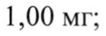

# Валериана + Мелисса лекарственная + Мята перечная — внутрь

- Препарат: Персен® (таблетки, покрытые оболочкой;)
- АТХ: N05CM
- Источник: ГРЛС, инструкция по медицинскому применению, РУ П N016317/01, файл от 2022-11-14 (https://grls.rosminzdrav.ru/Grls_View_v2.aspx?routingGuid=474eabd7-cc07-4a49-90d6-9a39902d743f)
- Распознано автоматически (OCR): 5 из 5 стр.
- Инструкция найдена по торговому наименованию: Персен®, РУ П N016317/01
- Сомнительных строк после OCR: 1 (см. раздел «Проверка распознавания»)

## Общие сведения

МИНИСТЕРСТВО ЗДРАВООХРАНЕНИЯ РОССИЙСКОЙ ФЕДЕРАЦИИ
| МИНЗАЛРА В РОССИИ ae na 63 ior ~ 070 "
ПО МЕДИЦИНСКОМУ ПРИМЕНЕНИЮ ЛЕКАРСТВЕННОГО ПРЕПАРАТА
СОГЛАСО ВАНО Персен®

Внимательно прочитайте эту инструкцию перед тем, как начать прием/использование этого лекарства.

® Сохраните инструкцию, она может потребоваться вновь.

e Еслиу Вас возникли вопросы, обратитесь к врачу.
Регистрационный номер Торговое наименование
Персен®

e Международное непатентованное или группировочное наименование
Валерианы корневищ экстракт+Мелиссы лекарственной травы экстракт+Мяты экстракт

## 3. Лекарственная форма

Таблетки, покрытые оболочкой
Таблетки, покрытые оболочкой

## 2. Состав

1 таблетка, покрытая оболочкой, содержит:
1 таблетка, покрытая оболочкой, содержит:
состав ядра таблетки:
- активные ингредиенты: валерианы лекарственной корневищ с корнями экстракт сухой ((4-7):1) - 50,00 мг (соответствует 35,00 мг нативного экстракта);
мелиссы лекарственной листьев экстракт сухой ((3-6):1) - 25,00 мг
(соответствует 17,50 мг нативного экстракта); мяты перечной листьев экстракт сухой ((3-6):1) - 25,00 мг (соответствует 17,50 мг нативного экстракта);
- вспомогательные вещества: лактозы моногидрат 99,50 мг, целлюлоза микрокристаллическая 50,00 мг, крахмал кукурузный 8,00 мг, кросповидон re:: 99275 5,00 мг, тальк 10,00 мг, кремния диоксид коллоидный 1,50 мг, магния стеарат 1,00 мг;
состав оболочки таблетки: гипромеллоза 7,021 мг, кармеллоза натрия 0,036 мг, повидон 3,614 мг, сахароза 66,988 мг, кремния диоксид коллоидный 4,341 мг, кальция карбонат 6,450 мг, краситель железа оксид коричневый 2,649 мг, титана диоксид 0,498 мг, глицерол 2,300 мг, тальк 15,923 мг, воск горный гликолиевый 0,180 мг.
Описание Круглые, двояковыпуклые темно-коричневые таблетки, покрытые оболочкой.
Фармакотерапевтическая группа Седативное средство растительного происхождения
Код ATX: NOSCM Фармакологические свойства
Препарат обладает успокаивающим и спазмолитическим действием.
Экстракт корневищ с корнями валерианы оказывает успокаивающее действие.
® Экстракт листьев мелиссы — успокаивающее и спазмолитическое.

Экстракт листьев мяты перечной — спазмолитическое, умеренное успокаивающее действие.

## 4.1. Показания к применению

Повышенная нервная возбудимость, бессонница, раздражительность.
Повышенная нервная возбудимость, бессонница, раздражительность.

## 4.3. Противопоказания

® повышенная чувствительность к компонентам препарата;
® повышенная чувствительность к компонентам препарата;

| ® дефицит лактазы, непереносимость лактозы, глюкозо-галактозная мальабсорбция;
* дефицит сахаразы/изомальтазы, непереносимость фруктозы;
„ артериальная гипотензия;
® холангит, желчнокаменная болезнь и другие заболевания желчевыводящих путей; пении ай eT |

МИНЗДРАВРОССИИ e беременность; [ ® период грудного вскармливания; | М 01530 Of - 07 0817
СОГЛАСО ВАНО e детский возраст до 12 лет. ee
= — SEz275 ee at ————— РР ЧИ ИА ЕАН ee ee ШИПЫ

## 4.3. С осторожностью

У пациентов с гастроэзофагеальной рефлюксной болезнью (ГЭРБ).
У пациентов с гастроэзофагеальной рефлюксной болезнью (ГЭРБ).

## 4.6. Применение при беременности и в период грудного вскармливания

Применение препарата при беременности и в период грудного вскармливания не изучено. Назначение препарата Персен® в период беременности (особенно в течение первого триместра) и грудного вскармливания возможно в случае, если предполагаемая польза для матери превышает потенциальный риск для плода или младенца. Ам
| МИНЗЛРАВРОССИИ Способ применения и дозы | |
| Амори 0708 17 Внутрь, запивая водой, независимо от приема пищи.
СОГЛАСОВАНО Взрослые и дети старше 12 лет: В
| при повышенной нервной возбудимости, раздражительности - по 2-3 таблетки, покрытые оболочкой, 2-3 раза в день;
| при бессоннице - по 2-3 таблетки, покрытые оболочкой, за 30 минут - 1 час перед сном.
® Максимальная дневная доза составляет 12 таблеток в день.
При прекращении лечения синдрома отмены не возникает.
Не следует применять препарат непрерывно более 1,5-2 месяцев.

## 4.8. Побочное действие

Возможны аллергические реакции (гиперемия, кожная сыпь, периферические отеки, аллергический дерматит), бронхоспазм, при длительном применении — запор.
Возможны аллергические реакции (гиперемия, кожная сыпь, периферические отеки, аллергический дерматит), бронхоспазм, при длительном применении — запор.
Если любые из указанных побочных эффектов усугубляются, или Вы заметили любые другие побочные эффекты, не указанные в инструкции, сообщите об этом врачу.

## 4.9. Передозировка

Однократный прием 20 г корневищ с корнями валерианы (примерно 104 таблетки, покрытые оболочкой, Персен®) может вызвать ощущение усталости, | спазмы в желудке, ощущение сжатия в груди, головокружение, дрожание рук, расширение зрачков, которые могут исчезнуть самостоятельно в течение 24 часов.
Однократный прием 20 г корневищ с корнями валерианы (примерно 104 таблетки, покрытые оболочкой, Персен®) может вызвать ощущение усталости, | спазмы в желудке, ощущение сжатия в груди, головокружение, дрожание рук, расширение зрачков, которые могут исчезнуть самостоятельно в течение 24 часов.
г* о 99223 об При признаках передозировки целесообразно провести промывание желудка и обратиться к врачу.

## 4.5. Взаимодействие с другими лекарственными средствами

Препарат усиливает действие снотворных средств и других лекарственных препаратов, угнетающих центральную нервную систему, гипотензивных препаратов (в частности, центрального действия), обезболивающих средств, что требует коррекции доз.

## 4.4. Особые указания

У пациентов с ГЭРБ возможно ухудшение симптомов.
У пациентов с ГЭРБ возможно ухудшение симптомов.
При сохранении симптомов заболевания или ухудшении состояния на фоне применения препарата, следует сообщить об этом лечащему врачу.
Не следует применять препарат непрерывно более 1,5-2 месяцев.

## 4.7. Влияние на способность управлять транспортными средствами, механизмами

В период лечения препаратом следует соблюдать осторожность при
® выполнении потенциально опасных видов деятельности, требующих повышенной концентрации внимания и быстроты психомоторных реакций
(управление транспортными средствами, работа с движущимися механизмами, работа диспетчера, оператора).

## 6.5. Форма выпуска

Таблетки, покрытые оболочкой
Таблетки, покрытые оболочкой
Первичная упаковка:
| По 10 таблеток, покрытых оболочкой, в блистер.
Вторичная упаковка:
По 2, 4, 6 или 8 блистеров вместе с инструкцией по применению в картонную пачку. ons нипоы шиваищинены

## 6.4. Условия хранения

MHH3 PAB POCCHH При температуре He выше 25 °С. МВ 070817
MHH3 PAB POCCHH При температуре He выше 25 °С. МВ 070817
Хранить в недоступном для детей месте. LOTT 1ACOBAHO a

## 6.3. Срок годности

2 года.
2 года.
| 99223 Не применять препарат после истечения срока годности.
Условия отпуска Без рецепта.
Производитель Держатель РУ: Сандоз д.д., Веровшкова 57, 1000 Любляна, Словения.
Произведено: Лек д.д., Веровшкова 57, г. Любляна, Словения.
Организация, принимающая претензии потребителей:
ЗАО «Сандоз», 125315, г. Москва, Ленинградский проспект, д. 72, кори. 3;
телефон: (495) 660-75-09; факс: (495) 660-75-10.
Руководитель группы поддержки зарегистрированных продуктов
ЗАО «Сандоз» Слизкова К.Ш.
В МИНЗДРАВРОССИЙ | Jj МЗ 070817 | СОГЛАСО ВАНО _|
| apo | | > | SKCHEPTHRMOTUET || | | = |ДЕЙСТВИТЕЛЕН ДЛЯ ДАННОЙ ~ tig | ВЕРСИИ ДОКУМЕНТА | В |
| обобобо00з "| 99225
## Проверка распознавания

Страницы-сканы распознаны автоматически. В 1 строках с дозировками цифры могли распознаться с ошибкой — сверьте с вырезкой из оригинала:

- стр. 2: «1,00 мг;» — повторное чтение: «1,00 мг;»  
  
