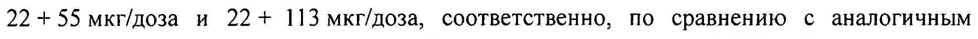
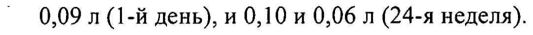
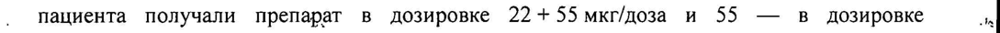
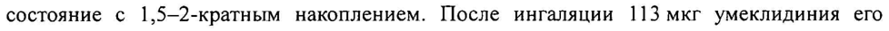
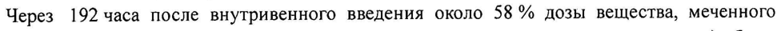
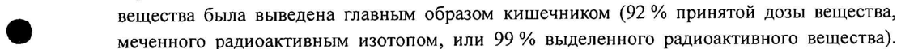

# Вилантерол + Умеклидиния бромид — ингаляц

- Препарат: Аноро Эллипта (порошок для ингаляций дозированный;)
- АТХ: R03AL03
- Источник: ГРЛС, инструкция по медицинскому применению, РУ ЛП-002548, файл от 2020-12-22 (https://grls.rosminzdrav.ru/Grls_View_v2.aspx?routingGuid=f37a8f24-5bf9-43f2-bf2e-d708c9116a09)
- Распознано автоматически (OCR): 13 из 13 стр.
- Инструкция к другому РУ того же препарата: ЛП-002548 (срок действия истёк, решение от 08.12.2020). Текст может быть старше действующего
- Сомнительных строк после OCR: 6 (см. раздел «Проверка распознавания»)
- Проверено вручную строк: 2

## Общие сведения

=. —— | | „МИНЗДРАВ РОССИИ bo МИНИСТЕРСТВО ЗДРАВООХРАНЕНИЯ РОССИЙСКОЙ ФЕДЕРАЦИИ
ЛП 002548 - 300714 | СОГЛАСОВАНО | | ИНСТРУКЦИЯ
| по применению лекарственного препарата для медицинского применения
| ® ® АНОРО ЭЛЛИПТА? / ANORO ELLIPTA | Регистрационный номер:
| Торговое наименование препарата: Аноро Эллипта® / Апого Ellipta®. :
| Группировочное наименование: вилантерол + умеклидиния бромид / vilanterol +
| umeclidinium bromide. | Лекарственная форма: порошок для ингаляций дозированный.
СОСТАВ на 1 дозу | компонентов 22 мкг + 55 мкг/доза 22 мкг + 113 мкг/доза
Вилантерола трифенатат 40 40 ` | микронизированный
| (в пересчете Ha 252 | 25?
| вилантерол)
10 12,5.
al Умеклидиния бромид 74,2 148,3 3 микронизированный ,
(в пересчете на | умеклидиний) 62,5? 125 :
a 12,5 | Примечания: | | 1. Для компенсации потерь при наполнении ячеек при производстве готового |
| препарата смесь вилантерола и вспомогательных веществ может закладываться в |
| готовый препарат с избытком до 8 %, смесь умеклидиния и вспомогательных веществ
— с избытком до 6 %. | | | | | С. 1 из 13
2. Указано номинальное количество действующего вещества, доставленное количество вилантерола составляет 22 мкг, умеклидиния — 55 мкг и 113 мкг, что соответствует указанным дозировкам.
ОПИСАНИЕ Пластиковый ингалятор с корпусом светло-серого цвета, красной крышкой мундштука и счетчиком доз, упакованный в контейнер из фольги, содержащий влагопоглощающий пакетик. Контейнер запечатан легко открывающейся фольгой. Ингалятор содержит два стрипа, каждый стрип состоит из 30 равномерно распределенных ячеек, каждая из которых содержит порошок белого цвета.
ФАРМАКОТЕРАПЕВТИЧЕСКАЯ ГРУППА Адреномиметики в комбинации с антихолинергиками.
Код ATX: RO3AL03.
@ ‚ ФАРМАКОЛОГИЧЕСКИЕ СВОЙСТВА Фармакодинамика
Механизм действия Препарат Аноро Эллипта® представляет собой комбинацию ингаляционного антагониста мускариновых холинорецепторов длительного действия и ингаляционного бета>- адреномиметика длительного действия (АХДД/ДДБА). После пероральной ингаляции оба соединения оказывают местное воздействие на дыхательные пути, вызывая бронходилатацию за счет различных механизмов действия.
Вилантерол относится к классу селективных агонистов бета›-адренергических рецепторов длительного действия (бета›-агонистов).
Фармакологические эффекты агонистов бета›-адренорецепторов, включая вилантерол, по крайней мере, частично связаны со стимуляцией внутриклеточной аденилатциклазы —
® фермента, который катализирует превращение аденозинтрифосфата (АТФ) в циклический 3*,5’-аденозинмонофосфат (циклический АМФ). Повышение уровня циклического АМФ приводит к расслаблению гладкой мускулатуры бронхов и угнетению высвобождения из клеток (в первую очередь из тучных клеток) медиаторов реакций гиперчувствительности немедленного типа.
Умеклидиний является антагонистом мускариновых рецепторов длительного действия
(также называемый антихолинергиком). Он представляет собой производное хинуклидина, являющееся антагонистом мускариновых рецепторов, который действует на мускариновые холинергические рецепторы различных подтипов. Умеклидиний — оказывает бронхорасширяющее действие путем конкурентного ингибирования связывания ацетилхолина с мускариновыми ацетилхолиновыми рецепторами гладкой мускулатуры дыхательных путей. При проведении доклинических исследований на моделях in vilro данное соединение демонстрирует медленную обратимость действия на человеческие мускариновые рецепторы подтипа M3, а на моделях м vivo была продемонстрирована длительность воздействия препарата после введения непосредственно в легкие.
С. 2 из 13 Фармакодинамические эффекты В двух плацебо-контролируемых клинических исследованиях эффективности наблюдалось увеличение объема форсированного выдоха за первую секунду (ОФВ!) после первой дозы комбинации вилантерола и умеклидиния в первый день. Данный показатель увеличился на 0,11 и 0,13 л через 15 минут после применения препарата в дозировке 22 + 55 мкг/доза и 22+ 113 мкг/доза, соответственно, по сравнению с аналогичным показателем при применении плацебо (в обоих случаях р<0,001). Разница между исходным показателем и пиковым OMB), определяемая в течение 6 часов после применения препарата, в первый день и на 24-й неделе эксперимента составила 0,27 и 0,32 л, соответственно, при применении препарата B дозировке 22 + 55 мкг/доза, и 0,31 и 0,34 л, соответственно, при применении препарата в дозировке 22 + 113 мкг/доза. При применении плацебо аналогичные показатели составили 0,11 и
° 0,09 л (1-й день), и 0,10 и 0,06л (24-я неделя).
Влияние комбинации вилантерола и умеклидиния на длительность интервала ОТ оценивали в плацебо и моксифлоксацин-контролируемом исследовании. 103 здоровых
® добровольца применяли комбинацию вилантерола и умеклидиния на протяжении 10 дней один раз в сутки в дозировке 22+ 113 мкг/доза или 88+ 452 мкг/доза. После многократного применения данного препарата не наблюдалось клинически значимого влияния на длительность интервала ОТ (корригированного по методу Фредерика).
Кроме того, не наблюдалось клинически значимого влияния комбинации вилантерола и умеклидиния на сердечный ритм при 24-часовом холтеровском мониторировании ЭКГ у 108 пациентов с ХОБЛ, получавших данный препарат на протяжении 6 месяцев (из них 53
‚ пациента получали препарат в дозировке 22+ 55 мкг/доза и 55 — в дозировке №
.° 22'+ 113 мкг/доза один раз в сутки), а также у 226 пациентов, получавших препарат в дозировке 22 + 113 мкг/доза один раз в сутки на протяжении 12 месяцев.

## 5.2. Фармакокинетика

При ингаляционном применении комбинации умеклидиния и — вилантерола фармакокинетика каждого соединения была сходна с таковой, наблюдаемой при
При ингаляционном применении комбинации умеклидиния и — вилантерола фармакокинетика каждого соединения была сходна с таковой, наблюдаемой при
@ применении каждого действующего вещества по отдельности. По этой причине фармакокинетика каждого вещества будет рассмотрена отдельно.
Всасывание У здоровых добровольцев после ингаляции вилантерола средняя максимальная концентрация (Cmax) достигалась через 5-15 минут. Абсолютная биодоступность ингаляционного вилантерола, в среднем, составляла 27% с учетом весьма незначительного всасывания вещества в полости рта. После повторных ингаляций вилантерола через 6 дней достигалось равновесное состояние с 2,4-кратным накоплением.
У здоровых добровольцев после ингаляции умеклидиния Cmax достигалась через 5— 15 минут. Абсолютная биодоступность ингаляционного умеклидиния, в среднем, составляла 13 % с учетом весьма незначительного всасывания вещества в полости рта.
После повторных ингаляций умеклидиния через 7-10 дней достигалось равновесное состояние с 1,5-—2-кратным накоплением. После ингаляции 113 мкг умеклидиния его системная экспозиция была приблизительно в два раза выше таковой, наблюдаемой после ингаляции препарата в дозировке 55 мкг.
С. 3 из 13 Распределение После внутривенного введения вилантерола здоровым добровольцам средний объем распределения в равновесном состоянии составлял 165 л. Связывание с белками плазмы | крови человека in vilro, в среднем, равно 94 %. |
После внутривенного введения умеклидиния здоровым добровольцам средний объем распределения составлял 86 л. Связывание с белками плазмы крови человека in Vitro, в среднем, равно 89 %.
Метаболизм Исследования in vitro показали, что вилантерол метаболизируется главным образом под действием изофермента СУРЗА4 системы цитохрома Р450, и что он является субстратом переносчика Р-гликопротеина (P-gp). Основным путем метаболизма является Oдеалкилирование с образованием ряда метаболитов, обладающих существенно более низкой бета!- и бета›-адреномиметической активностью. Метаболический профиль плазмы крови, определенный в организме человека в ходе исследования с использованием
® радиоактивных изотопов после перорального приема вилантерола, согласуется с высоким метаболизмом «первого прохождения». Системная экспозиция метаболитов незначительна.
Исследования in vitro показали, что умеклидиний метаболизируется главным образом под действием изофермента CYP2D6 системы цитохрома Р450, и что он является субстратом переносчика P-gp. Основным путем метаболизма умеклидиния является окисление
(гидроксилирование, О-деалкилирование) с последующей конъюгацией
(глюкуронирование и т.д.), приводящей к образованию ряда метаболитов с более низкой
| фармакологической активностью, либо метаболитов, фармакологическая активность , которых не установлена. Системная экспозиция таких метаболитов низкая. |
Доступные фармакокинетические данные, полученные при исследовании на здоровых добровольцах и пациентах с ХОБЛ, указывают на отсутствие изменений системной экспозиции (Cpa, и средней площади под фармакокинетической кривой (AUC)) и прогнозируемой экспозиции при изучении популяционной фармакокинетики вилантерола
Ss и умеклидиния при их совместном применении по сравнению с аналогичными показателями, полученными при применении обоих компонентов по отдельности.
При совместном применении сильного ингибитора изофермента СУРЗА4 — кетоконазола
(400 мг) наблюдалось повышение средних AUC.) и Cmax вилантерола Ha 65 и 22%, соответственно. Увеличение экспозиции вилантерола не приводило к усилению системных эффектов, характерных для бета-агонистов: влияние на частоту сердечных сокращений, содержание калия в крови или интервал ОТ (корригированный по методу
Фредерика).
Как умеклидиний, так и вилантерол являются субстратами P-gp. У здоровых добровольцев определяли влияние умеренного ингибитора переносчика P-gp верапамила (240 мг один раз в сутки) на фармакокинетику вилантерола и умеклидиния в равновесном состоянии.
Влияния верапамила Ha Cmax вилантерола или умеклидиния не наблюдалось. Отмечалось приблизительно 1,4-кратное повышение AUC умеклидиния, при этом AUC вилантерола не изменилась.
С. 4 из 13 Выведение Плазменный клиренс вилантерола после внутривенного введения составил 108 л/ч. После перорального приема вилантерола, меченного радиоактивным изотопом, баланс масс показал, что 70 % радиоактивного вещества выводилось почками и 30 % — кишечником. |
Выведение вилантерола главным образом происходило метаболическим путем с последующей экскрецией метаболитов почками и кишечником. После ингаляций вилантерола в течение 10 дней период полувыведения из плазмы составил, в среднем, 11 ч.
Плазменный клиренс умеклидиния после внутривенного введения составил 151 л/ч.
Через 192 часа после внутривенного введения около 58 % дозы вещества, меченного радиоактивным изотопом (или 73% выделенного радиоактивного вещества) было выведено кишечником, что указывает на секрецию данного соединения в желчь. Почками было выведено 22% дозы вещества, меченного радиоактивным изотопом (27% выделенного радиоактивного вещества) через 168 часов. Через 168 часов после перорального приема препарата здоровыми мужчинами основная масса радиоактивного |
® вещества была выведена главным образом кишечником (92 % принятой дозы вещества, меченного радиоактивным изотопом, или 99 % выделенного радиоактивного вещества).
При пероральном приеме почками выводится менее | % дозы вещества (1 % выделенного радиоактивного вещества), что указывает на весьма незначительное всасывание при данном пути введения препарата. После повторных ингаляций умеклидиния в течение 10 дней период полувыведения из плазмы составил, в среднем, 19 ч, при этом от 3 до 4 % неизмененного вещества было выведено почками в равновесном состоянии.
Особые группы пациентов Пациенты пожилого возраста
Популяционный фармакокинетический анализ показал сходство фармакокинетики вилантерола и умеклидиния, определенной у пациентов с ХОБЛ в возрастной группе 65 лет и старше и в возрастной группе младше 65 лет.
Пациенты с нарушение функции почек ©® При исследовании пациентов с тяжелым нарушением функции почек не было получено данных, указывающих на увеличение системной экспозиции вилантерола или умеклидиния (Cmax и AUC). Отсутствуют признаки изменений связывания с белками у пациентов с нарушением функции почек по сравнению со здоровыми добровольцами.
Нарушение функции печени При исследовании пациентов с умеренным нарушением функции печени не было получено данных, указывающих на увеличение системной экспозиции вилантерола или умеклидиния (Cmax и AUC). Отсутствуют признаки изменений связывания с белками у пациентов с нарушением функции печени по сравнению со здоровыми добровольцами.
Исследований комбинации вилантерола и умеклидиния у пациентов с тяжелым | нарушением функции печени не проводилось.
Другие группы пациентов Данные популяционного анализа фармакокинетики показали отсутствие необходимости коррекции дозы вилантерола или умеклидиния в зависимости от возраста, расовой и
С. 5 из 13 половой принадлежности, применения ингаляционных глюкокортикостероидов или массы тела. При исследовании пациентов со слабой метаболической активностью изофермента
CYP2D6 не было получено данных, указывающих на клинически значимое влияние генетического полиморфизма изофермента CYP2D6 на системную экспозицию умеклидиния.

## 4.1. Показания к применению

’ Препарат Аноро Эллипта® применяется в качестве поддерживающей бронхорасширяющей терапии, направленной на облегчение симптомов хронической обструктивной болезни легких (ХОБЛ).
’ Препарат Аноро Эллипта® применяется в качестве поддерживающей бронхорасширяющей терапии, направленной на облегчение симптомов хронической обструктивной болезни легких (ХОБЛ).

## 4.3. Противопоказания

Препарат Аноро Эллипта® противопоказан:
Препарат Аноро Эллипта® противопоказан:
® пациентам, имеющим в анамнезе тяжелые аллергические реакции на белок молока
® или повышенную чувствительность к действующим веществам или любому другому компоненту, входящему в состав препарата;
» детям в возрасте до 18 лет.

## 4.3. С осторожностью

После применения симпатомиметиков и антагонистов мускариновых рецепторов, в том числе и препарата Аноро Эллипта®, со стороны сердечно-сосудистой системы могут наблюдаться такие нежелательные реакции, как аритмия (например, фибрилляция , предсердий и тахикардия). В связи с этим, пациентам с тяжелыми формами сердечно- - сосудистых заболеваний препарат Аноро Эллипта® следует назначать с осторожностью.
После применения симпатомиметиков и антагонистов мускариновых рецепторов, в том числе и препарата Аноро Эллипта®, со стороны сердечно-сосудистой системы могут наблюдаться такие нежелательные реакции, как аритмия (например, фибрилляция , предсердий и тахикардия). В связи с этим, пациентам с тяжелыми формами сердечно- - сосудистых заболеваний препарат Аноро Эллипта® следует назначать с осторожностью.
Учитывая антимускариновую активность данного препарата, его следует с осторожностью назначать пациентам с закрытоугольной глаукомой или задержкой мочи.

## 4.6. Применение при беременности и в период грудного вскармливания

® ВСКАРМЛИВАНИЯ Фертильность Данные по влиянию препарата Аноро Эллипта® на фертильность человека отсутствуют. В доклинических исследованиях воздействия вилантерола или умеклидиния на фертильность не обнаружено.
Беременность Данные по применению комбинации вилантерола и умеклидиния у беременных женщин отсутствуют или ограничены. В доклинических исследованиях была выявлена | репродуктивная токсичность при ингаляционном применении вилантерола.
Применение препарата Аноро Эллипта® у беременных женщин допустимо только в том | случае, если потенциальная польза для матери превышает возможный риск для плода.
Период грудного вскармливания Данные об экскреции вилантерола или умеклидиния в грудное молоко человека отсутствуют. Однако другие бета2-агонисты определяются в грудном молоке. Риск
С. 6 из 13 ; | проникновения препарата вместе с молоком в организм новорожденного или ребенка не может быть исключен.
Принимая во внимание соотношение пользы терапии для матери и грудного | вскармливания для ребенка, необходимо принять решение либо об отмене препарата, либо о прекращении грудного вскармливания.

## 4.2. Способ применения и дозы

Препарат Аноро Эллипта® предназначен только для ингаляционного применения.
Препарат Аноро Эллипта® предназначен только для ингаляционного применения.
Препарат Аноро Эллипта® следует применять ежедневно в одно и то же время один раз в сутки.
Рекомендуемая доза препарата Аноро Эллипта®: одна ингаляция 22 мкг + 55 мкг/доза один ' раз в сутки.
Было обнаружено, что у некоторых пациентов применение препарата Аноро Эллипта® в дозировке 22 мкг + 113 мкг/доза один раз в сутки оказывает дополнительное
@ преимущество в отношении влияния на функцию легких и частоту применения препаратов неотложной помощи. |
| Максимальная доза составляет одну ингаляцию препарата Аноро Эллипта® в дозировке | 22 + 113 мкг/доза один раз в сутки.
Особые группы пациентов Дети Данный препарат не применяется для лечения пациентов младше 18 лет, принимая во внимания показания для его назначения.
Пациенты поэсилого возраста Пациентам старше 65 лет коррекции дозы не требуется (см. раздел «Фармакологические свойства»).
Пациенты с нарушением функции почек ©® Пациентам с нарушением функции почек коррекции дозы не требуется (см. раздел
«Фармакологические свойства»).
Пациенты с нарушением функции печени Пациентам с нарушением функции печени легкой или умеренной степени тяжести коррекции дозы не требуется. Исследований по применению комбинации вилантерола и умеклидиния на пациентах с тяжелым нарушением функции печени не проводилось (см.
раздел «Фармакологические свойства»).
Рекомендации по применению | При первом использовании ингалятора Эллинта® нет необходимости в проверке правильности его работы или специальной подготовки ингалятора к эксплуатации. Просто последовательно соблюдайте рекомендации по применению, указанные ниже.
Ингалятор Эллипта® упакован в контейнер, содержащий влагопоглощающий пакетик с силикагелем, который не предназначен для еды или ингаляций. Данный пакетик следует утилизировать.
С. 7 из 13 ООО Когда Вы достаете ингалятор из контейнера, его крышка находится в закрытом положении.
Не открывайте ее до тех пор, пока Вы не будете готовы к приему препарата.
Ниже приведены подробные инструкции использования ингалятора Эллиптае:
I. Прочитайте следующую информацию перед использованием
При открытии и закрытии крышки ингалятора Эллинта® без приема лекарственного препарата происходит потеря одной дозы. Эта доза остается закрытой внутри ингалятора, но она будет недоступна для приема. Невозможно случайно получить большую дозу или двойную дозу за одну ингаляцию.
pete at me in omg | Крышка . i 3 | | < Одна доза лекарственного
| | препарата готовак \ ——_—_—_—Eceanmeneees ee ee ee i
| Счетчик доз | | | ингаляции после ЕВРЕЕВ НЕЕ каждого открытия |
®* | Счетчик доз показывает, сколько доз | ЗЕ. ПИ:
| лекарственного препарата осталось в | В а
| ингаляторе. | ей а.
| Перед началом использования i A / ff | ингалятора счетчик доз показывает | 7 (
{ } 7 1 | число 30. р *f \ \ | При каждом открытии крышки количество | | SX }
‚ доз уменьшается на 1. | Hl > | | — | Когда остается менее 10 доз, половина
| счетчика становится красной. | i © | ‘
| После того, kak израсходована последняя | 174
| доза препарата, половина счетчика i y,
| выделена красным цветом, счетчик | :
‚ показывает цифру 0. Это означает, что W а
' ингалятор пуст. 7 \ ре.
® | Если Вы откроете крышку после этого, YS e
‚ счетчик доз станет полностью красным. ' : —
Na re tn en Il. Подготовка дозы Не открывайте крышку, пока Вы не будете готовы к приему препарата.
Не встряхивайте ингалятор.
1. Опустите крышку вниз до щелчка.
2. Доза препарата готова к ингаляции, и в подтверждение этого счетчик доз уменьшает число доз на единицу. |
3. Если счетчик доз не уменьшил число доз после того, как Вы услышали щелчок, то ингалятор не готов к подаче дозы лекарственного препарата. В этом случае следует обратиться по телефону или адресу, указанному в подразделе «За дополнительной информацией обращаться».
С. 8 из 13
4. Никогда не встряхивайте ингалятор.
т. ый 1 | pe’ } | АЙ, р не и 24 t alk - ‚ Мундштук ,
| ыы | me у _ | = —— EEE | ЕЙ | | Вентиляционное отверстие
F \ =e _ + Щ . аи ыы : .
| К 1 == — A | eS Pp)
| SS 3 | | V7 | | ¢ \ | LY AVA — | . Z | See
* NALS им Ш. — Ингаляция лекарственного препарата
1. Удерживая ингалятор на некотором расстоянии ото рта, сделайте выдох максимальной глубины. Не выдыхайте в ингалятор.
2. Поместите мундштук между губами и плотно обхватите его губами. Не закрывайте
`° пальцами вентиляционное отверстие. ' Se ая OS = == Е м <
| :
ЖЕ | | | * : !
i Mig —— Cy, Дм \ ' _] Губы должны точно "|
| IY : ' повторять форму 1 :
м & VA, | мундштука ингалятора , ; } | +. AX а К |
PAT 5 | [2 и г | PABA | NASON ИНЬ
3. Сделайте один глубокий, долгий, равномерный вдох. Задержите дыхание насколько возможно (по крайней мере, на 3—4 секунды).
4. Уберите ингалятор изо рта. |
5. Медленно и спокойно выдохните.
С. 9 из 13 При правильном использовании ингалятора Вы можете не почувствовать вкус или не ощутить поступление лекарственного препарата.
ГУ. Закрытие ингалятора Если Вы хотите протереть мундштук перед закрытием крышки, используйте сухую бумажную салфетку.
Поднимите крышку до упора, добившись полного закрытия мундштука.
Ё=——— т ee | | Е — | | | | i < | ® ™~ | ae о | :
| | Y | \ | | \ \/ | | | zz :
eee ner po See eee tec ПОБОЧНОЕ ДЕЙСТВИЕ
Профиль безопасности комбинации вилантерола и умеклидиния основан на данных клинических исследований, в которых участвовали 2 454 пациента с ХОБЛ, получившие во время исследования не менее одной дозы комбинации вилантерола и умеклидиния. Все пациенты применяли препарат один раз в сутки; из них | 124 получили препарат в
©® дозировке 22 + 55 мкг/доза и 1 330 — в дозировке 22 + 113 мкг/доза.

## 4.8. Побочное действие

, представленные ниже, перечислены в соответствии с поражением органов и систем органов и частотой встречаемости. Частота встречаемости
, представленные ниже, перечислены в соответствии с поражением органов и систем органов и частотой встречаемости. Частота встречаемости
| определяется следующим образом: очень часто (> 1/10), часто (> 1/100 и < 1/10), нечасто
(> 1/1000 и < 1/100), редко (> 1/10 000 и <1/ 000), очень редко (< 1/10 000, включая | отдельные случаи). Категории частоты были сформированы на основании клинических исследований препарата. |
Частота встречаемости нежелательных реакций |
Инфекционные и паразитарные заболевания ,
Часто: фарингит. | Нарушения co стороны сердца
Нечасто: фибрилляция предсердий, тахикардия.
Нарушения со стороны дыхательной системы, органов грудной клетки и | средостения
Часто: кашель.
С. 10 из 13 Нарушения со стороны желудочно-кишечного тракта
Часто: запор, сухость во рту.

## 4.9. Передозировка

При проведении клинических исследований не было получено данных о передозировке комбинацией вилантерола и умеклидиния.
При проведении клинических исследований не было получено данных о передозировке комбинацией вилантерола и умеклидиния.
Симптомы Передозировка препаратом Аноро Эллипта® может вызывать развитие симптомов и признаков, обусловленных действием отдельных компонентов препарата, включая известные нежелательные реакции, развивающиеся при воздействии антагонистов мускариновых рецепторов (например, сухость во рту, нарушения аккомодации и тахикардия) и признаки, наблюдаемые при передозировке другими бета2-агонистами
(например, тремор, головная боль и тахикардия).
Лечение ® В случае передозировки требуется симптоматическая терапия и, при необходимости, за больным обеспечивается соответствующее наблюдение. Дальнейшее ведение больных в случае передозировки необходимо проводить в соответствии с клиническими показаниями.

## 4.5. Взаимодействие с другими лекарственными средствами

Бета-адреноблокаторы могут ослаблять эффекты бета»-агонистов или действовать в качестве антагонистов препаратов этой группы, в том числе и вилантерола. Следует о избегать одновременного применения неселективных и селективных бета-блокаторов, исключая случаи наличия веских оснований для их совместного применения.
Вилантерол — компонент препарата Аноро Эллипта®, подвергается быстрому метаболизму главным образом в желудочно-кишечном тракте и печени с помошью изофермента СУРЗА4 системы цитохрома Р450.
При одновременном назначении препарата с сильными ингибиторами изофермента
® СУРЗА4 (например, кетоконазолом) следует соблюдать осторожность, так как существует возможность увеличения системной экспозиции вилантерола, что в свою очередь может привести к повышению риска развития нежелательных реакций (см. раздел
«Фармакологические свойства»).

## 4.4. Особые указания

Исследований по применению препарата Аноро Эллипта® у пациентов с бронхиальной астмой не проводилось, поэтому использовать указанный препарат для терапии в данной группе больных не рекомендуется.
Исследований по применению препарата Аноро Эллипта® у пациентов с бронхиальной астмой не проводилось, поэтому использовать указанный препарат для терапии в данной группе больных не рекомендуется.
Препарат Аноро Эллипта® предназначен для применения в качестве поддерживающей терапии ХОБЛ. Не следует применять данный препарат для купирования острых симптомов, т.е. в качестве терапии неотложной помощи при остром эпизоде бронхоспазма. |
Для купирования острых симптомов необходимо использовать бронходилататор короткого действия. Увеличение частоты применения бронходилататоров короткого действия с
С. 11 из 13 целью купирования симптомов свидетельствует об ухудшении контроля над заболеванием, в этом случае пациенту требуется консультация врача. |
Как и при других видах ингаляционной терапии, применение препарата Аноро Эллипта® может вызвать парадоксальный бронхоспазм, который может быть опасным для жизни.
При развитии парадоксального бронхоспазма необходимо прекратить лечение препаратом, и при необходимости может быть назначена альтернативная терапия.
Препарат Аноро Эллипта® предназначен для поддерживающего лечения больных ХОБЛ. В связи с тем обстоятельством, что в общей популяции ХОБЛ существенно преобладают больные в возрасте старше 40 лет, при назначении препарата пациентам до 40 лет требуется спирометрическое подтверждение диагноза ХОБЛ.

## 4.7. Влияние на способность управлять транспортными средствами, механизмами

МЕХАНИЗМАМИ Исследования по изучению влияния препарата Аноро Эллипта® на способность к р вождению автотранспорта и работе с механизмами не проводились.

## 6.5. Форма выпуска

Порошок для ингаляций дозированный, 22 мкг + 55 мкг/доза, 22 мкг + 113 мкг/доза.
Порошок для ингаляций дозированный, 22 мкг + 55 мкг/доза, 22 мкг + 113 мкг/доза.
По 30 доз в пластиковый ингалятор с корпусом светло-серого цвета, красной крышкой мундштука и счетчиком доз. Ингалятор содержит два алюминиевых ламинированных стрипа, каждый из которых состоит из 30 ячеек, которые содержат порошок белого цвета.
Ингалятор помещен в многослойный контейнер из алюминиевой фольги, содержащий влагопоглощающий пакетик. Контейнер запечатан легко открывающейся фольгой. По | контейнеру вместе с инструкцией по применению в картонной пачке.

## 6.3. Срок годности

Невскрытый алюминиевый контейнер: 2 года.
Невскрытый алюминиевый контейнер: 2 года.
Вскрытый алюминиевый контейнер: 6 недель.
® Не применять после истечения срока годности, указанного на упаковке.

## 6.4. Условия хранения

Хранить при температуре не выше 25°С.
Хранить при температуре не выше 25°С.
Хранить в недоступном для детей месте.
УСЛОВИЯ ОТПУСКА По рецепту.
ПРОИЗВОДИТЕЛЬ «Глаксо Оперэйшенс Великобритания Лимитед» / Glaxo Operations UK Limited
SG12 ODJ, Хертфордшир, Bsa, Прайори стрит, Великобритания / Priory Street, Ware,
Hertfordshire, SG12 001, United Kingdom

С. 12 из 13 НАИМЕНОВАНИЕ И АДРЕС ЮРИДИЧЕСКОГО ЛИЦА, НА ИМЯ КОТОРОГО |
ВЫДАНО РЕГИСТРАЦИОННОЕ УДОСТОВЕРЕНИЕ ЗАО «ГлаксоСмитКляйн Трейдинг»
119180, г. Москва, Якиманская наб.., д. 2
За дополнительной информацией обращаться:
ЗАО «ГлаксоСмитКляйн Трейдинг»
121614, г. Москва, ул. Крылатская, д. 17, корп. 3, эт. 5
Бизнес-Парк «Крылатские холмы»
Тел.: (495) 777 89 00; факс: (495) 777 89 04 ое обще а
Менеджер отдела oe SI > >“ Ярыгина Л.О.
м SG < ‚= регуляторных отношений в бахобо =
ЗАО «ГлаксоСмитКляйн Трейдинг» 5 : \ Trading "® 3 З
< \® и, . ony mens sf < % Moc, а .
С. 13 из 13
## Проверка распознавания

Страницы-сканы распознаны автоматически. В 6 строках с дозировками цифры могли распознаться с ошибкой — сверьте с вырезкой из оригинала:

- стр. 3: «22 + 55 мкг/доза и 22+ 113 мкг/доза, соответственно, по сравнению с аналогичным» — низкая уверенность: «22» (68)  
  
- стр. 3: «° 0,09 л (1-й день), и 0,10 и 0,06л (24-я неделя).» — низкая уверенность: «0,09» (0)  
  
- стр. 3: «‚ пациента получали препарат в дозировке 22+ 55 мкг/доза и 55 — в дозировке №» — низкая уверенность: «22+» (78), «55» (78)  
  
- стр. 3: «состояние с 1,5-—2-кратным накоплением. После ингаляции 113 мкг умеклидиния его» — низкая уверенность: «1,5-—2-кратным» (41), «113» (47)  
  
- стр. 5: «Через 192 часа после внутривенного введения около 58 % дозы вещества, меченного» — низкая уверенность: «192» (77)  
  
- стр. 5: «® вещества была выведена главным образом кишечником (92 % принятой дозы вещества,» — повторное чтение: «ee была выведена равным образом кмчником ОС притоп Bemeenay»  
  