# Вилантерол + Умеклидиния бромид + Флутиказона фуроат — ингаляц

- Препарат: ТРЕЛЕДЖИ ЭЛЛИПТА (порошок для ингаляций дозированный;)
- АТХ: R03AL08
- Источник: ГРЛС, инструкция по медицинскому применению, РУ ЛП-006961, файл от 2023-01-16 (https://grls.rosminzdrav.ru/Grls_View_v2.aspx?routingGuid=9c28322b-b070-41e6-bddd-0031bb67cd37)
- Распознано автоматически (OCR): 24 из 24 стр.
- Инструкция к другому РУ того же препарата: ЛП-006961 (национальное РУ, переоформленное по правилам ЕАЭС, решение от 22.12.2022). Текст может быть старше действующего
- Сомнительных строк после OCR: 12 (см. раздел «Проверка распознавания»)
- Проверено вручную строк: 2

## Общие сведения

МИНИСТЕРСТВО ЗДРАВООХРАНЕНИЯ POC МИНЗДРАВ РОССИИ
ИНСТРУКЦИЯ ЛП- 006961-21042 1 ПО МЕДИЦИНСКОМУ ПРИМЕНЕНИЮ JIEKARCTBEHHONQ@dIPRIGAPATA
ТРЕЛЕДЖИ ЭЛЛИПТА / TRELEGY ELLIPTA Регистрационный номер:
Торговое наименование: Треледжи Эллипта.
Международное непатентованное или группировочное наименование:
вилантерол + умеклидиния бромид + флутиказона фуроат.

## 3. Лекарственная форма

порошок для ингаляций дозированный.
порошок для ингаляций дозированный.

## 2. Состав

1 доза содержит:
1 доза содержит:
Количество в одной Наименование компонентов и ячейке, мкг
Стрип с вилантеролом и умеклидинием!
Действующие вещества Вилантерола трифенатат микронизированный? 40
(в пересчете на вилантерол) 25 Умеклидиния бромид микронизированный? 74,2 |
(в пересчете на умеклидиний) 62,5 Вспомогательные вещества
© Магния стеарат Лактозы моногидрат до 12,5 мг
Стрип с флутиказона фуроатом!
| Действующее вещество Флутиказона фуроат микронизированный?
Вспомогательное вещество Лактозы моногидрат до 12,5 мг
Примечания:
1. Для компенсации потерь во время наполнения ячеек смесь флутиказона фуроата и вспомогательных веществ может закладываться в готовый препарат с избытком до 8 %, смесь вилантерола, умеклидиния и вспомогательных веществ — с избытком до 8 %.
ра Указано номинальное количество действующего вещества, доставляемое количество вилантерола составляет 22 мкг, умеклидиния — 55 мкг, флутиказона фуроата — 184 мкг, что соответствует указанной дозировке.
а С. 1 из 24 14 fis @ @ 190460 J МИНЗДРАВ РОССИИ
ЛП- 006961-210421 ОПИСАНИЕ _ СОГЛАСОВАНО
Пластиковый ингалятор с корпусом светло-серого цвета, бежевой крышкой мундштука и счетчиком доз, упакованный в многослойный контейнер из фольги, содержащий пакетик с осушителем. Контейнер запечатан отрывной крышкой. Ингалятор содержит два стрипа, каждый стрип состоит из 14 или 30 равномерно распределенных ячеек, каждая из которых содержит порошок белого цвета.
ФАРМАКОТЕРАПЕВТИЧЕСКАЯ ГРУППА Препараты для лечения обструктивных заболеваний дыхательных путей, адреномиметики в комбинации с антихолинергическими средствами, включая тройные комбинации с глюкокортикостероидными средствами.
Код ATX: RO3AL08.
ФАРМАКОЛОГИЧЕСКИЕ СВОИСТВА . Фармакодинамика
Механизм действия Вилантерол, умеклидиний и флутиказона фуроат относятся к трем различным классам лекарственных препаратов: селективный бета2-адреномиметик длительного действия
(ДДБА), антагонист мускариновых рецепторов длительного действия (также обозначаемый как ДДАХ или антихолинергическое средство) и синтетический глюкокортикостероид соответственно.
Вилантерол Вилантерол является селективным ДДБА. Фармакологические эффекты агонистов бета2-адренорецепторов, включая вилантерол, по крайней мере частично связаны со стимуляцией внутриклеточной аденилатциклазы — фермента, который катализирует превращение аденозинтрифосфата (АТФ) в циклический-3’,5’-аденозинмонофосфат te (циклический АМФ). Повышение концентрации циклического АМФ приводит к расслаблению гладкой мускулатуры бронхов и угнетению высвобождения из клеток (в первую очередь из тучных клеток) медиаторов реакций гиперчувствительности немедленного типа.
Умеклидиний Умеклидиний является неспецифическим антагонистом мускариновых рецепторов длительного действия (также называемый антихолинергиком). Умеклидиний оказывает бронхорасширяющее действие путем конкурентного ингибирования связывания ацетилхолина с мускариновыми ацетилхолиновыми рецепторами гладкой мускулатуры дыхательных путей. При проведении доклинических исследований на моделях in vitro данное соединение демонстрирует медленную обратимость действия в отношении мускариновых рецепторов подтипа мз человека, а на моделях in vivo была показана длительность воздействия препарата после введения непосредственно в легкие.
С. 2 из 24 4того?
130483 en Cee | МИНЗДРАВ РОССИИ ЛП - 006961-210421

Флутиказона фуроат

_ Флутиказона фуроат является глюкокорти _с выраженным _} противовоспалительным действием. Точный механизм влияния флутиказона фуроата на симптомы бронхиальной астмы и ХОБЛ неизвестен. Глюкокортикостероиды продемонстрировали широкий спектр действия на различные типы клеток (например, эозинофилы, макрофаги, лимфоциты) и медиаторы (например, цитокины и хемокины), участвующие в процессе воспаления.
Фармакодинамические эффекты Влияние на сердечно-сосудистую систему
Влияние препарата Треледжи Эллипта на длительность интервала ОТ не оценивалось в подробном исследовании влияния на интервал ОТ (ТОТ). В исследованиях ТОТ с применением комбинации вилантерола с флутиказона фуроатом и вилантерола с умеклидинием не выявлено клинически значимое влияние на интервал ОТ при применении препарата Треледжи Эллипта в терапевтических дозах.

w He выявлено клинически значимое влияние Ha интервал QTc при оценке ЭКГ централизованным способом у 1519 пациентов с бронхиальной астмой, применявших препарат Треледжи Эллипта в течение периода до 24 недель, и в подгруппе из 364 пациентов, применявших препарат в течение периода до 52 недель.

Клиническая эффективность и безопасность
Безопасность и эффективность препарата Треледжи Эллипта были оценены у 2436 взрослых пациентов с неадекватно контролируемой на фоне текущей комбинированной терапии (ингаляционные глюкокортикостероиды плюс ДДБА)
бронхиальной астмой в рандомизированном многоцентровом двойном слепом активно контролируемом клиническом исследовании продолжительностью от 24 до 52 недель
(исследование 205715, CAPTAIN). В исследовании была оценена эффективность препарата
Треледжи Эллипта в отношении функции легких, среднегодовой частоты развития умеренных и тяжелых обострений бронхиальной астмы, контроля симптомов
© бронхиальной астмы и качества жизни пациента, связанного с состоянием здоровья, при проведении сравнения с применением комбинации вилантерола и флутиказона фуроата.
Первичной конечной точкой являлось изменение минимального объема форсированного выдоха за первую секунду (ОФВ\) от исходного уровня на 24-й неделе. Ключевой вторичной конечной точкой являлась среднегодовая частота умеренных/тяжелых обострений бронхиальной астмы.
Изменение минимального ОФВ! относительно исходного уровня на 24-й неделе показало статистически значимые улучшения функции легких при применении препарата Треледжи
Эллипта в дозировке 22 мкг + 55 мкг + 92 мкг по сравнению с комбинацией вилантерола и флутиказона фуроата в дозировке 22 мкг + 92 мкг и при применении препарата Треледжи
Эллипта в дозировке 22 мкг + 55 мкг + 184 мкг по сравнению с комбинацией вилантерола и флутиказона фуроата в дозировке 22 мкг + 184 мкг.
Умеренные/тяжелые обострения бронхиальной астмы оценивали на протяжении 52недельного периода терапии. В сводном анализе среднегодовая частота умеренных/тяжелых обострений была ниже при применении препарата Треледжи Эллипта 130483 из
| МИНЗДРАВ РОССИИ | | |

в дозировках 22 мкг + 55 мкг + 92 мкг и 22 мкг + 55 мк ist tie a , ОВНЕНИЮ lc применением комбинации вилантерола и флутиказона 0 фуроатал НВ р 22 мкг + 92 мкг и 22 мкг + 184 мкг (снижение частоты на 5: 95 % ДИ: от -5,2 до 28,1), однако разница не была статистически достоверной (р = 0.151).

## 5.2. Фармакокинетика

При ингаляционном применении препарата Треледжи Эллипта фармакокинетика каждого компонента у здоровых добровольцев была сопоставима с таковой, наблюдаемой при применении действующих веществ в виде комбинации вилантерола с флутиказона фуроатом, комбинации вилантерола с умеклидинием или каждого компонента в виде монотерапии.
При ингаляционном применении препарата Треледжи Эллипта фармакокинетика каждого компонента у здоровых добровольцев была сопоставима с таковой, наблюдаемой при применении действующих веществ в виде комбинации вилантерола с флутиказона фуроатом, комбинации вилантерола с умеклидинием или каждого компонента в виде монотерапии.
Популяционный анализ фармакокинетики был проведен для оценки системной экспозиции вилантерола, умеклидиния и флутиказона фуроата у пациентов с бронхиальной астмой. В этом анализе системные концентрации (равновесные Cmax и АЧСо-24) вилантерола и флутиказона фуроата после применения препарата Треледжи Эллипта

& (22 мкг + 55 мкг + 92 мкг/доза и 22 мкг + 55 мкг + 184 мкг/доза) находились в пределах показателей, наблюдаемых после применения двойной комбинации вилантерола и флутиказона фуроата с соответствующими дозами флутиказона фуроата 92 мкг и 184 мкг;
системная экспозиция умеклидиния 55 мкг после применения препарата Треледжи Эллипта была в пределах диапазона показателей, которые наблюдались после применения умеклидиния в дозировке 55 мкг в виде монотерапии.
Всасывание Вилантерол У здоровых добровольцев после ингаляции препарата Треледжи Эллипта максимальная концентрация в плазме крови (Cmax) вилантерола достигалась через 7 минут. Абсолютная биодоступность вилантерола при ингаляционном введении в среднем составляла 27 % с учетом незначительного всасывания вещества из полости рта. После повторных ингаляций комбинации вилантерола и флутиказона фуроата равновесное состояние достигалось в

© течение 6 дней, при этом отмечалось не более чем 1,5-кратное накопление.
Умеклидиний У здоровых добровольцев после ингаляции препарата Треледжи Эллипта Cmax умеклидиния достигалась через 5 минут. Абсолютная биодоступность умеклидиния при ингаляционном введении в среднем составляла 13 % с учетом незначительного всасывания вещества из полости рта. После повторных ингаляций умеклидиния равновесное состояние достигалось в течение 7—10 дней с 1,5—2-кратным накоплением.
Флутиказона фуроат У здоровых добровольцев после ингаляции препарата Треледжи Эллипта Cmax флутиказона фуроата достигалась через 15 минут. Абсолютная биодоступность флутиказона фуроата при ингаляционном введении комбинации вилантерола и флутиказона фуроата составляла в среднем 15,2 %, что обусловлено, в первую очередь, всасыванием ингаляционной части дозы, поступившей в легкие, с учетом незначительного всасывания из полости рта. После повторных ингаляций комбинации вилантерола с флутиказона фуроатом равновесное

130483 С. из] | МИНЗДРАВ РОССИИ | состояние достигалось в течение 6 дней, при “eee aM Pr 5-KpaTHoF накопление. : |
СОГЛАСОВАНО | Распределение a Вилантерол
После внутривенного введения вилантерола здоровым добровольцам средний объем распределения в равновесном состоянии составлял 165 литров. Связывание с белками плазмы крови человека in vitro в среднем составило 94 %.
Умеклидиний После внутривенного введения умеклидиния здоровым добровольцам средний объем распределения составлял 86 литров. Связывание с белками плазмы крови человека in vitro в среднем составило 89 %.
Флутиказона фуроат После внутривенного введения флутиказона фуроата здоровым добровольцам средний
& объем распределения составлял 661 литр. Связывание с белками плазмы крови человека in vitro в среднем составило более 99,6 %.
Метаболизм Вилантерол Исследования in vitro показали, что вилантерол метаболизируется главным образом под действием изофермента СУРЗА4 системы цитохрома Р450 и является субстратом переносчика Р-гликопротеина (P-gp). Основным путем метаболизма является
О-деалкилирование с образованием ряда метаболитов, обладающих существенно более низкой бета!- и бета2-адреномиметической активностью. Метаболический профиль для плазмы крови, определенный в организме человека в ходе исследования с использованием радиоактивных изотопов после перорального приема вилантерола, согласуется с высоким уровнем метаболизма первого прохождения. Системная экспозиция метаболитов низкая.
Умеклидиний & Исследования in vitro показали, что умеклидиний метаболизируется главным образом под действием изофермента CYP2D6 системы цитохрома Р450 и является субстратом переносчика P-gp. Основным путем метаболизма умеклидиния является окисление
(гидроксилирование, О-деалкилирование) с последующей конъюгацией (глюкуронизация и т.д.), приводящей к образованию ряда метаболитов с более низкой фармакологической активностью либо метаболитов, фармакологическая активность которых не установлена.
Системная экспозиция таких метаболитов низкая.
Флутиказона фуроат Исследования in vitro показали, что флутиказона фуроат метаболизируется главным образом под действием изофермента СУРЗА4 системы цитохрома Р450 и является субстратом переносчика P-gp. Флутиказона фуроат преимущественно метаболизируется путем гидролиза $-фторметилкарботиоатной группы с образованием метаболитов, характеризующихся значительно более низкой глюкокортикостероидной активностью.
Системная экспозиция метаболитов низкая.
чп С. 5 из 24 ko ef WF АК SS | МИНЗДРАВ POCCHH |
| | | ЛП - 006961-210421 Выведение | СОГЛАСОВАНО |
Вилантерол Ц После ингаляций вилантерола в течение 10 суток период полувыведения из плазмы крови составил в среднем 11 часов. Плазменный клиренс вилантерола после внутривенного введения составил 108 л/ч. После перорального приема вилантерола, меченного радиоактивным изотопом, 70 % радиоактивного вещества выводилось почками и 30 % — через кишечник. Выведение вилантерола главным образом происходило метаболическим путем с последующей экскрецией метаболитов почками и через кишечник.
Умеклидиний После ингаляций умеклидиния в течение 10 суток период полувыведения из плазмы крови составил в среднем 19 часов, при этом в равновесном состоянии от 3 до 4 % неизмененного вещества выводилось почками. Плазменный клиренс умеклидиния после внутривенного введения составил 151 л/ч. После внутривенного введения около 58 % от введенной дозы вещества, меченного радиоактивным изотопом, выделялось через кишечник, w приблизительно 22 % от введенной дозы вещества, меченного радиоактивным изотопом, выделялось почками. Выделение через кишечник связанных с препаратом соединений после внутривенного введения указывает на их секрецию в желчь. После приема внутрь 92 % от принятой дозы вещества, меченного радиоактивным изотопом, выделялось через кишечник. Почками выводилось менее | % от принятой внутрь дозы (1 % от выделенного радиоактивного вещества), что указывает на незначительное всасывание после перорального приема.
Флутиказона фуроат Период полувыведения из плазмы крови для флутиказона фуроата после ингаляционного приема вилантерола и флутиказона фуроата составлял в среднем 24 ч. После внутривенного введения период полувыведения из плазмы крови в среднем составлял 15,1 ч. Плазменный клиренс после внутривенного введения составил 65,4 л/ч. Выделение почками составляло приблизительно 2% от внутривенно введенной дозы. После перорального приема флутиказона фуроат в организме человека метаболизировался главным образом с
- образованием метаболитов, которые преимущественно выводились через кишечник, за исключением дозы радиоактивного вещества < | %, выведенной почками.
Особые группы пациентов В анализах популяционной фармакокинетики при бронхиальной астме (1263 пациента в группе вилантерола; 634 пациента в группе умеклидиния; 1265 пациентов в группе флутиказона фуроата) оценивали влияние демографических ковариат (раса/этническая принадлежность, возраст, пол, масса тела) на фармакокинетику вилантерола, умеклидиния и флутиказона фуроата. В анализе популяционной фармакокинетики при ХОБЛ (п = 821)
оценивали влияние демографических ковариат (раса/этническая принадлежность, возраст, пол, Macca тела) на фармакокинетику вилантерола, умеклидиния и флутиказона фуроата.
Анализы при нарушении функции почек и печени проводили в отдельных исследованиях.
4 4 (} 18 5 С. биз 24 -- — | | | | МИНЗДРАВ РОССИИ
Расовая принадлежность ЛИ- 006961-210421 |
Не наблюдались клинически значимые различия в| системной жрать умеклидиния или флутиказона фуроата, требующие коррекции хиальной астме или ХОБЛ в зависимости от расовой принадлежности.
У пациентов из Восточной Азии с бронхиальной астмой (восточноазиатского, японского и юго-восточноазиатского происхождения) (п=92), для которых были получены популяционные данные по фармакокинетике препарата Треледжи Эллипта
(22 мкг + 55 мкг + 92 мкг/доза и 22 мкг + 55 мкг + 184 мкг/доза), расчетная Cmax вилантерола в равновесном состоянии была приблизительно в 3 раза выше, чем у пациентов не восточно-азиатского происхождения. Не наблюдалось влияние расовой принадлежности на фармакокинетику умеклидиния или флутиказона фуроата у пациентов с бронхиальной астмой.
Пациенты пожилого возраста © Не выявлено клинически значимое влияние, требующее корректировки дозы для пациентов пожилого возраста с бронхиальной астмой.
Пациенты с нарушением функции почек Применение комбинации вилантерола, умеклидиния и флутиказона фуроата у пациентов с нарушением функции почек не оценивали. Однако были проведены исследования с применением комбинаций вилантерола с флутиказона фуроатом и вилантерола с умеклидинием.
По данным клинико-фармакологического исследования для комбинации вилантерола и флутиказона фуроата нарушение функции почек тяжелой степени (клиренс креатинина
< 30 мл/мин) не приводит к значительному увеличению экспозиции вилантерола или флутиказона фуроата или к развитию более выраженных системных эффектов глюкокортикостероидов или бета2-агонистов в сравнении со здоровыми добровольцами.
В исследовании с применением комбинации вилантерола с умеклидинием у пациентов с нарушением функции почек тяжелой степени не выявлены признаки повышения системной w экспозиции вилантерола или умеклидиния (Cmax и AUC). Проведены in vitro исследования связывания с белками плазмы крови у пациентов с тяжелым нарушением функции почек и здоровых добровольцев, в которых не выявлено клинически значимое изменение связывания с белками плазмы крови.
Влияние гемодиализа не изучалось.
Пациенты с нарушением функции печени Применение препарата Треледжи Эллипта у пациентов с нарушением функции печени не оценивали. Однако были проведены исследования с применением комбинаций вилантерола с флутиказона фуроатом и вилантерола с умеклидинием.
После многократного применения комбинации вилантерола и флутиказона фуроата в течение 7 дней у пациентов с нарушением функции печени (класса А, В или С по шкале
Чайлд-Пью) было отмечено увеличение системной экспозиции флутиказона фуроата (не более чем трехкратное при измерении по АЧСо-24) в сравнении со здоровыми добровольцами. У пациентов с легким нарушением функции печени (класса А по шкале 4 4 ft Г о 2 С. 7 из 24 кызы :
| МИНЗДРАВ РОССИИ | .. ЛП - 006961-210421
Чайлд-Пью) не наблюдалось клинически значимое влияние на средневзвешенный уровень кортизола в сыворотке крови. Повышение системно экспозиций [флужикАЗона фуроата
(комбинация вилантерола и флутиказона фуроата дозировкой 22 мкг + [84 мкг) у пациентов с нарушением функции печени умеренной степени (класс В по шкале Чайлд-Пью)
сопровождалось снижением концентрации сывороточного кортизола в среднем на 34 % в сравнении со здоровыми добровольцами. У пациентов с нарушением функции печени тяжелой степени (класс С по шкале Чайлд-Пью), которые применяли комбинацию вилантерола и флутиказона фуроата дозировкой 11 мкг + 92 мкг, не было отмечено снижения концентрации сывороточного кортизола (отмечено увеличение концентрации сывороточного кортизола на 10 %). У пациентов с умеренным или тяжелым нарушением функции печени максимальная доза препарата Треледжи Эллипта составляет 22 мкг +55 мкг-+ 92 мкг He было отмечено значительного увеличения системной экспозиции вилантерола.
Не были получены данные, подтверждающие увеличение системной экспозиции
> умеклидиния или вилантерола (Cmax или AUC) у пациентов с нарушением функции печени средней степени. Влияние применения умеклидиния у пациентов с нарушением функции печени тяжелой степени не оценивалось.
Другие характеристики пациентов

У пациентов с бронхиальной астмой не наблюдались клинически значимые отличия,

требующие коррекции дозы в зависимости от пола, массы тела или индекса массы тела

пациента.

В исследовании с участием лиц со слабой метаболической активностью изофермента

CYP2D6 не были получены данные, указывающие на клинически значимое влияние

генетического полиморфизма изофермента CYP2D6 на системную экспозицию |

умеклидиния.

## 4.1. Показания к применению

Бронхиальная астма

Поддерживающая терапия бронхиальной астмы.

## 4.3. Противопоказания

Препарат Треледжи Эллипта противопоказан:

» в качестве основного средства терапии при обострении бронхиальной астмы, приступе бронхоспазма, астматическом статусе в случае необходимости применения интенсивных мер терапии;

» пациентам, имеющим в анамнезе тяжелые аллергические реакции на молочный белок;

e пациентам, имеющим в анамнезе повышенную чувствительность к вилантеролу, умеклидинию, флутиказона фуроату или любому другому компоненту, входящему в состав препарата;

e детям до 18 лет.

Я 4 “а 130485 С. 8 из 24 и | МИНЗДРАВ РОССИИ

## 4.3. С осторожностью

ЛП - 006961-21042 1 Препарат Треледжи Эллипта следует назначать с осторожностью П@цйёйТаМ\ $ йарушением функции печени умеренной или тяжелой степени в максимальной дозировке” 22 мкг + 55 мкг + 92 мкг.
ЛП - 006961-21042 1 Препарат Треледжи Эллипта следует назначать с осторожностью П@цйёйТаМ\ $ йарушением функции печени умеренной или тяжелой степени в максимальной дозировке” 22 мкг + 55 мкг + 92 мкг.
Препарат Треледжи Эллипта следует назначать с осторожностью при применении ингибиторов моноаминооксидазы (МАО) и трициклических антидепрессантов, включая период 14 дней после их отмены, при долгосрочной терапии системными глюкокортикостероидами. Также следует соблюдать осторожность при назначении препарата пациентам при следующих = состояниях: чувствительность к симпатомиметическим аминам, ишемическая болезнь сердца, гипокалиемия, гипергликемия, сахарный диабет, кетоацидоз, иммунодефицитные состояния, остеопороз, катаракта, гиперплазия предстательной железы, обструкция шейки мочевого пузыря, грибковые, вирусные и бактериальные инфекции.
После применения симпатомиметиков или антагонистов мускариновых рецепторов, в том

& числе вилантерола или умеклидиния, CO стороны сердечно-сосудистой системы могут наблюдаться такие нежелательные реакции, как аритмия (например, фибрилляция предсердий и тахикардия). В связи с этим, пациентам с тяжелыми формами сердечнососудистых заболеваний препарат Треледжи Эллипта следует назначать с осторожностью.
Учитывая антимускариновую активность данного препарата, его следует с осторожностью назначать пациентам с закрытоугольной глаукомой или задержкой мочи.
Препарат Треледжи Эллипта следует назначать с осторожностью пациентам с судорожным синдромом или тиреотоксикозом и пациентам с нетипичной реакцией на агонисты бета?- адренорецепторов.
Как и другие лекарственные препараты, в состав которых входят глюкокортикостероиды, препарат Треледжи Эллипта следует с осторожностью назначать пациентам с туберкулезом легких, а также пациентам с хроническими или невылеченными инфекциями.

## 4.6. Применение при беременности и в период грудного вскармливания

© ВСКАРМЛИВАНИЯ, ВЛИЯНИЕ НА ФЕРТИЛЬНОСТЬ
Беременность , Недостаточно данных по применению препарата Треледжи Эллипта у беременных женщин.
В доклинических исследованиях выявлена репродуктивная токсичность при применении бета2-агонистов или глюкокортикостероидов.
Применение препарата Треледжи Эллипта у беременных женщин допустимо только в том случае, если ожидаемая польза для матери превышает потенциальный риск для плода.
Период грудного вскармливания Неизвестно, выделяются ли вилантерол, умеклидиний, флутиказона фуроат или их метаболиты с грудным молоком у человека. Однако другие глюкокортикостероиды, антагонисты мускариновых рецепторов и бета2-агонисты обнаруживаются в грудном молоке у человека. Риск для новорожденных/младенцев, находящихся на грудном вскармливании, не может быть исключен.

> С. 9 из 24 Зо 0483 Да 1 ; T a | | МИНЗДРАВ РОССИН
ЛП - 006961-210421 Необходимо принять решение либо об отмене препарата Трел либо о еобход р р е либ о репара р Джи Рядита,

прекращении грудного вскармливания, принимая во вни ‚материи пользу грудного вскармливания для ребенка.
Фертильность Данные по влиянию препарата Треледжи Эллипта на фертильность человека отсутствуют.
В доклинических исследованиях воздействие на фертильность самцов или самок не обнаружено.

## 4.2. Способ применения и дозы

Препарат Треледжи Эллипта предназначен только для ингаляционного применения.
Препарат Треледжи Эллипта предназначен только для ингаляционного применения.
Препарат Треледжи Эллипта следует применять один раз в сутки в одно и то же время, утром или вечером.
После ингаляции пациенту следует прополоскать рот водой, не проглатывая ее.

w Пациенты должны быть проинформированы о необходимости регулярного применения препарата Треледжи Эллипта даже в случае бессимптомного течения заболевания.

При возникновении симптомов бронхиальной астмы в период между приемами препарата в качестве неотложной терапии следует применять ингаляционные формы бета?-агонистов короткого действия.

Врач должен регулярно оценивать эффективность терапии, чтобы получаемая пациентами доза препарата Треледжи Эллипта оставалась оптимальной и изменялась только по рекомендации врача.

Взрослые

Рекомендуемая доза — одна ингаляция препарата Треледжи Эллипта 22 мкг + 55 мкг + 92 мкг один раз в сутки или одна ингаляция препарата Треледжи Эллипта 22 мкг + 55 мкг + 184 мкг один раз в сутки.

& Начальная доза препарата 22 mKr+55 мкг + 92 мкг назначается пациентам, которым требуется низкая или средняя доза ингаляционного глюкокортикостероида в комбинации с антагонистом мускариновых рецепторов длительного действия и бета2-агонистом длительного действия.

Препарат Треледжи Эллипта в дозировке 22 мкг + 55 мкг + 184 мкг назначается пациентам, которым требуется более высокая доза ингаляционного глюкокортикостероида в комбинации с антагонистом мускариновых рецепторов длительного действия и бета?- агонистом длительного действия.
При отсутствии эффективного контроля у пациентов на фоне терапии препаратом
Треледжи Эллипта дозировкой 22 мкг + 55 мкг + 92 мкг следует рассмотреть вопрос об увеличении дозы до 22 мкг + 55 мкг + 184 мкг, что может обеспечить дополнительное улучшение контроля бронхиальной астмы.

, . С. 10 из 24

Li +} } i 9 4S чумы | МИНЗДРАВ РОССИИ | ЛП - 006961-210421
Дети и подростки COTIACOBAHO ~ Безопасность и эффективность применения препа и_Эллипта ete и | подростков младше 18 лет не установлена.
Особые группы пациентов Пациенты пожилого возраста
Пациентам старше 65 лет коррекция дозы не требуется.
Пациенты с нарушением функции почек Пациентам с нарушением функции почек коррекция дозы не требуется.
Пациенты с нарушением функции печени Следует соблюдать осторожность при применении препарата у пациентов с нарушением функции печени, у которых может существовать повышенный риск развития системных нежелательных реакций, связанных с применением глюкокортикостероидов. Для пациентов w с нарушением функции печени умеренной или тяжелой степени следует применять препарат Треледжи Эллипта в другой дозировке: 22 мкг + 55 мкг + 92 мкг.
ИНСТРУКЦИЯ ПО ПРИМЕНЕНИЮ ИНГАЛЯТОРА | Рекомендации по применению
Пошаговые инструкции по использованию ингалятора, представленные ниже, могут быть использованы для 30-дозового (30 дней терапии) или 14-дозового (14 дней терапии)
ингалятора Эллипта.
При первом использовании ингалятора Эллипта нет необходимости в проверке правильности его работы или специальной подготовке ингалятора к эксплуатации. Просто последовательно соблюдайте рекомендации по применению, указанные ниже.
В пачке картонной ингалятора Эллипта содержатся:
Пачка & _ картонная Крышка ra => контейнера ы. 4
Ингалятор = а = | | = Пакетик с —_ | i | осушителем fap Ge Е |
Fe ORD — \ i Контейнер — 7—5 ] Инструкция по >> J применению
LO a GF Sb ‹ & | МИНЗДРАВ РОССИИ . . 7 ЛП - 006961-210491
Ингалятор упакован в контейнер. Не открывайте контейнер до тех пор, пока Не будете готовы осуществить ингаляцию лекарственного препарата. Korie ый Вбунёте готовы использовать ингалятор, снимите крышку с контейнера. Контейнер содержит паке’ осушителем для снижения влажности. Не вскрывайте данный пакетик, он не предназначен для еды или ингаляций, его следует выбросить.
& к?
рии a CoS м ы r / ще ( < _ Пакетик с an = осушителем
Е?
Когда Вы достаете ингалятор из контейнера, его крышка находится в закрытом положении.
Не открывайте ее до тех пор, пока Вы не будете готовы осуществить ингаляцию лекарственного препарата. В специально отведенном поле «Использовать до» на этикетке ингалятора напишите дату, которая будет соответствовать дате вскрытия плюс 6 недель. Не следует использовать ингалятор после этой даты.
Ниже приведены пошаговые инструкции по использованию ингалятора Эллипта.
Г. Прочитайте следующую информацию перед использованием
При открывании и закрывании крышки ингалятора Эллипта без приема лекарственного препарата происходит потеря одной дозы. Эта доза остается закрытой внутри ингалятора, te : но она будет недоступна для приема. Невозможно случайно получить ббльшую дозу или двойную дозу за одну ингаляцию.
130483 1.049. С. 12 из 24 | | | МИНЗДРАВ РОССИИ |
| | ЛП - 006961-21042 1 | Крышк | СОГЛАСОВАНО лекарственного препарата готова к
Счетчик доз ингаляции после каждого открывания
Счетчик доз показывает, сколько доз oa лекарственного препарата осталось в —_ ингаляторе. т ЖЖ:
Перед началом использования т ИА ингалятора счетчик доз показывает и, , число 30 (или 14 в случае ингалятора на Sa = 14 доз). QS —
При каждом открывании крышки > — количество доз уменьшается на 1. |2 в
Когда остается менее 10 доз, половина © счетчика становится красной. 7
После того, как израсходована последняя \y . | доза препарата, половина счетчика (30)
— выделена красным цветом, счетчик \/ ‚| показывает цифру 0. Это означает, что 4 5 ингалятор пуст.
Если Вы откроете крышку после этого, счетчик доз станет полностью красным.
В случае ингалятора на 14 доз половина счетчика доз также будет выделена красным цветом, когда останется менее 10 доз; после использования последней дозы половина счетчика доз будет выделена красным цветом, и на счетчике будет отражаться число 0. При открывании крышки после этого счетчик доз станет полностью красного цвета.
I. Подготовка дозы Не открывайте крышку, пока Вы не будете готовы к приему препарата.
& He встряхивайте ингалятор.

1. Опустите крышку вниз до щелчка.

2. Доза препарата готова к ингаляции, и в подтверждение этого счетчик доз уменьшает число доз на единицу.

3. Если счетчик доз не уменьшил число доз после того, как Вы услышали щелчок, то ингалятор не готов к подаче дозы лекарственного препарата. Если Вы считаете, что ингалятор неисправен, Вам следует обратиться по телефону или адресу, указанному в подразделе «Организация, принимающая претензии по качеству лекарственного препарата и сообщения о нежелательных реакциях».

4. Никогда не встряхивайте ингалятор.

31193 С. 13 из 24 | J is => UY ei | | | МИНЗДРАВ РОССИИ
| — | ЛП - 006961-210421 tT Мундштук | а \ Вентиляционное отверстие
%, Se pitt о с Е \ | } » Щелчок ‘)
| SG ; ‘ „7 a Ш. — Ингаляция лекарственного препарата
1. Удерживая ингалятор на некотором расстоянии ото рта, сделайте выдох максимальной глубины. Не выдыхайте в ингалятор.
2. Поместите мундштук между губами и плотно обхватите его губами. Не закрывайте пальцами вентиляционное отверстие.
_ it Ct Плотно обхватите => 4 YY тубамн мунлитуЕ для il . C3 ингаляции.
о _ hm —~/ _ He закрывайте 2 пальцами WY SO J вентиляционное
_ хх J <? отверстие.
_ 7 | (/ Я ote с | 3. Сделайте один долгий, равномерный, глубокий вдох через рот. Задержите дыхание насколько возможно (по крайней мере на 3—4 секунды).
4. Уберите ингалятор ото рта.
5. Медленно и спокойно выдохните.
Даже при правильном использовании ингалятора Вы можете не почувствовать вкус или не ощутить поступление лекарственного препарата.
Если Вы хотите протереть мундштук, сделайте это до закрывания крышки, используя сухую салфетку.
ТУ. —Закрывание ингалятора и полоскание ротовой полости
1. Поднимите крышку до упора, добившись полного закрывания мундштука.
зйло? С. 14 из 24 131193 уз UY | МИНЗДРАВ РОССИИ
ЛП -006961-210421
2. После ингаляции следует прополоскать рот водой, не проглатывая ff are eet
КА у вероятность развития таких побочных явлений, как воспаление в полости PTA WI mn!
горле.
—\ _ — — oS 7 LA \ 7 ® | ‹ © — № При хранении в холодильнике ингалятор следует выдержать при комнатной температуре не менее одного часа перед использованием.

## 4.8. Побочное действие

Данные, полученные в клинических исследованиях
Данные, полученные в клинических исследованиях
Данные одного клинического исследования по показанию бронхиальная астма фазы Ш и трех клинических исследований по показанию ХОБЛ фазы Ш были использованы для определения частоты встречаемости нежелательных реакций, связанных с применением препарата Треледжи Эллипта. В программе клинических исследований по показанию т бронхиальная астма в общей сложности 1623 взрослых пациента были оценены на предмет развития нежелательных реакций. В программе клинических исследований по показанию
ХОБЛ в комплексную оценку нежелательных реакций было включено 5589 взрослых пациентов.
Если частота развития нежелательной реакции отличалась между исследованиями и популяциями, то далее указана более высокая частота.
Нежелательные реакции, представленные ниже, перечислены в соответствии с поражением органов и систем органов и частотой встречаемости. Частота встречаемости определяется следующим образом: очень часто (> 1/10), часто (> 1/100 и < 1/10), нечасто (> 1/1 000 и
< 1/100), редко (> 1/10 000 и < 1/1 000), очень редко (< 1/10 000).
Частота встречаемости нежелательных реакций
Инфекционные и паразитарные заболевания Очень часто: назофарингит.
4Z2nf OF С. 15 из 24 150485 | МИНЗДРАВ РОССИИ |
| JH - 006961-210493 | Часто: пневмония*, инфекция верхних дыхательных путей, бронхит, фарингит, | ринит, синусит, грипп, кандидоз [полости pra! ЛиС Форла) инфекция’ мочевыводящих путей, вирусная инфекция дыхательных путей.
Нарушения со стороны нервной системы Часто: головная боль.
Нечасто: — дисгевзия.
Нарушения со стороны сердца Нечасто: наджелудочковая тахиаритмия, тахикардия, фибрилляция предсердий.
Нарушения со стороны дыхательной системы, органов грудной клетки и средостения
Часто: кашель, боль в ротоглотке, дисфония.
Нарушения со стороны желудочно-кишечного тракта
Часто: запор.
Нечасто: сухость слизистой оболочки полости рта.
Нарушения со стороны скелетно-мышечной и соединительной ткани
Часто: артралгия, боль в спине.
w Нечасто: mepesioMbl.
Описание отдельных нежелательных реакций
*Пневмония у пациентов с бронхиальной астмой
У пациентов с бронхиальной астмой (исследование 205715), получавших терапию на протяжении периода до 52 недель, частота развития пневмонии составляла 1% (5 из 406 пациентов) в группе пациентов, получавших препарат Треледжи Эллипта в дозировке 22 мкг +55 мкг + 92 мкг/доза, и <1 % (4 из 408 пациентов) в группе пациентов, получавших препарат Треледжи Эллипта в дозировке 22 мкг +55 мкг + 184 мкг/доза. Частота развития пневмонии составляла 2 % в группах пациентов, получавших комбинацию вилантерола и флутиказона фуроата в дозировке 22 мкг + 92 мкг/доза (7 из 407 пациентов) и комбинацию вилантерола и флутиказона фуроата в дозировке 22 мкг + 184 мкг/доза (7 из 406 пациентов).
Частота развития случаев пневмонии, потребовавших госпитализации, была сходной в группах пациентов, получавших препарат Треледжи Эллипта и комбинацию вилантерола и
© флутиказона фуроата (<1 % во всех группах). Случаи пневмонии со смертельным исходом не были выявлены.
Данные, полученные при пострегистрационном применении
Нарушения со стороны иммунной системы Редко: реакции гиперчувствительности, включая анафилаксию, ангионевротический отек, крапивницу и сыпь.

## 4.9. Передозировка

При проведении клинических исследований не выявлены данные о передозировке препаратом Треледжи Эллипта.
При проведении клинических исследований не выявлены данные о передозировке препаратом Треледжи Эллипта.
1394065 С. 16 из 24 | МИПЗДРАБЬ РОССИИ | IM - 006961-210421 |
Симптомы и признаки | АРА | | СОГЛАСОВАНО |
Передозировка препаратом Треледжи Эллипта может-вызывать-—развитие-признаков;
симптомов или нежелательных эффектов, обусловленных фармакологическим действием отдельных компонентов препарата.
Лечение Специфическое лечение передозировки препаратом Треледжи Эллипта отсутствует. В случае передозировки, при необходимости, следует проводить поддерживающее лечение с надлежащим наблюдением у специалистов.
Возможность применения кардиоселективных бета-адреноблокаторов следует рассматривать только в случае выраженных эффектов передозировки вилантерола, которые имеют клиническое значение и не отвечают на меры поддерживающей терапии.
Кардиоселективные бета-адреноблокаторы следует с осторожностью назначать пациентам с эпизодами бронхоспазма в анамнезе.
Дальнейшее ведение пациентов должно осуществляться в соответствии с клиническими
~ показаниями.

## 4.5. Взаимодействие с другими лекарственными средствами

При назначении препарата в терапевтических дозах клинически значимые лекарственные взаимодействия вилантерола, умеклидиния или флутиказона фуроата считаются маловероятными вследствие низких концентраций данных веществ в плазме крови при ингаляционном введении.
Взаимодействие с бета-адреноблокаторами Бета-адреноблокаторы могут ослаблять эффект или препятствовать действию агонистов бета2-адренорецепторов, таких как вилантерол. При необходимости применения бета-адреноблокаторов следует рассмотреть возможность применения кардиоселективных бета-адреноблокаторов; однако следует соблюдать осторожность при одновременном применении как неселективных, так и селективных бета-адреноблокаторов.
- Взаимодействие с ингибиторами изофермента СУРЗА4
Вилантерол и флутиказона фуроат — компоненты препарата Треледжи Эллипта — подвергаются быстрому первичному метаболизму в печени с участием изофермента
СУРЗА4 системы цитохрома P450.
Следует соблюдать осторожность при одновременном применении препарата с сильными ингибиторами изофермента СУРЗА4 (например, кетоконазол, ритонавир), поскольку возможно повышение системного воздействия вилантерола и флутиказона фуроата, что в свою очередь может привести к повышению риска развития нежелательных реакций.
Проведено клиническое исследование с участием здоровых добровольцев по изучению многократного применения комбинации вилантерола и флутиказона фуроата
(22 мкг + 184 мкг/доза) и кетоконазола (400 мг) — сильного ингибитора изофермента
CYP3A4 и ингибитора P-gp. Одновременное применение препаратов привело к увеличению средних значений средней площади под фармакокинетической кривой (AUC -24)) и Cmax флутиказона фуроата на 36 % и 33 % соответственно. Увеличение экспозиции флутиказона 130483 С. 17 из 24
| МИНЗДРАВ РОССИИ | | err _aqemmend рб | i UN- 006961-219421 | фуроата сопровождалось снижением на 27% средней концентрации ОНИ: |
~ | СОГЛАСОВАН кортизола, измеренной за период 0—24 часа. Одновременное примёнёние' комбинации | вилантерола с флутиказона фуроатом и кетоконазолом привело к повышению средних значений АОСо-) и Cmax вилантерола на 65% и 22% соответственно. Увеличение экспозиции вилантерола не приводило к усилению характерных для бета-агонистов системных эффектов, таких как частота сердечных сокращений или содержание калия в крови.
Взаимодействие с ингибиторами P-gp Вилантерол, умеклидиний и флутиказона фуроат являются субстратами P-gp. В исследовании по оценке лекарственных взаимодействий при многократном применении у здоровых добровольцев, получавших умеклидиний или комбинацию вилантерола с умеклидинием и верапамил (240 мг) — ингибитор P-gp и изофермента СУРЗА4 — не выявлено клинически значимое влияние на фармакокинетику вилантерола или умеклидиния.
. Взаимодействие с ингибиторами изофермента СУР2О6/полиморфизм CYP2D6
Влияние генетически обусловленной медленной метаболической активности изофермента
CYP2D6 на фармакокинетику умеклидиния в равновесном состоянии оценивалось у здоровых добровольцев (нормальная метаболическая активность изофермента CYP2D6 и медленная метаболическая активность изофермента CYP2D6). Не наблюдалось клинически значимое различие в системной экспозиции умеклидиния (452 мкг, что в 8 раз выше терапевтической дозы) после повторных ежедневных ингаляций доз у лиц с нормальной и медленной метаболической активностью изофермента CYP2D6.
Другие _ антимускариновые _ препараты __ длительного __ действия и агонисты бета2-адренорецепторов длительного действия
Одновременное применение препарата Треледжи Эллипта и других антимускариновых препаратов длительного действия или агонистов бета2-адренорецепторов длительного действия не изучалось и не рекомендуется, поскольку может усилить нежелательные
- реакции.
Гипокалиемия Одновременная гипокалиемическая терапия производными метилксантина, стероидами или диуретиками, не относящимися к калийсберегающим, может усиливать возможное гипокалиемическое действие агонистов бета2-адренорецепторов, поэтому одновременную терапию вышеперечисленными лекарственными препаратами у пациентов с гипокалиемией следует проводить с осторожностью.
Взаимодействие с ингибиторами МАО и трициклическими антидепрессантами
Вилантерол, как и другие агонисты бета2-адренорецепторов, следует назначать с особой осторожностью пациентам, получающим лечение ингибиторами МАО, трициклическими антидепрессантами или другими препаратами с известным влиянием на увеличение интервала ОТс или в течение 2 недель после прекращения применения данных препаратов, в связи с тем, что влияние агонистов адренорецепторов на сердечно-сосудистую систему
| 5 } А } 5 С. 18 из 24 МИНЗДРАВ РОССИИ |
| | | wm nnkani oanad | | ЛП -006961-21942] | может усиливаться перечисленными группами прёпаратов. Лекарственные препараты |
| СОГЛАСОВАВУ { известным влиянием на увеличение интервала ОТс характеризуются. повышенным риском возникновения желудочковой аритмии при их применении.
Взаимодействие с диуретиками, не относящимися к калийсберегающим
Изменения параметров электрокардиограммы и/или гипокалиемия, которые могут возникнуть в результате приема диуретиков, не относящихся к калийсберегающим (таких как петлевые или тиазидные диуретики), могут резко усугубляться под действием бетаагонистов, особенно при превышении их рекомендованной дозы. Несмотря на то, что клиническое значение этих эффектов неизвестно, рекомендуется с осторожностью назначать бета-агонисты одновременно с диуретиками, не относящимися к калийсберегающим.
ОСОБЫЕ УКАЗАНИЯ р Препарат не предназначен для применения в остром периоде
. Треледжи Эллипта не следует применять для лечения острых симптомов бронхиальной астмы, для которых требуется бронходилататор короткого действия.
Обострение заболевания Увеличение частоты применения бронходилататоров короткого действия с целью купирования симптомов свидетельствует об ухудшении контроля над заболеванием. В этом случае пациенту требуется консультация врача.
Пациентам не следует прекращать лечение препаратом Треледжи Эллипта при бронхиальной астме без рекомендаций и наблюдения врача, так как прекращение лечения может привести к возобновлению симптомов. При лечении препаратом Треледжи Эллипта возможно возникновение нежелательных явлений, связанных с бронхиальной астмой, и обострений. Пациентам следует продолжать лечение, но обратиться к врачу, если симптомы бронхиальной астмы остаются неконтролируемыми или ухудшаются после начала лечения препаратом Треледжи Эллипта.
- | Парадоксальный бронхоспазм
Как и при других видах ингаляционной терапии, применение препарата может вызывать парадоксальный бронхоспазм, сопровождающийся быстрым нарастанием свистящих хрипов и появлением одышки, который может представлять угрозу для жизни. Лечение препаратом Треледжи Эллипта следует немедленно прекратить, пациент должен быть осмотрен врачом и, при необходимости, должна быть назначена альтернативная терапия.
Пациенты с нарушением функции печени Пациентам с нарушением функции печени средней и тяжелой степени, применяющим препарат Треледжи Эллипта, необходим контроль в отношении развития системных нежелательных реакций, связанных с применением глюкокортикостероидов.
Системные эффекты глюкокортикостероидов При применении ингаляционных глюкокортикостероидов (особенно при длительном приеме в высоких дозах) могут развиваться системные побочные реакции. Такие реакции
, a С. 19 из 24 } J J by OY —— === „> . - — слез '
| МИНЗДРАВ POCCHH | | | | П- 006961-210421 | развиваются значительно реже, чем при пероральном приеме глюкокортикостероидов. к | проявлениям возможного неблагоприятного системного, _ воздействия "относятся: ыы подавление функции гипоталамо-гипофизарно-надпочечниковой системы, снижение минеральной плотности костей, нарушение зрения.
Местные эффекты ингаляционных глюкокортикостероидов и подавление иммунного ответа
При применении ингаляционных глюкокортикостероидов возможно развитие кандидоза слизистой рта и глотки, потенциальное ухудшение течения инфекций, в том числе туберкулеза, паразитарных инфекций, простого герпеса, ветряной оспы и кори.
Нарушение зрения При системном и местном применении глюкокортикостероидов может отмечаться нарушение зрения. При наличии у пациента таких симптомов, как нечеткость зрения или другие нарушения зрения, следует рассмотреть возможность направления пациента на
‹ консультацию к офтальмологу для оценки возможных причин нарушения зрения, которые
~ могут включать катаракту, глаукому или редкие заболевания (например, центральная серозная хориоретинопатия (ЦСХР)). Данные заболевания были отмечены у пациентов после системного и местного применения глюкокортикостероидов.
Антимускариновая активность | Препарат Треледжи Эллипта следует с осторожностью применять у пациентов, страдающих задержкой мочи или закрытоугольной глаукомой. Пациенты должны быть проинформированы о субъективных и объективных симптомах острой закрытоугольной глаукомы и необходимости прекратить применение препарата Треледжи Эллипта и немедленно обратиться к лечащему врачу при появлении любых из этих симптомов.
Пневмония у пациентов с ХОБЛ У пациентов с ХОБЛ, применяющих ингаляционные глюкокортикостероиды, было отмечено повышение частоты развития пневмонии, в том числе пневмонии, требующей
© госпитализации. Существуют некоторые доказательства повышенного риска развития пневмонии при увеличении дозы стероидов, однако он не был продемонстрирован убедительно во всех исследованиях.
Не существует убедительных клинических доказательств внутриклассовых различий по величине риска развития пневмонии между различными — ингаляционными глюкокортикостероидными препаратами.
В некоторых случаях при применении ингаляционных препаратов, содержащих глюкокортикостероид флутиказона фуроат, включая препарат Треледжи Эллипта, отмечались случаи пневмонии с летальным исходом. Врачам следует учитывать возможность развития пневмонии у пациентов с ХОБЛ, поскольку клинические признаки этого инфекционного заболевания совпадают с симптомами обострения ХОБЛ. К факторам риска развития пневмонии у пациентов с ХОБЛ, применяющих ингаляционные препараты, содержащие глюкокортикостероид, относятся курение, пожилой возраст, пневмония в анамнезе, низкий индекс массы тела и тяжелая степень течения ХОБЛ. При назначении
| С. 20 из 24 | | | МИНЗДРАВ РОССИИ | | | |
| ЛИ- 006961-210421 | } || терапии препаратом Треледжи Эллипта следует учитывать эти, факторы», и в случае |
| СОГЛАСОВАНВУ | возникновения пневмонии лечение должно быть пересмотрено.
Гипокалиемия Агонисты бета2-адренорецепторов могут вызывать значимую гипокалиемию у некоторых пациентов, которая может приводить к нежелательным эффектам со стороны сердечнососудистой системы. Уменышение сывороточной концентрации калия обычно является транзиторным и не требует заместительной терапии.
В клинических исследованиях с применением препарата Треледжи Эллипта в рекомендуемой терапевтической дозе не были отмечены клинически значимые эффекты гипокалиемии. Следует соблюдать осторожность при применении препарата Треледжи
Эллипта с другими лекарственными препаратами, которые также потенциально могут вызывать развитие гипокалиемии.
Гипергликемия w Агонисты бета2-адренорецепторов могут вызывать транзиторную гипергликемию у некоторых пациентов. В клинических исследованиях с применением препарата Треледжи
Эллипта в рекомендуемой терапевтической дозе не было отмечено клинически значимое влияние на концентрацию глюкозы в плазме крови. Имеются сообщения о повышении концентрации глюкозы в плазме крови у пациентов с сахарным диабетом, получавших лечение препаратом Треледжи Эллипта, что следует учитывать при назначении препарата пациентам с сахарным диабетом в анамнезе. После начала терапии препаратом Треледжи
Эллипта у пациентов с сахарным диабетом следует более тщательно контролировать концентрацию глюкозы в плазме крови.
Вспомогательные вещества Препарат Треледжи Эллипта содержит лактозу. Пациентам с редкими наследственными нарушениями в виде непереносимости галактозы, общей лактазной недостаточности или мальабсорбции глюкозы и галактозы не следует применять данный лекарственный препарат.
. Одновременное применение с другими агонистами 6ema2-adpeHopeuenmopos длительного действия
Препарат Треледжи Эллипта не следует применять совместно с другими лекарственными препаратами, содержащими агонисты бета›-адренорецепторов длительного действия
(например, салметерол, формотерол, арформотерол, индакатерол), поскольку это может привести к передозировке.
Перевод пациентов с терапии системными глюкокортикостероидами
Особое внимание необходимо уделять пациентам, которые были переведены с терапии системными глюкокортикостероидами на ингаляционные ’глюкокортикостероиды, поскольку для пациентов с бронхиальной астмой во время и после перевода с системных глюкокортикостероидов на ингаляционные глюкокортикостероиды, обладающие меньшим системным действием, описаны случаи смерти по причине развития надпочечниковой недостаточности. После отмены системных глюкокортикостероидов требуется несколько 199565 С. 21 из 24
МИНЗДРАВ РОССИИ | | ЛП - 006961-210421 | месяцев для восстановления функции гипоталамо-гипофизарно-надпочечниковой системь крит
(ГНО). ee Пациенты, ранее получавшие лечение преднизолоном (или его эквивалентом) в дозе 20 мг или более, могут быть наиболее восприимчивыми, особенно в момент полной отмены системных глюкокортикостероидов. В течение этого периода подавления ГГНС у пациентов могут наблюдаться признаки и симптомы надпочечниковой недостаточности при получении травмы, при хирургическом вмешательстве, инфекции (особенно при гастроэнтерите) или других состояниях, связанных с тяжелой потерей электролитов.
Пациентам, которым требуются глюкокортикостероиды для приема внутрь, следует постепенно медленно снижать дозу системных глюкокортикостероидов после перехода на препарат Треледжи Эллипта. Во время терапии препаратом Треледжи Эллипта уменьшение дозы преднизолона может быть достигнуто путем снижения суточной дозы преднизолона на 2,5 мг еженедельно. Во время отмены глюкокортикостероидов для приема внутрь следует тщательно контролировать функцию легких (OMB)), применение бета-агонистов и симптомы бронхиальной астмы. Кроме того, следует тщательно наблюдать за пациентами
- на предмет выявления признаков и симптомов надпочечниковой недостаточности, таких как утомляемость, вялость, слабость, тошнота и рвота, а также артериальная гипотензия.
При переводе пациентов с терапии системными глюкокортикостероидами на ингаляционные глюкокортикостероиды могут проявляться аллергические заболевания, ранее имевшие скрытое течение вследствие терапии системными глюкокортикостероидами
(например, ринит, конъюнктивит, экзема, артрит, эозинофильные заболевания).
Во время отмены глюкокортикостероидов для приема внутрь у некоторых пациентов могут проявляться симптомы отмены системных глюкокортикостероидов (например, суставная и/или мышечная боль, утомляемость, депрессия), несмотря на сохранение или даже улучшение дыхательной функции.
Сопутствующие заболевания При применении ингаляционных глюкокортикостероидов, в том числе препарата Греледжи
Эллипта, необходимо соблюдать осторожность у пациентов с сердечно-сосудистыми
© заболеваниями, гипокалиемией, судорожными расстройствами, тиреотоксикозом, гипергликемией, сахарным диабетом, кетоацидозом, иммунодефицитными состояниями.

## 4.7. Влияние на способность управлять транспортными средствами, механизмами

МЕХАНИЗМАМИ Исследования по оценке влияния препарата Треледжи Эллипта на способность выполнять задачи, требующие принятия решений, двигательных или когнитивных навыков, не проводились.
На основании фармакологических свойств вилантерола, умеклидиния или флутиказона фуроата при применении в терапевтических дозах неблагоприятное влияние препарата на эти виды деятельности не предполагается.

## 6.5. Форма выпуска

Порошок для ингаляций дозированный, 22 мкг + 55 мкг + 184 мкг/доза.
Порошок для ингаляций дозированный, 22 мкг + 55 мкг + 184 мкг/доза.
озеро? С. 22 из 24 dl 4 U i, 3 Ay | МИНЗДРАВ РОССИЙ |
| | | ЛП - 006961-210421 | По 14 или 30 доз в пластиковый ингалятор с корпусом светло-серого, цвета, бежевой
| СОГЛАЧУБАНУ | крышкой мундштука и счетчиком доз. Ингалятор содержит два алюминиевых:
ламинированных стрипа, каждый из которых состоит из 14 или 30 ячеек, которые содержат порошок белого цвета. Ингалятор помещен в многослойный контейнер из фольги, содержащий пакетик с осушителем. Контейнер запечатан отрывной крышкой. Обе стороны ингалятора и крышка алюминиевого контейнера оснащены этикетками. По 1 контейнеру вместе с инструкцией по применению в пачку картонную с контролем первого вскрытия.

## 6.3. Срок годности

Невскрытый алюминиевый контейнер: 2 года.
Невскрытый алюминиевый контейнер: 2 года.
Вскрытый алюминиевый контейнер: 6 недель.
В специально отведенном поле «Использовать до» на этикетке ингалятора напишите дату утилизации. Дату следует указать сразу после того, как ингалятор был извлечен из
© контейнера.
Не применять после истечения срока годности, указанного на упаковке.

## 6.4. Условия хранения

Хранить при температуре не выше 30 °С.
Хранить при температуре не выше 30 °С.
Хранить в недоступном для детей месте.
УСЛОВИЯ ОТПУСКА Отпускают по рецепту.
ПРОИЗВОДИТЕЛЬ Производитель (выпускающий контроль качества)
«Глаксо Оперэйшенс Великобритания Лимитед» / Glaxo Operations UK Limited
& Прайори Стрит, Boa, SG12 ODJ, Соединенное Королевство / Priory Street, Ware, SG12 ODJ,
United Kingdom НАИМЕНОВАНИЕ И АДРЕС ДЕРЖАТЕЛЯ (ВЛАДЕЛЬЦА)
РЕГИСТРАЦИОННОГО УДОСТОВЕРЕНИЯ ЛЕКАРСТВЕННОГО ПРЕПАРАТА
АО «ГлаксоСмитКляйн Трейдинг», Россия 125167, г.Москва, Ленинградский проспект, д.37А, корпус 4, этаж 3, помещение XV, комната |
Организация, принимающая претензии по качеству лекарственного препарата и сообщения о нежелательных реакциях:
АО «ГлаксоСмитКляйн Трейдинг», Россия 125167, г. Москва, Ленинградский проспект, д.37А, корпус 4, этаж 3, помещение ХУ, комната | bQUSL OR С. 23 из 24
| МИНЗДРАВ РОССИИ ЛИ - 006961-210421 Тел.: (495) 777 89 00; факс: (495) 777 89 04 СОГЛАСОВАНО
= 1 РобЕСТРЕ- ПЕ.
Специалист отдела регуляторных отношений || SEE NAW OY & MIO
AO «ГлаксоСмитКляйн Трейдинг» | 6 /6/" а SA ae
$ Овны AYE 7.
& ww | МЗРФ __ [ >. ЭКСПЕРТНЫЙ ОТЧЕТ fi Fo [ДЕЙСТВИТЕЛЕН ДЛЯ ДАННОЙ & ыы ВЕРСИИ ДОКУМЕНТА 5 00000000011 а ~ С. 24 из 24 150455
## Проверка распознавания

Страницы-сканы распознаны автоматически. В 12 строках с дозировками цифры могли распознаться с ошибкой — сверьте с вырезкой из оригинала:

- стр. 1: «1 доза содержит:» — низкая уверенность: «1» (80); повторное чтение: «| доза содержит:»  
  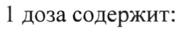
- стр. 1: «количество вилантерола составляет 22 мкг, умеклидиния — 55 мкг, флутиказона» — низкая уверенность: «22» (41), «55» (22)  
  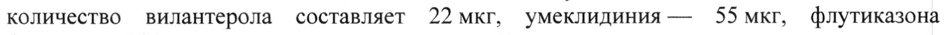
- стр. 4: «в дозировках 22 мкг + 55 мкг + 92 мкг и 22 мкг + 55 мк ist tie a ,  ОВНЕНИЮ lc» — низкая уверенность: «22» (69); повторное чтение: «в дозировках 22 мкг + 55 мкг + 92 мкг и 22 wt + 55 мк is? MK “To бравнению ‘»  
  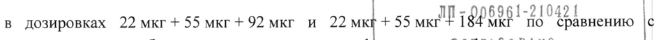
- стр. 4: «22 мкг + 92 мкг и 22 мкг + 184 мкг (снижение частоты на 5: 95 % ДИ: от -5,2 до 28,1),» — повторное чтение: «22 мкг + 92 мкг и 22 мкг + 184 мкг (снижение частоты на 13 %; 95 % ДИ: от -5,2 до 28.1),»  
  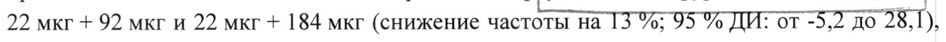
- стр. 4: «& (22 мкг + 55 мкг + 92 мкг/доза и 22 мкг + 55 мкг + 184 мкг/доза) находились в пределах» — повторное чтение: «& (22 мкг + 55 мкг + 92 мкг/доза и 22 MKr + 55 мкг + 184 мкг/доза) находились в пределах»  
  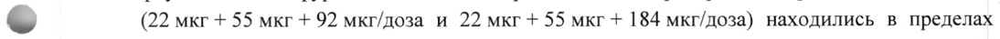
- стр. 4: «введении в среднем составляла 13 % с учетом незначительного всасывания вещества из» — повторное чтение: «введении в среднем составляла 13 %с учетом незначительного всасывания вещества из»  
  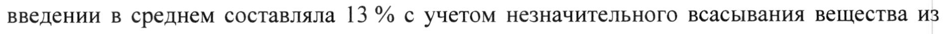
- стр. 7: «(22 мкг + 55 мкг + 92 мкг/доза и 22 мкг + 55 мкг + 184 мкг/доза), расчетная Cmax» — низкая уверенность: «22» (50)  
  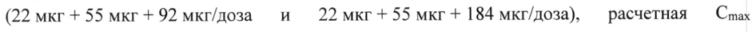
- стр. 7: «вилантерола в равновесном состоянии была приблизительно в 3 раза выше, чем у пациентов» — повторное чтение: «вилантерола в равновесном состоянии была приблизительно B3 раза выше, чем у пациентов»  
  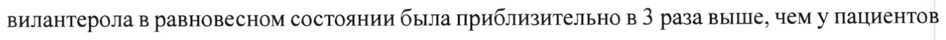
- стр. 7: «< 30 мл/мин) не приводит к значительному увеличению экспозиции вилантерола или» — низкая уверенность: «30» (77)  
  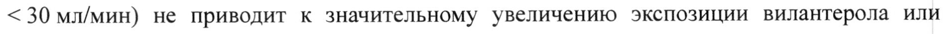
- стр. 8: «вилантерола и флутиказона фуроата дозировкой 11 мкг + 92 мкг, не было отмечено» — низкая уверенность: «11» (78)  
  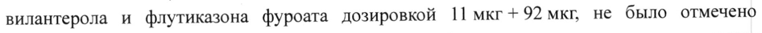
- стр. 16: «протяжении периода до 52 недель, частота развития пневмонии составляла 1% (5 из» — низкая уверенность: «1%» (78)  
  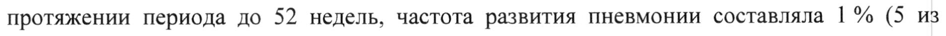
- стр. 17: «(22 мкг + 184 мкг/доза) и кетоконазола (400 мг) — сильного ингибитора изофермента» — низкая уверенность: «(400» (64)  
  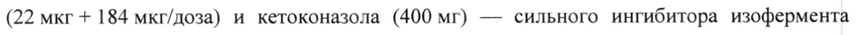
