# Вилантерол, флутиказона фуроат — ингаляц

- Препарат: Релвар Эллипта (порошок для ингаляций дозированный;)
- АТХ: R03AK10
- Источник: ГРЛС, инструкция по медицинскому применению, РУ ЛП-002451, файл от 2021-10-01 (https://grls.rosminzdrav.ru/Grls_View_v2.aspx?routingGuid=1c27da6f-7b55-4f39-9e78-d7464ff842b0)
- Распознано автоматически (OCR): 16 из 16 стр.
- Инструкция к другому РУ того же препарата: ЛП-002451 (срок действия истёк, решение от 27.09.2021). Текст может быть старше действующего
- Сомнительных строк после OCR: 16 (см. раздел «Проверка распознавания»)
- Проверено вручную строк: 4

## Общие сведения

| и МИНИСТЕРСТВО ЗДРАВООХРАНЕНИЯ РОССИЙКОЙФЕДНЕХИИ
| | M РУ. peLsry ИНСТРУКЦИЯ СОГЛАСОВАНО |
| по применению лекарственного препарата для медицинского применения
| | РЕЛВАР ЭЛЛИПТА® / RELVAR® ELLIPTA® Регистрационный номер:
| , Торговое наименование препарата: Релвар Эллипта®/ Relvar® Ellipta®.
Группировочное наименование: вилантерол + флутиказона фуроат / vilantero] +
| fluticasone furoate.
@ Лекарственная форма: порошок для ингаляций дозированный. °
СОСТАВ на 1 дозу ‘ Вилантерола трифенатат 40 40 микронизированный |
(в пересчете на вилантерол) (25)? (25)° a
| у Флутиказона фуроат 100° 200 ee ОИ ОО
Примечание:
1. При производстве готового препарата смеси действующих и вспомогательных | веществ могут закладываться в конечный продукт с избытком до 8 % для , компенсации потерь при наполнении ячеек.
:
С. Тиз 16 | | | 2. Указано номинальное количество действующего вещества, закладываемое в процессе производства; доставленное количество составляет 22 мкг вилантерола, 92 мкги 184 мкг флутиказона фуроата, что соответствует указанным дозировкам.
ОПИСАНИЕ Пластиковый ингалятор с корпусом светло-серого цвета, бледно-голубой крышкой мундштука и счетчиком доз, упакованный в контейнер из фольги, содержащий влагопоглощающий пакетик. Контейнер запечатан легко открывающейся фольгой.
Ингалятор содержит два стрипа, каждый стрип состоит из 30 равномерно распределенных ячеек, каждая из которых содержит порошок белого цвета.
ФАРМАКОТЕРАПЕВТИЧЕСКАЯ ГРУППА | Бронходилатирующее средство комбинированное (бета›-адреномиметик селективный +
| . глюкокортикостероид местный).
| Код ATX: RO3AK10. . | ‚- ФАРМАКОЛОГИЧЕСКИЕ СВОЙСТВА |
| Фармакодинамика | Механизм действия | Вилантерол и флутиказона фуроат относятся к двум различным классам лекарственных | препаратов — синтетический глюкокортикостероид и селективный бета>-адреномиметик
| длительного действия.
; Фармакодинамические эффекты й | Вилантерол относится к классу селективных бета›-адреномиметиков длительного |
| действия (ДДБА). | Фармакологические эффекты агонистов бета›-адренорецепторов, включая вилантерол, по | if крайней мере, частично связаны со стимуляцией внутриклеточной аденилатциклазы — фермента, который катализирует превращение аденозинтрифосфата (АТФ) в циклический 3°,5’-аденозинмонофосфат (циклический АМФ). Повышение уровня циклического АМФ | приводит к расслаблению гладкой мускулатуры бронхов и угнетению высвобождения из клеток (в первую очередь из тучных клеток) медиаторов реакций гиперчувствительности
| немедленного типа.
Флутиказона фуроат является синтетическим трехфтористым глюкокортикостероидом с | выраженным противовоспалительным действием. Точный механизм действия,
| позволяющий купировать симптомы бронхиальной астмы и хронической обструктивной болезни легких (ХОБЛ), не известен. Глюкокортикостероиды продемонстрировали широкий спектр действия на различные типы клеток (например, эозинофилы, макрофаги, |
| лимфоциты) и медиаторы (например, цитокины и химокины, участвующие в процессе |
| воспаления).
Между глюкокортикостероидами и ДДБА происходят молекулярные взаимодействия, в | результате которых стероидные гормоны активируют ген бета2-адренорецептора, повышая
С. 2 из 16 | о №.
| число восприимчивых адренорецепторов. ДДБА связываются с глюкокортикостероидным рецептором, обеспечивая его стероидо-зависимую активацию и стимулируя транслокацию в ядро клетки. Эти синергические взаимодействия приводят к усилению противовоспалительной активности, что выявляется в экспериментах in vitro и in vivo с
| различными клетками воспаления; участвующими в патофизиологических процессах развития бронхиальной астмы и ХОБЛ. Результаты клинических исследований с использованием биоптатов. дыхательных путей также продемонстрировали синергию
‚. глюкокортикостероидов и ДДБА, возникающую при назначении этих препаратов пациентам с ХОБЛ в терапевтических дозах.
| Фармакокинетика | : . . - ;
° Всасывание ВЫ | | Абсолютная биодоступность вилантерола и флутиказона фуроата при ингаляционном введении комбинации вилантерола и флутиказона фуроата составила в среднем 15,2 % и 27,3 %, соответственно. Пероральная биодоступность обоих веществ была низкой, и в
{ , среднем составляла 1,26 % и < 2%, соответственно. Принимая во внимание низкую | пероральную биодоступность, системное действие вилантерола и флутиказона фуроата после ингаляционного приема в первую очередь обусловлено всасыванием части ингаляционной дозы, поступившей в легкие.
Распределение . | | | ° . | | После внутривенного введения вилантерол и флутиказона фуроат активно распределяются
| | в организме, при этом средние объемы распределения в равновесном состоянии
| ° составляют 165 ли 661 JI, соответственно. |
Оба вещества обладают низкой способностью связываться с эритроцитами. В исследованиях in уйго связывание вилантерола и флутиказона фуроата с белками плазмы человека было высоким и достигало в среднем > 93,9 % и 99,6 %, соответственно. Степень связывания с белками плазмы М уИто не уменьшалась у пациентов с нарушениями функции печени и почек. |
Несмотря на то, что вилантерол и флутиказона фуроат являются субстратами Р- |
| гликопротеина (P-gp), при одновременном назначении комбинации вилантерола и флутиказона фуроата с ингибиторами P-gp изменение системной экспозиции вилантерола | 4 | или флутиказона фуроата считается маловероятным, так как оба вещества обладают | хорошей абсорбционной способностью.
Метаболизм | На основании in vifro экспериментов можно заключить, что ключевые пути метаболизма вилантерола и флутиказона фуроата в организме человека в первую очередь опосредуются через изофермент цитохрома CYP3A4. -
Вилантерол преимущественно метаболизируется путем О-деалкилирования с образованием целого ряда метаболитов, обладающих существенно более низкой бета!- и бета›-адреномиметической активностью.
| С. 3 из 16 | = ee Флутиказона фуроат преимущественно о метаболизируется путем гидролиза Sфторметилкарботиоатной группы с образованием метаболитов, имеющих значительно более низкую глюкокортикостероидную активность.
Было проведено клиническое исследование лекарственных взаимодействий препарата с изоферментом цитохрома СУРЗА4 при длительном введении комбинации вилантерола и флутиказона фуроата (22 мкг + 184 мкг/доза) и сильного ингибитора изофермента цитохрома СУРЗА4 — кетоконазола (400 мг) на примере здоровых добровольцев.
| Совместное введение препаратов привело к повышению средней площади под - фармакокинетической кривой (AUC) и средней максимальной концентрации (Снах)
флутиказона фуроата на 36% и -33 %, соответственно. Увеличение экспозиции ‘
° ‘флутиказона фуроата было ассоциировано сб снижением средней концентрации сывороточного кортизола на 27 %, измеренного за период 0-24 часа. о.
| Совместное введение комбинации вилантерола и флутиказона фуроата и кетоконазола .
привело к повышению средних АЧСцо- и Cmax вилантерола на 65 и 22 %, соответственно.
| Увеличение экспозиции вилантерола не приводило к усилению характерных. для бета-
| агонистов системных эффектов — влияние на частоту сердечных сокращений, содержание
| калия в крови или корригированный интервал ОТ (ОТсЕ).
Выведение | После перорального приема флутиказона фуроат в организме человека, главным образом, |
| метаболизировался с образованием метаболитов, которые преимущественно выводились через желудочно-кишечный тракт, за исключением дозы радиоактивного вещества < 1 %, выведенной с мочой. Предполагаемый период полувыведения из плазмы флутиказона фуроата после ингаляционного приема препарата составлял в среднем 24 часа.
й | После перорального приема вилантерол в организме человека, главным образом,
| | метаболизировался с образованием метаболитов, которые экскретировались с мочой и
| фекалиями, в соотношении приблизительно 70 % и 30% дозы радиоактивного вещества, соответственно. Период полувыведения из плазмы вилантерола после ингаляционного приема препарата составлял в среднем 2,5 часа.
Особые группы пациентов В ходе третьей фазы клинических исследований проводился популяционный мета-анализ фармакокинетики вилантерола и флутиказона фуроата у пациентов с бронхиальной астмой и ХОБЛ. В рамках данного анализа оценивалось влияние демографических ковариат
(возраст, пол, вес, индекс массы тела (ИМТ), расовая и этническая принадлежность) на фармакокинетику вилантерола и флутиказона фуроата.
| Paca | У пожилых пациентов с бронхиальной астмой или ХОБЛ оценивалась AUC, 24)
флутиказона фуроата. Согласно полученным данным пациенты восточно-азиатской,
| японской и южно-азиатской расы (12-14 % пациентов) имели в среднем более высокие показатели АЧСцо-24) (выше не более чем на 53 %) в сравнении с пациентами европеоидной расы. Тем не менее, в этих популяциях признаков более высокой системной экспозиции,
C.4u316 © проявляющейся более выраженным влиянием на экскрецию кортизола с мочой за 24-
| часовой период, не обнаружено. У пациентов, страдающих ХОБЛ, влияние расовой
| принадлежности Ha фармакокинетические параметры вилантерола не выявлено. |
В среднем, по результатам оценки Cmax вилантерола была на 220-287 % выше, а AUC 0.24) | была сопоставима у пациентов азиатского происхождения по сравнению с показателями у других расовых групп. Тем не менее, более высокая Cmax вилантерола не имела клинически значимого влияния на частоту сердечных сокращений.
Дети - “ Для подростков (12 лет или старше) рекомендации по изменению режима дозирования | у . , | отсутствуют. , |
. Фармакокинетика комбинации вилантерола и флутиказона`фуроата у пациентов младше 12 |
_ лет не изучалась. Безопасность и эффективность применёния комбинации вилантерола и -
| . . Флутиказона фуроата у детей младше 12 лет пока не установлена. . | |
Пациенты пожилого возраста | Влияние возраста на фармакокинетику вилантерола и флутиказона фуроата изучалось в | третьей фазе клинических исследований, включавших пациентов с ХОБЛ и бронхиальной | астмой. |
У пациентов с бронхиальной астмой, не было обнаружено признаков влияния возраста
(12-84 лет) на фармакокинетический профиль флутиказона фуроата и вилантерола. |
_ | Несмотря на увеличение (37 %) AUC(o_24) вилантерола у пациентов с ХОБЛ на протяжении | всего наблюдаемого возрастного диапазона от 41 до 84 лет, признаков влияния возраста |
. пациентов на фармакокинетический профиль флутиказона фуроата не выявлено. У | пожилого пациента (в возрасте 84 года) с низкой массой тела (35 кг) AUC o.24) вилантерола ` | будет Ha 35 % выше результата, рассчитанного для популяции (в среднем, пациент с ХОБЛ .. | в возрасте 60 лет и массой тела 70 кг), в то время как Cymax вилантерола останется | неизмененной. Маловероятно, что эти различия являются клинически релевантными. |
| | Пациенты с нарушением функции почек |
| По данным клинико-фармакологического исследования тяжелое нарушение функции почек (клиренс креатинина < 30 мл/мин) не приводит к значительному увеличению
| | системной экспозиции вилантерола или флутиказона фуроата или к развитию более | выраженных системных эффектов глюкокортикостероидов или GeTa-aroHUCTOB в |
| сравнении со здоровыми добровольцами. Индивидуальный подбор дозы для пациентов с | нарушением функции почек не требуется. |
Влияние гемодиализа не изучалось. | | Пациенты с нарушением функции печени |
: | После непрерывного приема комбинации вилантерола и флутиказона фуроата в течение | 7 дней у пациентов с нарушением функции печени наблюдалось увеличение системной | экспозиции флутиказона фуроата (по измеренной АЧСи-24) до трех раз) в сравнении со | здоровыми добровольцами (согласно классификации цирроза печени по Чайлд-Пью: |
| С. 5 из 16 | — О» | стадии цирроза А; В или С). Повышение системной экспозиции флутиказона фуроата (при назначении комбинации вилантерола и флутиказона фуроата в дозировке 22 мкг +

184 мкг/доза) у пациентов с нарушением функции печени средней тяжести (стадия В по

классификации Чайлд-Пью) было ассоциировано со снижением концентрации сывороточного кортизола в среднем на 34 % в сравнении со здоровыми добровольцами.

Показатели нормализованной по дозе системной экспозиции флутиказона фуроата у

пациентов с нарушением функции печени средней и тяжелой степени (стадии В и С по

классификации Чайлд-Пью) были сходными. Следовательно, хотя больным с нарушением
| функции печени не требуется индивидуальный подбор дозы, следует соблюдать осторожность при назначении им данного лекарственного препарата.

После непрерывного приема комбинации вилантерола и флутиказона фуроата в течение ,

‚ 7 дней у пациентов с нарушением функции печени легкой, средней или тяжелой степени

‘’. `` стадии А, В и С по классификации Чайлд-Пью) не отмечалось значительного увеличения |
| системной экспозиции вилантерола (по Cmax иАЧ Су 24). 8 |
| ’. В сравнении co здоровыми добровольцами у пациентов с нарушением функции печени

| легкой или средней степени (принимавших вилантерол в дозе 22 мкг) или тяжелой степени (принимавших вилантерол в дозе 11 мкг) не наблюдалось клинически значимых

| | бета-адренергических системных эффектов (изменение частоты сердечных сокращений

или концентрации сывороточного калия), вызванных приемом комбинации вилантерола и

флутиказона фуроата. | | ь

Пол, масса тела, индекс массы тела (ИМТ) 7

По данным третьей фазы популяционного анализа фармакокинетики, включавшего 1213
| пациентов с бронхиальной астмой (712 женщин) и 1225 пациентов с ХОБЛ (392 женщины),

признаков влияния пола, массы тела или ИМТ на фармакокинетический профиль

| флутиказона фуроата не обнаружено.

По данным популяционного анализа фармакокинетики с участием 856 пациентов с |
| бронхиальной астмой (500 женщин) и 1091 пациента с ХОБЛ (340 женщин) признаков | влияния пола, массы тела или ИМТ на фармакокинетический профиль вилантерола не |

обнаружено. |

Не требуется индивидуальный подбор дозы на основании данных о половой |

принадлежности, массы тела или ИМТ.

| ПОКАЗАНИЯ К ПРИМЕНЕНИЮ

Бронхиальная астма

Препарат Релвар Эллипта” применяется в качестве. поддерживающей терапии

| бронхиальной астмы.

ХОБЛ (хроническая обструктивная болезнь легких)

Препарат Релвар Эллипта® применяется в качестве поддерживающей терапии обструкции

дыхательных путей у пациентов с ХОБЛ, включая хронический бронхит и/или эмфизему

С. 6 из 16 легких. Применение препарата Релвар Эллипта® позволяет сократить число обострений

ХОБЛ у пациентов с повторными обострениями в анамнезе.
| ПРОТИВОПОКАЗАНИЯ

Препарат Релвар Эллипта® противопоказан:

e пациентам, имеющим в анамнезе тяжелые аллергические реакции на молочный белок или повышенную чувствительность к действующим веществам или любому другому компоненту, входящему в состав препарата; .
® детям до 12 лет для лечения бронхиальной астмы. ,

° Препарат Релвар Эллипта® в дозе 22 мкг + 184 мкг/доза не показан для лечения

ХОБЛ. =. | С. .
‘€ ОСТОРОЖНОСТЬЮ. ть. | noe ;

При приеме симпатомиметиков, включая препарат.Релвар Эллийта®: со стороны сердечно-

сосудистой системы могут наблюдаться такие нежелательные явления, как аритмия

(например, наджелудочковая тахикардия и экстрасистолия). В связи с этим пациентам,

страдающим тяжелыми формами сердечно-сосудистых заболеваний, препарат Релвар

Эллипта® следует назначать с осторожностью. |

Как и другие лекарственные средства, в состав которых входят глюкокортикостероиды,

“@)

препарат Релвар Эллипта® следует с осторожностью назначать пациентам с туберкулезом

легких, а также пациентам с хроническими или невылеченными инфекциями.

## 4.6. Применение при беременности и в период грудного вскармливания

| ВСКАРМЛИВАНИЯ

Фертильность.

Данные по влиянию на фертильность человека отсутствуют. В доклинических

исследованиях воздействия вилантерола и флутиказона фуроата на фертильность не

обнаружено.
Беременность | | Данные о применении препарата во время беременности ограничены.
Применение препарата Релвар Эллипта® у беременных женщин допустимо только в том
_ случае, если потенциальная польза для матери превышает возможный риск для плода.
Период грудного вскармливания Данных 06 экскреции вилантерола или флутиказона фуроата или их метаболитов в
| грудное молоко человека недостаточно. Однако другие глюкокортикостероиды и бета>- агонисты определяются в грудном молоке. Риск проникновения препарата вместе с молоком в организм новорожденного или ребенка не может быть исключен.
С. 7 из 16 НН | Принимая во внимание соотношение пользы терапии для матери и грудного | вскармливания для ребенка, необходимо решить вопрос либо об отмене препарата, либо о |
| прекращении грудного вскармливания.

## 4.2. Способ применения и дозы

| Препарат Релвар Эллипта® предназначен только для ингаляционного применения. |
| Препарат Релвар Эллипта® предназначен только для ингаляционного применения. |
| . „ . , Препарат Релвар Эллипта® следует применять один раз в сутки в одно и то же время, |
| утром или вечером. о | После ингаляции следует прополоскать рот водой, не проглатывая.
| Бронхиальная астма | ‚ Пациент должен быть проинформирован ‚© необходимости регулярного применения | .
a `препарата-Релвар’Эллипта® даже в случае бессимптомного течения заболевания. о i ‚ `При. возникновении ` симптомов: заболевания в период. между ‘приемами препарата в с —
``. Качестве неотложной терапии следует применять ‘ингаляционные формы бета>-агонистов .,
| короткого действия. -' И oO a 7 Врач должен регулярно оценивать состояние пациента, чтобы обеспечить своевременное
, назначение оптимальной дозировки препарата Релвар Эллипта®. Дозировка может быть | изменена только по рекомендации врача. |
Взрослые и подростки 12 лет и старше | Рекомендуемая доза препарата Релвар Эллипта®: .
одна ингаляция 22 мкг вилантерола и 92 мкг флутиказона фуроата один раз в сутки
ИЛИ одна ингаляция 22 мкг вилантерола и 184 мкг флутиказона фуроата один раз в сутки.
Начальная доза препарата Релвар Эллипта® 22 мкг вилантерола и 92 мкг флутиказона фуроата назначается пациентам, которым требуются низкие или средние дозы ингаляционных глюкокортикостероидов, применяемых в комбинации с бета›-агонистами
| длительного действия.
Препарат Релвар Эллипта® в дозировке 22 мкг вилантерола и 184 мкг флутиказона | фуроата следует назначать пациентам, ‘которым требуется более высокая доза
| ‚ ингаляционных глюкокортикостероидов, применяемых в комбинации с бета›-агонистами длительного действия.
Если препарат Релвар Эллинта® в дозировке 22 мкг вилантерола и 92 мкг флутиказона фуроата не обеспечивает адекватного контроля заболевания, рассматривается вопрос об увеличении дозы до 22 мкг вилантерола и 184 мкг флутиказона фуроата, что может улучшить уровень контроля над течением бронхиальной астмы.
Дети | Безопасность и эффективность применения препарата Релвар Эллипта® у детей младше 12 лет не установлена. |
!
С. 8 из 16 | Ш а ey Oe п | ХОБЛ | Взрослые |
® Рекомендуемая доза препарата Релвар Эллинта®:
одна ингаляция 22 мкг вилантерола и 92 мкг флутиказона фуроата один раз в сутки.
‘ Препарат Релвар Эллипта® в дозировке 22 мкг вилантерола и 184 мкг флутиказона | фуроата не показан для лечения пациентов с ХОБЛ.
Дети | ° .
| | Препарат по показанию ХОБЛ у детей не применяется. | |
Особые группы пациентов _ ` Пациенты пожилого возраста . , о
‚ . . Нациентам: старше 65. лет не требуется индивидуальный‘. подбор дозы препарата (см. |
: `* раздей «Фармакокинетика»; подраздел «Особые ‘труппы пациентов»). 1:0.
В Пациенты с нарушением функции почек | | и __
| | Пациентам с нарушением функции почек не требуется индивидуальный подбор дозы препарата (см. раздел «Фармакокинетика»).
| | Пациенты с нарушением функции печени 7
| По данным клинико-фармакологического исследования У пациентов с нарушениями

Я | функции печени легкой, средней и тяжелой степени наблюдается трехкратное возрастание
| степени системной экспозиции флутиказона фуроата (с увеличением таких показателей
} | .
| как Cmax и AUC) (см. раздел «Фармакокинетика»).
Пациентам с нарушениями функции печени следует назначать препарат с осторожностью, так как эта группа больных имеет более высокий риск развития системных нежелательных | реакций, вызванных приемом глюкокортикостероидов.
Рекомендации по применению ь При первом использовании ингалятора Эллипта® нет необходимости в проверке правильности его работы или специальной подготовки ингалятора к эксплуатации. Просто
- последовательно соблюдайте рекомендации по применению.

Ингалятор Эллипта® упакован в контейнер, содержащий влагопоглощающий пакетик с

силикагелем, который не предназначен для еды или ингаляций. Данный пакетик следует утилизировать.
Когда Вы достаете ингалятор из контейнера, его крышка находится в закрытом положении.
| Не открывайте ее до тех пор, пока Вы не будете готовы к приему препарата.
F Ниже приведены пошаговые инструкции использования ингалятора Эллипта®:
1. Прочитайте следующую информацию перед использованием

При открытии и закрытии крышки ингалятора Эллипта® без приема лекарственного |
| препарата происходит потеря одной дозы. Эта доза остается закрытой внутри ингалятора,
С. 9 из 16 | .
р .
но она будет недоступна для приема. Невозможно случайно получить большую дозу или двойную дозу за одну ингаляцию.
Крышка - | Одна доза | 2 ВИ | лекарственного ;
’ Препарата готовак =| |_ ‚ Счетчик доз |. ингаляции после
, —. : — = i ’ Каждого открытия \!
Счетчик доз показывает, сколько доз | о. РЫНКИ а.
: лекарственного препарата осталось в | , И
‚ ингаляторе. _— a} i oid -; Перед началом использования _ О AN И
_ ; Ингалятора счетчик доз показывает . ' | crs \& TNO, mo
, ‚ При каждом открытии крышки количество Pye. Woe по Е ee VE ых
‚ доз уменьшается Ha 1.. р ОА та ль, ый. ев
‚ Когда остается менее 10 доз, половина: ipo. LZ : —_ : ,
‚ счетчика становится красной. Е at © | Г |
| После того, как израсходована последняя |. Ww С. И | доза препарата, половина счетчика Е р y, | о F выделена красным цветом, счетчик , i i. —: 30) a, fi
‚ показывает цифру 0. Это означает, что д... “A ; й
‚ ингалятор пуст. | ы NT ’ “\ / Если Вы откроете крышку после этого, NX | и.
счетчик доз станет полностью красным. 7 ~~ ~
I. Подготовка дозы Не открывайте крышку, пока Вы не будете готовы к приему препарата.

- Невстряхивайте ингалятор.

1. Опустите крышку вниз до щелчка.

2. Доза препарата готова к ингаляции, и в подтверждение этого счетчик доз уменьшает число доз на единицу.

3. Если счетчик доз не уменьшил число доз после того, как Вы услышали щелчок, то ингалятор не готов‘к подаче дозы лекарственного препарата. В этом случае следует обратиться по телефону или адресу, указанному в разделе «За дополнительной информацией обращаться: >». -

| 4. Никогда не встряхивайте ингалятор.
С. 10 из 16 | ee Mynarry |

a Ч = ee eee : ; st: Ку Sen ae о N my 4 en Вентиляционное отверстие = о
ОЕ \ г. а В ee ее. Ша!

Е . % fo eae z : .
wie PP NGS etre in

; ОР = wee (hee < Е, "о, | | | ia: : : eB eae У: if a i oo A .
a a а т и ИР, НОЛЬ. | м | но i 4 apie oh a on i " a A .. р |
NN т К) М’ Щелчок | * .
ENS и п м ой gt |

| © ss Ш. Ингаляция лекарственного препарата ° `` п |

1.. Удерживая ингалятор на некотором расстоянии. ото рта, сделайте выдох
| максимальной глубины. Не выдыхайте в ингалятор. —
2. Поместите мундштук между губами и плотно обхватите его губами. Не закрывайте
| пальцами вентиляционное отверстие.
3. Сделайте один глубокий, долгий, равномерный вдох. Задержите дыхание насколько возможно (по крайней мере, на 3—4 секунды).
4. Уберите ингалятор изо рта. , |
5. Медленно и спокойно выдохните.
: : omer? А змея о att > < _— _ ;
| : oe я ый в рен ее и . и: , ;
| а aoe а ee Губы должны точно | й | > aN —~—}_ повторять форму
№ А} \ 7 ‚ мундштука ингалятора | | | | (PAE У с и. 7
Вы можете не почувствовать вкус или не ощутить поступление лекарственного препарата
| даже при правильном использовании ингалятора.
: С. 11 из 16 | .
| | : ТУ. Закрытие ингалятора и полоскание ротовой полости
Если Вы хотите протереть мундштук, используйте сухую бумажную салфетку перед закрытием крышки.
1. Поднимите крышку до упора, добившись полного закрытия мундштука.
‚ 2. После ингаляции следует прополоскать рот водой. Это снизит. вероятность развития таких побочных явлений, как боль в горле и полости рта.
р опия м——о—оыоиыиыимиыиыиыыиыиым АИ . | .. СВ |
| po ; | т os | И:
| \ oe РУХ i | и в it Ё oe ца - 3 Aa и .
| fa . = Н | ee ee у. H a АИ RA ИЛ, мена пеной

## 4.8. Побочное действие

| | Для определения частоты развития нежелательных явлений, связанных с приемом препарата Релвар Эллипта®, использовались данные крупных клинических исследований среди пациентов-с ХОБЛ и бронхиальной астмой. Программа клинической разработки | препарата для лечения бронхиальной астмы включала 7 034. пациента, у которых проводилась комплексная оценка нежелательных явлений. В программе клинической разработки препарата для лечения ХОБЛ принимали участие 6 237 пациентов, y которых f < также проводилась комплексная оценка нежелательных явлений.
| | Для определения частоты развития нежелательных явлений, связанных с приемом препарата Релвар Эллипта®, использовались данные крупных клинических исследований среди пациентов-с ХОБЛ и бронхиальной астмой. Программа клинической разработки | препарата для лечения бронхиальной астмы включала 7 034. пациента, у которых проводилась комплексная оценка нежелательных явлений. В программе клинической разработки препарата для лечения ХОБЛ принимали участие 6 237 пациентов, y которых f < также проводилась комплексная оценка нежелательных явлений.
| Исключая такие нежелательные явления, как пневмония и переломы, профили
| безопасности препарата у пациентов с ХОБЛ и бронхиальной астмой были схожи. По
| данным клинических исследований пневмония и переломы более часто наблюдались у
|. пациентов, страдающих ХОБЛ.
Нежелательные явления, представленные ниже, перечислены в соответствии с поражением органов и систем органов и частотой встречаемости. Частота встречаемости определяется следующим образом: очень часто (> 1/10), часто (> 1/100 и < 1/10), нечасто
(> 1/1 000 и < 1/100), редко (> 1/10 000 и <1/] 000), очень редко (< 1/10 000, включая отдельные случаи).
, С. 12 из 16 | 7 | Частота встречаемости нежелательных явлений
Инфекционные и паразитарные заболевания Часто: пневмония, инфекции верхних дыхательных путей, бронхит, грипп, кандидоз полости рта и глотки.
й Нарушения со стороны нервной системы | Очень часто: — головная боль. |
| Нарушения. со стороны сердца Нечасто: экстрасистолия.
Нарушения со стороны дыхательной системы, органов грудной клетки и
| средостения .
Очень часто: назофарингит: | Часто: орофарингеальная боль, синусит, фарингит, ринит, кашель, дисфония. в 7 о
Нарушения со стороны желудочно-кишечного тракта | в Ye. oa
| . Часто: 2. 2. ‚_боль в’животё, ‘о ee —
"Нарушения со стороны скелетно-мышеёчной и соединительной ткани = И
“Macro: ® 2. артралгия, боль в спине, переломы: ©’: В a
Общие расстройства и нарушения в месте введения и" о
Часто: лихорадка. | ПЕРЕДОЗИРОВКА. | Симптомы -
При проведении клинических исследований не было получено данных о передозировке комбинацией вилантерола и флутиказона фуроата. |
| Передозировка препаратом Релвар Эллипта® может вызывать развитие симптомов и
| признаков, обусловленных действием отдельных компонентов препарата и характерных
| для передозировки бета›-агонистами и ингаляционными глюкокортикостероидами (см.
| раздел «Особые указания »).
Лечение | Специфическое лечение передозировки комбинацией вилантерола и флутиказона фуроата отсутствует. В случае развития передозировки назначается симптоматическая терапия и, при необходимости, обеспечивается соответствующее наблюдение за больным.
Применение кардиоселективных бета-адреноблокаторов следует рассматривать только в случаях сильно выраженных эффектов передозировки вилантеролом, которые клинически проявляются невосприимчивостью к поддерживающей терапии. Кардиоселективные бетаадреноблокаторы следует с осторожностью назначать пациентам, у которых наблюдались эпизоды бронхоспазма в анамнезе.
С. 13 из 16 ВЗАИМОДЕЙСТВИЕ С ДРУГИМИ ЛЕКАРСТВЕННЫМИ ПРЕПАРАТАМИ
При назначении препарата в терапевтических дозах клинически значимые лекарственные взаимодействия вилантерола или флутиказона фуроата считаются маловероятными . | вследствие низких плазматических концентраций последних при ингаляционном введении. |

Бета-адреноблокаторы могут ослаблять или антагонизировать действие бета>- |

адреномиметиков. Следует избегать одновременного приема © неселективных и

; селективных бета-блокаторов, исключая случаи, когда их назначение строго необходимо. |
Вилантерол и флутиказона фуроат подвергаются быстрому первичному метаболизму в |

печени посредством изофермента системы цитохрома CYP3A4. |
При одновременном назначении препарата с сильными ингибиторами изофермента — цитохрома СУРЗА4 (например, кетоконазол, ритонавир) следует соблюдать осторожность, |

. Поскольку возможно повышение системного воздействия вилантерола и флутиказона | фуроата, что в свою очередь может привести к повышению риска развития нежелательных —'_ реакций (см. раздел «Фармакокинетика»). ‘о - м ons В
< -Вилантерол-и флутиказона фуроат являются субстратами P-gp. По. результатам клинико- -

°^. фармакологичёского”. исследования. с ` участием здоровых. добровольцев, которым в.

t одновременно назначались вилантёрол и сильный ингибитор P-gp и умеренный ингибитор | изофермента цитохрома СУРЗА4 верапамил, значимого влияния Ha фармакокинетику |

Я вилантерола не выявлено. Клинико-фармакологические исследования’ совместного

назначения специфического ингибитора P-gr и флутиказона фуроата не проводились. |

|

## 4.4. Особые указания

Препарат 'Релвар Эллипта® не предназначен для купирования острых симптомов |

| бронхиальной астмы или обострения ХОБЛ, в таких случаях требуется назначение

|

бронходилататоров короткого действия. Увеличение частоты приема бронходилататоров

короткого действия с целью купирования симптомов свидетельствует об ухудшении

\

контроля над заболеванием и необходимости консультации врача.

Пациентам с бронхиальной астмой или ХОБЛ не следует прекращать лечение препаратом

| ® >

Релвар Эллипта” без наблюдений врача, так как отмена терапии может привести к

| обострению заболевания.

‚Как и при других видах ингаляционной терапии, после приема препарата может.

| развиваться парадоксальный бронхоспазм, сопровождающийся быстрым нарастанием

i свистящих хрипов. В этом случае показаны неотложное назначение ингаляционного

бронходилататора короткого действия и немедленная отмена препарата Релвар Эллипта®.

) Пациент должен быть осмотрен врачом, и ему, при необходимости, может быть назначена = |

|. |

альтернативная терапия. о

На фоне лечения препаратом Релвар Эллипта® могут развиваться нежелательные явления,

связанные с течением бронхиальной астмы или обострением заболевания. Пациентам

| следует рекомендовать продолжить лечение. В случае отсутствия контроля над

р |

| заболеванием или дшения состояния после начала терапии препаратом Релва | р р |

| Эллипта® необходима консультация врача. ‘

, С. 14 из 16 | При применении ингаляционных глюкокортикостероидов (особенно при длительном |
| приеме в высоких дозах) могут развиваться системные побочные эффекты. Такие побочные эффекты развиваются значительно реже, чем при пероральном приеме | глюкокортикостероидов. К проявлениям возможного неблагоприятного системного
. действия относятся: подавление функции гипоталамо-гипофизарно-надпочечниковой |
| системы, снижение минеральной плотности костей, замедление скорости ‘роста у детей и | подростков, катаракта и глаукома. | |
У пациентов с ХОБЛ, получающих препарат Релвар Эллипта®, наблюдалось повышение |
| частоты развития пневмонии, а также частоты возникновения тяжелых форм пневмонии, | требующих госпитализации пациента. В некоторых случаях клинические эпизоды | пневмонии имели летальный исход. Врачам следует помнить о возможности развития | пневмонии у пациентов с ХОБЛ, не забывая о том, что клинические признаки такого | инфекционного заболевания маскируются симптомами обострения ХОБЛ. Наиболее высокий риск развития пневмонии на фоне приема препарата Релвар Эллипта® имеют.
| ‚ | следующие группы пациентов с ХОБЛ: курящие пациенты, пациенты, ранее перенесшие =
| |” невмонию; naunenrer с индексом массы“ тела. <25 кт/м? и -пациейты ` ©- объемом. о —
|+: ‘форсированного выдоха (ОФВ) < 50 % от. должных. величин. При назначении терапии о
| ‘препаратом Релвар Эллипта®. следует учитывать: вышеуказанные ‚факторы, в случае .
возникновения пневмонии лечение должно быть пересмотрено. ‹. о | |
У пациентов с бронхиальной астмой случаи развития пневмонии наблюдались нечасто.
Пациенты с бронхиальной астмой, получавшие препарат Релвар Эллипта® в дозировке |
| 22 мкг + 184 мкг/доза, возможно, имели более высокий риск развития пневмонии в |
: сравнении с пациентами, получавшими более низкую дозу препарата Релвар Эллипта® |
(22 мкг + 92 мкг/доза), или с группой плацебо. Факторы риска не установлены. |
В ходе проведения клинических исследований У пациентов, страдающих ХОБЛ, была ' | выявлена низкая частота возникновения переломов костей во всех лечебных группах, но | при этом во всех группах, получавших комбинацию вилантерола и флутиказона фуроата,
| она была несколько выше (2 %), чем в группе, получавших монотерапию вилантеролом 22 мкг (<1 %). |

## 4.7. Влияние на способность управлять транспортными средствами, механизмами

| Исследования по изучению влияния препарата Релвар Эллипта® на способность к |
| вождению автотранспорта и работе с механизмами не проводились. Исходя из данных | фармакологии вилантерола или флутиказона фуроата, неблагоприятное влияние препарата |
| на эти виды деятельности не предполагается.

## 6.5. Форма выпуска

| Порошок для ингаляций дозированный, 22 мкг + 92 мкг/доза, 22 мкг + 184 мкг/доза. | |
| Порошок для ингаляций дозированный, 22 мкг + 92 мкг/доза, 22 мкг + 184 мкг/доза. | |
| По 30 доз в пластиковый ингалятор с корпусом светло-серого цвета, бледно-голубой | крышкой мундштука и счетчиком доз. Ингалятор содержит два алюминиевых ламинированных стрипа, каждый из которых состоит из 30 ячеек, которые содержат
С. 15 из 16 порошок белого цвета. Ингалятор помещен в многослойный контейнер из алюминиевой
{ фольги, содержащий влагопоглощающий пакетик. Контейнер запечатан легко | открывающейся фольгой. По 1 контейнеру вместе с инструкцией по применению в | картонной пачке. , |
| СРОК ГОДНОСТИ | | Не вскрытый алюминиевый контейнер: 2 года. | |
| Вскрытый алюминиевый контейнер: 6 недель.
Не применять после истечения срока годности, указанного на упаковке.

## 6.4. Условия хранения

| Хранить при температуре не выше 25°С.
| Хранить при температуре не выше 25°С.
i Хранить в недоступном для детей месте. 7 В ВВ
| ‚ УСЛОВИЯ ОТПУСКА. оо | ‘To рецепту. ss cs eo ee aoe
| ПРОИЗВОДИТЕЛЬ ... А | | г «Глаксо Оперэйшенс Великобритания Лимитед» / Glaxo Operations UK Limited | 5012 001, Хертфордшир, Bsa, Прайори стрит, Великобритания / Priory Street, Ware,
Hertfordshire, SG12 ODJ, United Kingdom НАИМЕНОВАНИЕ И АДРЕС ЮРИДИЧЕСКОГО ЛИЦА, НА ИМЯ КОТОРОГО
| ВЫДАНО РЕГИСТРАЦИОННОЕ УДОСТОВЕРЕНИЕ |
ЗАО «ГлаксоСмитКляйн Трейдинг» | | 119180, г. Москва, Якиманская наб., д.2
За дополнительной информацией обращаться:
po ЗАО «ГлаксоСмитКляйн Трейдинг»
121614, г. Москва, ул. Крылатская, д. 17, корп. 3, эт. 5
| Бизнес-Парк «Крылатские холмы»
Тел.: (495) 777 89 00; факс: (495) 777 89 04 | а
Менеджер отдела . < fs GY Aste Bad yackas регуляторных отношений ера: тИНКИпе 3
“ . rading го ЗАО «ГлаксоСмитКляйн Трейдинг» \ =, $
= 4 oe < * Comes 5, я | | ь mad с кв А а г
| _С. 16 из 16 / “a é |
## Проверка распознавания

Страницы-сканы распознаны автоматически. В 16 строках с дозировками цифры могли распознаться с ошибкой — сверьте с вырезкой из оригинала:

- стр. 4: «цитохрома СУРЗА4 — кетоконазола (400 мг) на примере здоровых добровольцев.» — низкая уверенность: «(400» (63)  
  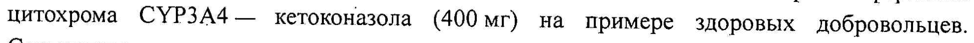
- стр. 4: «через желудочно-кишечный тракт, за исключением дозы радиоактивного вещества < 1 %,» — повторное чтение: «через i a heii nel тракт, за ИОвЛЮчеННем дозы радиоактивного вещества < | %,»  
  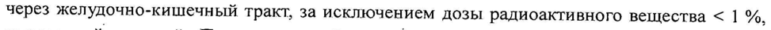
- стр. 4: «| фекалиями, в соотношении приблизительно 70 % и 30% дозы радиоактивного вещества,» — низкая уверенность: «70» (79)  
  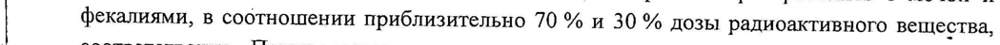
- стр. 4: «| японской и южно-азиатской расы (12-14 % пациентов) имели в среднем более высокие» — повторное чтение: «\ японской и южно-азиатской расы (12—14 % пациентов) имели в среднем более высокие»  
  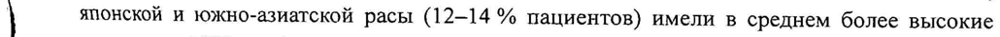
- стр. 4: «показатели АЧСцо-24) (выше не более чем на 53 %) в сравнении с пациентами европеоидной» — низкая уверенность: «АЧСцо-24)» (12)  
  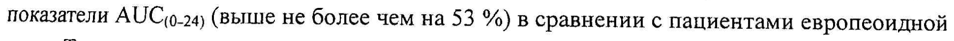
- стр. 5: «В среднем, по результатам оценки Cmax вилантерола была на 220-287 % выше, а AUC 0.24) |» — низкая уверенность: «0.24)» (72)  
  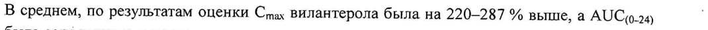
- стр. 5: «Несмотря на увеличение (37 %) AUC(o_24) вилантерола у пациентов с ХОБЛ на протяжении |» — низкая уверенность: «AUC(o_24)» (30)  
  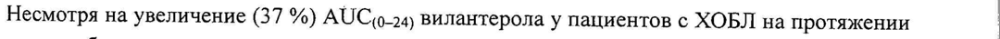
- стр. 5: «пожилого пациента (в возрасте 84 года) с низкой массой тела (35 кг) AUC o.24) вилантерола ` |» — низкая уверенность: «o.24)» (24)  
  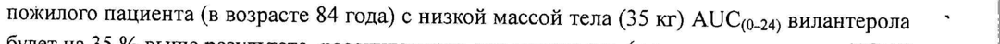
- стр. 6: «назначении комбинации вилантерола и флутиказона фуроата в дозировке 22 мкг +» — низкая уверенность: «22» (12)  
  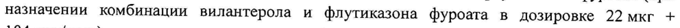
- стр. 6: «184 мкг/доза) у пациентов с нарушением функции печени средней тяжести (стадия В по» — повторное чтение: «184 ак у пациентов с нарушением функции печени средней EOL ——— по»  
  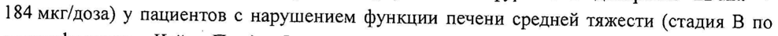
- стр. 6: «степени (принимавших вилантерол в дозе 11 мкг) не наблюдалось клинически значимых» — повторное чтение: «степени {open вилантерол в дозе И мкг) не наблюдалось клинически нах»  
  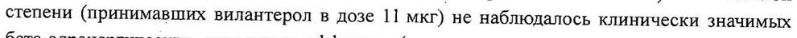
- стр. 15: «|+: ‘форсированного выдоха (ОФВ) < 50 % от. должных. величин. При назначении терапии о» — повторное чтение: «| Pepexposanioro выдона (OB) <0 % от должных величин, При Назначения repay»  
  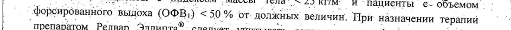
- стр. 15: «| 22 мкг + 184 мкг/доза, возможно, имели более высокий риск развития пневмонии в |» — повторное чтение: «»  
  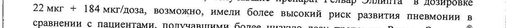
- стр. 15: «(22 мкг + 92 мкг/доза), или с группой плацебо. Факторы риска не установлены. |» — повторное чтение: «©? мкг + 92 мкг/доза), или с группой плацебо. Факторы rank 28 Уавовлен, о |»  
  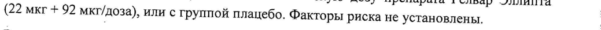
- стр. 15: «22 мкг (<1 %). |» — низкая уверенность: «(<1» (70); повторное чтение: «72 мкг (1). о — “fo “ о сре INA FIERA ROLLA, LO POI IOM»  
  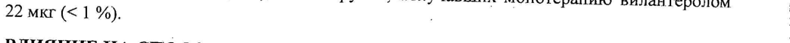
- стр. 15: «| По 30 доз в пластиковый ингалятор с корпусом светло-серого цвета, бледно-голубой |» — повторное чтение: «| | Mo 30 дз в пластиковый ингалятор © корпусом еветло-серого цвета, бледиотолубой = |»  
  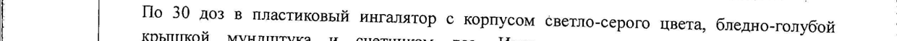
