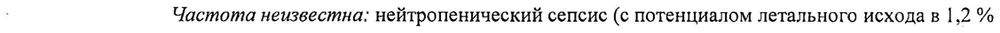

# Винорелбина дитартрат — парентерально

- Препарат: ЦИТУВИН® (концентрат для приготовления раствора для инфузий;)
- АТХ: L01CA04
- Источник: ГРЛС, инструкция по медицинскому применению, РУ ЛП-002558, файл от 2023-08-10 (https://grls.rosminzdrav.ru/Grls_View_v2.aspx?routingGuid=d71d6e57-5fae-4ad3-8b36-eb4c02c78b1a)
- Распознано автоматически (OCR): 13 из 13 стр.
- Инструкция к другому РУ того же препарата: ЛП-002558 (национальное РУ, переоформленное по правилам ЕАЭС, решение от 07.07.2023). Текст может быть старше действующего
- Сомнительных строк после OCR: 1 (см. раздел «Проверка распознавания»)

## Общие сведения

от 04.07.2023 № 12515 (Входящий МЗ №4229584)}
МИНИСТЕРСТВО ЗДРАВООХРАНЕНИЯ РОССИЙСКОЙ ФЕДЕРАЦИИ
ИНСТРУКЦИЯ ПО МЕДИЦИНСКОМУ ПРИМЕНЕНИЮ ЛЕКАРСТВЕННОГО ПРЕПАРАТА
ЦИТУВИН® Регистрационный номер: | Торговое наименование: ЦИТУВИН®
Международное непатентованное наименование (МНН): винорелбин ©

## 3. Лекарственная форма

концентрат для приготовления раствора для инфузий |
концентрат для приготовления раствора для инфузий |
_ Состав | — 1 мл концентрата содержит: .
действующее вещество: винорелбина дитартрат (винорелбина тартрат) 13,85 мг, эквивалентно винорелбину основанию 10,0 мг;
вспомогательное вещество: вода для инъекций до 1,0 мл.
Описание Прозрачный раствор от бесцветного до светло-желтого цвета.
Фармакотерапевтическая группа | Противоопухолевое средство, алкалоид.
Код ATX: LO1CA04 7 a Фармакологические свойства
- Фармакодинамика
Винорелбин — противоопухолевое средство растительного происхождения из группы полусинтетических винкаалкалоидов, выделенное из растения рода Vinca (барвинок).
Нарушает полимеризацию тубулина в процессе клеточного митоза. Блокирует митоз клеток
| на стадии метафазы G2-M, вызывая гибель клеток во время интерфазы или при последующем митозе. Действует преимущественно на митотические микротрубочки; при
| применении в высоких дозах оказывает влияние на аксональные микротрубочки. Эффект спирализации тубулина, вызываемый винорелбином, выражен слабее, чем у винкристина.

## 5.2. Фармакокинетика

| . Распределение Объем распределение винорелбина высокий, составляет в среднем 21,2 И (диапазон 7,5 —
| . Распределение Объем распределение винорелбина высокий, составляет в среднем 21,2 И (диапазон 7,5 —
Lft.018.1.RU.02.03 С. 1 СООТВЕТСТВУЕТ ЭКСПЕРТНОМУ ОТЧЕТУ от 04.07.2023 № 12515
(Входящий МЗ №4229584)\ | 39,7 л/кг), что свидетельствует об экстенсивном распределении винорелбина в тканях. |
Связывание с белками плазмы незначительное - 13,5 %. Винорелбин в больших количествах связывается с клетками крови, особенно с тромбоцитами (78 %).
Наблюдается значительный захват винорелбина легочной тканью, где достигается концентрация в 300 раз выше, чем в плазме. Винорелбин не обнаруживается в тканях головного мозга. | .
Метаболизм Винорелбин биотрансформируется в печени под действием изофермента CYP 3A4 цитохрома Р450. Все метаболиты идентифицированы и являются неактивными, за | исключением 4-О-деацетилвинорелбина, являющегося основным метаболитом в плазме
| крови. Сульфо- и глюкуроновые конъюгаты не выявлены.
a Выведение — Средний период полувыведения (T12) винорелбина в конечной фазе элиминации составляет
| около 40 часов (27,7-43,6). Системный клиренс винорелбина высокий и приближается к скорости кровотока в печени, составляет в среднем 0,72 л/ч/кг (0,32 — 1,26 л/ч/кг).
Винорелбин преимущественно выводится с желчью в неизмененном виде и в виде метаболитов. Почками выводится менее 20 % введенной внутривенно дозы, в основном, в.
виде исходного вещества.
_ _ Показания к применению e немелкоклеточный pak легкого;
e распространенный pak молочной железы; |
| . . гормонорезистентный рак предстательной железы (в комбинации с лечением a пероральными глюкокортикостероидами в малых дозах).

## 4.3. Противопоказания

| | e гиперчувствительность к винорелбину или другим винкаалкалоидам, а также к любому из компонентов препарата;
| | e гиперчувствительность к винорелбину или другим винкаалкалоидам, а также к любому из компонентов препарата;
© исходное абсолютное число нейтрофилов <1500 клеток/мкл крови;
° исходное число тромбоцитов <100000 клеток/мкл крови;
e инфекционные заболевания в день начала терапии или перенесенные в течение последних 2-х недель;
® совместное применение с вакциной против желтой лихорадки;
° беременность и период грудного вскармливания;
Lft.018.1.RU.02.03 C.2 СООТВЕТСТВУЕТ ЭКСПЕРТНОМУ ОТЧЕТУ от 04.07.2023 № 12515
(Входящий МЗ №4229584}

° детский возраст до 18 лет (безопасность и эффективность применения винорелбина у детей не изучены). ,

## 4.3. С осторожностью

Препарат ЦИТУВИН® следует применять с осторожностью в следующих случаях:

. у пациентов с ишемической болезнью сердца в анамнезе, у пациентов с тяжелым общим состоянием, при печеночной недостаточности тяжелой степени;

e при совместном применении с сильными ингибиторами или индукторами изофермента СУРЗА4, антагонистами витамина К, макролидами, кобицистатом, ингибиторам протеазы, лапатинибом. Подробную информацию см. в разделе
«Взаимодействие с другими лекарственными средствами и другие виды

, ^) взаимодействия»:
= . у пациентов из японской популяции (в связи с более частыми случаями развития интерстициальных легочных нарушений у данной категории пациентов). |

## 4.6. Применение при беременности и в период грудного вскармливания

Беременность

Данные по применению винорелбина у беременных женщин отсутствуют. |

В исследованиях на животных винорелбин продемонстрировал эмбриотоксическое и

тератогенное действие. Данные доклинических исследований, а также фармакологическое

действие лекарственного препарата позволяют предположить существование потенциального риска токсического действия на эмбрион и плод. |

Препарат ЦИТУВИЕ® противопоказан во время беременности.

Грудное вскармливание

Неизвестно, выделяется ли винорелбин в грудное молоко. Невозможно исключить риск

токсического действия винорелбина в период грудного вскармливания.

Грудное вскармливание должно быть прекращено до начала применения препарата.

Препарат ЦИТУВИН® противопоказан в период грудного вскармливания.

## 4.2. Способ применения и дозы

Вводить строго внутривенно.

Интратекальное введение может привести к летальному исходу, оно категорически

запрещено!

| Необходимо предварительное разведение концентрата! Концентрат разводят в 20-50 мл

0,9 % раствора натрия хлорида для инъекций или в 5 % растворе декстрозы для инъекций.
Lft.018.1.RU.02.03

C. 3 СООТВЕТСТВУЕТ ЭКСПЕРТНОМУ ОТЧЕТУ | от 04.07.2023 № 12515
(Входящий МЗ №4229584) | Приготовленный раствор вводят в виде 6-10 минутной инфузии. |
Сразу же после завершения инфузии следует ввести не менее 250 мл 0,9 % раствора натрия хлорида для промывания вены. |
Частоту введения препарата и продолжительность лечения определяет врач. |
Дозу определяет врач, исходя из результатов гематологического анализа.
Режим монотерапии Стандартная доза препарата составляет 25-30 мг/м? один раз в неделю.
Режим комбинированной химиотерапии Стандартная доза препарата составляет 25-30 мг/м?, но частота введения уменьшается - в дни | и 5 каждые 3 недели или в дни | и 8 каждые 3 недели - в зависимости от протокола противоопухолевой терапии. ,
~ Коррекция режима дозирования при гематологической токсичности
_ При снижении абсолютного числа нейтрофилов менее 1500 клеток/мкл крови и/или
| тромбоцитопении <100 000 клеток/мкл крови очередное введение препарата ЦИТУВИН® откладывают до восстановления их исходного количества.
Особые группы пациентов Пациенты пожилого возраста (старше 70 nem)
Клинический опыт применения винорелбина у пациентов пожилого возраста не выявил значимых отличий в отношении развития ответа на терапию, однако нельзя полностью исключить возможность повышенной чувствительности к токсическим свойствам винорелбина у некоторых пожилых пациентов.
Фармакокинетика винорелбина у пожилых пациентов не изменяется.
Применение у детей к. Безопасность и эффективность применения винорелбина у детей не изучены.
Препарат ЦИТУВИН® противопоказан детям. |
Пациенты с нарушением функции печени | Фармакокинетика винорелбина не изменяется у пациентов с печеночной недостаточностью. Тем не менее, в качестве меры предосторожности рекомендуется снижение дозы до 20 мг/м? и тщательный контроль гематологических показателей у пациентов с печеночной недостаточностью тяжелой степени.
Пациенты с нарушением функции почек | Фармакокинетика винорелбина у пациентов с нарушением функции почек не изучалась. В
‘связи с низкой почечной элиминацией винорелбина не требуется снижение дозы препарата
ЦИТУВИН® при применении у пациентов данной группы.
Lft.018.1.RU.02.03 С. 4 СООТВЕТСТВУЕТ ЭКСПЕРТНОМУ ОТЧЕТУ от 04.07.2023 № 12515
| (Входящий МЗ №14229584)
Инструкции по введению раствора для инфузий
Подготовка к введению и введение препарата ЦИТУВИН® должны осуществляться медицинским персоналом, обученным работе с химиотерапевтическими препаратами.
Персоналу следует использовать защиту для глаз, одноразовые перчатки, маску и фартук.
Раствор для инфузий следует вводить строго внутривенно: до начала введения препарата
ЦИТУВИН® необходимо убедиться в том, что игла или катетер точно установлены в вене.
При экстравазации следует немедленно прекратить введение, промыть вену 0,9 %
_ раствором натрия хлорида, остаток дозы ввести в другую вену. В случае экстравазации ДлЯ уменьшения риска флебита следует — немедленно ввести внутривенно глюкокортикостероиды.
Хранение готового раствора для инфузий ' ts С микробиологической точки зрения готовый раствор для инфузий следует использовать
_ немедленно. Если раствор He был введен немедленно, медицинский работник берет на себя ответственность за условия и продолжительность его хранения до введения. Длительность такого хранения не должна превышать 24 ч при температуре от 2 °С до 8 °С в защищенном от света месте. |
Неиспользованный раствор должен быть утилизирован согласно регламенту лечебнопрофилактического учреждения.

## 4.8. Побочное действие

Нежелательные реакции систематизированы по системно-органным классам и перечислены в соответствии со следующей градацией: очень часто >1/10; часто >1/100,
Нежелательные реакции систематизированы по системно-органным классам и перечислены в соответствии со следующей градацией: очень часто >1/10; часто >1/100,
<1/10; нечасто >1/1 000, <1/100; редко >1/10 000, <1/1 000; очень редко <1/10 000; частота
( _ неизвестна - единичные постмаркетинговые сообщения, частота не может быть оценена по имеющимся данным. : |
Инфекционные и паразитарные заболевания Часто: бактериальные, вирусные и грибковые инфекции различных локализаций
(респираторные, гастроинтестинальные, мочевыводящих путей), от умеренной до средней степени тяжести, обычно обратимые при соответствующем лечении.
Нечасто: тяжелый сепсис с органной недостаточностью; септицемия.
Очень редко: осложненная септицемия (в некоторых случаях — с летальным исходом).
: Частота неизвестна: нейтропенический сепсис (с потенциалом летального исхода в 1,2 % случаев); инфекции, ассоциированные с нейтропенией 3-4 степени тяжести.
Нарушения со стороны крови и лимфатической системы
Очень часто: миелосупрессия, приводящая в основном к нейтропении (3 степень тяжести
Lft.018.1.RU.02.03 C.5 СООТВЕТСТВУЕТ ЭКСПЕРТНОМУ ОТЧЕТУ от 04.07.2023 № 12515
(Входящий МЗ №4229584) | в 24,3 % случаев и 4 степени тяжести в 27,8 % случаев монотерапии), являющейся | обратимой, количество нейтрофилов восстанавливается в течение 5-7 дней, не кумулятивна); анемия (3-4 степени тяжести в 7,4 % в случае монотерапии).
Часто: тромбоцитопения (3-4 степени тяжести в 2,5 % случаев).
Частота неизвестна: фебрильная нейтропения; панцитопения, лейкопения |-4 степени тяжести.
Нарушения со стороны иммунной системы Частота неизвестна: системные аллергические реакции (анафилаксия, анафилактический шок или реакции анафилактоидного типа).
Нарушения со стороны эндокринной системы
Частота неизвестна: синдром неадекватной секреции антидиуретического гормона.
-, Нарушения со стороны обмена веществ и питания
~ Редко: тяжелая гипонатриемия.
Частота неизвестна: анорексия.
Нарушения со стороны нервной системы Очень часто: неврологические нарушения (3-4 степени тяжести 2,7 %), включая снижение или потерю сухожильных рефлексов. Сообщалось о развитии слабости нижних конечностей при длительном проведении химиотерапии.
Нечасто: тяжелые парестезии с сенсорными и моторными симптомами, обычно обратимые.
Частота неизвестна: головная боль, головокружение, атаксия, синдром задней обратимой энцефалопатии.
` Нарушения со стороны сердца | | Редко: ишемическая болезнь сердца (стенокардия, инфаркт миокарда, в некоторых случаях
- с летальным исходом).
Очень редко: тахикардия, фибрилляция, нарушения сердечного ритма.
Частота неизвестна: сердечная недостаточность. |
Нарушения со стороны сосудов Нечасто: снижение артериального давления, повышение артериального давления, приливы крови, похолодание конечностей.
Редко: снижение артериального давления тяжелой степени, коллапс. |
Нарушения со стороны дыхательной системы, органов грудной клетки и средостения
Нечасто: одышка, бронхоспазм.
Редко: интерстициальная болезнь легких (в некоторых случаях - с летальным исходом).
Lft.018.1.RU.02.03 С. 6 СООТВЕТСТВУЕТ ЭКСПЕРТНОМУ ОТЧЕТУ от 04.07.2023 № 12515
(Входящий МЗ №4229584)
Частота неизвестна: кашель 1-2 степени тяжести, острый респираторный дистресссиндром, тромбоэмболия легочной артерии.
Нарушения со стороны желудочно-кишечного тракта
Очень часто: стоматит (1-4 степени тяжести в 15 % в случае монотерапии), тошнота, рвота
(1-2 степени тяжести в 30,4 % и 3-4 степени тяжести в 2,2 %), запор (3-4 степени тяжести в 2,7 %; редко прогрессирует и приводит к паралитической кишечной непроходимости 3-4 степени тяжести в 4,1 % в случае монотерапии и при комбинированной химиотерапии).
Часто: диарея (от легкой до средней степени тяжести).
Редко: паралитическая кишечная непроходимость (лечение может быть продолжено после восстановления нормальной моторики кишечника); панкреатит.
| Частота неизвестна: желудочно-кишечное кровотечение, тяжелая диарея, боль в животе.
т Нарушения со стороны печени и желчевыводящих путей
_ Очень часто: транзиторное повышение функциональных тестов печени без клинической симптоматики 1-2 степени тяжести (аспартатаминотрансферазы у 27,6 %, аланинаминотрансферазы у 29,3 %). |
Частота неизвестна: нарушение функции печени.
Нарушения со стороны кожи и подкожных тканей
Очень часто: алопеция, обычно легкой степени тяжести (3-4 степени тяжести в 4,1 % В случае монотерапии). |
| Редко: генерализованные кожные реакции.
Частота неизвестна: синдром пальмарно-плантарной эритродизэстезии, гиперпигментация кожи по ходу вены. ,
Нарушения со стороны костно-мышечной системы и соединительной ткани
= : Часто: артралгия, боль в височно-нижнечелюстном суставе, миалгия.
Общие расстройства и нарушения в месте введения |
Очень часто: реакции в месте введения могут включать эритему, жгучую боль, изменение цвета вены и флебит в месте введения (3-4 степени: 3,7 % при монотерапии винорелбином).
Часто: астения, слабость, лихорадка, боль различной локализации, включая боль в грудной
| клетке и в области опухоли.
Редко: некроз тканей в месте введения. Данный эффект может быть уменьшен при правильной установке внутривенной иглы или катетера, а также за счет болюсного введения препарата и обильного промывания вены после окончания инфузии.
Частота неизвестна: озноб 1-2 степени тяжести.
Исследования Частота неизвестна: снижение массы тела. |
Lft.018.1.RU.02.03 C.7 СООТВЕТСТВУЕТ ЭКСПЕРТНОМУ ОТЧЕТУ от 04.07.2023 № 12515

(Входящий МЗ №4229584) | Передозировка |
Симптомы Основным токсическим эффектом вследствие передозировки является подавление функции костного мозга, иногда - в сочетании с инфекцией, лихорадкой, паралитической кишечной непроходимостью и нарушением функции печени.

| Неотложная помощь В случае передозировки необходима госпитализация и тщательный мониторинг функций жизненно важных органов. Должны быть предприняты соответствующие меры’ — переливание крови, введение антибиотиков, факторов роста. Рекомендуется мониторирование функции печени. |
Антидот Специфический антидот не известен. | р

## 4.5. Взаимодействие с другими лекарственными средствами

Взаимодействия, характерные для всех цитотоксических препаратов
Совместное применение противопоказано: |
С вакциной против желтой лихорадки: риск развития генерализованной вакцинальной болезни с летальным исходом.
Совместное применение не рекомендуется:
С живыми аттенуированными вакцинами (о применении с вакциной против желтой лихорадки см. пункт «Совместное применение противопоказано»): риск развития генерализованной вакцинальной болезни с летальным исходом. Данный риск увеличивается у пациентов с иммуносупрессией, вызванной основным заболеванием.
кл Рекомендуется использовать инактивированные вакцины в случае их существования.
Фенитоин: риск обострения судорожного синдрома из-за уменьшения всасывания фенитоина в желудочно-кишечном тракте при совместном применении с цитотоксическим препаратом; риск увеличения цитотоксичности, или потеря эффективности цитотоксического препарата в результате ускорения его метаболизма в печени.
Совместное применение с осторожностью:
Антикоагулянты: риск кровотечений и тромбозов в связи с потенциальным взаимодействием между антикоагулянтами и противоопухолевыми средствами и повышенной вариабельности коагуляции при опухолевых заболеваниях. В случае применения у пациента пероральных антикоагулянтов требуется более частый контроль
МНО (международного нормализованного отношения).
Lft.018.1.RU.02.03 С. 8 СООТВЕТСТВУЕТ ЭКСПЕРТНОМУ ОТЧЕТУ от 04.07.2023 № 12515
(Входящий МЗ №4229584) .
Макролиды (кларитромицин, эритромицин, телитромицин): риск повышения токсичности | антимитотического препарата вследствие уменьшения его печеночного метаболизма.
Тщательный клинический и лабораторный мониторинг. При возможности — применение альтернативных антибиотиков. :
| Кобицистат: увеличение нейротоксичности антимитотического препарата вследствие снижения его печеночного метаболизма. Тщательный клинический мониторинг. При возможности — коррекция дозы антимитотического препарата.
При совместном применении принять во внимание: |
Иммуносупрессоры (циклоспорин, эверолимус, сиролимус, такролимус): выраженная иммуносупрессия с риском лимфопролиферативного синдрома.
Взаимодействия, характерные для винкаалкалоидов
-. Совместное применение не рекомендуется: |

oe Итраконазол, позаконазол, кетоконазол: повышение нейротоксичности винкаалкалоидов

в результате снижения их метаболизма в печени.

Совместное применение с осторожностью: |

Ингибиторы протеазы: повышение токсичности антимитотического препарата вследствие

снижения его метаболизма в печени. Необходим тщательный клинический мониторинг, при

возможности — корректировка дозы антимитотического препарата.

При совместном применении принять во внимание:

Митомицин С: повышение легочной токсичности митомицина и винкаалкалоидов.

Одновременное применение винкаалкалоидов и митомицина С увеличивает риск развития

бронхоспазма и одышки. В редких случаях, особенно в сочетании с митомицином,
| наблюдался интерстициальный пневмонит. ,

U2 | Индукторы и ингибиторы Р-гликопротеина: винкаалкалоиды являются субстратом для
Р-гликопротеина, следует соблюдать осторожность при совместном применении препарата
ЦИТУВИН® с препаратами, изменяющими функцию данного транспортного белка.
Взаимодействия, характерные для винорелбина ,
Совместное применение винорелбина с другими препаратами с известной миелотоксичностью может усиливать выраженность миелосупрессивных нежелательных реакций.

В метаболизме винорелбина участвует изофермент СУРЗА4. Совместное применение с | сильными ингибиторами данного изофермента (кетоконазол, итраконазол) может повышать концентрацию винорелбина в плазме крови; комбинация с сильными индукторами данного изофермента (рифампицин, фенитоин) может снижать концентрацию винорелбина в плазме крови.
Lft.018.1.RU.02.03

C.9 СООТВЕТСТВУЕТ ЭКСПЕРТНОМУ ОТЧЕТУ от 04.07.2023 № 12515
Отсутствует взаимное влияние на фармакокинетику применения препаратов при совместном применении винорелбина с уисилатином в течение нескольких курсов лечения.
Однако частота случаев гранулоцитопении, связанной с приемом винорелбина в комбинации с цисплатином, была выше, чем при применении винорелбина в режиме монотерапии.

. В клиническом исследовании I фазы, изучавшем комбинацию винорелбина для в/в введения и лапатиниба, наблюдалось увеличение проявлений нейтропении 3-4 степени тяжести. В данном исследовании рекомендованная доза винорелбина составляла 22,5 мг/м?
в день | и день 8 каждые 3 недели в сочетании с 1000 мг лапатиниба ежедневно. Такая

| ’ комбинация должна применяться с осторожностью.
Пищевые продукты не влияют на фармакокинетические свойства винорелбина.
Фармацевтическое взаимодействие | =” Не использовать щелочные растворы для разбавления концентрата (возможно выпадение осадка). Не смешивать готовый раствор для инфузий препарата ЦИТУВИН® с другими лекарственными препаратами для внутривенного введения.

## 4.4. Особые указания

Препарат предназначен исключительно для внутривенного введения. Интратекальное введение приводит к летальному исходу, категорически запрещено!
Препарат предназначен исключительно для внутривенного введения. Интратекальное введение приводит к летальному исходу, категорически запрещено!
Применять только по назначению врача.
Винорелбин следует вводить внутривенно с особой аккуратностью: очень важно убедиться, что канюля точно введена в вену, прежде чем начинать инфузию винорелбина. Экссудация винорелбина во время внутривенного введения может вызвать сильное местное
- раздражение. В этом случае инфузию следует немедленно прекратить, промыть вену раствором натрия хлорида 9 мг/мл (0,9 %), а оставшуюся часть дозы ввести в другую вену.
Поскольку ингибирование системы гемопоэза является основным фактором риска, связанным с применением винорелбина, необходим тщательный гематологический контроль в период применения препарата ЦИТУВИН®. Перед каждым очередным .
введением препарата следует определять число лейкоцитов, нейтрофилов, тромбоцитов, концентрацию гемоглобина.
Основной нежелательной реакцией, ограничивающей дозу, является нейтропения. Этот эффект не является кумулятивным, имеет надир в диапазоне от 7 до 14 дня после введения, показатели быстро восстанавливаются в течение 5-7 дней. Если количество нейтрофилов составляет менее 1500 клеток/мкл и (или) количество тромбоцитов - менее
Lft.018.1.RU.02.03 C. 10 СООТВЕТСТВУЕТ ЭКСПЕРТНОМУ ОТЧЕТУ от 04.07.2023 № 12515 |
(Входящий МЗ №4229584)} | 100 000 клеток/мкл, введение препарата должно быть отложено до восстановления их количества.
В случае подозрения на сопутствующую инфекцию в день начала терапии следует обследовать пациента и оценить соотношение пользы и риска при принятии решения о введении препарата.
Рекомендуется обеспечить особую осторожность при назначении винорелбина пациентам с ишемической болезнью сердца в анамнезе. ,
Фармакокинетика винорелбина не изменяется у пациентов с печеночной недостаточностью средней или тяжелой степени. У пациентов с печеночной недостаточностью тяжелой степени доза винорелбина должна быть снижена, необходимо соблюдать осторожность и обеспечивать тщательный гематологический мониторинг (см. раздел «Способ применения и дозы»).
= Требуется соблюдение осторожности при одновременном назначении с сильными ингибиторами или индукторами СУРЗА4 ввиду наличия риска влияния на плазменную концентрацию винорелбина.
При появлении одышки, кашля или гипоксии невыясненной этиологии следует обследовать пациента для исключения легочной токсичности.
Попадание концентрата на кожу, слизистые оболочки или в глаза может привести к серьезному раздражению тканей вплоть до изъязвления роговицы при разбрызгивании препарата. Если это произошло, пострадавшие участки следует немедленно и тщательно промыть 0,9 % раствором натрия хлорида.
Сообщалось о развитии легочной токсичности, включая тяжелый острый бронхоспазм, интерстициальный пневмонит, острый респираторный дистресс-синдром (ОРДС) при
У применении внутривенной лекарственной формы винорелбина. Среднее время до начала
ОРДС после введения винорелбина составляло одну неделю (от 3 до 8 дней).
Инфузия должна быть немедленно прекращена у пациентов с необъяснимой одышкой или любыми признаками легочной токсичности.
Препарат ЦИТУВИН® не следует применять одновременно с проведением рентгенотерапии, особенно захватывающей область печени.
Противопоказано применение винорелбина с вакциной против желтой лихорадки, не рекомендуется совместное применение с живыми аттенуированными вакцинами, фенитоином, итраконазолом, позаконазолом, кетоконазолом.
Влияние на фертильность | Lft.018.1.RU.02.03
С. 11 СООТВЕТСТВУЕТ ЭКСПЕРТНОМУ ОТЧЕТУ от 04.07.2023 № 12515 ©
Женщины детородного возраста должны использовать надежные и эффективные способы
‘контрацепции в период применения препарата ЦИТУВИН®, а также в течение 3 месяцев после окончания химиотерапии, а также информировать лечащего врача в случае наступления беременности.
Пациентам, планирующим рождение детей после завершения лечения, рекомендуется генетическая консультация.
Мужчинам, получающим лечение винорелбином, не рекомендуется заводить ребенка во время и в течение 3 месяцев после окончания лечения. Возможна необратимая потеря фертильности в результате лечения винорелбином. Пациентам должна быть дана рекомендация по консервации спермы до начала курса лечения препаратом ЦИТУВИН®.
`} Влияние на способность к вождению автотранспорта и управлению механизмами
- Специальных исследований по влиянию препарата на способность к вождению автотранспорта и управлению механизмами не проводилось. На основании фармакодинамического профиля винорелбина, маловероятно, что препарат ЦИТУВИН® оказывает влияния на способность управлять транспортными средствами и работать с механизмами. Тем не менее, пациентам не рекомендуется управлять транспортными средствами и заниматься другими потенциально опасными видами деятельности, требующими повышенной концентрации внимания и быстроты психомоторных реакций, с учетом возможных нежелательных реакций лекарственного препарата, способных повлиять на выполнение этой деятельности.
| Форма выпуска хи Концентрат для приготовления раствора для инфузий, 10 мг/мл.
По | мл или 5 мл препарата помещают во флаконы из бесцветного нейтрального стекла |
. гидролитического класса, укупоренные резиновыми пробками с обкаткой алюминиевыми колпачками с пластиковой крышкой типа «Нр-оЁ». На каждый флакон наклеивают самоклеящуюся этикетку. ,
По 1 флакону с инструкцией по применению помещают в пачку из картона или по 1 флакону в контурную ячейковую упаковку из ПВХ пленки с инструкцией.по применению помещают в пачку из картона.

По 5 флаконов помещают в контурную ячейковую упаковку из ПВХ пленки. По | или 2 контурные ячейковые упаковки с инструкцией по применению помещают в пачку из картона. Допускается наклеивание этикетки контроля первого вскрытия на пачку. из картона.

Lft.018.1.RU.02.03 - С. 12 от 04.07.2023 № 12515
(Входящий МЗ №4229584) — Условия хранения
Хранить в защищенном от света месте при температуре от 2 °С до 8 °С. Не замораживать!
Хранить в недоступном для детей месте.

## 6.3. Срок годности

| 2 года.
| 2 года.
Не применять после даты истечения срока годности.
Условия отпуска Отпускают по рецепту.
; Владелец регистрационного удостоверения
- АО «БИОКАД», Россия, 198515, г. Санкт-Петербург, вн.тер.г. поселок Стрельна, п. Стрельна, ул. Связи, д. 38, стр. 1, помещ. 89.
Производитель | АО «БИОКАДУ», Россия, 143422, Московская обл., г.о. Красногорск, с. Петрово-Дальнее, ул. Промышленная, д. 5, к. 2.
| ООО «ПК-137», Россия, 124460, г. Москва, вн.тер.г. муниципальный округ Силино, г. Зеленоград, проезд 5557-Й, д. 2. |
Организация, принимающая претензии потребителей
АО «БИОКАД», Россия, 198515, г. Санкт-Петербург, вн.тер.г. поселок Стрельна,
_\ п. Стрельна, ул. Связи, д. 38, стр. 1, помещ. 89.
Тел.: +7 (812) 380 49 33 Факс: +7 (812) 380 49 34 e-mail: biocad@biocad.ru .
Информацию о развитии нежелательных реакций направлять по адресу: safety@biocad.ru
Руководитель направления регистрации к акова Н.В.
лекарственных средств в РФ и странах СНП В ем 20 sr.
AO «БИОКАД» |= <("БИОКАВ |e SH)
= К | % и) Ly IrO TEV Ge Lft.018.1.RU.02.03 = |
Co 13
## Проверка распознавания

Страницы-сканы распознаны автоматически. В 1 строках с дозировками цифры могли распознаться с ошибкой — сверьте с вырезкой из оригинала:

- стр. 5: «: Частота неизвестна: нейтропенический сепсис (с потенциалом летального исхода в 1,2 %» — низкая уверенность: «1,2» (77)  
  
