# Винфлунина дитартрат — парентерально

- Препарат: Жавлор (концентрат для приготовления раствора для инфузий;)
- АТХ: L01CA05
- Источник: ГРЛС, инструкция по медицинскому применению, РУ ЛП-001721, файл от  (https://grls.rosminzdrav.ru/Grls_View_v2.aspx?routingGuid=3a1d8e56-c8f1-4e81-8b07-adc06d39103a)
- Распознано автоматически (OCR): 15 из 15 стр.
- Инструкция к другому РУ того же препарата: ЛП-001721 (срок действия истёк, решение от 12.08.2020). Текст может быть старше действующего
- Сомнительных строк после OCR: 14 (см. раздел «Проверка распознавания»)

## Общие сведения

_ - МИНИСТЕРСТВО ЗДРАВООХРАНЕНИЯ РОССИЙСКОЙ ФЕДЕРАЦИИ
ИНСТРУКЦИЯ по медицинскому применению лекарственного препарата
ЖАВЛОР рено aexapersenoronpenapara) о —ы—ы—
Регистрационный номер: МИНЗ РАВ РОССИИ |
Торговое наименование препарата: Жавлор Afl- 007% | ~ 030717 |
Международное непатентованное наименование: винфлунин СОГЛАСОВАНО |

## 3. Лекарственная форма

концентрат для приготовления раствора для инфузий
концентрат для приготовления раствора для инфузий

## 2. Состав

О ыы ылный Активное вещество:
® Винфлунина дитартрат 68,35 мг 136,70 мг 341,75 мг
| (в пересчете на винфлунин ® основание) 50,0 мг 100,0 мг 250 мг
Вспомогательное вещество:
Fy Вода для инъекций до 2 мл до 4 мл до 10 мл
Описание: прозрачный раствор от бесцветного до светло-желтого цвета.
Фармакотерапевтическая группа:
| противоопухолевое средство - алкалоид Код ATX: LOICA0S
| Фармакологические свойства:

## 5.1. Фармакодинамика

| Винфлунин оказывает цитостатическое действие, связанное с ингибированием
| Винфлунин оказывает цитостатическое действие, связанное с ингибированием
| полимеризации тубулина в процессе клеточного митоза.
| Фармакокинетика Винфлунин демонстрирует линейную фармакокинетику при назначении в стандартных дозировках (от 30 мг/м? до 400 мг/м?).
Экспозиция винфлунина в крови — площадь под кривой «концентрация-время» (AUC)
значимо коррелирует со степенью тяжести лейкопении, нейтропении и выраженностью астенизации пациента.
| Распределение Винфлунин умеренно связывается с белками плазмы крови (67,2+1,1%), соотношение концентраций между плазмой и общим объемом крови составляет 0,8=0,12.
Связь с белками осуществляется, главным образом, с липопротеинами высокой плотности и сывороточным альбумином, не достигает насыщения в диапазоне терапевтических концентраций препарата. Взаимодействие с альфа-!-кислым гликопротеином и тромбоцитами несущественно (<5%). |
Предельный объем распределения составляет 2422 + 676 л (около 35 л/кг), что подтверждает широкое распределение препарата в тканях.
Метаболизм | Основным активным метаболитом в крови является 4-О-деацетилвинфлунин, образующийся в результате действия различных эстераз. Все другие идентифицированные метаболиты образуются под воздействием изофермента цитохром СУРЗА4.
Выведение Период полувыведения винфлунина (Т1/2) равен 40 ч.
Г Образование и выведение метаболита 4-О-деацетилвинфлунина происходит медленнее, его период полувыведения (Т!/2) составляет приблизительно 120 ч.
® Выделение винфлунина и его метаболитов происходит с калом (2/3) и мочой (1/3).

## 4.1. Показания к применению

® Монотерапия взрослых пациентов с распространенным или метастатическим уротелиальным переходно-клеточным раком после терапии препаратами платины, не давшей положительного результата.
® Монотерапия взрослых пациентов с распространенным или метастатическим уротелиальным переходно-клеточным раком после терапии препаратами платины, не давшей положительного результата.
| Противопоказания | | ®_ гиперчувствительность к активному веществу либо к алкалоидам барвинка;
® инфекционные заболевания в течение 2-х недель до начала терапии или текущие
| тяжелые инфекционные заболевания;
| ® абсолютное число нейтрофилов в крови менее 1,5 x 10%/л (1,500 клеток/мкл) при первом введении препарата и менее 1,0 x 10%л (1,000 клеток/мкл) при
| последующих введениях препарата или число тромбоцитов в крови менее 100 x 10°/n (100,000 клеток/мкл);
® печеночная недостаточность тяжелой степени тяжести;
® беременность и период грудного вскармливания;
| ® детский возраст до 18 лет.
| С осторожностью Синдром врожденного удлинения интервала О-Т, заболевания сердца (сердечная недостаточность, инфаркт миокарда, ишемия миокарда, стенокардия, брадикардия).
Электролитный дисбаланс (например, при гипокалиемии, гипомагниемии).
Одновременный прием лекарственных средств удлиняющих интервал О-Т (в том числе антиаритмические IA и Ш классов).
Синдром задней обратимой энцефалопатии (309).
Печеночная недостаточность средней степени тяжести (стандартная доза препарата
Жавлор должна быть уменьшена).
Почечная недостаточность средней и тяжелой степени тяжести (стандартная доза препарата Жавлор должна быть уменьшена).
Возраст 75 лет и старше (рекомендуемые стандартные дозы препарата Жавлор должны
| быть уменьшены).
| Применение при беременности и в период грудного вскармливания |
Препарат Жавлор не должен использоваться во время беременности в связи с
® потенциальным риском для эмбриона и плода.
Грудное вскармливание во время терапии препаратом Жавлор противопоказано.
® Пациентам, планирующим рождение детей после окончания терапии, рекомендуется
| генетическая консультация.
_ ©@ | Способ применения и дозы | Внутривенно.
Рекомендованная доза составляет 320 мг/м? винфлунина в виде внутривенной инфузии в течение 20 минут | раз в 3 недели.
При оценке общего состояния по шкале WHO/ECOG 0 или 1, и после предварительного облучения области таза, лечение следует начинать с дозы 280 мг/м?. При отсутствии гематологической токсичности в течение первого цикла, требующей отсрочки лечения или уменьшения дозы, дозу необходимо увеличивать до 320 мг/м? для последующих циклов (1 раз в 3 недели).
| | | | _ = Se СЕНЕ ee eS eee ae | | | |
| 4 Таблица 1.Временное приостановление или прекращение лечения в случае проявления токсичности
Нейтропения (АМС* < 1,0 x 10%/л) или - Приостановление лечения до — восстановления
Тромбоцитопения (тромбоцитов < 100 x 10%/л) | (ANC > 1,0 x 10°/л и тромбоцитов > 100 x 10°/л), при необходимости корректировать дозу (см. таблицу 2);
- Прекращение лечения, если показатели не пришли в норму в течение 2-х недель
Органотоксичность: умеренная, тяжелая или | - Приостановление лечения до уровня слабой или угрожающая жизни нулевой токсичности, или до исходного уровня (см.
таблицу 2);
- Прекращение лечения, если снижение степени токсичности не произошло в течение 2-х недель
Ишемия миокарда у пациентов, имеющих в анамнезе инфаркт миокарда или стенокардию - Прекращение лечения
*АМС - абсолютное число нейтрофилов * Таблица 2. Коррекция дозы в случае проявления токсичности:
® (NCI CTC у. 2.0)* Начальная доза 320 mr/M? Начальная доза 280 мг/м* ii первый =r a первый oe последующий последующий последующий эпизод эпизод эпизод ЭПИЗОД эпизод токсичности токсичности
® токсичности токсичности токсичности Нейтропения 4 степени
(АМС < 0,5 x 10°/n >7 дней Фебрильная нейтропения
(АМС < 1,0 х 10% и температура тела > 38,5°С)
Мукозит или запор 2 степени продолжительностью более ——— 280 mr/m? | 250 мг/м? | прекращение | 250 мгим | PCXPANE 5 дней или 3-4 степени любой лечения лечения продолжительности!
Любая другая токсичность 3 или 4 степени (кроме тошноты или рвоты 3 степени) и
*Национальный институт исследования рака, Общий критерий токсичности (NCI-CTC).
' При запоре 2 степени по NCI СТС требуется использование слабительных средств, 3 степень является непроходимостью, требующей эвакуации содержимого кишечника методом ручного пособия или с использованием клизмы, при 4 степени имеется обструкция или токсический мегаколон.
Мукозит 2 степени считается «умеренным», 3 степени — «тяжелым», 4 степени — жизнеугрожающим.
2 Тошнота 3 степени по NCI СТС определяется как незначительная, не требует внутривенного введения жидкости.
Рвота 3 степени > 6 раз в сутки требует премедикации или необходимости внутривенного введения жидкости.
Особые группы пациентов Пациенты с нарушением функции печени
Рекомендуется использовать следующие дозы:
› у пациентов с протромбиновым индексом более 70% и, как минимум, с одним из следующих показателей:
концентрация общего билирубина превышает верхнюю границу нормы (ВГН)
не более чем в 1,5 раза;
и/или активность трансаминаз более чем в 1,5 раза превышает ВГН, но не более чем в 2,5 раза;
и/или активность гамма-глутамилтрансферазы (ГГТ) превышает ВГН, но не более чем в 5 раз;
или активность трансаминаз превышает ВГН от 2,5 раз (до 5 раз только при наличии метастазов в печени) - коррекция дозы не требуется, рекомендованная доза винфлунина составляет 320 мг/м? (1 раз в 3 недели);
‚ у пациентов с печеночной — недостаточностью легкой — степени td] (класс А по шкале Чайлд-Пью) или у пациентов с протромбиновым индексом
> 60% и концентрацией общего билирубина более чем в 1,5 раза превышающим
№ ВГН, но не более чем в 3 раза и одним из следующих показателей:
активностью трансаминаз, превышающей ВГН;
| ф и/или активностью ГГТ, превышающей ВГН более чем в 5 раз - рекомендованная
| доза винфлунина составляет 250 мг/м? (1 раз в 3 недели);
| » упациентов с печеночной недостаточностью средней степени (класс В по шкале
| Чайлд-Пью) или у пациентов с протромбиновым индексом > 50%;
| и если концентрация билирубина превышает ВГН более чем в 3 раза;
и активность трансаминаз и ГГТ превышает ВГН - рекомендованная доза винфлунина составляет 200 mr/M? (1 раз в 3 недели).
| У пациентов с печеночной недостаточностью тяжелой степени (класс С по шкале
| Чайлд-Пью) или у пациентов с протромбиновым индексом < 50% либо с концентрацией билирубина, превышающей ВГН более чем в 5 раз, или с активностью трансаминаз, превышающей ВГН более чем в 2,5 раза (от 5 и более раз только при наличии метастазов в печени), или с активностью ITT, превышающей BIH более чем в 15 раз, исследование винфлунина не проводилось.
Пациенты с нарушением функции почек В клинических исследованиях у пациентов с клиренсом креатинина > 60 мл/мин использовались стандартные дозы.
Для пациентов с нарушением функции почек средней тяжести (клиренс креатинина 40-60 мл/мин) рекомендуемая доза составляет 280 мг/м? (1 раз в 3 недели).
Для пациентов с тяжелым нарушением функции почек (клиренс креатинина 20-39 мл/мин)
рекомендуемая доза составляет 250 мг/м? (1 раз в 3 недели).
Для последующих циклов лечения доза должна быть скорректирована в зависимости от токсичности (см. таблицу 3).
Пожилые пациенты (75 лет и старше):
- для пациентов моложе 75 лет не требуется коррекция дозы;
- для пациентов от 75 до 79 лет рекомендуемая доза составляет 280 мг/м?
(1 раз в 3 недели);
- для пациентов от 80 лет и старше рекомендуемая доза составляет 250 мг/м?
(1 раз в 3 недели).
* Для последующих циклов лечения доза должна быть скорректирована в зависимости OT токсичности.
® Таблица 3. Коррекция дозы в случае проявления токсичности у пациентов с нарушениями функции почек или у пожилых пациентов
° первый эпизод последующий первый эпизод последующий токсичности эпизод токсичности эпизод
| токсичности токсичности Нейтропения 4 степени
Фебрильная нейтропения | (ANC < 10 x ЮЖ и температура тела > 38,5°С)
Мукозит или запор 2 степени продолжительностью более прекращение прекращение 5 дней или 3-4 степени любой ae ны лечения лечения
Любая другая токсичность 3 или 4 степени (кроме тошноты или рвоты 3 степени) и
*Национальный институт исследования рака, Общий критерий токсичности (NCI-CTC).
оао аи в в она a oe Ses ee бас ТЕ И Жые |
| ' При запоре 2 степени по NCI СТС требуется использование слабительных средств, 3 степень является непроходимостью, требующей эвакуации содержимого кишечника методом ручного пособия или с использованием
| клизмы, при 4 степени имеется обструкция или токсический мегаколон. Мукозит 2 степени считается
| «умеренным», 3 степени — «тяжелым», 4 степени — жизнеугрожающим.
| 2 Тошнота 3 степени по NCI СТС определяется kak незначительная, не требует внутривенного введения жидкости.
| Рвота 3 степени > 6 раз в сутки требует премедикации или необходимости внутривенного введения
| жидкости.
| Применение в педиатрии Нет опыта применения препарата Жавлор у детей.
Разведение концентрата Для разведения концентрата используют 0,9 % раствор натрия хлорида для инфузий либо 5 % раствор декстрозы для инфузий. Объем концентрата, соответствующий рассчитанной дозе винфлунина, разводят в 100 мл растворителя в инфузионном мешке.
Приготовленный раствор необходимо защищать от воздействия света до начала процедуры введения.
Метод введения » в инфузионной системе два инфузионных мешка:
® №1: 500 мл инфузионный мешок с 0,9 % раствором натрия хлорида для инфузий или 5 % раствором декстрозы для инфузий;
® №2: 100 мл инфузионный мешок с приготовленным раствором препарата Жавлор;
» необходимо обеспечить венозный доступ в области вены верхней части предплечья
@ или центральной вены руки, следует избегать введения препарата в вену тыльной части руки и в вены, расположенные близко к суставам;
e инфузию начинают с введения 250 мл 0,9 % раствора натрия хлорида для инфузий или 5 % раствора декстрозы для инфузий;
» инфузию препарата Жавлор проводят в течение 20 минут;
е BO время проведения инфузии необходимо часто проверять проходимость венозного протока и тщательно соблюдать меры по предотвращению экстравазации;
e после введения раствора препарата Жавлор, вводят оставшиеся 250 мл 0,9 % раствора натрия хлорида для инфузий или 5 % раствора декстрозы для инфузий
(скорость потока 300 мл/ч).

## 4.8. Побочное действие

Побочные реакции систематизированы по системно-органным классам и перечислены в соответствии со следующей градацией:
Побочные реакции систематизированы по системно-органным классам и перечислены в соответствии со следующей градацией:
| | | 8 очень часто (> 1/10), часто (> 1/100 до < 1/10),
| нечасто (> 1/1000 до < 1/100), редко (> 1/10000 до < 1/1000),
| очень редко (< 1/10000)
частота неизвестна (не может быть оценена по имеющимся данным).
Инфекционные и паразитарные заболевания:
часто: инфекционные заболевания на фоне нейтропении, инфекционные осложнения (вирусные, бактериальные, грибковые);
нечасто: бактериальный сепсис на фоне нейтропении.
Нарушения со стороны крови и лимфатической системы:
очень часто: нейтропения, лейкопения, анемия, тромбоцитопения;
часто: фебрильная нейтропения.
Нарушения со стороны иммунной системы:
| часто: гиперчувствительность.
® Нарушения со стороны метаболизма:
очень часто: гипонатриемия, снижение аппетита;
| 9 часто: обезвоживание.
| Нарушения психики:
* часто: бессонница.
| Нарушения co стороны нервной системы:
| очень часто: периферическая сенсорная нейропатия;
часто: обмороки, головная боль, головокружение, невралгия,
| нарушение вкусовосприятия, нейропатия;
нечасто: периферическая моторная нейропатия;
редко: синдром задней обратимой энцефалопатии".
Нарушения со стороны органа зрения:
нечасто: нарушения зрительного восприятия.
| Нарушения со стороны органа слуха и лабиринтные нарушения:
часто: боль в ухе;
нечасто: головокружение, ощущение звона в ушах.
Нарушения со стороны сердца:
часто: тахикардия;
нечасто: ишемия миокарда, инфаркт миокарда.
Нарушения со стороны сосудов:
часто: повышение артериального давления, венозный тромбоз, флебит, снижение артериального давления.
Нарушения со стороны дыхательной системы, органов грудной клетки и средостения:
часто: одышка, кашель;
нечасто: острый респираторный дистресс-синдром, боли в области гортани и глотки.
Нарушения со стороны желудочно-кишечного тракта:
очень часто: запор, боль в животе, рвота, тошнота, стоматит, диарея;
часто: кишечная непроходимость, дисфагия, нарушения слизистой оболочки полости рта, диспепсия;
нечасто: боль при глотании, гастрит, эзофагит, гингивит.
| Нарушения со стороны эндокринной системы:
нечасто: синдром неадекватной секреции антидиуретического гормона (СНС АДГ).
Новообразования: доброкачественные, злокачественные и неизвестной этиологии
| нечасто: болезненность в области опухоли“.
® Нарушения со стороны кожи и подкожных тканей очень часто: алопеция;
| ©® часто: кожные реакции (сыпь, крапивница), зуд, гипергидроз;
нечасто: эритема, сухость кожных покровов.
| * Нарушения co стороны скелетно-мышечной системы и соединительной ткани:
| очень часто: миалгия;
часто: мышечная слабость, артралгия, костно-мышечные боли различной
| локализации, боль в грудной клетке, боль в спине, боль в челюсти, боль в конечностях.
| Нарушения со стороны почек и мочевыводящих путей:
нечасто: почечная недостаточность.
Общие расстройства и нарушения в месте введения:
очень часто: астения, чувство усталости, реакция в месте введения, повышение температуры тела;
часто: боль в грудной клетке, озноб, боль и/или отек в месте введения;
нечасто: экстравазация.
Лабораторные и инструментальные данные:
очень часто: снижение массы тела;
нечасто: повышение активности трансаминаз, повышение массы тела.
Примечание:
| нежелательная реакция, зарегистрированная после выпуска препарата на рынок
| Передозировка Основным токсическим эффектом вследствие передозировки является подавление функции костного мозга с риском последующего развития тяжелой инфекции.
Специфический антидот не известен.
В случае передозировки необходимо госпитализировать пациента и тщательно контролировать функции жизненно важных органов. Должны быть предприняты соответствующие меры такие как, переливание крови, введение антибиотиков, факторов
| роста.
| | Взаимодействие с другими лекарственными средствами и другие виды взаимодействия
| Исследования in vitro показали, что винфлунин не оказывает индуцирующего влияния на активность СУР1А2, CYP2B6 или СУРЗА4 изоферментов и не оказывает ингибирующего
| влияния на активность СУР1А2, CYP2B6, CYP2C8, CYP2C9, CYP2C19, CYP2D6 и
| СУРЗА4 изоферментов.
® Исследования in vitro показали, что винфлунин, как и другие алкалоиды барвинка, является субстратом для Pgp, но с меньшим сродством, поэтому риск возникновения e клинически значимого взаимодействия маловероятен.
При совместном применении винфлунина с цисплатином, карбоплатином, капецитабином или гемцитабином не наблюдалось фармакокинетических взаимодействий препаратов.
® При совместном применении винфлунина с доксорубицином не наблюдалось фармакокинетических взаимодействий препаратов, однако данная комбинация связана с повышенным риском развития гематологической токсичности.
Совместное применение с кетоконазолом (в дозировке 400 мг внутрь один раз в течение
$ дней) приводит к увеличению экспозиции винфлунина в крови (на 30%) и к увеличению экспозиции его метаболита 4-О-деацетил-винфлунина (на 50%).
Следует избегать совместного применения винфлунина и сильных ингибиторов изофермента СУРЗА4 (ритонавир, кетоконазол, итраконазол, сок грейпфрута) или его индукторов (рифампицин, трава зверобоя продырявленного), так как эти вещества могут изменять концентрацию винфлунина.
Следует избегать совместного применения с препаратами, удлиняющими интервал
Q-T/Q-Te.
Совместное применение с опиоидами увеличивает риск возникновения запоров.
Отмечалось фармакокинетическое взаимодействие между винфлунином и липосомальным доксорубицином, что вызывало 15% - 30% увеличение экспозиции винфлунина и уменьшение в 2-3 раза площади под кривой «концентрация-время» (AUC) доксорубици-
| Ha, при этом концентрации метаболита доксорубицинола не изменялись. Исследования
| in vitro показали, что такие изменения могут быть обусловлены поглощением винфлунина липосомами и измененным распределением обоих соединений в крови. Таким образом, комбинации такого типа следует использовать с осторожностью.
| Возможное взаимодействие винфлунина с паклитакселом и — доцетакселом
| (CYP3 субстраты) было изучено в исследовании in-vitro (незначительное ингибирование
| метаболизма винфлунина), но специальных клинических исследований по
| взаимодействию с этими препаратами не проводилось.

## 4.4. Особые указания

Винфлунин предназначен исключительно для внутривенного введения.
Винфлунин предназначен исключительно для внутривенного введения.
Интратекальное введение приводит к летальному исходу, категорически запрещено!
Лечение винфлунином следует проводить под наблюдением врача, имеющего опыт работы с противоопухолевыми препаратами.

Ф Терапию проводят под строгим гематологическим контролем, определяя число лейкоцитов, нейтрофилов, тромбоцитов, а также концентрацию гемоглобина перед

® каждой очередной инфузией.
После введения винфлунина отмечалось несколько случаев удлинения интервала О-Т, что

® повышает риск развития желудочковой аритмии. Несмотря на то, что при применении винфлунина желудочковые аритмии не наблюдались, винфлунин следует использовать с осторожностью у пациентов с риском развития проаритмии (например, сердечная недостаточность, удлинение интервала О-Т в анамнезе, гипокалиемия). Не рекомендуется одновременный приема двух или более препаратов удлиняющих интервал Q-T/Q-Te.
Особую осторожность следует проявлять, когда винфлунин вводится пациентам с сердечно-сосудистыми заболеваниями в анамнезе. Могут возникать ишемические сердечно-сосудистые осложнения, особенно у пациентов, у которых имеется основное сердечно-сосудистое заболевание. Пациенты, получающие винфлунин, должны тщательно наблюдаться врачами на предмет развития сердечно-сосудистых осложнений. Следует

| регулярно выполнять тщательный анализ соотношения между риском и пользой. Следует

рассматривать возможность отмены винфлунина пациентам, у которых возникла ишемия миокарда.
После введения винфлунина наблюдались случаи синдрома задней обратимой энцефалопатии (309). Типичные клинические симптомы в разной степени включают следующие проявления: неврологические (головные боли, спутанность сознания, | 2 +4 a en = судорожные припадки, зрительные расстройства), системные (артериальная гипертензия)
и желудочно-кишечные (тошнота, рвота).
Радиологические признаки состоят в наличии изменений в белом веществе задних отделов головного мозга. У пациентов с появившимися симптомами ЗОЭ следует контролировать артериальное давление. Для подтверждения диагноза рекомендуется сделать томографию головного мозга.
Клинические и радиологические признаки, как правило, обратимы и быстро исчезают после отмены препарата.
Следует рассматривать возможность отмены винфлунина у пациентов, у которых появились неврологические признаки ЗОЭ.
После введения винфлунина наблюдалась выраженная гипонатриемия, включая случаи, возникающие из-за синдрома неадекватной секреции антидиуретического гормона
(СНС АДГ). Поэтому, рекомендуется регулярный мониторинг уровня натрия в сыворотке крови во время лечения винфлунином.
С целью предотвращения запоров, с первого по пятый или седьмой день после каждого
® применения винфлунина следует применять слабительные средства, а также диету богатую клетчаткой и обильное питье.
® Пациентам с высоким риском запоров (одновременный прием опиатов, перитонеальная
| карцинома, новообразования органов брюшной полости, предшествующая обширная
№ полостная операция) следует назначать осмотические слабительные средства один раз в сутки утром перед завтраком с | по 7 день после применения винфлунина.
При наличии запора 2 степени, который требует применения слабительных средств не менее 5 дней или при запоре > 3 степени любой продолжительности следует корректировать дозу винфлунина (см. Таблицу 2 раздела «Способ применения и дозы»).
Запор 3 степени является непроходимостью, требующей эвакуации содержимого кишечника методом ручного пособия или с использованием клизмы, при 4 степени имеется обструкция или токсический мегаколон.
При желудочно-кишечной токсичности > 3 степени (исключая рвоту и тошноту) или при мукозите (2 степени в течении 5 дней и более, или при > 3 степени любой продолжительности) требуется коррекция дозы. 2 степень является «средней», 3 степень
| — «тяжелая», а 4 степень —«жизнеугрожающая» (см. Таблицу 2 раздела «Способ применения и дозы»).
Препарат следует вводить в крупную вену, предпочтительно в области вены верхней части предплечья или центральной вены руки.
О ов в но Быныыйе 9’. = ааа ный | :
| | При введении препарата через периферическую вену винфлунин может вызвать ее флебит.
Во избежание экстравазации или кровоизлияния необходимо удостоверится в правильном введении иглы перед началом инфузии.
При венах малого диаметра или венах с уплотненной стенкой, лимфатическом отеке или недавнем проколе этой же вены, предпочтительнее использовать центральный катетер.
Мужчины и женщины должны использовать надежные методы контрацепции в период лечения, а также в течение трех месяцев после окончания терапии.
Вследствие возможности необратимой потери фертильности, в результате лечения винфлунином, пациентам должна быть дана рекомендация по консервации спермы до начала курса лечения.
Общие меры предосторожности при приготовлении и применении.
Приготовление и введение раствора производит медицинский персонал, должным образом обученный обращению с цитотоксическими веществами.
Все процедуры по приготовлению раствора для инфузий требуют соблюдения
® асептических условий. Медицинскому персоналу рекомендуется использовать перчатки, защитные очки и защитную одежду.
® При попадании раствора препарата на кожу необходимо немедленно тщательно промыть их с мылом и водой. При попадании раствора препарата на слизистые оболочки
® необходимо немедленно тщательно промыть их водой.
Беременным запрещено работать с винфлунином.
Утилизация Препарат предназначен для разового использования. Весь неиспользованный материал и отходы необходимо утилизировать в соответствии с требованиями по обращению с цитотоксическими лекарственными препаратами.
Влияние на способность к вождению автотранспорта и управлению механизмами
Пациентам не следует управлять транспортными средствами и заниматься другими
| потенциально опасными видами деятельности, требующими повышенной концентрации, внимания и быстроты психомоторных реакций, если они испытывают побочные реакции
| | способные повлиять на выполнение этой деятельности (например, часто возникающая усталость, головокружение, обморок).
| Форма выпуска Концентрат для приготовления раствора для инфузий 25 мг/мл.
| По 50 mr/2 мл, 100 мг/4 мл, 250 mr/10 мл во флаконы бесцветного стекла с пробкой
| черного цвета из хлорбутила или ламинированной резиновой пробкой серого цвета,
| укупоренные алюминиевыми колпачками серого цвета, с пластмассовой защитной
| крышкой типа «flip — off» желтого цвета для флакона 50 Mr/2 мл, розового цвета для флакона 100 мг/4 мл, оранжевого цвета для флакона 250 мл/10 мл. | флакон в пластиковом
| поддоне вместе с инструкцией по применению помещают в пачку картонную.
| Условия хранения При температуре от +2° до +8° С в защищенном от света месте.
| Хранить в недоступном для детей месте.
Хранение во время транспортировки Во время транспортировки препарата допускается его хранение при температуре
| до +30° С в защищенном от света месте не более 7 дней.
@ Срок годности * 3 года.
Не применять после даты истечения срока годности.
| ® Хранение готового раствора для инфузий
С микробиологической точки зрения готовый раствор для инфузий препарата Жавлор следует использовать немедленно. Если препарат не был введен немедленно, медицинский работник берет на себя ответственность за условия и продолжительность его хранения до введения. Длительность такого хранения не должна превышать 24 ч при температуре от +2° до +8°С в защищенном от света месте.
Условия отпуска из аптек По рецепту.
Наименование и адрес юридического лица, на имя которого выдано регистрационное удостоверение
Пьер Фабр Медикамент, Франция 45, площадь Абель Ганс, 92100 Булонь, Франция
| Наименование и адрес производителя лекарственного препарата:
Пьер Фабр Медикамент Продакшн, Франция Юридический адрес: 45, площадь Абель Ганс, 92100 Булонь, Франция
Адрес производственной площадки: предприятие Акитэн Фарм Интернэшнл 1,
Авеню дю Берн, 64320 Идрон, Франция Наименование и адрес организации для приема претензий:
ООО “Пьер Фабр” 119435, Москва, Саввинская наб.., 15
Тел.: +7 (495) 789 -95-33 Факс: +7 (495) 789-95-34 e-mail: info.pfrussia@pierre-fabre.com
Представитель компании AES `Ванова Н.К.
и | © See @ | |
## Проверка распознавания

Страницы-сканы распознаны автоматически. В 14 строках с дозировками цифры могли распознаться с ошибкой — сверьте с вырезкой из оригинала:

- стр. 1: «Торговое наименование препарата: Жавлор Afl- 007% | ~ 030717 |» — низкая уверенность: «007%» (40); повторное чтение: «ртвопаннае вание Af- 00d J- 030717 |»  
  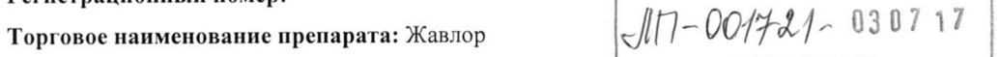
- стр. 1: «Fy Вода для инъекций до 2 мл до 4 мл до 10 мл» — повторное чтение: «Fy Вода для инъекций до2 мл до 4 мл до 10 мл»  
  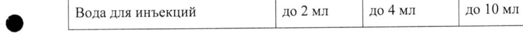
- стр. 2: «Период полувыведения винфлунина (Т1/2) равен 40 ч.» — низкая уверенность: «(Т1/2)» (26)  
  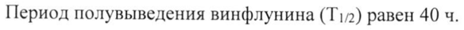
- стр. 2: «его период полувыведения (Т!/2) составляет приблизительно 120 ч.» — низкая уверенность: «(Т!/2)» (70)  
  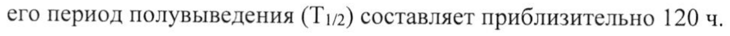
- стр. 2: «| ® абсолютное число нейтрофилов в крови менее 1,5 x 10%/л (1,500 клеток/мкл) при» — низкая уверенность: «10%/л» (69)  
  
- стр. 3: «циклов (1 раз в 3 недели).» — низкая уверенность: «(1» (76)  
  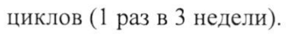
- стр. 4: «Нейтропения (АМС* < 1,0 x 10%/л) или - Приостановление лечения до — восстановления» — низкая уверенность: «1,0» (41), «10%/л)» (17)  
  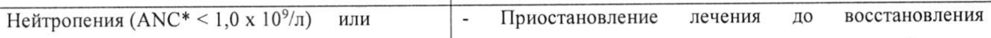
- стр. 4: «Тромбоцитопения (тромбоцитов < 100 x 10%/л) | (ANC > 1,0 x 10°/л и тромбоцитов > 100 x 10°/л), при» — низкая уверенность: «100» (63), «10%/л)» (53), «10°/л),» (41); повторное чтение: «Тромбоцитопения (тромбоцитов < 100 x 10°/л) | (ANC > 1,0 x 10°/л и тромбоцитов > 100 x 10°/л), при»  
  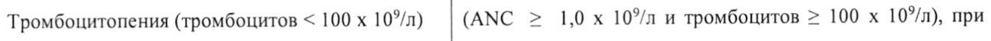
- стр. 4: «® (NCI CTC у. 2.0)* Начальная доза 320 mr/M? Начальная доза 280 мг/м*» — повторное чтение: «® (NCI CTC у. 2.0)* ee 320 i —y доза я —»  
  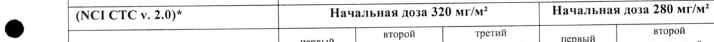
- стр. 4: «(АМС < 1,0 х 10% и» — низкая уверенность: «10%» (34); повторное чтение: «(АМС < 10 x 10” и»  
  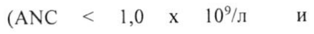
- стр. 4: «280 mr/m? | 250 мг/м? | прекращение | 250 мгим | PCXPANE» — низкая уверенность: «250» (25), «250» (79); повторное чтение: «280 мг/м2 | 250 мг/м? | прекращение | 250 мг/м? | р»  
  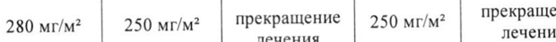
- стр. 4: «Рвота 3 степени > 6 раз в сутки требует премедикации или необходимости внутривенного введения» — повторное чтение: «Рвота 3 степени > 6 pa3 B сутки требует премедикации или необходимости внутривенного введения»  
  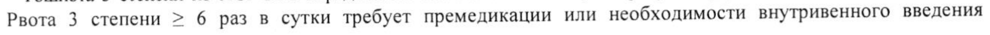
- стр. 7: «® №1: 500 мл инфузионный мешок с 0,9 % раствором натрия хлорида для инфузий» — повторное чтение: «© №1: 500 tai инфузионный епт 0,9 % раствором натрия хлорида для инфузий»  
  
- стр. 14: «хранения до введения. Длительность такого хранения не должна превышать 24 ч при» — повторное чтение: «хранения до введения. Длительность такого хранения не должна превышать 24 4 при»  
  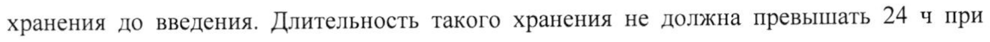
