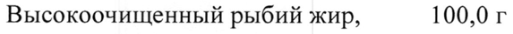
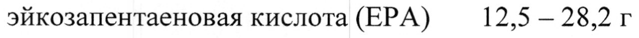
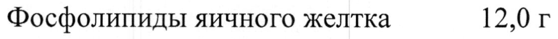
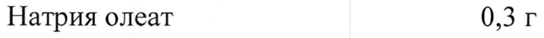
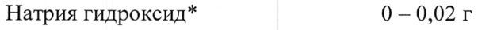
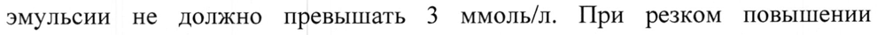
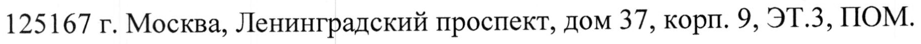

# Высокоочищенный рыбий жир — парентерально

- Препарат: Омегавен (эмульсия для инфузий;)
- АТХ: B05BA02
- Источник: ГРЛС, инструкция по медицинскому применению, РУ ЛС-002225, файл от 2022-01-10 (https://grls.rosminzdrav.ru/Grls_View_v2.aspx?routingGuid=3327438b-85ec-4ef9-9a0c-9bcf13a0a33d)
- Распознано автоматически (OCR): 12 из 12 стр.
- Инструкция к другому РУ того же препарата: ЛС-002225 (срок действия истёк, решение от 27.12.2021). Текст может быть старше действующего
- Сомнительных строк после OCR: 7 (см. раздел «Проверка распознавания»)

## Общие сведения

ЛС-002225-060720 МИНИСТЕРСТВО ЗДРАВООХРАНЕНИЯ РОССИЙСКОЙ ФЕДЕРАЦИИ
ИНСТРУКЦИЯ ПО МЕДИЦИНСКОМУ ПРИМЕНЕНИЮ ЛЕКАРСТВЕННОГО ПРЕПАРАТА
ОМЕГАВЕН Регистрационный номер: ЛС-002225
Торговое наименование: Омегавен Международное непатентованное или группировочное наименование:
w Жировые эмульсии для парентерального питания

## 3. Лекарственная форма

эмульсия для инфузий
эмульсия для инфузий

## 2. Состав

1000 мл содержат Действующее вещество:
1000 мл содержат Действующее вещество:
Высокоочищенный рыбий жир, 100,0 г содержащий, в том числе:
эйкозапентаеновая кислота (ЕРА) 12,5 — 28,2 г докозагексаеновая кислота (ОНА) 14,4-—30,9r
~ альфа-токоферол 0,150 - 0,296 г Вспомогательные вещества:
Фосфолипиды яичного желтка 12,0 г Глицерол 25,0T
Натрия олеат 0,3 г Натрия гидроксид* 0-—0,02 г
Вода для инъекций до 1000 мл * для коррекции рН
РН 7,5 — 8,7 Энергетическая ценность 4,7 МДж/л (= 1120 ккал/л)
119900 ЛС-002225-060720 С.2 Осмоляльность 308—376 мОсм/кг Н2О
Титруемая кислотность < 1 ммоль НСИл Описание
Белого цвета гомогенная эмульсия.
Фармакотерапевтическая группа Средство для парентерального питания
Код ATX: BOSBA02 Фармакологические свойства
Фармакодинамика wr Длинноцепочечные омега-3-жирные кислоты частично включаются в липиды плазмы и тканей. Докозагексаеновая кислота является важным компонентом структурных фосфолипидов клеточных мембран, эйкозапентаеновая кислота
— предшественник для синтеза эйкозаноидов: простагландинов, тромбоксанов, лейкотриенов и других липидных медиаторов.
Полиненасыщенные жирные кислоты семейства омега-3 влияют на биофизические характеристики клеточных мембран путем изменения состава фосфолипидов и содержания холестерина, что улучшает текучесть мембраны. Сопутствующее повышение способности к деформации клеток
© крови может являться объяснением улучшения реологических свойств крови при потреблении рыбьего жира или введении препарата Омегавен. Кроме того, полиненасыщенные жирные кислоты семейства омега-3 модифицируют функцию мембранных ферментных систем, рецепторов, а также передачу импульсов. Омега-3 жирные кислоты улучшают терапию патологических расстройств у недоношенных младенцев, а также воспалительных заболеваний кишечника, псориаза, атопического дерматита, сепсиса, ожогов, послеоперационных состояний, онкологических заболеваний. Препарат
Омегавен оказывает иммуномоделирующий эффект: восстанавливает соотношения липидных медиаторов воспаления (в том числе простагландинов, тромбоксанов, лейкотриенов, цитокинов).
119900 JIC-002225-060720 C.3 Наиболее важными являются длинноцепочечные жирные кислоты семейства омега-3: эйкозапентаеновая кислота (C20:5@-3) и докозагексаеновая кислота
(C22:6@-3). Способность человеческого организма — синтезировать эйкозапентаеновую и — докозагексаеновую кислоту очень низкая.
Следовательно, эйкозапентаеновая кислота и докозагексаеновая кислота должны поступать извне естественным путем с пищей или внутривенно.
Глицерол, содержащийся в препарате Омегавен, используется для образования энергии или реэстерифицируется вместе со свободными жирными кислотами в печени с формированием триглицеридов.
Фосфолипиды яичного желтка включаются в клеточные мембраны, являясь
& незаменимыми компонентами для поддержания их целостности, или гидролизуются.

## 5.2. Фармакокинетика

Размер липидных глобул, вводимых с препаратом Омегавен, и биологические свойства идентичны таковым для физиологических хиломикронов в крови. У здоровых мужчин-добровольцев, период полувыведения триглицеридов, вводимых внутривенно с препаратом Омегавен, составил 54 минуты.
Размер липидных глобул, вводимых с препаратом Омегавен, и биологические свойства идентичны таковым для физиологических хиломикронов в крови. У здоровых мужчин-добровольцев, период полувыведения триглицеридов, вводимых внутривенно с препаратом Омегавен, составил 54 минуты.

## 4.1. Показания к применению

Включение омега-3-жирных кислот, особенно эйкозапентаеновой и
Включение омега-3-жирных кислот, особенно эйкозапентаеновой и
- докозагексаеновой, в состав парентерального питания, когда пероральное или энтеральное питание невозможно, недостаточно или противопоказано.

## 4.3. Противопоказания

- Тяжелые нарушения свертывания крови;

- Определенные острые и жизнеугрожающие состояния, такие как:
коллапс и шок, острая стадия инфаркта миокарда, инсульт, эмболия, кома неясного генеза;

- Повышенная чувствительность к действующим веществам, рыбному белку, яичному белку или к любому из компонентов препарата;

119900 ЛС-002225-060720 С. 4 - Общие противопоказания для инфузионной терапии: гипокалиемия, гипергидратация, гипотоническая дегидратация, нестабильность метаболизма, ацидоз.
В связи с недостаточностью опыта клинического применения, препарат
Омегавен не рекомендуется назначать пациентам с тяжелой печеночной недостаточностью, тяжелой почечной недостаточностью, при беременности и в период грудного вскармливания и детям в возрасте до 18 лет.

## 4.3. С осторожностью

При нарушении метаболизма липидов и неконтролируемом сахарном
При нарушении метаболизма липидов и неконтролируемом сахарном
© диабете, а также у пациентов, нуждающихся в антикоагулянтной терапии.

## 4.6. Применение при беременности и в период грудного вскармливания

Данные, подтверждающие безопасность применения препарата Омегавен во время беременности и в период грудного вскармливания, отсутствуют.
Применение препарата Омегавен при беременности и в период грудного вскармливании допустимо только в случае острой необходимости.

## 4.2. Способ применения и дозы

Способ применения
Способ применения
Внутривенно, для инфузий в центральную или периферическую вену.
© Флакон перед применением следует встряхнуть.
Когда препарат назначается/используется с другими лекарственными средствами для парентерального питания (например растворами аминокислот, углеводами) через обычную систему для внутривенных вливаний, должна быть гарантирована совместимость применяемых препаратов и эмульсий.
Дозы Суточная доза составляет 1 — 2 мл препарата Омегавен/кг массы тела/сутки, что соответствует 0,1 — 0,2 г рыбьего жира/кг массы тела.
Для пациента весом 70 кг суточная доза составляет примерно 70 — 140 мл препарата Омегавен.
119900 ЛС-002225-060720 С.5

Максимальная суточная доза составляет 2 мл препарата Омегавен /кг массы тела/сутки.
Максимальная скорость инфузии не должна превышать 0,5 мл препарата
Омегавен/кг массы тела/ч, что соответствует 0,05 г рыбьего жира/кг массы тела/ч.
Следует строго соблюдать максимальную скорость инфузии, иначе может наблюдаться значительное повышение концентрации триглицеридов в плазме крови.
Препарат Омегавен можно назначать одновременно с другими жировыми эмульсиями и жирорастворимыми витаминами. Общее рекомендуемое

ww суточное потребление жиров составляет 1-2 г/кг массы тела. При одновременном введении препарата Омегавен с другими жировыми эмульсиями в качестве добавки или при его разведении перед введением, доля рыбьего жира, вводимого с препаратом Омегавен, должна составлять 10-20 % от рекомендуемого суточного потребления жиров.
Продолжительность применения Продолжительность применения препарата Омегавен не должна превышать 4 недели.
Специальные меры предосторожности |

© Использовать только гомогенную эмульсию из неповрежденной упаковки.
Перед применением препарат необходимо осмотреть визуально на наличие возможного расслоения эмульсии, а также убедиться, что не происходит разделения на фазы после приготовления раствора для инфузии после смешивания с другими лекарственными средствами (см. раздел
«Взаимодействие с другими лекарственными средствами»).
Один флакон только для однократного применения.
Неиспользованную эмульсию или остаток смеси следует уничтожить.

## 4.8. Побочное действие

Используется следующая классификация нежелательных реакций по частоте развития:
Используется следующая классификация нежелательных реакций по частоте развития:

119900 JIC-002225-060720

C. 6 Очень частые (> 1/10)
Частые (> 1/100, <1/10)
Нечастые (>1/1 000, <1/100)
Редкие (>1/10 000, <1/1 000)
Очень редкие (<1/10 000)
Частота развития неизвестна (сведения о частоте развития в имеющихся данных отсутствует).
Нежелательные реакции, которые могут наблюдаться при инфузии препарата
Омегавен. | Нарушения со стороны желудочно-кишечного тракта:

- Редкие: рыбный привкус во рту;
Лабораторные и инструментальные данные:
Редкие: удлинение времени кровотечения, угнетение (замедление)
агрегации тромбоцитов. Клинически значимых отклонений не наблюдалось.
Ниже указаны нежелательные реакции, которые могут быть связаны с применением жировых эмульсий.
Нарушения со стороны крови и лимфатической системы
Очень редкие: тромбоцитопения, гемолиз, ретикулоцитоз
Нарушения со стороны иммунной системы © Очень редкие: анафилактические реакции
Нарушения со стороны обмена веществ и питания
Нечастые: гипертриглицеридемия Нарушения со стороны нервной системы
Нечастые: головная боль Нарушения со стороны сосудов
Очень редкие: циркуляторные изменения (например, повышение или снижение артериального давления)
Нарушения со стороны кожи и подкожных тканей
Очень редкие: кожная сыпь, крапивница 119900
JIC-002225-060720 т Нарушения со стороны желудочно-кишечного тракта
Нечастые: боль в животе, тошнота, рвота Нарушения со стороны половых органов и молочной железы
Очень редкие: приапизм Общие расстройства и нарушения в месте введения
Нечастые: небольшое повышение температуры тела, дрожь, озноб, утомляемость
Лабораторные и инструментальные данные Очень редкие: транзиторное увеличение показателей функции печени
- Описаны случаи развития тромбоцитопении при длительном применении жировой эмульсии у детей грудного возраста.
Синдром жировой перегрузки Нарушение способности элиминировать триглицериды может привести к
«синдрому жировой перегрузки», который может быть вызван передозировкой любых жировых эмульсий. Необходимо следить за появлением возможных признаков метаболической перегрузки. Причина синдрома жировой перегрузки может быть генетической (индивидуальная особенность метаболизма), кроме того, на жировой обмен может повлиять
© текущее или ранее перенесенное заболевания. Синдром жировой перегрузки характеризуется гепатомегалией (с желтухой или без нее), изменением или снижением некоторых параметров свертывания крови (например, время кровотечения, время коагуляции, протромбиновое время, количество тромбоцитов), спленомегалией, анемией, лейкопенией, тромбоцитопенией, нарушением свертывания крови, отклонением от нормы показателей функции печени, повышение температуры тела, гиперлипидемией, головная боль, боль в животе, утомляемость, гипергликемия.
Симптомы имеют обратимый характер и обычно исчезают после прекращения инфузии.
119900 JIC-002225-060720 C.8

В случае развития перечисленных нежелательных реакций или повышении

концентрации триглицеридов выше 3 ммоль/л введение препарата Омегавен

необходимо прекратить или, при необходимости, продолжить инфузию с

более низкой скоростью.

## 4.9. Передозировка

Передозировка может привести к развитию нежелательных реакций.

Передозировка с развитием синдрома жировой перегрузки может возникнуть

при резком повышении концентрации триглицеридов (более 3 ммоль/л) во

время инфузии жировой эмульсии как результат очень быстрого введения,
, или развиваться постепенно при соблюдении рекомендуемой скорости
~ инфузии препарата на фоне изменения общего состояния пациента,

например, при нарушении функции почек или инфекции.

При передозировке необходимо немедленное прекратить введение препарата

Омегавен или, при необходимости, продолжить инфузию со сниженной

дозой препарата.

Инфузию жировой эмульсии также прекращают в случае выраженного

повышения концентрации глюкозы в крови при введении препарата

Омегавен. Тяжелая степень передозировки препаратом Омегавен без

одновременного внутривенного введения с раствором углеводов может w привести к развитию метаболического ацидоза.

## 4.5. Взаимодействие с другими лекарственными средствами

Внутривенное введение препарата Омегавен может вызвать удлинение

времени кровотечения и угнетение агрегации тромбоцитов, поэтому препарат

Омегавен следует назначать с осторожностью пациентам, нуждающимся в

антикоагулянтной терапии, даже принимая во внимание возможное

снижение дозы этих препаратов.

Препарат Омегавен можно смешивать с другими жировыми эмульсия и

препаратами жирорастворимых витаминов (Виталипид Н).

| 19900 JIC-002225-060720 („9

Несовместимость: Несовместимость может появиться при добавлении поливалентных катионов (например, кальций) особенно в сочетании с гепарином.

## 4.4. Особые указания

Препарат Омегавен следует применять с осторожностью у пациентов с нарушенным метаболизмом липидов и неконтролируемым сахарным диабетом.
Препарат Омегавен следует применять с осторожностью у пациентов с нарушенным метаболизмом липидов и неконтролируемым сахарным диабетом.
Необходимо ежедневно контролировать содержание триглицеридов в плазме крови и регулярно контролировать другие лабораторные показатели
(глюкоза, электролиты, свертываемость крови и др.).

we Содержание триглицеридов в плазме крови во время инфузии жировой эмульсии не должно превышать 3 ммоль/л. При резком повышении концентрации триглицеридов (более 3 ммоль/л) во время инфузии препарата может возникнуть передозировка с развитием синдрома жировой перегрузки как результат очень быстрого введения, или синдрома жировой перегрузки может развиваться постепенно при соблюдении рекомендуемой скорости инфузии на фоне изменения общего состояния пациента, например, при нарушении функции почек или инфекции.
Внутривенное введение препарата Омегавен может вызвать удлинение

© времени кровотечения и угнетение агрегации тромбоцитов, поэтому препарат
Омегавен следует назначать с осторожностью пациентам, нуждающимся в антикоагулянтной терапии, даже принимая во внимание возможное снижение дозы этих препаратов. Необходимо проводить регулярный мониторинг лабораторных показателей, которые включают определение концентрации глюкозы в плазме крови, кислотно-основное состояние, водноэлектролитный баланса, развернутый общий анализ крови и время кровотечения у пациентов, получающих лечение антикоагулянтами.
Препарат Омегавен не следует применять при — известной гиперчувствительности к рыбному или яичному белку. При проявлении

19900 ЛС-002225-060720

С. 10 анафилактических реакций инфузию препарата следует немедленно прекратить.
Влияние на лабораторные показатели Высокие концентрации липидов в плазме крови могут оказывать влияние на результаты некоторых лабораторных показателей, например, содержанию гемоглобина, и приводить к транзиторному увеличению показателей функции печени.
Учитывая, что при использовании центрального или периферического венозного доступа, риск возникновения инфекции повышен, необходимо строго придерживаться асептики во время катетеризации вен и манипуляций

& с катетером.
Смешивание препарата Омегавен с жировыми эмульсиями и жирорастворимыми витаминами необходимо проводить в асептических условиях. Смеси, содержащие препарат Омегавен, химически и физически стабильны в течение 24 часов при температуре 25 °С. С микробиологической точки зрения смеси, содержащие жировые эмульсии, или жировые эмульсии, в состав которых входят жирорастворимые витамины, должны быть использованы немедленно после приготовления. При неиспользовании смеси сразу после приготовления ответственность за определение срока и условий
© хранения до момента использования несет медицинский работник.
С микробиологической точки зрения смеси, приготовленные в неконтролируемых и невалидированных условиях, должны быть использованы в течение 24 часов, включая время введения смеси.

## 4.7. Влияние на способность управлять транспортными средствами, механизмами

Не сообщалось о влиянии препарата на способность управлять автомобилем и работать с механизмами.
119900 JIC-002225-060720 С. 11 Форма выпуска
Эмульсия для инфузий По 50 или 100 мл во флакон бесцветного стекла, укупоренный резиновой
(галобутиловой) пробкой и обкатанный алюминиевым колпачком с пластиковой крышкой-контролем первого вскрытия. По 10 флаконов вместе с пластиковыми держателями или без них в коробку картонную с инструкцией по применению.

## 6.4. Условия хранения

Хранить при температуре не выше 25 °С. Не замораживать.
Хранить при температуре не выше 25 °С. Не замораживать.
Хранить в недоступном для детей месте.
~ Срок годности 1,5 года.
Не применять после истечения срока годности, указанного на упаковке.
Условия отпуска Для стационаров.
Производитель | Фрезениус Каби Австрия ГмбХ, Хафнерштрассе 36, 8055 Грац, Австрия
Вторичный упаковщик:
© Фрезениус Каби Австрия ГмбХ, Хафнерштрассе 36, 8055 Грац, Австрия
ИЛИ Фрезениус Каби Австрия ГмбХ, Эстерманнштрассе 17, 4020 Линц, Австрия
ИЛИ Фрезениус Каби Австрия ГмбХ, Технопарк 6, 8402 Верндорф, Австрия
Владелец регистрационного удостоверения/Организация, уполномоченная принимать претензии потребителей
Фрезениус Каби Дойчланд ГмбХ, Германия ООО «Фрезениус Каби»
125167 г. Москва, Ленинградский проспект, дом 37, кори. 9, ЭТ.3, ПОМ.
XXIV, КОМ.15 119900 ЛС-002225-060720 С. 12
Тел.: +7 (495) 988-45-78 www.fresenius-kabi.ru
Менеджер по регистрации Vig М И А ООО Фрезениус Каби | „о JLA: Полозова
X С. \ 7 и S у Sie - a M3PO ООО ЭКСП ОТЧЕТ E |
Ё acTaMaNEL ANE ARH фе | © | версии документа |Ё|
ЦЕ, ПЕ. К.И... К ВЫ 119900
## Проверка распознавания

Страницы-сканы распознаны автоматически. В 7 строках с дозировками цифры могли распознаться с ошибкой — сверьте с вырезкой из оригинала:

- стр. 1: «Высокоочищенный рыбий жир, 100,0 г» — низкая уверенность: «100,0» (67)  
  
- стр. 1: «эйкозапентаеновая кислота (ЕРА) 12,5 — 28,2 г» — низкая уверенность: «28,2» (50)  
  
- стр. 1: «Фосфолипиды яичного желтка 12,0 г» — низкая уверенность: «12,0» (65)  
  
- стр. 1: «Натрия олеат 0,3 г» — низкая уверенность: «0,3» (30)  
  
- стр. 1: «Натрия гидроксид* 0-—0,02 г» — низкая уверенность: «0-—0,02» (53)  
  
- стр. 9: «эмульсии не должно превышать 3 ммоль/л. При резком повышении» — повторное чтение: «эмульсии не должно превышать 3 ммолыл. При резком повышении»  
  
- стр. 11: «125167 г. Москва, Ленинградский проспект, дом 37, кори. 9, ЭТ.3, ПОМ.» — низкая уверенность: «ЭТ.3,» (80)  
  
