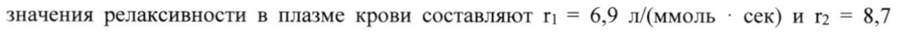
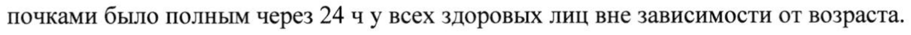
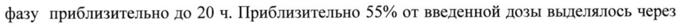
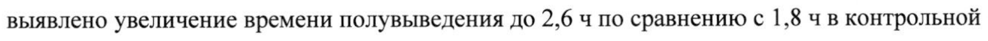

# Гадоксетовая кислота — парентерально

- Препарат: Примовист® (раствор для внутривенного введения;)
- АТХ: V08CA10
- Источник: ГРЛС, инструкция по медицинскому применению, РУ ЛСР-003252/07, файл от 2023-01-18 (https://grls.rosminzdrav.ru/Grls_View_v2.aspx?routingGuid=299ada96-e10e-4ee2-af41-f1da9f19749d)
- Распознано автоматически (OCR): 17 из 17 стр.
- Инструкция к другому РУ того же препарата: ЛСР-003252/07 (национальное РУ, переоформленное по правилам ЕАЭС, решение от 23.12.2022). Текст может быть старше действующего
- Сомнительных строк после OCR: 4 (см. раздел «Проверка распознавания»)

## Общие сведения

ЛСР-003252/07-280217 МИНИСТЕРСТВО ЗДРАВООХРАНЕНИЯ РОССИЙСКОЙ ФЕДЕРАЦИИ
ИНСТРУКЦИЯ по применению лекарственного препарата для медицинского применения

Примовист® /Primovist® Регистрационный номер: ЛСР-003252/07
Торговое наименование препарата: Примовист® /Primovist®
Международное непатентованное наименование: Гадоксетовая кислота

## 3. Лекарственная форма

раствор для внутривенного введения
раствор для внутривенного введения

## 2. Состав

1 мл препарата содержит:
Активное вещество: 181,430 мг (0,25 ммоль) гадоксетовой кислоты динатриевой соли
Вспомогательные вещества:

- Калоксетовой кислоты тринатриевая соль 1,000 мг,

- трометамол 1,211 мг,

- хлористоводородная кислота 3,6 % (вес/вес) 8,400 мг,

- натрия гидроксид до pH 7,2 — 7,6 0,264 мг,

| - вода для инъекций 901,195 мг.
ОПИСАНИЕ Прозрачный от бесцветного до светло-желтого цвета раствор, свободный от механических включений.
Физико-химические свойства Осмоляльность при 37° С (мОсм/кг воды) — 688
Вязкость при 37° С (мПа:с) -1,19 РН 6,8-8,0 760759

CCDS 7 1 JICP-003252/07-280217

ФАРМАКОТЕРАПЕВТИЧЕСКАЯ ГРУППА

Контрастное средство для МРТ

КОД АТХ

У08СА10

ФАРМАКОЛОГИЧЕСКИЕ СВОИСТВА

Препарат Примовист® — это парамагнитное контрастное вещество, предназначенное для

магнитно-резонансной томографии (МРТ).

Контрастирующий эффект обусловлен гадоксетовой кислотой — ионным комплексом,

состоящим из гадолиния (Ш) и лиганда — этоксибензилдиэтилентриамин-пентауксусной

кислоты.

При сканировании с помощью Т!-взвешенных импульсных последовательностей при

проведении протонной магнитно-резонансной визуализации индуцированное ионами

гадолиния укорочение времени спин-решеточной релаксации возбужденных атомарных

ядер приводит к увеличению интенсивности сигнала и, таким образом, к повышению

контрастности изображения определенных тканей.

Фармакодинамика гадоксетовой кислоты динатриевой соли вызывает выраженное

укорочение времени релаксации даже при низких концентрациях. При РН 7,

напряженности магнитного поля 0,47 Тл и температуре 40°C релаксивность (г1), которая

определяется по влиянию на время спин-решеточной релаксации (Т!) протонов плазмы,

составляет приблизительно 8,18 л/(ммоль ‘ сек), а релаксивность (r2), которая

определяется по влиянию на время спин-спиновой релаксации (Т>), составляет

приблизительно 8,56 л/(ммоль : сек). При 1,5 Тл и при температуре 37°C соответствующие

значения релаксивности в плазме крови составляют г! = 6,9 л/(ммоль ` сек) и 12 = 8,7

л/(ммоль ° сек). Релаксивность характеризуется небольшой обратной зависимостью OT

напряженности магнитного поля.

Этоксибензилдиэтилентриамин-пентаацетат формирует стабильный комплекс с ионами

парамагнетика гадолиния, который характеризуется крайне высокой стабильностью in

vivo и in vitro (константа термодинамической стабильности: log Kaa = -23,46).
| CCDS 7 96759 2 JICP-003252/07-280217 Гадоксетовой кислоты динатриевая соль — это хорошо растворимое в воде гидрофильное соединение со значением коэффициента распределения между н-бутанолом и буфером при РН 7,6 приблизительно 0,011. В связи с наличием липофильной этоксибензольной группы гадоксетовой кислоты динатриевая соль характеризуется двухфазным механизмом действия: вначале после болюсной инъекции гадоксетовой кислоты динатриевая соль распределяется во внеклеточном пространстве, а затем подвергается селективному захвату гепатоцитами. Релаксивность г! в ткани печени составляет 16,6 л/(ммоль ` сек) (при 0,47 Тл), что обуславливает повышение интенсивности сигнала от ткани печени. Затем гадоксетовой кислоты динатриевая соль выводится через кишечник.
Вещество He характеризуется какими-либо выраженными — ингибирующими взаимодействиями с ферментами в клинически значимых концентрациях.

## 5.2. Фармакокинетика

Гадоксетовой кислоты динатриевая соль ведет себя в организме как другие высоко гидрофильные биологически инертные соединения, которые выводятся почками и печенью через кишечник.
Гадоксетовой кислоты динатриевая соль ведет себя в организме как другие высоко гидрофильные биологически инертные соединения, которые выводятся почками и печенью через кишечник.
Всасывание и распределение После внутривенного введения профиль зависимости плазменной концентрации гадоксетовой кислоты — динатриевой соли от времени характеризуется биэкспоненциальным снижением. Общий объем распределения для гадоксетовой кислоты динатриевой соли в равновесном состоянии составляет приблизительно 0,21 л/кг
(внеклеточное пространство). Препарат связывается белками плазмы крови менее чем на 10%.
Гадоксетовая кислота не проходит через неповрежденный гематоэнцефалический барьер и проникает через плацентарный барьер в небольшой степени.
Метаболизм Гадоксетовой кислоты динатриевая соль не метаболизируется.
Выведение Гадоксетовой кислоты динатриевая соль полностью выводится в равных количествах | почками и печенью через кишечник. |
Время полувыведения для гадоксетовой кислоты динатриевой соли (доза от 0,01 до 0,1 ммоль/кг) в терминальную фазу у здоровых лиц составило приблизительно 1 час. |
CCDS 7 К:
JICP-003252/07-280217 Общий плазменный клиренс (CL) составил 250 мл/мин. Почечный клиренс (CLR)
составляет приблизительно 120 мл/мин. Это значение сходно со значением скорости клубочковой фильтрации у здоровых лиц.
Линейность нелинейность Гадоксетовой кислоты динатриевая соль характеризуется линейной фармакокинетикой, т.е. параметры фармакокинетики изменяются пропорционально дозе (например, Смах, |
| площадь под кривой «концентрация время» (AUC) или не зависят от дозы (например, Vss, | ti) при дозе до 100 мкмоль/кг массы тела (0,4 мл/кг).
| Дополнительная информация для особых групп пациентов
В исследовании Ш фазы с применением препарата Примовист® в дозе 25 мкмоль/кг массы |
| тела проводилось сравнение пациентов с различной степенью нарушений функции | печени, с нарушением функции почек и с одновременным нарушением функции печени и почек, а также у здоровых лиц разных возрастных групп, включая пожилых.
e Пол Общий клиренс был приблизительно на 20% ниже у женщин (185 мл/мин) по сравнению с мужчинами (236 мл/мин).
e Пациенты пожилого возраста (возраст 65 лет и старше)
В соответствии с физиологическими изменениями функции почек с возрастом плазменный клиренс гадоксетовой кислоты динатриевой соли снижался с 210 мл/мин у лиц молодого и среднего возраста до 163 мл/мин у пожилых пациентов в возрасте 65 лет и старше. Значения времени полувыведения в терминальную фазу и системной экспозиции были выше у пожилых (2,3 ч и 197 мкмоль ` ч/л соответственно) по сравнению с контрольной группой (1,8 чи 160 мкмоль : ч/л соответственно). Выведение препарата почками было полным через 24 ч у всех здоровых лиц вне зависимости от возраста.
e Нарушение функции почек и/или печени У пациентов с умеренно выраженным нарушением функции почек наблюдалось увеличение AUC до 237 мкмоль ` ч/л и конечного времени полувыведения до 2,2 ч. У
| пациентов с терминальной стадией почечной недостаточности наблюдалось увеличение
AUC приблизительно до 903 мкмоль ` ч/л и времени полувыведения в терминальную
CCDS 7 4 ЛСР-003252/07-280217 6 20 ч. Приб 55% i

фазу приблизительно до 20 4. Приблизительно 55% от введенной дозы выделялось через кишечник в течение периода наблюдения длительностью 6 дней, большей части — в течение 3 дней. |
У пациентов с легким и среднетяжелым нарушением функции печени наблюдалось небольшое или среднее увеличение плазменных значений AUC, времени полувыведения и экскреции почками, а также снижение гепатобилиарной экскреции по сравнению со здоровыми лицами.
У пациентов с тяжелым нарушением функции печени, особенно у пациентов с аномально высокими концентрациями билирубина в плазме (> 3 мг/дл) наблюдалось увеличение
AUC до 259 мкмоль - ч/л по сравнению со 160 мкмоль ` ч/л в контрольной группе. Было выявлено увеличение времени полувыведения до 2,6 ч по сравнению с 1,8 ч в контрольной группе. Наблюдалось значительное снижение гепатобилиарной экскреции до 5,7% от введенной дозы у этих пациентов.
Гадоксетовой кислоты динатриевую соль можно вывести из организма путем гемодиализа. Приблизительно 30% от введенной дозы обнаруживалось в диализате в течение трехчасового диализа при условии его начала через один час после инъекции. В

| исследовании с участием пациентов с конечной стадией почечной недостаточности гадоксетовой кислоты динатриевая соль практически полностью выводилась посредством диализа и за счет гепатобилиарной экскреции в течение 6 дней. Концентрации гадоксетовой кислоты динатриевой соли в плазме у таких пациентов поддавались измерению в течение срока до 72 часов после его введения (см. раздел «Особые указания»).

## 4.1. Показания к применению

Вводимый внутривенно препарат Примовист® предназначен исключительно для диагностических целей.
Вводимый внутривенно препарат Примовист® предназначен исключительно для диагностических целей.
Препарат Примовист® представляет собой парамагнитное контрастное средство на основе гадолиния и используется для Т1-взвешенной магнитно-резонансной визуализации
(МРВ) печени. На динамических и отсроченных изображениях препарат Примовист® улучшает выявление очаговых поражений печени (в том числе их количества, размера,

CCDS 7 5 _ м о ии пы об о ВЗР ЛСР-003252/07-280217

сегментарного распределения и визуализации) и позволяет получить дополнительные данные по характеристике и классификации очаговых поражений печени, увеличивая тем самым достоверность диагноза.

## 4.3. Противопоказания

® гиперчувствительность к активному веществу или любому из вспомогательных компонентов препарата;

e препарат не рекомендован к применению у детей младше 18 лет, вследствие недостаточности данных об эффективности и безопасности.

## 4.3. С осторожностью

e Гиперчувствительность к сходным контрастным средствам на основе гадолиния (КСОГ) в анамнезе
Применение препарата у пациентов с наличием в анамнезе реакций гиперчувствительности к контрастным средствам, наличием в анамнезе аллергических заболеваний, в том числе бронхиальной астмы, возможно только после тщательной оценки соотношения польза/риск. Большинство этих реакций отмечаются в пределах получаса после введения препарата. Тем не менее, как и при использовании других контрастных средств этого класса, в редких случаях возможно развитие отсроченных реакций (от нескольких часов до дней).
Применение препарата должно быть ограничено введением стандартной дозы.

® Сердечно-сосудистая патология

Данные по введению препарата Примовист® пациентам с тяжелыми сердечнососудистыми заболеваниями ограничены, поэтому в этих случаях необходимо соблюдать осторожность.
Необходимо особенно тщательно оценивать соотношение польза/риск у пациентов с риском развития аритмий, в частности, пациентов с удлиненным интервалом ОТ и при применении ЛС, удлиняющих интервал ОТ.

® Тяжелые заболевания почек У пациентов с тяжелыми нарушениями функции почек замедлено выведение контрастных средств, поэтому в таких случаях необходимо тщательно оценивать соотношение польза/риск. Повторное введение не должно осуществляться в течение 7 дней у пациентов с острыми или хроническими тяжелыми нарушениями функции почек.

CCDS 7 rOlo4 6 ЛСР-003252/07-280217

Имеются сообщения о связи нефрогенного системного фиброза (НСФ) с использованием некоторых контрастных средств, содержащих гадолиний, у пациентов с острыми или хроническими тяжелыми нарушениями функции почек (СКФ < 30 мл/мин/1,73 м²) и | острой почечной недостаточностью любой степени тяжести вследствие гепаторенального синдрома или в период до и после трансплантации печени. Поэтому применять препарат
Примовист® у таких пациентов можно лишь после тщательной оценки соотношения польза/риск (см. раздел «Побочное действие»).

## 4.6. Применение при беременности и в период грудного вскармливания

Беременность Клинические данные по применению гадоксетовой кислоты динатриевой соли у беременных отсутствуют.
Исследования на животных с применением клинически значимых доз не выявили репродуктивной токсичности после повторного применения.

Потенциальный риск для человека неизвестен.
Отсутствует опыт применения препарата Примовист® у людей во время беременности. Не следует применять препарат Примовист® для обследования беременных женщин, за исключением тех случаев, когда проведение МРТ с контрастным усилением представляется крайне необходимым и предполагаемая польза для матери от его применения превышает потенциальный риск для плода.
Период грудного вскармливания Неизвестно, выделяется ли гадоксетовой кислоты динатриевая соль в грудное молоко человека.
Доклинические исследования показали, что малые количества гадоксетовой кислоты динатриевой соли (менее 0,5% от внутривенно введенной дозы) выделяются в грудное молоко, при этом его всасывание через желудочно-кишечный тракт незначительно
(приблизительно 0,4% от пероральной дозы выводится почками).
Грудное вскармливание следует прекратить на 24 часа после введения препарата
Примовист®.
CCDS 7 | Я ЛСР-003252/07-280217 СПОСОБ ПРИМЕНЕНИЯ И ДОЗЫ

Препарат Примовист® предназначен для внутривенного введения.

Доза вводится в неразведенном виде путем внутривенной болюсной инъекции. После инъекции контрастного средства внутривенную канюлю/катетер следует промыть 0,9% раствором хлорида натрия.

После болюсной инъекции препарата Примовист® динамическая визуализация в артериальной, портовенозной и равновесной фазах позволяет получить неодинаковую временную картину контрастирования разных типов поражений печени. Эта информация дает возможность классифицировать выявленные образования

| (доброкачественные/злокачественные) и описать их специфические характеристики.

Данный метод исследования дополнительно улучшает визуализацию гиперваскулярных поражений печени.
Отсроченная (гепатоспецифическая) фаза начинается примерно через 10 минут после инъекции (в подтверждающих исследованиях большинство данных были получены через 20 минут после инъекции), при этом период визуализации длится не менее 120 минут. У пациентов, которым требуется гемодиализ, а также у пациентов с повышенной концентрацией билирубина (>3 мг/дл) период визуализации сокращается до 60 минут (см.
раздел «Взаимодействие с другими лекарственными препаратами»).

Выявление поражений улучшается при контрастировании паренхимы печени во время гепатоспецифической фазы, позволяя определить количество очагов поражения, их сегментарное расположение, визуализацию и границы. Различие поражений печени по характеру динамики контрастирования/вымывания контрастного вещества позволяет получить дополнительную информацию.

Печеночная экскреция препарата Примовист® обеспечивает контрастирование

желчевыводящей системы.

Необходимо соблюдать общепринятые меры предосторожности при проведении

магнитно-резонансной томографии. При наличии у пациента кардиостимулятора и

ферромагнитного имплантируемого устройства не рекомендуется проведение магнитно-

резонансной томографии.

В течение двух часов перед обследованием пациент должен воздерживаться от приема

пищи для снижения риска аспирации, поскольку все контрастные средства могут |

вызывать такие побочные действия как тошнота и рвота. |
|

CCDS 7 oO 8

| ЛСР-003252/07-280217 По возможности, во время введения контрастного средства пациент должен находиться в горизонтальном положении.
Дозы:
Взрослые:
0,1 мл/кг препарата Примовист® (что соответствует 25 мкмоль/кг массы тела).
Некоторые группы пациентов:
® Пациенты пожилого возраста (старше 65 лет)
Корректировки дозы не требуется. Учитывая данные клинических исследований и опыт применения препарата в клинической практике, различий в эффективности и безопасности у молодых и пожилых (старше 65 лет) пациентов не выявлено.
® Гациенты с нарушениями функции печени Корректировки дозы не требуется. Учитывая данные клинических исследований и опыт применения препарата в клинической практике, различий в эффективности и
| безопасности у пациентов с нормальной и нарушенной функцией печени не выявлено.
® Пациенты с нарушениями функции почек В ходе клинических исследований различий в эффективности и безопасности применения препарата у пациентов с нормальной и нарушенной функцией почек обнаружено не было. У пациентов с нарушениями функции почек замедлено выведение гадоксетовой кислоты динатриевой соли, однако для получения изображения высокого качества, корректировку дозы проводить не следует (см. раздел
«Особые указания»).
Правила использования/обращения с препаратом
Визуальный осмотр Лекарственный препарат необходимо тщательно осмотреть перед применением.
Препарат Примовист® не следует применять в случае выраженного изменения цвета, появления механических включений и при наличии дефектов упаковки.
Флаконы Данный лекарственный препарат представляет собой готовый к применению раствор, предназначенный только для однократного использования.
j 97 CCDS 7 9 ЛСР-003252/07-280217 Набор препарата в шприц проводят непосредственно перед введением. Резиновую пробку флакона следует проколоть один раз, повторный забор препарата из флакона недопустим.
Предварительно наполненные шприцы Предварительно наполненный шприц следует вынуть из упаковки и приготовить для инъекции непосредственно перед обследованием. Колпачок с наполненного шприца следует снять непосредственно перед введением препарата.
Остаток неиспользованного контрастного средства следует уничтожить.
| ПОБОЧНОЕ ДЕЙСТВИЕ | Общий профиль безопасности препарата Примовист® основан на данных о применении у
| 1900 пациентов в рамках клинических исследований и на результатах постмаркетингового наблюдения.
Наиболее часто (> 0,5%) встречались такие нежелательные реакции, как тошнота, головная боль, приливы жара, повышение артериального давления и головокружение.
Наиболее серьезной нежелательной реакцией у пациентов, получавших препарат
Примовист®, является анафилактический шок.
В редких случаях наблюдались отсроченные реакции по типу аллергических (от нескольких часов до нескольких дней после введения препарата).
Большинство побочных явлений было легкой и умеренной интенсивности.

## 4.8. Побочное действие

, которые наблюдались после применения препарата Примовист®, классифицированы по системам органов (классификация MedDRA) и представлены в таблице ниже. Нежелательные реакции, выявленные в ходе клинических исследований, распределены по частоте возникновения. Распределение по частоте проводится следующим образом: часто - от > 1/100 до < 1/10, нечасто - от > 1/1000 до < 1/100, редко - от > 1/10 000 до < 1/1000. Нежелательные реакции, выявленные только на этапе постмаркетинговых наблюдений, для которых нельзя провести оценку частоты, отнесены к категории «частота неизвестна».
, которые наблюдались после применения препарата Примовист®, классифицированы по системам органов (классификация MedDRA) и представлены в таблице ниже. Нежелательные реакции, выявленные в ходе клинических исследований, распределены по частоте возникновения. Распределение по частоте проводится следующим образом: часто - от > 1/100 до < 1/10, нечасто - от > 1/1000 до < 1/100, редко - от > 1/10 000 до < 1/1000. Нежелательные реакции, выявленные только на этапе постмаркетинговых наблюдений, для которых нельзя провести оценку частоты, отнесены к категории «частота неизвестна».
В пределах каждой группы, выделенной по частоте, нежелательные явления представлены в порядке уменьшения тяжести.
ужа CCDS 7 at Bi 10 ЛСР-003252/07-280217
Таблица 1: Нежелательные реакции, выявленные при применении препарата Примовист® в ходе клинических исследований или по данным постмаркетингового контроля
О | tener | me | eon Часто Нечасто Редко Частота неизвестна органов
Нарушения со Гиперчувствительность/анафилакстороны тоидные реакции (например, иммунной шок*, снижение артериального системы давления, отек гортани и глотки, крапивница, отек лица, ринит, конъюнктивит, боль в животе, гипестезия, чихание, кашель,
| бледность)
Нарушения со Головная | Головокру- Тремор Беспокойство стороны боль жение Акатизия нервной Нарушение
| системы вкусовых | ощущений | Парестезии
Извращение обоняния Нарушения со Блокада ножек Тахикардия стороны сердца пучка Гиса
Ощущение сердцебиения Нарушения со Повышение стороны артериального сосудов давления
«Приливы»
жара Нарушения со Нарушения | стороны дыхания дыхательной (одышка*, системы, респираторный органов дистрессгрудной клетки синдром)
и средостения п ай Е 000 ОНИ 7675 9 CCDS 7 11
ЛСР-003252/07-280217 |

стороны Сухость во рту | ощущения во рту.
желудочно- Повышенное кишечного слюнообразование тракта
Нарушения со Сыпь Макулопапулезная стороны кожи Зуд** сыпь и подкожных Повышенное тканей потоотделение
Нарушения со Боль в спине стороны скелетномышечной и соединительной ткани
Общие Боль в груди Ощущение расстройства и Реакции в дискомфорта нарушения в месте Недомогание месте инъекции инъекции***

Чувство жара

Озноб

Чувство

усталости

Плохое

| самочувствие

* Сообщалось об угрожающих жизни и/или летальных случаях. Эти сообщения были получены в постмаркетинговый период.
** Зуд (генерализованный зуд, зуд в глазах).
*** Реакции (различного рода) в месте инъекции: экстравазация в месте инъекции, жжение в месте инъекции, ощущение холода в месте инъекции, раздражение в месте инъекции, боль в месте инъекции.
Описание отдельных нежелательных реакций
Имеются сообщения о случаях развития нефрогенного системного фиброза (НСФ) при применении некоторых гадолиний содержащих контрастных средствах (см. также раздел
«Особые указания»).
После введения препарата Примовист® менее чем у 1% пациентов отмечалось незначительное повышение концентрации железа и билирубина в плазме. Однако эти
CCDS 7 7O7 95 12 ЛСР-003252/07-280217 значения не превышали исходные более чем в 2-3 раза и возвращались к первоначальным значениям в пределах 1-4 дней без развития каких-либо симптомов.

| Со стороны лабораторных показателей при введении препарата Примовист® возможно | развитие таких побочных эффектов как: повышение активности «печеночных»
трансаминаз, снижение уровня гемоглобина, лейкоцитурия, — гипергликемия, гипонатриемия, лейкоцитоз, гипокалиемия.

## 4.9. Передозировка

Однократное введение гадоксетовой кислоты динатриевой соли в дозе до 0,4 мл/кг (100 мкмоль/кг) хорошо переносится. Среди ограниченного числа пациентов в ходе клинических исследований испытывалась доза 2 мл/кг (500 мкмоль/кг) массы тела. У этих пациентов наблюдалась повышенная частота побочных эффектов, но каких-либо дополнительных побочных реакций обнаружено не было.
Однократное введение гадоксетовой кислоты динатриевой соли в дозе до 0,4 мл/кг (100 мкмоль/кг) хорошо переносится. Среди ограниченного числа пациентов в ходе клинических исследований испытывалась доза 2 мл/кг (500 мкмоль/кг) массы тела. У этих пациентов наблюдалась повышенная частота побочных эффектов, но каких-либо дополнительных побочных реакций обнаружено не было.
При клиническом применении о случаях передозировки не сообщалось. Таким образом, признаки и симптомы передозировки гадоксетовой кислоты динатриевой солью не описаны.
Специфического антидота не существует и лечение симптоматическое.
Пациенты с нарушениями функции почек и/или печени
В случае непреднамеренной передозировки у пациентов с тяжелыми нарушениями функции почек и/или печени препарат Примовист® можно вывести из организма путем гемодиализа (см. разделы «Особые указания» и «Фармакокинетика»).

## 4.5. Взаимодействие с другими лекарственными средствами

Взаимодействие с ингибиторами транспортного белка органических анионов.
Исследования на животных показали, что соединения, принадлежащие к классу анионных лекарственных препаратов, например, рифампицин, уменьшают захват гадоксетовой кислоты клетками печени, тем самым снижая эффективность контрастирования печени. В этом случае ожидаемая польза от введения препарата Примовист® может проявиться не в полной мере. По данным исследований у животных других взаимодействий с лекарственными препаратами выявлено не было.
В исследовании у здоровых добровольцев было показано, что одновременное применение с ингибитором транспортного белка органических анионов эритромицином не оказывало |
CCDS 7 POC OY 13: _.
ЛСР-003252/07-280217 влияния на эффективность и фармакокинетику гадоксетовой кислоты. Прочих клинических исследований по взаимодействию с другими лекарственными препаратами не проводилось.
® Влияние повышенного содержания билирубина или ферритина
Повышение концентрации билирубина (> 3 мг/дл) или ферритина может уменьшить эффективность контрастирования печени препаратом Примовист®. При применении препарата Примовист*® у таких пациентов процедуру магнитно-резонансной томографии необходимо завершить не позже, чем через 60 минут после введения препарата.
® Влияние на результаты диагностических тестов
При определении содержания железа в сыворотке крови комплексонометрическими методами (например, методом комплексообразования с ферроцином) в течение 24 часов

после обследования с использованием препарата Примовист® возможно получение ложно завышенных или ложно заниженных значений из-за присутствия в растворе контрастного препарата свободного комплексообразующего вещества тринатриевой соли калоксетовой
| кислоты.
| ® Несовместимость Ввиду отсутствия исследований о несовместимости данный медицинский препарат не должен смешиваться с другими лекарственными средствами.

## 4.4. Особые указания

® [иперчувствительность Как и для других препаратов этого класса, введение препарата Примовист® может быть связано с развитием реакций гиперчувствительности/аллергических реакций или других проявлений идиосинкразии, характеризующихся сердечно-сосудистыми, дыхательными или кожными проявлениями. Возможны тяжелые реакции, в том числе анафилактический шок.
® [иперчувствительность Как и для других препаратов этого класса, введение препарата Примовист® может быть связано с развитием реакций гиперчувствительности/аллергических реакций или других проявлений идиосинкразии, характеризующихся сердечно-сосудистыми, дыхательными или кожными проявлениями. Возможны тяжелые реакции, в том числе анафилактический шок.
Риск развития реакций повышенной чувствительности возрастает при наличии:
- ранее имевших место реакций на введение контрастных средств;
- бронхиальной астмы;
- аллергических заболеваний.
7 759 CCDS 7 | 14 ЛСР-003252/07-280217

Большинство из перечисленных реакций проявляются в течение 30 минут после введения

препарата. В связи с этим рекомендуется последующее наблюдение за пациентом после

проведения исследования.

Для лечения реакций гиперчувствительности необходимы — соответствующие

лекарственные средства и готовность к проведению экстренных реанимационных

мероприятий.

В редких случаях могут наблюдаться отсроченные реакции (от нескольких часов до

нескольких дней) (см. «Побочное действие»).

Пациенты с развитием подобных реакций на фоне приема бета-адреноблокаторов могут

быть резистентны к лечению бета-агонистами.

® Сердечно-сосудистая патология

Данные по введению препарата Примовист® пациентам с тяжелыми сердечно-

сосудистыми заболеваниями ограничены, поэтому в этих случаях необходимо соблюдать

осторожность.

Необходимо особенно тщательно оценивать соотношение польза/риск у пациентов с

риском развития аритмий, в частности, пациентов с удлиненным интервалом ОТ и при

применении ЛС, удлиняющих интервал ОТ.

® Нарушения функции почек

У пациентов с нормальной функцией почек гадоксетовой кислоты динатриевая соль

выводится почками и через ЖКТ в равном соотношении.

Перед введением препарата Примовист® всем пациентам следует провести обследование

на наличие возможного нарушения функции почек с помощью сбора анамнеза и/или

проведения лабораторных тестов.

У пациентов с тяжелыми нарушениями функции почек замедлено выведение контрастных

средств, поэтому в таких случаях необходимо тщательно оценивать соотношение

польза/риск. Повторное введение не должно осуществляться в течение 7 дней у пациентов

с острыми или хроническими тяжелыми нарушениями функции почек.

Гадоксетовой кислоты динатриевая соль может быть удалена из организма с помощью |

гемодиализа. Приблизительно 30% введенной дозы выводится из организма после

однократного трехчасового сеанса гемодиализа начатого через | час после инъекции. У
| пациентов с терминальной почечной недостаточностью гадоксетовой кислоты динатриевая соль практически полностью выводилась путем гемодиализа и за счет экскреции с желчью в течение 6 дней, а у большинства пациентов — в течение 3 дней.

76799

CCDS 7 15

pe ЛСР-003252/07-280217 У пациентов уже находящихся на гемодиализе во время применения препарата
Примовист®, после введения препарата следует быстро начать процедуру гемодиализа для улучшения выведения контрастного средства из организма.
Имеются сообщения о связи нефрогенного системного фиброза (НСФ) с использованием некоторых гадолинийсодержащих контрастных средств, у пациентов с острыми или хроническими тяжелыми нарушениями функции почек (СКФ < 30 мл/мин/1,73 м²) и острой почечной недостаточностью любой степени тяжести вследствие гепаторенального синдрома или в период до и после трансплантации печени.
Хотя при введении диагностической дозы препарата Примовист® системная экспозиция гадолиния является низкой, и существуют два пути выведения (почками и через ЖКТ),
| возможность возникновения НСФ после введения препарата не исключена. Поэтому применять препарат Примовист® у таких пациентов можно лишь после тщательной оценки соотношения польза/риск (см. раздел «Побочное действие»).
® Реакции в месте введения Необходимо строго избегать внутримышечного введения препарата, поскольку оно может быть причиной развития реакций непереносимости в месте введения, включая очаговый некроз.

## 4.7. Влияние на способность управлять транспортными средствами, механизмами

СРЕДСТВАМИ, МЕХАНИЗМАМИ Неизвестно.

## 6.5. Форма выпуска

Раствор для внутривенного введения 0,25 ммоль/мл. Флаконы из бесцветного стекла типа | 1 (Евр.Фарм. или USP) объемом 6 мл и 10 мл с наполнением 5, 7,5 и 10 мл, укупоренные резиновой пробкой и обкатанные алюминиевым колпачком с цветным пластиковым диском.
Раствор для внутривенного введения 0,25 ммоль/мл. Флаконы из бесцветного стекла типа | 1 (Евр.Фарм. или USP) объемом 6 мл и 10 мл с наполнением 5, 7,5 и 10 мл, укупоренные резиновой пробкой и обкатанные алюминиевым колпачком с цветным пластиковым диском.
Предварительно наполненные шприцы из бесцветного стекла типа 1 (Евр.Фарм. или USP)
объемом 10 мл с наполнением 5, 7,5 и 10 мл с плунжером и верхней крышкой из хлорбутилэластомера типа | (Евр.Фарм.) черного цвета.
1, 5 или 10 флаконов вместе с инструкцией по применению в картонной пачке.
1, 5 или 10 шприцев в блистерах вместе с инструкцией по применению в картонной пачке.

## 6.4. Условия хранения

При температуре не выше 30 °С.
При температуре не выше 30 °С.
CCDS 7 A OTs 16 JICP-003252/07-280217 Хранить в недоступном для детей месте.

## 6.3. Срок годности

5 лет. Не применять по истечении срока годности.
5 лет. Не применять по истечении срока годности.
® Срок годности после первого открытия контейнера
Препарат Примовист® химически и физически стабилен. С точки зрения микробиологии, данный препарат должен быть использован непосредственно после открытия.
УСЛОВИЯ ОТПУСКА Отпускается по рецепту.
ЮРИДИЧЕСКОЕ ЛИЦО, НА ИМЯ КОТОРОГО ВЫДАНО РЕГИСТРАЦИОННОЕ
УДОСТОВЕРЕНИЕ Bayer Pharma AG, Mullerstrasse 178, 13353 Berlin, Germany
Байер Фарма АГ, Мюллерштрассе 178, 13353 Берлин, Германия
ПРОИЗВОДИТЕЛЬ Bayer Pharma AG, Mullerstrasse 178, 13353 Berlin, Germany
| Байер Фарма АГ, Мюллерштрассе 178, 13353 Берлин, Германия
ДОПОЛНИТЕЛЬНУЮ ИНФОРМАЦИЮ МОЖНО ПОЛУЧИТЬ ПО АДРЕСУ:
107113 Москва, 3-я Рыбинская ул., д.18, стр.2.
Тел.: +7 (495) 231 12 00 Факс: +7 (495) 231 12 02 . rae] www.bayer.ru 5 а для А! ой] S |
Руководитель по управлению И: АЙ IN —_ регуляторной политикой cs о № \
АО «БАЙЕР» [ АО «БАЙЕР» \ ‘4 Сычева Е.И.
CCDS 7 = 75799 17
## Проверка распознавания

Страницы-сканы распознаны автоматически. В 4 строках с дозировками цифры могли распознаться с ошибкой — сверьте с вырезкой из оригинала:

- стр. 2: «значения релаксивности в плазме крови составляют г! = 6,9 л/(ммоль ` сек) и 12 = 8,7» — низкая уверенность: «12» (58)  
  
- стр. 4: «почками было полным через 24 ч у всех здоровых лиц вне зависимости от возраста.» — повторное чтение: «почками было полным через 244 у всех здоровых лиц вне зависимости OT возраста.»  
  
- стр. 5: «фазу приблизительно до 20 4. Приблизительно 55% от введенной дозы выделялось через» — повторное чтение: «фазу приблизительно до 20 ч. Приблизительно 55% от введенной дозы выделялось через»  
  
- стр. 5: «выявлено увеличение времени полувыведения до 2,6 ч по сравнению с 1,8 ч в контрольной» — повторное чтение: «выявлено увеличение времени полувыведения до 2,6 ч по сравнению с 1,8 4B контрольной»  
  
