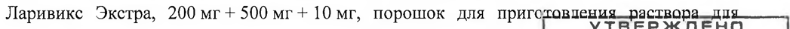
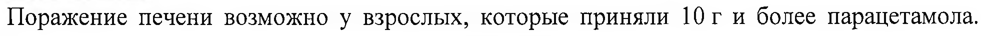
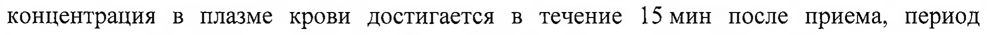

# Гвайфенезин + Парацетамол + Фенилэфрина гидрохлорид — внутрь

- Препарат: Ларивикс Экстра (порошок для приготовления раствора для приема внутрь)
- АТХ: N02BE51
- Источник: ОХЛП, Единый реестр ЛС ЕАЭС, запись 65c0a7ea30dcf8482095bdc1, документ от 2024-07-12
- Распознано автоматически (OCR): 11 из 11 стр.
- Сомнительных строк после OCR: 3 (см. раздел «Проверка распознавания»)

## Общие сведения

ЛП-#002331-РГ -ВУ ОБЩАЯ ХАРАКТЕРИСТИКА ЛЕКАРСТВЕННОГО ПРЕПАРАТА

## 1. Наименование лекарственного препарата

Ларивикс Экстра, 200 мг + 500 мг + 10 мг, порошок для приготовпения_-раствора_дия—__—
УТВЕРЖДЕНО приема внутрь. МИНИСТЕРСТВОМ ЗДРАВООХРАНЕНИЯ
РЕСПУБЛИКИ БЕЛАРУСЬ Приказ М истЕрства здравоохранения со М Республики Беларусь 4 -.

## 2. Качественный и количественный состав

«_1 7 ЯЮН | № AOSD

Действующие вещества: гвайфенезин, парацетамол, фенилэфрина гидрохлорид.
Каждый пакет содержит: 200 мг гвайфенезина, 500 мг парацетамола, 10 мг фенилэфрина гидрохлорида.
Вспомогательные вещества, наличие которых надо учитывать в составе лекарственного препарата: аспартам (E951), натрий (в виде натрия цитрата), сахар (см. раздел 4.4.).
Полный перечень вспомогательных веществ приведен в разделе 6.1.

## 3. Лекарственная форма

Порошок для приготовления раствора для приема внутрь.
Порошок от белого до белого с желтоватым оттенком цвета с запахом лимона и ментола.
Допускается наличие мягких комков, вкраплений белого и желтого цвета.

## 4. Клинические данные

## 4.1. Показания к применению

Ларивикс Экстра показан к применению у взрослых и детей в возрасте от 12 лет.
Кратковременное облегчение симптомов острых респираторных заболеваний, сопровождающихся ознобом, повышенной температурой, головной и мышечной болью, болью в горле, заложенностью носа и кашлем с затрудненным отхождением вязкой мокроты.

## 4.2. Режим дозирования и способ применения

Режим дозирования Взрослым и детям старше 12 лет принимать по одному пакету через 4-6 часов (не более 4-х пакетов в сутки). Максимальная продолжительность лечения без консультации врача:
— 3 дня при приеме в качестве жаропонижающего средства;
— не более 5 дней при приеме в качестве обезболивающего средства.
Особые группы пациентов Пациенты с нарушением функции почек
Не применять у пациентов с тяжелым нарушением функции почек (см. раздел 4.3).
Пациенты с нарушением функции печени Не применять у пациентов с тяжелым нарушением функции печени (см. раздел 4.3).
Дети Безопасность и эффективность Ларивикс Экстра у детей в возрасте до 12 лет на данный момент не установлены (см. раздел 4.3). Данные отсутствуют.
Режим дозирования для детей в возрасте от 12 лет не отличается от режима дозирования для взрослых.
Способ применения NN-#002931-PF -ВУ Для приема внутрь.
Содержимое | пакета растворить в стакане горячей, но не кипящей воды (250 мл). Дать остыть до приемлемой температуры и выпить.

## 4.3. Противопоказания

— _ Гиперчувствительность к действующим веществам или к любому из вспомогательных веществ, перечисленных в разделе 6.1;
— нарушение функции печени;
— тяжелая хроническая почечная недостаточность;
— тяжелые сердечно-сосудистые заболевания, включая тяжелую гемолитическую анемию;
— артериальная гипертензия;
— гипертиреоз;
— сахарный диабет;
— одновременный прием бета-адреноблокаторов, трициклических антидепрессантов;
— одновременный или в течение предшествующих 14 дней прием ингибиторов моноаминоксидазы;
— одновременный прием других парацетамол-содержащих препаратов и симпатомиметических средств;
— язвенная болезнь желудка и двенадцатиперстной кишки в стадии обострения;
— гиперплазия предстательной железы;
— закрытоугольная глаукома;
— феохромоцитома;
— алкоголизм;
— беременность (см. раздел 4.6);
— период лактации (см. раздел 4.6);
— детский возраст до 12 лет.

## 4.4. Особые указания и меры предосторожности при применении

Следует обратить внимание, если симптомы:
— не улучшаются в течение 5 дней;
— сопровождаются лихорадкой, которая держится более 3 дней;
— включают боль в горле, которая не проходит более 3 дней, сопровождаются лихорадкой, головной болью, высыпаниями, тошнотой или рвотой.
Пациентам, страдающим хроническим кашлем или астмой, следует проконсультироваться с врачом перед приемом препарата.
Пациентам следует прекратить использование препарата и проконсультироваться с врачом, если кашель длится более 5 дней или возвращается, или сопровождается лихорадкой, сыпью или постоянной головной болью.
Следует соблюдать большую осторожность у пациентов со стенокардией.
Симпатомиметические препараты могут действовать как стимуляторы головного мозга, вызывая бессонницу, нервозность, гиперпирексию, тремор и эпилептиформные судороги.
СОГЛАСОВАНО МИНИСТЕРСТВОМ ЗДРАВООХРАНЕНИЯ
РЕСПУБЛИКИ БЕЛАРУСЬ | 2 Приказ Министерства здравоохранения i
Республики Беларусь 1 me ЕЕ ОИ ДО ЗОРИ SS
An-#002931-P! -ВУ

Следует избегать одновременного назначения с другими симпатомиметическими препаратами (деконгестантами, супрессорами аппетита, психостимуляторами амфетаминового ряда).
Не следует принимать одновременно со средствами, угнетающими кашлевой рефлекс.
Применять с осторожностью у пациентов с дефицитом глюкозо-6-фосфатдегидрогеназы, заболеваниями крови, врожденной гипербилирубинемией (синдромы Жильбера, ДубинаДжонсона, Ротора), вазоспастическими заболеваниями (синдром Рейно), гипероксалурией, бронхиальной астмой, ХОБЛ (хронической обструктивной болезнью легких).
Во избежание риска передозировки следует убедиться, что другие препараты, которые принимает пациент, не содержат парацетамол.
Для взрослых с массой тела более 50 кг общая доза парацетамола не должна превышать 4 гв день.
При применении препарата не рекомендуется употреблять алкогольные напитки, поскольку этиловый спирт при одновременном приеме с парацетамолом может вызывать нарушение функции печени.
Ларивикс Экстра искажает результаты лабораторных исследований содержания глюкозы и мочевой кислоты в плазме крови,
Вспомогательные вещества Ларивикс Экстра содержит источник фенилаланина — аспартам (E951), Может оказаться вредным для людей с фенилкетонурией.
Данный препарат содержит около 5,1 ммоль (или 117,3 мг) натрия в одном пакете.
Необходимо учитывать пациентам, находящимся на диете с ограничением поступления натрия.
Ларивикс Экстра содержит сахар. Пациентам с редко встречающейся наследственной непереносимостью фруктозы, глюкозо-галактозной мальабсорбцией или дефицитом сахаразы-изомальтазы не следует принимать этот препарат,

## 4.5. Взаимодействие с другими лекарственными препаратами и другие виды взаимодействия

Парацетамол Скорость всасывания парацетамола увеличивается при одновременном приеме с препаратами, которые увеличивают опорожнение желудка (например, метоклопрамид или домперидон).
Колестирамин снижает всасывание парацетамола, если назначен в течение | часа до или после приема парацетамола.
Антикоагулянтный эффект кумаринов (включая варфарин) может быть усилен при длительном ежедневном использовании препаратов, содержащих парацетамол, что может привести к повышенному риску кровотечения. Может потребоваться снижение дозы антикоагулянтов, если необходимо лечение препаратами, содержащими парацетамол.
Потенциально гепатотоксические препараты или средства, которые вызывают индукцию микросомальных ферментов печени (например, алкоголь, барбитураты, ингибиторы моноаминоксидазы и трициклические антидепрессанты), могут усилить гепатотоксичность парацетамола, особенно при его передозировке.
Одновременное применение зидовудина и парацетамола повышает риски возникновения нейтропении. — _ СОГЛАСОВАНО

МИНИСТЕРСТВОМ ЗДРАВООХРАНЕНИЯ

РЕСПУБЛИКИ БЕЛАРУСЬ | 3

Праказ Министерства здравоохранения Республики Беларусь
ПЕ В а ле ыы ЛП-#007931-РГ -ВУ Ацетилсалициловая кислота увеличивает период полувыведения парацетамола.
Одновременное применение парацетамола с нестероидными противовоспалительными препаратами (НИВП) может повысить их нефротоксичность.
Гвайфенезин В течение первых суток после приема лекарственного препарата результаты определения в моче 5-гидроксииндолуксусной кислоты и ванилилминдальной кислоты колориметрическим способом могут быть искажены.
Гвайфенезин усиливает действие седативных средств и миорелаксантов.
Фенилэфрин Одновременный прием фенилэфрина с ингибиторами моноаминоксидазы может привести к развитию гипертонического криза.
Одновременное применение фенилэфрина с другими симпатомиметическими аминами может увеличить риск возникновения нежелательных эффектов со стороны сердечнососудистой системы.
Фенилэфрин может снижать эффективность бета-блокаторов и — других антигипертензивных препаратов (например, дебризохин, гуанетидин, резерпин, метилдопа), приводя к повышению риска развития гипертонии и других нежелательных явлений со стороны сердечно-сосудистой системы.
Трициклические антидепрессанты (например, амитриптилин) увеличивают риск возникновения нежелательных явлений фенилэфрина со стороны сердечно-сосудистой системы.
Фенотиазиды, используемые в качестве седативного средства, усиливают нежелательные явления со стороны центральной нервной системы.
Алкалоиды спорыньи (эрготамин и метизергид) увеличивают риск возникновения эрготизма.
Дигоксин и сердечные гликозиды увеличивают риск возникновения нерегулярного сердцебиения и сердечного приступа.
Ингаляционные анестетики (в т.ч. хлороформ, энфлуран, галотан, изофлуран)
увеличивают риск возникновения тяжелой предсердной и желудочковой аритмии.

## 4.6. Фертильность, беременность и лактация

Беременность Лекарственный препарат противопоказан во время беременности.
Большой объем данных о беременных женщинах свидетельствует об отсутствии у парацетамола фето- и/или неонатальной токсичности, а также способности вызывать пороки развития, однако беременные женщины должны следовать советам своего врача относительно применения препаратов парацетамола.
Имеются ограниченные данные по применению фенилэфрина у беременных. Сужение сосудов матки и снижение кровотока в матке, связанное с применением фенилэфрина, может привести к гипоксии плода. До тех пор, пока не будет получено больше информации, следует избегать применения фенилэфрина во время беременности.
Безопасность гвайфенезина при беременности не была полностью установлена.
Лактация Лекарственный препарат противопоказан в период лактации.
м | МИНИСТЕРСТВОМ ЗДРАВООХРАНЕНИЯ 4 РЕСПУБЛИКИ БЕЛАРУСЬ
Приказ Министерства здравоохранения Республики Беларусь __ ый ee ыы
ЛП-6002931-РГ -ВУ Парацетамол выделяется с грудным молоком. Доступные опубликованные данные не подтверждают противопоказание при кормлении грудью.
Фенилэфрин выделяется с грудным молоком и противопоказан в период кормления грудью.
Безопасность гвайфенезина в период кормления грудью не была полностью установлена.
4.7. Влияние на способность управлять транспортными средствами и работать с механизмами
Ларивикс Экстра может вызывать головокружение, спутанность сознания, поэтому во время лечения не рекомендуется управлять транспортными средствами и работать со сложными механизмами, требующими повышенной концентрации внимания и высокой скорости психомоторных реакций.

## 4.8. Нежелательные реакции

Табличное резюме нежелательных реакций Информация о нежелательных реакциях представлена в таблицах ниже в соответствии с системно-органной классификацией и частотой встречаемости. Категории частоты: очень часто (>1/10), часто (>1/100, но <1/10), нечасто (>1/1000, но <1/100), редко (>1/10 000, но
<1/1000), очень редко (<1/10 000), частота неизвестна (на основании имеющихся данных оценить невозможно).
Парацетамол Из-за ограниченности данных клинических исследований частота нежелательных реакций неизвестна (не может быть оценена на основе имеющихся данных), но постмаркетинговое применение показывает, что нежелательные реакции на парацетамол возникают редко, а серьезные реакции — очень редко.
Частота этих реакций не определена, но обычно они возникают редко.
Нарушения со стороны крови и тромбоцитопения, агранулоцитоз лимфатической системы
Нарушения со стороны иммунной | анафилактические реакции, кожные реакции системы гиперчувствительности, в том числе кожная сыпь, отек Квинке и синдром Стивенса-Джонсона
Нарушения со стороны бронхоспазм у пациентов, чувствительных к дыхательной системы, органов ацетилсалициловой кислоте и другим НИВИ грудной клетки и средостения
Нарушения со стороны печени и дисфункции печени желчевыводящих путей
Гвайфенезин Частота этих реакций не определена, но обычно они возникают редко.
системы анафилактические реакции СОГЛАСОВАНО
МИНИСТЕРСТВОМ ЗДРАВООХРАНЕНИЯ | 5 РЕСПУБЛИКИ БЕЛАРУСЬ
Приказ Министерства здравоохранения i Республики Беларусь {
С ны nn-#002931-Pf -ВУ Нарушения со стороны одышка (сообщалось об одышке в сочетании с дыхательной системы, органов другими симптомами гиперчувствительности)
грудной клетки и средостения Желудочно-кишечные нарушения | тошнота, рвота, дискомфорт в желудочнокишечном тракте
Нарушения со стороны кожи и сыпь, крапивница подкожных тканей
Фенилэфрин Следующие нежелательные реакции наблюдались в клинических исследованиях с фенилэфрином и поэтому представляют собой наиболее часто встречающиеся.
Психические нарушения нервозность, раздражительность, беспокойство и возбудимость
Нарушения со стороны нервной головная боль, головокружение, бессонница системы
Нежелательные реакции, выявленные в ходе постмаркетингового использования, перечислены ниже. Частота этих реакций неизвестна, но, вероятно, они будут встречаться очень редко.
Нарушения со стороны органа мидриаз, острая закрытоугольная глаукома зрения (наиболее вероятно у лиц с закрытоугольной глаукомой)
Нарушения со стороны кожи и аллергические реакции (например, сыпь, подкожных тканей крапивница, аллергический дерматит, в том числе перекрестная чувствительность с другими симпатомиметиками)
Нарушения со стороны почек и дизурия, задержка мочи. Это наиболее вероятно у мочевыводящих путей лиц с инфравезикальной обструкцией, такой, как гипертрофия предстательной железы
Сообщение о подозреваемых нежелательных реакциях
Важно сообщать о подозреваемых нежелательных реакциях после регистрации лекарственного препарата с целью обеспечения непрерывного мониторинга соотношения
«польза — риск» лекарственного препарата. Медицинским работникам рекомендуется сообщать о любых подозреваемых нежелательных реакциях лекарственного препарата через национальные системы сообщения о нежелательных реакциях государств-членов
Евразийского экономического союза.
Республика Беларусь УП «Центр экспертиз и испытаний в здравоохранении» nsec
МИНИСТЕРСТВОМ ЗДРАВООХРАНЕНИЯ РЕСПУБЛИКИ БЕЛАРУСЬ
| Приказ Министерства здравоохранения 6 Республики Беларусь
ИИ ЕН ООВ ИИД ЛП-№002931-РГ -ВУ Адрес: 220037, Минск, пер. Товарищеский, 2а
Телефон/факс: +375 (17) 242-00-29 Электронная почта: rcpl@rceth.by
Сайт: www.rceth.by Российская Федерация Федеральная служба по надзору в сфере здравоохранения
Адрес: 109012, Москва, Славянская площадь, д.4, стр.1
Телефон: +7 800 550-99-03 Электронная почта: pharm@roszdravnadzor.gov.ru
Сайт: www.roszdravnadzor.gov.ru Республика Казахстан
PIT] на ПХВ «Национальный центр экспертизы лекарственных средств и медицинских изделий» Комитета медицинского и фармацевтического контроля Министерства здравоохранения Республики Казахстан
Департамент фармаконадзора и мониторинга безопасности, эффективности и качества медицинских изделий
Адрес: 010000, Астана, ул. А.Иманова, 13
Телефон: +7 (7172) 235-135 Электронная почта: pdic@dari.kz
Сайт: www.ndda.kz

## 4.9. Передозировка

Парацетамол Поражение печени возможно у взрослых, которые приняли 10 г и более парацетамола.
Прием 5г или более парацетамола может вызвать поражение печени, если имеются следующие факторы риска: продолжительное лечение карбамазепином, фенобарбиталом, фенитоином, примидоном, рифампицином или иными препаратами, активирующими ферменты печени; злоупотребление алкоголем; недостаток глутатиона (например, неправильное питание, муковисцидоз, ВИЧ-инфекция, голодание, кахексия).
Симитомы Симптомы передозировки парацетамолом в первые 24 часа включают: бледность кожных покровов, тошноту, рвоту, анорексию и боль в области живота. Повреждение печени может проявиться в течение 12-48 часов после приема парацетамола. Возможно нарушение метаболизма глюкозы и возникновение метаболического ацидоза. При тяжелых отравлениях печеночная недостаточность может прогрессировать до энцефалопатии, кровотечения, гипогликемии, отека мозга и смерти. Острая почечная недостаточность с острым некрозом, боль в пояснице, гематурия и протеинурия могут развиться даже при отсутствии серьезных повреждений печени. Поступали сообщения о сердечных аритмиях и панкреатитах.
Лечение Незамедлительные мероприятия имеют большое значение в лечении передозировки парацетамолом. Несмотря на отсутствие значительных ранних симптомов передозировки, пациент должен быть незамедлительно доставлен в стационар. Симптомы могут быть ограничены рвотой и не соответствовать тяжести ре
МИНИСТЕРСТВОМ ЗДРАВООХРАНЕНИЯ РЕСПУБЛИКИ БЕЛАРУСЬ
Приказ Министерства здравоохраненил Республики Беларусь :
1П-#002931 -РГ -ВУ органов. Оказание помощи должно осуществляться в соответствии с установленными стандартами лечения. Лечение с помощью активированного угля следует рассматривать, если передозировка была диагностирована в течение | часа после приема парацетамола.
Плазменные концентрации парацетамола следует измерять каждые 4 часа после приема лекарственного препарата. Лечение с помощью М-ацетилцистеина может быть использовано в течение 24 часов после приема парацетамола, однако максимальный защитный эффект достигается в течение 8 часов после приема лекарственного препарата. Эффективность антидота резко снижается после этого времени. При необходимости М-ацетилцистеин может быть введен внутривенно. В случае отсутствия у пациента повышенной чувствительности к метионину последний может являться подходящей альтернативой для оказания экстренной медицинской помощи.
Гвайфенезин Симитомы Очень большие дозы гвайфенезина могут вызвать расстройство желудочно-кишечного тракта (тошноту и рвоту).
Лечение При рвоте следует проводить мероприятия по восполнению жидкости в организме и следить за уровнем электролитов.
Фенилэфрин Симптомы Симптомы передозировки включают повышение артериального давления и связанные с гипертонией рефлекторную брадикардию и аритмию. В тяжелых случаях могут возникать нарушение сознания, галлюцинации, судороги и аритмии.
Лечение Повышенное артериальное давление следует купировать антагонистом альфа-рецепторов, например, внутривенным введением фентоламина. Снижение артериального давления приводит к рефлекторному увеличению частоты сердечных сокращений, поэтому при необходимости это состояние может быть облегчено путем введения атропина.

## 5. Фармакологические свойства

СВОИСТВА

## 5.1. Фармакодинамические свойства

Фармакотерапевтическая группа: Анальгетики. Другие анальгетики и антипиретики.
Парацетамол в комбинации со средствами (исключая психотропные препараты).
Код ATX: NO2BE51 Фармакодинамические эффекты
Парацетамол Парацетамол обладает анальгетическим, жаропонижающим и слабым противовоспалительным действием. Механизм действия связан с ингибированием синтеза простагландинов, преимущественным влиянием на центр терморегуляции в гипоталамусе.
Болеутоляющий механизм действия за счет ингибирования синтеза простагландинов проявляется в первую очередь в центральной, но также и в периферической нервной
СОГЛАСОВАНО МИНИСТЕРСТВОМ ЗДРАВООХРАНЕНИЯ | 8
РЕСПУБЛИКИ БЕЛАРУСЬ Приказ Министерства здравоохранения |
Республики Беларусь В ЛП-#002931-РГ -ВУ системе. Жаропонижающее действие подавляет эффект эндогенных пирогенов в центре регулирования температуры гипоталамуса. Парацетамол не обладает выраженными противовоспалительными свойствами и не влияет на гемостаз и слизистую оболочку желудка.

Гвайфенезин Гвайфенезин обладает отхаркивающим действием. Гвайфенезин стимулирует рецепторы слизистой оболочки желудка, которые, в свою очередь, инициируют рефлекторную секрецию жидкости дыхательных путей, что приводит к увеличению объема и снижению вязкости бронхиального секрета и способствует переходу непродуктивного кашля в продуктивный.
Фенилэфрин Фенилэфрин представляет собой симпатомиметическое средство, оказывает стимулирующее действие на альфа-адренорецепторы, вызывая сужение артериол слизистой оболочки носа, тем самым способствует устранению отека и слизи, уменьшению ринореи и заложенности носа.

## 5.2. Фармакокинетические свойства

Парацетамол Парацетамол быстро и практически полностью всасывается из желудочно-кишечного тракта. Максимальные концентрации в плазме крови достигаются через 10-60 мин после приема внутрь. Период полувыведения составляет 1-3 часа. Парацетамол подвергается метаболизму преимущественно в печени, выводится с мочой в виде глюкуронидов и сульфатных конъюгатов.
Гвайфенезин Гвайфенезин быстро всасывается из желудочно-кишечного тракта. Максимальная концентрация в плазме крови достигается в течение 15 мин после приема, период полувыведения составляет 1 час. Метаболизируется в печени путем окисления до
В-(2метокси-фенокси) молочной кислоты, которая выводится легкими (с мокротой) и почками в виде неактивных метаболитов.
Фенилэфрин Фенилэфрин обладает низкой биодоступностью в связи с тем, что неравномерно всасывается из желудочно-кишечного тракта, подвергаясь метаболизму с участием моноаминоксидазы в печени. Максимальные концентрации в плазме крови наблюдаются через 1-2 часа, период полувыведения составляет около 2-3 часов, выводится с мочой в виде сульфатных конъюгатов.
5.3. Данные доклинической безопасности
Доклинические данные по безопасности действующих веществ препарата, представленные в литературе, не свидетельствуют о наличии каких-либо значимых результатов с точки зрения безопасности при применении в рекомендуемой дозе.
Данные исследований оценки репродуктивной и онтогенетической токсичности в настоящее время не доступны.
| СОГЛАСОВАНО | МИНИСТЕРСТВОМ ром 9 РЕСПУБЛИКИ БЕЛАРУСЬ
Приказ Министерства здравоохранения ЛП-№002931-РГ -ВУ

## 6. Фармацевтические свойства

6.1. Перечень вспомогательных веществ
Винная кислота, лимонная кислота безводная, натрия цитрат, аспартам (Е951), кремния диоксид коллоидный безводный, сахар, ароматизатор «Лимон Лайм» (мальтодекстрин, гуммиарабик (E414), вкусоароматические вещества), ароматизатор «Ментол» (гуммиарабик (Е414), вкусоароматические вещества).

## 6.2. Несовместимость

Не применимо.

## 6.3. Срок годности (срок хранения)

2 года.
Приготовленный раствор Приготовленный раствор хранению не подлежит.
6.4. Особые меры предосторожности при хранении
Хранить при температуре не выше 25°C, Условия хранения после приготовления см. в разделе 6.3.
6.5. Характер и содержание первичной упаковки
По 4,36 г в пакеты из материала упаковочного многослойного (пленка полиэтилентерефталатная/пленка полипропиленовая/фольга алюминиевая/пленка полиэтиленовая). По 10 пакетов вместе с листком-вкладышем в пачке из картона.
6.6. Особые меры предосторожности при уничтожении использованного лекарственного препарата или отходов, полученных после применения лекарственного препарата, и другие манипуляции с препаратом
Внешний вид лекарственного препарата после растворения: бесцветный или с желтоватым оттенком опалесцирующий раствор с небольшим количеством взвешенных частиц.
Нет особых требований к утилизации.

## 7. Держатель регистрационного удостоверения

ООО «АмантисМед»
Республика Беларусь, 223141, г. Логойск, ул. Минская 2и тел/факс: +375 (1774) 25 286 адрес электронной почты: office@amantismed.by
7.1. Представитель держателя регистрационного удостоверения
Претензии потребителей направлять по адресу: СОГЛАСОВАНО
МИНИСТЕРСТВОМ ЗДРАВООХРАНЕНИЯ РЕСПУБЛИКИ БЕЛАРУСЬ 10
Приказ Министерства здравоохранения Республики Беларусь наи О ln nl
AN-#002931-PF -BY ООО «АмантисМед»
Республика Беларусь, 223141, г. Логойск, ул. Минская 2и тел/факс: +375 (1774) 25 286 адрес электронной почты: office@amantismed.by

## 8. Номер регистрационного удостоверения

## 9. Дата первичной регистрации

(ПОДТВЕРЖДЕНИЯ РЕГИСТРАЦИИ,

ПЕРЕРЕГИСТРАЦИИ)
10. ДАТА ПЕРЕСМОТРА ТЕКСТА
Общая характеристика лекарственного препарата Ларивикс Экстра доступна на информационном портале Евразийского экономического союза в информационнокоммуникационной сети «Интернет» htpp://eec.eaeunion.org/
СОГЛАСОВАНО МИНИСТЕРСТВОМ ЗДРАВООХРАНЕНИЯ
РЕСПУБЛИКИ БЕЛАРУСЬ 11 Нриказ Министерства здраввохранения
Республики Беларусь
## Проверка распознавания

Страницы-сканы распознаны автоматически. В 3 строках с дозировками цифры могли распознаться с ошибкой — сверьте с вырезкой из оригинала:

- стр. 1: «Ларивикс Экстра, 200 мг + 500 мг + 10 мг, порошок для приготовпения_-раствора_дия—__—» — низкая уверенность: «200» (73)  
  
- стр. 7: «Поражение печени возможно у взрослых, которые приняли 10 г и более парацетамола.» — низкая уверенность: «10» (10); повторное чтение: «Поражение печени возможно у взрослых, которые приняли 1Оги более парацетамола.»  
  
- стр. 9: «концентрация в плазме крови достигается в течение 15 мин после приема, период» — низкая уверенность: «15» (76)  
  
