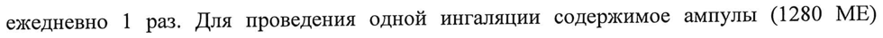

# Гиалуронидаза — парентерально

- Препарат: Лидаза (лиофилизат для приготовления раствора для инъекций и местного применения)
- АТХ: B06AA03
- Источник: ОХЛП, Единый реестр ЛС ЕАЭС, запись 5feb1918fb44f147fbad8852, документ от 2023-09-21
- Распознано автоматически (OCR): 7 из 7 стр.
- Сомнительных строк после OCR: 2 (см. раздел «Проверка распознавания»)

## Общие сведения

ОБЩАЯ ХАРАКТЕРИСТИКА ЛЕКАРСТВЕННОГО ПРЕПАРАТА

## 1. Наименование лекарственного препарата

Лидаза, 1280 МЕ, лиофилизат для приготовления раствора для инъекций и местного применения.

## 2. Качественный и количественный состав

Состав на 1 ампулу:
Гиалуронидаза 1280 МЕ

## 3. Лекарственная форма

Лиофилизат для приготовления раствора для инъекций и местного применения.
Лиофилизированный порошок или пористая масса, уплотненная в таблетку, белого цвета , или белого цвета с желтоватым, розоватым или коричневатым оттенком.

## 4. Клинические данные

## 4.1. Показания к применению

Ожоговые, травматические, послеоперационные рубцы.

e Длительно незаживающие язвы (в том числе лучевые).
| e Контрактура Дюпюитрена.
e Тугоподвижность суставов, контрактуры суставов (после воспалительных процессов, травм), остеоартроз, анкилозирующий спондилоартрит, тяжелые заболевания поясничных дисков.
» Хронический тендовагинит, склеродермия (кожные проявления), гематома мягких
| тканей поверхностной локализации.
e Подготовка к кожно-пластическим операциям по поводу рубцовых стяжений.
» Туберкулез легких (осложненный неспецифическими поражениями бронхов),
| воспалительные процессы в верхних дыхательных путях и бронхах с явлениями обструкции.
| e Травматические поражения нервных сплетений и периферических нервов (плексит, неврит).
e Гифема, гемофтальм, ретинопатии различной этиологии.

## 4.2. Режим дозирования и способ применения

| Режим дозирования

1280 ME лидазы (гиалуронидазы) соответствует 64 YE лидазы (гиалуронидазы).
При рубцовых поражениях подкожно (под рубцово-измененные ткани) или внутримышечно (вблизи места поражения) препарат вводят но 1280 МЕ ежедневно или через день (всего 10-20 инъекций). Для приготовления раствора с целью введения при рубцовых поражениях содержимое ампулы растворяют в 1 мл натрия хлорида 0,9 %.

При травматических поражениях нервных сплетений и периферических нервов вводят подкожно в область пораженного нерва (1280 МЕ) через день; на курс — 12-15 инъекций.
Курс лечения при необходимости повторяют. Для приготовления раствора с целью введения при травматических поражениях содержимое одной ампулы растворяют в 1 мл прокаина 0,5 %.

При использовании в офтальмологической практике препарат вводят субконъюнктивально — 0,3 мл, парабульбарно — 0,5 мл, а также методом электрофореза. Для применения в офтальмологии содержимое одной ампулы растворяют в | мл раствора натрия хлорида 0,9 %.

Больным туберкулезом легких с продуктивным характером воспаления назначают в комплексной терапии для повышения концентрации антибактериальных лекарственных средств в очагах поражения в виде инъекций и/или ингаляций. Ингаляции проводят ежедневно 1 раз. Для проведения одной ингаляции содержимое ампулы (1280 МЕ)
растворяют в 5 мл раствора натрия хлорида 0,9 %. Курс лечения состоит из 20-25 ингаляций. При необходимости проводят повторные курсы с промежутками 1,5-2 мес.

Наружно, в виде повязок, пропитанных раствором препарата. Для приготовления раствора каждые 1280 МЕ растворяют в 10 мл стерильного раствора натрия хлорида 0,9 % или кипяченой воды комнатной температуры. Этим раствором смачивают стерильную повязку, сложенную в 4-5 слоев, накладывают ее на пораженный участок, покрывают вощеной бумагой и фиксируют мягкой повязкой. Доза зависит от площади поражения
(640-1280 МЕ/кв.см), в среднем — 6400 МЕ на повязку. Повязку накладывают ежедневно на 15-18 4 в течение 15-60 дней. При длительном применении через каждые 2 недели делают перерыв на 3-4 дня.

При применении методом электрофореза 1 ампулу препарата (1280 МЕ) растворяют в 60 мл дистиллированной воды, добавляют 2-3 капли 0,1 % раствора хлористоводородной кислоты и вводят с анода на пораженный участок в течение 20-30 мин. Курс лечения — 15-20 сеансов. Анппликационный режим дозирования можно чередовать с электрофорезом.
Приготовленный раствор должен быть использован в течение 24 ч.
Способ применения Подкожно; внутримышечно; субконъюнктивально; парабульбарно; методом электрофоре-
| за; в виде ингаляций; наружно, в виде повязок.
Приготовление лекарственного препарата перед применением см. в разделе 4.2. (режим дозирования).

## 4.3. Противопоказания

Гиперчувствительность к препарату.

e Острые инфекционно-воспалительные заболевания.
e Недавние кровоизлияния.
e Беременность, период грудного вскармливания.
e Детский возраст до 18 лет.
Для ингаляционного введения:
» Туберкулез легких с выраженной дыхательной недостаточностью.
e Легочное кровотечение, кровохарканье.
e Злокачественные новообразования.
e Свежее кровоизлияние в стекловидное тело.
e Сопутствующий прием эстрогенов.

## 4.4. Особые указания и меры предосторожности при применении

Раствор не следует вводить через катетер, в который ранее вводили растворы, содержащие катионы.
Растворы для инъекций готовят на 0,9 % растворе натрия хлорида или 0,5 % растворе прокаина, для ингаляций — на 0,9 % растворе натрия хлорида, для электрофореза — на
| дистиллированной воде.
] Перед началом лечения целесообразно провести тест с внутрикожным введением 20 мкл гиалуронидазы.
Не следует вводить в зоны инфекционного воспаления и опухоли.
При острых кровоизлияниях гиалуронидазу не применяют.
При развитии аллергической реакции следует прекратить применение препарата и обратиться к врачу.
При необходимости прекращения приема препарата отмену можно осуществить сразу, без постепенного уменьшения дозы.
В случае пропуска введения очередной дозы препарата, последующее его применение следует проводить в обычном режиме, как указано в данной инструкции или рекомендовано врачом. Пациент не должен вводить удвоенную дозу с целью компенсации пропущенных доз.

Не использовать препарат при наличии визуальных признаков его непригодности (дефект упаковки, изменение цвета порошка).
Препарат целесообразно применять в ранние сроки заболевания и в составе комплексной терапии (лечебная гимнастика, массаж, противовоспалительные, анальгезирующие средства и другие способы лечения).
С осторожностью применяют при хронической почечной недостаточности (не чаще 1 раза в неделю).

## 4.5. Взаимодействие с другими лекарственными препаратами и другие виды взаимодействия

Препарат Лидаза можно комбинировать с антибиотиками, противовирусными, противогрибковыми препаратами, бронхолитиками. При применении в комбинации с другими лекарственными средствами (антибиотики, местные анестетики, диуретики)
препарат Лидаза увеличивает биодоступность и усиливает их действие. При совместном применении с большими дозами салицилатов, кортизона, адренокортикотропного гормона
(АКТГ), эстрогенов или антигистаминных препаратов может быть снижена ферментативная активность препарата Лидаза.
Не следует применять одновременно с фуросемидом, бензодиазепином, фенитоином.

## 4.6. Фертильность, беременность и лактация

Беременность Противопоказано применение препарата при беременности.
Лактация Противопоказано применение препарата в период грудного вскармливания.

| 4.7. Влияние на способность управлять транспортными средствами и работать с механизмами
Применение препарата не оказывает влияния на способность к выполнению потенциально опасных видов деятельности, требующих повышенной концентрации внимания и быстроты психомоторных реакций (управление транспортными средствами, работа с движущимися механизмами, работа диспетчера и оператора).
4.3. Нежелательные реакции
Возможны аллергические реакции; при длительном применении — местные кожные реакции (дерматит).

Сообщение о подозреваемых нежелателиных реакциях. “медицинским” ‘работникам рекомендуется сообщать о любых подозреваемых нежелательных реакциях лекарственного препарата /Лидаза через национальные системы сообщения о нежелательных реакциях государств — членов Евразийского экономического союза.

## 4.9. Передозировка

Симптомы: озноб, тошнота, рвота, головокружение, тахикардия, снижение артериального давления, местный отек, крапивница, эритема.
Лечение: введение эпинефрина, глюкокортикостероидов; антигистаминных препаратов.

## 5. Фармакологические свойства

Фармакотерапевтическая группа: ферментное средство.
Код ATX: BO6AA03 Ферментный препарат, выделенный из семенников крупного рогатого скота. Расщепляет основной компонент межуточного вещества соединительной ткани — гиалуроновую кислоту (мукополисахарид, в состав которого входят ацетилглюкозамин и глюкуроновая кислота, является цементирующим веществом соединительной ткани), уменьшает ее вязкость, повышает тканевую и сосудистую проницаемость, облегчает движение жидкостей в межтканевых пространствах; уменьшает отечность ткани, размягчает и уплощает рубцы, увеличивает объем движений в суставах, уменьшает контрактуры и предупреждает их формирование. Гиалуронидаза вызывает распад гиалуроновой кислоты до глюкозамина и глюкуроновой кислоты и тем самым уменьшает ее вязкость.
Продолжительность действия при внутрикожном введении - до 48 ч.

## 6. Фармацевтические свойства

| 6.1. Перечень вспомогательных веществ

| Отсутствуют.

## 6.2. Несовместимость

Не следует применять одновременно с фуросемидом, бензодиазепином, фенитоином.

## 6.3. Срок годности (срок хранения)

3 года.
6.4. Особые меры предосторожности при хранении
В защищенном от света месте при температуре не выше 15 °С.
Хранить в недоступном для детей месте.

6.5. Характер и содержание первичной упаковки
Лиофилизат для приготовления раствора для инъекций и местного применения 1280 МЕ.
По 1280 МЕ в ампулы вместимостью 2 мл из стекла марки НС-3, NK или другие марки стекла 1-го гидролитического класса.
По 10 ампул с инструкцией по применению и скарификатором ампульным в коробке из картона.
При упаковке ампул, имеющих кольцо излома или точку для вскрытия, скарификатор ампульный не вкладывают.
6.6. Особые меры предосторожности при уничтожении использованного лекарственного препарата или отходов, полученных после применения лекарственного препарата и другие манипуляции с препаратом

## 6.4. Особые меры предосторожности при хранении

Лидаза или отходов, полученных после его применения, отсутствуют.

Растворы для инъекций готовят на 0,9 % растворе натрия хлорида или 0,5 % растворе прокаина, для ингаляций — на 0,9 % растворе натрия хлорида, для электрофореза — на дистиллированной воде. Приготовление лекарственного препарата перед применением см. в разделе 4.2.
Весь оставшийся лекарственный препарат и отходы следует уничтожить в установленном

порядке.

## 7. Держатель регистрационного удостоверения

/ ОРГАНИЗАЦИЯ,

ПРИНИМАЮЩАЯ ПРЕТЕНЗИИ ПОТРЕБИТЕЛЕЙ:
Россия АО «НПО «Микроген»
Россия, 115088, г. Москва, ул. 1-я Дубровская, д. 15, стр. 2, тел. (495) 710-37-87.
Адрес производства:
Россия, 614089, Пермский край, г. Пермь, ул. Братская, д. 177, тел. (342) 281-94-96.

## 8. Номер регистрационного удостоверения

СООТВЕТСТВУЕТ ЭКСПЕРТНОМУ ОТЧЕТУ от 15.06.2021 № 13942 7
7 Oe OCOMGATENLUGSTL rim at

## 9. Дата первичной регистрации

РЕГИСТРАЦИ ПОДТВЕРЖДЕНИЯ: РЕГИСТРА ЦИИ

ПЕРЕРЕГИСТРАЦИИ) |
10. ДАТА ПЕРЕСМОТРА ТЕКСТА
Общая характеристика лекарственного препарата Лидаза доступна на информационном | портале Евразийского экономического союза в информационно-коммуникационной сети
«Интернет» http://www.eurasioncomission.org.
wy, Hila | Начальник управления регистрации т > И и медицинских исследований № Фе.
АО «НПО «Микроген» es J Ks А.Е. Ершов : gz 5$ aa 3% 3§ к ХХ ея; ey
* MOCKBA | | | |
## Проверка распознавания

Страницы-сканы распознаны автоматически. В 2 строках с дозировками цифры могли распознаться с ошибкой — сверьте с вырезкой из оригинала:

- стр. 2: «ежедневно 1 раз. Для проведения одной ингаляции содержимое ампулы (1280 МЕ)» — низкая уверенность: «1» (80)  
  
- стр. 7: «3% 3§» — низкая уверенность: «3%» (70), «3§» (0); повторное чтение: «»  
  
