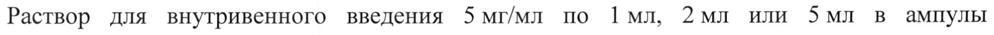

# Гидроксиникотиноилглутамат кальция — парентерально

- Препарат: Ампассе® (раствор для внутривенного введения;)
- АТХ: N06BX
- Источник: ГРЛС, инструкция по медицинскому применению, РУ ЛП-006394, файл от 2022-02-02 (https://grls.rosminzdrav.ru/Grls_View_v2.aspx?routingGuid=e5657a1a-5c96-4c9e-9fc2-e3d3b0a8ff00)
- Распознано автоматически (OCR): 4 из 4 стр.
- Инструкция к другому РУ того же препарата: ЛП-006394 (национальное РУ, переоформленное по правилам ЕАЭС, решение от 23.12.2021). Текст может быть старше действующего
- Сомнительных строк после OCR: 1 (см. раздел «Проверка распознавания»)

## Общие сведения

МИНЗДРАВ РОССИИ МИНИСТЕРСТВО ЗДРАВООХРАНЕНИЯ РОССИЙСКОЙ ФЕДЕРАЦИЙ\Н (|
ИНСТРУКЦИЯ ПО МЕДИЦИНСКОМУ ПРИМЕНЕНИЮ ЛЕКАРСТВЕННОГО ПРЕПАРАТА
АМПАССЕ” РЕГИСТРАЦИОННЫЙ НОМЕР:
ТОРГОВОЕ НАИМЕНОВАНИЕ: Ампассе”.
© ГРУППИРОВОЧНОЕ НАИМЕНОВАНИЕ: гидроксиникотиноилглутамат кальция.

## 3. Лекарственная форма

раствор для внутривенного введения.
раствор для внутривенного введения.

## 2. Состав

(на 1 мл):
(на 1 мл):
действующее вещество - Ампассе® (гидроксиникотиноилглутамат кальция) - 5 мг;
w вспомогательное вещество - вода для инъекций - до 1 мл.
ОПИСАНИЕ: прозрачный бесцветный или с желтоватым оттенком раствор.
ФАРМАКОТЕРАПЕВТИЧЕСКАЯ ГРУППА: ноотропное средство.
КОД АТХ: NO6BX.
ФАРМАКОЛОГИЧЕСКИЕ СВОЙСТВА Фармакодинамика
Нейрохимический механизм действия препарата опосредован взаимодействием с глутаматергической системой на уровне модуляции АМРА-рецепторов.
Результаты проведенного клинического иследования Ш фазы (Ampasse-III-02)
убедительно доказывают эффективность применения препарата Ампассе у больных с хроническим нарушением мозгового кровообращения вследствие артериальной гипертензии и(или) атеросклероза магистральных артерий головы. Эффективность лечения оценивалась по влиянию на когнитивные функции головного мозга (повышение счета по шкале МоСА на 2 балла и более, по сравнению с группой пациентов, принимающих плацебо на 30-й день после начала терапии). Доля пациентов, для которых
Z лечение было признано успешным по шкале МоСА на 30-й день после начала терапии в группе Ампассе и группе плацебо составили 83,87 % и 22,58 % соответственно. Таким образом, эффективность лечения в группе Ампассе, по сравнению с контрольной группой была выше на 61,29 % (95 % ДИ: 45,087 - 72,478 %; p<0,001).
Длительное введение препарата не приводит к кумуляции эффекта, к развитию толерантности или появлению нежелательных реакций. Отмена препарата после длительного введения не вызывает синдрома отмены.
Препарат является малотоксичным.

## 5.2. Фармакокинетика

& При изучении фармакокинетики Ампассе в ходе клинических исследований Ги П фазы
& При изучении фармакокинетики Ампассе в ходе клинических исследований Ги П фазы
(внутривенное и внутримышечное введение) было установлено, что значения основных фармакокинетических параметров гидроксиникотиноилглутамата при внутривенном введении характеризуются высокой межиндивидуальной вариабельностью.
Вариабельность фармакокинетических параметров при внутримышечном введении была
© небольшой. Фармакокинетические процессы у изученной группы пациентов в диапазоне доз 10 - 50 мг при внутривенном введении носили нелинейный характер. Биодоступность гидроксиникотиноилглутамата при внутримышечном введении здоровым добровольцам составила | - 3 % от внутривенного введения в той же дозе.
На основании данных, полученных в ходе клинических исследований, период полувыведения у человека составляет около 4 ч. Основным путем элиминации препарата
© является почечная экскреция.

## 4.1. Показания к применению

Хроническое нарушение мозгового кровообращения.
Хроническое нарушение мозгового кровообращения.

## 4.3. Противопоказания

Повышенная чувствительность к компонентам препарата, беременность, период грудного вскармливания, возраст до 18 лет, нарушения функции почек, нарушения функции печени.
Повышенная чувствительность к компонентам препарата, беременность, период грудного вскармливания, возраст до 18 лет, нарушения функции почек, нарушения функции печени.

## 4.6. Применение при беременности и в период грудного вскармливания

ВСКАРМЛИВАНИЯ Противопоказано применение препарата при беременности и в период грудного вскармливания. При необходимости применения в период лактации грудное вскармливание На время применения препарата следует прекратить. В исследованиях у животных не было обнаружено влияния на репродуктивную функцию, а также эмбриотоксическое и тератогенное действия.

## 4.2. Способ применения и дозы

Препарат вводят внутривенно струйно медленно в дозе 25 мг (5 мл) 1 раз в сутки в течение 15 дней.
Препарат вводят внутривенно струйно медленно в дозе 25 мг (5 мл) 1 раз в сутки в течение 15 дней.

## 4.8. Побочное действие

По результатам оценки безопасности проведенного клинического исследования Ш фазы
По результатам оценки безопасности проведенного клинического исследования Ш фазы
& было отмечено, что во время внутривенного введения препарата в редких случаях возможны головокружение (0,8 % случаев) и состояние сонливости легкой степени тяжести (0,8 % случаев). Клинически значимых отклонений от нормы результатов оценки жизненно-важных показателей и лабораторных анализов крови и мочи зарегистрировано не было. В редких случаях возможно появление аллергических реакций к отдельным
, компонентам препарата. В ходе клинических испытаний таких реакций зафиксировано не
- было.
Вместе с тем, при появлении каких-либо нежелательных побочных эффектов необходимо прекратить применение препарата и проконсультироваться с врачом.
Если Вы заметили любые другие побочные эффекты, не указанные в инструкции, сообщите об этом вашему лечащему врачу.
> ПЕРЕДОЗИРОВКА Случаи передозировки не зарегистрированы.

## 4.5. Взаимодействие с другими лекарственными средствами

Препарат уменьшает токсические эффекты этилового спирта.

## 4.7. Влияние на способность управлять транспортными средствами, механизмами

СРЕДСТВАМИ И РАБОТАТЬ С МЕХАНИЗМАМИ Не следует применять препарат при данных видах деятельности, т.к. отсутствуют данные по изучению влияния препарата на способность управлять транспортными средствами и работать с механизмами.

## 6.5. Форма выпуска

Раствор для внутривенного введения 5 мг/мл по Imi, 2мл или SMI в ампулы светозащитного нейтрального стекла марки СНС-1 или стекла с классом сопротивления гидролизу НСА1 (первый гидролитический).
Раствор для внутривенного введения 5 мг/мл по Imi, 2мл или SMI в ампулы светозащитного нейтрального стекла марки СНС-1 или стекла с классом сопротивления гидролизу НСА1 (первый гидролитический).
5 ампул помещают в контурную ячейковую упаковку из пленки поливинилхлоридной
(ПВХ), либо из пленки полиэтилентерефталатной (ПЭТФ).
1, 2 или 3 контурные ячейковые упаковки вместе с инструкцией по применению помещают в пачку из картона.
УСЛОВИЯ ХРАНЕНИЯ w& В защищенном от света месте, при температуре He выше 25 °C. He замораживать. Хранить в недоступном для детей месте.

## 6.3. Срок годности

2 года.
2 года.
© Не использовать по истечении срока годности, указанного на упаковке.
УСЛОВИЯ ОТПУСКА Отпускают по рецепту.
ВЛАДЕЛЕЦ РЕГИСТРАЦИОННОГО УДОСТОВЕРЕНИЯ/
© ОРГАНИЗАЦИЯ, ПРИНИМАЮЩАЯ ПРЕТЕНЗИИ ПОТРЕБИТЕЛЕЙ
ООО «ТАВИТА», Россия, 117997, г. Москва, ул. Вавилова, д. 69/75, оф. 1023A, тел.: 8-800-555-222-9.
ПРОИЗВОДИТЕЛЬ ООО «Эллара», Россия, 601122, Владимирская обл., Петушинский район, г. Покров, ул. Франца Штольверка, д. 20, стр. 2.
Генеральный директор hr a. 7 of ООО «ТАВИТА» [77 ARTA Аи Литвин А.А.
т АВИТА Я NENG pif Rae
## Проверка распознавания

Страницы-сканы распознаны автоматически. В 1 строках с дозировками цифры могли распознаться с ошибкой — сверьте с вырезкой из оригинала:

- стр. 4: «Раствор для внутривенного введения 5 мг/мл по Imi, 2мл или SMI в ампулы» — низкая уверенность: «5» (0)  
  
