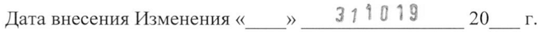
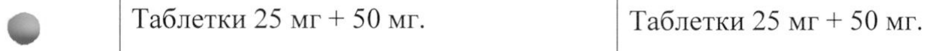

# Гидрохлоротиазид + Каптоприл — внутрь

- Препарат: Гидрохлоротиазид+Каптоприл (таблетки;)
- АТХ: C09BA01
- Источник: ГРЛС, инструкция по медицинскому применению, РУ ЛП-003732, файл от 2021-07-27 (https://grls.rosminzdrav.ru/Grls_View_v2.aspx?routingGuid=cfbe59f7-2a17-4b7a-bf49-a5b1582996b9)
- Распознано автоматически (OCR): 6 из 6 стр.
- Инструкция к другому РУ того же препарата: ЛП-003732 (срок действия истёк, решение от 15.07.2021). Текст может быть старше действующего
- Сомнительных строк после OCR: 2 (см. раздел «Проверка распознавания»)

## Общие сведения

11-095 /52-5 1 ВУ МИНИСТЕРСТВО ЗДРАВООХРАНЕНИЯ РОССИЙСКОЙ ФЕДЕРАЦИИ
ИНСТРУКЦИЯ ПО МЕДИЦИНСКОМУ ПРИМЕНЕНИЮ ЛЕКАРСТВЕННОГО ПРЕПАРАТА
Гидрохлоротиазид + Каптоприл наименование лекарственного препарата таблетки 25 мг + 50 мг лекарственная форма, дозировка
ООО «Озон», Россия наименование производителя, страна
& Изменение № 1 Дата внесения Изменения « » 311013 20 г.
Старая редакция Новая редакция Состав на 1 таблетку Состав на 1 таблетку
Действующие вещества: | Действующие вещества:
гидрохлоротиазид — 25 мг, каптоприл | гидрохлоротиазид — 25 мг, каптоприл
— 50,0 мг. — 50,0 мг.
Вспомогательные вещества: лактозы | Вспомогательные вещества: лактозы моногидрат (сахар молочный) -—| моногидрат (сахар молочный) —
~ 169,0 mr, целлюлоза | 169,0 mr, целлюлоза микрокристаллическая — 100,0 мг, микрокристаллическая (МКЦ-101 крахмал кукурузный — 40,0 мг, Премиум) — 100,0 мг, крахмал кроскармеллоза натрия — 12,0 мг, | кукурузный _ 40,0 MI, магния стеарат — 4,0 мг. кроскармеллоза натрия — 12,0 мг, магния стеарат - 4,0 мг.
Описание: круглые | Описание плоскоцилиндрические таблетки с| Круглые плоскоцилиндрические риской с одной стороны и фасками с | таблетки, белого или белого с 420596 211-995 /52-511019
Изменение № | к инструкции С.2 двух сторон, белого или белого с бежевым оттенком цвета, с риской и бежевым оттенком цвета, с фаской, с характерным запахом.
характерным запахом, допускается Допускается незначительная незначительная мраморность. мраморность.

## 4.3. Противопоказания

Противопоказания ® повышенная чувствительность ® повышенная чувствительность к гидрохлоротиазиду, другим к гидрохлоротиазиду, другим производным сульфонамида, к производным сульфонамида, к
Противопоказания ® повышенная чувствительность ® повышенная чувствительность к гидрохлоротиазиду, другим к гидрохлоротиазиду, другим производным сульфонамида, к производным сульфонамида, к
- каптоприлу и/или любому из каптоприлу и/или любому из вспомогательных веществ; вспомогательных веществ;
® рефрактерная — гипокалиемия, e рефрактерная — гипокалиемия, гипонатриемия, гипонатриемия, гиперкальциемия; гиперкальциемия;
® ангионевротический отек в © ангионевротический отек в анамнезе, связанный с приемом анамнезе, связанный с приемом ингибиторов АПФ, ингибиторов АПФ, наследственный ИЛИ наследственный или
© идиопатический идиопатический ангионевротический отек; ангионевротический отек;
© двусторонний стеноз почечных © двусторонний стеноз почечных артерий или стеноз артерии артерий или стеноз артерии единственной почки c единственной почки С прогрессирующей азотемией; прогрессирующей азотемией;
рефрактерная гиперкалиемия; рефрактерная гиперкалиемия;
® состояние после ® состояние после трансплантации почек; трансплантации почек;
® аортальный стеноз, митральный ® аортальный стеноз, митральный 420596 11-003 /52-3511019
Изменение № | к инструкции С.3

стеноз; гипертрофическая стеноз; гипертрофическая обструктивная кардиомиопатия обструктивная кардиомиопатия
(состояния, затрудняющие (состояния, затрудняющие отток крови из — левого отток крови из — левого желудочка); желудочка);

® одновременное применение с © одновременное применение с алискиреном И алискиреном и алискиренсодержащими алискиренсодержащими препаратами, у пациентов с препаратами, у пациентов с

= сахарным диабетом и/или сахарным диабетом и/или

умеренными или тяжелыми умеренными или тяжелыми нарушениями функции почек нарушениями функции почек
(клиренс креатинина менее 30 (клиренс креатинина менее 30 мл/мин); мл/мин);

® одновременное применение с @ одновременное применение с антагонистами рецепторов антагонистами рецепторов ангиотензина П (АРА П) у ангиотензина П (APA II) у пациентов с диабетической пациентов с диабетической

© нефропатией; нефропатией;

® тяжелая почечная ® тяжелая почечная недостаточность (клиренс недостаточность (клиренс креатинина менее 30 мл/мин), креатинина менее 30 мл/мин), анурия; анурия;

® тяжелая печеночная ® тяжелая печеночная недостаточность ИЛИ недостаточность ИЛИ печеночная энцефалопатия печеночная энцефалопатия
(риск развития печеночной (риск развития печеночной комы); комы);

120596 71-095 /55-511019 Изменение № | к инструкции С.4

® беременность И период ® беременность И период грудного вскармливания; грудного вскармливания;

e детский возраст до 18 лет » детский возраст до 18 лет
(эффективность и безопасность (эффективность и безопасность не установлены); не установлены);

® непереносимость лактозы, ® непереносимость лактозы, дефицит лактазы и синдром дефицит лактазы и синдром глюкозо-галактозной глюкозо-галактозной мальабсорбции. мальабсорбции;

~ ® одновременное применение с ингибиторами нейтральной эндопептидазы (например, с препаратами, содержащими сакубитрил) в связи с высоким риском развития ангионевротического отека.

## 6.5. Форма выпуска

Форма выпуска © Таблетки 25 мг + 50 мг. Таблетки 25 мг + 50 мг.
Форма выпуска © Таблетки 25 мг + 50 мг. Таблетки 25 мг + 50 мг.
По 7, 10, 30 таблеток в контурную По 7, 10, 30 таблеток в контурную ячейковую упаковку из пленки | ячейковую упаковку поливинилхлоридной И фольги | из пленки поливинилхлоридной и алюминиевой печатной | фольги алюминиевой — печатной лакированной. лакированной.
По 10, 20, 28, 30, 40, 50 или 100 По 10, 20, 28, 30, 40, 50 или 100 таблеток B банки из | таблеток B банки из полиэтилентерефталата для | полиэтилентерефталата ДЛЯ лекарственных средств, укупоренные | лекарственных средств ИЛИ 420596 711-905 /525-511019

Изменение № | к инструкции С.5 крышками навинчиваемыми с полипропиленовые для лекарственных контролем первого вскрытия или | средств, укупоренные крышками из системой «нажать-повернуть» из полиэтилена высокого давления с полипропилена или полиэтилена или | контролем первого вскрытия или банки полипропиленовые для крышками полипропиленовыми с лекарственных средств, укупоренные | системой «нажать-повернуть» или крышками натягиваемыми с крышками из полиэтилена низкого контролем первого вскрытия из давления с контролем первого полиэтилена ИЛИ банки | вскрытия.

& полипропиленовые для | Одну банку или 1, 2, 3, 4, 5 или 19 лекарственных средств, укупоренные | контурных ячейковых — упаковок крышками натягиваемыми с | вместе с инструкцией по применению контролем первого вскрытия из помещают в картонную упаковку полиэтилена высокого давления. (пачку).
Одну банку или 1, 2, 3, 4, 5 или 10 контурных ячейковых упаковок вместе с инструкцией по применению помещают в картонную упаковку

© (пачку).

## 6.4. Условия хранения

Условия хранения В защищенном от света месте при При температуре не выше 25 °С.
Условия хранения В защищенном от света месте при При температуре не выше 25 °С.
температуре не выше 25 °С. Хранить в недоступном для детей
Хранить в недоступном для детей месте.
месте.
Держатель регистрационного | Держатель регистрационного удостоверения и производитель удостоверения: ООО «Атолл»
Держатель РУ: ООО «Атолл», Россия, 445351, Самарская обл.,

120596 11-095 / 54-51 ЦИУ Изменение № | к инструкции C.6
Старая редакция Новая редакция Юридический адрес: 445351, Россия, г. Жигулевск, ул. Гидростроителей,
Самарская обл., г. Жигулевск, ул. | д.6.
Гидростроителей, д. 6. Производитель: ООО «Озон»
Производитель, ответственный за | Россия, 445351, Самарская обл., выпускающий контроль качества: | г. Жигулевск, ул. Гидростроителей,
OOO «Озон», Россия, Самарская | 1.6.
обл., ‚я Жигулевск, ул. | Организация, принимающая
Гидростроителей, д. 6. претензии: ООО «Озон»
Все претензии потребителей следует Россия, 445351, Самарская обл.,
& направлять представителю держателя | г. Жигулевск, ул. Гидростроителей, регистрационного удостоверения: | 1.6.
ООО «Озон» Тел.: +79874599991, +79874599992 445351, Россия, Самарская обл., | E-mail: ozon@ozon-pharm.ru г. Жигулевск, ул. Гидростроителей, д.
6.
Тел.: +79874599991, +79874599992 E-mail:ozon@ozon-pharm.ru 5021323
Директор ООО «Атолл» * И Об, ООО «Управляющая компания»
w fy Hy 44-2 — влице Секретаря Правления 10, | ©. Грядунова ILE.
Во и И, о MM И 28 QOH AW cae 24.09.2019 TUE 80 i И 2 2. р; ни:
Ky м =ртный отчет =| BI 120596
## Проверка распознавания

Страницы-сканы распознаны автоматически. В 2 строках с дозировками цифры могли распознаться с ошибкой — сверьте с вырезкой из оригинала:

- стр. 1: «Дата внесения Изменения « » 311013 20 г.» — повторное чтение: «Дата внесения Изменения « » 311013 20____г.»  
  
- стр. 4: «© Таблетки 25 мг + 50 мг. Таблетки 25 мг + 50 мг.» — повторное чтение: «6 | Таблетки 25 мг + 50 mr. | Таблетки 25 мг + 50 мг.»  
  
