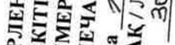

# Гилтеритиниб — внутрь

- Препарат: Ксоспата (таблетки, покрытые пленочной оболочкой)
- АТХ: L01EX13
- Источник: ОХЛП, Единый реестр ЛС ЕАЭС, запись 64256c9dfb44f115ad9bcb07, документ от 2026-04-03
- Распознано автоматически (OCR): 2 из 36 стр.
- Сомнительных строк после OCR: 2 (см. раздел «Проверка распознавания»)

## Общие сведения

1 из 14 ОБЩАЯ ХАРАКТЕРИСТИКА ЛЕКАРСТВЕННОГО ПРЕПАРАТА
▼Данный лекарственный препарат подлежит дополнительному мониторингу. Это позволит быстро выявить новую информацию по безопасности. Мы обращаемся к работникам системы здравоохранения с просьбой сообщать о любых подозреваемых нежелательных реакциях. Порядок сообщения о нежелательных реакциях представлен в разделе 4.8.

## 1. Наименование лекарственного препарата

Ксоспата, 40 мг, таблетки, покрытые пленочной оболочкой.

## 2. Качественный и количественный состав

Действующее вещество: гилтеритиниб.

Каждая таблетка, покрытая пленочной оболочкой содержит 40 мг гилтеритиниба (в виде фумарата).

Полный перечень вспомогательных веществ приведен в разделе 6.1.

## 3. Лекарственная форма

Таблетки, покрытые пленочной оболочкой.
Круглые, двояковыпуклые таблетки, покрытые пленочной оболочкой, светло-желтого цвета, с фаской с двух сторон, с гравировкой логотипа компании и «235» на одной стороне.

## 4. Клинические данные

## 4.1. Показания к применению

Гилтеритиниб показан в виде монотерапии для лечения взрослых пациентов с рецидивирующим или рефрактерным острым миелоидным лейкозом (ОМЛ) с мутациями в гене FLT3.

## 4.2. Режим дозирования и способ применения

Лечение препаратом Ксоспата должно проводиться врачом, имеющим опыт проведения противоопухолевой химиотерапии.

Перед приемом гилтеритиниба у пациентов с рецидивирующим или рефрактерным ОМЛ необходимо получить подтверждение наличия мутации FMS-подобной тирозинкиназы 3 (FLT3)
(внутренней тандемной дупликации [ВТД] или тирозинкиназного домена [ТКД]) с помощью валидированного теста.
Режим дозирования Рекомендуемая начальная доза гилтеритиниба составляет 120 мг (три таблетки по 40 мг) один раз в сутки.

2 из 14 Лечение следует продолжать до того момента, пока пациент получает клиническую пользу от приема препарата Ксоспата, либо до развития непереносимой токсичности. Ответ на лечение может иметь отсроченный характер; в этой связи следует учесть, что при использовании препарата в назначенной дозе до получения клинического ответа может пройти до 6 месяцев.
При отсутствии ответа на лечение через 4 недели терапии, дозу можно увеличить до 200 мг (пять таблеток по 40 мг) один раз в сутки.

У пациентов, перенесших трансплантацию гемопоэтических стволовых клеток (ТГСК), лечение гилтеритинибом может быть возобновлено. Биохимические параметры крови, включая уровень креатинфосфокиназы, необходимо оценивать перед началом лечения, на 15-й день цикла 1, а затем ежемесячно в течение всего периода лечения.

Электрокардиографическое (ЭКГ) исследование необходимо проводить перед началом лечения гилтеритинибом, на 8-й и 15-й дни цикла 1 и перед началом следующих двух последовательных циклов терапии. Пациентам с продолжительностью QTcF >500 мсек требуется отмена терапии и/или снижение дозы препарата.

Коррекция дозы

Таблица 1. Рекомендации по прерыванию приема, снижению и отмене доз лекарственного препарата Ксоспата у пациентов с рецидивирующим или рефрактерным ОМЛ
Критерии Доза препарата Ксоспата Синдром дифференцировки
• При подозрении на синдром дифференцировки назначают кортикостероиды и начинают мониторинг гемодинамики (см. раздел 4.4.).
• При сохранении выраженных жалоб и/или симптомов более 48 часов после начала применения кортикостероидов прием гилтеритиниба прерывают.
• После уменьшения жалоб и симптомов до степени 2а и ниже прием гилтеритиниба возобновляют в прежней дозе.
Синдром задней обратимой энцефалопатии • Гилтеритиниб отменяют.
Интервал QTcF >500 мс • Прием гилтеритиниба прерывают.
• При возвращении продолжительности интервала QTcF в пределы 30 мс от исходного значения или ≤ 480 мс прием гилтеритиниба возобновляют в сниженной дозе (80 мг или 120 мгb).
Удлинение интервала QTcF более чем на 30 мс на ЭКГ, записанной на 8-й день цикла 1
• Записывают контрольную ЭКГ на 9-й день.
• При подтверждении удлинения следует рассмотреть снижение дозы до 80 мг.
Панкреатит • Прием гилтеритиниба прерывают до разрешения панкреатита.
• Лечение гилтеритинибом возобновляют в сниженной дозе (80 мг или 120 мгb).

3 из 14 Критерии Доза препарата Ксоспата
Другие токсические эффекты степени 3a или выше, расцененные как связанные с лечением.
• Прием гилтеритиниба прерывают до разрешения токсического эффекта или его уменьшения до степени 1a.
• Лечение гилтеритинибом возобновляют в сниженной дозе (80 мг или 120 мгb).
Планируемая ТГСК • Лечение гилтеритинибом прерывают за одну неделю до начала процедуры подготовки к ТГСК.
• Лечение можно возобновить через 30 дней после ТГСК при условии успешного приживления трансплантата, отсутствия у пациента острой реакции «трансплантат против хозяина» степени ≥2 и находился в стадии комбинированной ПР (ПРкомпл)c.
a.
Степень 1 — легкая, степень 2 – умеренная, степень 3 – тяжелая, степень 4 – угрожающая жизни.
b. Суточную дозу можно снизить с 120 мг до 80 мг или с 200 мг до 120 мг.
c.
Комплексную полную ремиссию (ПРкомпл) определяли, как совокупность всех вариантов полной ремиссии
(ПР). ПР определяли как абсолютное число нейтрофилов ≥1,0 x 109/л, тромбоцитов ≥100 x 109/л, нормальную дифференциацию костного мозга с <5% бластов; отсутствие зависимости от переливания эритроцитарной массы, тромбоцитарной массы и отсутствие признаков внекостномозгового лейкоза, ПРтр [достигнута ПР, за исключением неполного восстановления числа тромбоцитов (<100 x 109/л)] и ПРн (достигнуты все критерии
ПР, за исключением неполного гематологического восстановления с остаточной нейтропенией <1 x 109/л и полным восстановлением числа тромбоцитов или без него).

Если доза гилтеритиниба пропущена или не принята в обычное время, следует принять препарат как можно раньше в тот же день, а на следующий день вернуться к обычному графику приема. Если после приема препарата развивается рвота, не следует принимать дополнительную дозу, а на следующий день нужно вернуться к обычной схеме лечения.

Особые группы пациентов Пациенты пожилого возраста
Коррекция дозы у пациентов в возрасте ≥65 лет не требуется.

Пациенты с нарушением функции почек Пациенты с почечной недостаточностью легкой, умеренной или тяжелой степени в коррекции дозы не нуждаются.

Пациенты с нарушением функции печени У пациентов с печеночной недостаточностью легкой (класс A по классификации Чайлд-Пью) и средней (класс B по классификации Чайлд-Пью) степени тяжести коррекция дозы не требуется.
Применение гилтеритиниба у пациентов с тяжелой печеночной недостаточностью (класс C по классификации Чайлд-Пью) не изучалось.
Дети Эффективность и безопасность применения препарата Ксоспата у детей в возрасте от 0 до 18 лет, не установлены. Данные отсутствуют.
Способ применения Для приема внутрь.

4 из 14 Таблетки следует принимать внутрь один раз в сутки независимо от приема пищи. Таблетки нельзя ломать или измельчать. Препарат Ксоспата следует принимать приблизительно в одно и то же время суток.

## 4.3. Противопоказания

Гиперчувствительность к гилтеритинибу или к любому из вспомогательных веществ, перечисленных в разделе 6.1.

## 4.4. Особые указания и меры предосторожности при применении

Синдром дифференцировки Синдром дифференцировки связан с быстрой пролиферацией и дифференцировкой клеток миелоидного ряда и при отсутствии лечения может угрожать жизни или приводить к летальному исходу. У пациентов, получавших гилтеритиниб, симптомы и другие клинические проявления дифференцировочного синдрома у , включают лихорадку, одышку, плевральный выпот, перикардиальный выпот, отек легких, артериальную гипотензию, быстрое увеличение массы тела, периферические отеки, сыпь и нарушение функции почек. В некоторых случаях одновременно имеет место острый фебрильный нейтрофильный дерматоз. Развитие синдрома дифференцировки наблюдалось в период с 1 дня по 82 день после начала лечения гилтеритинибом и происходило на фоне лейкоцитоза или без него.
При подозрении на синдром дифференцировки следует назначать системные кортикостероиды и начать мониторинг гемодинамики до облегчения симптомов. При разрешении симптомов дозу кортикостероидов следует постепенно снижать. Симптомы синдрома дифференцировки могут рецидивировать в случае преждевременной отмены кортикостероидов.
Если тяжелые признаки и/или симптомы сохраняются свыше 48 часов после начала применения кортикостероидов, следует прервать лечение гилтеритинибом до тех пор, пока выраженность симптомов и признаков не уменьшится (см. раздел 4.2.).
Синдром задней обратимой энцефалопатии Имеются сообщения о развитии у пациентов синдрома задней обратимой энцефалопатии (PRES)
с симптомами судорог и изменения психического состояния. PRES — это редкое обратимое неврологическое заболевание, которое может проявляться быстро прогрессирующими симптомами, включающими судорожные приступы, головную боль, спутанность сознания, зрительные и неврологические нарушения с сопутствующей артериальной гипертензией или без нее и изменением психического состояния. Симптомы разрешались после отмены гилтеритиниба. Диагноз PRES требует подтверждения при помощи визуализирующего исследования головного мозга, предпочтительно - магнитно-резонансной томографии (МРТ). У пациентов с PRES гилтеритиниб необходимо отменить.
Удлинение интервала QT Применение гилтеритиниба ассоциировалось с увеличением длительности реполяризации желудочков сердца (интервала QT) (см. разделы 4.8. и 5.). Удлинение интервала QT может наблюдаться в первые три месяца лечения гилтеритинибом.
Следовательно, электрокардиографическое (ЭКГ) исследование необходимо проводить перед началом лечения, на 8-й и 15-й дни цикла 1 и перед началом следующих трех последовательных циклов терапии.
При удлинении QTcF >500 мсек пациентам требуется отмена терапии и/или снижение дозы (см.
раздел 4.2.). У пациентов со значимым кардиологическим анамнезом следует соблюдать осторожность.

5 из 14 Гипокалиемия или гипомагниемия могут повысить риск удлинения интервала QT. Перед началом и во время лечения гилтеритинибом следует проводить коррекцию гипокалиемии или гипомагниемии.
Панкреатит Имеются сообщения о развитии панкреатита, однако связь с применением гилтеритиниба не подтверждена. Необходима оценка и мониторинг состояния пациентов с признаками и симптомами, указывающими на панкреатит. Терапию препаратом Ксоспата следует прервать и возобновить в сниженной дозе после разрешения симптомов панкреатита (см. раздел 4.2.).
Взаимодействия Сопутствующее применение индукторов CYP3A / гликопротеина P (P-gp) может привести к снижению экспозиции гилтеритиниба и, следовательно, ослаблению его эффективности. По этой причине следует избегать одновременного применения гилтеритиниба с сильными индукторами
CYP3A4/P-gp (см. раздел 4.5.).

Необходимо соблюдать осторожность при одновременном применении гилтеритиниба с сильными ингибиторами CYP3A, P-gp и/или белка резистентности рака молочной железы
(BCRP) (например, вориконазол, итраконазол, позаконазол и кларитромицин), так как они могут повышать экспозицию гилтеритиниба. Следует рассмотреть альтернативные лекарственные препараты, которые не обладают сильной ингибирующей активностью к CYP3A, P-gp и/или
BCRP. В случае отсутствия альтернативной терапии пациенты должны находиться под тщательным наблюдением на предмет появления токсического действия во время приема гилтеритиниба (см. раздел 4.5.).

Гилтеритиниб может ослаблять эффекты лекарственных средств, действующих на рецепторы 5HT2B или неспецифические сигма-рецепторы. По указанной причине следует избегать одновременного применения гилтеритиниба с этими препаратами, если только они не считаются крайне необходимыми для лечения пациента (см. раздел 4.5.).
Эмбриофетальная токсичность и контрацепция
Следует информировать беременных женщин о потенциальном риске для плода (см. раздел 4.6.).
Женщинам, способным к деторождению, за семь дней до начала лечения препаратом Ксоспата рекомендуется пройти тест на беременность, а также использовать эффективные методы контрацепции во время лечения препаратом Ксоспата и в течение 6 месяцев после его окончания.
Женщинам, использующим гормональные контрацептивы, необходимо дополнительно применять барьерный метод. Мужчинам с репродуктивным потенциалом следует рекомендовать эффективные методы контрацепции во время лечения и не менее 4 месяцев после приема последней дозы препарата Ксоспата.

## 4.5. Взаимодействие с другими лекарственными препаратами и другие виды взаимодействия

Гилтеритиниб метаболизируется преимущественно изоферментами CYP3A, которые могут индуцироваться или ингибироваться различными сопутствующими лекарственными препаратами.
Влияние других лекарственных препаратов на гилтеритиниб
Индукторы CYP3A/P-gp Одновременного применения гилтеритиниба с лекарственными препаратами, которые являются мощными индукторами
CYP3A/P-gp (например, рифампин, фенитоин, зверобой

6 из 14 продырявленный), следует избегать, поскольку это может привести к снижению концентрации гилтеритиниба в плазме крови. У здоровых лиц одновременное применение рифампицина
(600 мг), мощного индуктора CYP3A/P-gp, до равновесного состояния с однократной дозой гилтеритиниба 20 мг снижало среднее значение максимальной плазменной концентрации (Cmax)
гилтеритиниба на 27% и среднее значение площади под фармакокинетической кривой
«плазменная концентрация – время» (AUCinf) на 70%, соответственно, в сравнении с пациентами, получавшими лишь однократную дозу гилтеритиниба (см. раздел 4.4.).

Ингибиторы CYP3A, P-gp и/или BCRP При одновременном приеме гилтеритиниба с лекарственными препаратами, являющимися мощными ингибиторами CYP3A и/или P-gp (например, вориконазол, итраконазол, позаконазол, кларитромицин, эритромицин, каптоприл, карведилол, ритонавир, азитромицин), следует соблюдать осторожность, поскольку это может привести к повышению его концентрации в плазме крови. Однократное применение гилтеритиниба в дозе 10 мг вместе с итраконазолом
(200 мг один раз в сутки в течение 28 дней), мощным ингибитором CYP3A, P-gp и BCRP, у здоровых участников приводило к увеличению средней Cmax примерно на 20% и увеличению среднего значения AUCinf в 2,2 раза по сравнению с участниками, получавшими только однократную дозу гилтеритиниба. Экспозиция гилтеритиниба повышалась приблизительно в 1,5 раза у пациентов с рецидивирующим или рефрактерным ОМЛ при одновременном применении с мощным ингибитором CYP3A, P-gp и/или BCRP (см. раздел 4.4.).

Влияние препарата Ксоспата на другие лекарственные препараты
Гилтеритиниб как ингибитор или индуктор Гилтеритиниб не является ингибитором или индуктором CYP3A4 или ингибитором MATE1 in vivo. Фармакокинетика мидазолама (чувствительного субстрата CYP3A4) существенно не изменялась (Cmax и AUC повышались примерно на 10%) после приема гилтеритиниба один раз в сутки (300 мг) в течение 15 дней у пациентов с рецидивирующим или рефрактерным ОМЛ с мутацией FLT3. Кроме того, фармакокинетика цефалексина (чувствительного субстрата MATE1)
существенно не изменилась (Cmax и AUC снижались менее чем на 10%) после применения гилтеритиниба один раз в сутки (200 мг) в течение 15 дней у пациентов с рецидивирующим или рефрактерным ОМЛ с мутацией FLT3.
Гилтеритиниб является ингибитором P-gp, белка резистентности рака молочной железы (BCRP)
и OCT1 in vitro. Поскольку гилтеритиниб может ингибировать транспортеры в терапевтической дозе, рекомендуется соблюдать осторожность при совместном применении гилтеритиниба с субстратами P-gp (например, дигоксином, дабигатрана этексилатом), BCRP (например, митоксантроном, розувастатином) и OCT1 (например, метформином).

Рецептор 5HT2B или неспецифический сигма-рецептор
По данным исследований in vitro, гилтеритиниб может приводить к снижению эффективности лекарственных препаратов, направленных на рецептор 5HT2B или неспецифический сигмарецептор (например, эсциталопрам, флуоксетин, сертралин). Следует избегать одновременного применения этих препаратов с гилтеритинибом, кроме случаев, когда это признано необходимым для лечения пациента.

## 4.6. Фертильность, беременность и лактация

Беременность Гилтеритиниб может оказывать вредное воздействие на плод при введении его беременным женщинам. Нет или имеется ограниченное число данных об использовании гилтеритиниба у беременных женщин. Репродуктивные исследования на крысах показали, что гилтеритиниб вызывал подавление роста плода, гибель эмбриона и плода и тератогенность. Ксоспата не

7 из 14 рекомендуется во время беременности и женщинам, способным к деторождению, которые не используют эффективные средства контрацепции.
Лактация Информация относительно наличия гилтеритиниба в молоке человека, влияния на грудного ребенка или продукцию молока отсутствуют. В исследованиях на животных было показано, что гилтеритиниб и/или его метаболиты попадали в ткани новорожденных крыс через молоко.
Кормление грудью следует прекратить во время лечения гилтеритинибом, а также на протяжении минимум 2 месяцев после получения последней дозы препарата.

Женщины с детородным потенциалом (контрацепция у мужчин и женщин)
Женщинам, способным к деторождению, за семь дней до начала лечения препаратом Ксоспата рекомендуется пройти тест на беременность, а также рекомендуется использовать надежные методы контрацепции (характеризующиеся частотой неудачи менее 1%) во время лечения и в течение 6 месяцев после его окончания. Неизвестно, снижает ли гилтеритиниб эффективность гормональных контрацептивов, поэтому женщинам, использующим этот метод контрацепции, необходимо дополнительно применять барьерный метод. Мужчинам с репродуктивным потенциалом следует рекомендовать использовать эффективные методы контрацепции во время лечения и не менее 4 месяцев после приема последней дозы препарата Ксоспата (см. раздел 4.4.).
Фертильность Нет данных о влиянии гилтеритиниба на фертильность человека.
4.7. Влияние на способность управлять транспортными средствами и работать с механизмами
Гилтеритиниб оказывает несущественное влияние на способность управлять транспортными средствами и работать с механизмами. Сообщалось о случаях головокружения у пациентов, принимавших гилтеритиниб, что необходимо учитывать при принятии решения о возможности пациента управлять транспортными средствами и работать с механизмами.

## 4.8. Нежелательные реакции

Резюме профиля безопасности Оценка безопасности проводилась на основании 319 пациентах (включая 246 участников исследования ADMIRAL) с рецидивирующим или рефрактерным ОМЛ, получивших по меньшей мере одну дозы (120 мг) гилтеритиниба в сутки. На момент окончательного анализа медиана продолжительности лечения гилтеритинибом составила 111 дней (интервал от 4 до 1320 дней).

Наиболее частыми нежелательными реакциями (≥10%) были повышение активности аланинаминотрансферазы (АЛТ) (82,1%), аспартатаминотрансферазы (АСТ) (80,6%), щелочной фосфатазы (68,7%), креатинфосфокиназы в крови (53,9%), диарея (35,1%), общая слабость
(30,4%), тошнота (29,8%), запор (28,2%), кашель (28,2%), периферические отеки (24,1%), одышка
(24,1%), головокружение (20,4%), артериальная гипотензия (17,2%), боль в конечностях (14,7%), астения (13,8%), артралгия (12,5%) и миалгия (12,5%).

Наиболее частыми серьезными нежелательными реакциями (≥2%) были острое поражение почек
(6,6%), диарея (4,7%), повышение активности АЛТ (4,1%), одышка (3,4%), повышение активности АСТ (3,1%), артериальная гипотензия (2,8%). Другие серьезные нежелательные реакции включали в себя дифференцировочный синдром (2,2%), удлинение интервала QT на ЭКГ
(0,9%) и синдром задней обратимой энцефалопатии (0,6%).

8 из 14

Табличное резюме нежелательных реакций Ниже приведены и распределены по частоте нежелательные реакции, наблюдавшиеся в ходе клинических исследований. Категории частоты распределены следующим образом: очень часто
(≥1/10), часто (≥1/100, но <1/10), нечасто (≥1/1000, но <1/100), редко (≥1/10000, но <1/1000), очень редко (<1/10000), частота неизвестна (на основании имеющихся данных оценить невозможно). В каждой частотной группе нежелательные реакции представлены в порядке уменьшения степени тяжести.

Таблица 2. Нежелательные реакции Нежелательная реакция
Все степени % Степень тяжести ≥3 % Категория частоты
Нарушения со стороны иммунной системы Анафилактическая реакция 1,3 1,3
Часто Нарушения со стороны нервной системы
Головокружение 20,4 0,3 Очень часто Синдром задней обратимой энцефалопатии 0,6 0,6
Нечасто Нарушения со стороны сердца Удлинение интервала QT на ЭКГ 8,8 2,5
Часто Перикардиальный выпот 4,1 0,9 Часто
Перикардит 1,6 Часто Сердечная недостаточность 1,3 1,3
Часто Нарушения со стороны сосудов Гипотензия 17,2 7,2
Очень часто Нарушения со стороны дыхательной системы, органов грудной клетки и средостения
Кашель 28,2 0,3 Очень часто Одышка 24,1 4,4
Очень часто Дифференцировочный синдром 3,4 2,2
Часто Желудочно-кишечные нарушения Диарея 35,1 4,1
Очень часто Тошнота 29,8 1,9 Очень часто
Запор 28,2 0,6 Очень часто Нарушения со стороны печени и желчевыводящих путей
Повышение активности аланинаминотрансферазы* 82,1 12,9
Очень часто Повышение активности аспартатаминотрансферазы* 80,6 10,3
Очень часто Нарушения со стороны мышечной, скелетной и соединительной ткани
Повышение активности креатинфосфокиназы в крови* 53,9 6,3
Очень часто Повышение активности щелочной фосфатазы в крови* 68,7 1,6
Очень часто Боль в конечностях 14,7 0,6 Очень часто
Артралгия 12,5 1,3 Очень часто Миалгия 12,5 0,3
Очень часто Костно-мышечная боль 4,1 0,3
Часто Нарушения со стороны почек и мочевыводящих путей
Острое поражение почек 6,6 2,2 Часто

9 из 14 Нежелательная реакция Все степени
% Степень тяжести ≥3 % Категория частоты
Общие нарушения и реакции в месте введения
Повышенная утомляемость 30,4 3,1 Очень часто
Периферический отек 24,1 0,3 Очень часто
Астения 13,8 2,5 Очень часто Недомогание 4,4
Часто * Оценка частоты основывается на показателях центральной лаборатории.

Описание отдельных нежелательных реакций
Синдром дифференцировки У 11 (3%) из 319 пациентов, получавших препарат Ксоспата в клинических исследованиях, возникал синдром дифференцировки. Данный синдром связан с быстрой пролиферацией и дифференцировкой миелоидных клеток и в отсутствие лечения может угрожать жизни или приводить к смерти. Симптомы и клинические проявления синдрома дифференцировки у пациентов, получавших Ксоспата, включали лихорадку, одышку, плевральный выпот, перикардиальный выпот, отек легких, артериальную гипотензию, быстрое увеличение массы тела, периферические отеки, сыпь и нарушение функции почек. В некоторых случаях отмечали сопутствующий острый фебрильный нейтрофильный дерматоз. Сроки развития синдрома дифференцировки после начала применения препарата Ксоспата составляли от 1 до 82 дней, при этом он мог сопровождаться или не сопровождаться лейкоцитозом. 9 (82%) из 11 пациентов у которых возник синдром дифференцировки, восстановились после лечения или прекращения приема препарата Ксоспата. Рекомендации при подозрении на синдром дифференцировки (см.
разделы 4.2. и 4.4.).

Синдром задней обратимой энцефалопатии (PRES)
У 0,6% из 319 пациентов, получавших препарат Ксоспата в клинических исследованиях, возник синдром задней обратимой энцефалопатии (PRES). PRES — это редкое обратимое неврологическое заболевание, которое может проявляться быстро прогрессирующими симптомами, включающими судорожные приступы, головную боль, спутанность сознания, зрительные и неврологические нарушения с сопутствующей артериальной гипертензией или без нее. Симптомы разрешались после отмены лечения (см. разделы 4.2. и 4.4.).

Удлинение интервала QT У 4 (1%) из 317 пациентов, получавших гилтеритиниб в дозе 120 мг, у которых зарегистрировали интервал QTc после исходного уровня в клинических исследованиях, значение QTcF составило
>500 мс. Кроме того, в совокупности групп всех доз у 12 пациентов (2,3%) с рецидивирующим/рефрактерным ОМЛ максимальная продолжительность интервала QTcF после исходного уровня составила >500 мс (см. разделы 5., 4.2. и 4.4.).
Сообщение о подозреваемых нежелательных реакциях
Важно сообщать о подозреваемых нежелательных реакциях после регистрации лекарственного препарата с целью обеспечения непрерывного мониторинга соотношения «польза – риск»
лекарственного препарата. Медицинским работникам рекомендуется сообщать о любых подозреваемых нежелательных реакциях лекарственного препарата через национальные системы сообщения о нежелательных реакциях государств – членов Евразийского экономического союза.

Российская Федерация Адрес: 109012, г. Москва, Славянская площадь, д. 4, стр. 1

10 из 14 Федеральная служба по надзору в сфере здравоохранения (Росздравнадзор)
Тел.: +7 (800) 550-99-03; +7 (499) 578-06-70; +7 (499) 578-02-20
Эл. почта: npr@roszdravnadzor.gov.ru Сайт: http://www.roszdravnadzor.gov.ru

Республика Казахстан Адрес: 010000, г. Астана, район Байконыр, ул. А. Иманова, 13 (БЦ «Нурсаулет 2»)
РГП на ПХВ «Национальный центр экспертизы лекарственных средств и медицинских изделий»
Комитета медицинского и фармацевтического контроля Министерства здравоохранения
Республики Казахстан Тел.: +7 (717) 278-99-11
Эл. почта: farm@dari.kz Сайт: http://www.ndda.kz

## 4.9. Передозировка

Лечение Специфический антидот не известен. В случае передозировки препарата необходимо прекратить лечение гилтеритинибом и начать проведение общих мероприятий поддерживающей терапии, учитывая, что продолжительность периода полувыведения составляет 113 часов.

## 5. Фармакологические свойства

## 5.1. Фармакодинамические свойства

Фармакотерапевтическая группа: противоопухолевые средства; ингибиторы протеинкиназ;
другие ингибиторы протеинкиназ.
Код АТХ: L01EX13.

Механизм действия Гилтеритиниб представляет собой низкомолекулярный ингибитор
FMS-подобной тирозинкиназы 3 (FLT3) и тирозинкиназы AXL. Гилтеритиниб продемонстрировал способность ингибировать передачу сигнала от рецептора FLT3 и пролиферацию в бластных клетках, экспрессирующих этот рецептор на своей поверхности, включая FLT3-ITD, FLT3-D835Y и FLT3ITD-D835Y. Кроме того, он индуцировал апоптоз лейкемических клеток, экспрессирующих
FLT3-ITD.
Фармакодинамические эффекты У пациентов с рецидивирующим или рефрактерным острым миелоидным лейкозом (ОМЛ), получавших гилтеритиниб в дозе мг, существенное
(>90%)
ингибирование фосфорилирования FLT3 происходило быстро (в течение 24 часов после приема первой дозы) и имело устойчивый характер, о чем свидетельствовали результаты тестирования ингибирующей активности плазмы (PIA) ex vivo.

Удлинение интервала QT Зависящее от концентрации удлинение интервала QTcF (ΔQTcF) по сравнению с исходным уровнем наблюдалось в интервалах доз гилтеритиниба от 20 до 450 мг. . При использовании суточной дозы 120 мг и достижении средней равновесной концентрации Cmax (282,0 нг/мл)
прогнозируемое среднее изменение длительности QTcF по сравнению с исходным уровнем

11 из 14 составляло 4,96 мсек с верхним пороговым значением одностороннего 95% доверительного интервала (ДИ) 6,20 мсек. Из 317 пациентов, которые в клинических исследованиях получали гилтеритиниб в дозе 120 мг и у которых проводилось сравнение длительности интервала QTс исходным уровнем у 4 пациентов (<1,3%) продолжительность интервала QTcF составила >500 мсек.
Кроме того, независимо от дозы, у 2,3% пациентов с рецидивирующим/рефрактерным ОМЛ, максимальная длительность интервала QTcF составляла >500 мс.

## 5.2. Фармакокинетические свойства

Абсорбция После приема внутрь максимальные концентрации гилтеритиниба в плазме крови отмечались при медиане значения tmax, примерно через 4-6 часов у здоровых добровольцев и пациентов с рецидивирующим или рефрактерным
ОМЛ.
По результатам популяционного фармакокинетического (ФК) моделирования гилтеритиниб подвергается абсорбции первого порядка с расчетной скоростью абсорбции (ka) в 0,43 ч-1 через 0,34 часа. После приема 120 мг гилтеритиниба 1 раз в сутки медиана равновесной максимальной концентрации (Cmax) составляет 282,0 нг/мл (CV% = 50,8), а площадь под кривой зависимости концентрации от времени в течение 24-часового интервала дозирования (AUC0-24) составляет 6180 нг*ч/мл (CV% = 46,4).
Равновесная концентрация в плазме достигается к 15-му дню ежедневного применения препарата с примерно 10-кратной кумуляцией.

Влияние приема пищи При сравнении с приемом натощак однократный прием 40 мг гилтеритиниба одновременно с жирной пищей приводит к снижению Cmax и AUC гилтеритиниба приблизительно на 26% и менее чем на 10% соответственно (данные от здоровых взрослых добровольцев). При приеме с жирной пищей медиана времени достижения максимальной концентрации (tmax) увеличивалась на 2 часа.
Гилтеритиниб можно принимать вне зависимости от приема пищи.
Распределение Популяционное исследование показало, что центральный и периферический объемы распределения составили 1092 л и 1100 л соответственно. Полученные данные указывают на то, что гилтеритиниб распределяется преимущественно вне плазмы крови, что может указывать на экстенсивное распределение в тканях. В опытах in vivo связывание гилтеритиниба с белками плазмы составило около 90%, препарат преимущественно связывается с альбумином.
Биотрансформация По данным исследований in vitro гилтеритиниб метаболизируется преимущественно под воздействием фермента CYP3A4. Основными метаболитами препарата у человека являются M17
(образуется путем N-деалкилирования и окисления), M16 и M10 (оба образуются путем Nдеалкилирования), они же определяются у животных. Ни один из этих трех метаболитов не превышал 10% от общей экспозиции исходного вещества. Фармакологическая активность метаболитов в отношении рецепторов FLT3 и AXL неизвестна.

Лекарственные взаимодействия между транспортерами
Исследования in vitro продемонстрировали, что гилтеритиниб является субстратом P-gp и BCRP.
Препарат потенциально может ингибировать BCRP, P-gp и OCT1 в клинически значимых концентрациях (см. раздел 4.5.).

12 из 14 Элиминация После однократного введения
[14C]-гилтеритиниба основная часть введенной дозы гилтеритиниба выводится через желудочно-кишечный тракт, в фекалиях обнаруживается 64,5% от общей дозы препарата.
Небольшая часть препарата выводится через почки, препарат обнаруживается в моче как в неизменном виде, так и в форме метаболитов, через почки выводится 16,4% общей дозы.
Снижение концентрации гилтеритиниба в плазме происходит биэкспоненциально, оцененный в популяционных моделях средний период полувыведения составляет 113 часов. Рассчитанный с помощью популяционной фармакокинетической модели кажущийся клиренс (CL/F) составляет 14,85 л/ч.
Линейность (нелинейность)
Гилтеритиниб демонстрирует линейную дозозависимую фармакокинетику у пациентов с рецидивирующим или рефрактерным ОМЛ в дозах от 20 мг до 450 мг с приемом один раз в сутки.

Фармакокинетическая-фармакодинамическая зависимость
Возраст (20-90 лет), расовая принадлежность (европеоидная, негроидная, монголоидная и др.
расы), печеночная недостаточность легкой степени (уровень общего билирубина ≤ верхней границы нормы (ВГН) и уровень аспартатаминотрансферазы (АСТ) > ВГН или уровень общего билирубина 1-1,5 х ВГН при любом уровне АСТ), пол, масса тела (36-157 кг) и площадь поверхности тела (1,29-2,96 м2) не оказывали клинически значимого влияния на фармакокинетику гилтеритиниба.

Печеночная недостаточность Влияние нарушения функции печени на фармакокинетику гилтеритиниба изучалось в исследованиях с участием пациентов с печеночной недостаточностью легкой (класс А по классификации Чайлд-Пью) и средней (класс B по классификации Чайлд-Пью) степени тяжести.
Полученные результаты указывают на то, что экспозиция несвязанного гилтеритиниба у пациентов с печеночной недостаточностью легкой и средней степени тяжести схожа с таковой у пациентов с нормальной функцией печени. Применение гилтеритиниба у пациентов с тяжелой печеночной недостаточностью (класс С по классификации Чайлд-Пью) не изучалось.
Влияние печеночной недостаточности легкой степени на экспозицию гилтеритиниба изучалось также с помощью популяционной фармакокинетической модели, полученные результаты свидетельствовали о небольшом различии между расчетной равновесной экспозицией гилтеритиниба у типичного пациента с рецидивирующим или рефрактерным ОМЛ с легким нарушением и нормальной функцией печени. Эти данные позволяют предположить, что у пациентов с легким или умеренным нарушением функции печени коррекция дозы гилтеритиниба не требуется. Применение гилтеритиниба у пациентов с тяжелой печеночной недостаточностью
(класс С по классификации Чайлд-Пью) не изучалось.

Почечная недостаточность Поскольку данные доклинических и клинических исследований показали, что через почки выводится очень небольшая часть препарата, клиническая оценка влияния функции почек на экспозицию гилтеритиниба не проводилась. Несмотря на то что уровень креатинина в сыворотке крови (маркер функции почек) был включен в модель популяционной фармакокинетики как статистически значимая ковариата, его влияние на экспозицию гилтеритиниба не считалось клинически значимым (менее чем 2-кратное изменение показателя). Таким образом, считается, что нарушение функции почек не будет оказывать значимого влияния на экспозицию гилтеритиниба и при нарушении функции почек коррекция дозы гилтеритиниба не требуется.

13 из 14

## 6. Фармацевтические свойства

6.1. Перечень вспомогательных веществ
Маннитол Гидроксипропилцеллюлоза Гидроксипропилцеллюлоза с низкой степенью замещения
Магния стеарат

Пленочная оболочка: ОПАДРАЙ® 03F42203 Гипромеллоза 2910 6 мПа·с
Тальк Макрогол 8000 Титана диоксид (E171)
Железа оксид желтый (E172)

## 6.2. Несовместимость

Не применимо.

## 6.3. Срок годности (срок хранения)

4 года.
6.4. Особые меры предосторожности при хранении
Хранить при температуре не выше 30 °C.
6.5. Характер и содержание первичной упаковки
По 21 таблетке в блистере из фольги алюминиевой. По 4 блистера вместе с листком-вкладышем помещают в картонную пачку.
6.6. Особые меры предосторожности при уничтожении использованного лекарственного препарата или отходов, полученных после применения лекарственного препарата и другие манипуляции с препаратом
Весь оставшийся лекарственный препарат и отходы следует уничтожить в соответствии с установленными национальным законодательством требованиями.

## 7. Держатель регистрационного удостоверения

Нидерланды Астеллас Фарма Юроп Б.В. / Astellas Pharma Europe B.V.
Адрес: Силвиусвег 62, 2333 BE Лейден, Нидерланды / Sylviusweg 62, 2333 BE, Leiden, Netherlands

7.1. Представитель держателя регистрационного удостоверения
Претензии потребителей направлять по адресу:
Российская Федерация

14 из 14 Представительство частной компании с ограниченной ответственностью «Астеллас Фарма Юроп
Б.В.» (Нидерланды) в г. Москва Адрес: 109147, г. Москва, ул. Марксистская, 16
Тел.: +7 (495) 737-07-56 (доб. 8)
Факс: +7 (495) 737-07-67 Эл. почта: Pharmacovigilance.RU@astellas.com

Республика Казахстан ТОО «Астеллас Фарма»
Адрес: 050059, г. Алматы, пр. Аль-Фараби 15, БЦ «Нурлы Тау», корпус 4В, офис №19-4В-10
Тел.:/Факс: +7 727 311 13/88/89/90 Эл. почта: Pharmacovigilance.KZ@astellas.com

## 8. Номер регистрационного удостоверения

ЛП-№(004240)-(РГ-RU)

## 9. Дата первичной регистрации

(ПОДТВЕРЖДЕНИЯ

РЕГИСТРАЦИИ, ПЕРЕРЕГИСТРАЦИИ)
Дата первой регистрации: 10.01.2024
10. ДАТА ПЕРЕСМОТРА ТЕКСТА
Общая характеристика лекарственного препарата КСОСПАТА доступна на информационном портале Евразийского экономического союза в информационно-коммуникационной сети
«Интернет» http://eec.eaeunion.org/.

< psig СТРА, - и АУ ¢ GNSS С т i КА м. и а, Г.
< 2% а ) oO ~ = Я = & $ &-о £68 feo} fof = 5 о
Za<2 10а K Bia Vo = = ZS SENSE of Ее < 3
Beer 5% So>e zx 56: “es oO о << = = ЕН Ея я mg © ~
= = = == S ы = 3 Я = Е [FE | з

ДӘРІЛІК ПРЕПАРАТТЫҢ ЖАЛПЫ СИПАТТАМАСЫ

▼ Дәрілік препарат қауіпсіздігі жөніндегі жаңа мәліметтерді жылдам анықтауға ықпал ететін қосымша мониторинг өткізуге жатады. Сіз дәрілік препаратты қолдану кезеңінде туындайтын кез келген жағымсыз реакциялар туралы (соның ішінде оның тиімсіздік жағдайлары жөнінде)
ақпаратты хабарлаумен көмек көрсете аласыз. Жағымсыз реакциялар туралы мәлімдеу тәсілі қосымша парақтың 4 бөлімінде сипатталған.

1. ДӘРІЛІК ПРЕПАРАТТЫҢ АТАУЫ

Ксоспата, 40 мг, үлбірлі қабықпен қапталған таблеткалар.

2. САПАЛЫҚ ЖӘНЕ САНДЫҚ ҚҰРАМЫ

Әсер етуші зат - гилтеритиниб.

Үлбірлі қабықпен қапталған әр таблетканың құрамында 40 мг гилтеритиниб (фумарат түрінде) бар.
Қосымша заттардың толық тізбесін 6.1 бөлімінде берілген.

3. ДӘРІЛІК ТҮРІ

Үлбірлі қабықпен қапталған таблеткалар.

Дөңгелек, екі беті дөңес, екі жағында да ойығы, бір жағында компания логотипі мен
«235» деген өрнегі бар ашық сары түсті үлбірлі қабықпен қапталған таблеткалар.

4. КЛИНИКАЛЫҚ ДЕРЕКТЕР

4.1. Қолданылуы Гилтеритиниб монотерапия түрінде FLT3 геніндегі мутацияларымен қайталамалы немесе рефрактерлі жедел миелоидты лейкоз (ЖМЛ) бар ересек пациенттерді емдеу үшін көрсетілген.

4.2 Дозалау режимі және қолдану тәсілі
Ксоспата препаратымен емдеуді ісікке қарсы химиялық ем жүргізу тәжірибесі бар дәрігер жүргізуі тиіс.

Қайталамалы немесе рефрактерлі ЖМЛ бар пациенттерде гилтеритиниб қабылдау алдында валидацияланған тест көмегімен FMS тәрізді 3 тирозинкиназа (FLT3)
мутациясының (ішкі тандем көшірмесі [ІТК] немесе тирозинкиназалық домен [ТКД])
бар-жоғын растап алу қажет.
Дозалау режимі Ұсынылатын бастапқы гилтеритиниб дозасы тәулігіне бір рет 120 мг (40 мг үш таблетка) құрайды.

Емдеуді пациентке Ксоспата препаратын қабылдау клиникалық пайдалы болатын сәтке дейін немесе қолайсыз уыттылықтың дамуына дейін жалғастырған жөн. Емдеуге жауап кеш білінетін сипатта болуы мүмкін; осыған байланысты препаратты тағайындалған дозада пайдаланғанда клиникалық жауап алуға дейін 6 ай өтуі мүмкін.
Емнің 4 аптасы өткенде емдеуге жауап болмаса, дозаны тәулігіне бір рет 200 мг дейін
(40 мг бес таблетка) арттыруға болады.

Гемопоэздік дің жасушаларының трансплантациясы (ГДЖТ) жасалған пациенттерде гилтеритинибпен емдеуді жаңғыртуға болады. Креатинфосфокиназа деңгейін қоса, қанның биохимиялық параметрлерін ем басталуына дейін, 1 циклдың 15-ші күні, ал артынан бүкіл емдеу кезеңі бойына ай сайын бағалау қажет.

Электрокардиографиялық (ЭКГ) зерттеуді гилтеритинибпен емдеуді бастар алдында, 1 циклдың 8-ші және 15-ші күні және емнің келесі бірізді екі циклын бастау алдында жүргізу қажет. QTcF ұзақтығы > 500 мсек пациенттерге емді тоқтату және/немесе препарат дозасын төмендету талап етіледі.

Дозаны түзету

1 кесте. Қайталамалы немесе рефрактерлі ЖМЛ бар пациенттерде Ксоспата дәрілік препаратының дозаларын қабылдауды үзу, төмендету және тоқтату бойынша ұсынымдар

Критерийлер Ксоспата препаратының дозасы
Дифференциациялау синдромы • Дифференциациялау синдромына күмән туындағанда кортикостероидтар тағайындалады және гемодинамика мониторингі тағайындалады (4.4. бөлімін қараңыз).
• Айқын шағымдар және/немесе симптомдар кортикостероидтар қолдану басталған соң 48 сағаттан астам сақталса, гилтеритиниб қабылдауда үзіліс жасалады.
• Шағымдар мен симптомдар 2а дәрежеге дейін және одан төмен азайған соң гилтеритиниб қабылдау бұрынғы дозада жаңғыртылады.
Қайтымды артқы энцефалопатия синдромы • Гилтеритиниб тоқтатылады.
QTcF > 500 мс аралығы • Гилтеритиниб қабылдауда үзіліс жасалады.
• QTcF аралығының ұзақтығы бастапқы мәннен 30 мс немесе ≤ 480 мс шегіне оралса, гилтеритиниб қабылдау төмендетілген дозада (80 мг немесе 120 мгb) жаңғыртылады.
QTcF аралығының 1 циклдың 8-ші күні түсірілген ЭКГ-да 30 мс-ден артық ұзаруы
• Бақылау мақсатындағы ЭКГ 9-шы күні түсіріледі.
• Ұзару расталғанда дозаны 80 мг дейін төмендетуді қарастыру керек.
Панкреатит • Панкреатит басылғанша гилтеритиниб қабылдауда үзіліс жасалады.
• Гилтеритинибпен емдеу төмендетілген дозада
(80 мг немесе мгb)
жаңғыртылады.

Критерийлер Ксоспата препаратының дозасы
Емдеумен байланысты деп бағаланған 3a немесе одан жоғары дәрежедегі басқа уытты әсерлер.
• Уытты әсері басылғанша немесе ол 1a дәрежеге дейін азайғанша гилтеритиниб қабылдауда үзіліс жасалады.
• Гилтеритинибпен емдеу төмендетілген дозада
(80 мг немесе мгb)
жаңғыртылады.
Жоспарланған ГДЖТ • Гилтеритинибпен емдеуді
ГДЖТ дайындық шарасының басталуына дейін бір апта бұрын үзеді.
• Емдеуді трансплантат сәтті кіріккен, пациентте ≥2 дәрежедегі «қожайынға қарсы трансплантат» жедел реакциясы болмаған және біріктірілген ТР (кешенді
ТР)c сатысында болған жағдайда ГДЖТ жасалуынан кейін 30 күн өткен соң жаңғыртуға болады.
a.
1 дәреже – жеңіл, 2 дәреже – орташа, 3 дәреже – ауыр, 4 дәреже – өмірге қатерлі.
b. Тәуліктік дозаны 120 мг-ден 80 мг дейін немесе 200 мг-ден 120 мг дейін төмендетуге болады.
c.
Кешенді толық ремиссия (кешенді ТР) толық ремиссияның (ТР) барлық нұсқаларының жиынтығы болып айқындалды. ТР нейтрофилдердің ≥1,0 x 109/л, тромбоциттердің ≥100 x 109/л абсолютті саны,
< 5% бласттармен сүйек кемігінің қалыпты дифференциациясы; эритроцитарлық массаны, тромбоцитарлық массаны құюға тәуелділіктің болмауы және сүйек кеміктік лейкоз, ТРтр
[тромбоциттер санының толық емес қалпына келуін (<100 x 109/л) қоспағанда, ТР қол жеткізілді,] және ПРн (< 1 x 109д/л қалдық нейтропениямен және тромбоциттер санының толық қалпына келуімен немесе онсыз гематологиялық толық емес қалпына келуін қоспағанда, барлық ТР критерийлеріне қол жеткізілді) белгілерінің болмауы ретінде айқындалды.

Егер гилтеритиниб дозасын өткізіп алсаңыз немесе әдеттегі уақытында қабылданбаса, препаратты сол күні мүмкіндігінше ертерек қабылдап, ал келесі күні әдеттегі қабылдау кестесіне оралу керек. Егер препаратты қабылдаудан кейін құсу дамыса, қосымша дозаны қабылдауға болмайды, ал келесі күні әдеттегі емдеу сызбасына оралу керек.

Пациенттердің ерекше топтары Егде жастағы пациенттер
≥ 65 жастағы пациенттерде дозаны түзету қажет емес.

Бүйрек функциясының бұзылуы бар пациенттер

Жеңіл, орташа немесе ауыр дәрежедегі бүйрек жеткіліксіздігі бар пациенттер дозаны түзетуді қажет етпейді.

Бауыр функциясының бұзылуы бар пациенттер
Ауырлығы жеңіл (Чайлд-Пью жіктеуі бойынша A класы) және орташа (Чайлд-Пью жіктеуі бойынша B класы) дәрежедегі бауыр жеткіліксіздігі бар пациенттерде дозаны түзету қажет емес. Бауыр жеткіліксіздігі ауыр пациенттерде (Чайлд-Пью жіктеуі бойынша C класы) гилтеритиниб қолдану зерттелмеді.
Балалар Ксоспата препаратын 0-ден 18 жасқа дейінгі балаларда қолдану тиімділігі мен қауіпсіздігі анықталмаған. Деректер жоқ.
Қолдану тәсілі Ішке қабылдау үшін.
Таблеткаларды ас ішуге байланыссыз тәулігіне бір рет ішке қабылдау керек.
Таблеткаларды сындыруға немесе ұсақтауға болмайды. Ксоспата препаратын шамамен тәуліктің белгілі бір уақытында қабылдау керек.

4.3 Қолдануға болмайтын жағдайлар Гилтеритинибке немесе 6.1 бөлімінде тізбеленген қосымша заттардың кез келгеніне аса жоғары сезімталдық.

4.4 Айрықша нұсқаулар және қолдану кезіндегі сақтандыру шаралары
Дифференциациялау синдромы Дифференциациялау синдромы миелоидты қатардағы жасушалардың жылдам пролиферациясымен және дифференциялануымен байланысты және емдеу болмаса, өмірге қатер төндіруі немесе өліммен аяқталуға алып келуі мүмкін. Гилтеритиниб қабылдаған пациенттерде дифференциациялау синдромының симптомдары және басқа клиникалық көріністері қызба, ентігу, плевралық жалқық, перикардиальді жалқық, өкпенің ісінуі, артериялық гипотензия, дене салмағының жылдам артуы, шеткері ісінулер, бөртпе және бүйрек функциясының бұзылуын қамтиды. Кейбір жағдайларда жедел фебрильді нейтрофильді дерматоз бір мезгілде орын алады. Дифференциациялау синдромының дамуы гилтеритинибпен емдеу басталған соң 1 күннен 82 күнге дейінгі кезеңде байқалды және лейкоцитоз аясында немесе онсыз болды.
Дифференциациялау синдромына күмән туындағанда жүйелі кортикостероидтарды

тағайындау және симптомдардың жеңілдеуіне дейін гемодинамика мониторингін бастау керек. Симптомдар басылғанда кортикостероидтар дозасын біртіндеп төмендету керек.
Дифференциациялау синдромының симптомдары кортикостероидтар мерзімінен бұрын тоқтатылған жағдайда қайталануы мүмкін.
Егер ауыр белгілері және/немесе симптомдары кортикостероидтар қолдану басталған соң 48 сағаттан артық сақталса, симптомдар мен белгілер айқындылығы азаятын сәтке дейін гилтеритинибпен емдеуді тоқтату керек (4.2. бөлімін қараңыз).

Қайтымды артқы энцефалопатия синдромы Пациенттерде құрысулар мен психикалық ахуал өзгерістерінің симптомдарымен қайтымды артқы энцефалопатия синдромының (PRES) дамуы туралы хабарламалар бар.
PRES — бұл құрысу ұстамаларын, бас ауыруын, сананың шатасуын, қатарлас артериялық гипертензиямен немесе онсыз және психикалық ахуал өзгерісімен көру және неврологиялық бұзылуларын қамтитын жылдам үдемелі симптомдармен көрініс беруі мүмкін сирек қайтымды неврологиялық ауру. Симптомдар гилтеритинибті тоқтатудан кейін басылды. PRES диагнозы ми көрінісін түсіретін зерттеу, дұрысы - магнитті-резонансты томография (МРТ) көмегімен растауды талап етеді. PRES бар пациенттерде гилтеритинибті тоқтату қажет.
QT аралығының ұзаруы Гилтеритинибті қолдану жүрек қарыншаларының реполяризациялану ұзақтығының (QT аралығының) артуымен астасты (4.8. және 5. бөлімдерін қараңыз). QT аралығының ұзаруын гилтеритинибпен емдеудің алғашқы үш айында байқауға болады. Демек, емдеуді бастар алдында, 1 циклдың 8-ші және 15-ші күні және емнің келесі бірізді үш циклын бастау алдында электрокардиографиялық (ЭКГ) зерттеу жүргізу қажет.
Пациенттерге QTcF > 500 мсек ұзаруында емді тоқтату және/немесе дозаны төмендету талап етіледі (4.2. бөлімін қараңыз). Маңызды кардиологиялық анамнезі бар пациенттерде сақ болу керек.
Гипокалиемия немесе гипомагниемия QT аралығының ұзару қаупін арттыруы мүмкін.
Гилтеритинибпен емдеуді бастар алдында және ем кезінде гипокалиемия немесе гипомагниемияны түзету керек.
Панкреатит Панкреатит дамуы туралы хабарламалар бар, алайда гилтеритиниб қолданумен байланыс расталмаған. Панкреатит бар екенін көрсететін белгілер мен симптомдар бар пациенттердің жай-күйін бағалау және мониторингтеу қажет. Ксоспата препаратымен

емді үзу және панкреатит симптомдары басылған соң төмендетілген дозада жаңғырту керек (4.2. бөлімін қараңыз).
Өзара әрекеттесулер CYP3A индукторларын / P гликопротеинін (P-gp) қатарлас қолдану гилтеритиниб экспозициясының төмендеуіне, ал демек оның тиімділігінің әлсіреуіне әкелуі мүмкін.
Сол себепті гилтеритинибті CYP3A4/P-gp күшті индукторларымен бір мезгілде қолданбау керек (4.5. бөлімін қараңыз).

Гилтеритинибті CYP3A, P-gp және/немесе сүт безінің обырына төзімді ақуыздың
(BCRP) күшті индукторларымен (мысалы, вориконазол, итраконазол, позаконазол және кларитромицин) бір мезгілде қолдану кезінде сақ болу қажет, өйткені олар гилтеритиниб экспозициясын ұлғайтуы мүмкін. CYP3A, P-gp және/немесе BCRP күшті тежеу белсенділігі жоқ баламалы дәрілік препараттарды қарастыру керек. Баламалы ем болмаған жағдайда пациенттер гилтеритиниб қабылдау кезіндегі уытты әсерінің пайда болуы тұрғысынан мұқият қадағалауда болуы тиіс (4.5. бөлімін қараңыз).

Гилтеритиниб 5HT2B рецепторларына немесе спецификалық емес сигма-рецепторларға әсер ететін дәрілік заттардың тиімділігін әлсіретуі мүмкін. Көрсетілген себеп бойынша, егер тек олар пациентті емдеу үшін аса қажет болып саналмаса, гилтеритинибті осы препараттармен бір мезгілде қолданбау керек (4.5. бөлімін қараңыз).
Эмбриофетальді уыттылық және контрацепция
Жүкті әйелдерді шаранаға төнетін зор қауіптен хабардар ету керек (4.6. бөлімін қараңыз). Бала көтеруге қабілетті әйелдерге Ксоспата препаратымен емделудің басталуынан жеті күн бұрын жүктілік тестісінен өтуге, сондай-ақ Ксоспата препаратымен емделу кезінде және ол аяқталған соң 6 ай бойы тиімді контрацепция әдістерін пайдалануға кеңес беріледі. Гормонды контрацептивтерді пайдаланып жүрген әйелдерге қосымша бөгеттік әдісті қолдану қажет. Ұрпақ өрбіту қуаты бар ерлерге
Ксоспата препаратымен емделу кезінде және соңғы дозаны қабылдаудан кейін 4 айдан кем емес тиімді контрацепция әдістерін ұсыну керек.

4.5 Басқа дәрілік препараттармен өзара әрекеттесуі және өзара әрекеттесудің басқа түрлері

Гилтеритиниб көбінесе әртүрлі қатарлас дәрілік препараттармен индукциялануы немесе тежелуі мүмкін CYP3A изоферменттерімен метаболизденеді.
Басқа дәрілік препараттардың гилтеритинибке әсері
CYP3A/P-gp индукторлары CYP3A/P-gp қуатты индукторлары (мысалы, рифампин, фенитоин, шілтерленген шайқурай) болып табылатын дәрілік препараттармен бір мезгілде қолданбау керек, өйткені бұл қан плазмасында гилтеритиниб концентрациясының төмендеуіне әкелуі мүмкін. Дені сау тұлғаларда CYP3A/P-gp қуатты индукторы - рифампицинді (600 мг)
тепе-теңдік күйіне дейін гилтеритинибтің 20 мг бір реттік дозасымен бір мезгілде қолдану, гилтеритинибтің бір реттік дозасын қабылдаған пациенттермен салыстырғанда, тиісінше, гилтеритинибтің ең жоғары плазмалық концентрациясының (Cmax) орташа мәнін барынша 27% және «плазмалық концентрация – уақыт» фармакокинетикалық қисығы астындағы ауданының (AUCinf) орташа мәнін 70% төмендетті (4.4. бөлімін қараңыз).

CYP3A, P-gp және/немесе BCRP тежегіштері
CYP3A және/немесе P-gp қуатты тежегіштері болып табылатын дәрілік препараттармен
(мысалы, вориконазол, итраконазол, позаконазол, кларитромицин, эритромицин, каптоприл, карведилол, ритонавир, азитромицин) бір мезгілде қабылдағанда сақ болу керек, өйткені бұл оның қан плазмасындағы концентрациясының жоғарылауына алып келуі мүмкін. Гилтеритинибті 10 мг дозада CYP3A, P-gp және BCRP қуатты тежегіші – итраконазолмен бірге (28 күн бойы тәулігіне бір рет 200 мг) бір рет қолдану, гилтеритинибтің тек бір реттік дозасын қабылдаған қатысушылармен салыстырғанда, дені сау еріктілерде орташа Cmax мәнінің шамамен 20%, ал орташа AUCinf мәнінің 2,2 есе артуына алып келді. CYP3A, P-gp және/немесе BCRP қуатты тежегішімен бір мезгілде қолданғанда қайталамалы немесе рефрактерлі ЖМЛ бар пациенттерде гилтеритиниб экспозициясы шамамен 1,5 есе ұлғайды (4.4. бөлімін қараңыз).

Ксоспата препаратының басқа дәрілік препараттарға әсері
Гилтеритиниб тежегіш немесе индуктор ретінде
Гилтеритиниб in vivo CYP3A4 тежегіші немесе индукторы немесе MATE1 тежегіші болып табылмайды. FLT3 мутациясымен қайталамалы немесе рефрактерлі ЖМЛ бар пациенттерде 15 күн бойы гилтеритинибті (300 мг) тәулігіне бір рет қабылдаудан кейін мидазолам (CYP3A4 сезімтал субстраты) фармакокинетикасы елеулі өзгермеді (Cmax

және AUC шамамен 10% артты). Бұдан бөлек, FLT3 мутациясымен қайталамалы немесе рефрактерлі ЖМЛ бар пациенттерде 15 күн бойы гилтеритинибті (200 мг)
тәулігіне бір рет қабылдаудан кейін цефалексин (MATE1 сезімтал субстраты)
фармакокинетикасы елеулі өзгермеді (Cmax және AUC шамамен 10%-дан аз төмендеді).
Гилтеритиниб in vitro P-gp, сүт безі обырына төзімді ақуыз (BCRP) және OCT1 тежегіші болып табылады. Гилтеритиниб емдік дозада тасымалдаушыларды тежеуі мүмкін екендіктен, гилтеритинибті P-gp (мысалы, дигоксинмен, дабигатран этексилатымен),
BCRP (мысалы, митоксантронмен, розувастатинмен)
және OCT1 (мысалы, метформинмен) субстраттарымен бірге қолданғанда сақ болуға кеңес беріледі.

5HT2B рецепторы немесе спецификалық емес сигма-рецептор
Іn vitro зерттеулерінің деректері бойынша гилтеритиниб 5HT2B рецепторына немесе спецификалық емес сигма-рецепторына
(мысалы, эсциталопрам, флуоксетин, сертралин) бағытталған дәрілік препараттар тиімділігінің төмендеуіне әкелуі мүмкін.
Бұл пациентті емдеу үшін қажет болып танылған жағдайлардан басқа, осы препараттарды гилтеритинибпен бір мезгілде қолданбау керек.
4.6 Фертильділік, жүктілік және лактация

Жүктілік

Гилтеритиниб оны жүкті әйелдерге енгізу кезінде шаранаға зиянды әсерін тигізуі мүмкін. Гилтеритинибті жүкті әйелдерде пайдалану туралы деректер саны жоқ немесе шектеулі саны бар.
Егеуқұйрықтарға жүргізілген тұқым өрбіту зерттеулері гилтеритинибтің төлдің өсуінің бәсеңдеуін, эмбрион мен ұрықтың өліп қалуын және тератогенділікті тудырғанын көрсетті.
Ксоспата жүктілік кезінде және контрацепцияның тиімді дәрілерін пайдаланбайтын бала көтеруге қабілетті әйелдерге ұсынылмайды.
Лактация Гилтеритинибтің адам сүтінде болуына, емізулі сәбиге әсеріне немесе сүт өндіруіне қатысты ақпарат жоқ. Жануарларға жүргізілген зерттеулер гилтеритиниб және/немесе оның метаболиттерінің жаңа туған егеуқұйрық төлдерінің тіндеріне түскенін көрсетті.
Гилтеритинибпен емдеу кезінде, сондай-ақ препараттың соңғы дозасын алудан кейін ең кемі 2 ай бойы бала емізуді тоқтату керек.

Бала тууға қабілетті әйелдер (ерлер мен әйелдердегі контрацепция)
Бала тууға қабілетті әйелдерге Ксоспата препаратымен емдеу басталуынан жеті күн бұрын жүктілік тестісінен өту ұсынылады, сондай-ақ емдеу кезінде және ол аяқталған соң 6 ай бойы контрацепцияның сенімді әдістерін (1%-дан аз сәтсіздік жиілігімен сипатталатын) пайдалануға кеңес беріледі. Гилтеритиниб гормонды контрацептивтер тиімділігін төмендете ме, жоқ па - белгісіз, сондықтан осы контрацепция әдісін пайдаланған әйелдерге қосымша бөгеттік әдіс қолдану қажет. Ұрпақ өрбіту қуаты бар ерлерге емделу кезінде және Ксоспата препаратының соңғы дозасын қабылдаудан кейін 4 айдан кем емес контрацепцияның тиімді әдістерін пайдалануға кеңес беру керек (4.4.
бөлімін қараңыз).
Фертильділік Гилтеритинибтің адам фертильділігіне ықпал ету деректері жоқ.

4.7. Көлік құралдарын басқару және механизмдермен жұмыс істеу қабілетіне әсері
Гилтеритиниб көлік құралдарын басқару және және механизмдермен жұмыс істеу қабілетіне елеусіз әсерін көрсетеді. Гилтеритиниб қабылдаған пациенттерде бас айналу жағдайлары мәлімделді, оны пациенттің көлік құралдарын басқару және механизмдермен жұмыс істеу мүмкіндігі туралы шешім қабылдау кезінде ескеру қажет.

4.8. Жағымсыз реакциялар

Қауіпсіздік бейін түйндемесі Гилтеритинибтің тәулігіне, кем дегенде, бір дозасын (120 мг) алған қайталамалы немесе рефрактерлі ЖМЛ бар 319 пациенттің негізінде (ADMIRA зерттеуінің 246 қатысушысын қоса) қауіпсіздік бағалауы жүргізілді. Түпкілікті талдау жасалған сәтте гилтеритинибпен емдеу ұзақтығының медианасы 111 күнге (аралығы 4-тен 1320 күнге дейін) созылды.

Ең көп жиі жағымсыз реакциялар (≥ 10%) қандағы аланинаминотрансфераза (АЛТ)
(82,1%), аспартатаминотрансфераза (АСТ) (80,6%), сілтілі фосфатаза (68,7%), креатинфосфокиназа (53,9%) белсенділігінің жоғарылауы, диарея (35,1%), жалпы әлсіздік (30,4%), жүрек айну (29,8%), іш қату (28,2%), жөтел (28,2%), шеткері ісінулер

(24,1%), ентігу (24,1%), бас айналу (20,4%), артериялық гипотензия (17,2%), аяқ-қол ауыруы (14,7%), астения (13,8%), артралгия (12,5%) және миалгия (12,5%) болды.

Ең көп жиі күрделі жағымсыз реакциялар (≥ 2%) бүйректің жедел зақымдануы (6,6%), диарея (4,7%), АЛТ белсенділігінің жоғарылауы (4,1%), ентігу (3,4%), АСТ белсенділігінің жоғарылауы (3,1%), артериялық гипотензия (2,8%) болды. Басқа күрделі жағымсыз реакциялар өзінде дифференциациялау синдромын (2,2%), ЭКГ-да
QT аралығының ұзаруын (0,9%) және қайтымды артқы энцефалопатия синдромын
(0,6%) қамтыды.

Жағымсыз реакциялардың кестелік түйіндемесі

Клиникалық зерттеулер барысында байқалған жағымсыз реакциялар төменде келтірілген және жиілігі бойынша орналасқан. Жиілік санаттары келесі үлгіде белгіленген: өте жиі (≥ 1/10), жиі (≥ 1/100, бірақ < 1/10), жиі емес (≥ 1/1000, бірақ < 1/100), сирек (≥ 1/10000, бірақ < 1/1000), өте сирек (< 1/10000), жиілігі белгісіз (қолда бар деректер негізінде бағалау мүмкін емес). Әр жиілік тобында жағымсыз реакциялар ауырлық дәрежесінің азаю ретімен берілген.

2 кесте. Жағымсыз реакциялар Жағымсыз реакция
Барлық дәрежелер % Ауырлық дәрежесі ≥ 3 %
Жиілік санаты Иммундық жүйе тарапынан бұзылулар
Анафилаксиялық реакция 1,3 1,3 Жиі Жүйке жүйесі тарапынан бұзылулар
Бас айналу 20,4 0,3 Өте жиі Қайтымды артқы энцефалопатия синдромы 0,6 0,6
Жиі емес Жүрек тарапынан бұзылулар ЭКГ-да QT аралығының ұзаруы 8,8 2,5
Жиі Перикардиальді жалқық 4,1 0,9 Жиі Перикардит 1,6
Жиі Жүрек жеткіліксіздігі 1,3 1,3 Жиі Тамырлар тарапынан бұзылулар

Жағымсыз реакция Барлық дәрежелер % Ауырлық дәрежесі
≥ 3 % Жиілік санаты Гипотензия 17,2 7,2 Өте жиі
Тыныс алу жүйесі, кеуде қуысы және көкірек ортасы ағзалары тарапынан бұзылулар
Жөтел 28,2 0,3 Өте жиі Ентігу 24,1 4,4 Өте жиі
Дифференциациялау синдромы 3,4 2,2 Жиі Асқазан-ішек бұзылулары
Диарея 35,1 4,1 Өте жиі Жүрек айну 29,8 1,9
Өте жиі Іш қату 28,2 0,6 Өте жиі Бауыр және өт шығару жолдары тарапынан бұзылулар
Аланинаминотрансфераза белсенділігінің жоғарылауы* 82,1 12,9
Өте жиі Аспартатаминотрансфераза белсенділігінің жоғарылауы * 80,6 10,3
Өте жиі Бұлшықет, қаңқа және дәнекер тіндер тарапынан бұзылулар
Қандағы креатинфосфокиназа белсенділігінің жоғарылауы* 53,9 6,3
Өте жиі Қандағы сілтілі фосфатаза белсенділігінің жоғарылауы * 68,7 1,6
Өте жиі Аяқ-қолдың ауыруы 14,7 0,6 Өте жиі
Артралгия 12,5 1,3 Өте жиі Миалгия 12,5 0,3
Өте жиі Сүйек-бұлшықет ауыруы 4,1 0,3 Жиі
Бүйрек және несеп шығару жолдары тарапынан бұзылулар
Бүйректің жедел зақымдануы 6,6 2,2 Жиі Жалпы бұзылулар және енгізген жердегі реакциялар
Қатты қажу 30,4 3,1 Өте жиі Шеткері ісіну 24,1 0,3
Өте жиі Астения 13,8 2,5 Өте жиі Дімкәстану 4,4
Жиі

* Жиілігін бағалау орталық зертхана көрсеткіштеріне негізделеді.

Жекелеген жағымсыз реакциялар сипаттамасы
Дифференциациялау синдромы Клиникалық зерттеулерде Ксоспата препаратын қабылдаған 319 пациенттің 11-де (3%)
дифференциациялау синдромы туындады. Аталған синдром миелоидты қатардағы жасушалардың жылдам пролиферациясымен және дифференциялануымен байланысты және емдеу болмағанда, өмірге қатер төндіруі немесе өлімге әкелуі мүмкін. Ксоспата қабылдаған пациенттерде дифференциациялау синдромының симптомдары мен клиникалық көріністері қызба, ентігу, плевралық жалқық, перикардиальді жалқық, өкпенің ісінуі, артериялық гипотензия, дене салмағының жылдам артуы, шеткері ісінулер, бөртпе және бүйрек функциясының бұзылуын қамтыды. Кейбір жағдайларда қатарлас жедел фебрильді нейтрофилді дерматоз болды. Ксоспата препаратын қолданудың басталуынан кейін дифференциациялау синдромының даму мерзімі 1-ден 82 күнге дейін құрады, осы орайда ол лейкоцитозбен қатар жүруі немесе қатар жүрмеуі мүмкін. Дифференциациялау синдромы туындаған 11 пациенттің 9-ы (82%)
емделуден немесе Ксоспата препаратын қабылдауды тоқтатудан кейін қалпына келді.
Дифференциациялау синдромына күмән туындаған кездегі нұсқаулар (4.2. және 4.4.
бөлімдерін қараңыз).

Қайтымды артқы энцефалопатия синдромы (PRES)
Клиникалық зерттеулерде Ксоспата препаратын қабылдаған 319 пациенттің 0,6%-да қайтымды артқы энцефалопатия синдромы (PRES) туындады. PRES — бұл құрысу ұстамаларын, бас ауыруын, сананың шатасуын, қатарлас артериялық гипертензиямен немесе онсыз неврологиялық бұзылуларды қамтитын жылдам үдемелі симптомдармен көрініс беруі мүмкін сирек қайтымды неврологиялық ауру. Симптомдар емдеуді тоқтатудан кейін басылды (4.2. және 4.4. бөлімдерін қараңыз).

QT аралығының ұзаруы Клиникалық зерттеулерде бастапқы деңгейден кейінгі QTc аралығы тіркелген, гилтеритинибті 120 мг дозада қабылдаған 317 пациенттің 4-де (1%) QTcF мәні > 500 мс құрады. Бұдан бөлек, қайталамалы/рефрактерлі ЖМЛ бар 12 пациенттегі (2,3%) барлық дозалар жиынтығында бастапқы деңгейден кейінгі QTcF аралығының ең көп ұзақтығы
> 500 мс құрады (5., 4.2. және 4.4. бөлімдерін қараңыз).

Күмәнді жағымсыз реакциялар туралы хабарлау
Дәрілік препараттың «пайда – қауіп» арақатынасын үздіксіз мониторингтеуді қамтамасыз ету мақсатында препаратты тіркеуден кейін күмән тудыратын жағымсыз реакциялар туралы хабарлау маңызды. Медициналық қызметкерлерге Еуразиялық экономикалық одаққа мүше-мемлекеттердің жағымсыз реакциялары туралы ұлттық хабарландыру жүйелері арқылы кез келген күмәнді жағымсыз реакциялар туралы мәлімдеуге кеңес беріледі.

Ресей Федерациясы Денсаулық сақтау саласын қадағалау жөніндегі федералдық қызмет (Росздравнадзор)
Мекенжай: 109012, Мәскеу қ., Славянская ауданы, 4 үй, 1 құр.
Тел.: +7 (800) 550-99-03; +7 (499) 578-06-70; +7 (499) 578-02-20
Эл. пошта: npr@roszdravnadzor.gov.ru Сайт: http://www.roszdravnadzor.gov.ru

Қазақстан Республикасы Қазақстан Республикасы
Денсаулық сақтау министрлігі Медициналық және фармацевтикалық бақылау комитеті «Дәрілік заттар мен медициналық бұйымдарды сараптау ұлттық орталығы» ШЖҚ РМК
Мекенжай: 010000, Астана қ., Байқоңыр ауданы, А.Иманов көш., 13 үй («Нұрсәулет 2»
БО)
Тел.: +7 (717) 278-99-11 Эл. пошта: farm@dari.kz
Сайт: http://www.ndda.kz

4.9. Артық дозалану

Емдеу Спецификалық антидоты белгісіз. Препараттың артық дозалануы жағдайында гилтеритинибпен емдеуді тоқтату және жартылай шығарылу кезеңі ұзақтығының 113 сағатқа созылатынын ескеріп, жалпы демеуші ем іс-шараларын жүргізуді бастау керек.

5. ФАРМАКОЛОГИЯЛЫҚ ҚАСИЕТТЕРІ

5.1 Фармакодинамикалық қасиеттері

Фармакотерапиялық тобы: ісікке қарсы дәрілер;
протеинкиназа тежегіштері;
протеинкиназаның басқа тежегіштері.
АТХ коды: L01EX13.

Әсер ету механизмі Гилтеритиниб FMS тәрізді 3 тирозинкиназа (FLT3) және AXL итирозинкиназасының молекуласы төмен тежегіші түрінде болады. Гилтеритиниб FLT3 рецепторынан дабыл берілісін тежеу қабілетін, әрі FLT3-ITD, FLT3-D835Y және FLT3-ITD-D835Y қамтылған осы рецепторды өз беткейінде экспрессиялайтын бластты жасушалардағы пролиферацияны көріністеді. Бұдан бөлек, ол FLT3-ITD экспрессиялайтын лейкемиялық жасушалар апоптозын индукциялады.

Фармакодинамикалық әсерлері Гилтеритинибті 120 мг дозада қабылдаған қайталамалы немесе рефрактерлі жедел миелоидты лейкоз (ЖМЛ) бар пациенттерде FLT3 фосфорлануының елеулі (> 90%)
тежелуі тез жүреді (алғашқы дозаны қабылдаудан кейін 24 сағат ішінде) және тұрақты сипатта болды, оны ex vivo плазманың тежеу белсенділігін (PIA) тестілеу нәтижелері айғақтады.

QT аралығының ұзаруы Гилтеритинибтің 20-дан мг дозалар аралығында, бастапқы деңгеймен салыстырғанда, концентрацияға тәуелді QTcF (ΔQTcF) аралығының ұзаруы байқалды.
Тәуліктік 120 мг дозасын пайдаланғанда және Cmax орташа тепе-тең (282,0 нг/мл)
концентрациясына жеткенде, бастапқы деңгеймен салыстырғанда, болжанатын QTcF ұзақтығының орташа өзгеруі 4,96 мсек құрап, біржақты сенім аралығы (СА) 95% болатын жоғарғы шектес мәні 6,20 мсек болды. Клиникалық зерттеулерде гилтеритинибті 120 мг дозада қабылдаған және QTс аралығының ұзақтығын жүргізілген 317 пациенттің арасында 4 пациентте (<1,3%) QTcF аралығының ұзақтығы > 500 мсек құрады.
Бұдан бөлек, дозасына қарамастан, 2,3%-да QTcF аралығының ең жоғары ұзақтығы > 500 мс құрады.

5.2.Фармакокинетикалық қасиеттері

Сіңірілуі Ішке қабылдаудан кейін қан плазмасындағы гилтеритинибтің ең жоғары концентрациялары дені сау еріктілерде және қайталамалы немесе рефрактерлі ЖМЛ бар пациенттерде шамамен 4-6 сағаттан соң tmax мәні медианасында білінді. Қауымдық фармакокинетикалық (ФК) модельдеу нәтижелері бойынша гилтеритиниб 0,34 сағат өткен соң 0,43 сағат-1 есептік сіңірілу жылдамдығымен бірінші кезектегі сіңірілуге (ka)
ұшырайды. Тәулігіне 1 рет 120 мг гилтеритиниб қабылдаудан кейін ең жоғары тепе-тең концентрациясының (Cmax) медианасы 282,0 нг/мл (CV% = 50,8) құрайды, ал концентрацияның уақытқа тәуелділік қисығы астындағы ауданы 24-сағаттық дозалау аралығы (AUC0-24) тұсында 6180 нг*сағ./мл (CV% = 46,4) болады. Плазмадағы тепе-тең концентрациясына шамамен еселік жинақталатын препаратты күнделікті қабылдаудың 15-ші күніне қарай жетеді.

Ас ішудің әсері Аш қарынға қабылдаумен салыстырғанда, бір рет 40 мг гилтеритинибті майлы тағаммен бір мезгілде қабылдау гилтеритиниб Cmax және AUC мәндерінің, тиісінше, шамамен 26% және одан аз және 10%-дан аз төмендеуіне әкеледі (дені сау ересек еріктілерден алынған деректер). Майлы тамақпен қабылдағанда ең жоғары концентрациясына жету уақытының (tmax) медианасы 2 сағатқа ұзарды. Гилтеритинибті ас ішуге байланыссыз қабылдауға болады.

Таралуы Қауымдық зерттеу орталық және шеткері таралу көлемінің, тиісінше, 1092 л және 1100 л құрайтынын көрсетті. Алынған деректер гилтеритинибтің көбінесе қан плазмасынан тыс таралатынын көрсетеді, бұл тіндерде экстенсивті таралуын көрсетуі мүмкін. Іn vivo тәжірибелерінде гилтеритинибтің плазма ақуыздарымен байланысуы 90% жуық, препарат көбінесе альбуминмен байланысады.

Биотрансформациясы Іn vitro зерттеулерінің деректері бойынша гилтеритиниб көбінесе CYP3A4 ферментінің әсерімен метаболизденеді. Адамдағы препараттың негізгі метаболиттері M17
(N-деалкилдену және тотығу жолымен түзіледі), M16 және M10 (екеуі де N-деалкилдену жолымен түзіледі) болып табылады, ал олар жануарларда айқындалады. Осы үш

метаболиттің бір де бірі бастапқы заттың жалпы экспозициясының 10%-нан аспады.
Метаболиттерінің FLT3 және AXL рецепторларына қатысты фармакологиялық белсенділігі белгісіз.

Тасымалдаушылар арасындағы дәрілік өзара әрекеттесулер
Іn vitro зерттеулері гилтеритинибтің P-gp және BCRP субстраты екенін көріністеді.
Препарат клиникалық мәнді концентрацияларда ықтималды түрде BCRP, P-gp және
OCT1 тежеуі мүмкін (4.5. бөлімін қараңыз).

Элиминациясы [14C]-гилтеритинибті бір рет енгізуден кейін гилтеритинибтің енгізілген дозасының негізгі бөлігі асқазан-ішек жолы арқылы шығарылады, препараттың жалпы дозасының 64,5%-ы нәжістен табылады.
Препараттың аздаған бөлігі бүйрек арқылы шығарылды, препарат несептен өзгерсісіз күйде де, метаболиттер түрінде де табылды, бүйрек арқылы жалпы дозаның 16,4%-ы шығарылады.
Плазмада гилтеритиниб концентрациясының төмендеуі биэкспоненциальді жүреді, қауымдық модельдерде бағаланған орташа жартылай шығарылу кезеңі 113 сағатқа созылады. Қауымдық фармакокинетикалық модель көмегімен есептелген болжамды клиренсі (CL/F) 14,85 л/сағат құрайды.

Дозаға тәуелділігі (тәуелсіздігі)
Гилтеритиниб тәулігіне бір рет 20 мг-ден 450 мг дейінгі дозаларда қабылдаған қайталамалы немесе рефрактерлі ЖМЛ бар пациенттерде дозаға тәуелді желілік фармакокинетикасын көріністейді.

Фармакокинетикалық-фармакодинамикалық тәуелділік
Жасы (20-90 жас), нәсілдік тегі (еуропалық, қара нәсілді, монғол және басқа нәсілді), жеңіл дәрежедегі бауыр жеткіліксіздігі (жалпы билирубин деңгейі ≤ қалыптың жоғарғы шегі (ҚЖШ) және аспартатаминотрансфераза (АСТ) деңгейі > ҚЖШ немесе жалпы билирубин деңгейі 1-1,5 х ҚЖШ АСТ кез келген деңгейінде), жынысы, дене салмағы
(36-157 кг)
және дене беткейінің ауданы (1,29-2,96 м2)
гилтеритиниб фармакокинетикасына клиникалық мәнді ықпалын тигізбеді.

Бауыр жеткіліксіздігі Ауырлығы жеңіл (Чайлд-Пью жіктеуі бойынша А класы) және орташа (Чайлд-Пью жіктеуі бойынша B класы) дәрежедегі бауыр жеткіліксіздігі бар пациенттердің қатысуымен зерттеулерде бауыр функциясы бұзылуының гилтеритиниб фармакокинетикасына әсері зерттелді. Алынған нәтижелер ауырлығы жеңіл және орташа дәрежедегі бауыр жеткіліксіздігі бар пациенттерде байланыспаған гилтеритиниб экспозициясы бауыр функциясы қалыпты пациенттердегісіне ұқсас болды. Бауыр жеткіліксіздігі ауыр (Чайлд-Пью жіктеуі бойынша С класы) пациенттерде гилтеритиниб қолдану зерттелмеді.
Қауымдық фармакокинетикалық модель көмегімен жеңіл дәрежедегі бауыр жеткіліксіздігінің гилтеритиниб экспозициясына әсері де зерттелді, алынған нәтижелер бауыр функциясының жеңіл бұзылуы және қалыпты болатын қайталамалы немесе рефрактерлі ЖМЛ бар типтік пациентте гилтеритинибтің есептік тепе-тең экспозициясы арасында аздаған өзгешелік барын айғақтайды. Осы деректер бауыр жеңіл және орташа бұзылуы бар пациенттерде гилтеритиниб дозасын түзету қажет емес деп жорамалдауға мүмкіндік береді. Бауыр жеткіліксіздігі ауыр (Чайлд-Пью жіктеуі бойынша С класы)
пациенттерде гилтеритиниб қолдану зерттелмеді.

Бүйрек жеткіліксіздігі Клиникаға дейінгі және клиникалық зерттеулер деректері препараттың өте аздаған бөлігінің бүйрек арқылы шығарылатынын көрсетті, бүйрек функциясының гилтеритиниб экспозициясына әсерін бағалау жүргізілмеді. Қан сарысуындағы креатинин деңгейі (бүйрек функциясының маркері) статистикалық мәнді ковариата ретінде қауымдық фармакокинетикалық модельге қосылғандықтан, оның гилтеритиниб экспозициясына әсері клиникалық мәнді (көрсеткішінің 2-еседен аз өзгеруі) болып саналмайды.

Осылайша, бүйрек функциясының бұзылуы гилтеритиниб экспозициясына мәнді ықпалын тигізеді және бүйрек функциясының бұзылуында гилтеритиниб дозасын түзету қажет емес деп саналады.

6. ФАРМАЦЕВТИКАЛЫҚ ҚАСИЕТТЕРІ

6.1. Қосымша заттар тізбесі

Маннитол Гидроксипропилцеллюлоза

Орын басу дәрежесі төмен гидроксипропилцеллюлоза
Магний стеараты

Үлбірлі қабық: ОПАДРАЙ® 03F42203 Гипромеллоза 2910 6 мПа·с
Тальк Макрогол 8000 Титанның қостотығы (E171)
Темірдің сары тотығы (E172)

6.2.Үйлесімсіздік

Қатысты емес.

6.3. Жарамдылық мерзімі (сақтау мерзімі)

4 жыл.

6.4. Сақтау кезіндегі ерекше сақтандыру шаралары

30 °С-ден аспайтын температурада сақтау керек.

6.5. Бірінші қаптаманың ішіндегісі және сипаты

21 таблеткадан алюминий фольгадан жасалған блистерде. 4 блистерден қосымша парақпен бірге картон қорапшада.

6.6. Пайдаланылған дәрілік препаратты немесе дәрілік препаратты қолданудан кейін алынған қалдықтарды жою кезіндегі ерекше сақтану шаралары және препаратпен жасалатын басқа манипуляциялар

Бүкіл қалған дәрілік препаратты және қалдықтарын ұлттық заңнамада белгіленген талаптарға сәйкес жою керек.

7. ТІРКЕУ КУӘЛІГІНІҢ ҰСТАУШЫСЫ

Нидерланды Астеллас Фарма Юроп Б.В. / Astellas Pharma Europe B.V.
Адрес: Силвиусвег 62, 2333 BE Лейден, Нидерланды / Sylviusweg 62, 2333 BE, Leiden,
Netherlands

7.1. Тіркеу куәлігі ұстаушысының өкілі

Тұтынушылар шағымдарын мына мекенжайға жолдау керек:

Ресей Федерациясы Астеллас Фарма Юроп Б.В.» (Нидерланды) жауапкершілігі шектеулі жекеменшік компаниясының Мәскеу қ. өкілдігі
Мекенжай: 109147, Мәскеу қ, Марксистская көш.,16 үй
Тел.: +7 (495) 737-07-56 (қосымша 8)
Эл. пошта: Pharmacovigilance.RU@astellas.com

Қазақстан Республикасы «Астеллас Фарма» ЖШС
Мекенжай: 050059, Алматы қ., Әл-Фараби даңғ. 15, «Нұрлы Тау» БО, 4В корпус,
№19-4В-10 кеңсе Тел.:/Факс: +7 727 311 13/88/89/90
Эл. пошта: Pharmacovigilance.KZ@astellas.com

8.
ТІРКЕУ КУӘЛІГІНІҢ НӨМІРІ

ЛП-№(004240)-(РГ-RU)

9. БАСТАПҚЫ ТІРКЕЛГЕН (ТІРКЕУ, ҚАЙТА ТІРКЕУ РАСТАЛҒАН) КҮН

Бірінші тіркеу күні: 10.01.2024

10. МӘТІН ҚАЙТА ҚАРАЛҒАН КҮН

КСОСПАТА дәрілік препаратының жалпы сипаттамасын «Интернет» ақпараттық- коммуникациялық желісіндегі
Еуразиялық экономикалық одақтың http://eec.eaeunion.org/. ақпараттық порталынан қарауға болады.

| | | | | | Sony MMe &>>.
>, KA Sy CB Nes а ; Qo A NEM А ЩАЗ а oe ан: A ВНЕ аа ИЕ т
‘¥L © | 0 = Е 9 Зо #8 mo tea шыхе |009 Я -. 9 2 =
ESSEQIO Sosa at | BOS EEX | Gee ESE aur <<
| я НЕ Е ы | = S 5 ы © = 5 > % | & = © И -*
| | | | | |
## Проверка распознавания

Страницы-сканы распознаны автоматически. В 2 строках с дозировками цифры могли распознаться с ошибкой — сверьте с вырезкой из оригинала:

- стр. 15: «< 2%» — низкая уверенность: «2%» (44); повторное чтение: «НЕ»  
  
- стр. 15: «Beer 5%» — низкая уверенность: «5%» (39); повторное чтение: «Beer Io»  
  
