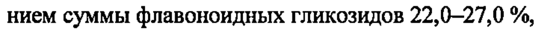
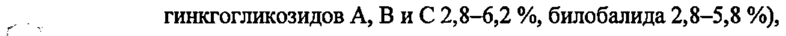
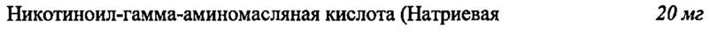

# Гинкго двулопастного листьев экстракт + Никотиноил-гамма-аминомасляная кислота — внутрь

- Препарат: ПИКАМИЛОН® ГИНКГО (капсулы;)
- АТХ: N06BX
- Источник: ГРЛС, инструкция по медицинскому применению, РУ ЛП-007673, файл от 2024-09-25 (https://grls.rosminzdrav.ru/Grls_View_v2.aspx?routingGuid=6ddc2aec-9e66-47d9-9f61-4bb3dc3b799f)
- Распознано автоматически (OCR): 8 из 8 стр.
- Инструкция к другому РУ того же препарата: ЛП-007673 (национальное РУ, переоформленное по правилам ЕАЭС, решение от 13.09.2024). Текст может быть старше действующего
- Сомнительных строк после OCR: 3 (см. раздел «Проверка распознавания»)

## Общие сведения

от 14.05.2024 № 9323 Входящий МЗ №42 74819
МИНИСТЕРСТВО ЗДРАВООХРАНЕНИЯ РОССИЙСКОЙ ФЕДЕРАЦИИ
ИНСТРУКЦИЯ ПО МЕДИЦИНСКОМУ ПРИМЕНЕНИЮ ЛЕКАРСТВЕННОГО ПРЕПАРАТА
| ПИКАМИЛОН® ГИНКГО | Внимательно прочитайте инструкцию по применению перед тем, как начать применение этого препарата, так как она содержит важную для Вас информацию.
Сохраняйте инструкцию, она может понадобиться вновь.
Если у Вас возникли вопросы, обратитесь к врачу.
Лекарственное средство, которым Вы лечитесь, предназначено лично Вам, и его не следует передавать другим лицам, поскольку оно может причинить им вред, даже при наличии тех r 5 же симптомов, что иу Bac.
Регистрационный номер:
Торговое наименование: ПИКАМИЛОН® ГИНКГО
| Международное непатентованное или группировочное наименование: гинкго двулопаст-
| ного листьев экстракт + никотиноил-гамма-аминомасляная кислота

## 3. Лекарственная форма

капсулы Состав на одну капсулу.
капсулы Состав на одну капсулу.
Действующие вещества:
| Гинкго двулопастного листьев экстракт сухой (с содержа- 40 мг нием суммы флавоноидных гликозидов 22,0—27,0 %, ри гинкгогликозидов A, ВиС 2,8-6,2 %, билобалида 2,8-5,8 %),
С (35—67):1, экстрагент этанол 50 % Никотиноил-гамма-аминомасляная кислота (Натриевая 20 мг соль никотиноил-гамма-аминомасляной кислоты) (в пересчете на сухое вещество)
Вспомогательные вещества:
Лактозы моногидрат 197,7 мг Крахмал картофельный 36 мг
Целлюлоза микрокристаллическая 101 32,58 мг
Кроскармеллоза натрия 15 мг Тальк 9,72 мг
| Кремния диоксид коллоидный 6 мг Магния стеарат Змг и
СООТВЕТСТВУЕТ ЭКСПЕРТНОМУ ОТЧЕТУ | Входящий МЗ №4274819
. Капсулы твердые желатиновые №0 [Состав оболочки капсулы (корпус):
краситель бриллиантовый синий - 0,0029 мг, краситель хинолиновый желтый - 0,0025 мг, THтана диоксид — 0,5965 мг, краситель солнечный закат желтый — 0,0007 мг, желатин — 59,0474 мг:
Состав оболочки капсулы (крышка):
краситель патентный синий — 0,0278 мг, титана диоксид — 0,727 мг, краситель солнечный закат желтый - 0,0119 мг, краситель железа оксид желтый — 0,1818 мг, желатин — 35,4015 mr].
| Описание: твердые желатиновые капсулы № 0 с корпусом светло-зелёного и крышечкой тёмно-зелёного цвета. Содержимое капсул — смесь порошка и микрогранул светло-коричнеc С вого цвета с вкраплениями белого и темно-коричневого цвета
Фармакотерапевтическая группа: ноотропное средство |
| Код ATX: NO6BX Фармакологические свойства
| Фармакодинамика Никотиноил-гамма-аминомасляная кислота
Ноотропное средство, расширяет сосуды головного мозга. Оказывает также транквилизирующее, психостимулирующее, антиагрегантное и антиоксидантное действие. Улучшает функци_ ональное состояние мозга за счет нормализации метаболизма тканей и влияния на мозговое tu кровообращение (увеличивает объемную и линейную скорость мозгового кровотока, умень-
| шает сопротивление сосудов, ингибируя агрегацию тромбоцитов, улучшает микроциркуляЦИЮ).
При курсовом приеме повышает физическую и умственную работоспособность, уменьшает головную боль, улучшает память, нормализует сон; способствует снижению или исчезновению чувства тревоги, напряжения, страха; улучшает состояние больных с двигательными и речевыми нарушениями, уменьшает угнетающее влияние этанола на центральную нервную систему. Улучшает кровообращение в сосудах сетчатки и зрительного нерва.
Гинкго двулопастного листьев экстракт | Повышает устойчивость организма к гипоксии, особенно тканей головного мозга. Улучшает мозговое и периферическое кровоснабжение, улучшает реологию крови. Оказывает дозозависимое регулирующее влияние на сосудистую стенку, расширяет мелкие артерии, повышает
TT | СООТВЕТСТВУЕТ ЭКСПЕРТНОМУ ОТЧЕТУ | Входящий МЗ №4274819 тонус вен. Препятствует образованию свободных радикалов и перекисному окислению липи- | дов клеточных мембран. Улучшает обмен веществ в органах и тканях, способствует накоплению в клетках макроэргов, повышению утилизации кислорода и глюкозы, нормализации медиаторных процессов в центральной нервной системе.

## 5.2. Фармакокинетика

Никотиноил-гамма-аминомасляная кислота
Никотиноил-гамма-аминомасляная кислота
Абсорбция - быстрая и полная. Проникает через гематоэнцефалический барьер, длительно удерживаясь в тканях организма. Биодоступность - 50-88 %. Выводится, в основном, почками в неизменном виде. Период полувыведения - 0,51 4.
Гинкго двулопастного листьев экстракт | Всасывание
| После перорального введения биодоступность терпенлактонов (гинкголид А, гинкголид Ви билобалид) составляет 80 % для гинкголида А, 88 % для гинкголида В и 79% для билобалида.
Распределение Пик плазменной концентрации составлял 16-22 нг/мл для гинкголида А, 8-10 нг/мл для гинкголида Ви 27-54 нг/мл для билобалида после применения внутрь в форме таблеток. Связывание с белками плазмы крови составляет: 43% для гинкголида А, 47% для гинкголида В и 67 % для билобалида.
Выведение Период полувыведения - 3,9 часа (гинкголид А), 4-6 часов (гинкголид В) и 2-3 часа (билобалид).
` й Ноказания к применению | Вспомогательная терапия расстройств внимания и ухудшения памяти при установленном ди-
| агнозе сосудистого заболевания головного мозга у взрослых.
| | Противопоказания | Гиперчувствительность к действующим веществам и/или любому вспомогательному веществу в составе препарата, возраст до 18 лет (эффективность и безопасность не изучены), хро-
| ническая почечная недостаточность, беременность, период грудного вскармливания, дефицит лактазы, непереносимость лактозы, глюкозо-галактозная мальабсорбция, пониженная свертываемость крови, эрозивный гастрит, язвенная болезнь желудка и двенадцатиперстной кишки в стадии обострения, острые нарушения мозгового кровообращения, острый инфаркт миокарда.
, 3.
СООТВЕТСТВУЕТ ЭКСПЕРТНОМУ ОТЧЕТУ Входящий МЗ №42 74819
Если у Вас есть одно из перечисленных выше заболеваний состояний или факторов риска перед применением препарата необходимо проконсультироваться с врачом.
| | С осторожностью | Применение у пациентов с эпилепсией, артериальной гипотензией.
Если у Bac есть одно из перечисленных выше заболеваний/состояний или факторов риска перед применением препарата необходимо проконсультироваться с врачом.

## 4.6. Применение при беременности и в период грудного вскармливания

Противопоказано применение препарата при беременности и в период грудного вскармливания в связи с отсутствием опыта клинического применения у данной категории пациентов.
<. Перед применением ITHKAMHJIOH® ГИНКГО, если Вы беременны или предполагаете, что Вы могли бы быть беременной, или планируете беременность, необходимо проконсультироваться с врачом.

## 4.2. Способ применения и дозы

Внутрь.
Внутрь.
По 1 капсуле 3 раза в сутки, суточная доза 3 капсулы.
Капсулы необходимо запивать У стакана воды и принимать во время еды. |
Курс лечения составляет 3 месяца. Проведение повторных курсов лечения возможно по реко-
| мендации врача, через 5-6 месяцев.
Если после лечения улучшения не наступает, или симптомы усугубляются, или появляются в новые симптомы, необходимо проконсультироваться с врачом. Применяйте препарат
` и только согласно тем показаниям, тому способу применения и в тех дозах, которые указаны в инструкции.

## 4.8. Побочное действие

Классификация нежелательных реакций представлена со следующей частотой: часто (> 1/100 до < 1/10), нечасто (> 1/1000 до < 1/100), редко (> 1/10000 до < 1/1000), очень редко (< 1/10000), частота неизвестна (не может быть оценена на основе имеющихся данных).
Классификация нежелательных реакций представлена со следующей частотой: часто (> 1/100 до < 1/10), нечасто (> 1/1000 до < 1/100), редко (> 1/10000 до < 1/1000), очень редко (< 1/10000), частота неизвестна (не может быть оценена на основе имеющихся данных).
| о стороны иммунной системыЧасто Аллергические реакции
И ИИ = И СООТВЕТСТВУЕТ ЭКСПЕРТНОМУ ОТЧЕТУ
Входящий МЗ №42 74819 Ин а о стороны асто Головокружение нервной системы Головная боль
Обморок ревога Возбуждение о стороны желудочно-кишеч-Часто ошнота ного тракта Боль в животе
- Диарея a .
Wo Диспепсия Со стороны кожи и подкожныхЧасто кзема
Очень редко Гиперемия — о стороны крови и лимфати-Очень редко нижение свертываемости
ИИ И о стороны органа слуха и ла-Частота неизвестна Нарущение слуха |
ИИ Г“ Если любые из указанных в инструкции побочных действий усугубляются или Вы заметили a любые другие побочные действия, не указанные в инструкции, сообщите об этом врачу.

## 4.9. Передозировка

При передозировке возможно усиление выраженности дозозависимых побочных эффектов.
При передозировке возможно усиление выраженности дозозависимых побочных эффектов.
Лечение симптоматическое.
При появлении симптомов передозировки следует прекратить прием препарата и немедленно обратиться к врачу.

## 4.5. Взаимодействие с другими лекарственными средствами

Никотиноил-гамма-аминомасляная кислота Укорачивает действие барбитуратов, усиливает действие опиоидных анальгетиков.
Гинкго дв улопастного листьев экстракт | СООТВЕТСТВУЕТ ЭКСПЕРТНОМУ ОТЧЕТУ
| Входящий МЗ №4274819 Не рекомендуется применение препарата ПИКАМИЛОН® ГИНКГО пациентам, постоянно принимающим ацетилсалициловую кислоту, антикоагулянты (прямого и непрямого действия), а также тиазидные диуретики, трициклические антидепрессанты, противосудорожные препараты, гентамицин.
Возможны единичные случаи кровотечения у пациентов, одновременно принимающих лекар- | ственные средства, снижающие свертываемость крови; причинно-следственная связь данных кровотечений с приемом препаратов гинкго двулопастного не подтверждена. Не рекомендуется одновременное применение препаратов гинкго двулопастного с эфавирензом, так как BO3-
| можно снижение его концентрации в плазме крови вследствие индукции цитохрома СУРЗА4 под влиянием экстракта гинкго двулопастного. Исследование взаимодействия с талинололом | показывает, что экстракт гинкго двулопастного может ингибировать кищечные Р-гликопротеко ины. Это может увеличить воздействие чувствительных к Р-гликопротеину лекарств в кишечнике, таких как дабигатран, в связи с чем, при их одновременном применении необходимо соблюдать осторожность.
Если Вы применяете выше перечисленные или другие лекарственные препараты (8 том числе
| безрецептурные) перед применением препарата ПИКАМИЛОЕ?® ГИНКГО проконсультируйтесь с врачом.
| | Особые указания Не следует превышать рекомендованные дозы препарата. При развитии реакции повышенной
| чувствительности применение препарата необходимо прекратить. Перед хирургическим вмешательством необходимо сообщить врачу о применении препарата. При часто возникающих
. ощущениях головокружения и шума в ушах необходимо проконсультироваться с врачом. В
‘у случае внезапного ухудшения или потери слуха, следует незамедлительно обратиться к врачу.
Пациентам с кровоточивостью (геморрагическим диатезом) и пациентам, получающим антикоагулянтную терапию, необходимо проконсультироваться с врачом перед началом терапии препаратом. Не рекомендуется принимать препарат вместе с этанолом. Рекомендуется соблюдать осторожность при совместном приеме препаратов, метаболизируемых при помощи цитохрома Р450, включая СУРЗА4 (см. раздел «Взаимодействие с другими лекарственными средствами»). ПИКАМИЛОН® ГИНКГО содержит лактозу. Пациентам с наследственной непереносимостью лактозы, дефицитом лактазы или глюкозо-галактозной мальабсорбцией не следует принимать препарат, так как в его составе содержится лактоза.
На фоне применения препарата у пациентов, страдающих эпилепсией, возможно появление эпилептических приступов.
rrr СООТВЕТСТВУЕТ ЭКСПЕРТНОМУ ОТЧЕТУ Входящий МЗ №42 74819

## 4.7. Влияние на способность управлять транспортными средствами, механизмами

В связи с возможностью возникновения головокружения и других побочных эффектов, связанных с приемом препарата, в период лечения препаратом следует воздержаться от управления транспортными средствами и занятий другими потенциально опасными видами деятель- | ности, требующими повышенной концентрации внимания и быстроты психомоторных и двигательных реакций.

## 6.5. Форма выпуска

Капсулы, 40 мг+20 мг По 10 или 15 капсул в контурную ячейковую упаковку из пленки поливинилхлоридной или
Капсулы, 40 мг+20 мг По 10 или 15 капсул в контурную ячейковую упаковку из пленки поливинилхлоридной или
| ПВХИ/ПВДХ, или из пленки ПВХ/ПВДХЛИВХ и фольги алюминиевой печатной лакированной.
So 1, 2, 3, 4, 5, 6, 9 или 12 контурных ячейковых упаковок по 10 капсул, или 6 контурных ячейковых упаковок по 15 капсул вместе с инструкцией по медицинскому применению помещают в пачку из картона.
| Условия хранения При температуре не выше 25 °С в оригинальной упаковке (контурная ячейковая упаковка в пачке).
Хранить в недоступном для детей месте.
° Срок годности 3 года.
. Не применять по истечении срока годности.
Условия отпуска Отпускают без рецепта.
Владелец регистрационного удостоверения/организация, принимающая претензии потребителей
Открытое акционерное общество "Фармстандарт-Лексредства"
(ОАО "Фармстандарт-Лексредства"), Россия 305022, Курская обл., г. Курск, ул. 2-я Агрегатная, д. 1а/18,
| тел./факс: (4712) 34-03-13, www.pharmstd.ru
| СООТВЕТСТВУЕТ ЭКСПЕРТНОМУ ОТЧЕТУ от 14.05.2024 № 9323
(Входящий МЗ №42 74819)
Производитель Открытое акционерное общество "Фармстандарт-Лексредства",
(ОАО "Фармстандарт-Лексредства"), Россия
Курская обл., г. Курск, ул. 2-я Агрегатная, д. 1а/18, тел./факс: (4712) 34-03-13, www.pharmstd.ru
Представитель Дек У < <, \ ОАО «Фармстандарт- Лексредства» | 3 с Н.Е. Назарова
| | о |
## Проверка распознавания

Страницы-сканы распознаны автоматически. В 3 строках с дозировками цифры могли распознаться с ошибкой — сверьте с вырезкой из оригинала:

- стр. 1: «нием суммы флавоноидных гликозидов 22,0—27,0 %,» — низкая уверенность: «22,0—27,0» (76)  
  
- стр. 1: «ри гинкгогликозидов A, ВиС 2,8-6,2 %, билобалида 2,8-5,8 %),» — низкая уверенность: «2,8-5,8» (44)  
  
- стр. 1: «Никотиноил-гамма-аминомасляная кислота (Натриевая 20 мг» — низкая уверенность: «20» (60)  
  
