# Гликопиррония бромид + Индакатерол — ингаляц

- Препарат: Ультибро® Бризхалер® (капсулы с порошком для ингаляций;)
- АТХ: R03AL04
- Источник: ГРЛС, инструкция по медицинскому применению, РУ ЛП-003386, файл от 2023-10-30 (https://grls.rosminzdrav.ru/Grls_View_v2.aspx?routingGuid=4c921488-387a-4287-adb1-1632fe8756b4)
- Распознано автоматически (OCR): 25 из 25 стр.
- Сомнительных строк после OCR: 13 (см. раздел «Проверка распознавания»)

## Общие сведения

О a, ИНСТРУКЦИЯ по применению лекарственного препарата для медицинского применения
| УЛЬТИБРО® BPH3XAJIEP® ———— | МИНЗДРАВ РОССИИ |
РЕГИСТРАЦИОННЫЙ НОМЕР: JII1-003386 | i AT)-0023%6- 110117 |
ТОРГОВОЕ НАИМЕНОВАНИЕ: Ультибро® Бризхалер® | ОГЛАСОВАНО |
МЕЖДУНАРОДНОЕ HEMATEHTOBAHHOE ИЛИ ГРУППИРОВОЧНОЕ НАИМЕНОВАНИЕ: — гликопиррония бромид + индакатерол

## 3. Лекарственная форма

капсулы с порошком для ингаляций
капсулы с порошком для ингаляций

## 2. Состав

1 капсула с порошком для ингаляций содержит:
действующие вещества: гликопиррония основание — 0,050 мг (соответствует 9 гликопиррония бромиду 0,063 мг), индакатерола основание — 0,110 мг (соответствует индакатерола малеату 0,143 mr):
вспомогательные вещества: лактозы моногидрат — 24,757 мг, магния стеарат - 0,037 мг;
Оболочка капсулы: гипромеллоза — 45,70 мг, вода — 2,70 мг, каррагинан — 0,42 мг, калия хлорид — 0,18 мг.
В состав чернил черных входит: шеллак, краситель железа оксид черный (Е 172), пропиленгликоль, калия гидроксид, вода.
В состав чернил синих входит: шеллак, индигокармин (Е 132), пропиленгликоль, титана диоксид.
ОПИСАНИЕ:
Твердые прозрачные бесцветные капсулы № 3, с маркировкой «№» черного цвета на
$ крышечке и надписью «IGP110.50» синими чернилами под двойной синей полосой на
| корпусе.
Содержимое капсул: порошок белого или почти белого цвета.
ФАРМАКОТЕРАПЕВТИЧЕСКАЯ ГРУППА: бронходилатирующее средство комбинированное
(М-холиноблокатор + бета2?-адреномиметик селективный)
Код ATX: В03А1.04 ФАРМАКОЛОГИЧЕСКИЕ СВОЙСТВА
Механизм действия Препарат Ультибро® Бризхалер® — ингаляционный комбинированный препарат обладающий длительным действием. Входящие в его состав гликопирроний и индакатерол вызывают расслабление гладкой мускулатуры бронхов, взаимно усиливая бронходилатирующий эффект друг друга за счет различного механизма действия,
| 1/25 — направленного на различные виды рецепторов. Поскольку плотность расположения
М-холинорецепторов и бета2-адренорецепторов в центральных и периферических дыхательных путях различается, бета2-адреномиметики более эффективны для бронхорелаксации периферических дыхательных путей, в то время как
М-холиноблокаторы оказывают более выраженный эффект в отношении центральных дыхательных путей. Таким образом, комбинация М-холиноблокатора и бета2-адреномиметика способствует оптимальной бронходилатации на всем протяжении нижних дыхательных путей человека.

Индакатерол является селективным бета2-адреномиметиком ультра-длительного действия

(в течение 24 ч при однократном применении). Фармакологическое действие бета?-адреномиметиков, включая индакатерол, связано со стимуляцией внутриклеточной

| аденилатциклазы, фермента, который катализирует превращение АТФ в циклический

$ 3',5'-АМФ (циклический АМФ). Повышение содержания циклического АМФ приводит к расслаблению гладкой мускулатуры бронхов. Индакатерол является практически полным
| агонистом бета2-адренорецепторов; стимулирующее действие препарата на бета2-адренорецепторы в 24 раза сильнее, чем на бета1-адренорецепторы, и в 20 раз сильнее, чем на бета3З-адренорецепторы. После ингаляции индакатерол оказывает быстрое и продолжительное бронходилатирующее действие. Селективность индакатерола сходна с селективностью формотерола. После ингаляции индакатерол оказывает местное бронходилатирующее действие. В изолированных бронхах человека индакатерол

оказывает быстрое и длительное действие.
Гликопирроний — это ингаляционный М-холиноблокатор длительного действия, предназначенный для поддерживающей терапии нарушений бронхиальной проходимости
|| У пациентов с хронической обструктивной болезнью легких (ХОБЛ). Нервная регуляция бронхоконстрикции обеспечивается парасимпатической нервной системой, таким образом, холинергическая стимуляция является ключевым компонентом обратимого нарушения бронхиальной проходимости при ХОБЛ. Механизм действия гликопиррония основан на блокировании бронхоконстрикторного действия ацетилхолина на гладкомышечные клетки дыхательных путей, что приводит к бронходилатирующему эффекту. В организме человека выявлено 5 подтипов мускариновых рецепторов (М1-5).
Известно, что только подтипы М1-3 задействованы в физиологической функции дыхательной системы. Гликопирроний обладает выраженным аффинитетом к этим типам рецепторов, при чем он обладает в 4-5 раз большей селективностью в отношении M1- и
МЗ-рецепторов, по сравнению с М2-рецепторами. Это приводит к быстрому развитию терапевтического эффекта после ингаляции, что подтверждено клиническими 2425 исследованиями. Бронходилатирующий эффект гликопиррония после ингаляции сохраняется более 24 часов. Продолжительность его действия после ингаляции обусловлена длительным поддержанием терапевтической концентрации препарата в легких, что подтверждается более длительным периодом полувыведения гликопиррония после ингаляционного применения по сравнению с внутривенным введением.

## 5.1. Фармакодинамика

Эффект препарата Ультибро” Бризхалер” наступает уже через 5 минут после ингаляции и остается неизменным на протяжении 24-х часов, обеспечивая стойкое значимое улучшение функции легких: на 26 неделе терапии повышение объема форсированного выдоха за первую секунду (ОФВТ) в среднем на 320 мл по сравнению с пациентами, получавшими плацебо, и на 110 мл по сравнению с монотерпией гликопирронием, индакатеролом или тиотропием. Также отмечалось снижение функциональной остаточной

9 емкости легких и остаточного объема легких на 350 мл и 380 мл (р<0,001) соответственно по сравнению с плацебо через 60 мин после приема в первый день и обоих показателей на 520 мл (р<0,001) по сравнению с плацебо через 21 день терапии. При применении препарата отмечается уменьшение одышки, улучшение переносимости физических нагрузок. Также наблюдается достоверное снижение риска обострений ХОБЛ (увеличение времени до следующего обострения), уменьшение потребности в ингаляционных

бета?-адреномиметиках короткого действия и улучшение качества жизни пациентов
(оценка с помощью сертифицированного опросника госпиталя Святого Георгия).
Не получено данных, свидетельствующих о развитии тахифилаксии к препарату при длительном применении по сравнению с плацебо или с применением каждого из действующих компонентов в монотерапии.

— На основании проведенных клинических исследований показано. что препарат Ультибро* |
Бризхалер® в терапевтических и супратерапевтических дозах не оказывает клинически значимого влияния на частоту сердечных сокращений (ЧСС), длину интервала ОТ, содержание калия и концентрацию глюкозы в сыворотке крови.

## 5.2. Фармакокинетика

Всасывание

После ингаляции препарата среднее время достижения максимальных концентраций

(Cmax) гликопиррония и индакатерола в плазме крови составляли 15 минут и 5 минут

соответственно. Экспозиция гликопиррония в равновесном состоянии при применении в

составе препарата Ультибро” Бризхалер” соответствует таковой при ингаляции

гликопиррония в монотерапии.

По данным исследования in vitro доза индакатерола, доставляемая в легкие при 3725 применении препарата Ультибро® Бризхалер”, соответствует таковой после применения

индакатерола в монотерапии в дозе 150 мкг. Экспозиция индакатерола в равновесном

состоянии при применении препарата Ультибро® Бризхалер” соответствует или может

быть незначительно ниже таковой при ингаляции индакатерола в монотерапии в дозе 150

мкг. Абсолютная биодоступность индакатерола при применении препарата Ультибро®

Бризхалер*® составляет от 47% до 66%, гликопиррония — около 40%.

Индакатерол

Среднее время достижения Cmax индакатерола в сыворотке крови составляет около 15 мин

после однократной или повторных ингаляций. Концентрация индакатерола в сыворотке

крови повышается при повторном применении препарата | раз в сутки. Равновесная

концентрация вещества в крови (Css) достигается в течение 12-15 дней применения

препарата. При ингаляции в дозе от 60 до 480 мкг (доза, доставляемая в легкие) с частотой

9 1 раз в сутки в течение 14 дней коэффициент кумуляции индакатерола, оцененный по |

значению площади под кривой «концентрация-время» (AUC) на 1-й и 14-й или 15-й дни,

составляет от 2,9 до 3,8.

Гликопирроний

После ингаляции гликопирроний быстро всасывается и достигает Cmax в плазме крови

через 5 минут. Около 90% системной экспозиции гликопиррония приходится на

всасывание в легких, и 10% на всасывание в желудочно-кишечном тракте (ЖКТ).

Абсолютная биодоступность гликопиррония после ингаляции оценивается в 40% от

доставляемой дозы. На фоне регулярных ингаляций (1 раз в сутки) Css гликопиррония
| достигается в течение | недели. Экспозиция гликопиррония в равновесном состоянии
| была в 1,4-1,7 раз выше, чем после первой ингаляции. Cmax гликопиррония в равновесном _

& состоянии (при ингаляции рекомендуемой дозы 1 раз в день) и концентрация

гликопиррония в плазме крови непосредственно перед приемом очередной дозы равны

166 пг/мл и 8 пг/мл соответственно.

Распределение

Индакатерол

После внутривенного (в/в) введения объем распределения в терминальной фазе (\,)

индакатерола составлял 2361-2557 л, что указывает на значительное распределение

препарата. Связь с белками сыворотки и плазмы крови человека in vitro составляет

примерно 95%.

Гликопирроний

После в/в введения объем распределения в равновесном состоянии (Vss) гликопиррония составил 83 ли V, — 376 л. Кажущийся объем распределения в терминальной фазе после

4/25 | ингаляции (\»/Е) составил 7310 л, что отражает более медленное выведение его после ингаляции. Jn vitro связь гликопиррония с белками плазмы крови человека составила 3841% при концентрации 1-10 нг/мл. Указанные концентрации как минимум в 6 раз превышают Cmax в равновесном состоянии при применении в дозе 50 мкг 1 раз в сутки.
Метаболизм Индакатерол | При приеме внутрь меченого радиоактивным изотопом индакатерола, неизмененный индакатерол является основным компонентом сыворотки крови и составляет приблизительно 1/3 от суточной AUC. Из метаболитов индакатерола в сыворотке крови в наибольшей степени определяется гидрокислированное производное индакатерола. В меньшем количестве обнаруживаются фенольный О-глюкуронид индакатерола и гидроксилированный — индакатерол. Кроме того, выявляются диастереомеры | 9 гидроксилированного производного, М-глюкуронид индакатерола и продукты С- и Nдезалкилирования.
Изофермент UGTIA1 является единственным изоферментом, метаболизирующим индакатерол до фенольного О-глюкуронида. Гидроксилирование индакатерола в основном происходит с помощью изофермента СУРЗА4. Также установлено, что
| индакатерол является низкоафинным субстратом для мембранного переносчика молекул
Р-гликопротеина (P-gp).
Гликопирроний In vitro отмечено, что гидроксилирование гликопиррония приводит к образованию различных моно- и бис-гидроксилированных метаболитов, а прямой гидролиз приводит к
| образованию производных карбоновой кислоты (М9). Исследования in vitro показали, что
| изоферменты CYP вносят свой вклад в окислительную биотрансформацию гликопиррония. Гидролиз до М9, по-видимому, катализируется ферментами семейства холинэстераз. Так как исследования in vifro не выявили метаболизма действующего вещества в легких ‚а вклад M9 в циркуляцию был минимальным (4% от Cmax и AUC гликопиррония) после внутривенного введения, предполагается, что М9 образуется из фракции действующего вещества, поступившей через ЖКТ после ингаляции путем пресистемного гидролиза и/или при «первом прохождении» через печень. После ингаляции или в/в введения только минимальное количество М9 было обнаружено в моче
(<0,5% введенной дозы). Глюкуроновые и/или сульфатные конъюгаты гликопиррония были обнаружены в моче человека после повторных ингаляций в количестве приблизительно 3% от доставляемой дозы. Исследования ингибирования in уйго показали, что гликопирроний не обладает значимой способностью подавлять активность 5/25 изоферментов СУР1А2, CYP2A6, CYP2C8, CYP2C9, CYP2C19, CYP2D6, CYP2E1 или
CYP3A4/5, транспортных белков MDR1, MRP1 или MXR, опосредующих выведение лекарственных препаратов из клеток, а также белков-переносчиков ОАТР1В1, OATP1B3,
ОАТТ, OAT3, ОСТ1 или ОСТ2. Исследования индукции ферментов in vitro не выявили у гликопиррония клинически значимой способности индуцировать изоферменты цитохрома
Р450, фермент ОСТТА] и белки-переносчики МОК] и МКР2.Выведение
Индакатерол Количество неизмененного индакатерола, выделяющегося почками, составляет менее 2,5% от доставляемой дозы. Почечный клиренс индакатерола составлял в среднем 0,46— 1,2 л/ч. Учитывая, что сывороточный клиренс индакатерола составляет 18,8-23,3 л/ч, очевидно, что выведение препарата почками незначительное (приблизительно 2—5% системного клиренса). При приеме внутрь индакатерол выводился в основном через
$ кишечник: в неизмененном виде (54% от дозы) и в виде гидроксилированных метаболитов
(23% от дозы).
Концентрация индакатерола в сыворотке крови снижается многофазно со средним значением конечного периода полувыведения (Т!2) в диапазоне от 45,5 до 126 ч.
Эффективный T)2, рассчитанный на основании кумуляции индакатерола после повторного применения, варьировал от 40 до 52 4, что согласуется с установленным временем достижения равновесного состояния (12—15 дней).
AUC индакатерола в равновесном состоянии повышалась пропорционально доставляемой дозе в диапазоне от 120 мкг до 480 мкг.
Гликопирроний Выведение гликопиррония почками достигает 60-70% от общего плазменного клиренса, 9 30-40% выводится другими путями - с желчью или за счет метаболизма. У здоровых добровольцев и пациентов с ХОБЛ, получавших гликопирроний в дозах от 50 до 200 мкг 1 раз в сутки и одно- и многократно, средний почечный клиренс гликопиррония составлял от 174 до 24,4 л/ч. Выведение гликопиррония почками обусловлено активной канальцевой секрецией. До 23% от дозы обнаруживается в моче в неизмененном виде.
Концентрация гликопиррония в плазме крови снижается многофазно. Средний конечный период полувыведения более продолжителен после ингаляции (33-57 4), чем после в/в (6,2 ч) или перорального введения (2,8 ч). Характер выведения позволяет предположить длительное всасывание в легких и/или проникновение гликопиррония в системный кровоток во время и после 24 ч после ингаляции.
| 6/25 Линейность/нелинейность Индакатерол
Системная экспозиция индакатерола увеличивается пропорционально повышению дозы
(от 150 до 600 мкг). Системная экспозиция препарата обусловлена его всасыванием как в легких, так и в ЖКТ.
Гликопирроний У пациентов с ХОБЛ системная экспозиция, а также выведение почками гликопиррония в равновесном состоянии повышались пропорционально дозе в диапазоне от 50 мкг до 200 мкг. |
Фармакокинетика у особых групп пациентов
Препарат Ультибро® Бризхалер* Возраст, пол и масса тела не оказывают существенного влияния на фармакокинетику 9 препарата Ультибро” Бризхалер” у пациентов с ХОБЛ. Выявлена отрицательная корреляция между экспозицией и сухой массой тела (или массой тела), однако, поскольку | экспозиция изменялась незначительно, а прогностическая ценность сухой массы тела невелика, не рекомендуется корректировать дозу в зависимости от этого параметра. |
Курение и исходные показатели OMB), не оказывают видимого влияния на экспозицию препарата Ультибро*® Бризхалер®.
Индакатерол Возраст (взрослые пациенты до 88 лет), пол и масса тела (32-168 кг) не оказывают влияния на фармакокинетику индакатерола у пациентов с ХОБЛ.
Гликопирроний Возраст и масса тела являются факторами, влияющими на межиндивидуальные различия в
& фармакокинетике препарата. В рекомендованной дозе гликопирроний может безопасно применяться в любой возрастной группе и при любой массе тела. Пол, курение и исходные показатели ОФВ! не оказывают видимого влияния на AUC гликопиррония.
Пациенты с нарушениями функции печени.
Препарат Ультибро® Бризхалер* Исходя из фармакокинетических свойств каждого из компонентов, применяемых по отдельности, препарат Ультибро® Бризхалер” можно применять в рекомендуемой дозе у пациентов с нарушениями функции печени легкой и средней степени. Данные по применению препарата у пациентов с тяжелыми нарушениями функции печени отсутствуют.
Индакатерол Фармакокинетика индакатерола существенно не изменялась у пациентов с нарушениями 7/25
ВВ ви СЕИСО БОЕВ Е ОЕ ЕСИ ИАТА ВД ЕЕ Я ЩО ВЛИЯЯ ИИЕОбО ИИ функции печени легкой и средней степени. Применение препарата у пациентов с тяжелыми нарушениями функции печени не изучалось.

Гликопирроний Клинические исследования у пациентов с нарушением функции печени не проводились. |
Выведение гликопиррония происходит главным образом через почки. Предполагается, что ухудшение метаболизма гликопиррония в печени не приведет к клинически значимому повышению экспозиции.
Пациенты с нарушениями функции почек Препарат Ультибро® Бризхалер®
Исходя из фармакокинетических свойств каждого из компонентов, применяемых по отдельности, препарат Ультибро® Бризхалер® можно применять в рекомендуемой дозе у пациентов с нарушениями функции почек легкой и средней степени тяжести. У пациентов

@ с нарушением функции почек тяжелой степени или с терминальной стадией хронической болезни почек (ХБП), требующей гемодиализа, препарат Ультибро® Бризхалер® следует применять лишь в том случае, если ожидаемая польза превышает возможный риск.
Индакатерол Поскольку индакатерол выводится почками в незначительной степени, фармакокинетика препарата у пациентов с нарушениями функции почек не изучалась.
Гликопирроний Нарушение функции почек влияет на экспозицию гликопиррония. Умеренное повышение полной системной экспозиции до 1,4 раз наблюдалось у пациентов с нарушением функции почек легкой и средней степени тяжести и до 2,2 раз у пациентов с нарушением функции | почек тяжелой степени и терминальной стадией ХБП. По данным популяционного

9 фармакокинетического анализа у пациентов с ХОБЛ с сопутствующим нарушением функции почек легкой и средней степени тяжести (оцениваемой по скорости клубочковой фильтрации (СКФ) >30 мл/мин/1,73 м?) гликопирроний может применяться в | рекомендуемых дозах.
Расса и этническая принадлежность | Препарат Ультибро* Бризхалер*
Статистически значимого эффекта этнической принадлежности на экспозицию обоих компонентов не выявлено после коррекции по сухой массе тела.
Индакатерол Никаких различий между этническими подгруппами не выявлено. Опыт применения препарата у лиц негроидной расы ограничен.

8/25 Гликопирроний

Каких-либо значимых различий между этническими подгруппами не выявлено.

## 4.1. Показания к применению

Длительная поддерживающая терапия нарушений бронхиальной проходимости у пациентов с хронической обструктивной болезнью легких, облегчающая симптомы и снижающая количество обострений.

## 4.3. Противопоказания

° Повышенная чувствительность к гликопирронию, индакатеролу или любым другим компонентам, входящим в состав препарата.

з Возраст до 18 лет (эффективность и безопасность не установлены).

$ ° Непереносимость галактозы, дефицит лактазы или глюкозо-галактозная

мальабсорбция (препарат содержит лактозу).

Не рекомендуется одновременное применение с лекарственными препаратами, содержащими другие бета2?-адреномиметики длительного действия или
М-холиноблокаторы длительного действия.

| С ОСТОРОЖНОСТЬЮ Сопутствующие заболевания сердечно-сосудистой системы (ишемическая болезнь сердца
(в том числе нестабильная стенокардия), острый инфаркт миокарда (в том числе в анамнезе), артериальная гипертензия, нарушения сердечного ритма, удлинение интервала
QTc (ОТ скорректированный >0,44 с)), судорожные расстройства, тиреотоксикоз, 9 сахарный диабет, синдром врожденного удлинения интервала ОТ; одновременное применение лекарственных средств, удлиняющих интервал ОТ (антиаритмические препараты 1А и Ш классов, трициклические и тетрациклические антидепрессанты, нейролептики, макролиды, противогрибковые препараты, производные имидазола, некоторые антигистаминные, в т.ч. астемизол, терфенадин, эбастин), препараты для общей анестезии из группы барбитуратов; при гиперреактивности на действие бета2-адреномиметиков; закрытоугольная глаукома, нарушения функции печени тяжелой степени, заболевания, сопровождающиеся задержкой мочи, нарушения функции почек тяжелой степени (СКФ ниже 30 мл/мин/1,73 м?), включая терминальную стадию почечной недостаточности, требующую проведения гемодиализа (применение препарата возможно только в случае, если ожидаемая польза превышает потенциальный риск).
9/25 | ПРИМЕНЕНИЕ ПРИ БЕРЕМЕННОСТИ И В ПЕРИОД ГРУДНОГО ВСКАРМЛИВАНИЯ |
Данных о применении препарата Ультибро® Бризхалер® у беременных женщин нет.
Данные по применению гликопиррония или индакатерола у беременных также | отсутствуют.
В исследовании раннего и позднего эмбриогенеза у животных каких-либо эффектов | препарата Ультибро® Бризхалер”, применяемого в различных дозах, на эмбрион или плод не выявлено. У животных также не отмечено какого-либо тератогенного действия.
Отмечалась низкая концентрация гликопиррония в плазме пуповинной крови через 86 минут после однократной внутримышечной инъекции гликопиррония в дозе 0,006 мг/кг пациенткам после кесарева сечения. Однако индакатерол оказывал | токсическое действие на репродуктивную систему, что проявлялось в увеличении частоты изменений скелета у животных.

8 В связи с отсутствием клинических данных по применению препарата Ультибро*®
Бризхалер” у беременных женщин, применение препарата. BO время беременности | возможно только если предполагаемая польза применения для матери превышает | потенциальный риск для плода.

Индакатерол может замедлять процесс родов вследствие релаксирующего действия на гладкую мускулатуру матки.

Неизвестно, проникают ли гликопирроний и/или индакатерол в грудное молоко у человека. Однако и индакатерол, и гликопирроний (включая его метаболиты) были обнаружены в молоке лактирующих животных. Учитывая это обстоятельство, применение препарата Ультибро® Бризхалер® у кормящих грудью женщин допустимо, только если предполагаемая польза для матери превышает возможный риск для ребенка. |

Ф Фертильность Исследования репродуктивной токсичности и другие исследования у животных не дают оснований полагать, что препарат может влиять на фертильность у мужчин или женщин.

(СПОСОБ ПРИМЕНЕНИЯ И ДОЗЫ

Только для ингаляционного применения!

Препарат представляет собой капсулы с порошком для ингаляций, которые следует

применять только для ингаляций через рот с помощью специального устройства для

ингаляций (бризхалер), которое входит в комплект. Капсулы нельзя принимать внутрь.

Капсулы с порошком для ингаляций следует хранить в блистере и извлекать из него

непосредственно перед применением.

Рекомендуемая доза препарата Ультибро® Бризхалер® составляет 50 мкг + 110 мкг
(содержимое 1 капсулы) | раз в сутки. Ингаляцию препарата проводят ежедневно | раз в

10/25 сутки в одно и то же время. В случае пропуска дозы ее необходимо принять как можно раньше. Следует проинформировать пациента о недопустимости применения более | дозы препарата в сутки.
Перед началом применения препарата пациента следует обучить правильной технике использования устройства для ингаляций.
При отсутствии улучшения функции дыхания следует удостовериться, правильно ли пациент применяет препарат. Препарат следует вдыхать, а не глотать.
Режим дозирования у особых групп пациентов
Применение у пациентов старше 75 лет Не требуется коррекции дозы препарата у пациентов в возрасте >75 лет.
Применение у пациентов с нарушением функции почек
Не требуется коррекции дозы при применении препарата у пациентов с нарушениями д функции почек легкой или средней степени. У пациентов с нарушением функции почек тяжелой степени или терминальной стадией ХБП, требующей проведения гемодиализа, препарат Ультибро” Бризхалер® следует применять только в случае, если предполагаемая польза превышает потенциальный риск.
Применение у пациентов с нарушением функции печени |
Не требуется коррекции дозы при применении препарата у пациентов с нарушениями функции печени легкой и средней степени тяжести. Применение препарата у пациентов с нарушением функций печени тяжелой степени не изучалось.

## 4.8. Побочное действие

Нежелательные явления (НЯ) при применении препарата Ультибро® — Бризхалер® характеризуются симптомами, Типичными ДлЯ М-холиноблокаторов и 9 бета2-адреномиметиков, применяемых в монотерапии. К числу других наиболее частых
Нежелательные явления (НЯ) при применении препарата Ультибро® — Бризхалер® характеризуются симптомами, Типичными ДлЯ М-холиноблокаторов и 9 бета2-адреномиметиков, применяемых в монотерапии. К числу других наиболее частых
НЯ, связанных с данным лекарственным препаратом (которые отмечались как минимум у 3% пациентов и чаще, чем в группе плацебо), относятся кашель и назофарингит.
У пациентов с ХОБЛ при ингаляции в рекомендованных дозах препарат не оказывает клинически значимого системного бета2?-адреномиметического действия. ЧСС в среднем изменялась не более чем на | удар в минуту, а тахикардия развивалась редко и с меньшей частотой, чем в группе плацебо. Частота развития значимого удлинения интервала QTc
(>450 мс) и гипокалиемии была сходной с таковой в группе плацебо.
Ниже приведены НЯ, отмечавшиеся при применении препарата в ходе клинических исследований (продолжительностью 6 и 12 месяцев), препарат применяли | раз в сутки у пациентов с ХОБЛ. НЯ сгруппированы в соответствии с классификацией органов и систем органов Мед ОКА. В пределах каждой группы органов и систем органов НЯ перечислены 11/25 в порядке уменьшения частоты встречаемости. Для оценки частоты встречаемости использованы следующие критерии: очень часто (>1/10); часто (>1/100, <1/10); нечасто
(>1/1000, <1/100); редко (>1/10000, <1/1000); очень редко (<1/10000), включая отдельные | сообщения. В пределах каждой группы частоты встречаемости НЯ указаны в порядке уменьшения их тяжести. |
Инфекционные и паразитарные заболевания: очень часто — инфекция верхних дыхательных путей; часто — назофарингит, инфекция мочевыводящих путей, синусит, ринит.
Нарушения со стороны иммунной системы: часто — гиперчувствительность.
Нарушения со стороны обмена веществ и питания: часто - гипергликемия и сахарный диабет.
Нарушения психики: нечасто — бессонница.
9 Нарушения со стороны нервной системы: часто — головокружение, головная боль;

редко - парестезия.
Нарушения co стороны органа зрения: нечасто — глаукома'.

| Нарушения со стороны сердца: нечасто — ишемическая болезнь сердца, мерцательная

аритмия, тахикардия, ощущение сердцебиения.
Нарушения с0 стороны дыхательной системы, органов грудной клетки и средостения: часто — кашель, боль в ротоглотке, першение в горле: нечасто — носовое кровотечение, парадоксальный бронхоспазм.
Нарушения co стороны пищеварительной системы: часто — диспепсия, кариес зубов:
нечасто - сухость слизистой оболочки полости рта, гастроэнтерит.
Нарушения CO стороны кожи и подкожных тканей: нечасто — кожная сыпьзуд.

9 Нарушения со стороны скелетно-мышечной и соединительной ткани: нечасто —

скелетно-мышечная боль, мышечный спазм, боль в конечностях, миалгия.
Нарушения co стороны почек и мочевыводящих путей: часто — обструкция мочевого пузыря, задержка мочи.

Общие расстройства и нарушения в месте введения: часто — лихорадка', боль в грудной клетке; нечасто — периферические отеки, усталость.
Ссылки:
| — НЯ, отмечавшиеся на фоне применения комбинированного препарата Ультибро®
Бризхалер” и не отмечавшиеся при применении каждого из компонентов в монотерапии.
Во время проведения пострегистрационных исследований были выявлены следующие побочные реакции (поскольку сообщения получены в добровольном порядке от популяции неопределенного размера, достоверно определить частоту развития данных НЯ

12.625 | ит eS a ee a a a = бам| не представляется возможным, в связи с чем они классифицированы как частота неизвестна). НЯ сгруппированы в соответствии с классификацией органов и систем органов MedDRA. В пределах каждой группы НЯ указаны в порядке уменьшения их тяжести.
Нарушения со стороны иммунной системы: ангионевротический отек. |
Нарушения co стороны дыхательной системы, органов грудной клетки и средостения: дисфония.
Описание отдельных неблагоприятных побочных реакций
Из НЯ, типичных для М-холиноблокаторов, наиболее часто отмечалась сухость во рту
(0,64% против 0,45% в группе плацебо); вместе с тем, на фоне применения препарата
Ультибро® Бризхалер® это НЯ отмечалось реже, чем на фоне применения гликопиррония в монотерапии. В большинстве случаев сухость во рту была слабо выражена и связана с 9 применением препарата, тяжелых случаев отмечено не было.
| Кашель отмечался часто, HO, как правило, был слабо выражен.
Некоторые серьезные НЯ, включая реакции гиперчувствительности и ишемическую болезнь сердца, были отмечены в качестве НЯ на фоне применения индакатерола в монотерапии. У пациентов в группе применения препарата Ультибро® Бризхалер®
| реакции гиперчувствительности и ишемическая болезнь сердца отмечались с частотой 2,06%, (0% в группе плацебо) и 0,67% (0,78% в группе применения плацебо)
соответственно.
Если любые из указанных в инструкции побочных эффектов усугубляются, или Вы заметили любые другие побочные эффекты, не указанные в инструкции, сообщите об этом врачу.
9 ПЕРЕДОЗИРОВКА
У пациентов с ХОБЛ после 14 дней применения препарата Ультибро® Бризхалер® в дозах, в несколько раз превышающих терапевтические, было отмечено увеличение частоты возникновения желудочковой экстрасистолии. В целом, нестойкая желудочковая тахикардия была отмечена у четырех пациентов, при этом продолжительность наиболее длительного эпизода составила 4 секунды (9 сокращений).
Предполагается, что передозировка препаратом Ультибро® Бризхалер® характеризуется симптомами, типичными для передозировки бета2-адреномиметиками, такими как тахикардия, тремор, ощущение сердцебиения, головная боль, тошнота, рвота, сонливость, желудочковая аритмия, метаболический ацидоз, гипокалиемия и гипергликемия, а также симптомами, типичными для передозировки М-холиноблокаторами, такими как повышение внутриглазного давления (сопровождающееся болью в глазах, нарушением | 13/25 зрения или покраснением глаз), запор или затруднение мочеиспускания.
Информация о передозировке гликопирронием
У пациентов с ХОБЛ регулярные ингаляции гликопиррония в общей дозе 100 и 200 мкг 1 раз в день в течение 4 недель переносилось хорошо.
Острая интоксикация при случайном проглатывании капсулы гликопиррония маловероятна вследствие низкой биодоступности гликопиррония при приеме внутрь
(около 5%).
Cmax и AUC после в/в введения 150 мкг гликопиррония у здоровых добровольцев были приблизительно в 50 и в 6 раз выше соответственно, чем Cmax и AUC в равновесном состоянии, достигаемые при применении гликопиррония ингаляционно в рекомендуемых | дозах. Признаков передозировки при этом не выявлено.
Информация о передозировке индакатеролом
После однократного применения индакатерола у пациентов с ХОБЛ в дозе, 9 превышающей максимальную терапевтическую в 10 раз, отмечалось умеренное | увеличение ЧСС, повышение артериального давления (АД) и удлинение интервала ОТс.
Лечение Показана поддерживающая и симптоматическая терапия. В тяжелых случаях может потребоваться госпитализация. В случае необходимости возможно применение селективных бета-адреноблокаторов. Применять селективные бета-адреноблокаторы следует с осторожностью, только под строгим медицинским наблюдением, поскольку их применение может провоцировать развитие бронхоспазма.

## 4.5. Взаимодействие с другими лекарственными средствами

При ингаляционном комбинированном применении гликопиррония и индакатерола в
| равновесном состоянии фармакокинетические свойства обоих лекарственных средств не
| [ менялись.
| Специальных исследований взаимодействия препарата Ультибро® Бризхалер® с другими лекарственными препаратами не проводили. Информация о возможных лекарственных взаимодействиях препарата Ультибро® Бризхалер® основана на данных о возможном лекарственном взаимодействии при применении каждого из действующих веществ в монотерапии
Лекарственные взаимодействия, связанные с гликопирронием
Исследования in vitro показали, что гликопирроний, вероятно, не влияет на метаболизм других лекарственных средств. Ингибирование или индукция метаболизма гликопиррония не приводит к значимым изменениям его экспозиции. Метаболические превращения с участием нескольких ферментов играют вторичную роль в выведении гликопиррония .
14/25 Циметидин или другие ингибиторы переносчиков катионов
В клинических исследованиях у здоровых добровольцев, циметидин, ингибитор переносчиков органических катионов, влияющих на почечный клиренс гликопиррония, повышал экспозицию гликопиррония на 22% и снижал почечный клиренс на 23%.
Основываясь на данных показателях. не предполагается клинически значимого взаимодействия при одновременном применении гликопиррония с циметидином или другими ингибиторами переносчиков катионов.
М-холиноблокаторы Специальных исследований взаимодействия препарата Ультибро® Бризхалер® с другими лекарственными препаратами, содержащими М-холиноблокаторы, не проводилось. Не
| рекомендуется одновременный прием с лекарственными препаратами, содержащими
| М-холиноблокаторы длительного действия.
Лекарственные взаимодействия, связанные с индакатеролом |
9 Бета-адреноблокаторы |
| Поскольку бета-адреноблокаторы могут ослаблять эффект или препятствовать действию бета?-адреномиметиков, препарат Ультибро® Бризхалер® не рекомендуется применять одновременно с бета-адреноблокаторами (включая глазные капли) при отсутствии веских причин для их одновременного применения.
При необходимости применения обоих классов препаратов, предпочтение следует отдавать кардиоселективным бета-адреноблокаторам с соблюдением осторожности.
Препараты, удлиняющие интервал ОТ Как и при применении других бета?-адреномиметиков, следует соблюдать осторожность при применении препарата Ультибро® Бризхалер® у пациентов, получающих ингибиторы 9 моноаминооксидазы, трициклические антидепрессанты или другие препараты, способные удлинять интервал ОТ, в связи с возможностью потенцирования эффекта любого из вышеперечисленных средств относительно длины интервала ОТ. При применении препаратов, способных удлинять интервал ОТ, повышается риск развития желудочковой аритмии.
Симпатомиметические препараты Одновременное применение индакатерола с симпатомиметиками (как в монотерапии, так и в составе комбинированной терапии) может повышать риск развития НЯ. Не рекомендуется одновременное применение с лекарственными препаратами, содержащими другие бета2-адреномиметики длительного действия.
Гипокалиемические лекарственные средства
Одновременное применение с производными метилксантина, глюкокортикостероидами 15/25 или диуретиками, вызывающими гипокалиемию, может усиливать возможную гипокалиемию, вызываемую бета2-адреномиметиками.
Взаимодействие на уровне изофермента CYP3A4 и мембранного переносчика Ргликопротеина
Было изучено взаимодействие индакатерола со специфическими ингибиторами изофермента СУРЗА4 и Р-гликопротеина, такими как кетоконазол, эритромицин, верапамил и ритонавир. Одновременное применение индакатерола с верапамилом привело к 1,4—2-кратному увеличению AUC и 1,5-кратному увеличению Cmax. При применении индакатерола с эритромицином отмечалось увеличение AUC в 1,4 - 1,6 раза и
Cmax в 1,2 раза. Сочетанное ингибирование Р-гликопротеина и изофермента СУРЗА4 при применении мощного двойного ингибитора кетоконазола приводило к увеличению AUC и
Cmax в 2 и 1,4 раза соответственно. При одновременном применении индакатерола с 8 ритонавиром (ингибитором изофермента СУРЗА4 и Р-гликопротеина), отмечалось увеличение AUC в 1,6-1,8 раз, однако Cmax оставалась неизменным. В совокупности полученные данные позволяют предположить, что системный клиренс находится под влиянием варьирования активности Р-гликопротеина и изофермента CYP3A4, при этом двукратное увеличение AUC, вызванное одновременным применением двойного мощного ингибитора кетоконазола, отражает влияние максимального двойного ингибирования.
| Степень увеличения экспозиции в результате лекарственного взаимодействия не вызывает опасений в плане безопасности на основании опыта применения индакатерола в клинических исследованиях продолжительностью более одного года в дозе 600 мкг
(двукратное превышение максимальной рекомендованной дозы).
Исследования in vitro показали, что при экспозиции, достигаемой в клинической практике, 9 индакатерол имеет незначительный потенциал для развития лекарственного взаимодействия с другими лекарственными средствами на уровне метаболизма. .

## 4.4. Особые указания

Препарат Ультибро® Бризхалер® не следует применять одновременно с другими препаратами, содержащими бета-адреномиметики длительного действия или
Препарат Ультибро® Бризхалер® не следует применять одновременно с другими препаратами, содержащими бета-адреномиметики длительного действия или
М-холиноблокаторы длительного действия.
Препарат Ультибро® Бризхалер® не рекомендован для купирования острых эпизодов бронхоспазма.
Препарат Ультибро* Бризхалер” предназначен для поддерживающего лечения пациентов
| с ХОБЛ. В связи с тем, что в общей популяции ХОБЛ существенно преобладают пациенты в возрасте старше 40 лет, перед началом терапии препаратом у пациентов в возрасте до 40 лет требуется спирометрическое подтверждение диагноза ХОБЛ.
16 / 25 | Реакции гиперчувствительности На фоне применения гликопиррония или индакатерола, компонентов препарата препарат
Ультибро® Бризхалер®, были зарегистрированы случаи развития реакций гиперчувствительности немедленного типа. При появлении признаков, свидетельствующих о развитии аллергической реакции, в частности, ангионевротического отека ( включая затрудненное дыхание или глотание, отек языка, губ и лица, крапивницу, кожную сыпь), препарат необходимо отменить и подобрать альтернативную терапию.
Бронхиальная астма В связи с отсутствием данных по применению препарата Ультибро® Бризхалер® у пациентов с бронхиальной астмой, препарат не следует применять для лечения бронхиальной астмы.
При применении бета2-адреномиметиков длительного действия для лечения 9 бронхиальной астмы возрастает риск возникновения серьезных нежелательных явлений, связанных с бронхиальной астмой, в том числе летального исхода.
Парадоксальный бронхоспазм В клинических исследованиях при применении препарата Ультибро® Бризхалер® не
| отмечалось случаев парадоксального бронхоспазма. Однако при применении других ингаляционных препаратов отмечались случаи парадоксального бронхоспазма, потенциально представляющих угрозу для жизни. В случае возникновения парадоксального бронхоспазма, применение препарата Ультибро® Бризхалер® должно быть немедленно прекращено и произведен подбор альтернативной терапии. |
М-холиноблокирующий эффект | В связи с отсутствием данных о применении препарата Ультибро® Бризхалер® у 9 пациентов с закрытоугольной глаукомой, следует соблюдать осторожность при применении препарата у пациентов данной группы.
Следует проинформировать пациента о признаках и симптомах острого приступа | закрытоугольной глаукомы и о необходимости прекратить применение препарата
Ультибро® Бризхалер*, а также незамедлительно обратиться к врачу при возникновении
| любого из этих признаков или симптомов.
Влияние бета2-адреномиметиков на сердечно-сосудистую систему
Бета2-адренорецепторы представлены главным образом в гладкой мускулатуре бронхов, в тот время как миокард человека содержит преимущественно бета1-адренорецепторы.
Однако на долю бета2-адренорецепторов в миокарде человека приходится от 10% до 50% всех адренорецепторов. Точно не установлено, какую функцию выполняют бета2-адренорецепторы миокарда, однако их присутствие позволяет предположить, что 17 / 25
| даже высокоселективные бета2-адреномиметики могут оказывать влияние на сердечную функцию.
Бета?-адреномиметики могут оказывать клинически значимое влияние на сердечнососудистую систему (увеличение ЧСС, повышение АД и др.). В случае возникновения указанных НЯ при применении препарата Ультибро® Бризхалер® может потребоваться прекращение терапии препаратом. Кроме того, при применении бета2?-адреномиметиков могут отмечаться следующие электрокардиографические изменения: уплощение зубца Т, удлинение интервала ОТ и депрессия сегмента ST (однако клиническая значимость этих изменений не установлена). В клинических исследованиях при применении препарата в рекомендуемых терапевтических дозах значимого удлинения интервала ОТ по сравнению с плацебо не отмечалось.
Гипокалиемия У некоторых пациентов при применении бета?-адреномиметиков может отмечаться значительная гипокалиемия, приводящая к развитию НЯ со стороны сердечно-сосудистой системы. Снижение содержания калия в сыворотке крови обычно бывает преходящим и не требует коррекции. У пациентов с ХОБЛ тяжелой степени гипокалиемия может быть вызвана гипоксией и сопутствующей терапией, что, в свою очередь, может повышать вероятность развития аритмий. В клинических исследованиях при применении препарата в рекомендуемых терапевтических дозах не наблюдалось клинически значимых эффектов гипокалиемии.
Гипергликемия При ингаляции высоких доз бета2-адреномиметиков возможно повышение концентрации глюкозы в плазме крови. При применении препарата у пациентов с сахарным диабетом следует регулярно контролировать концентрацию глюкозы в плазме крови. В клинических исследованиях у пациентов, получавших препарат (в рекомендованных дозах), отмечалось повышение частоты клинически значимых колебаний концентрации глюкозы в крови
(4,9%) по сравнению с группой плацебо (2,7%). Эффективность и безопасность применения препарата у пациентов с некомпенсированным сахарным диабетом не изучались.

## 4.7. Влияние на способность управлять транспортными средствами, механизмами

МЕХАНИЗМАМИ Препарат Ультибро® Бризхалер* не оказывает или оказывает незначительное влияние на способность управлять транспортными средствами и выполнение потенциально опасных видов деятельности, требующих повышенной концентрации внимания и быстроты психомоторных реакций. Однако препарат может вызывать головокружение. При 18/25 возникновении головокружения следует отказаться от управления транспортными средствами и выполнения потенциально опасных видов деятельности.
@OPMA ВЫПУСКА Капсулы с порошком для ингаляций 50 мкг + 110 мкг.
По 6 капсул в блистер из ПА/Ал/ПВХ и алюминиевой фольги. По 1, 2 или 5 блистеров вместе с инструкцией по медицинскому применению и устройством для ингаляций
(бризхалер) в картонную пачку.
Мультиупаковка: по 3 пачки по 5 блистеров вместе с устройством для ингаляций
(бризхалер) в коробку, или по 4 пачки по 2 блистера вместе с устройством для ингаляций
(бризхалер) в коробку, или по 25 пачек по | блистеру вместе с устройством для ингаляций
(бризхалер) в коробку.

## 6.4. Условия хранения

В оригинальной упаковке при температуре не выше 25 °С.
В оригинальной упаковке при температуре не выше 25 °С.
Беречь от воздействия влаги.
Хранить в недоступном для детей месте.

## 6.3. Срок годности

2 года.
2 года.
Препарат не применять по истечении срока годности.
УСЛОВИЯ ОТПУСКА | Отпускают по рецепту.
| НАИМЕНОВАНИЕ И АДРЕС ЮРИДИЧЕСКОГО ЛИЦА, HA ИМЯ КОТОРОГО ВЫДАНО
РЕГИСТРАЦИОННОЕ УДОСТОВЕРЕНИЕ Новартис Фарма АГ; Лихтштрассе 35, 4056 Базель, Швейцария / Novartis Pharma AG;
| Lichtstrasse 35, 4056 Basel, Switzerland
| ПРОИЗВЕДЕНО:
Новартис Фарма Штейн АГ; Шаффхаузерштрассе, 4332 Штейн, Швейцария / Novartis
Pharma Stein AG; Schaffhauserstrasse, 4332 Stein, Switzerland
ПОЛУЧИТЬ ДОПОЛНИТЕЛЬНУЮ ИНФОРМАЦИЮ О ПРЕПАРАТЕ, А ТАКЖЕ НАПРАВИТЬ
ПРЕТЕНЗИИ И ИНФОРМАЦИЮ О НЕЖЕЛАТЕЛЬНЫХ ЯВЛЕНИЯХ МОЖНО ПО СЛЕДУЮЩЕМУ
АДРЕСУ В РОССИИ:
ООО «Новартис Фарма»
125315, г. Москва, Ленинградский проспект, дом 72, корпус 3 тел. (495) 967 12 70;
факс (495) 967 12 68.
19/25 УКАЗАНИЯ ПО ПРИМЕНЕНИЮ УСТРОЙСТВА ДЛЯ ИНГАЛЯЦИЙ
Каждая упаковка препарата Ультибро® Бризхалер® содержит:
- Одно устройство для ингаляций — бризхалер;
- Блистеры с капсулами с порошком для ингаляций.
Мундштук Крышка SO, | о | LEQ = в LE} On~C/ <”
: б м | С Кнопка Основание Блистеры Камера для капсулы
Капсулы с порошком для ингаляций нельзя принимать внутрь!
Устройство для ингаляций, находящееся в упаковке, предназначено для использования только вместе с капсулами препарата Ультибро® Бризхалер®.
Для ингаляции капсул, находящихся в упаковке, используется только бризхалер.
Не используйте капсулы препарата Ультибро® Бризхалер® с каким-либо другим устройством для ингаляций и, в свою очередь, не используйте бризхалер для ингаляции других препаратов.
Через 30 дней использования бризхалер следует утилизировать.
20/25 Как использовать устройство для ингаляций
Снимите крышку:
2 Откройте устройство для ингаляций:
Чтобы открыть бризхалер, крепко возьмите его за al основание и наклоните мундштук.
<< SS CU | 3 ote) Приготовьте капсулу:
«д» Отделите один блистер от блистер-упаковки, оторвав
—„ a его по перфорации.
Za Ж Возьмите один блистер и снимите с него защитную je: ( \ пленку, чтобы извлечь капсулу. He нажимайте на
— > блистер чтобы извлечь капсулу.
4 Выньте капсулу:
Капсулы следует хранить в блистере и вынимать a только непосредственно перед применением.
¢ (ae Вытрите руки насухо и извлеките капсулу из блистера.
<) Не глотайте капсулу.
Уз {\ 21/25
5 Вставьте капсулу в бризхалер:
Положите капсулу в камеру для капсул.
| S) Никогда не кладите капсулу непосредственно в
= А у мундштук.
SZ KO
6 Закройте устройство для ингаляций:
Плотно закройте бризхалер, при закрытии должен a раздаться «щелчок».
$ < tS Naas р Проколите капсулу:
<> Удерживайте бризхалер в вертикальном положении так, чтобы мундштук был направлен вверх.
| 3 Одновременно нажмите до конца на обе кнопки. При
=, 2 прокалывании капсулы должен раздаться «щелчок».
7 | Не нажимайте на кнопки для прокалывания капсулы
| более одного раза.
|
8 Полностью отпустите кнопки бризхалера с обеих
Cry сторон.
| — fA <a pe 22:/'25 FREE EE EEE EE EEE EE DEE EEE ООО ИВИС 9 \| Сделайте выдох:
Перед тем как вставить мундштук в рот, сделайте полный выдох.
< Никогда не дуйте в мундштук.
10 \| Вдохните лекарственный препарат:
Вложите мундштук бризхалера в рот и плотно сожмите губы вокруг него.
WN S= Держа бризхалер рукой, сделайте быстрый
ROIS равномерный максимально глубокий вдох. Не
Vaan нажимайте на кнопки прокалывающего устройства.
| 11 \| Обратите внимание:
Когда Вы вдыхаете через устройство для ингаляций,
Вы должны услышать характерный дребезжащий звук,
<> Dy создаваемый вращением капсулы в камере и 5 распылением порошка. Вы можете почувствовать
Vane сладковатый привкус препарата во рту.
Если Вы не слышите дребезжащего звука, это может означать, что капсула застряла в камере бризхалера. В этом случае откройте бризхалер и аккуратно освободите капсулу, постучав по основанию устройства. Чтобы освободить капсулу, не нажимайте на кнопки для прокалывания капсулы. При необходимости повторите этапы 9 и 10.
23/25 12 \| Задержите дыхание:

Если при вдыхании вы услышали характерный звук, задержите дыхание как можно дольше (чтобы не
= испытывать неприятных ощущений), и выньте

мундштук изо рта. После этого сделайте выдох.

[у Откройте бризхалер и посмотрите, не остался ли в капсуле порошок. Если в капсуле остался порошок, закройте бризхалер и повторите этапы 9-12.
Большинство людей могут опорожнить капсулу за одну или две ингаляции.
У некоторых людей в течение небольшого времени после ингаляции лекарственного препарата отмечается кашель. Если Вы кашляете, не волнуйтесь. Если | порошка в капсуле не осталось, значит Вы получили полную дозу препарата.
Выньте капсулу:

13 (у После того как Вы примете суточную дозу препарата
Ультибро*® Бризхалер®, отклонив мундштук,
< &

5 извлеките пустую капсулу, постучав по устройству для iy : = ингаляций, и утилизируйте ее. Закройте мундштук
» бризхалера и закройте его крышкой.
Не храните капсулы в бризхалере.
Помните:
Не глотайте капсулы с порошком для ингаляций.
Используйте только бризхалер, находящийся в упаковке.
Капсулы должны храниться в блистере и извлекаться непосредственно перед использованием.
Никогда не вкладывайте капсулу в мундштук бризхалера.
Не нажимайте на прокалывающее устройство более одного раза.
Никогда не дуйте в мундштук бризхалера.
Всегда прокалывайте капсулу до ингаляции.
Не мойте бризхалер. Храните его сухим. См. раздел «Как чистить бризхалер» ниже.
24/25 ОИ Не разбирайте бризхалер.
Начиная новую упаковку препарата, для ингаляции капсул всегда используйте новый бризхалер, находящийся в упаковке.
Не храните капсулы в бризхалере.
| Всегда храните блистеры с капсулами и бризхалер в сухом месте.
Дополнительная информация В очень редких случаях маленькие кусочки капсул могут попасть в рот. Не волнуйтесь, если Вы вдохнули их или проглотили, это не опасно. Для того чтобы свести данное явление к минимуму, не следует прокалывать капсулу более | раза.
Как чистить бризхалер Чистите бризхалер один раз в неделю. Протрите мундштук снаружи и внутри чистой сухой тканью. Никогда не используйте воду для чистки бризхалера. Сохраняйте его сухим.
[ \ Стародубова М.В.
| | ’ i ea Менеджер группы регулирования
\ ( / обращения лекарственных средств | ‘da OOO «Новартис Фарма»
25/25
## Проверка распознавания

Страницы-сканы распознаны автоматически. В 13 строках с дозировками цифры могли распознаться с ошибкой — сверьте с вырезкой из оригинала:

- стр. 1: «РЕГИСТРАЦИОННЫЙ НОМЕР: JII1-003386 | i AT)-0023%6- 110117 |» — низкая уверенность: «JII1-003386» (20), «AT)-0023%6-» (42); повторное чтение: «PEFHCTPAMHOHHBI HOMER: 11-00336 | |[] ())2200- 110117 |»  
  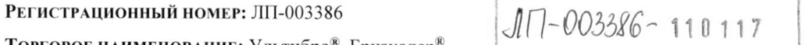
- стр. 1: «9 гликопиррония бромиду 0,063 мг), индакатерола основание — 0,110 мг (соответствует» — повторное чтение: «9 compos Spee ous | мг), индакатерола основание — 0,110 мг (соответствует»  
  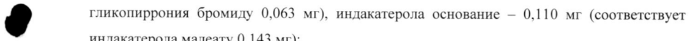
- стр. 2: «бета2-адренорецепторы в 24 раза сильнее, чем на бета1-адренорецепторы, и в 20 раз» — низкая уверенность: «бета2-адренорецепторы» (77), «бета1-адренорецепторы,» (72)  
  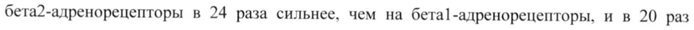
- стр. 3: «9 емкости легких и остаточного объема легких на 350 мл и 380 мл (р<0,001) соответственно» — повторное чтение: «»  
  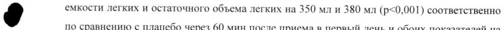
- стр. 4: «9 1 раз в сутки в течение 14 дней коэффициент кумуляции индакатерола, оцененный по |» — повторное чтение: «6 be me МИ : a м ne и И ° ees ~ т № и “se»  
  
- стр. 4: «& состоянии (при ингаляции рекомендуемой дозы 1 раз в день) и концентрация» — повторное чтение: «»  
  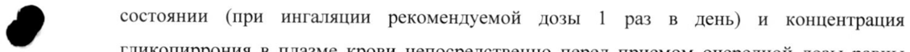
- стр. 6: «2,5% от доставляемой дозы. Почечный клиренс индакатерола составлял в среднем 0,46—» — низкая уверенность: «0,46—» (49)  
  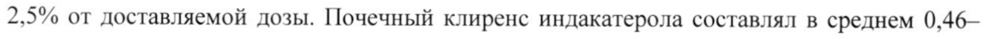
- стр. 6: «очевидно, что выведение препарата почками незначительное (приблизительно 2—5%» — низкая уверенность: «2—5%» (63); повторное чтение: «очевидно, что выведение препарата почками незначительное (приблизительно 25%»  
  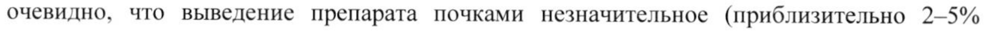
- стр. 6: «значением конечного периода полувыведения (Т!2) в диапазоне от 45,5 до 126 ч.» — низкая уверенность: «(Т!2)» (68)  
  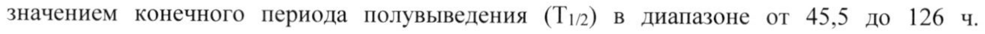
- стр. 6: «9 30-40% выводится другими путями - с желчью или за счет метаболизма. У здоровых» — повторное чтение: «»  
  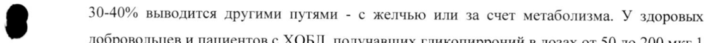
- стр. 14: «9 превышающей максимальную терапевтическую в 10 раз, отмечалось умеренное |» — повторное чтение: «9 тм ‚ | поло ри»  
  
- стр. 16: «Cmax в 2 и 1,4 раза соответственно. При одновременном применении индакатерола с» — низкая уверенность: «2» (67)  
  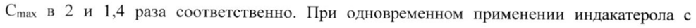
- стр. 17: «Однако на долю бета2-адренорецепторов в миокарде человека приходится от 10% до 50%» — низкая уверенность: «бета2-адренорецепторов» (69)  
  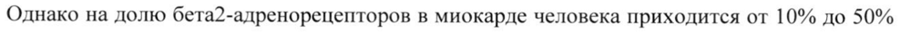
