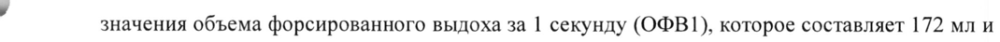
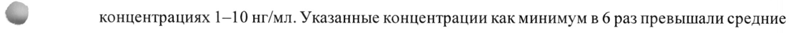
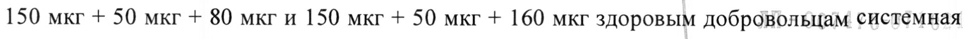

# Гликопиррония бромид + Индакатерол + Мометазон — ингаляц

- Препарат: Энерзейр Бризхалер® (капсулы с порошком для ингаляций;)
- АТХ: R03AL12
- Источник: ГРЛС, инструкция по медицинскому применению, РУ ЛП-007476, файл от 2025-05-26 (https://grls.rosminzdrav.ru/Grls_View_v2.aspx?routingGuid=d1b86724-c54f-4a37-b0e4-2ed22c63d131)
- Распознано автоматически (OCR): 24 из 24 стр.
- Инструкция к другому РУ того же препарата: ЛП-007476 (национальное РУ, переоформленное по правилам ЕАЭС, решение от 15.05.2025). Текст может быть старше действующего
- Сомнительных строк после OCR: 3 (см. раздел «Проверка распознавания»)

## Общие сведения

МИНИСТЕРСТВО ЗДРАВООХРАНЕНИЯ РОССИЙСКОЙ ФЕДЕРАЦИИ
ПО МЕДИЦИНСКОМУ ПРИМЕНЕНИЮ ЛЕКАРСТВЕННОГО ПРЕПАРАТА
ЭНЕРЗЕЙР БРИЗХАЛЕР®

РЕГИСТРАЦИОННЫЙ НОМЕР:

ТОРГОВОЕ НАИМЕНОВАНИЕ: Энерзейр Бризхалер®

МЕЖДУНАРОДНОЕ НЕПАТЕНТОВАННОЕ ИЛИ ГРУППИРОВОЧНОЕ НАИМЕНОВАНИЕ:

гликопиррония бромид + индакатерол + мометазон

## 3. Лекарственная форма

капсулы с порошком для ингаляций
капсулы с порошком для ингаляций

COCTAB:

1 капсула с порошком для ингаляций содержит (дозировка 50 мкг + 150 мкг + 80 мкг):

действующие вещества: гликопиррония бромид - 0,063 мг (соответствует гликопиррония
~ основанию 0,050 mr), индакатерола ацетат - 0,173 мг (соответствует индакатерола основанию

0,150 мг), мометазона фуроат — 0,080 мг; вспомогательные вещества: лактозы моногидрат,

магния стеарат.

1 капсула с порошком для ингаляций содержит (дозировка 50 мкг + 150 мкг + 160 мкг):

действующие вещества: гликопиррония бромид - 0,063 мг (соответствует гликопиррония

основанию 0,050 мг), индакатерола ацетат - 0,173 мг (соответствует индакатерола основанию

0,150 мг), мометазона фуроат — 0,160 мг; вспомогательные вещества: лактозы моногидрат,

магния стеарат.

Оболочка капсулы: гипромеллоза, вода очищенная, каррагинан, калия хлорид, краситель

железа оксид желтый (E172), индигокармин (E132), чернила черные, чернила белые.

В состав чернил черных входит (для капсул 50 мкг + 150 мкг + 80 мкг и 50 мкг + 150 мкг +
& 160 мкг): вода очищенная, железа оксид черный (Е 172), изопропанол, пропиленгликоль

(Е 1520), гипромеллоза (Е 464).

В состав чернил белых входит (для капсул 50 мкг+ 150 мкг + 80 мкг): вода очищенная, титана

диоксид (Е 171), изопропанол, пропиленгликоль (Е 1520), гипромеллоза (Е 464).

ОПИСАНИЕ:

Дозировка 50 мкг + 150 мкг + 80 мкг:

Твердые капсулы с прозрачной крышечкой зеленого цвета и прозрачным бесцветным

корпусом, с маркировкой. Содержимое капсул: порошок белого или почти белого цвета.

Маркировка (радиальная): на крышечке - логотип «4» белого цвета; на корпусе - надпись

«IGM150-50-80» черного цвета. Размер: № 3.

Дозировка 50 мкг + 150 мкг + 160 мкг:

Твердые капсулы с прозрачной крышечкой зеленого цвета и прозрачным бесцветным

корпусом, с маркировкой. Содержимое капсул: порошок белого или почти белого цвета.

429491 ae Стр. 2 из 24 Маркировка (радиальная): на крышечке - логотип «4» черного цвета; окруженный черной полосой; на корпусе - надпись «IGM150-50-160» черного цвета, расположенная над двойной черной полосой. Размер: № 3. ‚ (
ФАРМАКОТЕРАПЕВТИЧЕСКАЯ ГРУППА: препараты для лечения обструктивных заболеваний дыхательных путей, адреномиметики в комбинации с антихолинергическими и глюкокортикостероидными средствами.
КОД ATX: RO3AL12 ФАРМАКОЛОГИЧЕСКИЕ СВОЙСТВА
Механизм действия Препарат Энерзейр Бризхалер® является комбинацией индакатерола, длительно действующего бета2-адреномиметика (ДДБА), гликопиррония, длительно действующего антихолинергического препарата (ДДАХ), и мометазона фуроата, ингаляционного
- синтетического глюкокортикостероида.
Индакатерол. Фармакологическое действие бета›-адреномиметиков, включая индакатерол, по меньшей мере частично обусловлено стимуляцией внутриклеточной аденилатциклазы — фермента, который катализирует превращение аденозинтрифосфата (АТФ) в циклический 3’, 5’ аденозинмонофосфат (циклический АМФ). Повышение содержания циклического АМФ приводит к расслаблению гладкой мускулатуры бронхов.
Хотя бета2-адренорецепторы являются преобладающими адренорецепторами в гладкой мускулатуре бронхов, а бета1-рецепторы преобладают в сердце человека, тем не менее бета>- адренорецепторы составляют 10-50 % от общего количества адренорецепторов в сердце человека.
Гликопирроний является ингаляционным М-холиноблокатором длительного действия.
& Механизм действия гликопиррония основан на блокировании бронхоконстрикторного действия ацетилхолина на гладкомышечные клетки дыхательных путей, что приводит к бронходилатирующему эффекту. В организме человека выявлено 5 подтипов мускариновых рецепторов (М1-5). Известно, что только подтипы М1-3 задействованы в физиологической функции дыхательной системы. Гликопирроний обладает выраженным аффинитетом к этим типам рецепторов, причем он обладает в 4-5 раз большей селективностью в отношении М]- и МЗ-рецепторов по сравнению с M2-peyentopamu. Гликопирроний вызывает быстрое наступление эффекта, о чем свидетельствуют кинетические параметры ассоциациидиссоциации рецепторов и время до начала терапевтического эффекта, наблюдавшиеся в клинических исследованиях (КИ). Длительное действие гликопиррония отчасти может объясняться длительным периодом сохранения его терапевтической концентрации в легких, что подтверждается более длительным периодом полувыведения гликопиррония после ингаляционного применения по сравнению с периодом полувыведения после внутривенного
(в/в) введения.
929491 и Мометазона фуроат является синтетическим глюкокортикостероидом с высоким сродством к глюкокортикоидным рецепторам и местным противовоспалительным эффектом.
Установлено, что ингаляционное применение мометазона фуроата у пациентов с бронхиальной астмой обеспечивает благоприятное соотношение местного ‘действия в легких и системного воздействия. По всей видимости, значительная часть механизма действия мометазона фуроата основана на его способности ингибировать высвобождение медиаторов каскада воспалительных реакций. Jn vitro мометазона фуроат ингибирует высвобождение лейкотриенов (ЛТ) из лейкоцитов у пациентов с аллергией. В культурах клеток мометазона фуроат продемонстрировал высокую способность ингибировать синтез и высвобождение интерлейкинов 1, 5 и 6 (ИЛ-1, ИЛ-5, ИЛ-6), а также фактора некроза опухоли альфа (DHO-a).
Он также является ингибитором продукции JIT Т№2-цитокинов, интерлейкинов 4 и 5, синтезируемых CD4+T - клетками человека.
w& Фармакодинамика В клинических исследованиях применение фиксированной комбинации индакатерола, гликопиррония и мометазона фуроата было связано с более благоприятными показателями функции легких при использовании препарата Энерзейр Бризхалер® 150 мкг + 50 мкг + 80 мкг один раз в сутки и 150 мкг + 50 мкг + 160 мкг один раз в сутки по сравнению с фиксированной комбинацией салметерола и флутиказона 50 мкг + 500 мкг два раза в сутки, фиксированной комбинацией индакатерола и мометазона фуроата 150 мкг + 160 мкг и 150 мкг + 320 мкг один раз в сутки и плацебо.
Профиль фармакодинамического ответа на терапию препаратом Энерзейр Бризхалер® характеризуется началом действия в течение 5 минут после ингаляции и стойкостью эффекта в течение более 24 часов.
© Профиль фармакодинамического ответа характеризуется увеличением среднего пикового
| значения объема форсированного выдоха за | секунду (OMB1), которое составляет 172 мл и 159 мл после применения препарата Энерзейр Бризхалер® 150 мкг + 50 мкг + 80 мкг и 150 мкг + 50 мкг + 160 мкг один раз в сутки соответственно по сравнению с фиксированной комбинацией салметерола и флутиказона 50 мкг + 500 мкг, принимаемой два раза в сутки.
Данных, свидетельствующих о развитии тахифилаксии к препарату Энерзейр Бризхалер®, получено не было.
Влияние на интервал ОТс Специализированные исследования влияния препарата на длину интервала ОТ (ТОТ) не проводились.
О свойствах мометазона фуроата, способствующих удлинению интервала QTc, неизвестно.
129491 — | Стр. 4 из 24 Фармакокинетика Всасывание
После ингаляции препарата Энерзейр Бризхалер® среднее время достижения максимальной концентрации индакатерола, гликопиррония и мометазона фуроата в плазме крови составляли приблизительно 15 минут, 5 минути 1 час соответственно.
На основании результатов исследования in vitro установлено, что доза каждого компонента, доставляемая в легкие при применении препарата Энерзейр Бризхалер®, соответствует таковой при применении этих соединений по отдельности. После ингаляции препарата
Энерзейр Бризхалер® экспозиция индакатерола, гликопиррония и мометазона фуроата в равновесном состоянии в плазме крови не отличалась от системной экспозиции индакатерола малеата, гликопиррония или мометазона фуроата после их ингаляционного введения по отдельности.

w После ингаляции препарата Энерзейр Бризхалер® абсолютная биодоступность индакатерола, гликопиррония и мометазона фуроата составила около 45 %, 40 % и менее 10% соответственно.

Индакатерол

Концентрация индакатерола повышается при повторном применении препарата 1 раз в сутки.
Равновесная концентрация вещества в крови (Css) достигается в течение 12-14 дней применения препарата. При ингаляционном введении в дозах 75 — 600 мкг один раз в сутки средний коэффициент кумуляции индакатерола (т. е. АЦ Со 24. на 14-й день по сравнению с 1-м днем) варьировал в диапазоне 2,9-3,8. Системная экспозиция является результатом всасывания индакатерола в легкие и желудочно-железный тракт (ЖКТ): около 75 % системной экспозиции обеспечивается всасыванием в легких и около 25 % — в ЖКТ.

© Гликопирроний После ингаляции около 90 % системной экспозиции обеспечивается всасыванием в легких и 10 % — в ЖКТ. При пероральном применении расчетная абсолютная биодоступность гликопиррония составляет 5 % от доставляемой дозы.

Мометазона фуроат

Концентрация мометазона фуроата повышается при повторном применении препарата один раз в сутки с помощью устройства Бризхалер?. Равновесная концентрация вещества достигается через 12 дней. При ингаляционном введении в дозах 80 и 160 мкг один раз в сутки в составе препарата Энерзейр Бризхалер® средний коэффициент кумуляции мометазона фуроата (т. е. AUCp 4. на 14-й день по сравнению с AUC ›4. в 1-й день) варьировал в диапазоне 1,28—1,40.

После перорального введения мометазона фуроата его расчетная абсолютная биодоступность была очень низкой (менее 2 %).

129491

Распределение

Индакатерол

После в/в инфузии объем распределения (Vz) индакатерола варьировал B диапазоне. 2,36 1—

2,557 л, что указывает на значительное распределение препарата. В условиях | in) vitro

примерно 94,1 — 95,3 % и 95,1 — 96,2 % индакатерола связывается с белками сыворотки и

плазмы крови человека соответственно.

Гликопирроний

После в/в введения объем распределения гликопиррония в равновесном состоянии (Vss)

составлял 83 л, объем распределения в терминальной фазе (Vz) достигал 376 л. После

ингаляционного введения кажущийся объем распределения в терминальной фазе (Vz/F)

составил 7310 л, что отражает его более медленное выведение после ингаляции. В условиях

in vitro 38 — 41 % гликопиррония связывается с белками плазмы крови человека при w концентрациях 1-10 нг/мл. Указанные концентрации как минимум в 6 раз превышали средние

максимальные уровни в равновесном состоянии в плазме крови, наблюдавшиеся при

применении препарата в дозе 50 мкг один раз в сутки.

Мометазона фуроат

После в/в болюсного введения объем распределения (Vd) составляет 332 л. Связь мометазона

фуроата с белками плазмы крови в условиях in vitro очень высокая и составляет 98 — 99 % при

концентрациях 5 — 500 нг/мл.

Метаболизм

Индакатерол

В исследовании по оценке всасывания, распределения, метаболизма и выведения (ADME)

после приема внутрь меченого радиоактивным изотопом индакатерола, неизмененный
© индакатерол является основным компонентом сыворотки крови и обуславливает

приблизительно 1/3 от суточной AUC (Area under the curve — площадь под кривой

концентрация-время). Из всех метаболитов индакатерола в сыворотке крови наибольшее

содержание было определено для гидрокислированного производного. В меньшем

количестве обнаруживаются фенольный О-глюкуронид индакатерола и гидроксилированный

индакатерол. Кроме того, выявляются диастереомеры гидроксилированного производного,

М-глюкуронид индакатерола и продукты C- и N- дезалкилирования.

В ходе исследований in vitro установлено, что изофермент ОСТТА1 является единственным

изоферментом UGT, метаболизирующим индакатерол до фенольного О- глюкуронида. После

инкубации с рекомбинантными изоферментами CYP1A1, CYP2D6, и СУРЗА4 были выявлены

окислительные метаболиты. Это означает, что гидроксилирование индакатерола происходит

преимущественно под действием изофермента СУРЗА4. В дальнейшем в ходе исследований

in vitro было установлено, что индакатерол являетсянизкоафинным субстратом для

мембранного переносчика молекул Р-гликопротеина (P-gp). Согласно результатам

129491 исследований in vitro, метаболический клиренс индакатерола в основном происходит под влиянием изоформы UGT1A1. Однако, согласно результатам клинических исследований, в популяциях пациентов с разными генотипами изоформы ' ОСТТАТ, данный генотип не оказывает существенного влияния на системную экспозицию индакатерола:
Гликопирроний Результаты исследований метаболизма in vitro указывают на то, что пути метаболизма гликопиррония у человека и животных не отличаются. Метаболитов, свойственных только человеку, не выявлено. Гидроксилирование гликопиррония приводит к образованию различных моно- и би-гидроксилированных метаболитов, а прямой гидролиз приводит к образованию производных карбоновой кислоты (М9). Исследования in vitro показали, что изоферменты СУР вносят свой вклад в окислительную биотрансформацию гликопиррония.
Гидролиз до М9, по-видимому, катализируется ферментами семейства холинэстераз. После

& ингаляции системная экспозиция М9 в среднем не отличалась OT экспозиции исходного вещества. Так как исследования in vitro не выявили метаболизма действующего вещества в легких, а вклад М9 в циркуляцию был минимальным (4 % от Cmax и AUC гликопиррония)
после в/в введения, предполагается, что М9 образуется из фракции действующего вещества, поступившей через ЖКТ после ингаляции путем пресистемного гидролиза и/или при «первом прохождении» через печень. После ингаляции или в/в введения только минимальное количество М9 было обнаружено в моче (<0,5 % введенной дозы). Глюкуроновые и/или сульфатные конъюгаты гликопиррония были обнаружены в моче человека после повторных ингаляций в количестве приблизительно 3 % от доставляемой дозы. Исследования ингибирования in vitro показали, что гликопирроний не обладает значимой способностью подавлять активность изоферментов СУР1А2, CYP2A6, CYP2C8, CYP2C9, CYP2C19,

© CYP2D6, СУР2Е1 или CYP3A4/5, транспортных белков MDRI, МКР! или MXR, опосредующих выведение лекарственных препаратов из клеток, а также белков-переносчиков
ОАТР1В1, ОАТР1ВЗ, OAT1, ОАТЗ, ОСТ] или ОСТ2. Исследования индукции ферментов in vitro не выявили у гликопиррония клинически значимой способности индуцировать изоферменты цитохрома P450, изофермент UGT1A1 и белки-переносчики МОК] и MRP2.
Мометазона фуроат Доставляемая при ингаляции доза мометазона фуроата, которая поступает и всасывается в
ЖКТ, быстро метаболизируется до различных метаболитов. В плазме крови основные метаболиты не обнаруживаются. В микросомах печени человека метаболизм мометазона фуроата происходит под действием изофермента цитохрома Р-450 3A4 (изофермент
СУРЗА4).

129491 Выведение Индакатерол В клинических исследованиях с проведением анализа мочи количество неизмененного индакатерола, выделяющегося почками, как правило, составляло менее 2 % от доставляемой дозы. Почечный клиренс индакатерола составлял в среднем 0,46 — 1,20 л/ч. Учитывая, что сывороточный клиренс индакатерола составляет 18,8 — 23,3 л/ч, очевидно, что почечный клиренс играет незначительную роль (примерно 2 — 6 % от системного клиренса) в системном выведении индакатерола.
После приема внутрь индакатерол выводился преимущественно через кишечник: в неизменном виде (54 % от доставляемой дозы) и в виде гидроксилированных метаболитов
(23 % от доставляемой дозы). Достигался полный баланс массы при более чем 90 % извлечении из экскретов.
| Концентрация индакатерола в сыворотке крови снижается многофазно со средним значением конечного периода полувыведения (T1/2) в диапазоне от 45,5 до 126 ч. Эффективный T1/2, рассчитанный на основании кумуляции индакатерола после повторного применения, варьировал от 40 до 52 4, что согласуется с установленным временем достижения равновесного состояния (12 — 14 дней).
Гликопирроний После в/в введения человеку гликопиррония, меченого изотопом ЗН, в течение 48 часов с мочой выводилось в среднем 85 % от доставляемой дозы. Еще 5 % дозы обнаруживалось в желчи. Таким образом, баланс массы был практически полным.
Выведение гликопиррония почками достигает 60 - 70 % от общего плазменного клиренса, 30
- 40% выводится другими путями - с желчью или за счет метаболизма. У здоровых
© добровольцев и пациентов с ХОБЛ, получавших гликопирроний ингаляционно в дозах от 50 до 200 мкг | раз в сутки как однократно, так и повторно, средний почечный клиренс гликопиррония составлял от 17,4 до 24,4 л/ч. Выведение гликопиррония почками обусловлено активной канальцевой секрецией. До 20 % от дозы обнаруживается в моче в неизмененном виде. Концентрация гликопиррония в плазме крови снижается многофазно. Средний конечный период полувыведения более продолжителен после ингаляции (33 - 57 ч), чем после в/в (6,2 4) или перорального введения (2,8 4). Характер выведения позволяет предположить длительное всасывание в легких и/или проникновение гликопиррония в системный кровоток во время и спустя 24 ч после ингаляции.
Мометазона фуроат После в/в болюсного введения средний конечный период полувыведения мометазона фуроата составляет около 4,5 часа. По результатам исследования с использованием меченого радиоактивного изотопа, после ингаляции мометазона фуроат выводится в основном через кишечник (74 %) и, в меньшей степени, с мочой (8 %).
129491 Линейность/нелинейность Г После однократного и повторного ингаляционного введения препарата Энерзейр Бризхалер® 150 мкг + 50 мкг + 80 мкги 150 мкг + 50 мкг + 160 мкг здоровым добровольцам системная экспозиция мометазона фуроата (Си, и AUCO-244) увеличивалась пропорционально(дозе.:У пациентов с бронхиальной астмой после применении в дозах 150 мкг + 50 мкг + 80 мкг и 150 мкг + 50 мкг + 160 мкг отмечалось менее пропорциональное повышение (в 1,7 раза)
системной экспозиции мометазона фуроата в равновесном состоянии. Оценка дозозависимого увеличения экспозиции индакатерола или гликопиррония не выполнялась, так как использовалась только одна их дозировка в препарате Энерзейр Бризхалер®.
Фармакокинетика у особых групп пациентов
Результаты анализа фармакокинетики у пациентов с бронхиальной астмой после ингаляционного введения препарата Энерзейр Бризхалер® указывали на отсутствие
& значимого влияния возраста, пола, массы тела, статуса курения, исходной расчетной скорости клубочковой фильтрации (рСКФ) и исходного ОФВ, на системную экспозицию индакатерола, гликопиррония или мометазона фуроата.
Безопасность и эффективность препарата Энерзейр Бризхалер® у пациентов моложе 18 лет не установлена
Пациенты с нарушениями функции печени Влияние нарушения функции печени на фармакокинетику индакатерола, гликопиррония и мометазона фуроата после применения препарата Энерзейр Бризхалер® не изучалось. Однако проводились исследования по оценке свойств каждого из компонентов, применяемых по отдельности.
Индакатерол: у пациентов с легким или умеренным нарушением функции печени не
© наблюдалось значимых изменений значений Cy, или AUC индакатерола. Кроме того, не было отмечено различий в связывании с белками плазмы крови у пациентов с легким или умеренным нарушением функции печени и здоровых добровольцев. Исследования у пациентов с тяжелым нарушением функции печени не проводились.
Гликопирроний: клинические исследования у пациентов с нарушением функции печени не проводились. Гликопирроний выводится из системного кровотока преимущественно почками. Предполагается, что ухудшение метаболизма гликопиррония в печени не приведет к клинически значимому повышению экспозиции.
Мометазона _фуроат: результаты исследования по оценке однократного применения ингаляционной формы мометазона фуроата в дозе 400 мкг у пациентов с легким (п = 4), умеренным (п = 4) и тяжелым (п = 4) нарушением функции печени указывают на то, что обнаруживаемые пиковые концентрации мометазона фуроата в плазме крови наблюдались только у одного или двух пациентов в каждой группе лечения (50 — 105 пкг/мл). По всей видимости, частота выявления пиковых концентраций в плазме крови увеличивается в 129491 зависимости от степени тяжести нарушения функции печени, однако подобные пиковые концентрации (нижний предел количественного определения составлял 50 пкг/мл) были зарегистрированы лишь в нескольких случаях. a = |
Пациенты с нарушениями функции почек Оценка влияния нарушений функции почек на фармакокинетику индакатерола, гликопиррония и мометазона фуроата в клинических исследованиях препарата не проводилась. В анализе популяционной фармакокинетики рСКФ не являлась статистически значимым предиктором для системной экспозиции индакатерола, гликопиррония и мометазона фуроата после введения препарата Энерзейр Бризхалер® у пациентов с бронхиальной астмой.

Поскольку выведение с мочой не оказывает существенного влияния на общее выведение индакатерола и мометазона фуроата, влияние нарушения функции почек на системную
& экспозицию этих веществ не изучалось.
Нарушение функции почек оказывает влияние на системную экспозицию гликопиррония при его применении в монотерапии. Умеренное повышение полной системной экспозиции до 1,4 раз наблюдалось у пациентов с нарушением функции почек легкой и средней степени тяжести и до 2,2 раз у пациентов с нарушением функции почек тяжелой степени и терминальной стадией хронической болезни почек (ХБП). Согласно данным популяционного фармакокинетического анализа, у пациентов с бронхиальной астмой и абсолютной СКФ 58 или 143 мл/мин AUCo.24 гликопиррония увеличивалась соответственно на 27 % или 19 % по сравнению с пациентами с СКФ 93 мл/мин.
По данным популяционного фармакокинетического анализа у пациентов с ХОБЛ с сопутствующим нарушением функции почек легкой и средней степени тяжести
(СКФ >30 мл/мин/1,73 м²) гликопирроний может применяться в рекомендуемых дозах.
-

Раса, этническая принадлежность и другие особые группы пациентов
У пациентов японского происхождения и представителей европеоидной расы отсутствовали существенные различия общей системной экспозиции (по AUC) индакатерола, гликопиррония или мометазона фуроата. В настоящее время недостаточно данных по фармакокинетике у пациентов другой этнической принадлежности или расы.
У пациентов с бронхиальной астмой общая системная экспозиция гликопиррония (AUC)
может увеличиваться в 1,8 и 2,5 раза при низкой массе тела и при низкой массе тела (35 кг) в сочетании с низкой абсолютной СКФ (45 мл/мин) соответственно.

129491 ПОКАЗАНИЯ К ПРИМЕНЕНИЮ Поддерживающая терапия бронхиальной астмы у взрослых пациентов, у которых не удалось достичь надлежащего контроля заболевания с помощью комбинации бета>- адреномиметика длительного действия и средней или высокой дозой ингаляционного глюкокортикостероида, в том числе перенесших одно или несколько обострений бронхиальной астмы в предыдущем году.
ПРОТИВОПОКАЗАНИЯ e Повышенная чувствительность к гликопирронию, индакатеролу, мометазона фуроату или любым другим компонентам, входящим в состав препарата.
e Возраст до 18 лет (эффективность и безопасность не установлены).
e Непереносимость галактозы, дефицит лактазы или глюкозо-галактозная мальабсорбция
, (препарат содержит лактозу).
- e Не рекомендуется одновременное применение с лекарственными препаратами, содержащими другие бета›-адреномиметики длительного действия или
М- холиноблокаторы длительного действия.

## 4.3. С осторожностью

Сопутствующие заболевания сердечно-сосудистой системы (ишемическая болезнь сердца), острый инфаркт миокарда, артериальная гипертензия, нарушения сердечного ритма, удлинение интервала ОТс; судорожные расстройства; тиреотоксикоз; сахарный диабет;
Сопутствующие заболевания сердечно-сосудистой системы (ишемическая болезнь сердца), острый инфаркт миокарда, артериальная гипертензия, нарушения сердечного ритма, удлинение интервала ОТс; судорожные расстройства; тиреотоксикоз; сахарный диабет;
синдром врожденного удлинения интервала ОТ; одновременное применение лекарственных средств, удлиняющих интервал ОТ (антиаритмические препараты 1А и Ш классов, трициклические и тетрациклические антидепрессанты, нейролептики, макролиды,
, противогрибковые препараты, производные имидазола, некоторые антигистаминные, в т.ч.
~ астемизол, терфенадин, эбастин); при гиперреактивности на действие OeTarадреномиметиков; закрытоугольная глаукома; нарушения функции печени тяжелой степени
(применение препарата возможно только в случае, если ожидаемая польза превышает потенциальный риск); заболевания, сопровождающиеся задержкой мочи; нарушения функции почек тяжелой степени (СКФ ниже 30 мл/мин/1,73 м²), включая терминальную стадию (ХБП), требующую проведения гемодиализа (применение препарата возможно только в случае, если ожидаемая польза превышает потенциальный риск); туберкулез легких;
хронические или нелеченые инфекции; одновременное применение лекарственных средств, удлиняющих интервал ОТ (антиаритмические препараты [А и Ш классов, трициклические и тетрациклические антидепрессанты, нейролептики, макролиды, противогрибковые препараты, производные имидазола, некоторые антигистаминные, в т.ч. астемизол, терфенадин, эбастин); одновременное применение с препаратами для общей анестезии из группы барбитуратов.
129491 Стр. 11и324 о

## 4.6. Применение при беременности и в период грудного вскармливания

Резюме рисков Имеющихся в настоящее время данных по применению препарата Энерзейр Бризхалер® (или его отдельных компонентов: индакатерол, гликопирроний и мометазона фуроат) у беременных женщин недостаточно для того, чтобы сделать какие-либо выводы относительно рисков, связанных с применением препарата.
Индакатерол и гликопирроний не оказывали тератогенного действия у крыс и кроликов после подкожного или ингаляционного введения соответственно. В исследованиях репродуктивной токсичности введение мометазона фуроата беременным самкам мышей, крыс и кроликов приводило к увеличению частоты пороков развития плода и снижению выживаемости и роста плода.
Препарат Энерзейр Бризхалер® следует применять во время беременности только в тех

& случаях, когда предполагаемая польза для матери превышает потенциальный риск для плода.
Риск для здоровья матери, эмбриона и (или) плода, связанный с заболеванием
В отсутствии контроля или при недостаточном контроле бронхиальной астмы у матери увеличивается риск развития некоторых негативных перинатальных исходов, таких как преэклампсия, преждевременные роды, низкая масса новорожденного или малый размер плода для гестационного возраста. В отсутствии контроля или при недостаточном контроле бронхиальной астмы у матери увеличивается риск развития некоторых негативных перинатальных исходов, таких как преэклампсия, преждевременные роды, низкая масса новорожденного или малый размер плода для гестационного возраста.
Пациенток с бронхиальной астмой следует тщательно наблюдать во время беременности, при необходимости доза препарата может быть изменена с целью поддержания оптимального

: контроля заболевания.

-
Родовая деятельность и исход родов Индакатерол
Другие лекарственные препараты, содержащие бета2-адреномиметики, индакатерол может ингибировать родовую деятельность вследствие расслабляющего действия на гладкую мускулатуру матки.
Гликопирроний У беременных женщин, которым проводилось кесарево сечение, через 86 минут после однократной внутримышечной инъекции гликопиррония бромида в дозе 0,006 мг/кг концентрация гликопиррония в плазме венозной (0,28 (0,25) нг/мл) и артериальной пуповинной (0,18 (0,11) нг/мл) крови была низкой (клинически незначимой).
Грудное вскармливание Отсутствует информация о проникновении индакатерола, гликопиррония или мометазона в грудное молоко человека, влиянии на выработку грудного молока, а также о влиянии на

929491 | Стр. 12 из 24 ребенка, получающего грудное вскармливание. Другие ингаляционные глюкокортикостероиды, схожие с мометазона фуроатом, проникают’в грудное’ молоко человека. 20
Принимая решение о прекращении грудного вскармливания или отказе / временном прекращении терапии препаратом, необходимо учитывать пользу грудного вскармливания для ребенка и пользу терапии для матери.

Фертильность

Результаты исследований репродуктивной функции и другие данные исследований на животных указывают на отсутствие проблем у мужчин или женщин, связанных с фертильностью.

## 4.2. Способ применения и дозы

Только для ингаляционного применения!

- Препарат представляет собой капсулы с порошком для ингаляций, которые следует применять только для ингаляций через рот с помощью специального устройства для ингаляций (Бризхалер®), которое входит в упаковку. Следует использовать новое устройство для ингаляций при каждой новой упаковке. Капсулы нельзя принимать внутрь. Капсулы с порошком для ингаляций следует хранить в блистере и извлекать из него непосредственно перед применением. После ингаляции следует прополоскать рот водой, не проглатывая.
Ингаляцию препарата проводят ежедневно | раз в сутки в одно и то же время. В случае пропуска дозы ее необходимо принять как можно раньше. Следует проинформировать пациента о недопустимости применения более | дозы препарата в сутки.

Перед началом применения препарата пациента следует обучить правильной технике использования устройства для ингаляций.

©, При отсутствии улучшения функции дыхания следует удостовериться, правильно ли пациент применяет препарат. Препарат следует вдыхать, а не глотать.

Режим дозирования у особых групи пациентов

Применение у пациентов старше 65 лет

Не требуется коррекции дозы препарата у пациентов в возрасте > 65 лет.

Применение у пациентов с нарушением функции почек

Не требуется коррекции дозы при применении препарата у пациентов с нарушениями

функции почек легкой или средней степени. Следует соблюдать осторожность у пациентов с

нарушением функции почек тяжелой степени или терминальной ХБП, требующей

проведения диализа.

Применение у пациентов с нарушением функции печени

Не требуется коррекции дозы при применении препарата у пациентов с нарушениями

функции печени легкой и средней степени тяжести. Применение препарата у пациентов с

нарушением функций печени тяжелой степени не изучалось, поэтому в данной подгруппе 429491
| Crp. 13 из 24 пациентов препарат Энерзейр Бризхалер® следует применять TONBKO B TeX случаях, когда предполагаемая польза превышает потенциальный риск. C0 OBA
IITOBOYUHOE ДЕЙСТВИЕ Профиль безопасности препарата Энерзейр Бризхалер® изучен в исследованиях Ш фазы: 1233 взрослых пациентов с бронхиальной астмой, получавших терапию препаратом Энерзейр
Бризхалер® в дозах 150 мкг + 50 мкг + 80 мкг или 150 мкг + 50 мкг + 160 мкг один раз в сутки в течение 52 недель.

Наиболее частыми побочными реакциями, связанным с применением препарата Энерзейр

Бризхалер®, были астма (обострение), назофарингит, инфекция верхних дыхательных путей

и головная боль.

## 4.8. Побочное действие

(НЛР) сгруппированы в соответствии с классификацией органов и систем органов Мед ОКА. В пределах каждой группы органов и систем органов НЛР
(НЛР) сгруппированы в соответствии с классификацией органов и систем органов Мед ОКА. В пределах каждой группы органов и систем органов НЛР
- перечислены в порядке уменьшения частоты встречаемости. Для оценки частоты

встречаемости использованы следующие критерии: очень часто (>1/10); часто (>1/100, <1/10);

нечасто (>1/1000, <1/100); редко (>1/10000, <1/1000); очень редко (<1/10000), включая

отдельные сообщения. В пределах каждой группы частоты встречаемости НЯ указаны в

порядке уменьшения их тяжести.

- 429491 реакции |
Инфекционные и паразитарные дыхательных путей заболевания мочевыводящих путей?
Нарушения со стороны иммунной Г з | Часто can emo | Punepsyserarensoen? Ч“ питания
;
Нарушения со стороны дыхательнои системы, органов грудной клетки и Оль в ротоглотке acre о |7
.
Нарушения со стороны пищеварительной = оболочки полости рта
Не Скелетно-мышечная Часто ‘wc cere, ыы мышечной и соединительной ткани = мочевыводящих путей введения
' кандидоз ротовой полости, ротоглоточный кандидоз.
2? бессимптомная бактериурия, бактериурия, цистит, воспаление мочеиспускательного
© канала, инфекции мочеполовой системы, инфекции мочевыводящих путей вирусной этиологии.
3 лекарственная сыпь, гиперчувствительность к лекарственному препарату, сенсибилизация, высыпания, зудящая сыпь, крапивница.
4 повышенный уровень глюкозы в крови, гиперкалиемия.
> головная боль напряжения, тензионная головная боль.
° синусовая тахикардия, суправентрикулярная тахикардия, тахикардия.
7 дисфагия, ротоглоточный дискомфорт, боль в ротоглотке, раздражение в горле.
$ хронический гастрит, энтерит, гастрит, гастроэнтерит, желудочно-кишечное воспаление.
9 сухость во рту, сухость в горле.
10 лекарственная сыпь, высыпания, папулёзная сыпь, зудящая сыпь.
И зуд в глазах, кожный зуд, кожный зуд половых органов.
1? боль в пояснице, боль в груди при заболеваниях костно-мышечного аппарата, скелетно-мышечные боль, миальгия, боль в шее.
Если любые из указанных в инструкции побочных эффектов усугубляются, или Вы заметили любые другие побочные эффекты, не указанные в инструкции, сообщите об этом врачу.
129491 | 824 ПЕРЕДОЗИРОВКА И | Максимальная рекомендованная доза препарата Энерзейр Бризхалер® 50 мкг 4450 мкг + 160 мкг один раз в день. В клинических исследованиях получены ограниченные данные о передозировке препаратом Энерзейр Бризхалер®. В случае подозрения на передозировку — необходимо начать общую поддерживающую и симптоматическую терапию.
При передозировке могут развиться признаки, симптомы или побочные эффекты, связанные с фармакологическим действием отдельных компонентов (например, тахикардия, тремор, ощущение сердцебиения, головная боль, тошнота, рвота, сонливость, желудочковая аритмия, метаболический ацидоз, гипокалиемия, гипергликемия, повышенное внутриглазное давление
(сопровождающееся болью в глазах, нарушением зрения или покраснением глаз), запор, затрудненное мочеиспускание, угнетение гипоталамо-гипофизарно-надпочечниковой системы). Для лечения побочных эффектов бета2-адреномиметиков можно рассмотреть
| возможность применения кардиоселективных бета-адреноблокаторов, исключительно под наблюдением врача и с максимальной осторожностью, поскольку применение бета?- адреноблокаторов может спровоцировать развитие бронхоспазма. В тяжелых случаях может потребоваться госпитализация.

## 4.5. Взаимодействие с другими лекарственными средствами

Исследования взаимодействия препарата Энерзейр Бризхалер® с другими лекарственными препаратами не проводились. Информация о возможных лекарственных взаимодействиях препарата Энерзейр Бризхалер® основана на данных о возможном лекарственном взаимодействии при применении каждого из действующих веществ по отдельности. При ингаляционном применении препарата Энерзейр Бризхалер в клинических (терапевтических)
дозах одновременно с другими лекарственными препаратами, развитие клинически значимых
& лекарственных взаимодействий, опосредованных данным препаратом, маловероятно в связи с малой концентрацией в плазме крови.
Одновременное ингаляционное применение индакатерола, гликопиррония и мометазона фуроата не влияет на фармакокинетику любого из действующих веществ в равновесном состоянии в сыворотке крови.
Лекарственные препараты, удлиняющие интервал ОТс
Как и при применении других бета2-адреномиметиков, следует соблюдать осторожность при применении препарата Энерзейр Бризхалер® у пациентов, принимающих ингибиторы моноаминооксидазы, трициклические антидепрессанты или другие препараты, способные удлинять интервал ОТ, в связи с возможностью усиления воздействия этих препаратов на длину интервала ОТ. Лекарственные препараты, способные удлинять интервал ОТ, могут повысить риск развития желудочковой аритмии.
129491 Стр. 16 из24 | Лекарственные средства, способные вызвать гипокалиемию
Одновременное применение с производными метилксантина, стероидами. или не | каллийсберегающими диуретиками, может усилить потенциальный гипокалиемический` - эффект бета2-адреномиметиков (см. раздел «Особые указания»).
Бета-адреноблокаторы Бета-адреноблокаторы могут ослаблять эффект или препятствовать действию бета>- адреномиметиков. Поэтому препарат Энерзейр Бризхалер® не рекомендуется применять одновременно с бета-адреноблокаторами при отсутствии веских причин для их совместного применения. В случае необходимости совместного применения обоих классов препаратов предпочтение следует отдавать кардиоселективным бета-адреноблокаторам (соблюдая при этом осторожность).
Взаимодействие с ингибиторами СУРЗА4 и Р-гликопротеина
© Ингибирование CYP3A4 и Р-гликопротеина (P-gp) не влияет на безопасность применения препарата Энерзейр Бризхалер® в терапевтических дозах.
Ингибирование основных ферментов, способствующих клиренсу индакатерола (CYP3A4 и
P-gp) или мометазона фуроата (CYP3A4), увеличивает системную экспозицию индакатерола или мометазона фуроата в два раза.
Согласно опыту применения в клинических исследованиях в дозе 600 мкг вплоть до одного года, степень увеличения экспозиции индакатерола в результате лекарственных взаимодействий не вызывает опасений по безопасности.
Поскольку после ингаляции достигаются очень низкие концентрации в плазме крови, клинически значимые лекарственные взаимодействия с мометазона фуроатом представляются маловероятными. Однако при одновременном применении мощных
© ингибиторов изофермента СУРЗА4 (например, кетоконазола, итраконазола, нелфинавира, ритонавира, кобицистата) возможно увеличение системной экспозиции мометазона фуроата.
Циметидин или другие ингибиторы транспорта органических катионов
В клинических исследованиях у здоровых добровольцев циметидин, ингибитор транспорта органических катионов, влияющих на почечный клиренс гликопиррония, повышал общую экспозицию гликопиррония на 22 % (AUC) и понижал почечный клиренс на 23 %. Учитывая величину данных изменений, не ожидается клинически значимого лекарственного взаимодействия при одновременном применении гликопиррония с циметидином или другими ингибиторами транспорта органических катионов.
Другие длительно действующие холинолитические препараты и длительно действующие бета?-адреномиметики
Одновременное применение препарата Энерзейр Бризхалер® с другими лекарственными препаратами, содержащими длительно действующие холинолитические препараты или длительно действующие бета>-адреномиметики, не изучалось и не рекомендуется ввиду 929491
Стр:-17 13.24.

возможного развития нежелательных реакций.

## 4.4. Особые указания

- - 7
- - 7

Ухудшение течения заболевания

Препарат Энерзейр Бризхалер® нельзя применять для купирования острых симптомов

бронхиальной астмы, в том числе острых эпизодов бронхоспазма, для купирования которых

требуется применение бронходилататоров короткого действия. Увеличение частоты

применения бронходилататоров короткого действия с целью облегчения симптомов

указывает на снижение контроля заболевания и необходимость осмотра пациента врачом. Без

контроля врача пациенту не следует прекращать лечение препаратом, поскольку на фоне

прекращения терапии возможно возобновление симптомов.

При применении препарата Энерзейр Бризхалер® возможно развитие симптомов
~ бронхиальной астмой, a также обострения заболевания.

Не рекомендовано резкое прекращение терапии препаратом. При неэффективности терапии

по мнению пациента необходимо продолжить применение препарата и обратиться за

консультацией врача. Увеличение частоты использования бронходилататоров короткого

действия («спасательной терапии») указывает на ухудшение течения заболевания и требует

пересмотра лечения. Внезапное прогрессирующее ухудшение бронхиальной астмы может

быть жизнеугрожающим, в связи с чем пациенту необходимо срочное медицинское

обследование.

Реакции гиперчувствительности

При применении препарата Энерзейр Бризхалер® наблюдались случаи развития реакций

гиперчувствительности немедленного типа. При появлении признаков, свидетельствующих о w развитии аллергической реакции, в особенности ангионевротического отека (включая

затрудненное дыхание или затрудненное глотание, отек языка, губ и лица), крапивницы или

кожной сыпи, следует немедленно прекратить применение препарата и сменить лечение на

альтернативное.

Парадоксальный бронхоспазм

Как и в случае использования других препаратов для ингаляционного применения, терапия

препаратом Энерзейр Бризхалер® может привести к развитию угрожающего жизни

парадоксального бронхоспазма. При развитии парадоксального бронхоспазма следует

немедленно прекратить применение препарата Энерзейр Бризхалер® и сменить лечение на

альтернативное.

Действие бета?-адреномиметиков на сердечно-сосудистую систему

Как и другие лекарственные препараты, содержащие бета>-адреномиметики, препарат

Энерзейр Бризхалер® может оказывать клинически значимое действие на сердечно-

сосудистую систему, проявляющееся в виде повышения артериального давления, увеличения

29491 | Стр. 18 из 24 частоты пульса и (или) возникновения соответствующих симптомов, При развитии таких эффектов может потребоваться прекращение терапии.

Препарат Энерзейр Бризхалер® следует применять с осторожностью у пациентов с сердечнососудистыми заболеваниями (ишемическая болезнь сердца; острый инфаркт миокарда, сердечная аритмия, артериальная гипертензия), судорожными расстройствами или тиреотоксикозом, а также у пациентов с повышенной чувствительностью к агонистам бета?- адренеренорецепторов.
В программе клинической разработки индакатерола / гликопиррония / мометазона фуроата из исследований исключали пациентов с нестабильной ишемической болезнью сердца, инфарктом миокарда в анамнезе за последние 12 месяцев, левожелудочковой недостаточностью класса Ш / ТУ Нью-Йоркской кардиологической ассоциации (МУНА), аритмией, неконтролируемой артериальной гипертензией, цереброваскулярными
© заболеваниями, синдромом удлиненного интервала ОТ в анамнезе, а также пациенты, получавшие лечение лекарственными средствами с известной способностью удлинять интервал ОТс. Таким образом, нет данных по безопасности у пациентов вышеуказанных категорий.
Кроме того, при применении бета2-адреномиметиков могут отмечаться следующие электрокардиографические изменения: уплощение зубца Т, удлинение интервала ОТ и депрессия сегмента ST (однако клиническая значимость этих изменений не установлена).
Таким образом, у пациентов с подтвержденным или предполагаемым удлинением интервала
ОТ или у пациентов, получающих препараты, оказывающие влияние на интервал ОТ, следует с осторожностью применять длительно действующие бета2-агонисты (ДДБА) или комбинированные препараты, содержащие ДДБА, в том числе препарат Энерзейр
© Бризхалер®.
Гипокалиемия при применении бета-адреномиметиков
У некоторых пациентов при применении бета2-адреномиметиков может отмечаться значительная гипокалиемия, приводящая к развитию НЯ со стороны сердечно-сосудистой системы. Снижение содержания калия в сыворотке крови обычно бывает преходящим и не требует коррекции. У пациентов с тяжелой бронхиальной астмой гипокалиемия может быть вызвана гипоксией и сопутствующей терапией, что в свою очередь может увеличивать предрасположенность к развитию сердечной аритмии. В клинических исследованиях при применении препарата в рекомендуемых терапевтических дозах не наблюдалось клинически значимых эффектов гипокалиемии.
Гипергликемия При ингаляции высоких доз бета2-адреномиметиков с глюкокортикостероидами возможно повышение концентрации глюкозы в плазме крови. При инициировании терапии препаратом у пациентов с сахарным диабетом следует более тщательно контролировать концентрацию 429491 глюкозы в плазме крови. |
Применение препарата Энерзейр Бризхалер® у пациентов с сахарным диабетом | типа или неконтролируемым сахарным диабетом П типа не изучено. |
Холинолитическое действие гликопиррония | -_
Как и другие антихолинергические лекарственные препараты, Энерзейр Бризхалер® следует применять с осторожностью у пациентов с закрытоугольной глаукомой или задержкой мочи.
Следует проинформировать пациента о признаках и симптомах острого приступа закрытоугольной глаукомы и о необходимости прекратить применение препарата, а также незамедлительно обратиться к врачу при возникновении соответствующих признаков и
СИМПТОМОВ.

Пациенты с нарушением функции почек тяжелой степени

Следует соблюдать осторожность у пациентов с нарушением функции почек тяжелой степени
& (СКФ <30 мл/мин/1,73 м²), включая пациентов с терминальной стадией ХБП, требующей

диализа.

Профилактика инфекций полости рта и глотки

Чтобы снизить риск кандидозной инфекции ротоглотки, пациентам следует рекомендовать

полоскать рот или полоскать горло водой, не глотая ее, или чистить зубы после вдыхания

предписанной дозы.

Системные эффекты глюкокортикостероидов

При применении ингаляционных глюкокортикостероидов возможно развитие системных

эффектов, особенно при их применении в высоких дозах и в течение продолжительного

периода времени. Данные явления возникают реже, чем при применении пероральных

глюкокортикостероидов, также они могут различаться в зависимости от индивидуальных
& особенностей пациентов и применяемых глюкокортикостероидов.

У пациентов с туберкулезом легких или хронической или нелеченой инфекцией препарат

Энерзейр Бризхалер® следует применять с осторожностью.

Вспомогательные вещества

Данный лекарственный препарат содержит лактозу. Пациентам с редкими наследственными

проблемами непереносимости галактозы, полной лактазной недостаточностью или

мальабсорбцией глюкозы-галактозы не следует принимать Энерзейр Бризхалер®.

## 4.7. Влияние на способность управлять транспортными средствами, механизмами

МЕХАНИЗМАМИ

Препарат Энерзейр Бризхалер® не оказывает или оказывает незначительное влияние на

способность управлять транспортными средствами и выполнение потенциально опасных

видов деятельности, требующих повышенной концентрации внимания и быстроты

психомоторных реакций.

929491 Форма ВЫПУСКА Капсулы с порошком для ингаляций (в дозировке 50 мкг + 150. мкг + 80 мкг или 50 мкг + 150 мкг + 160 мкг).
По 10 капсул в блистер из ПА/Ал/ПВХ и ПЭТ/Ал (Ал/Ал):Но-1 или З-блистера вместе с инструкцией по медицинскому применению и устройством для ингаляций (Бризхалер?®) в картонную пачку.
Допускается наличие контроля первичного вскрытия на картонной пачке.

## 6.4. Условия хранения

В оригинальной упаковке (в пачке), в защищенном от света месте при температуре не выше 25°С.
В оригинальной упаковке (в пачке), в защищенном от света месте при температуре не выше 25°С.
Хранить в недоступном для детей месте.

## 6.3. Срок годности

| 2 года.
Препарат не применять по истечении срока годности.
УСЛОВИЯ ОТПУСКА Отпускают по рецепту.
НАИМЕНОВАНИЕ И АДРЕС ЮРИДИЧЕСКОГО ЛИЦА, НА ИМЯ КОТОРОГО ВЫДАНО
РЕГИСТРАЦИОННОЕ УДОСТОВЕРЕНИЕ Новартис Фарма АГ, Лихтштрассе 35, 4056 Базель, Швейцария / Novartis Pharma AG,
Lichtstrasse 35, 4056 Basel, Switzerland
ПРОИЗВОДИТЕЛЬ Производство готовой лекарственной формы
Новартис Фарма Штейн АГ, Шаффхаузерштрассе, 4332 Штейн, Швейцария / Novartis Pharma
© Stein AG, Schaffhauserstrasse, 4332 Stein, Switzerland.
Первичная упаковка / вторичная (потребительская) упаковка / выпускающий контроль качества
Новартис Фармасьютика С.А., Ронда де Санта Мария, 158, Барбера Дель Валлес, 08210,
Барселона, Испания / Novartis Farmaceutica S.A., Ronda de Santa Maria, 158, Barbera del Valles, 08210 Barcelona, Spain.
ПОЛУЧИТЬ ДОПОЛНИТЕЛЬНУЮ ИНФОРМАЦИЮ О ПРЕПАРАТЕ, А ТАКЖЕ НАПРАВИТЬ
ПРЕТЕНЗИИ И ИНФОРМАЦИЮ О НЕЖЕЛАТЕЛЬНЫХ ЯВЛЕНИЯХ МОЖНО ПО СЛЕДУЮЩЕМУ
АДРЕСУ В РОССИИ:
ООО «Новартис Фарма»
125315, г. Москва, Ленинградский проспект, дом 70 тел. (495) 967 12 70;
факс (495) 967 12 68.
129491 ——— (Crp. 21 из24.
ИНСТРУКЦИЯ ПО ПРИМЕНЕНИЮ УСТРОЙСТВА ДЛЯ ИНГАЛЯЦИЙ БРИЗХАЛЕР® р
В упаковку лекарственного препарата Энерзейр Бризхалер® входит:
® Одно устройство для ингаляций — Бризхалер®; СОГЛАСОВАН
© — Один или несколько блистеров с капсулами с порошком для ингаляций. —
Отсек для Мундштук капсулы ыы 4 2 4 : у / <) С №
- Боковые cy SERS
Основание . Блистер \\/ © Устройство для Основание Блистер ингаляций устройства
В этом разделе приведены указания по использованию устройства для ингаляций, а также уходу за ним. Пожалуйста, перед использованием устройства Бризхалер® внимательно ознакомьтесь с инструкцией и следуйте приведенным рекомендациям.
При возникновении дополнительных вопросов обратитесь к медицинскому специалисту.
Перед использованием устройства полностью прочитайте нижеприведенные инструкции.
(ey ee ® \ Са WN р BSN А WF f=, < J \ 7 Вставьте капсулу | Проколите капсулу | Глубоко вдохните | Удостоверьтесь, что
_ и отпустите _ . капсула пуста р > № 3} ~~) a 7 “ инь д‘ (PAr Пси Se 3 у tA (_A =
= У \ рить Шаг la: Шаг 2а: Шаг За:
Снимите крышку | Проколите капсулу | Сделайте полный | Убедитесь, что один раз выдох 11 капсула пуста
Держите устройство | Не дуйте в | Откройте устройство для ингаляций в устройство =—Ss aia | для’ ингаляций и вертикальном ингаляций. — убедитесь, что в положении. капсуле не осталось
Проколите капсулу, порошка.
одновременно нажав на обе боковые кнопки.
При прокалывании капсулы должен раздаться щелчок.
Не прокалывайте капсулу более одного раза.
© Е nV —\’ = | [Soe >20 кои ЛХ Г ay Yo wy $3 Na a Le ¥ ( ig ~ (С ~ Suh а < < © \/=| Cee vou NU) \ ‘> ]
A XQ @ Шаг 1b Шаг 2b Шаг 3b Убедитесь, что
Откройте Отпустите боковые | Глубоко вдохните | капсула пуста
Бризхалер кнопки препарат Откройте устройство
Держите устройство | для ингаляций и для ингаляций как | убедитесь, что в показано на рисунке. | капсуле не осталось
Вложите мундштук | порошка.
устройства в рот и| Если в капсуле плотно сожмите его | остался порошок:
губами. Закройте ингалятор.
w He нажимайте на | Повторите шаги 3a— боковые кнопки. | 34.
Сделайте быстрый и максимально глубокий вдох. Порошок | Пустая
Во время ингаляции | остался капсула ВЫ услышите дребезжащий звук.
Вы можете почувствовать вкус препарата во время вдоха.
EE: : eo J — a > | [ й = Pe (4 | TSS = > № 929491
Стр. 23 из24 —- > EOS Py.
Шаг Ic: Шаг 3c Утилизируйте о Извлеките капсулу Задержите дыхание | пустую капсулу из блистера Задержите дыхание | Пустую капсулу
Отделите одну не более чем на 5 | можно утилизировать ячейку с капсулой от секунд. с домашними блистерной отходами.
упаковки. Закройте устргойство Снимите с блистера для ингаляций и покрывную фольгу и наденьте на него извлеките капсулу. крышку.
Не нажимайте на блистер, чтобы извлечь капсулу.
Не глотайте © капсулу.
Sy Шаг 14: Шаг 34:
Вставьте капсулу Прополощите рот Никогда не После каждого помещайте капсулу применения непосредственно в прополощите рот мундштук. водой, не проглотывая.
g [SO д =o => ~ Шаг le Закройте Бризхалер
Важная информация Капсулы препарата Энерзейр Бризхалер® должны храниться в блистерной упаковке и извлекаться непосредственно перед использованием.
При извлечении капсулы из блистера не продавливайте ее через фольту.
Не глотайте капсулу.
Не используйте капсулы препарата Энерзейр Бризхалер® с другими устройствами для ингаляций.
Не используйте устройство для ингаляций Бризхалер® с другими препаратами.
Не помещайте капсулы в рот или мундштук устройства для ингаляций.
и Стр. 24 из 24 Не нажимайте на боковые кнопки более одного раза.
Не дуйте в мундштук.
Не нажимайте на боковые кнопки при вдохе через мундштук. С С
Берите капсулы только сухими руками. О |
Не мойте ингалятор водой.
Чистка устройства для ингаляций Протрите мундштук внутри и снаружи чистой сухой тканью без ворса, чтобы очистить его от остатков порошка. Храните ингалятор сухим. Не мойте ингалятор водой.
Утилизация ингалятора после использования
После использования всех капсул устройство для ингаляций необходимо утилизировать.
Информацию о способах утилизации препарата и ингалятора можно получить у фармацевта.
-
Менеджер по регуляторным проектам ООО «Новартис Фарма» Иванов В. А.
Me cee] We а © M3 Pb = fo |ДЕЙСТВИТЕЛЕН ДЛЯ ДАННОЙ x
© ВЕРСИИ ДОКУМЕНТА = 0000000005 _ 129491
## Проверка распознавания

Страницы-сканы распознаны автоматически. В 3 строках с дозировками цифры могли распознаться с ошибкой — сверьте с вырезкой из оригинала:

- стр. 3: «| значения объема форсированного выдоха за | секунду (OMB1), которое составляет 172 мл и» — низкая уверенность: «(OMB1),» (73)  
  
- стр. 5: «w концентрациях 1-10 нг/мл. Указанные концентрации как минимум в 6 раз превышали средние» — низкая уверенность: «1-10» (44)  
  
- стр. 8: «150 мкг + 50 мкг + 80 мкги 150 мкг + 50 мкг + 160 мкг здоровым добровольцам системная» — повторное чтение: «150 мкг + 50 мкг + 80 мкг и 150 мкг + 50 мкг + 160 мкг здоровым добровольцам системная»  
  