# Гозоглиптин — внутрь

- Препарат: Сатерекс®Мет (таблетки, покрытые пленочной оболочкой;)
- АТХ: A10BH
- Источник: ГРЛС, инструкция по медицинскому применению, РУ ЛП-№(001161)-(РГ-RU), файл от 2022-10-20 (https://grls.rosminzdrav.ru/Grls_View_v2.aspx?routingGuid=111ff706-66ff-4a0d-ab39-ba74a281f173)
- Распознано автоматически (OCR): 18 из 18 стр.
- Сомнительных строк после OCR: 11 (см. раздел «Проверка распознавания»)
- Проверено вручную строк: 2

## Общие сведения

МИНИСТЕРСТВО ЗДРАВООХРАНЕНИЯ РОССИЙСКОЙ ФЕДЕРАЦИИ
ИНСТРУКЦИЯ ПО МЕДИЦИНСКОМУ ПРИМЕНЕНИЮ ЛЕКАРСТВЕННОГО ПРЕПАРАТА
САТЕРЕКС®МЕТ МИНЗДРАВ РОССИИ

Регистрационный номер: 29.08. 2022

Торговое наименование: Сатерекс® Мет СОГЛАСОВАНО

Группировочное наименование: гозоглиптин и метформин

## 3. Лекарственная форма

таблетки, покрытые пленочной оболочкой
таблетки, покрытые пленочной оболочкой

## 2. Состав

& 1 таблетка гозоглиптина содержит:

Действующее вещество: гозоглиптина малат - 40,986 мг (в пересчете на гозоглиптин - 30,0

МГ).

Вспомогательные вещества:

Ядро: целлюлоза микрокристаллическая тип 102 - 260,676 мг, кальция гидрофосфат -

130,338 мг, карбоксиметилкрахмал натрия - 13,500 мг, магния стеарат - 4,500 мг.
Пленочная оболочка: поливиниловый спирт - 7,200 мг, титана диоксид - 4,500 мг, макрогол 4000 - 3,636 мг, тальк - 2,664 мг.

1 таблетка метформина содержит:

Действующее вещество: метформина гидрохлорид - 500 мг/1000 мг.

© Вспомогательные вещества:

Ядро: гипромеллоза 2208 - 5,0 мг/10,0 мг; повидон K90 (коллидон 90F) - 20,0 мг/40,0 мг;
натрия стеарилфумарат - 5,0 мг/10,0 мг.

Пленочная водорастворимая оболочка: гипромеллоза 2910 - 5,250 мг/10,500 мг;
полиэтиленгликоль 6000 (макрогол 6000) - 0,675мг/1,350 мг; полисорбат 80 (твин 80) - 0,075мг/0,150 мг; титана диоксид - 1,500 мг/3,000 мг.

Описание Гозоглиптин:
Круглые двояковыпуклые таблетки, покрытые пленочной оболочкой белого page oes поперечном разрезе ядро таблетки белого или почти белого цвета. foes м

417657 Хой, } № enna ‘iS Метформин:
Для дозировки 500 мг: продолговатые двояковыпуклые таблетки, покрытые пленочной оболочкой белого цвета. На поперечном разрезе ядро белого или почти белого цвета.
Для дозировки 1000 мг: продолговатые двояковыпуклые таблетки, покрытые пленочной оболочкой белого цвета с риской, с одной стороны. На поперечном разрезе ядро белого или почти белого цвета.
Фармакотерапевтическая группа Гипогликемическое средство для перорального применения, дипептидилпептидазы-4 ингибитор и гипогликемическое средство группы бигуанидов для перорального применения в наборе.
Код ATX: А1ОВО Фармакологические свойства
& Препарат Сатерекс®Мет представляет собой набор, состоящий из двух лекарственных препаратов: гозоглиптина и метформина.

## 5.1. Фармакодинамика

Гозоглииптин является активным, высоко селективным ингибитором фермента дипептидилпептидазы 4 (ДПП-4), предназначенным для лечения сахарного диабета 2 типа
Гозоглииптин является активным, высоко селективным ингибитором фермента дипептидилпептидазы 4 (ДПП-4), предназначенным для лечения сахарного диабета 2 типа
(СД?).
Ингибируя активность ДПП-4, гозоглинтин повышает концентрацию синтезируемых в кишечнике гормонов семейства инкретинов: глюкагоноподобного пептида-1 (ГПП-1)
глюкозозависимого инсулинотропного полипептида (ГИП). Увеличение концентрации
ГИП-1 и ГИП вызывает повышение чувствительности бета-клеток поджелудочной железы к глюкозе, что приводит к повышению синтеза и секреции инсулина. Повышение
© концентрации ГПИП-! вызывает повышение чувствительности альфа-клеток поджелудочной железы к глюкозе, что приводит к улучшению глюкозозависимой регуляции секреции глюкагона. Снижение повышенной секреции глюкагона во время еды вызывает уменьшение инсулинорезистентности. Снижение концентрации глюкагона на фоне повышения концентрации инсулина, обусловленное повышением концентрации ГПП1 и ГИП, вызывает уменьшение продукции глюкозы печенью, что приводит к снижению концентрации глюкозы в крови. У пациентов с СД? с гипергликемией эти изменения секреции инсулина и глюкагона приводят к снижению концентрации гликированного гемоглобина (НЬА1с) и уменьшению концентрации глюкозы в плазме крови как натощак, так и после приема пищи.
При применении гозоглиптина У более 750 пациентов с СД? в течение от 12 до 36 недель в качестве монотерапии или в комбинации с метформином отмечалось достоверное длительное снижение концентрации (HbA Ic), глюкозы крови натощак и через 2 4 после еды. На фоне лечения гозоглиптином не было отмечено значимого изменения массы тела; частота эпизодов гипогликемии была минимальной.
Метформин снижает гипергликемию, не приводя к развитию гипогликемии. В отличие от производных сульфонилмочевины, не стимулирует секрецию инсулина и не оказывает гипогликемического эффекта у здоровых лиц. Повышает чувствительность периферических рецепторов к инсулину и утилизацию глюкозы клетками. Снижает выработку глюкозы печенью за счет ингибирования глюконеогенеза и гликогенолиза.
Задерживает всасывание глюкозы в кишечнике.
Метформин стимулирует синтез гликогена, воздействуя на гликогенсинтазу. Увеличивает
& транспортную емкость всех типов мембранных переносчиков глюкозы. Кроме того, оказывает благоприятный эффект на метаболизм липидов: снижает концентрации общего холестерина, липопротеинов низкой плотности и триглицеридов.
На фоне приема метформина масса тела пациента либо остается стабильной, либо умеренно снижается.

## 5.2. Фармакокинетика

Гозоглиптин Фармакокинетика гозоглиптина сопоставима у здоровых людей и у пациентов с СД2.
Гозоглиптин Фармакокинетика гозоглиптина сопоставима у здоровых людей и у пациентов с СД2.
Всасывание и распределение Гозоглиптин быстро всасывается при приеме внутрь с абсолютной биодоступностью более 99%. Максимальная концентрация (Cmax) в плазме крови достигается в течение 1 ч после
© приема. Средние концентрации в плазме крови увеличиваются пропорционально увеличению дозы. Снижение концентрации гозоглиптина в плазме крови после достижения
Cmax носит двухфазный характер.
Прием пищи оказывает умеренный эффект на скорость всасывания гозоглиптина.
Совместное применение гозоглиптина с метформином не влияет на динамику их всасывания.
Гозоглиптин практически не связывается с белками плазмы крови.
Метаболизм и выведение Основной метаболический путь гозоглиптина у человека связан с гидроксилированием пиримидиновой группы. Другие метаболиты связаны с гидролизом амидов, глюкуронизацией карабамоила, конъюгацией с формамидом, конъюгацией с глюкозой и конъюгацией с креатинином.
В исследованиях in vitro с использованием микросомальных ферментов печени человека отмечались низкие константы связывания и ингибирования гозоглиптином цитохромов
СУР1А2, 2С9, 2С19, 206 и 3A4.
Гозоглиптин выводится из организма преимущественно почками. После приема внутрь около 77% дозы гозоглиптина выводится почками, причем 48,5% - в неизмененном виде.
10,5% дозы выводится через кишечник, при этом значительная доля приходится на метаболиты гозоглиптина. Период полувыведения (Т1/2) после приема внутрь составляет около 20 4.
Фармакокинетика в особых клинических случаях
Нарушение функции почек & В исследовании с однократным введением гозоглиптина в дозе 20 мг различия между параметрами фармакокинетики у пациентов с нарушением функции почек по сравнению с группой пациентов с нормальной функцией почек были обнаружены в группах с хронической почечной недостаточностью легкой степени тяжести (АЧС0-о в 1,5 раза больше, чем в группе с нормальной функцией), хронической почечной недостаточностью средней степени тяжести (АЦ Со-» в 2,2 раза больше, чем в группе с нормальной функцией), тяжелой почечной недостаточностью (AUCo.» в 2,1 раза больше, чем в группе с нормальной функцией) и терминальной почечной недостаточностью (АЧСо-ь в 2,8 раза больше, чем в группе с нормальной функцией). При изменении функции почек не отмечено выраженных изменений Cymax.
Клиренс при диализе варьировал от 99 до 132 мл/мин и средняя доля гозоглиптина при
© приеме в дозе 20 мг, выведенного за один 4-часовой сеанс диализа составляла примерно 26% дозы (5,23 мг). Выведение гозоглиптина при гемодиализе оказалось умеренным. По окончании диализа не наблюдалось заметного "эффекта рикошета".
Дети Фармакокинетика гозоглиптина у детей младше 18 лет не изучались.
Метформин Всасывание и распределение После приема внутрь метформин абсорбируется из желудочно-кишечного тракта достаточно полно. Абсолютная биодоступность составляет 50-60%. Cmax, составляющая в среднем 2 мкг/мл, достигается через 2,5 ч. Не связывается с белками плазмы. При одновременном приеме пищи абсорбция метформина снижается и замедляется.
Метформин быстро распределяется в ткани, практически не связывается с белками плазмы крови.
Метаболизм и выведение Подвергается метаболизму в очень слабой степени и выводится почками. Клиренс у здоровых добровольцев составляет 440 мл/мин (в 4 раза больше, чем клиренс креатинина), что свидетельствует о наличии активной канальцевой секреции метформина. Период полувыведения составляет 6 ч. выводится почками в неизмененном виде. Скапливается в мышечной ткани, слюнных железах, почках и печени.

## 4.1. Показания к применению

Сахарный диабет 2 типа у взрослых пациентов (в сочетании с диетотерапией и физическими упражнениями) в комбинации с метформином в качестве стартовой терапии или в случае,
Сахарный диабет 2 типа у взрослых пациентов (в сочетании с диетотерапией и физическими упражнениями) в комбинации с метформином в качестве стартовой терапии или в случае,
& когда диета и физическая нагрузка в сочетании с монотерапией одним из перечисленных препаратов не приводят к адекватному гликемическому контролю.
Противопоказания e Гиперчувствительность к гозоглиптину, метформину и/или любому из вспомогательных веществ в составе препарата.
® Сахарный диабет | типа.
e Диабетический кетоацидоз, диабетическая прекома, кома.
® Лактоацидоз (в т.ч. и в анамнезе).
® Почечная недостаточность тяжелой степени или нарушение функции почек (клиренс креатинина менее 30 мл/мин).
® Печеночная недостаточность, нарушение функции печени.
® ® Острые состояния, протекающие с риском развития нарушения функции почек:
дегидратация (при диарее, рвоте), тяжелые инфекционные заболевания, шок.
® Клинически выраженные проявления острых или хронических заболеваний, которые могут приводить к развитию тканевой гипоксии (в том числе, острая сердечная недостаточность, хроническая сердечная недостаточность с нестабильными показателями гемодинамики, дыхательная недостаточность, острый инфаркт миокарда).
® Обширные хирургические операции, травмы, когда показано проведение инсулинотерапии (см. раздел «Особые указания»).
® Хронический алкоголизм, острая алкогольная интоксикация.
® Беременность.
® Период грудного вскармливания.
¢ Применение в течение менее 48 ч до и в течение 48 ч после проведения радиоизотопных или рентгенологических исследований с введением йодсодержащего контрастного вещества (см. раздел «Взаимодействие с другими лекарственными средствами»).
® Соблюдение гипокалорийной диеты (mentee 1000 ккал/сут).
¢ Возраст до 18 лет (в связи отсутствием данных по эффективности и безопасности).

## 4.3. С осторожностью

Гозоглиптин ® упациентов с панкреатитом в анамнезе;
Гозоглиптин ® упациентов с панкреатитом в анамнезе;
~ ®_ упациентов с хронической почечной недостаточностью средней степени ‘тяжести.
Метформин * упациентов старше 60 лет, выполняющих тяжелую физическую работу, что связано с повышенным риском развития у них лактоацидоза;
° У пациентов с почечной недостаточностью средней степени тяжести (клиренс креатина 30-59 мл/мин).
Применение во время беременности и в период грудного вскармливания
Гозоглиптии В экспериментальных доклинических исследованиях при применении в дозах, в 200 раз превышающих рекомендуемые у человека, гозоглиптин не вызывал нарушения фертильности, эмбриогенеза и не оказывал тератогенного действия на плод. Клинические
& исследования безопаспости гозоглиптипа у беременных пе проводились. В связи с отсутствием данных по безопасности применение гозоглиитина во время беременности противопоказано.
Поскольку неизвестно, проникает ли гозоглиптин в грудное молоко у человека, применение гозоглиптина в период грудного вскармливания противопоказано.
Метформин Декомпенсированный сахарный диабет во время беременности связан с повышенным риском возникновения врожденных пороков и перинатальной смертности. Ограниченное количество данных свидетельствует о том, что прием метформина у беременных женщин не увеличивает риск развития врожденных пороков у детей.
При планировании беременности, а также в случае наступления беременности на фоне приема метформина при СД2, препарат должен быть отменен и назначена инсулинотерапия. Необходимо поддерживать концентрацию глюкозы в плазме крови на уровне, наиболее близком к норме снижения риска возникновения пороков развития плода.
Метформин проникает в грудное молоко. Нежелательные реакции у новорожденных при грудном вскармливании на фоне приема метформина не наблюдались. Однако в связи с ограниченным количеством данных, применение препарата в период грудного вскармливания противопоказано.
Метформин не влиял на фертильность самцов или самок крыс при применении в дозах, втрое превышающих максимальную рекомендованную суточную дозу для человека.

## 4.2. Способ применения и дозы

& Режим дозирования
& Режим дозирования
Рекомендуемая доза препарата гозоглинтина составляет 30 мг 1 раз в сутки внутрь
(вечером).
Рекомендуемая доза препарата метформина (500 мг или 1000 мг) 2 раза в сутки внутрь
(утром и в обед).
Препарат гозоглиптин может приниматься независимо от приема пищи, таблетки следует проглатывать, целиком запивая водой, не разжевывая.
Препарат метформин принимают во время или после приема пищи.
Режим дозирования метформина должен подбираться исходя из рекомендованных доз для данного лекарственного препарата.
Во время лечения препаратом Сатерекс®Мет необходимо регулярно определять
© концентрацию глюкозы в крови.
Рекомендации в случае пропуска препарата
Гозоглиптин В случае пропуска приема гозоглиптина, обычную дозу следует принять как можно быстрее после обнаружения факта пропуска. Недопустим прием двойной дозы гозоглиптина.
Применение в особых клинических группах пациентов
У детей и подростков до 18 лет Безопасность и эффективность препарата Сатерекс®Мет у детей и подростков в возрасте до 18 лет не установлены. Данные отсутствуют.
У пациентов пожилого возраста Гозоглиптин

Не требуется коррекции дозы гозоглиптина у пожилых пациентов.

Метформин

Из-за возможного снижения функции почек дозу метформина необходимо подбирать под

регулярным контролем показателей функции почек (определять концентрацию креатинина

в сыворотке крови не менее 2-4 раза в год).

У пациентов с нарушением функции печени

Гозоглиптин

Поскольку опыт применения гозоглиптина У пациентов с печеночной недостаточностью

тяжелой степени ограничен, препарат не рекомендуется применять при повышении АЛТ

или АСТ>2,5 раза выше верхней границы нормы (ВГН).

У пациентов с нарушением функции почек

w Гозоглиптин

У пациентов с хронической почечной недостаточностью легкой степени тяжести коррекции

дозы гозоглиптина не требуется. Препарат гозоглиптин не рекомендуется применять у

пациентов с хронической почечной недостаточностью средней и тяжелой степени тяжести

ввиду ограниченного опыта применения у данной группы пациентов.
Метформин Может применяться у пациентов с почечной недостаточностью средней степени тяжести
(клиренс креатинина 30—59 мл/мин) только в случае отсутствия состояний, которые могут увеличивать риск развития лактоацидоза.
Пациенты с клиренсом креатинина 30-59 мл/мин: начальная доза составляет 500 мг 1 раз в сутки. Максимальная доза составляет 1000 мгв сутки, разделенная на 2 приема.

© Функция почек должна тщательно контролироваться (каждые 3—6 месяцев).
Если клиренс креатинина ниже 30 мл/мин, прием препарата должен быть немедленно прекращен.

Клиренс креатинина Максимальная Дополнительные сведения

(мл/мин) суточная доза (делится

на 2-3 приема в сутки)

60-89 2000 мг В связи со снижением функции почек следует рассмотреть возможность уменьшения дозы

а ТАРЫ 30-44 1000 мг метформином следует изучить факторы, повышающие риск развития лактоацидоза (см.
раздел «Особые указания»).
Начальная доза составляет половину максимальной суточной дозы
<30 Применение метформина противопоказано w Способ применения
Внутрь. Препарат гозоглиптина может приниматься независимо от приема пищи, таблетки следует проглатывать целиком, запивая водой, не разжевывая.
Препарат метформина принимают во время или после приема пищи.

## 4.8. Побочное действие

Гозоглиптин При применении гозоглиптина в качестве монотерапии или в комбинации с метформином большинство нежелательных реакций были слабо выражены, имели временный характер и не требовали отмены терапии. Корреляции между частотой нежелательных реакций и возрастом, полом, этнической принадлежностью, продолжительностью применения или режимом дозирования не выявлено.
Гозоглиптин При применении гозоглиптина в качестве монотерапии или в комбинации с метформином большинство нежелательных реакций были слабо выражены, имели временный характер и не требовали отмены терапии. Корреляции между частотой нежелательных реакций и возрастом, полом, этнической принадлежностью, продолжительностью применения или режимом дозирования не выявлено.
© Нежелательные реакции, возможные на фоне терапии гозоглиптином и метформином распределены по системно-органным классам с указанием частоты их возникновения согласно рекомендациям ВОЗ: очень часто (> 1/10), часто (> 1/100, <1/1 0), нечасто (> 1/1000,
<1/100), редко (> 1/10000, <1/1000), очень редко, включая отдельные сообщения (< 1/10000).
При применении гозоглиптина в дозе 30 мг 1 раз в сутки частота отмены терапии в связи с развитием нежелательных реакций составила 1,3 %. Согласно результатам проведенных клинических исследований, частота эпизодов симптоматической гипогликемии у пациентов, получавших гозоглиптин, не превышала 1 % и, как правило, была связана с нарушениями режима питания и повышенными физическими нагрузками. В группах применения гозоглиптина не отмечалось случаев развития гипогликемии тяжелой степени.
При применении гозоглиптина в дозе 30 мг 1 раз в сутки в качестве монотерапии связанные или возможно связанные с применением гозоглиптина нежелательные реакции отмечались
У 2,7 % пациентов. Тяжелых нежелательных реакций в ходе клинических исследований зарегистрировано не было.
Наблюдались следующие нежелательные реакции:
Нарушения со стороны иммунной системы: нечасто — аллергический дерматит.
Нарушения со стороны нервной системы: нечасто — головокружение, головная боль,
СОНЛИВОСТЬ.
Нарушения со стороны желудочно-кишечного тракта. нечасто — запор.
Нарушения со стороны печени и желчевыводящих путей: нечасто — повышение активности
& «печеночных» ферментов (AJIT, АСТ).
Общие расстройства и нарушения в месте введения: нечасто — астения, чувство усталости.
Комбинация гозоглиптина в дозе 20 мг и 30 мг 1 раз в сутки с метформином
На фоне комбинированной терапии с метформином с немодифицированным высвобождением (1000—2000 мг/сутки) связанные или возможно связанные с приемом препарата нежелательные реакции наблюдались у 3,3 % пациентов.
Наблюдались следующие нежелательные реакции:
Нарушения со стороны нервной системы: нечасто — головная боль.
Нарушения со стороны желудочно-кишечного тракта: нечасто — диарея, диспепсия, панкреатит.
Нарушения со стороны печени и желчного пузыря: нечасто — холецистит, стеатоз,
© повышение активности «печеночных» ферментов (АЛТ, АСТ), повышение концентрации билирубина, полип желчного пузыря.
Нарушения со стороны почек и мочевыводящих путей: нечасто — инфекции мочевыводящих путей.
Общие расстройства и нарушения в месте введения: нечасто — периферические отеки, боль в спине.
Метформин Очень частые >1/10;
Частые >1/100, <1/10;
Нечастые >1/1000, <1/100;
Редкие >1/10000, <1/1000;
Очень редкие <1/10000.
Нарушения со стороны обмена веществ и питания:
Очень редко — лактоацидоз (см. «Особые указания»).
При длительном приеме метформина может наблюдаться снижение всасывания витамина
В12. При обнаружении мегалобластной анемии необходимо учитывать возможность такой этиологии.
Нарушения со стороны нервной системы:
Часто — нарушение вкуса.
Нарушения со стороны желудочно-кишечного тракта:
Очень часто — тошнота, рвота, диарея, боль в животе, отсутствие аппетита. Наиболее часто они возникают в начальный период лечения и в большинстве случаев спонтанно проходят.
& Препарат метформина принимается 2 раза в сутки во время или после приема пищи.
Медленное увеличение дозы может улучшить переносимость со стороны желудочнокишечного тракта.
Нарушения со стороны кожи и подкожных тканей:
Очень редко — кожные реакции, такие как эритема, кожный зуд, сыпь.
Нарушения со стороны печени и желчевыводящих путей:
Очень редко — нарушение показателей функции печени или гепатит; после отмены метформина эти нежелательные явления полностью исчезают.
Сатерекс®Мет Нарушения со стороны нервной системы:
Нечасто - головная боль.
© Нарушения со стороны желудочно-кишечного тракта:
Нечасто - диарея, диспепсия, панкреатит.
Нарушения со стороны печени и желчного пузыря:
Нечасто - холецистит, стеатоз, повышение активности «печеночных» ферментов (АЛТ,
АСТ), повышение билирубина, полип желчного пузыря.
Нарушения со стороны почек и мочевыводящих путей:
Нечасто - инфекции мочевыводящих путей.
Общие расстройства и нарушения вместе введения:
Нечасто - периферические отеки, боль в спине;

## 4.9. Передозировка

Сатерекс® Мет Поскольку препарат Сатерекс® Мет содержит гозоглиптин и метформин передозировка препарата вызывает симптомы, характерные для каждого из этих компонентов по отдельности.
Сатерекс® Мет Поскольку препарат Сатерекс® Мет содержит гозоглиптин и метформин передозировка препарата вызывает симптомы, характерные для каждого из этих компонентов по отдельности.
Гозоглиптин Клинические исследования гозоглиптина У здоровых добровольцев показали хорошую переносимость гозоглиптина в дозе до 300 мг. Изучения дозы свыше 300 мг не проводилось.
При однократном применении препарата в дозе 300 мг могут наблюдаться головокружение, боль в мышцах, сухость во рту.
Все симптомы передозировки и изменения лабораторных показателей исчезают после прекращения применения препарата.
В случае передозировки необходимо проводить общепринятые мероприятия: промывание
“> желудка, мониторинг жизненных показателей, симптоматическая терапия в случае необходимости.
Возможно выведение гозоглиптина из организма с помощью 3-4-часового диализа.
Метформин При применении метформина в дозе до 85 г (в 42,5 раз превышающей максимальную суточную дозу) развития гипогликемии не наблюдалось. Однако в этом случае наблюдалось развитие лактоацидоза. Значительная передозировка или сопряженные факторы риска могут привести к развитию лактоацидоза (см. «Особые указания»).
Лечение: в случае появления признаков лактоацидоза, лечение препаратом необходимо немедленно прекратить, пациента срочно госпитализировать и, определив концентрацию лактата, уточнить диагноз. Наиболее эффективным мероприятием по выведению из
© организма лактата и метформина является гемодиализ. Проводят также симптоматическое лечение.

## 4.5. Взаимодействие с другими лекарственными средствами

Сатерекс®Мет Поскольку препарат Сатерекс® Мет содержит гозоглиптин и метформин, он может вступать в любые взаимодействия, характерные для каждого из этих компонентов по отдельности.
Гозоглиптин Обладает низким потенциалом лекарственного взаимодействия.
Поскольку гозоглиптин не является субстратом микросомальных ферментов печени, а также не ингибирует и не индуцирует эти ферменты, взаимодействие гозоглиптина с лекарственными препаратами, которые являются субстратами, ингибиторам индукторами микросомальных ферментов печени, маловероятно.
Клинически значимого взаимодействия гозоглиптина с препаратами, наиболее часто применяемыми при лечении СД2, не установлено.
Совместное применение гозоглиптина с инсулином, производными сульфонилмочевины, тиазолидиндионами и другими гипогликемическими препаратами, за исключением метформина, не изучено.
Метформин Противопоказанные комбинации:
Йодсодержащие рентгеноконтрастные средства: на фоне функциональной почечной недостаточности пациентов с сахарным диабетом радиологическое исследование применением Йодсодержащих рентгеноконтрастных средств может вызывать развитие w лактоацидоза. Прием метформина необходимо прекратить в зависимости OT функции почек за 48 ч до или на время рентгенологического исследования с применением йодсодержащих рентгеноконтрастных средств и не возобновлять ранее 48 ч после, при условии, функция почек была признана нормальной.
Нерекомендуемые комбинации:
Алкоголь: при острой алкогольной интоксикации увеличивается риск развития лактоацидоза, особенно в случае:
- недостаточного питания, соблюдения низкокалорийной диеты;
- печеночной недостаточности.
Во время приема препарата следует избегать приема алкоголя и лекарственных средств, содержащих этанол.
© Комбинации, требующие осторожности:
Даназол: не рекомендуется одновременный прием даназола во избежание гипергликемического действия последнего. При необходимости лечения даназолом и после прекращения приема последнего требуется коррекция дозы метформина под контролем концентрации глюкозы в крови.
Хлорпромазин: при приеме в больших дозах (100 мг в день) повышает концентрацию глюкозы в крови, снижая высвобождение инсулина. При лечении нейролептиками и после прекращения ее прекращения требуется коррекция дозы препарата под контролем концентрации глюкозы в крови.
Глюкокортикостероиды (ГКС) системного и местного действия снижают толерантность к глюкозе, повышают концентрацию глюкозы в крови, иногда вызывая кетоз. При лечении
ГКС и после ее прекращения требуется коррекция дозы метформина под контролем концентрации глюкозы в крови.
Диуретики: одновременный прием «петлевых» диуретиков может привести к развитию лактоацидоза из-за возможной функциональной почечной недостаточности. Не следует назначать метформин, если клиренс креатинина ниже 60 мл/мин.
Назначаемые в виде инъекций бета?-адреномиметики: повышают концентрацию глюкозы в крови вследствие стимуляции бета2-адренорецепторов. В этом случае необходим контроль концентрации глюкозы в крови. При необходимости рекомендуется назначение инсулина. При одновременном применении вышеперечисленных лекарственных средств может потребоваться более частый контроль содержания глюкозы в крови, особенно в начале лечения. При необходимости доза метформина может быть скорректирована в
& процессе лечения и после ero прекращения.
Гипотензивные — лекарственные средства, за исключением ингибиторов ангиотензинпревращающего фермента, могут снижать концентрацию глюкозы в крови.
При необходимости следует скорректировать дозу метформина. При одновременном применении метформина с производными сульфонилмочевины, инсулином, акарбозой, салицилатами возможно развитие гипогликемии.
Нифедипин повышает абсорбцию и Cmax метформина.
Катионные лекарственные средства (амилорид, дигоксин, морфин, прокаинамид, хинидин, хинин, ранитидин, триамтерен, триметоприм и ванкомицин), секретирующиеся в почечных канальцах, конкурируют с метформином за канальцевые транспортные системы и могут приводить к увеличению его Cmax.
© Транспортеры органических катионов (ОСТ)
Метформин является субстратом обоих транспортеров ОСТ! и ОСТ2. Одновременное применение метформина с:
- ингибиторами ОСТ1 (верапамил) может уменьшать эффективность метформина;
- индукторами ОСТ1 (рифампицин) может увеличить абсорбцию метформина в ЖКТ и его эффективность;
- ингибиторами OCT2 (циметидин, долутегравир, ранолазин, триметоприм, кризотиниб, олапариб, даклатасвир, вандетаниб) могут уменьшать почечную элиминацию метформина и таким образом приводить к увеличению плазменной концентрации метформина.
В связи с этим рекомендуется соблюдать осторожность, особенно у пациентов с почечной недостаточностью, когда эти лекарственные препараты принимаются одновременно с метформином, так как возможно повышение плазменной концентрации метформина. При необходимости может быть рассмотрен вопрос о коррекции дозы метформина, так как ингибиторы/индукторы ОСТ могут изменять эффективность метформина.
Некоторые лекарственные средства способны оказывать гипергликемическое действие и приводить к ухудшению гликемического контроля. К таким лекарственным средствам относятся фенотиазиды, глюкагон, эстрогены, пероральные контрацептивы, фенитоин, симпатомиметики, никотиновая кислота, изониазид, блокаторы «медленных» кальциевых каналов, гормоны щитовидной железы. При одновременном применении вышеперечисленных лекарственных средств у пациентов, получающих метформин, возможно снижение гипогликемического действия.
= Особые указания

Гозоглиптин Применение гозоглиптина у пациентов с сахарным диабетом 1 типа или для лечения диабетического кетоацидоза противопоказано.
У пациентов с хронической почечной недостаточностью легкой степени тяжести уменьшения дозы не требуется. В связи с возможностью увеличения концентрации гозоглиптина в плазме крови у пациентов с почечной недостаточностью средней степени тяжести, рекомендуется с осторожностью применять препарат у данных пациентов. Не рекомендуется применять препарат у пациентов с тяжелой степенью почечной недостаточности ввиду ограниченного опыта применения у данной группы пациентов.
Препарат не рекомендуется применять у пациентов с выраженным нарушением функции

© печени (AJIT или ACT> 2,5 раза выше BIH) в связи с ограниченным опытом применения гозоглиптина у данной категории пациентов.
Метформин Лактоацидоз Лактоацидоз является редким, но серьезным (высокая смертность при отсутствии неотложного лечения) осложнением, которое может возникнуть из-за кумуляции метформина. Случаи лактоацидоза при приеме метформина возникали в основном у пациентов с сахарным диабетом с выраженной почечной недостаточностью. Следует учитывать и другие сопряженные факторы риска, такие как декомпенсированный сахарный диабет, кетоз, продолжительное голодание, алкоголизм, печеночная недостаточность и

любое состояние, связанное с выраженной гипоксией. Это может помочь снизить частоту случаев возникновения лактоацидоза. Следует учитывать риск развития лактоацидоза при появлении неспецифических признаков, таких как мышечные — судороги, сопровождающиеся диспепсическими расстройствами, болью в животе и выраженной астенией. Лактоацидоз характеризуется ацидотической одышкой, болью в животе и гипотермией с последующей комой. Диагностическими лабораторными показателями являются снижение рН крови (менее 7,35), содержание лактата в плазме крови свыше 5 ммоль/л, повышенные анионный промежуток и отношение лактат/пируват. При подозрении на метаболический ацидоз необходимо прекратить прием препарата и немедленно обратиться к врачу.
Хирургические операции Применение метформина должно быть прекращено во время проведения хирургических
- операций под общей, спинальной или эпидуральной анестезией. Терапия метформином может быть продолжена не ранее чем через 48 ч после хирургической операции или возобновления приема пищи при условии, что функция почек была обследована и признана нормальной.
Функция почек Поскольку метформин выводится почками, перед началом лечения и регулярно в последующем, необходимо определять клиренс креатинина:
- не реже 1 раза в год у пациентов с нормальной функцией почек;
- каждые 3—6 месяцев у пациентов с клиренсом креатинина 45 -59 мл/мин;
- каждые 3 месяца у пациентов с клиренсом креатинина 30 -44 мл/мин;
В случае клиренса креатинина менее 30 мл/мин применение препарата противопоказано.
© Следует проявлять особую осторожность при возможном нарушении функций почек у пожилых пациентов, при дегидратации (хроническая или тяжелая диарея, многократные приступы рвоты), при одновременном применении гипотензивных лекарственных средств, диуретиков или нестероидных противовоспалительных препаратов.
Сердечная недостаточность Пациенты с сердечной недостаточностью имеют более высокий риск развития гипоксии и почечной недостаточности. Пациентам с хронической сердечной недостаточностью следует регулярно проводить мониторинг сердечной функции и функции почек во время приема метформина. Прием метформина при сердечной недостаточности с нестабильными показателями гемодинамики противопоказан.
Применение йодсодержащих рентгеноконтрастных средств
Внутрисосудистое введение йодсодержащих рентгеноконтрастных средств может привести к развитию почечной недостаточности и кумуляции метформина, что повышает риск развития лактоацидоза. Метформин необходимо отменить, в зависимости от функции почек, за 48 ч до или во время рентгенологического исследования с применением йодсодержащих рентгеноконтрастных средств, и не возобновлять прием ранее 48 ч после него, при условии, что в ходе обследования функция почек была признана нормальной.
Другие меры предосторожности Пациентам рекомендуется продолжать соблюдать диету с равномерным употреблением углеводов в течение дня. Пациентам с избыточной массой тела рекомендуется продолжать соблюдать гипокалорийную диету (но не менее 1000 ккал/сут).
Рекомендуется регулярно проводить стандартные лабораторные анализы для контроля
`- сахарного диабета.

## 4.7. Влияние на способность управлять транспортными средствами, механизмами

Гозоглиптин Влияние препарата Сатерекс®Мет на способность управлять транспортными средствами работать с механизмами не установлено, однако во время приема препарата Сатерекс® Мет необходимо учитывать риск развития гипогликемии. При развитии головокружения на фоне лечения препаратом пациентам не следует управлять транспортными средствами или работать с механизмами.

## 6.5. Форма выпуска

Таблетки, покрытые пленочной оболочкой, 30 мг и таблетки, покрытые пленочной оболочкой, 500 мг.
Таблетки, покрытые пленочной оболочкой, 30 мг и таблетки, покрытые пленочной оболочкой, 500 мг.

© Таблетки, покрытые пленочной оболочкой, 30 мг и таблетки, покрытые пленочной оболочкой, 1000 мг.
Первичная упаковка лекарственного препарата
По 7 таблеток гозоглиптина и 14 таблеток метформина в контурную ячейковую упаковку из пленки поливинилхлоридной и фольги алюминиевой печатной лакированной.
Вторичная упаковка лекарственного препарата
По 4 контурных ячейковых упаковки вместе с инструкцией по применению помещают в пачку из картона для потребительской тары.

## 6.3. Срок годности

3 года
3 года

Не применять по истечении срока годности

## 6.4. Условия хранения

В защищенном от света месте при температуре не выше 25 °С.
В защищенном от света месте при температуре не выше 25 °С.
Хранить в недоступном для детей месте.
Условия отпуска Отпускают по рецепту.
Производитель ООО «Фармасинтез-Тюмень», Россия г. Тюмень, 7-ой км Велижанского тракта, д. 2
Владелец регистрационного удостоверения/организация, принимающая претензии потребителей:
ООО «Фармасинтез-Тюмень», Россия, = 625059, г. Тюмень, 7-ой км Велижанского тракта, д. 2,
Tes: 8-800-100-1550, www.pharmasyntez.com.
Представитель ООО «Фармасинтез-Тюмень» Малых Н.Ю.
© | МЗРФ | 18 | Bs AEN CTBMTENIEN ДЛЯ ДАННОЙ we | a № о .
0000000004
## Проверка распознавания

Страницы-сканы распознаны автоматически. В 11 строках с дозировками цифры могли распознаться с ошибкой — сверьте с вырезкой из оригинала:

- стр. 1: «130,338 мг, карбоксиметилкрахмал натрия - 13,500 мг, магния стеарат - 4,500 мг.» — повторное чтение: «и. мг, карбоксиметилкрахмал натрия - 13,500 мг, магния стеарат - 4,500 к»  
  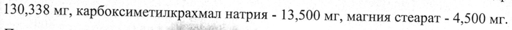
- стр. 1: «1 таблетка метформина содержит:» — низкая уверенность: «1» (73); повторное чтение: «|] таблетка метформина содержит:»  
  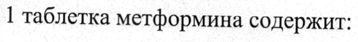
- стр. 1: «Ядро: гипромеллоза 2208 - 5,0 мг/10,0 мг; повидон K90 (коллидон 90F) - 20,0 мг/40,0 мг;» — низкая уверенность: «90F)» (69); повторное чтение: «Ядро: ЕЕ 2208 - 5,0 мг/10,0 мг; повидон K90 (коллидон 90F) - 20,0 мг/40,0 мг;»  
  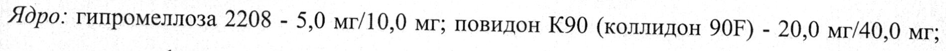
- стр. 1: «полиэтиленгликоль 6000 (макрогол 6000) - 0,675мг/1,350 мг; полисорбат 80 (твин 80) -» — низкая уверенность: «0,675мг/1,350» (78)  
  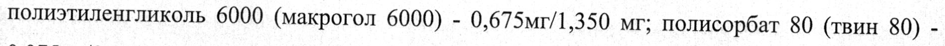
- стр. 1: «0,075мг/0,150 мг; титана диоксид - 1,500 мг/3,000 мг.» — низкая уверенность: «0,075мг/0,150» (52); повторное чтение: «0,075мг/0,150 мг; титана диоксид - 1,500 мг/3,000 мг.»  
  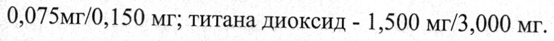
- стр. 4: «хронической почечной недостаточностью легкой степени тяжести (АЧС0-о в 1,5 раза» — низкая уверенность: «(АЧС0-о» (22)  
  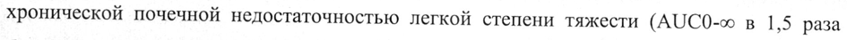
- стр. 4: «достаточно полно. Абсолютная биодоступность составляет 50-60%. Cmax, составляющая в» — низкая уверенность: «50-60%.» (68)  
  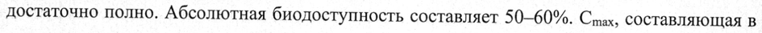
- стр. 9: «пациентов, получавших гозоглиптин, не превышала 1 % и, как правило, была связана с» — низкая уверенность: «1» (80)  
  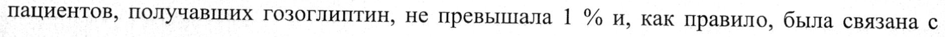
- стр. 10: «Комбинация гозоглиптина в дозе 20 мг и 30 мг 1 раз в сутки с метформином» — низкая уверенность: «1» (76)  
  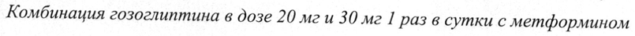
- стр. 10: «высвобождением (1000—2000 мг/сутки) связанные или возможно связанные с приемом» — низкая уверенность: «(1000—2000» (76)  
  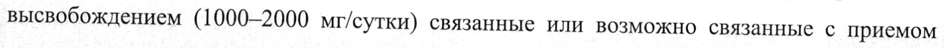
- стр. 11: «& Препарат метформина принимается 2 раза в сутки во время или после приема пищи.» — повторное чтение: «& EpSnaD ET метформина НЫ 2 ря ee eR i»  
  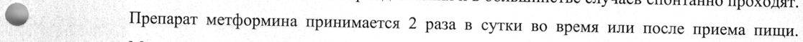
