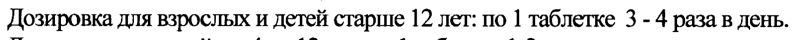

# Грамицидин С + Оксибупрокаин + Цетилпиридиния хлорид — внутрь

- Препарат: Граммидин® с анестетиком нео (таблетки для рассасывания;)
- АТХ: R02A
- Источник: ГРЛС, инструкция по медицинскому применению, РУ ЛСР-005119/08, файл от 2024-01-12 (https://grls.rosminzdrav.ru/Grls_View_v2.aspx?routingGuid=c545fa08-b793-4bf3-a10d-60df8e314579)
- Распознано автоматически (OCR): 2 из 2 стр.
- Инструкция к другому РУ того же препарата: ЛСР-005119/08 (национальное РУ, переоформленное по правилам ЕАЭС, решение от 25.12.2023). Текст может быть старше действующего
- Сомнительных строк после OCR: 1 (см. раздел «Проверка распознавания»)

## Общие сведения

. ЛСР-005119/08-010708 d ИНСТРУКЦИЯ по медицинскому применению препарата
ГРАММИДИН ` с анестетиком нео Регистрационный номер:
Торговое название препарата: ГРАММИДИНУ с анестетиком Heo

## 3. Лекарственная форма

таблетки для рассасывания
таблетки для рассасывания

## 2. Состав

1 таблетка содержит:
активные вещества:
грамицидина С дигидрохлорида (в пересчете на грамицидин С) — 0,003 г оксибупрокаина гидрохлорида — 0,0002 г цетилпиридиния хлорида моногидрата (в пересчете на цетилпиридиния хлорид) — 0,001 г вспомогательные вещества:
ow кремния диоксид коллоидный (Аэросил® 200), тальк, ацесульфам калия, ароматизатор мятный, сорбитол (Neosorb®), магния стеарат.
Описание: таблетки белого цвета круглые двояковыпуклые с надписью на одной стороне
GR.
Фармакотерапевтическая группа: антибиотик + антисептическое средство + местноанестезирующее средство.
Код ATX: В02А Фармакологические свойства

## 5.1. Фармакодинамика

Комбинированный препарат для лечения инфекционно-воспалительных заболеваний горла и полости рта. В состав препарата входит противомикробное средство грамицидин С, местноанестезирующее (обезболивающее) средство — оксибупрокаин и антисептическое средство
Комбинированный препарат для лечения инфекционно-воспалительных заболеваний горла и полости рта. В состав препарата входит противомикробное средство грамицидин С, местноанестезирующее (обезболивающее) средство — оксибупрокаин и антисептическое средство
- цетилпиридиния хлорид.
Механизм действия грамицидина С связан с повышением проницаемости цитоплазматической мембраны микробной клетки, что нарушает ее устойчивость и вызывает гибель клетки.
“ Грамицидин С оказывает выраженное противомикробное действие в отношении возбудителей инфекционных заболеваний полости рта и глотки.
Анестетик оксибупрокаин оказывает местное обезболивающее действие на слизистую оболочку полости рта и горла. Вызывает обратимую блокаду распространения и проведения нервных импульсов через аксоны нервных клеток.
Цетилпиридиния хлорид относится к антисептическим средствам. Подавляет рост и размножение возбудителей инфекционных заболеваний полости рта.
| Препарат оказывает обезболивающий эффект, уменьшает воспаление, оказывает противомикробное действие, смягчает неприятные ощущения в горле, облегчает глотание, при рассасывании вызывает гиперсаливацию, что способствует механическому очищению полости рта и глотки от микроорганизмов.

## 5.2. Фармакокинетика

Препарат обладает местным действием и практически не всасывается в желудочно-кишечном тракте, что определяет практически полное отсутствие системных эффектов.
Препарат обладает местным действием и практически не всасывается в желудочно-кишечном тракте, что определяет практически полное отсутствие системных эффектов.

## 4.1. Показания к применению

Инфекционно-воспалительные заболевания полости рта и горла: ангина, фарингит, тонзиллит, пародонтоз, гингивит, стоматит.
Инфекционно-воспалительные заболевания полости рта и горла: ангина, фарингит, тонзиллит, пародонтоз, гингивит, стоматит.
и И’ . ЛСР-005119/08-010708 .

## 4.3. Противопоказания

- повышенная чувствительность к компонентам, входящим в состав препарата;
- повышенная чувствительность к компонентам, входящим в состав препарата;
- детский возраст до 4 лет;
- беременность (I триместр).

## 4.6. Применение при беременности и в период грудного вскармливания

Не рекомендуется применять препарат при беременности (1) триместр.
Грудное вскармливание на время приема препарата необходимо прекратить.

## 4.2. Способ применения и дозы

Применяется после еды, путем рассасывания во рту не разжевывая.
Применяется после еды, путем рассасывания во рту не разжевывая.
Непосредственно после применения препарата следует воздержаться от приема пищи и напитков в течение 1-2 часов.
Дозировка для взрослых и детей старше 12 лет: по 1 таблетке 3 - 4 раза в день.
Дозировка для детей от 4 до 12 лет: по 1 таблетке 1-2 раза в день.
При отсутствии терапевтического эффекта в течение 7 дней приема препарата рекомендуется обращение к врачу.
w Побочное действие В отдельных случаях возможны аллергические реакции на компоненты препарата, временная потеря чувствительности языка.

## 4.5. Взаимодействие с другими лекарственными средствами

Граммидин® с анестетиком нео усиливает эффекты других противомикробных средств местного и системного действия.

## 6.5. Форма выпуска

Таблетки для рассасывания.
По 6 или 9 таблеток в контурную ячейковую упаковку из пленки поливинилхлоридной и фольги алюминиевой печатной лакированной.
2, 3 или 4 контурные ячейковые упаковки по 6 таблеток или 2 контурные ячейковые упаковки по 9 таблеток вместе с инструкцией по применению помещают в пачку из картона.
, Условия хранения:
w& В сухом защищенном OT света месте при температуре He выше 25° С.
Хранить в недоступном для детей месте.

## 6.3. Срок годности

2 года. Не применять после истечения срока годности
Условия отпуска из аптек:
Без рецепта.
Претензии от покупателей принимает предприятие-производитель:
ОАО «Щелковский вирайииньн? завод», 141100 Щелково-1, Иосковека LOOT, ул.Фабричная,2.
Тел. (495)933-48-6 4366. (495)933-48\63 и клинической Вт
< ag , Экспертизы 5 a р Mo. Директора ИД. Сет Ls А.Н. Васильев
=” Wg ty op Be и К ay 4 За О НЕРНО PaO ВА # “АМИ PR р
| САУ © TT Oe > /, Ce:
Генеральный директор ОАО i А ‘ff =:
«Щелковский витаминный завод» В 5 й yp < ‘ 5 С.А. Окуньков иж у ©:
47 iy Чу: С O О Моско “волнам * 2
## Проверка распознавания

Страницы-сканы распознаны автоматически. В 1 строках с дозировками цифры могли распознаться с ошибкой — сверьте с вырезкой из оригинала:

- стр. 2: «Дозировка для взрослых и детей старше 12 лет: по 1 таблетке 3 - 4 раза в день.» — низкая уверенность: «1» (75)  
  
