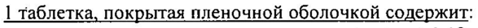

# Гранисетрон — внутрь

- Препарат: Нотирол (таблетки покрытые пленочной оболочкой;)
- АТХ: A04AA02
- Источник: ГРЛС, инструкция по медицинскому применению, РУ ЛСР-005940/09, файл от 2024-07-25 (https://grls.rosminzdrav.ru/Grls_View_v2.aspx?routingGuid=91c636ab-e236-4689-81ff-0a6d1f3cf60f)
- Распознано автоматически (OCR): 4 из 4 стр.
- Инструкция к другому РУ того же препарата: ЛСР-005940/09 (исключено из реестра, решение от 24.07.2024). Текст может быть старше действующего
- Сомнительных строк после OCR: 1 (см. раздел «Проверка распознавания»)

## Общие сведения

te, .
| | ЛСР-005940/09-210709 | oe `’ . ИНСТРУКЦИЯ. a . . - по медицинскому применению препарата
НОТИРОЛ Регистрационный номер: | | Торговое название препарата: НОТИРОЛ
Международное непатентованное название: гранисетрон (granisetron)
_ Лекарственная форма: таблетки, покрытые пленочной оболочкой

## 2. Состав

1 таблетка, покрытая пленочной оболочкой содержит:
1 таблетка, покрытая пленочной оболочкой содержит:
активное вещество: гранисетрона гидрохлорид 1,12 мг или 2,24 мг, соответствующий 1 мг или 2 мг гранисетрона;
вспомогательные вещества: лактоза безводная, целлюлоза микрокристаллическая (тип 101),
O карбоксиметилкрахмал натрия (тип А), гипромеллоза 291 0/ScP, магния стеарат;
`состав пленочной оболочки: Опадрай П 85Е18378 белый (поливиниловый спирт, титана
| диоксид (Е 171), макрогол 3350, тальк); |
Описание | Таблетки 1 мг: ` - Треугольные двояковыпуклые таблетки, покрытые пленочной оболочкой белого цвета, с гравировкой «G1» с одной стороны.
Таблетки 2 мг:
Треугольные двояковыпуклые таблетки, покрытые пленочной оболочкой белого цвета, с гравировкой «G2» с одной стороны.
Фармакотерапевтическая группа: противорвотное средство - серотониновых рецепторов антагонист.
Код ATX: A04AA02 Фармакологические свойства
© Фармакодинамика Гранисетрон — селективный антагонист 5-гидрокситриптаминовых (5-НТз) рецепторов, расположенных в окончаниях вагусного нерва и триггерной зоне дна IV желудочка мозга
(практически не влияет на другие рецепторы серотонина), с выраженным противорвотным
, эффектом. Исследования показали, что у гранисетрона низкая аффинность к другим видам рецепторов, включая 5-НТ и места связывания дофамина Д2. Устраняет рвоту, возникающую при возбуждении парасимпатической нервной системы, вследствие высвобождения серотонина энтерохромаффинными клетками.
| Гранисетрон устраняет тошноту и рвоту, вызванную цитотоксической химиотерапией, лучевой терапией, а также послеоперационную тошноту и рвоту.
Гранисетрон не влияет на концентрацию пролактина и альдостерона в плазме крови. `

## 5.2. Фармакокинетика

Всасывание гранисетрона после перорального применения - быстрое и полное, HO © абсолютная биодоступность снижается до 60% за счет эффекта первого прохождения через печень. Прием пищи не влияет на биодоступность препарата. Максимальная концентрация препарата в плазме крови - 5.99 нг/мл. ‘ | ; .
Всасывание гранисетрона после перорального применения - быстрое и полное, HO © абсолютная биодоступность снижается до 60% за счет эффекта первого прохождения через печень. Прием пищи не влияет на биодоступность препарата. Максимальная концентрация препарата в плазме крови - 5.99 нг/мл. ‘ | ; .
| | | 1 | 5 3746 ь г ы . | ЛСР-005940/09-210709 —
Гранисетрон распределяется по органам и тканям, средний объем распределения составляет 3 л/кг. Распределяется в плазме и в эритроцитах. Связь с белками плазмы составляет | примерно 65%. . О
Биотрансформация происходит в основном в печени путем М-деметилирования и окислением ароматического кольца с последующей конъюгацией. In vitro исследования
. показали, что кетоконазол ингибирует метаболизм гранисетрона, что предполагает участие.
изофермета ЗА системы цитохрома Р450.
С мочой в неизмененном виде выводится, в среднем, 12% и в виде метаболитов 47% дозы, оставшийся процент метаболитов выводится с калом. Период полувыведения (Т\/2)
составляет 9 часов, с широкой индивидуальной вариабельностью. Концентрации гранисетрона в плазме не четко коррелируют с его противорвотным’ действием.
Терапевтический эффект наблюдается даже тогда, когда гранисетрон уже не
° обнаруживается в плазме, ;

## 4.1. Показания к применению

Профилактика острой и отсроченной тошноты и рвоты, вызванных цитостатической
Профилактика острой и отсроченной тошноты и рвоты, вызванных цитостатической
O химиотерапией и лучевой терапией у взрослых.

## 4.3. Противопоказания

© повышенная чувствительность к гранисетрону или любому другому компоненту препарата;
© повышенная чувствительность к гранисетрону или любому другому компоненту препарата;
» реакции гиперчувствительности к другим селективным антагонистам 5-НТз ~ рецепторов в анамнезе;
® беременность и период лактации » детский возраст (сведения об эффективности и безопасности отсутствуют).

## 4.3. С осторожностью

частичная кишечная непроходимость.
частичная кишечная непроходимость.

## 4.2. Способ применения и дозы

Внутрь по 1 мг 2 раза в сутки или 2 мг 1 раз в сутки (при цитостатической терапии) или 2 мг 1 раз в сутки (при лучевой терапии), при этом первая доза должна быть принята за 1 час до начала цитостатической или лучевой терапии. Прием Нотирола должен продолжаться не более 7 дней.
Внутрь по 1 мг 2 раза в сутки или 2 мг 1 раз в сутки (при цитостатической терапии) или 2 мг 1 раз в сутки (при лучевой терапии), при этом первая доза должна быть принята за 1 час до начала цитостатической или лучевой терапии. Прием Нотирола должен продолжаться не более 7 дней.
@) Пациенты с почечной или печеночной недостаточностью, пожилые пациенты
Коррекции дозы не требуется.

## 4.8. Побочное действие

В большинстве случаев побочные действия при применении гранисетрона не были тяжелыми и переносились пациентами без прерывания терапии. Отмечены редкие и иногда тяжелые случаи проявления повышенной чувствительности (например, анафилаксия).
В большинстве случаев побочные действия при применении гранисетрона не были тяжелыми и переносились пациентами без прерывания терапии. Отмечены редкие и иногда тяжелые случаи проявления повышенной чувствительности (например, анафилаксия).
Со стороны пищеварительной системы: боль в животе, запор, диарея, метеоризм, повышение активности "печеночных" трансаминаз (AJIT, АСТ); диспепсия; редко - изжога, изменение вкусовых ощущений. ,
Со стороны нервной системы: головная боль, бессонница, сонливость (связь возникновения сонливости с приемом гранисетрона не установлена), слабость; редко - тревога, беспокойство, головокружение; . .
Со стороны сердечно-сосудистой системы: аритмия, повышение или снижение артериального давления, боль в груди;
Со стороны иммунной системы: кожная сыпь, гипертермия, бронхоспазм, крапивница, зуд;
редко - реакции повышенной чувствительности. | 53746 а %
| | ЛСР-005940/09-210709 Со стороны кожи и ее придатков: очень редко - кожная сыпь, отёк/отёк лица.
‚ ` Прочие: очень редко - гриппоподобный синдром.

## 4.9. Передозировка

Специфический антидот для Нотирола не известен. В случае передозировки лечение
Специфический антидот для Нотирола не известен. В случае передозировки лечение

симптоматическое.
Взаимодействия с другими лекарственными средствами
Нотирол не влияет на активность метаболизирующих ферментов подсемейства 3А4 системы цитохрома Р450 (отвечающих за метаболизм некоторых наркотических анальгетиков). | ;
Эффективность гранисетрона может быть усилена внутривенным введением дексаметазона

| (8-20 мг) до начала химиотерапии. . у

In vitro исследования показали, что кетоконазол ингибирует метаболизм гранисетрона, что предполагает участие изофермента ЗА системы цитохрома Р450. Специальных исследований по взаимодействию со средствами для общей анестезии не проводилось, но

О гранисетрон хорошо переносится при одновременном назначении с подобными препаратами и наркотическими анальгетиками. |

’ Не выявлено взаимодействия при одновременном назначении с бензодиазепинами, транквилизаторами, противоязвенными препаратами и другими цитостатическими лекарственными средствами, вызывающими рвоту.

## 4.4. Особые указания

Пациенты с признаками частичной непроходимости кишечника после введения Нотирола должны находиться под наблюдением врача, так как Нотирол может снижать моторику кишечника. .
Пациенты с признаками частичной непроходимости кишечника после введения Нотирола должны находиться под наблюдением врача, так как Нотирол может снижать моторику кишечника. .
В связи с наличием в составе лактозы пациенты с редкими наследственными
. заболеваниями, такими как непереносимость галактозы, дефицит лактозы или глюкозно-

галактозная мальабсорбция принимать препарат не рекомендуется.
Влияние на способность к вождению транспортных средств и работу с машинами и механизмами
Данные о влиянии гранисетрона на способность к вождению транспортного средства

@) отсутствуют.

## 6.5. Форма выпуска

Таблетки, покрытые пленочной оболочкой 1 мг или 2 мг.
Таблетки, покрытые пленочной оболочкой 1 мг или 2 мг.
По 1, 5 или 10 таблеток в блистере ПВХ/Алюминиевая фольга. 1, 5 или 10 блистеров по 1 таблетке, | или 2 блистера по 5 таблеток, 1 блистер по 10 таблеток вместе с инструкцией по применению в картонной пачке.
По 20, 40, 60, 100 блистеров вместе с инструкциями по применению в картонной коробке
(для стационаров).

## 6.4. Условия хранения

| Список Б. При температуре не выше 25 °С.
| Список Б. При температуре не выше 25 °С.
Хранить в недоступном для детей месте!

## 6.3. Срок годности

3 года.
3 года.

| Не применять по истечении срока годности, указанного на упаковке. _ _
Le 53746 3 | | | | | | ЛСР-005940/09-210709
Условия отпуска из аптек ; :
По рецепту. о eo, ма Производитель «АКТАВИС Лтд.» | . .
В 16 Булебель Инд. Эстейт Зейтун ЗТН 08, Мальта
Претензии потребителей предъявлять по адресу
` ООО «Актавис» \ | | | 127018, г. Москва, ул. Сущевский Вал, д. 18
Тел. 644-44-14, Факс. 644-44-24 ; ;
ЕТСТ :
< BON ‘3 о Я 2 Представитель комиёНи ту Вахнина Е.В.
чедктавиеу > ey > А @ < 0° MOCKBA ZY " РО РАВНАДЗОРА
>| — ЭКСПЕРТНЫЙ ОТЧЕТ ^ | -|ДЕЙСТВИТЕЛЕН ДЛЯ ДАННОЙ ®
9 ВЕРСИИ ДОКУМЕНТА = oO OT To бов
| 53746 д
## Проверка распознавания

Страницы-сканы распознаны автоматически. В 1 строках с дозировками цифры могли распознаться с ошибкой — сверьте с вырезкой из оригинала:

- стр. 1: «1 таблетка, покрытая пленочной оболочкой содержит:» — повторное чтение: «| таблетка, покрытая пленочной оболочкой содержит:»  
  