# Дапаглифлозин + Метформин — внутрь

- Препарат: Сигдуо Лонг® (таблетки с модифицированным высвобождением, покрытые пленочной оболочкой;)
- АТХ: A10BD15
- Источник: ГРЛС, инструкция по медицинскому применению, РУ ЛП-005093, файл от 2023-09-26 (https://grls.rosminzdrav.ru/Grls_View_v2.aspx?routingGuid=aed43fc7-8d17-4b4d-9515-99ca0baacfb8)
- Распознано автоматически (OCR): 30 из 30 стр.
- Инструкция к другому РУ того же препарата: ЛП-005093 (прежняя редакция, решение от 21.09.2023). Текст может быть старше действующего
- Сомнительных строк после OCR: 26 (см. раздел «Проверка распознавания»)

## Общие сведения

| от 19.09.2023 № 18151 1 | (Входящий МЗ №4246851) |
МИНИСТЕРСТВО ЗДРАВООХРА НЫЕРОССИИСКОРГЕФЕДЕРАЦИИ
" ИНСТРУКЦИЯ ПО МЕДИЦИНСКОМУ ПРИМЕНЕНИЮ ЛЕКАРСТВЕННОГО ПРЕПАРАТА
Сигдуо Лонг® Регистрационный номер: ЛП-005093
Торговое наименование: Сигдуо Лонг® Международное непатентованное или группировочное наименование: дапаглифлозин
+ метформин Лекарственная форма: таблетки с модифицированным высвобождением, покрытые
‚—- плёночной оболочкой Состав Одна таблетка с модифицированным высвобождением, покрытая плёночной оболочкой, 5 мг + 1000 мг, содержит:
Слой метформина пролонгированного действия
Действующее вещество: метформина гидрохлорид в смеси с 0,5 % магния стеарата' 1005,04 мг (1000,00 мг метформина гидрохлорида + 5,04 мг магния стеарата)
Вспомогательные вещества: кармеллоза натрия 49,99 мг, гипромеллоза 2208 234,98 мг, кремния диоксид 13,00 мг, магния стеарат 1,99 мг
Слой дапаглифлозина ar Действующее вещество: дапаглифлозина пропандиола моногидрат 6,15 мг (в пересчете на
`— дапаглифлозин 5 мг)
Вспомогательные вещества: целлюлоза микрокристаллическая PH302* 226,35 мг, лактоза 48,00 мг, кросповидон 12,00 мг, кремния диоксид 4,50 мг, магния стеарат? 3,00 мг
Плёночная оболочка: Опадрай® II розовый 852945924 40,13 мг°.
Одна таблетка с модифицированным высвобождением, покрытая плёночной оболочкой, 10 мг + 1900 мг, содержит:
Слой метформина пролонгированного действия
Действующее вещество: метформина гидрохлорид в смеси с 0,5 % магния стеарата!
1005,04 мг (1000,00 мг метформина гидрохлорида + 5,04 мг магния стеарата)
ПЕНИИ вещества: кармеллоза натрия 49,99 мг, гипромеллоза 2208 234,98 мг, кремния диоксид 13,00 мг, магния стеарат 1,99 мг.
| СООТВЕТСТВУЕТ ЭКСПЕРТНОМУ ОТЧЕТУ [Входящий МЗ №4246851)
Слой дапаглифлозина | Действующее вещество: дапаглифлозина пропандиола моногидрат 12,30 мг (в пересчете на дапаглифлозин 10 мг)
Вспомогательные вещества: целлюлоза микрокристаллическая PH302? 220,20 мг, лактоза
| 48,00 мг, кросповидон 12,00 мг, кремния диоксид 4,50 мг, магния стеарат? 3,00 мг
Плёночная оболочка: Опадрай® II жёлтый 85123726 40,13 мг’.
| ' Данная смесь состоит из 99,5 % (м/м) метформина гидрохлорида и 0,5 % (м/м) магния стеарата.
2? Количество может меняться в зависимости от чистоты дапаглифлозина и используемого актуального количества магния стеарата.
oh 3 Целевое суммарное количество магния стеарата составляет 1,0 % (м/м) oT слоя
Sse дапаглифлозина.
* Опадрай П розовый 8594592 содержит (% м/м): спирт поливиниловый частично гидролизованный 40,00 % (E1203), титана диоксид 22,00 % (E171), макрогол 3350 20,20 %
(E1521), тальк 14,80 % (E553b), краситель железа оксид красный 3,00 % (Е172).
| > Количество оболочечного материала основано на целевом увеличении массы таблетки 2,5 % (м/м). Фактическое количество может меняться в диапазоне 2,0-3,2 % (м/м) для достижения приемлемого физического внешнего вида.
° Опадрай П жёлтый 85Е12372 содержит (% м/м): спирт поливиниловый частично гидролизованный 40,00 % (E1203), титана диоксид 21,08 % (E171), макрогол 3350 20,20 %
(E1521), тальк 14,80 % (E553b), краситель железа оксид жёлтый 3,92 % (E172).
(^ _ Описание Таблетки 5 мг + 1000 мг:
Овальные двояковыпуклые таблетки, покрытые плёночной оболочкой от розового до темно-розового цвета, с гравировкой «1071» и «5/1000» на одной стороне.
Таблетки 10 мг + 1000 мг:
Овальные двояковыпуклые таблетки, покрытые плёночной оболочкой от жёлтого до темножёлтого цвета, с гравировкой «1073» и «10/1000» на одной стороне.
Фармакотерапевтическая группа: гипогликемическое средство для перорального применения (ингибитор натрийзависимого переносчика глюкозы 2 типа + бигуанид)
Код ATX: A10BD15 ООО ИИС | |

от 19.09.2023 № 18151 3

(Входящий МЗ №4246851}

Фармакологические свойства Механизм действия
Препарат Сигдуо Лонт® объединяет два гипогликемических препарата с дополняющими механизмами действия для улучшения гликемического контроля у пациентов с сахарным диабетом 2 типа (СД 2): дапаглифлозин, селективный обратимый ингибитор натрийзависимого переносчика глюкозы 2 типа (SGLT2), и метформин, представитель класса бигуанидов.

| Дапаглифлозин

SGLT2 экспрессируется в проксимальных почечных канальцах и является основным

| их переносчиком, участвующим в процессе реабсорбции глюкозы. Ингибируя SGLT2,

`- дапаглифлозин уменьшает реабсорбцию глюкозы и снижает почечный порог для глюкозы, что приводит к повышению ее выведения почками.

Метформин

Метформин улучшает толерантность к глюкозе у пациентов с СД 2, снижая концентрацию

|

глюкозы плазмы натощак и постпрандиальную концентрацию глюкозы. Метформин уменьшает продукцию глюкозы печенью, снижает всасывание глюкозы в кишечнике и повышает чувствительность к инсулину, увеличивая периферическое поглощение и утилизацию глюкозы. Метформин не вызывает гипогликемию у пациентов с СД 2 или здоровых людей (кроме особых ситуаций, см. раздел «Особые указания»), и 2% гиперинсулинемию. Во время терапии метформином секреция инсулина не меняется, хотя
Sa концентрации инсулина натощак и в ответ Ha прием пищи в течение дня могут снижаться.

## 5.1. Фармакодинамика

Дапаглифлозин После приема дапаглифлозина здоровыми добровольцами и пациентами с СД 2 наблюдалось увеличение количества выводимой почками глюкозы. При приеме
Дапаглифлозин После приема дапаглифлозина здоровыми добровольцами и пациентами с СД 2 наблюдалось увеличение количества выводимой почками глюкозы. При приеме
- дапаглифлозина в дозе 5 мг в сутки или 10 мг в сутки в течение 12 недель пациентами с СД 2 в сутки почками выводилось примерно 70 г глюкозы. При приеме дапаглифлозина в дозе 20 мг в сутки выведение глюкозы практически достигало максимума. Выведение глюкозы почками при применении дапаглифлозина также приводит к увеличению объема мочи (см.
раздел «Побочное действие»).
| от 19.09.2023 № 18151 4 | (Входящий МЗ №4246851
Клиническая эффективность Стартовая комбинированная терапия с метформином пролонгированного действия
Безопасность и эффективность стартовой комбинированной терапии дапаглифлозином и метформином пролонгированного действия изучались в 2 контролируемых исследованиях продолжительностью 24 недели у пациентов с СД 2 и неадекватным контролем гликемии, ранее не получавших гипогликемической терапии.
Применение дапаглифлозина и метформина пролонгированного действия (суточная доза 2 г) обеспечивало значимое снижение концентрации гликозилированного гемоглобина
(HbAlc) и концентрации глюкозы в плазме крови натощак (ГПН) по сравнению с монотерапией метформином или дапаглифлозином. Также комбинированная терапия дапаглифлозином и метформином пролонгированного действия обеспечила значимое
| a снижение массы тела по сравнению с монотерапией метформином пролонгированного
`.. действия.
Добавление дапаглифлозина к терапии метформином обычного высвобождения
| Безопасность и эффективность добавления дапаглифлозина к терапии метформином
| обычного высвобождения изучались B контролируемом исследовании продолжительностью 24 недели у пациентов с СД 2 и неадекватным контролем гликемии.
Добавление дапаглифлозина в дозе 10 мг к терапии метформином приводило к значимому
, снижению концентрации HbAlc и концентрации ГПН, а также к уменьшению массы тела по сравнению с плацебо на 24 неделе лечения. Также отмечено статистически значимое
(р<0,05) по сравнению с группой монотерапии метформином среднее снижение ri, систолического артериального давления (САД) на 4,5 мм рт. ст. и 5,3 MM рт. CT. у пациентов,
| oo получавших дапаглифлозин 5 мги 10 мг, соответственно.
| Добавление дапаглифлозина или глипизида к терапии метформином обычного высвобождения
| Безопасность и эффективность добавления дапаглифлозина к терапии метформином обычного высвобождения по сравнению с глипизидом изучались в контролируемом исследовании продолжительностью 52 недели у пациентов с СД 2 и неадекватным контролем гликемии.
Дапаглифлозин не менее эффективно, чем глипизид, снижал среднее значение концентрации НЬА]с к 52 неделе лечения. В группе дапаглифлозина было отмечено значимое снижение среднего значения массы тела к 52 неделе лечения, в то время как в группе глипизида наблюдалось увеличение этого показателя. В группе дапаглифлозина по
< ея и ыиы=—== д от 19.09.2023 № 18151 5
[Входящий МЗ №4246851)
сравнению с группой глипизида было достигнуто-статистически значимое (p<0;000 снижение САД на 5,0 мм рт. ст.
Сердечно-сосудистые и почечные исходы | Эффект дапаглифлозина по сравнению с плацебо в отношении сердечно-сосудистых и почечных исходов при добавлении к текущей базовой терапии был установлен в клиническом исследовании РЕСГАКЕ, проведенном у 17160 пациентов с СД 2 и двумя и более дополнительными факторами сердечно-сосудистого риска (возраст > 55 лету мужчин или > 60 лет у женщин и один или более из следующих факторов: дислипидемия, артериальная гипертензия или табакокурение) или с диагностированным сердечнососудистым заболеванием.

и Дапаглифлозин 10 мг продемонстрировал превосходство по сравнению с плацебо в

Nae” предотвращении событий первичной комбинированной конечной точки, включающей

госпитализацию по поводу сердечной недостаточности или сердечно-сосудистую смерть
(отношение рисков (ОР) 0,83 [95% доверительный интервал (ДИ) 0,73, 0,95]; р=0,005).
Различие эффекта терапии было достигнуто за счет госпитализации по поводу сердечной недостаточности (ОР 0,73 [95% ДИ 0,61, 0,88]), без разницы между группами в отношении сердечно-сосудистой смерти (ОР 0,98 [95% ДИ от 0,82 до 1,17].
Преимущество терапии дапаглифлозином по сравнению с плацебо наблюдалось у пациентов с диагностированным сердечно-сосудистым заболеванием или без такового, с исходной сердечной недостаточностью или без таковой, и было сопоставимым в ключевых подгруппах, включая возраст, пол, функцию почек (расчетную скорость клубочковой |

С фильтрации (pCK®)) и регион.

-^ Дапаглифлозин снижал частоту явлений комбинированной точки, включающей подтвержденное устойчивое снижение рСКФ, терминальную стадию почечной недостаточности, смерть вследствие осложнений со стороны почек или сердечнососудистую смерть. Разница между группами была обусловлена снижением числа явлений компонентов комбинированной точки почечных исходов, включающей устойчивое снижение рСКФ, терминальную почечную недостаточность и смерть вследствие осложнений со стороны почек,

Отношение рисков по времени до возникновения нефропатии (устойчивое снижение pCK®, терминальная стадия почечной недостаточности или смерть вследствие осложнений со

стороны почек) составило 0,53 (95% ДИ 0,43, 0,66) для дапаглифлозина по сравнению с

плацебо.

Также дапаглифлозин снижал риск новых случаев возникновения устойчивой от 19.09.2023 № 18151 :
(Входящий МЗ №4246851)
альбуминурии (OP 0,79 [95% ДИ 0,72, 0,87 и приводил к более выраженной регрессив макроальбуминурии (ОР 1,82 [95% ДИ 1,51, 2,20]) по сравнению с плацебо.

## 5.2. Фармакокинетика

Препарат Сигдуо Лонг® биоэквивалентен дапаглифлозину (препарат Форсига) и метформину пролонгированного действия (препарат Глюкофаж® Лонг) при их совместном применении в соответствующих дозах.
Препарат Сигдуо Лонг® биоэквивалентен дапаглифлозину (препарат Форсига) и метформину пролонгированного действия (препарат Глюкофаж® Лонг) при их совместном применении в соответствующих дозах.
Показатели экспозиции дапаглифлозина и метформина пролонгированного действия после приема препарата Сигдуо Лонг® здоровыми добровольцами были сопоставимы после стандартного приема пищи и натощак. В случае приема препарата Сигдуо Лонг® после стандартного приема пищи было отмечено снижение максимальной концентрации (Стах)
om дапаглифлозина на 35% и увеличение времени её достижения (Tmax) на 1-2 4 по сравнению a с приемом препарата натощак. Это различие не является клинически значимым. Прием пищи не оказывал значимого влияния на фармакокинетические параметры метформина.
Абсорбция Дапаглифлозин После приема дапаглифлозина внутрь натощак Cmax обычно достигается в течение 2 часов.
Значения Cmax и AUC (площадь под кривой зависимости концентрации от времени)
увеличиваются пропорционально дозе дапаглифлозина в диапазоне терапевтических доз.
Абсолютная биодоступность дапаглифлозина при приеме внутрь в дозе 10 мг составляет | 78%. Прием пищи оказывал умеренное влияние на фармакокинетику дапаглифлозина у |
= здоровых добровольцев. Прием пищи с высоким содержанием жиров снижал Cmax
CS дапаглифлозина на 50%, удлинял Tmax примерно Ha | час, но He влиял на AUC по сравнению с приемом натощак. Эти изменения не являются клинически значимыми, поэтому дапаглифлозин можно принимать независимо от приема пищи.
Метформин | После приема внутрь MeTPOpMHHAa пролонгированного действия Cmax достигается через 4-8 часов (медиана 7 часов). Степень абсорбции метформина из таблеток пролонгированного действия увеличивается примерно на 50% (оценивалось по изменению AUC) при приеме во время еды. Прием пищи не влиял на ТюахИ Cinax.
Распределение Дапаглифлозин | | | от 19.09.2023 № 18151 7
(Входящий МЗ №4246851} Дапаглифлозин примерно на 91% связывается с белками. У пациентов с нарушениями функции почек или печени этот показатель не изменялся.
Метформии — Не проводились исследования распределения метформина пролонгированного действия, однако кажущийся объем распределения метформина после однократного приема внутрь таблеток метформина обычного высвобождения в дозе 850 мг, в среднем, составил 6544358 л. Метформин в незначительной степени связывается с белками плазмы крови. Метформин проникает в эритроциты.
Метаболизм Дапаглифлозин ` ее, Метаболизм дапаглифлозина, главным образом, происходит под действием фермента
\.) уридиндифосфат-глюкуронилтрансферазы 1А9 (UGT1A9); изоферменты цитохрома CYP вовлечены в метаболизм у человека в меньшей степени. Дапаглифлозин метаболизируется с образованием, главным образом, неактивного метаболита дапаглифлозин-3-Оглюкуронида. После приема внутрь 50 мг “С-дапаглифлозина 61% принятой дозы метаболизируется в дапаглифлозин-3-О-глюкуронид.
Метформин | Исследования с однократным внутривенным введением препарата здоровым добровольцам показывают, что метформин выводится в неизмененном виде почками, не подвергается метаболизму в печени (у человека не выявлены метаболиты) и не выводится через
| кишечник. Исследования по изучению метаболизма метформина в таблетках |
С ~, пролонгированного действия не проводились.
— Выведение | Дапаглифлозин Дапаглифлозин и его метаболиты выводятся, преимущественно, почками, и только менее 2% выводится в неизмененном виде. После приема 50 мг “С-дапаглифлозина было обнаружено 96% радиоактивности — 75% в моче и 21% - в фекалиях. Примерно 15% радиоактивности, обнаруженной в фекалиях, приходилось на неизмененный дапаглифлозин. Ti2 (период полувыведения из плазмы) после однократного приема | дапаглифлозина в дозе 10 мг составляет примерно 12,9 ч.
Метформин Почечный клиренс примерно в 3,5 раза выше клиренса креатинина (КК), что указывает на то, что канальцевая секреция является основным путем выведения метформина. После
СООТВЕТСТВУЕТ ЭКСПЕРТНОМУ ОТЧЕТУ | [Входящий МЗ №4246851)

приема внутрь примерно 90% абсорбированного препарата выводитея почками в-течение

первых 24 4, при этом период полувыведения из плазмы равен примерно 6,2 ч. В крови

период полувыведения составляет примерно 17,6 ч, следовательно, эритроцитарная масса

может быть частью распределения.

Фармакокинетика у особых групп пациентов

Нарушение функции почек

Дапаглифлозин

В равновесном состоянии (прием дапаглифлозина | раз в сутки в дозе 20 мг в течение 7

дней) у пациентов с СД 2 и нарушением функции почек легкой, средней или тяжелой

степени (определяемой по рСКФ) геометрическая средняя системной экспозиции была на
_— 45%, в 2,04 и 3,03 раза выше, чем у пациентов с СД 2 и нормальной функцией почек,
`- соответственно. Повышение системной экспозиции дапаглифлозина у пациентов с СД2и

нарушением функции почек не сопровождалось соответствующим увеличением количества

глюкозы, выводимой почками в течение суток.

Суточная экскреция глюкозы почками в равновесном состоянии у пациентов с СД2и

нарушением функции почек легкой, средней или тяжелой степени была, соответственно, на

42%, 80% и 90% ниже, по сравнению с пациентами с СД 2 и нормальной функцией почек.

Неизвестно, оказывает ли гемодиализ влияние на экспозицию дапаглифлозина (CM, разделы

«Способ применения и дозы» и «Особые указания»).

Метформин

У пациентов с нарушением функции почек период полувыведения метформина из плазмы м - и крови удлиняется пропорционально снижению функции почек.

Нарушение функции печени

Дапаглифлозин

У пациентов с нарушением функции печени легкой или средней степени тяжести (классы

А иВ no Чайлд-Пью) средние значения Cmax и AUC дапаглифлозина после однократного

приема в дозе 10 мг были, соответственно, на 12% и 36% выше по сравнению с

аналогичными показателями у здоровых добровольцев. Данные различия не являются

клинически значимыми. У пациентов с нарушением функции печени тяжелой степени

(класс С по Чайлд-Пью) средние значения Cmax и AUC дапаглифлозина были на 40% и 67%

выше, соответственно, по сравнению со здоровыми добровольцами.

Метформин

Фармакокинетические исследования метформина у пациентов с нарушением функции
СООТВЕТСТВУЕТ ЭКСПЕРТНОМУ ОТЧЕТУ ’ [Входящий МЗ №4246851)
| печени не проводились. | р Пожилой возраст
Дапаглифлозин По результатам популяционного фармакокинетического анализа, возраст не оказывает клинически значимого влияния на системную экспозицию дапаглифлозина, поэтому коррекция дозы в зависимости от возраста пациента не требуется.
Метформин Ограниченные данные контролируемых исследований фармакокинетики метформина у здоровых добровольцев пожилого возраста позволяют предположить, что общий плазменный клиренс метформина понижается, период полувыведения увеличивается, а os Cmax повышается по сравнению CO значениями этих параметров у здоровых добровольцев
Ne молодого возраста. По этим данным, изменение параметров фармакокинетики метформина с увеличением возраста, в основном, обусловлено изменением функции почек.
Дети Не проводились исследования фармакокинетики препарата Сигдуо Лонг® у детей (см.
раздел «Противопоказания»).
Пол Дапаглифлозин По результатам популяционного фармакокинетического анализа, пол не оказывает го клинически значимого влияния на системную экспозицию дапаглифлозина, поэтому aa коррекция дозы в зависимости от пола пациента He рекомендуется.
Метформин Фармакокинетические параметры метформина у здоровых добровольцев и пациентов с СД 2 существенно не различались в зависимости от пола. В контролируемых клинических исследованиях у пациентов с СД 2 гипогликемический эффект метформина у мужчин и женщин был сопоставим.
Расовая и этническая принадлежность Дапаглифлозин
По результатам‘ популяционного фармакокинетического анализа, клинически значимых различий системной экспозиции у представителей европеоидной, негроидной и монголоидной рас не выявлено; коррекция дозы с учетом расовой принадлежности не от 19.09.2023 № 18151 10
(Входящий МЗ №4246851}

требуется.

Метформин

Не проводились исследования параметров фармакокинетики метформина в зависимости от

расовой принадлежности пациента. В клинических исследованиях у пациентов с СД 2

гипогликемический эффект метформина у представителей европеоидной, негроидной рас и

пациентов испанского происхождения был сопоставим.

Масса тела

Дапаглифлозин

По результатам популяционного фармакокинетического анализа, масса тела не оказывает

клинически значимого влияния на системную экспозицию дапаглифлозина, поэтому |
_ коррекция дозы в зависимости OT массы тела пациента не требуется.
Me |

## 4.1. Показания к применению

Сахарный диабет 2 типа у взрослых пациентов в дополнение к диете и физическим

упражневиям для улучшения гликемического контроля.

Дапаглифлозин рекомендован у взрослых пациентов с сахарным диабетом 2 типа с

установленным диагнозом сердечно-сосудистого заболевания или двумя и более

факторами сердечно-сосудистого риска* для снижения риска госпитализации по поводу

сердечной недостаточности.

* возраст у мужчин > 55 лет или > 60 лет у женщин и наличие не менее одного фактора

риска: дислипидемия, артериальная гипертензия или курение. |
Co)
> Противопоказания |

® Повышенная индивидуальная чувствительность к любому компоненту препарата.

® Сахарный диабет | типа.

» Нарушение функции почек тяжелой степени (рСКФ менее 30 мл/мин/1,73 м²), терминальная стадия почечной недостаточности и пациенты, получающие гемодиализ.

» Наследственная непереносимость лактозы, недостаточность лактазы и глюкозогалактозная непереносимость.

e Беременность и период грудного вскармливания.

® Детский возраст до 18 лет (безопасность и эффективность не изучены).

e Нарушение функции печени.

® Острые заболевания, при которых имеется риск развития нарушения функции почек:
| от 19.09.2023 № 18151 И [Входящий МЗ №4246851)
дегидратация (при рвоте, диарее), лихорадка, тяжелые-инфекционные заболевания;
состояния гипоксии (шок, сепсис, инфекции почек, бронхолегочные заболевания).
® Острый или хронический метаболический ацидоз, включая диабетический кетоацидоз, с комой или без комы. В случае диабетического кетоацидоза следует
| применять препараты инсулина.
| ¢ Клинически выраженные проявления острых и хронических заболеваний, которые могут привести к развитию тканевой гипоксии (дыхательная недостаточность, острая некомпенсированная сердечная недостаточность, острый инфаркт миокарда).
e Серьезные хирургические операции и травмы (когда показано проведение инсулинотерапии).
© Хронический алкоголизм и острое отравление этанолом.
CO e Лактоацидоз (в т.ч. в анамнезе).
~ ® Период менее 48 4 до и в течение 48 4 после проведения радиоизотопных или рентгенологических исследований с введением йодсодержащих контрастных средств.
® Соблюдение гипокалорийной диеты (<1000 ккал/сут).

## 4.3. С осторожностью

инфекции мочевыводящих путей; риск снижения объема циркулирующей крови (ОЦК); пожилые пациенты; повышенное значение гематокрита:
инфекции мочевыводящих путей; риск снижения объема циркулирующей крови (ОЦК); пожилые пациенты; повышенное значение гематокрита:
пациенты в возрасте старше 60 лет, выполняющие тяжелую физическую работу.

## 4.6. Применение при беременности и в период грудного вскармливания

С Применение препарата Сигдуо Лонг®, а также его действующих веществ, дапаглифлозина
— и метформина, в период беременности не изучено, поэтому препарат противопоказан во время беременности. В случае диагностирования беременности терапия препаратом Сигдуо
Лонг® должна быть прекращена.
Неизвестно, проникает ли дапаглифлозин, метформин и/или их метаболиты в грудное молоко человека. Нельзя исключить риск для новорожденных/младенцев. Препарат Сигдуо
Лонг® противопоказан в период грудного вскармливания.

## 4.2. Способ применения и дозы

Внутрь, один раз в сутки во время завтрака. Таблетки следует проглатывать целиком, не разжевывая, не измельчая и не разламывая.
Внутрь, один раз в сутки во время завтрака. Таблетки следует проглатывать целиком, не разжевывая, не измельчая и не разламывая.
Дозу следует подбирать индивидуально, учитывая эффективность и переносимость проводимой терапии. Максимальная суточная доза дапаглифлозина составляет 10 мг, от 19.09.2023 № 18151 12
; (Входящий МЗ №4246851} метформина пролонгированного действия —12000-мг.
Для снижения риска госпитализации по поводу сердечной недостаточности рекомендуемая доза дапаглифлозина составляет 10 мг один раз в сутки.
Если препарат Сигдуо Лонг® был назначен пациенту, принимающему метформин пролонгированного действия в вечернее время, следует пропустить прием последней вечерней дозы метформина пролонгированного действия накануне приема первой дозы препарата Сигдуо Лонг®.
Пациентам со сниженным ОЦК необходима коррекция этого состояния до начала терапии препаратом Сигдуо Лонг®.
Неактивные ингредиенты препарата Curnyo Лонг® могут выводиться через кишечник в виде мягкой, влажной массы, которая может сохранять форму принятой таблетки.
`` Применение у особых групп пациентов | Нарушение функции печени
У пациентов с нарушением функции печени применение метформина может приводить к лактоацидозу. Поэтому препарат Сигдуо Лонг® противопоказан пациентам с нарушением
| функции печени.
Нарушение функции почек Перед началом применения препарата Сигдуо Лонг® следует оценить СКФ, а затем проверять не реже одного раза в год. У пациентов с повышенным риском дальнейшего прогрессирования почечной недостаточности и у пожилых пациентов следует чаще оценивать функцию почек, например, каждые 3-6 месяцев.
-. Максимальную суточную дозу метформина желательно разделить на 2-3 суточных приема.
`` Следует иметь в виду факторы, которые могут увеличить риск развития лактоацидоза (см.
раздел «Особые указания»), перед рассмотрением возможности назначения метформина у пациентов с СКФ < 60 мл/мин.
В том случае, если отсутствует адекватная дозировка препарата Сигдуо Лонг®, следует применять отдельные монокомпоненты (дапаглифлозин, метформин) вместо комбинации фиксированных доз.
Доза для пациентов с нарушением функции почек
Е О ЗИ a 7 от 19.09.2023 № 18151 13 , УР еси a4 MAS М=А7ЗАЕРОЕТ 30-44 Максимальная Вуточная доза-метформина составляет — | 1000 мг. Начальная доза метформина составляет не более
; половины максимальной дозы.
‘ Максимальная суточная доза препарата Сигдуо Лонг® составляет 10 мг + 1000 мг. Гликемическая
| эффективность дапаглифлозина снижается у пациентов с
РСКФ менее 45 мл/мин/1,73 м².
<30 В связи с наличием метформина в составе, применение препарата Сигдуо Лонг® противопоказано (см. раздел
«Противопоказания»).
| i Дети ки Безопасность и эффективность препарата у пациентов младше 18 лет не изучались (см.
раздел «Противопоказания»).
Пациенты пожилого возраста Поскольку метформин частично выводится почками, а пожилые пациенты имеют и более склонны к нарушению почечной функции, препарат Сигдуо Лонг® следует применять с осторожностью по мере увеличения возраста пациента. Необходим мониторинг функции почек для предотвращения лактоацидоза, связанного с приемом метформина.

## 4.8. Побочное действие

Дапаглифлозин и метформин
Дапаглифлозин и метформин
Г а Оценка безопасности проводилась на основании объединенных данных 8 краткосрочных | ad плацебо-контролируемых исследований, в которых дапаглифлозин применялся в комбинации с метформином (в данной комбинации и в дополнение к другой гипогликемической терапии). В этих исследованиях 983 пациента получали дапаглифлозин в дозе 10 мг один раз в сутки и метформин, и 1185 пациентов получали плацебо и метформин.
Общая частота нежелательных явлений в группе дапаглифлозина в дозе 10 мг и метформина составила 60,3% по сравнению с 58,2% в группе плацебо и метформина. У 4% пациентов в группе дапаглифлозина 10 мг и метформина терапия была отменена из-за нежелательных реакций по сравнению с 3,3% в группе плацебо и метформина. Наиболее
| частыми нежелательными явлениями, приводившими к отмене терапии и отмеченными, как минимум, у 3 пациентов в группе дапаглифлозина 10 мг и метформина, были нарушение функции почек (0,7%), повышение концентрации креатинина в сыворотке крови (0,2%),
_ | ООО ООВ 4 от 19.09.2023 № 18151 14 (Входящий МЗ №4246851} | уменьшение КК (0,2%) и инфекции мочевыводящих нутей (0,2%),
В Таблице 1 приведены нежелательные реакции по данным 8 краткосрочных плацебоконтролируемых исследований, вне зависимости от оценки исследователем причинноследственной связи, которые были отмечены, как минимум, у 2% пациентов, принимавших дапаглифлозин и метформин, и, как минимум, на 1% чаще по сравнению с пациентами,
| получавшими метформин и плацебо.
Таблица 1. Нежелательные реакции в плацебо-контролируемых исследованиях! (вне зависимости от оценки исследователем причинно-следственной связи), отмеченные с
| частотой > 2% у пациентов, получавших дапаглифлозин и метформин, и, как минимум, на 1% чаще по сравнению с пациентами, получавшими метформин и плацебо (за исключением гипогликемни)?2
- Системно-органный класс Дапаглифлозин 10 мги
Термин предпочтительного | метформин | | употребления N=983
| Инфекции и инвазии Инфекции и инвазии путей
Часто Полиурия?
’ 8 плацебо-контролируемых исследований включали 2 исследования стартовой
(1 комбинированной терапии с метформином, 2 исследования добавления к терапии метформином, | исследование добавления к терапии инсулином, 1 исследование добавления к терапии ситаглиптином и 2 исследования добавления к комбинированной гипогликемической терапии. Приведенные данные относятся к краткосрочной терапии (до 24 недель) независимо от назначения дополнительных гипогликемических средств.
2 См. подраздел «Гипогликемия».
> Включает следующие предпочтительные термины (перечислены в порядке убывания частоты): вульвовагинальная грибковая инфекция, баланит, вагинальная инфекция, генитальная грибковая инфекция, генитальная инфекция,
| вульвовагинальный кандидоз, кандидозный баланит, вульвовагинит, генитальный кандидоз, вульвит, баланопостит, генитальная инфекция у мужчин, инфекция
, | | | от 19.09.2023 NE 18151

| (Входящий МЗ №4246851} мочеполового тракта, абсцесс пениса, инфекция нениса, не ‚ абсцесс вульвы +
| бактериальный вагинит.

* Включает следующие предпочтительные термины (перечислены в порядке убывания частоты): инфекция мочевыводящих путей, цистит, инфекция мочевыводящих путей, вызванная бактериями рода Escherichia, инфекция мочеполового тракта, пиелонефрит, тригонит, уретрит, инфекция почек и простатит.

° Включает следующие предпочтительные термины (перечислены в порядке убывания частоты): поллакиурия, полиурия и увеличение объема выделяемой мочи.

Метформин | В плацебо-контролируемых исследованиях метформина пролонгированного действия в р качестве монотерапии диарея и тошнота/рвота отмечались более чем у 5% пациентов и
L- чаще, чем в группе плацебо (диарея у 9,6% и 2,6% пациентов, тошнота/рвота у 6,5% и 1,5% пациентов, соответственно). У 0,6% пациентов, получавших метформин пролонгированного действия, диарея привела к прекращению терапии. .
Объединенные данные 12 плацебо-контролируемых исследований дапаглифлозина 5 мг и 10 мг для контроля гликемии
Дапаглифлозин В 4 исследованиях дапаглифлозин применялся в качестве монотерапии, а в 8 исследованиях
— в качестве дополнения к базовой сахароснижающей терапии или в комбинации с метформином. В этих исследованиях 2338 пациентов получали дапаглифлозин, в среднем, ay, в течение 21 недели. 1393 пациента получали плацебо, 1145 пациентов — дапаглифлозин 5 ыы мг, 1193 пациента — дапаглифлозин 10 мг один раз в сутки.
Объединенные данные 13 плацебо-контролируемых исследований дапаглифлозина 10 мг для контроля гликемии
Оценка безопасности и переносимости дапаглифлозина 10 мг проводилась на основании объединенных данных 13 плацебо-контролируемых исследований: в 3 исследованиях дапаглифлозин изучался в режиме монотерапии, в 9 исследованиях — в качестве дополнительной терапии к проводимой сахароснижающей терапии, и в | исследовании в стартовой комбинации с метформином. В этих исследованиях 2360 пациентов получали дапаглифлозин в дозе 10 мг, в среднем, в течение 22 недель.
| Описание отдельных нежелательных реакцг Входящий M3 №4246851]
Снижение ОЦК Дапаглифлозин вызывает осмотический диурез, который может приводить к снижению
ОЦК. Нежелательные реакции, связанные со снижением ОЦК (включая сообщения об обезвоживании, гиповолемии, ортостатической гипотензии или артериальной гипотензии), отмеченные в объединенных данных 12 и 13 краткосрочных плацебо-контролируемых исследований дапагпифиовини и в исследовании DECLARE, приведены в Таблице 2 (см.
раздел «Особые указания»).
Таблица 2. Нежелательные реакции, связанные со снижением ОЦК\, в клинических исследованиях дапаглифлозина
Объединенные данные 12| Объединенные Исследование
Le ‘плацебо-контролируемых данные 13 | DECLARE исследований плацебоконтролируемых исследований
Плацебо | Дапагли | Дапагли | Плацебо | Дапагли | Плацебо | Дапагли | флозин флозин флозин флозин 5 мг 10 мг 10 мг 10 мг
Общее №=1393 | N=1145 N=1193 | N=2295 | N=2360 | N=8569 | N=8574 количество |5(0,4%) | 7(0,6%) | 9(0,8%) | 17 (0,7%) | 27 (1,1%) 207 (2,4%) 213 (2,5%)
пациентов ‚ N(%)
-
Пациенты, n=55 n=40 п=3] n=267 n=236 n=934 n=866
| принимающие | 1 (1,8%) |0 3 (9,7%) | 4(1,5%) |6 (2,5%) | 57 (6,1%) 1 57 (6,6%)
«петлевые»
диуретики Пациенты с n=107 n=107 n=89 n=268 n=265 n=658 n=604 нарушением | 2 (1,9%) | 1 (0,9%) 1 (1,1%) | 4€1,5%) |5 (1,9%) | 30 (4,6%) | 35 (5,8%)
функции почек средней степени | СООТВЕТСТВУЕТ ЭКСПЕРТНОМУ ОТЧЕТУ
| от 19.09.2023 № 18151 17 (Входящий МЗ №4246851]\
| (60>рСКФ>30 ОО ИВ. конь ee el ПИ | Пациенты >65 | n=276 n=216 n=204 n=711 n=665 n=3950 =| n=3948 лет 1 (0,4%) |1 (0,5%) |3(1,5%) |6 (0,8%) | 11 (1,7%) [21 (3,1%) 117 (3,0%)
' Снижение ОЦК включало следующие нежелательные реакции: дегидратация, гиповолемия, ортостатическая гипотензия и артериальная гипотензия.
| | Гипогликемия | Частота развития гипогликемии в исследованиях представлена в Таблице 3. Гипогликемия чаще отмечалась при добавлении дапаглифлозина к терапии производным сульфонилмочевины или препаратом инсулина.
_ Таблица 3. Частота тяжелой гипогликемии! и гипогликемии ¢ концентрацией | a глюкозы < 54 мг/дл? в контролируемых клинических исследованиях
Плацебо | Дапаглифлозин | Дапаглифлозин
5 Mr 10 мг |
Добавление к метформину (24 | N=137 N=137 N=135 | недели)
| Добавление к ингибитору ДПП-4 | N=226 N=225
| (в том числе, в комбинации с C метформином) (24 недели)
} Глюкоза < 54 ми/дл [п (%)] 1 (0,4) БИ 1 (0,4)
| ' ООО ОКВ ОЕ] | от 19.09.2023 № 18151 AS
(Demme ait AAD Ned Aer)
Добавление к препарату | М= м м инсулина (в том числе, в
| комбинации | с другим гипогликемическим средством
| для перорального применения)
| (24 недели)
' Тяжелые эпизоды гипогликемии определялись как эпизоды тяжелых нарушений сознания или поведения, потребовавшие посторонней помощи (помощи третьих
| лиц), и быстро разрешившиеся после вмешательства, независимо от концентрации
| Cs ГЛЮКОЗЫ.
| 2 Эпизоды гипогликемии с концентрацией глюкозы < 54мг/дл (3 ммоль/л)
определялись как эпизоды гипогликемии, удовлетворяющие критериям по концентрации глюкозы, но не попадающие в категорию тяжелых.
| В исследовании РЕСГАВЕ тяжелая гипогликемия была отмечена у 58 (0,7%) из 8574 пациентов, получавших дапаглифлозин 10 мг, иу 83 (1,0%) из 8569 пациентов, получавших плацебо.
Грибковые генитальные инфекции Грибковые генитальные инфекции чаще отмечались в группе дапаглифлозина. Грибковые
| (} генитальные инфекции были отмечены у 0,9%, 5,7% и 4,8% пациентов, принимавших плацебо, дапаглифлозин 5 мг и дапаглифлозин 10 мг, соответственно (объединенные
| данные 12 плацебо-контролируемых исследований дапаглифлозина 5 mr u 10 mr). У 0,2%
| пациентов в группе дапаглифлозина 10 мг из-за генитальной инфекции препарат был отменен (в группе плацебо случаев отмены терапии из-за аналогичной нежелательной реакции не было). Грибковые генитальные инфекции чаще отмечались у женщин, а также у пациентов, у которых до начала приема препарата отмечались эпизоды аналогичной инфекции (10,0%, 23,1% и 25,0% по сравнению с 0,8%, 5,9% и 5,0% в группах плацебо, дапаглифлозина 5 мг, дапаглифлозина 10 мг, соответственно}. Наиболее частыми у женщин были вульвовагинальные грибковые инфекции, а у мужчин — баланит.
В исследовании DECLARE серьезные грибковые генитальные инфекции отмечались у
<0,1% пациентов в группе дапаглифлозина 10 мгиу <0,1% пациентов в группе плацебо.
| a СООТВЕТСТВУЕТ ЭКСПЕРТНОМУ ОТЧЕТУ ' (Входящий МЗ \№=4246851}
Грибковые генитальные инфекции, приводивщие к отмёне препарата, наблюдались у 0,9% пациентов, получавших дапаглифлозин 10 мг, иу <0,1% пациентов, получавших плацебо.
Инфекции мочевыводящих путей В объединенных данных 13 краткосрочных плацебо-контролируемых исследований инфекции мочевыводящих путей отмечены у 4,7% и 3,5% пациентов, получавших дапаглифлозин 10 мг и плацебо соответственно. Большинство инфекций у пациентов в
| группе дапаглифлозина 10 мг были слабо или умеренно выраженными. Начальный курс стандартной терапии был эффективен у большинства пациентов, и инфекции мочевыводящих путей редко приводили к исключению из исследования (дапаглифлозин 10 мг: 0,2%, плацебо: 0,1%). Инфекции чаще развивались у женщин (8,5% пациентов в группе р дапаглифлозина 10 мг по сравнению с 6,7% в группе плацебо), чем у мужчин (1,8% а пациентов в группе дапаглифлозина 10 мг по сравнению с 1,3% в группе плацебо).
В исследовании DECLARE серьезные случаи инфекций мочевыводящих путей отмечались у меньшего количества пациентов в группе дапаглифлозина по сравнению с группой
| плацебо: 79 (0,9%) по сравнению с 109 (1,3%), соответственно.
Реакции гиперчувствительности На фоне приема дапаглифлозина сообщалось о реакциях гиперчувствительности (таких как ангионевротический отек, крапивница, гиперчувствительность). В рамках программы клинических исследований серьезные анафилактическис реакции, тяжелые кожные
| реакции и ангионевротический отек отмечены у 0,3% пациентов, получавших
_ дапаглифлозин, и y 0,2% пациентов в группе сравнения. При возникновении реакций
ГВ гиперчувствительности следует отменить дапаглифлозин, проводить лечение в соответствии с принятой практикой и наблюдение за пациентом до полного разрешения симптомов.
Диабетический кетоацидоз В исследовании DECLARE явления диабетического кетоацидоза были зарегистрированы у 27 из 8574 пациентов в группе дапаглифлозина иу 12 из 8569 пациентов в группе плацебо.
Данные явления возникали равномерно в течение периода исследования.
| | | :
| | СООТВЕТСТВУЕТ ЭКСПЕРТНОМУ ОТЧЕТУ | (Входящий МЗ №4246851}
Результаты лабораторных исследований Повышение концентрации креатинина в сыворотке крови и снижение рСКФ
Дапаглифлозин Ha фоне начала терапии дапаглифлозином отмечается повышение концентрации креатинина в сыворотке крови и снижение рСКФ. У пациентов с исходно нормальной функцией почек или с нарушением функции почек легкой степени концентрация креатинина в сыворотке крови и pCK® возвращались к исходным значениям на 24 неделе.
Устойчивое снижение рСКФ отмечалось у пациентов с нарушением функции почек средней степени (pCK® > 30 и < 60 мл/мин/1,73 м²) (см. раздел «Особые указания»).
Увеличение гематокрита р Дапаглифлозин — Увеличение гематокрита у пациентов, получавших дапаглифлозин, отмечалось с | по 16 недели лечения (объединенные данные 13 плацебо-контролируемых исследований дапаглифлозина 10 мг). Максимальное увеличение гематокрита, по сравнению с исходными значениями, наблюдалось на 16 неделе. На 24 неделе среднее изменение гематокрита по сравнению с исходным значением составило -0,33% в группе плацебо и 2,30% в группе дапаглифлозина 10 мг. К 24 неделе повышенное значение гематокрита >55% было зарегистрировано у 0,4% пациентов в группе плацебо и 1,3% пациентов в группе дапаглифлозина 10 мг.
Повышение концентрации холестерина липопротеидов низкой плотности (XC ЛИНП)
=, Дапаглифлозин ий `Изменение концентрации липидов в сыворотке крови отмечено у пациентов, получавших дапаглифлозин, по сравнению с группой плацебо (объединенные данные 13 плацебоконтролируемых исследований дапаглифлозина 10 мг). Среднее процентное увеличение концентрации общего холестерина в сыворотке крови на 24 неделе составило 2,5% и 0,0% в группе дапаглифозина 10 мг и плацебо, соответственно, а ХС ЛИНП 2,9% в группе дапаглифлозина 10 мг по сравнению с -1,0% в группе плацебо.
В исследовании DECLARE среднее изменение концентрации общего холестерина через 4 года составило 0,4 мг/дл в группе дапаглифлозина 10 мг по сравнению с -4,1 мг/дл в группе плацебо, a ХС ЛПНП -2,5 мг/лл в группе дапаглифлозина 10 мг по сравнению с -4,4 мг/дл в группе плацебо.
| | ‘ | СООТВЕТСТВУЕТ ЭКСПЕРТНОМУ ОТЧЕТУ
| от 19.09.2023 № 18151 2)
Концентрация витамина В12 Метформин В клинических исследованиях метформина продолжительностью 29 недель приблизительно‘у 7% пациентов наблюдалось снижение ранее нормальной концентрации витамина B)2 в сыворотке крови до субнормальных значений (см. раздел «Особые указания»).
Опыт пострегистрационного применения Дапаглифлозин
При пострегистрационном применении были отмечены следующие нежелательные реакции: сыпь, Кетоацидоз, острая почечная недостаточность, уросепсис и пиелонефрит, oy некротизирующий фасциит промежности (гангрена Фурнье).

Le Достоверно оценить причинно-следственную связь и частоту нежелательных реакций не представляется возможным, поскольку сведения были получены в виде спонтанных сообщений, а размер популяции пациентов точно не был определен.

## 4.9. Передозировка

Дапаглифлозин

В рамках программы клинических исследований дапаглифлозина случаев передозировки

отмечено не было. В случае передозировки необходимо проводить поддерживающую
| терапию, учитывая состояние пациента. Выведение дапаглифлозина с помощью
| гемодиализа не изучалось.
Метформин

‘— Зарегистрированы случаи передозировки метформина, в том числе, при приеме более 50 г.
Примерно в 10% случаев развивалась гипогликемия, но ее причинная связь с приемом метформина не установлена. Примерно в 32% случаев передозировки метформина y пациентов наблюдался лактоацидоз. Метформин выводится при диализе, при этом клиренс достигает 170 мл/мин. Поэтому при предполагаемой передозировке препарата, содержащего метформин, целесообразен гемодиализ.

Взанмодействие с другими лекарственными средствами

Фармакокинетические исследования взаимодействий препарата Сигдуо Лонг® не проводились, однако такие исследования были проведены для дапаглифлозина и

метформина, входящих в состав препарата Сигдуо Лонг®,

Дапаглифлозин;
СООТВЕТСТВУЕТ ЭКСПЕРТНОМУ ОТЧЕТУ , от 19.09.2023 № 18151 22
| В ходе исследований in vitro дапаглифлозин—и_ дапаглифлозин-3=О-глюкуронид не ингибировали изоферменты системы цитохрома Р450 СУР1А2, CYP2C9, CYP2C19,
CYP2D6, СУРЗА4 и не индуцировали изоферменты CYP1A2, CYP2B6 или СУРЗА4.
Дапаглифлозин является слабым субстратом гликопротеина Р (P-gp), а дапаглифлозин-3-Оглюкуронид — субстратом активного транспортера ОАТЗ. Дапаглифлозин и дапаглифлозин3-О-глюкуронид значимо не ингибируют активные транспортеры P-gp, OCT2, ОАТ! и
ОАТЗ. В целом, не ожидается влияния дапаглифлозина на фармакокинетику препаратов, которые являются субстратами P-gp, ОСТ2, OAT] и ОАТЗ, при их одновременном применении.
Влияние других лекарственных препаратов на дапаглифлозин
Исследования взаимодействий, в основном, с приемом однократной дозы препарата,
_ показали, что метформин, пиоглитазон, ситаглиптин, глимепирид, воглибоза, oe гидрохлоротиазид, буметанид, валсартан или симвастатин не оказывают влияния Ha фармакокинетику дапаглифлозина.
| После совместного применения дапаглифлозина и рифампицина, индуктора различных активных транспортеров и ферментов, участвующих в метаболизме лекарственных препаратов, отмечено снижение системной экспозиции (AUC) дапаглифлозина на 22% без клинически значимого влияния на количество глюкозы, выводимой почками в течение суток. Не рекомендуется корректировать дозу препарата.
После совместного применения дапаглифлозина и мефенамовой кислоты (ингибитора
UGT1A9) отмечено увеличение на 51% системной экспозиции дапаглифлозина без клинически значимого влияния на количество глюкозы, выводимой почками в течение р суток. Не рекомендуется корректировать дозу препарата.
() Влияние дапаглифлозина на другие лекарственные препараты
Одновременное применение дапаглифлозина и препаратов лития может привести к снижению концентрации лития в сыворотке крови из-за возможного усиления выведения лития с мочой. Может потребоваться коррекция дозы препарата лития.
В исследованиях взаимодействий с участием здоровых добровольцев, в основном, однократно принимавших дозу препарата, дапаглифлозин не влиял на фармакокинетические параметры метформина, пиоглитазона, ситаглиптина, глимепирида, гидрохлоротиазида, буметанида, валсартана, симвастатина, дигоксина или варфарина.
Применение однократной дозы дапаглифлозина 20 мг и симвастатина приводило к повышению на 19% AUC симвастатина. Повышение экспозиции симвастатина и симвастатиновой кислоты не считается клинически значимым.
| ОВ от 19.09.2023 № 18151 23 | (Входящий МЗ N24246851)
Метформин Влияние других лекарственных препаратов на метформин
Исследования взаимодействий с приемом однократной дозы препаратов показали, что глибенкламид, фуросемид, нифедипин, пропранолол, ибупрофен не оказывают влияния на фармакокинетику метформина.
Ингибиторы карбоангидразы: топирамат и другие ингибиторы карбоангидразы (такие как зонисамид, ацетазоламид или диклофенамид) часто вызывают снижение концентрации бикарбонатов в сыворотке крови и неанионный интервал, гиперхлоремический метаболический ацидоз. Совместное применение этих препаратов с препаратом Сигдуо
Лонг® может повышать риск лактоацидоза. Такие пациенты нуждаются в более частом контроле.
=. Препараты, замедляющие выведение метформина: сопутствующее применение had! препаратов, которые влияют на транспортные системы почечных канальцев, участвующие в выведении метформина почками (ингибиторы ОСТ2 и МАТЕ, такие как ранолазин, вандетаниб, долутегравир и циметидин), может увеличивать системную экспозицию метформина и риск лактоацидоза. Необходимо оценить ожидаемую пользу и возможный риск совместного применения этих препаратов.
Влияние метформина на другие лекарственные препараты
Исследования взаимодействий с приемом однократной дозы препаратов показали, что метформин не оказывает влияния на фармакокинетику глибенкламида, фуросемида, нифедипина, пропранолола, ибупрофена и циметидина.
Лекарственные препараты, способные вызвать гипергликемию
=. | Прием некоторых лекарственных препаратов, таких как диуретики (в том числе,
Ч тиазидные), кортикостероиды, фенотиазины, гормоны щитовидной железы, эстрогены, оральные контрацептивы, фенитоин, никотиновая кислота, симпатомиметики, блокаторы кальциевых каналов и изониазид, может предрасполагать к развитию гипергликемии и ухудшению гликемического контроля. При совместном применении данных препаратов с препаратом Сигдуо Лонг® необходим тщательный контроль гликемии, а при их отмене — наблюдение за пациентом из-за возможности развития гипогликемии.
В исследованиях взаимодействия с участием здоровых добровольцев при однократном приеме препаратов не отмечалось взаимодействия метформина и пропранолола, метформина и ибупрофена.
Применение препаратов, которые могут вызвать гипогликемию
Метформин Гипогликемия не развивается у пациентов, принимающих только метформин в обычном
СООТВЕТСТВУЕТ ЭКСПЕРТНОМУ ОТЧЕТУ от 19.09.2023 № 18151 24 режиме, но может развиться при гипокалорийней диете, или-еели-активная физическая нагрузка не компенсируется калорийностью рациона, или при совместном применении с другими гипогликемическими препаратами (такими как производные сульфонилмочевины и инсулин) или алкоголем. Пожилые, ослабленные или плохо питающиеся пациенты и пациенты с недостаточностью функции надпочечников или гипофиза или алкогольной интоксикацией наиболее чувствительны к гипогликемическим эффектам. У пожилых людей и пациентов, принимающих бета-адреноблокаторы, диагностика гипогликемии может быть затруднена.
Оценка теста на 1,5-ангидроглоцитол Дапаглифлозин
У пациентов, получающих ингибиторы SGLT2, не рекомендуется использовать тест
_ определения 1,5-ангидроглюцитола для контроля гликемии. Следует использовать альтернативные методы контроля.
Оценки результатов анализа мочи Дапаглифлозин
Ингибиторы SGLT2 увеличивают выведение глюкозы почками. Поэтому результаты определения глюкозы в моче у пациентов, принимающих препарат Сигдуо Лонг®, будут положительными. Следует использовать альтернативные методы контроля.
Алкоголь Алкоголь усиливает влияние метформина на метаболизм лактата. Пациентов следует информировать о недопустимости приема больших доз алкоголя на фоне терапии препаратом Сигдуо Лонг®. |
() Особые указания Лактоацидоз | При пострегистрационном применении метформина были отмечены случаи лактоацидоза, в том числе, с летальным исходом. В этих случаях лактоацидоз имел скрытое начало и сопровождался неспецифическими симптомами, такими как недомогание, миалгия, боль в животе, дыхательная недостаточность и повышенная сонливость. При тяжелом ацидозе отмечались гипотермия, артериальная гипотензия и резистентные брадиаритмии. При лактоацидозе, связанном с приемом метформина, были отмечены повышенная
| концентрация лактата в крови (более 5 ммоль/л), ацидоз с анионным интервалом (без наличия кетонурии и кетонемии) и увеличение соотношения лактат/пируват; концентрация метформина в плазме крови обычно превышала 5 мкг/мл. Метформин уменьшает
| утилизацию лактата в печени, концентрация лактата в крови при этом увеличивается, что
:
| | СООТВЕТСТВУЕТ ЭКСПЕРТНОМУ ОТЧЕТУ | ; (Входящий МЗ №4246851)
способствует развитию лактоацидоза, особенно у нациентов с факторами риска.
При подозрении на лактоацидоз у пациента, принимающего метформин, следует безотлагательно начать проведение общих поддерживающих мероприятий в условиях стационара и немедленно прекратить прием препарата Сигдуо Лонг®.
При вероятном или подтвержденном лактоацидозе на фоне приема препарата Сигдуо Лонг® рекомендуется немедленно начать гемодиализ для коррекции ацидоза и выведения кумулированного метформина (метформин выводится при гемодиализе, клиренс составляет до 170 мл/мин в условиях хорошей гемодинамики). Гемодиализ часто приводил к разрешению симптоматики и выздоровлению.
Следует информировать пациентов и членов их семей о симптомах лактоацидоза, а также о необходимости прекратить терапию препаратом Сигдуо Лонг® и обратиться к врачу при
. появлении этих симптомов.

CL Далее по тексту приведены рекомендации по снижению риска и коррекции лактоацидоза в

случае наличия известных факторов риска.

Нарушение функции почек

Эффективность дапаглифлозина в отношении снижения уровня глюкозы зависит от функции почек и снижается у пациентов с СКФ < 45 мл/мин и, вероятно, отсутствует у пациентов с тяжелой почечной недостаточностью.

Метформин выводится почками, а почечная недостаточность средней и тяжелой степени увеличивает риск лактоацидоза. Перед началом лечения следует оценить функцию почек и

затем контролировать регулярно. Метформин противопоказан пациентам с СКФ < 30 мл/мин. Прием метформина следует временно прекратить при наличии состояний, | нарушающих функцию почек (см. раздел «Противопоказания»).

OO) Снижение функции почек у пожилых пациентов случается часто и может протекать бессимптомно. Особую осторожность следует соблюдать в ситуациях, когда может нарушаться функция почек, например, при начале антигипертензивной или мочегонной терапии или в начале применения нестероидных противовоспалительных препаратов
(НПВП).

Взаимодействия с другими лекарственными препаратами
Совместное применение препарата Сигдуо Лонг® с препаратами, которые могут влиять на функцию почек, может привести к значительным гемодинамическим изменениям, вызвать
, изменения кислотно-щелочного баланса или способствовать кумуляции метформина
(например, катионные препараты) (см. раздел «Взаимодействие с другими лекарственными средствами»). Поэтому следует более часто контролировать состояние таких пациентов.
| Пациенты в возрасте 65 лет и старше ОО
OO м СООТВЕТСТВУЕТ ЭКСПЕРТНОМУ ОТЧЕТУ : [Входящий МЗ №4246851)}
Риск лактоацидоза, связанного с приемом метформина, увеличивается © возрастом, поскольку риск нарушения функции печени, почек или сердечной недостаточности у пожилых пациентов выше по сравнению с пациентами более молодого возраста. У пожилых пациентов функцию почек необходимо контролировать чаще (см. раздел «Способ применения и дозы»).
Радиологические исследования с введением контрастных веществ
При проведении радиологических исследований с внутрисосудистым введением йодсодержащих контрастных веществ были выявлены случаи острого нарушения функции почек и развития лактоацидоза у пациентов, получающих метформин. Необходимо за 48 ч до выполнения такой процедуры приостановить терапию препаратом Сигдуо Лонг®, определить рСКФ через 48 ч после процедуры и возобновить прием препарата только после
= подтверждения стабильной функции почек.
i Хирургические вмешательства и другие процедуры
| Ограничение приема пищи и жидкости во время хирургических или других процедур может повысить риск снижения ОЦК, артериальной гипотензии и нарушения функции почек.
| Следует приостановить прием препарата Сигдуо Лонг® при ограничении приема пищи и жидкости.
| Гиноксия Несколько случаев лактоацидоза, связанного с пострегистрационным применением метформина, развилось на фоне острой сердечной недостаточности (особенно в сочетании с гипоперфузией и гипоксемией), Сосудистый коллапс (шок), острый инфаркт миокарда, сепсис и другие состояния, характеризующиеся гипоксемией, связаны с лактоацидозом и
. могут также вызывать преренальную азотемию. При возникновении таких состояний
<. / следует прекратить прием препарата Сигдуо Лонг®. |
Чрезмерное употребление алкоголя Алкоголь усиливает влияние метформина на метаболизм лактата и может способствовать развитию лактоацидоза. Пациентов следует информировать о недопустимости приема больших доз алкоголя на фоне терапии препаратом Сигдуо Лонг®.
Нарушение функции печени Применение метформина пациентами с нарушением функции печени в некоторых случаях приводило к лактоацидозу, вероятно, из-за нарушения утилизации лактата в печени и повышения его концентрации в крови. Поэтому препарат Сигдуо Лонг® противопоказан пациентам с нарушением функции печени.
Артериальная гипотензия СООТВЕТСТВУЕТ ЭКСПЕРТНОМУ ОТЧЕТУ
(Входящий МЗ №4246851)
Дапаглифлозин способствует снижению ОЦК. После начала терапии дапаглифлозином
| может возникать артериальная гипотензия с клиническими проявлениями, особенно у пациентов с нарушением функции почек (рСКФ менее 60 мл/мин/1,73 м²), пациентов пожилого возраста и пациентов, принимающих «петлевые» диуретики. Перед назначением
| препарата Сигдуо Лонг® таким пациентам следует провести оценку и коррекцию ОЦК, a после начала терапии — проводить наблюдение для выявления симптомов артериальной гипотензии.
Кетоацидоз Имеются сообщения о случаях кетоацидоза, серьезного и опасного для жизни состояния, требующего срочной госпитализации, у пациентов с сахарным диабетом 1 и 2 типа,
. принимающих ингибиторы SGLT2, включая дапаглифлозин (см. раздел «Побочное
\— действие»). Сообщалось о случаях кетоацидоза с летальным исходом у пациентов, принимающих дапаглифлозин. Препарат Сигдуо Лонг® не показан для лечения пациентов с сахарным диабетом 1 типа.
При появлении у пациента, получающего препарат Сигдуо Лонг®, признаков и симптомов тяжелого метаболического ацидоза, необходимо исключить кетоацидоз, независимо от концентрации глюкозы в крови, поскольку при кетоацидозе на фоне приема препарата
Сигдуо Лонг® концентрация глюкозы в крови может быть менее 13,9 ммоль/л. При подозрении на кетоацидоз следует прекратить прием препарата Сигдуо Лонг®, провести необходимое обследование и назначить соответствующее лечение. При лечении кетоацидоза применяются препараты инсулина, внутривенное введение растворов, в том
| 7 числе, глюкозы.
| (. } Во многих случаях при пострегистрационном применении, особенно у пациентов © сахарным диабетом | типа, кетоацидоз не был своевременно диагностирован, и лечение было начато с опозданием, поскольку концентрация глюкозы в крови была ниже типичной для кетоацидоза (часто ниже 13,9 ммоль/л). Первые признаки и симптомы кетоацидоза соответствовали дегидратации и тяжелому метаболическому ацидозу — тошнота, рвота, боль в животе, общее плохое самочувствие и одышка. Во многих, но не во всех случаях, были выявлены предрасполагающие факторы — снижение дозы инсулина, острое заболевание с лихорадкой, снижение калорийности рациона из-за заболевания или хирургического вмешательства, недостаточная секреция инсулина из-за заболевания поджелудочной железы (сахарный диабет | типа, панкреатит в анамнезе или хирургическое вмешательство на поджелудочной железе) или злоупотребление алкоголем.
| Перед началом применения препарата Сигдуо Лонг® необходимо оценить факторы риска
. a СООТВЕТСТВУЕТ ЭКСПЕРТНОМУ ОТЧЕТУ от 19.09.2023 № 18151 2 кетоацидоза, в том числе, недостаточную выработку инсулина поджелудочной железой.
вызванную различными причинами, снижение калорийности рациона и злоупотребление алкоголем. При. наблюдении за пациентами, принимающими препарат Сигдуо Лонг®, следует помнить о возможности развития кетоацидоза и необходимости временного прекращения терапии при клинических ситуациях, предрасполагающих к развитию
| кетоацидоза (таких как длительное голодание из-за острого заболевания или хирургического вмешательства).
| Ypocencuc и пиелонефрит | При пострегистрационном применении ингибиторов SGLT2, в том числе, дапаглифлозина, были отмечены случаи серьезных инфекций мочевыводящих путей, включая пиелонефрит
= и уросепсис, которые потребовали госпитализации. Терапия ингибиторами SGLT2 ый повышает риск инфекций мочевыводящих путей, Следует наблюдать за пациентами для выявления признаков и симптомов инфекций мочевыводящих путей и, при необходимости, незамедлительно начинать лечение (см. раздел «Побочное действие»).
Некротизирующий фасциит промежности (гангрена Фурнье)
| Сообщалось о пострегистрационных случаях некротизирующего фасциита промежности
(гангрены Фурнье), редкой, но серьезной и угрожающей жизни некротизирующей инфекции, требующей неотложного хирургического вмешательства, у пациентов с сахарным диабетом, получающих ингибиторы SGLT2, включая дапаглифлозин. Случаи зарегистрированы как у женщин, так и у мужчин. Серьезные исходы включали
= госпитализацию, множественные хирургические вмешательства и смерть.

‘а Пациентов, принимающих препарат Сигдуо Лонг®, следует обследовать на предмет наличия некротизирующего фасциита при появлении у них боли или чувствительности при прикосновении, эритемы или отека в генитальной области или области промежности, которые сопровождаются лихорадкой или недомоганием. При подозрении на некротизирующий фасциит следует незамедлительно начать терапию антибиотиками широкого спектра и, при необходимости, провести хирургическую обработку. Следует прекратить применение препарата Сигдуо Лонг®, тщательно следить за концентрацией глюкозы в крови и назначить соответствующее альтернативное лечение для контроля гликемии.

Концентрация витамина Br B контролируемых клинических исследованиях метформина длительностью 29 недель
ОИ ООО - СООТВЕТСТВУЕТ ЭКСПЕРТНОМУ ОТЧЕТУ
(Входящий МЗ №4246851} примерно у 7% ‘пациентов наблюдалось с эние в сыворотке крови ранее нормальной концентрации витамина Bi2 до субнормальных значений без клинических проявлений.
Такое снижение может сопровождаться развитием анемии, но концентрация быстро восстанавливается после отмены метформина или дополнительного приема витамина В12.
У некоторых пациентов (например, в случае недостаточного поступления с пищей или нарушения всасывания витамина В12 и кальция) существуег предрасположенность к снижению концентрации витамина Big до субнормальных значений. У пациентов, принимающих препарат Сигдуо Лонг®, следует оценивать гематологические параметры ежегодно и концентрацию витамина В12 каждые 2-3 года, и проводить лечение в случае отклонений (см. раздел «Побочное действие»).
a Грибковые генитальные инфекции hay У пациентов, получающих дапаглифлозин, может повышаться риск грибковых

| генитальных инфекций. Риск генитальных инфекций выше у пациентов, у которых до

| начала приема препарата отмечались эпизоды аналогичной инфекции (см. раздел

| «Побочное действие»). Следует контролировать состояние пациентов для выявления

возможных симптомов и проводить соответствующее лечение в случае такой инфекции.

|

| Влияние на способность управлять транспортными средствами, механизмами

| Исследований по изучению влияния препарата Сигдуо Лонт® на способность к управлению

| транспортными средствами и механизмами не проводилось.

## 6.5. Форма выпуска

Таблетки с модифицированным высвобождением, покрытые плёночной оболочкой, 5 мг +

| 1000 мг, 10 mr + 1000 мг.

Таблетки 5 мг + 1000 me:
По 6 таблеток в блистер из фольги алюминиевой,
По 10 блистеров с инструкцией по применению в картонную пачку с контролем первого вскрытия.
Таблетки 10 мг + 1000 me:
По 6 таблеток в блистер из фольги алюминиевой.
По 5 блистеров,с инструкцией по применению в картонную пачку с контролем первого вскрытия. |
Условия хранения от 19.09.2023 № 18151 30
(Входящий МЗ №4246851)
При температуре не выше 30 °С.
Хранить в местах, недоступных для детей.

## 6.3. Срок годности

2 года.
2 года.
Не применять по истечении срока годности, указанного на упаковке.
Условия отпуска Отпускают по рецепту.
Наименование и юридический адрес держателя (владельца) регистрационного удостоверения
АстраЗенека АБ, SE-151 85 Содерталье, Швеция
AstraZeneca АВ, SE-151 85 Sodertalje, Sweden
Производитель, фасовщик (первичная упаковка), упаковщик (вторичная
(потребительская) упаковка), выпускающий контроль качества
АстраЗенека Фармасьютикале ЛИ, США | | 4601 Хайуэй 62 Ист, Маунт Вернон, Индиана, 47620, США |
| AstraZeneca Pharmaceuticals LP, USA | 4601 Highway 62 East, Mount Vernon, Indiana, 47620, USA
Наименование, адрес организации, уполномоченной держателем или владельцем регистрационного удостоверения лекарственного препарата для медицинского применения на принятие претензий от потребителя:
ООО АстраЗенека Фармасьютикалз 123112, г. Москва, 1-й Красногвардейский проезд, д. 21, стр. 1. этаж 30, комнаты 13 и 14 тел. +7495 7995699 факс +7495 7995698
Сигдуо Лонг — товарный знак. собственность группы комданий АстраЗенека.
© AstraZeneca 2017-2023 РА Руководитель группы по работе с инструкциями беби. }
| и клинической частью регуляторного досье Ao eecoe ey Репина И.Б nome = ФИО
## Проверка распознавания

Страницы-сканы распознаны автоматически. В 26 строках с дозировками цифры могли распознаться с ошибкой — сверьте с вырезкой из оригинала:

- стр. 1: «Вспомогательные вещества: целлюлоза микрокристаллическая PH302* 226,35 мг, лактоза» — низкая уверенность: «PH302*» (49)  
  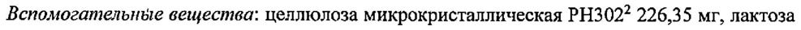
- стр. 1: «Плёночная оболочка: Опадрай® II розовый 852945924 40,13 мг°.» — низкая уверенность: «852945924» (33)  
  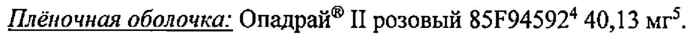
- стр. 1: «1005,04 мг (1000,00 мг метформина гидрохлорида + 5,04 мг магния стеарата)» — повторное чтение: «1005,04 мг (1 000,00 мг метформина гидрохлорида + 5,04 мг магния стеарата)»  
  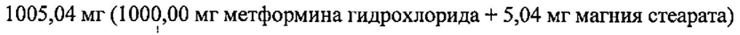
- стр. 2: «Вспомогательные вещества: целлюлоза микрокристаллическая PH302? 220,20 мг, лактоза» — низкая уверенность: «PH302?» (58)  
  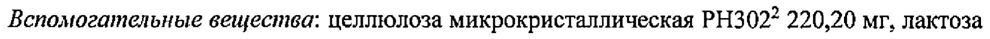
- стр. 2: «Плёночная оболочка: Опадрай® II жёлтый 85123726 40,13 мг’.» — низкая уверенность: «85123726» (25)  
  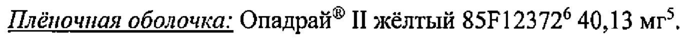
- стр. 2: «oh 3 Целевое суммарное количество магния стеарата составляет 1,0 % (м/м) oT слоя» — низкая уверенность: «3» (78)  
  
- стр. 3: «2% гиперинсулинемию. Во время терапии метформином секреция инсулина не меняется, хотя» — низкая уверенность: «2%» (70); повторное чтение: «ey гиперинсулинемию. Во время терапии метформином секреция инсулина не меняется, хотя»  
  
- стр. 3: «20 мг в сутки выведение глюкозы практически достигало максимума. Выведение глюкозы» — повторное чтение: «20 мгв сутки выведение глюкозы практически достигало максимума. Выведение глюкозы»  
  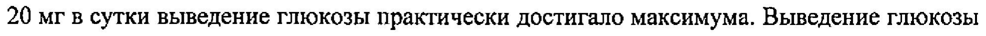
- стр. 4: «| oo получавших дапаглифлозин 5 мги 10 мг, соответственно.» — повторное чтение: «_ С) получавших дапаглифлозии 5 мг и 10 мт, соответственно.»  
  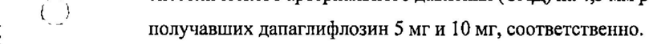
- стр. 5: «сердечно-сосудистой смерти (ОР 0,98 [95% ДИ от 0,82 до 1,17].» — низкая уверенность: «1,17].» (39)  
  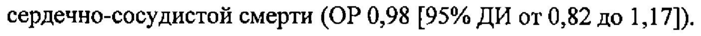
- стр. 6: «альбуминурии (OP 0,79 [95% ДИ 0,72, 0,87 и приводил к более выраженной регрессив» — низкая уверенность: «0,87» (46)  
  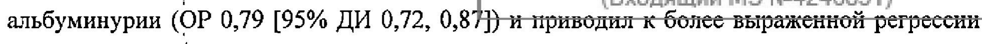
- стр. 8: «период полувыведения составляет примерно 17,6 ч, следовательно, эритроцитарная масса» — повторное чтение: «период полувыведения составляет примерно 17,6 4, следовательно, эритроцитарная масса»  
  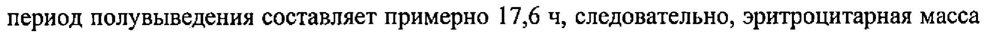
- стр. 14: «уменьшение КК (0,2%) и инфекции мочевыводящих нутей (0,2%),» — низкая уверенность: «(0,2%),» (15)  
  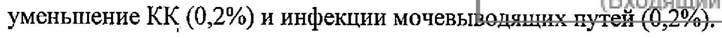
- стр. 15: «Объединенные данные 13 плацебо-контролируемых исследований дапаглифлозина 10 мг» — низкая уверенность: «10» (70)  
  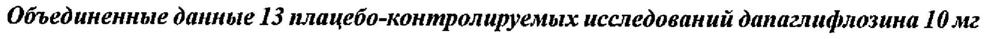
- стр. 16: «5 мг 10 мг 10 мг 10 мг» — низкая уверенность: «10» (33); повторное чтение: «5 мг 110 мг | | 10 мг | | 10 мг»  
  
- стр. 16: «количество |5(0,4%) | 7(0,6%) | 9(0,8%) | 17 (0,7%) | 27 (1,1%) 207 (2,4%) 213 (2,5%)» — низкая уверенность: «7(0,6%)» (66), «9(0,8%)» (72); повторное чтение: «количество |5 (0,4%) |7 (0,6%) |9 (0,8%) | 17 ©,7%) | 27 (1,1%) р07 (2,4%) 213 (2,5%)»  
  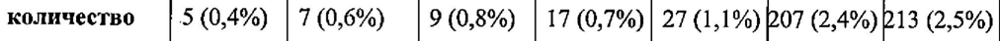
- стр. 16: «| принимающие | 1 (1,8%) |0 3 (9,7%) | 4(1,5%) |6 (2,5%) | 57 (6,1%) 1 57 (6,6%)» — низкая уверенность: «4(1,5%)» (61), «|6» (59), «(2,5%)» (59), «(6,1%)» (0)  
  
- стр. 16: «нарушением | 2 (1,9%) | 1 (0,9%) 1 (1,1%) | 4€1,5%) |5 (1,9%) | 30 (4,6%) | 35 (5,8%)» — низкая уверенность: «2» (69), «(1,9%)» (69), «1» (58), «(1,1%)» (58)  
  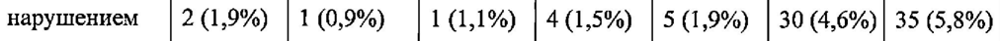
- стр. 17: «лет 1 (0,4%) |1 (0,5%) |3(1,5%) |6 (0,8%) | 11 (1,7%) [21 (3,1%) 117 (3,0%)» — низкая уверенность: «|1» (31), «(0,5%)» (31), «|3(1,5%)» (63), «|6» (79)  
  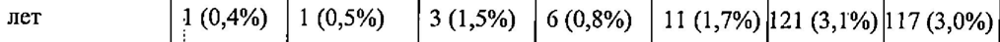
- стр. 17: «5 Mr 10 мг |» — низкая уверенность: «5» (27); повторное чтение: «5 мг | 10 мг |»  
  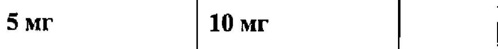
- стр. 18: «| 2 Эпизоды гипогликемии с концентрацией глюкозы < 54мг/дл (3 ммоль/л)» — низкая уверенность: «2» (64)  
  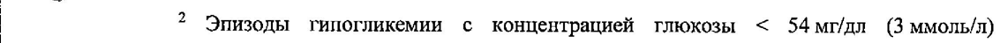
- стр. 18: «| данные 12 плацебо-контролируемых исследований дапаглифлозина 5 mr u 10 mr). У 0,2%» — повторное чтение: «данные 12 плацебо-контролируемых исследований дапаглифлозина 5 мги 10 мг). У 0,2%»  
  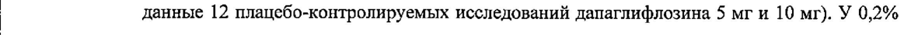
- стр. 19: «Грибковые генитальные инфекции, приводивщие к отмёне препарата, наблюдались у 0,9%» — повторное чтение: «Грибковые генитальные инфекции, приводивщие ко MeHe TH епара ra, наб д nt : “6 ¥.0,9%»  
  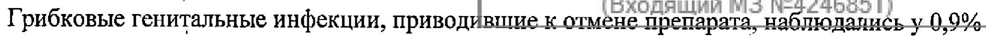
- стр. 20: «гематокрита по сравнению с исходным значением составило -0,33% в группе плацебо и» — низкая уверенность: «-0,33%» (36)  
  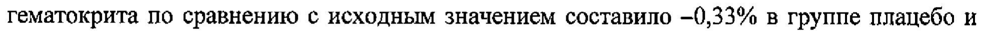
- стр. 20: «года составило 0,4 мг/дл в группе дапаглифлозина 10 мг по сравнению с -4,1 мг/дл в группе» — низкая уверенность: «-4,1» (78)  
  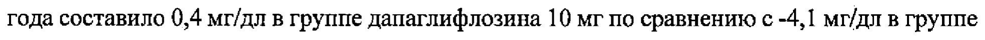
- стр. 29: «| 1000 мг, 10 mr + 1000 мг.» — повторное чтение: «| 1000 мг, 10 мг + 1000 мг.»  
  
