# Дарбэпоэтин альфа — парентерально

- Препарат: Аранесп (раствор для инъекций;)
- АТХ: B03XA02
- Источник: ГРЛС, инструкция по медицинскому применению, РУ ЛСР-001710/07, файл от 2023-01-23 (https://grls.rosminzdrav.ru/Grls_View_v2.aspx?routingGuid=908181c4-9f7a-4fe3-8651-1065d065faf3)
- Распознано автоматически (OCR): 28 из 28 стр.
- Сомнительных строк после OCR: 14 (см. раздел «Проверка распознавания»)

## Общие сведения

МИНИСТЕРСТВО ЗДРАВООХРАНЕНИЯ РОССИЙСКОЙ ФЕДЕРАЦИИ
ИНСТРУКЦИЯ ПО МЕДИЦИНСКОМУ ПРИМЕНЕНИЮ ЛЕКАРСТВЕННОГО
ПРЕПАРАТА ОНИ СИ | МИНЗДРАВ РОССИИ | | 170522
Регистрационный номер: ЛСР-001710/07 | cor JACOBAHO |
Торговое наименование: Аранесп ~~ Международное непатентованное или группировочное наименование: Дарбэпоэтин альфа

## 3. Лекарственная форма

раствор для инъекций w
раствор для инъекций w

## 2. Состав

Действующее вещество в одном предварительно заполненном шприце Дарбэпоэтин альфа
Действующее вещество в одном предварительно заполненном шприце Дарбэпоэтин альфа
(рекомбинантный): 30 мкг (100 мкг/мл), 500 мкг (500 мкг/мл).
Вспомогательные вещества в 1 мл раствора: натрия дигидрофосфата моногидрат —2,118 мг, натрия гидрофосфат — 0,661 мг, натрия хлорид — 8,182 мг, полисорбат 80 — 0,05 мг, вода для инъекций — до 1 мл.
Описание Прозрачная, бесцветная жидкость.
©, Фармакотерапевтическая группа Гемопоэза стимулятор (антианемическое средство).
KOJI ATX: B03XA02.
Фармакологические свойства Фармакодинамика
Механизм действия Эритропоэтин человека — эндогенный гликопротеиновый гормон, который является основным регулятором эритропоэза посредством специфического взаимодействия с рецептором эритропоэтина на клетках-предшественниках эритроидного ряда в костном мозге. Эритропоэтин в основном образуется в почках в ответ на изменения оксигенации
EU SPC v150_RU Revised v00 1145734 1 тканей, и регулируется данный процесс также в почках. Синтез эндогенного эритропоэтина нарушается у пациентов с хронической почечной недостаточностью, поэтому у таких пациентов анемия в первую очередь связана с дефицитом эритропоэтина. У пациентов с онкологическими заболеваниями, получающих химиотерапию, этиология анемии многофакторна. У таких пациентов значительное влияние на развитие анемии оказывают как дефицит эритропоэтина, так и снижение ответа эритроидных клеток-предшественников на эндогенный эритропоэтин.
Фармакодинамические эффекты Дарбэпоэтин альфа стимулирует эритропоэз по тому же механизму, что и эндогенный гормон. Дарбэпоэтин альфа содержит пять М-связанных углеводных цепей, в то время как эндогенный гормон и рекомбинантные человеческие эритропоэтины (рчЭпо) имеют всего
; три цепи. Дополнительные остатки сахаров, с молекулярной точки зрения, не отличаются
~ от таковых, представленных в эндогенном гормоне. Вследствие повышенного содержания углеводов дарбэпоэтин альфа обладает более длительным конечным периодом полувыведения в сравнении с рчЭпо, и, следовательно, и большей активностью in vivo.
Несмотря на указанные изменения молекулярной структуры дарбэпоэтин альфа сохраняет очень узкую специфичность к эритропоэтиновому рецептору.
Клиническая эффективность и безопасность
Пациенты с хронической почечной недостаточностью
В двух клинических исследованиях было выявлено, что у пациентов с ХПН риск летального исхода и серьезных сердечно-сосудистых нежелательных явлений выше при применении стимуляторов эритропоэза (ПСЭ) до более высокого целевого содержания гемоглобина при сравнении с более низкими 3,5 г/дл против 11,3 г/дл; 14 г/дл против 10 г/дл.
| В рандомизированном двойном слепом коррекционном исследовании (п = 358) сравнения режимов дозирования один раз каждые две недели и один раз в месяц у пациентов с хронической почечной недостаточностью, не находящихся на диализе, применение дарбэпоэтина альфа для коррекции анемии один раз в месяц было не хуже, чем один раз каждые две недели. Среднее время (1-й Квартиль, 3-й Квартиль) достижения коррекции содержания гемоглобина (> 10,0 г/дл и > 1,0 г/дл по сравнению с исходным уровнем)
составило 5 недель для обоих режимов дозирования (3, 7 недель для режима дозирования один раз каждые две недели и 3, 9 недель для режима дозирования один раз в месяц). В период оценки (недели 29-33), среднее значение (95% ДИ) эквивалентной дозы составило 0,20 (0,17; 0,24) мкг/кг при режиме дозирования один раз каждые две недели и 0,27 (0,23;
0,32) мкг/кг при режиме дозирования один раз в месяц.
EU SPC v150_RU Revised v00 7.
В рандомизированном двойном слепом плацебо-контролируемом исследовании (TREAT)
4038 пациентов с хронической почечной недостаточностью, с диабетом 2 типа и содержанием гемоглобина < 11 г/дл, не находящихся на диализе, получали дарбэпоэтин альфа с целью достижения содержания гемоглобина 13 г/дл или плацебо (с назначением дарбэпоэтина альфа при снижении содержания гемоглобина ниже 9 г/дл). Исследование не достигло основной цели, заключающейся в снижении риска смертности по любым причинам или по сердечно-сосудистой заболеваемости (дарбэпоэтин альфа vs плацебо;
соотношение рисков 1,05; 95% ДИ (0,94; 1,17)), равно как и цели заключающейся в снижении смертности по любым причинам и прогрессирования до терминальной стадии почечной недостаточности (ТСПН) (дарбэпоэтин альфа vs плацебо; соотношение рисков 1,06; 95% ДИ (0,95; 1,19)). Анализ индивидуальных компонентов композитных конечных

точек показал следующее соотношение рисков (95% ДИ): летальный исход 1,05 (0,92; 1,21),

< хроническая сердечная недостаточность (ХСН) 0,89 (0,74; 1,08), инфаркт миокарда (ИМ)
0,96 (0,75; 1,23), инсульт 1,92 (1,38; 2,68), госпитализация в связи с ишемией миокарда 0,84 (0,55; 1,27), ТСПН 1,02 (0,87; 1,18).
Для пациентов с хронической почечной недостаточностью (находящихся на диализе, не находящихся На диализе, с сахарным диабетом и без сахарного диабета) проводили объединенный апостериорный анализ данных клинических исследований ПСЭ. Была выявлена тенденция к повышению риска смертности от всех причин, сердечно-сосудистых и цереброваскулярных событий для пациентов, принимавших более высокие дозы ПСЭ, независимо от наличия диабета или проведения диализа (см. разделы «Способ применения и дозы» и «Особые указания»).
Дети

ow В рандомизированном клиническом исследовании 114 детей в возрасте от2 до 18 лет с хронической болезнью почек, находящихся или не находящихся на диализе, страдающих анемией (гемоглобин < 10,0 г/дл) и не получавших ПСЭ, получали дарбэпоэтин альфа один раз в неделю (n=58) или один раз в две недели (п = 56) с целью коррекции анемии.
Концентрация гемоглобина достигала значений > 10 г/дл у >98 % (р< 0,001) детей, получавших дарбэпоэтин альфа один раз в неделю, иу 84 % (р = 0,293) детей, получавших дарбэпоэтин альфа один раз в две недели. На момент времени, когда содержание гемоглобина впервые достигало значений > 10,0 г/дл, средняя (СО) доза на основании массы тела составляла 0,48 (0,24) мкг/кг (диапазон: 0,0-1,7 мкг/кг) в неделю в группе с введением препарата один раз в неделю и 0,76 (0,21) мкг/кг (диапазон: 0,3-1,5 мкг/кг) в две недели в группе с введением препарата один раз в две недели.
EU SPC v150_RU Revised v00 3 В клиническом исследовании с участием 124 детей в возрасте от | до 18 лет с хронической болезнью почек, находящихся или не находящихся на диализе, пациентов со стабилизацией состояния на фоне терапии эпоэтином альфа рандомизировали в группы дарбэпоэтина альфа один раз в неделю (подкожно или внутривенно) с использованием коэффициента пересчета дозы 238:1 или продолжения терапии эпоэтином альфа с использованием прежней дозы, режима дозирования и способа применения. Результаты по первичной конечной точке [изменение концентрации гемоглобина в течение периода оценки
(неделя 21-28) относительно исходного уровня] были сравнимы для двух групп. Средняя концентрация гемоглобина для рчЭпо и дарбэпоэтина альфа на исходном уровне составила 11,1 (СО 0,7) г/дл и 11,3 (СО 0,6) г/дл соответственно. Средняя концентрация гемоглобина для рчЭпо и дарбэпоэтина альфа на неделе28 составила 11,1 (СО 1,4) г/дл и

11,1 (CO 1,1) г/дл соответственно.

wv В европейском наблюдательном регистровом исследовании с участием 319 детей с хронической болезнью почек (13 (4,1 %) пациентов в возрасте < 1 года, 83 (26,0 %)
пациента в возрасте от 1 до < 6 лет, 90 (28,2 %) пациентов в возрасте от 6 до < 12 лет и 133 (41,7 %) пациента в возрасте > 12 лет), получавших дарбэпоэтин альфа, средняя концентрация гемоглобина варьировала от 11,3 до 11,5 г/дл, а средняя доза дарбэпоэтина альфа на основании массы тела в течение исследования оставалась достаточно постоянной
(от 2,31 мкг/кг в месяц до 2,67 мкг/кг в месяц) для всей исследуемой популяции.
В данных исследованиях не было выявлено значимых отличий профиля безопасности для детей по сравнению с ранее описанным профилем безопасности для взрослых (см. раздел
«Побочное действие»).
Онкологические пациенты, получающие химиотерапию

~ В проспективном, рандомизированном, двойном слепом, плацебо-контролируемом исследовании с участием 314 пациентов с раком легких, получающих химиотерапию препаратами платины, было отмечено значимое снижение потребности в гемотрансфузии
(р < 0,001).
В проспективном, рандомизированном, двойном слепом, плацебо-контролируемом исследовании с участием 344 пациентов с анемией и лимфопролиферативными злокачественными опухолями, получающих химиотерапию, было отмечено значимое снижение потребности в гемотрансфузии и улучшение ответа по содержанию гемоглобина
(р < 0,001). Также наблюдалось снижение выраженности утомляемости [по шкале функциональной оценки противоопухолевой терапии для утомляемости (FACT fatigue)].
EU SPC v150_RU Revised v00 4 Фармакокинетика
В связи с повышенным содержанием углеводов концентрация циркулирующего в крови дарбэпоэтина альфа превышает минимальную концентрацию необходимую для стимуляции эритропоэза в течение более продолжительного времени в сравнении с эквивалентными дозами рчЭпо, что позволяет снизить частоту введения дарбэпоэтина альфа с сохранением эквивалентного уровня биологического ответа.
Пациенты с хронической почечной недостаточностью
Фармакокинетика дарбэпоэтина альфа была изучена у пациентов с хронической почечной недостаточностью при внутривенном и подкожном введении препарата. Его конечный период полувыведения составлял 21 час (СО 7,5) при внутривенном введении. Клиренс дарбэпоэтина альфа составил 1,9 мл/час/кг (СО 0,56), а объем распределения (Орс) был приблизительно эквивалентен объему плазмы (50 мл/кг). При подкожном введении
~ препарата его биодоступность соответствовала 37%. При ежемесячном подкожном введении дарбэпоэтина альфа в дозе oT0,6 до 2,1 мкг/кг его конечный период полувыведения составлял 73 часа (СО 24). Более продолжительный конечный период полувыведения дарбэпоэтина альфа при подкожном введении, по сравнению с внутривенным, обусловлен кинетикой абсорбции. В ходе клинических исследований минимальное накопление препарата наблюдалось при любом способе введения. В доклинических исследованиях было продемонстрировано, что почечный клиренс дарбэпоэтина минимален (до 2% общего клиренса) и не оказывает влияния на период полувыведения препарата из сыворотки.
Для оценки дозы, необходимой для поддержания уровня гемоглобина, оценивали данные 809 пациентов, получавших Аранесп в рамках европейских клинических исследований.
ow Различий в средней недельной дозе при внутривенном или подкожном введении He отмечено.
Фармакокинетика дарбэпоэтина альфа изучалась у детей (2—16 лет) с ХПН, находящихся или не находящихся на диализе, при этом забор образцов проводился от момента однократного или двукратного подкожного или внутривенного введения препарата до 2 недель (336 часов) после введения. При использовании аналогичной продолжительности периода забора образцов, полученные фармакокинетические данные и данные моделирования популяционной фармакокинетики показали, что фармакокинетика дарбэпоэтина альфа у взрослых и детей с ХПН похожа.
В исследованиях фармакокинетики | фазы, после внутривенного введения препарата отмечалось приблизительно 25% различие между взрослыми и детьми в отношении площади под фармакокинетической кривой «концентрация-время» от нулевой отметки
EU SPC v150_RU Revised v00 5 времени до бесконечности (АЧС[0-о]); тем не менее, указанное различие для детей составило менее двукратного диапазона AUC(0.x). После подкожного введения препарата величина AUC(0.0) у взрослых и детей была сопоставимой. Как после внутривенного, так и после подкожного введения препарата, период полувыведения препарата у детей и взрослых с ХПН был сходен.

## 4.1. Показания к применению

Лечение симптоматической анемии у взрослых и детей, страдающих хронической почечной недостаточностью (ХПН, см. раздел «Способ применения и дозы»).
Лечение симптоматической анемии у взрослых и детей, страдающих хронической почечной недостаточностью (ХПН, см. раздел «Способ применения и дозы»).
Терапия симптоматической анемии у взрослых онкологических пациентов с немиелоидными злокачественными новообразованиями, получающих химиотерапию.
< Противопоказания Повышенная чувствительность к действующему веществу или к любому из вспомогательных веществ, перечисленных в разделе «Состав».
Плохо контролируемая артериальная гипертензия.

## 4.3. С осторожностью

Заболевания печени; серповидно-клеточная анемия; эпилепсия.
Заболевания печени; серповидно-клеточная анемия; эпилепсия.

## 4.6. Применение при беременности и в период грудного вскармливания

Беременность Полноценные, контролируемые исследования препарата Аранесп у беременных женщин не
“> проводились.
В исследованиях на животных не было продемонстрировано прямого повреждающего действия препарата на течение беременности, на эмбриональное/фетальное развитие, на роды или постнатальное развитие. Влияния на фертильность выявлено не было.
При назначении препарата Аранесп беременным женщинам следует соблюдать осторожность.
Период грудного вскармливания Неизвестно, экскретируется ли Аранесп в грудное молоко. Поэтому не исключен риск для ребенка при грудном вскармливании. Принятие решения о прекращении грудного вскармливания или прекращении/отмене лечения препаратом Аранесп следует принимать, учитывая пользу грудного вскармливания для ребенка и пользу лечения для матери.
EU SPC v150_RU Revised v00 6 Способ применения и дозы
Лечение препаратом Аранесп должно проводиться врачами, имеющими опыт назначения по вышеупомянутым показаниям.
Способ применения Терапия __ симптоматической _анемии в _ сочетании с__ хронической _ почечной недостаточностью (ХПН) у взрослых и детей
Симптомы анемии и последствия могут варьироваться в зависимости от возраста пациентов, их пола и тяжести заболевания; в каждом случае необходим анализ индивидуальных клинических данных пациента лечащим врачом. Аранесп может применяться подкожно или внутривенно для повышения содержания гемоглобина, но не выше 12 г/дл. У пациентов, не находящихся на диализе, подкожный способ введения является предпочтительным, так как позволяет избежать пункций периферических вен.
< Следует проводить тщательное наблюдение за пациентами для обеспечения адекватной коррекции анемии при сохранении концентрации гемоглобина ниже или на уровне 12 г/дл с применением минимальных одобренных доз препарата Аранесп. Следует с осторожностью повышать дозу препарата Аранесп у пациентов с хронической почечной недостаточностью. У пациентов с недостаточным ответом на Аранесп в отношении содержания гемоглобина следует рассмотреть альтернативные объяснения такого недостаточного ответа (см. разделы «Фармакодинамика» и «Особые указания»).
Содержание гемоглобина у пациентов подвержено индивидуальным колебаниям, в том числе иногда выше или ниже желаемых целевых значений. При отклонении содержания гемоглобина за пределы целевых значений проводят модификацию дозы, при этом под целевым значением следует рассматривать интервал от 10 г/дл до 12 г/дл. Следует избегать w стойкого повышения содержания гемоглобина выше 12 г/дл, указания по модификации дозы при значениях гемоглобина выше 12 г/дл представлены ниже. Также следует избегать повышения содержания гемоглобина более чем на 2 г/дл за 4-х недельный период. В этом случае также необходима коррекция дозы.
Лечение препаратом Аранесп включает две стадии — фаза коррекции и поддерживающая фаза. Рекомендации по применению и дозированию у взрослых и детей в инструкции приводятся отдельно.
Взрослые пациенты с хронической почечной недостаточностью
Фаза коррекции:
Начальная доза при подкожном или внутривенном введении должна составлять 0,45 мкг/кг массы тела при однократном еженедельном введении. Альтернативно, для пациентов, не получающих диализ, следующие начальные дозы препарата также могут назначаться
EU SPC v150_RU Revised v00 7 подкожно: 0,75 мкг/кг массы тела каждые две недели или 1,5 мкг/кг массы тела один раз в месяц. Если увеличение содержания гемоглобина недостаточно (менее 1 г/дл в течение 4 недель), необходимо увеличить дозу препарата примерно на 25%. Повышение дозы препарата не должно осуществляться чаще, чем один раз в четыре недели.
Если увеличение содержания гемоглобина превышает 2 г/дл за 4 недели, дозу препарата следует уменьшить примерно на 25%. В случае, когда содержание гемоглобина превышает 12 г/дл, следует рассмотреть возможность уменьшения дозы препарата. Если содержание гемоглобина продолжает увеличиваться, дозу следует снизить примерно на 25%. Если после снижения дозы гемоглобин продолжает повышаться, необходимо временно прекратить применение препарата до начала снижения содержания гемоглобина, после чего можно возобновить терапию, причем дозу препарата следует уменьшить примерно на 25% от предыдущей дозы.
~ Содержание гемоглобина следует измерять еженедельно или раз в две недели до его стабилизации. В последующем промежутки между измерениями гемоглобина можно увеличить.
Поддерживающая фаза:
Пациентам, находящимся на диализе, можно продолжить вводить Аранесп один раз в неделю или перейти на введение один раз каждые две недели. При переводе пациентов, находящихся на диализе, с еженедельных инъекций препарата Аранесп на режим введения однократно раз в две недели, исходная доза должна вдвое превышать дозу, вводившуюся один раз в неделю.
Для пациентов, не получающих диализа, можно продолжить вводить Аранесп один раз в неделю или один раз каждые две недели или один раз в месяц. Для пациентов, получающих
| Аранесп один раз каждые две недели, после достижения требуемой концентрации гемоглобина, подкожное введение препарата Аранесп затем может производиться один раз в месяц с использованием исходной дозы, вдвое превышающей предыдущую дозу, вводившуюся раз в две недели.
Титрование дозы с целью поддержания требуемой концентрации гемоглобина следует производить так часто, как это требуется.
Если необходима корректировка дозы для поддержания требуемой концентрации гемоглобина, рекомендуется изменять дозу примерно на 25%.
Если увеличение содержания гемоглобина превышает 2 г/дл за 4 недели, дозу препарата следует уменьшить приблизительно на 25% в зависимости от степени увеличения содержания гемоглобина. В случае, когда содержание гемоглобина превышает 12 г/дл, следует рассмотреть возможность уменьшения дозы препарата. Если содержание
EU SPC v150_RU Revised v00 8 гемоглобина продолжает увеличиваться, дозу следует снизить примерно на 25%. Если после снижения дозы гемоглобин продолжает повышаться, необходимо временно прекратить применение препарата до начала снижения содержания гемоглобина, после чего можно возобновить терапию, причем дозу препарата следует уменьшить примерно на 25% от предыдущей дозы.
После любого изменения дозы или режима введения содержание гемоглобина следует контролировать еженедельно или раз в две недели. Изменение дозы во время поддерживающей фазы должно выполняться не чаще одного раза в две недели.
При изменении пути введения следует использовать ту же дозу препарата и контролировать содержание гемоглобина один раз B1 или 2 недели, чтобы скорректировать дозу при необходимости с целью поддержания требуемого содержания гемоглобина.
Согласно данным клинических исследований, взрослых пациентов, получающих инъекции
® рчЭпо один, два или три раза в неделю, можно перевести на режим однократного еженедельного введения препарата Аранесп или его введение один раз в две недели.
Исходную еженедельную дозу препарата Аранесп (мкг/неделю) определяют, разделив общую еженедельную дозу рчЭпо (МЕ/неделю) на 200. Исходную дозу препарата Аранесп
(мкг/две недели) при режиме введения один раз в две недели определяют путем деления суммарной кумулятивной дозы рчЭпо, введенного за двухнедельный период, на 200. По причине индивидуальных различий для отдельных пациентов требуется подбор оптимальной терапевтической дозы. При замене рчЭпо на Аранесп содержание гемоглобина следует измерять еженедельно или раз в две недели, а способ введения препарата должен оставаться неизменным.
Дети с хронической почечной недостаточностью w Применение препарата у детей в возрасте до 1 года не изучалось в рандомизированных клинических исследованиях (см. раздел «Фармакодинамика»).
Фаза коррекции:
Для детей в возрасте от 1года и старше начальная доза при подкожном или внутривенном введении препарата составляет 0,45 мкг/кг веса тела в виде однократной инъекции один раз в неделю. У пациентов, не получающих диализ, может применяться начальная доза, равная 0,75 мкг/кг, подкожно один раз в две недели. Если увеличение содержания гемоглобина недостаточно (менее 1 г/дл в течение 4 недель), необходимо увеличить дозу препарата примерно на 25%. Повышение дозы препарата не должно осуществляться чаще, чем один раз в четыре недели.
Если увеличение содержания гемоглобина превышает 2 г/дл за 4 недели, дозу препарата следует уменьшить примерно на 25% в зависимости от степени увеличения содержания
EU SPC v150_RU Revised v00 9 гемоглобина. В случае, когда содержание гемоглобина превышает 12 г/дл, следует рассмотреть возможность уменьшения дозы препарата. Если содержание гемоглобина продолжает увеличиваться, дозу следует снизить примерно на 25%. Если после снижения дозы гемоглобин продолжает повышаться, необходимо временно прекратить применение препарата до начала снижения содержания гемоглобина, после чего можно возобновить терапию, причем дозу препарата следует уменьшить примерно на 25% от предыдущей дозы.
Содержание гемоглобина следует измерять еженедельно или раз в две недели до его стабилизации. В последующем промежутки между измерениями гемоглобина можно увеличить.
Лечение анемии препаратом Аранесп в фазе коррекции у детей в режиме дозирования один

р раз в месяц не изучено.

~ Поддерживающая фаза:
У детей от 1 года и старше в поддерживающую фазу терапии введение препарата Аранесп можно продолжать в режиме один раз в неделю или один раз в две недели. Пациентам в возрасте до 6 лет может потребоваться применение более высокой дозы для поддержания содержания гемоглобина, чем у пациентов более старшего возраста. При переводе пациентов, находящихся на диализе, с еженедельных инъекций препарата Аранесп На режим введения однократно раз в две недели, исходная доза должна вдвое превышать дозу, вводившуюся один раз в неделю.
Для пациентов в возрасте 11 лет и старше, не находящихся на диализе, после того как достигнуто целевое содержание гемоглобина в режиме дозирования препарата 1 раз в две недели, Аранесп может назначаться подкожно 1 раз в месяц, при этом начальная дозировка

| © должна составлять удвоенную дозу от той, что использовалась в режиме 1 раз в две недели.
Клинические данные показали, что пациенты детского возраста, получающие рчЭпо два или три раза в неделю, могут быть переведены на Аранесп, вводимый 1 раз в неделю, и пациенты получающие рчЭпо один раз в неделю могут быть переведены на режим введения препарата Аранесп один раз в две недели. Начальная дозировка препарата Аранесп для детей (мкг/нед), вводимого еженедельно может быть определена путем деления суммарной недельной дозы рчЭпо (МЕ/нед) на 240. Начальная дозировка препарата Аранесп при введении каждые 2 недели (мкг/каждые 2 недели) может быть определена путем деления суммарной дозы рчЭпо за двухнедельный период на 240. По причине индивидуальных различий для отдельных пациентов требуется подбор оптимальной терапевтической дозы.
При замене рчЭпо на Аранесп содержание гемоглобина следует измерять еженедельно или раз в две недели, а способ введения препарата должен оставаться неизменным.
EU SPC v150_RU Revised v00 10 Титрование дозы с целью поддержания требуемой концентрации гемоглобина следует производить так часто, как это требуется.
Если необходима корректировка дозы для поддержания требуемой концентрации гемоглобина, рекомендуется изменять дозу примерно на 25%.
Если увеличение содержания гемоглобина превышает 2 г/дл за 4 недели, дозу препарата следует уменьшить примерно на 25% в зависимости от степени увеличения содержания гемоглобина. В случае, когда содержание гемоглобина превышает 12 г/дл, следует рассмотреть возможность уменьшения дозы препарата. Если содержание гемоглобина продолжает увеличиваться, дозу следует снизить примерно на 25%. Если после снижения дозы гемоглобин продолжает повышаться, необходимо временно прекратить применение препарата до начала снижения содержания гемоглобина, после чего можно возобновить терапию, причем дозу препарата следует уменьшить примерно на 25% от предыдущей
~ дозы.
У пациентов, начинающих диализ на фоне терапии препаратом Аранесп, следует тщательно контролировать содержание гемоглобина.
После любого изменения дозы или режима введения содержание гемоглобина следует контролировать еженедельно или раз в две недели. Изменение дозы во время поддерживающей фазы должно выполняться не чаще одного раза в две недели.
При изменении пути введения препарата следует использовать ту же дозу препарата и контролировать содержание гемоглобина один разв | или 2 недели, чтобы скорректировать дозу при необходимости с целью поддержания требуемого содержания гемоглобина.
Лечение симптоматической анемии, индуцированной химиотерапией, у пациентов_с онкологическими заболеваниями w У пациентов с анемией (например, при концентрации гемоглобина равной или ниже 10 г/дл) Аранесп может применяться подкожно для повышения концентрации гемоглобина до уровня не выше 12 г/дл. Симптомы анемии и последствия могут варьироваться в зависимости от возраста пациентов, их пола и тяжести заболевания; в каждом случае необходим анализ индивидуальных клинических данных пациента лечащим врачом.
Содержание гемоглобина у пациентов подвержено индивидуальным колебаниям, в том числе иногда выше или ниже желаемых целевых значений. При отклонении содержания гемоглобина за пределы целевых значений проводят модификацию дозы, при этом под целевым значением следует рассматривать интервал от 10 г/дл до 12 г/дл. Следует избегать повышения содержания гемоглобина более 12 г/дл; ниже представлено руководство по коррекции дозы в случае, если содержание гемоглобина превышает 12 г/дл.
EU SPC v150_RU Revised v00 11 Рекомендованная начальная доза препарата — 500 мкг (6,75 мкг/кг) 1 раз в 3 недели либо по 2,25 мкг/кг 1раз в неделю. Если клинический ответ (утомляемость, содержание гемоглобина) через девять недель неадекватен, дальнейшая терапия может оказаться неэффективной.

Применение препарата Аранесп прекращают примерно через четыре недели после

завершения химиотерапии.

После достижения целевого содержания гемоглобина дозировку препарата следует

уменьшить на 25-50%, для адекватного контроля симптоматики анемии с использованием

минимальных одобренных доз препарата Аранесп. Возможно титрование дозы между

500 мкг, 300 мкги 150 мкг.

Следует производить тщательный мониторинг состояния пациентов. Если содержание
; гемоглобина у пациента превышает 12 г/дл, дозу препарата следует уменьшить на 25-50%.
< Если содержание гемоглобина превышает 13 г/дл, следует временно прекратить

применение препарата Аранесп. После снижения содержания гемоглобина до 12 г/дл или

ниже, терапию можно возобновить, дозировка препарата при этом должна быть примерно на 25% меньше предыдущей.

Если увеличение содержания гемоглобина превышает 2 г/дл за 4 недели, дозу препарата

следует уменьшить примерно на 25-50%.

Способ введения

Препарат Аранесп может вводиться подкожно самим пациентом или лицом,

осуществляющим уход, после обучения лечащим врачом, медицинской сестрой или

провизором.

Препарат_Аранесп_в дозировке 30 мкг, 500 мкг в лекарственной форме раствор для w инъекций в предварительно заполненном wnpuye (ПЗШ)

Аранесп может применяться подкожно или внутривенно, как описано в режиме

дозирования.

Необходимо менять места введения препарата и вводить препарат медленно, чтобы

избежать возникновения дискомфорта в месте инъекции.

Аранесп поставляется готовым для применения в предварительно заполненных шприцах.

Инструкции по применению препарата, обращению с ним и порядку его уничтожения

приводятся в разделе «Особые указания».

Фармацевтическая несовместимость

Поскольку исследования совместимости еще не проводились, данный медицинский

препарат не следует смешивать или вводить методом инфузии вместе с другими

лекарственными препаратами.

EU SPC v150_RU Revised v00 12 Побочное действие
Краткие сведения о безопасности препарата
Выявленные нежелательные реакции, связанные с приемом препарата Аранесп, включают артериальную гипертензию, инсульт, тромбоэмболии, судороги, аллергические реакции, кожную сыпь/эритему и истинную эритроцитарную аплазию (MDA), см. раздел «Особые указания».
Боль в месте инъекции была зарегистрирована, как связанная с лечением в исследованиях, в которых Аранесп вводили в виде подкожных инъекций. Дискомфорт в месте инъекции в целом был слабым и преходящим и развивался преимущественно после первой инъекции.
Таблица нежелательных реакций Частота развития нежелательных реакций указана по классу системы органов и частоте
~ возникновения. Частота возникновения определена следующим образом: очень часто
(> 1/10); часто (> 1/100, < 1/10); нечасто (> 1/1000, < 1/100); редко (> 1/10000, < 1/1000);
очень редко (< 1/10000), неизвестно (не может быть оценена по имеющимся данным).
Данные представлены отдельно для пациентов с ХПН и онкологических пациентов и отражают профиль нежелательных реакций в этих популяциях.
Пациенты с хронической почечной недостаточностью
Данные представленные в контролируемых исследованиях включали 1357 пациентов:
766 пациентов получали Аранесп, и 591 пациент получал рчЭпо. В группе препарата
Аранесп 83% находились На диализе, 17% — нет. Инсульт был выявлен в качестве нежелательной реакции в дополнительном клиническом исследовании (TREAT, см. раздел
«Фармакодинамика»).
w Частота нежелательных реакций по данным контролируемых клинических исследований и пострегистрационного опыта составляет:
Система органов по MedDRA Частота Нежелательная реакция
Е НЙ Со стороны крови и | Неизвестно? Парциальная femme gma
И =m EU SPC v150_RU Revised v00 13 Система органов по MedDRA Частота Нежелательная реакция ie
Heuacro! Тромбоз сосудистого ПЕ клетчатки Неизвестно? Синдром Стивенса —
Джонсона/токсический эпидермальный некролиз, мультиформная эритема, образование волдырей, шелушение кожи
> в месте введения Нечасто! Кровоподтек в месте инъекции,
Кровотечение в месте инъекции Источник: данные 5 рандомизированных двойных слепых исследований с активным контролем (970200, 970235, 980117, 980202 и 980211), за исключением случаев острого нарушения мозгового кровообращения, которые были зарегистрированы в качестве нежелательной реакции в рамках исследования TREAT (исследование 20010184).
' Нежелательные реакции, выявленные в пострегистрационный период. В соответствии с документом «Краткая характеристика лекарственного препарата» (редакция 2, сентябрь 2009 г.) частота возникновения нежелательных реакций в пострегистрационный
- период была определена на основании «правила трех».
* Невозможно оценить частоту по имеющимся данным.
* К гиперчувствительности относятся все явления, выдаваемые по этому термину при использовании SMQ.
> К острому нарушению мозгового кровообращения относятся геморрагический инсульт, ишемический инсульт, острое нарушение мозгового кровообращения и «инсульт в ходу»
(предпочтительные термины).
°К тромбоэмболическим событиям относятся артериальная эмболия, тромбофлебит, тромбоз, тромбоз вен конечности (предпочтительные термины).
“ К тромбозу сосудистого доступа для диализа относятся все нежелательные реакции, выдаваемые по этому термину при использовании АМО.
EU SPC v150_RU Revised у00 14 ° К сыпи/эритеме относятся кожная сыпь, зудящая сыпь, макулезная сыпь, генерализованная сыпь, эритема (предпочтительные термины).
Онкологические пациенты Нежелательные реакции были определены на основании объединенных данных восьми рандомизированных двойных слепых плацебо-контролируемых исследований препарата
Аранесп, включавших 4630 пациентов (Аранесп 2888, плацебо 1742). В клинические исследования включались пациенты с солидными опухолями (например, легких, молочной железы, толстой кишки, яичников) и лимфоидными злокачественными новообразованиями
(например, лимфомой, множественной миеломой).
Частота нежелательных реакций по данным контролируемых клинических исследований и
© пострегистрационного опыта составляет:
Система органов по MedDRA | Частота Нежелательная реакция
И | Со стороны сосудов Часто Тромбоэмболии?, включая тромбоэмболию легочной артерии
; клетчатки Неизвестно? Синдром Стивенса —
- Джонсона/токсический эпидермальный некролиз, мультиформная эритема, образование волдырей, шелушение кожи
EU SPC v150_RU Revised v00 15 Система органов по MedDRA | Частота Нежелательная реакция
—— oe Нечасто! Кровоподтек в месте инъекции,
Кровотечение в месте инъекции ' Нежелательные реакции, выявленные в пострегистрационный период. В соответствии с документом «Краткая характеристика лекарственного препарата» (редакция 2, сентябрь 2009 г.) частота возникновения нежелательных реакций в пострегистрационный
, период была определена на основании «правила трех».
< * Невозможно оценить частоту по имеющимся данным.
Источник: данные 8 рандомизированных двойных слепых плацебо-контролируемых исследований (980291 — график | и2; 980297, 990114, 20000161, 20010145, 20030232 и 20070782).
“К гиперчувствительности относятся все явления, выдаваемые по этому термину при использовании SMQ.
> К тромбоэмболическим событиям относятся эмболия, тромбоз, тромбоз глубоких вен, тромбоз яремной вены, венозный тромбоз, артериальный тромбоз, тромбоз вены таза, эмболия периферической артерии, тромбоэмболия легочной артерии, а также тромбоз в устройстве (предпочтительные термины из СОК «Проблемы с продуктом»).
°К сыпи относятся кожная сыпь, зудящая сыпь, генерализованная сыпь, папулезная сыпь, ow эритема, эксфолиативная сыпь, макулопапулезная сыпь, везикулезная сыпь, а также пустулезная сыпь (предпочтительные термины из СОК «Инфекции и инвазии»).
3 К отеку относятся периферический отек, отек, распространенный отек, отек вследствие заболеваний сердца, отек лица (предпочтительные термины).
°К боли в месте инъекции относятся боль в месте инъекции, боль в месте введения, боль в месте установки катетера, боль в месте инфузии и боль в месте пункции сосуда
(предпочтительные термины).
Описание отмеченных нежелательных реакций
Пациенты с хронической почечной недостаточностью
Инсульт был отмечен, как распространенная нежелательная реакция у пациентов с ХПН в исследовании ТВЕАТ (см. раздел «Фармакодинамика»).
EU SPC v150_RU Revised у00 16 В отдельных случаях сообщалось о нейтрализующих антителах к эритропоэтину, опосредующих парциальную красноклеточную аплазию (ПККА), связанную с терапией препаратом Аранесп, преимущественно у пациентов с ХПН, получавших препарат подкожно. В случае подтверждения диагноза ПККА, терапия препаратом Аранесп должна быть прекращена, и пациенты не должны быть переведены на другой рекомбинантный эритропоэтин (см. раздел «Особые указания»).
Частота реакций гиперчувствительности оценивалась на основе данных клинических исследований как «очень часто» у пациентов с ХПН. Также реакции гиперчувствительности очень часто встречались в группах, получающих плацебо. В пострегистрационном периоде сообщалось о развитии серьезных реакций гиперчувствительности, включая анафилактические реакции, ангионевротический отек, аллергический бронхоспазм, кожную сыпь и крапивницу, связанных с приемом
~ дарбэпоэтина альфа.
Отмечались тяжелые кожные нежелательные реакции, включая синдром Стивенса —
Джонсона (ССД) и токсический эпидермальный некролиз (ТЭН), которые могут быть смертельными или угрожающими жизни (см. раздел «Особые указания»).
Было отмечено о судорогах у пациентов, получающих дарбэпоэтин альфа (см. раздел
«Особые указания»). Частота оценивалась на основе данных клинических исследований как
«нечасто» у пациентов с ХНП.
В пострегистрационном периоде у пациентов с ХПН, находившихся на гемодиализе, были зарегистрированы случаи тромбоза сосудистого доступа (такие как осложнение сосудистого доступа, тромбоз артериовенозной фистулы, тромбоз трансплантата, тромбоз шунта, осложнение в области артериовенозной фистулы ит. д.). Частота оценивалась на ow основе данных клинических исследований как «нечасто» у онкологических пациентов.
Онкологические пациенты При применении в рутинной клинической практике (см. раздел «Особые указания»), у онкологических пациентов наблюдалась артериальная гипертензия. Частота оценивалась на основе данных клинических исследований как «часто» у онкологических пациентов и также часто встречалась в группах, получающих плацебо.
При применении в рутинной клинической практике, у онкологических пациентов наблюдались реакции гиперчувствительности. Частота реакций гиперчувствительности оценивалась на основе данных клинических исследований как «очень часто» у онкологических пациентов. Также реакции гиперчувствительности очень часто встречались в группах, получающих плацебо. Сообщалось о развитии серьезных реакций гиперчувствительности, включая анафилактические реакции, ангионевротический отек,
EU SPC v150_RU Revised v00 17 аллергический бронхоспазм, кожную сыпь и крапивницу, связанных с приемом

дарбэпоэтина альфа.

Отмечались тяжелые кожные нежелательные реакции, включая синдром Стивенса —

Джонсона (ССД) и токсический эпидермальный некролиз (ТЭН), которые могут быть

смертельными или угрожающими жизни (см. раздел «Особые указания»).

При применении в рутинной клинической практике у пациентов, получающих дарбэпоэтин

альфа, сообщалось о судорогах (см. раздел «Особые указания»). Частота оценивалась на

основе данных клинических исследований как «нечасто» у онкологических пациентов.

Судороги часто встречались в группах, получающих плацебо.

Дети с хронической почечной недостаточностью

Во всех исследованиях ХПН у детей не было выявлено дополнительных нежелательных реакций у детей по сравнению с ранее отмеченными для взрослых пациентов (см. раздел wv «Фармакодинамика»).

## 4.9. Передозировка

Максимальное количество препарата Аранесп, безопасное для введения в виде однократной

или многократной дозы, не определялось. Терапия препаратом Аранесп может привести к

полицитемии, если содержание гемоглобина не будет тщательно контролироваться и доза

не будет соответствующим образом скорректирована. После передозировки препаратом

Аранесп наблюдались случаи тяжелой артериальной гипертензии (см. раздел «Особые

указания»).

В случае выявления полицитемии введение препарата Аранесп следует временно

прекратить (см. раздел «Способ применения и дозы»). При наличии клинических показаний
| может быть выполнена флеботомия.

## 4.5. Взаимодействие с другими лекарственными средствами

Клинические данные, полученные до настоящего времени, не содержат указаний на

взаимодействие дарбэпоэтина альфа с другими веществами. Однако известно, что

потенциально возможно его взаимодействие с веществами, характеризующимися высокой

степенью сродства к эритроцитам, такими как циклоспорин, такролимус. При

одновременном назначении препарата Аранесп с любыми подобными лекарственными

средствами, следует контролировать уровень их содержания в крови и корректировать дозу

в случае повышения концентрации гемоглобина.

EU SPC v150_RU Revised v00 18 Особые указания
Общие положения Для улучшения отслеживаемости препаратов, стимулирующих эритропоэз (ПСЭ), в медицинской карте пациента должно быть четко указано торговое наименование используемого ПСЭ.
Необходим мониторинг артериального давления у всех пациентов, особенно в начале терапии препаратом Аранесп. При недостижении адекватного контроля артериального давления стандартными методами, концентрация гемоглобина может быть снижена путем уменьшения дозы и отмены препарата Аранесп (см. раздел «Способ применения и дозы»).
При лечении препаратом Аранесп пациентов с ХПН, отмечалось развитие тяжелой формы артериальной гипертензии, включая гипертонический криз, гипертоническую
; энцефалопатию и судорожные припадки.
< С целью подтверждения эффективности эритропоэза всем пациентам следует определять содержание железа до и во время лечения с целью назначения, в случае необходимости, дополнительной терапии препаратами железа.
Отсутствие ответа на применение препарата Аранесп должно служить стимулом для выявления причинных факторов. Эффективность препаратов, стимулирующих эритропоэз
(ПСЭ), снижается при недостатке в организме железа, фолиевой кислоты или витамина B12, вследствие чего уровень их содержания необходимо корректировать.
Эритропоэтический ответ также может быть ослаблен при наличии сопутствующих инфекционных заболеваний, симптомов воспаления или случаев травмы, скрытой кровопотери, гемолиза, тяжелой алюминиевой интоксикации, сопутствующих гематологических заболеваний или фиброза костного мозга. Численность ретикулоцитов ww следует рассматривать как один из параметров оценки. Если типичные причины отсутствия ответа исключены, а у пациента выявляется ретикулоцитопения, следует провести исследование костного мозга. Если картина костного мозга соответствует картине ИЭА, рекомендуется выполнить исследование на присутствие антител к эритропоэтину.
При применении эпоэтинов отмечались тяжелые кожные нежелательные реакции, включая синдром Стивенса — Джонсона (ССД) и токсический эпидермальный некролиз (ТЭН), которые могут быть смертельными или угрожающими жизни. Более тяжелые случаи были зарегистрированы при применении эпоэтинов длительного действия.
При назначении препарата следует информировать пациентов о признаках и симптомах кожных реакций и тщательно их контролировать. При возникновении таких признаков и симптомов применение препарата Аранесп следует немедленно прекратить и назначить альтернативное лечение.
EU SPC v150_RU Revised у00 19 При развитии тяжелых кожных реакций, таких как ССД или ТЭН, на фоне терапии препаратом Аранесп, ни в коем случае нельзя возобновлять применение препарата Аранесп у данного пациента.

Была описана истинная эритроцитарная аплазия, вызванная нейтрализующим действием

антител к эритропоэтину, связанная с применением ПСЭ, включая препарат Аранесп. Чаще

всего такие сообщения касались пациентов с ХПН, получавших препарат подкожно. Было показано, что эти антитела перекрестно реагируют со всеми эритропоэтическими белками, поэтому пациентов, у которых подозревается или выявлено развитие нейтрализующих антител к эритропоэтину, не следует переводить на препарат Аранесп (см. раздел

«Побочное действие»).

Парадоксальное снижение содержания гемоглобина и развитие тяжелой анемии с низким уровнем ретикулоцитов должно приводить к немедленной отмене лечения эпоэтином и
< проведению теста на наличие антител к эритропоэтину. Такие случаи были описаны у

пациентов с гепатитом С, которые получали терапию интерфероном и рибавирином в

сочетании с эпоэтинами. Применение эпоэтинов в лечении анемии при гепатите С не

одобрено.

Во всех исследованиях препарата Аранесп критерием исключения были активные

заболевания печени, поэтому данные о применении препарата у пациентов с нарушением

функции печени отсутствуют. Так как печень считается основным путем выведения дарбэпоэтина альфа и рчЭпо, пациентам с патологией печени эти препараты следует назначать с осторожностью.

Также Аранесп следует применять с осторожностью пациентам с серповидно-клеточной

анемией.

& Злоупотребление препаратом Аранесп у здоровых лиц может привести к избыточному повышению гематокрита. Подобные явления могут быть ассоциированы с опасными для жизни осложнениями со стороны сердечно-сосудистой системы.

Колпачок иглы предварительно заполненного шприца состоит из натуральной

обезвоженной резины (производное латекса), что может явиться причиной аллергической

реакции.

Аранесп следует применять с осторожностью у пациентов с эпилепсией. Имеются

сообщения о возникновении судорог у пациентов, получавших Аранесп.

Необходимо оценивать соотношение указанного риска тромботических событий и пользы

дарбэпоэтина альфа в особенности в случае пациентов, изначально подверженных риску

тромботических событий, например страдающих ожирением и имеющих случаи тромбоза

EU SPC v150_RU Revised v00 20 в анамнезе (такие как тромбоз глубоких вен, легочная эмболия и острое нарушение мозгового кровообращения).
Данный лекарственный препарат содержит менее | ммоль натрия (23 мг) на 1 дозу, поэтому может считаться не содержащим натрия.
Пациенты с хронической почечной недостаточностью
У пациентов с хронической почечной недостаточностью, поддерживающие концентрации гемоглобина не должны превышать верхнюю границу целевой концентрации гемоглобина, рекомендованной в разделе «Способ применения и дозы». В ходе клинических исследований наблюдались повышенные риски летального исхода, серьезных сердечнососудистых осложнений или нарушений мозгового кровообращения, включая инсульт, и тромбоз сосудистого доступа при назначении ПСЭ для достижения содержания
, гемоглобина свыше 12 г/дл.
< Следует с осторожностью повышать дозу препарата Аранесп у пациентов с хронической почечной недостаточностью, поскольку высокая кумулятивная доза эпоэтина может повышать риск смерти, серьезных сердечно-сосудистых и цереброваскулярных событий. У пациентов с недостаточным ответом на эпоэтин в отношении содержания гемоглобина следует рассмотреть альтернативные объяснения такого недостаточного ответа
(см. разделы «Фармакодинамика» и «Способ применения и дозы»).
Проводимые контролируемые клинические исследования не показали значительных преимуществ при назначении эпоэтинов, когда концентрация гемоглобина повышается выше уровня, необходимого для лечения симптомов анемии и для того, чтобы избежать переливания крови.
Всем пациентам с уровнем ферритина в сыворотке крови ниже 100 мкг/л или тем, у кого ow насыщение трансферрина ниже 20%, рекомендуется дополнительное лечение препаратами железа.
Во время применения препарата Аранесп следует регулярно контролировать сывороточное содержание калия. Повышение концентрации калия было описано у нескольких пациентов, получающих Аранесп, однако причинная связь установлена не была. При выявлении повышенной или повышающейся концентрации калия, введение препарата Аранесп следует прекратить до ее нормализации.
Онкологические пациенты Влияние на рост опухоли
Эпоэтины представляют собой факторы роста, которые, главным образом, стимулируют выработку эритроцитов. Рецепторы к эритропоэтину могут экспрессироваться на поверхности различных опухолевых клеток. Как и в случае любых факторов роста,
EU SPC v150_RU Revised v00 21 существует предположение о том, что эритропоэтины способны стимулировать рост

опухолей.

В ряде контролируемых клинических исследований у онкологических пациентов,

получавших химиотерапию, применение эпоэтинов не увеличивало общую

продолжительности жизни или не снижало риск прогрессии опухоли у пациентов с

анемией, ассоциированной с онкологическим заболеванием.

В контролируемых клинических исследованиях препарата Аранесп и других ПСЭ было

продемонстрировано:

e Уменьшение времени до прогрессии у пациентов с распространенным раком головы и шеи, получающими лучевую терапию, при назначении эпоэтина до достижения целевого значения гемоглобина выше, чем 14 г/дл, ПСЭ не показаны данной группе

, пациентов.

> ® Уменьшение общей продолжительности жизни и повышение смертности, связанное с прогрессией заболевания за 4 месяца у пациентов с метастазирующим раком молочной железы, получавших химиотерапию, при корректирующем назначении эпоэтина до достижения целевого значения гемоглобина 12-14 г/дл.

® Повышение риска смерти при назначении эпоэтина до достижения целевого значения гемоглобина 12г/дл у пациентов с активной злокачественной опухолью, не получавших ни химиотерапии, ни лучевой терапии. ПСЭ не показаны данной группе пациентов.

e Повышение риска прогрессирования заболевания или смерти на 9% в группе пациентов, получавших эпоэтин альфа и стандартную терапию, по результатам первичного анализа и 15% повышение риска, который нельзя статистически

- исключать у пациентов с метастатическим раком молочной железы, получавших химиотерапию, которым препарат назначался для достижения целевого содержания гемоглобина в диапазоне 10-12 г/дл.

® Не меньшая эффективность дарбэпоэтина альфа по сравнению с плацебо по показателям общей выживаемости и продолжительности периода без прогрессирования заболевания у пациентов с распространенным немелкоклеточным раком легкого, получающих химиотерапию, которым препарат назначался для достижения целевого содержания гемоглобина 12 г/дл (см. раздел
«Фармакодинамика»).

В соответствии с вышеизложенным, в некоторых клинических ситуациях для лечения

анемии у пациентов с онкологическими заболеваниями следует применять переливание

крови. Решение о назначении рекомбинантных эритропоэтинов следует принимать на

EU SPC v150_RU Revised v00 22 основании оценки соотношения польза/риск для каждого индивидуального пациента, принимая во внимание особенности клинической ситуации. Необходимо учитывать следующие факторы: вид и стадия опухолевого процесса; степень анемии; ожидаемая продолжительность жизни; обстановка, в которой пациент будет проходить лечение; и пожелания самого пациента (см. раздел «Фармакодинамика»).
У пациентов с солидными опухолями или с лимфопролиферативными злокачественными заболеваниями при возрастании уровня содержания гемоглобина выше 12 г/дл следует строго соблюдать схему адаптации дозы, описанную в разделе «Способ применения и дозы», с целью минимизации потенциального риска развития тромбоэмболических явлений. Также необходимо регулярно контролировать количество тромбоцитов и концентрацию гемоглобина в крови.

, Особые указания по условию хранения

< Перед амбулаторным использованием Аранесп может быть однократно перемещен из места хранения в условия комнатной температуры (до 25 °С) на максимальный период 7 дней.
Однократно перемещенный из холодильника и достигший комнатной температуры
(до 25 °С) шприц должен быть использован в течение 7 дней или уничтожен.
Особые указания по использованию Картонная упаковка содержит инструкцию по применению.
Аранесп представляет собой стерильный продукт, изготовленный без консервантов.
Следует вводить не более одной дозы препарата. Любое оставшееся количество лекарственного препарата, подлежит уничтожению.
Перед введением раствор препарата Аранесп следует проконтролировать на предмет присутствия видимых частиц. Допускается использование только бесцветного, прозрачного

& или слабо опалесцирующего раствора. Раствор нельзя встряхивать. Перед введением следует дождаться прогревания упаковки до комнатной температуры.
Любые количества неиспользованного продукта или его отходов подлежат уничтожению в соответствии с местными требованиями.

## 4.7. Влияние на способность управлять транспортными средствами, механизмами

Препарат Аранесп не влияет или имеет незначительное влияние на способность управлять транспортными средствами и механизмами.
EU SPC v150_RU Revised у00 29 Форма выпуска
Предварительно заполненные шприцы По 0,3 мл раствора (100 мкг/мл) — 30 мкг, или 1,0 мл раствора (500 мкг/мл) — 500 мкг в шприцы из стекла I гидролитического класса с нержавеющими стальными иглами (270).
Предварительно заполненные шприцы (ПЗШ) состоят из цилиндра со встроенной иглой, закрытой эластомерным колпачком, поршня и эластомерного плунжера, ламинированного фторполимером или из цилиндра со встроенной иглой, закрытой эластомерным колпачком с дополнительным внешним полипропиленовым колпачком, поршня и эластомерного плунжера, ламинированного фторполимером.
Колпачок иглы ПЗШ состоит из натуральной обезвоженной резины (производное латекса).
По 1 предварительно заполненному шприцу (с дозировкой 30 мкг, 500 мкг) помещают в

, контурную ячейковую упаковку. Одну контурную ячейковую упаковку помещают вместе с

- инструкцией по применению в картонную пачку.
На каждую картонную пачку наклеивают две прозрачные защитные этикетки — контроль первого вскрытия, имеющие продольную цветную полосу.

## 6.4. Условия хранения

Хранить в защищенном от света месте, при температуре от 2 °С до 8 °С. Не замораживать.
Хранить в защищенном от света месте, при температуре от 2 °С до 8 °С. Не замораживать.
Хранить в недоступном для детей месте!

## 6.3. Срок годности

3 года. Не применять по истечении срока годности.
3 года. Не применять по истечении срока годности.

©, Условия отпуска

Отпуск по рецепту.
Держатель регистрационного удостоверения
Амджен Европа Б.В., Нидерланды Минервум 7061 4817 ZK Бреда
Нидерланды Производитель Производитель готовой лекарственной формы/фасовщик (первичная упаковка)
Амджен Мэньюфэкчуринг Лимитед, Пуэрто-Рико, США
Роуд 31, Км 24.6 Джанкос, Пуэрто-Рико, 00777, США
EU SPC v150_RU Revised у00 24 Упаковщик (вторичная (потребительская) упаковка)/ выпускающий контроль качества
Амджен Европа Б.В., Нидерланды Минервум 7061, 4817 ZK Бреда, Нидерланды
ИЛИ Амджен Технолоджи (Айрлэнд) Анлимитед Компани, Ирландия
Поттери Роуд, Дан Лэйри, гр. Дублин, Ирландия
ИЛИ ООО «Добролек», Россия, 115446, Москва, Коломенский проезд, 13A.
Организация, принимающая претензии от потребителей
ООО «Амджен»
- 123112, Москва, Пресненская набережная, д.8, строение 1, 7 этаж
Тел: +7 (495) 745 0478 Факс: +7 (499) 995 1965
-
EU SPC v150_RU Revised v00 pe ТЕХНИКА ПРОЦЕДУРЫ — ИНЪЕКЦИИ ПРЕПАРАТА — АРАНЕСП В
ПРЕДВАРИТЕЛЬНО ЗАПОЛНЕННЫХ ШПРИЦАХ Этот раздел описывает процедуру инъекции препарата Аранесп, которую вы можете выполнить самостоятельно. Перед началом применения препарата в предварительно заполненных шприцах, пожалуйста, сначала ознакомьтесь с «Общими рекомендациями», приведенными ниже (раздел 1), а затем, с инструкцией (раздел 2).
Раздел 1. Общие рекомендации Очень важно, чтобы Вы не делали инъекцию сами, пока ваш лечащий врач, медицинская сестра или провизор не научит вас. Если у Вас будут вопросы, то проконсультируйтесь с
Вашим врачом, медицинской сестрой или провизором.
, Перед началом инъекции < Внимательно прочитайте все рекомендации перед введением препарата.
Как Вам, или тому кто делает вам эту инъекцию, использовать Аранесп ПЗШ?
Ваш врач назначил Вам Аранесп ПЗШ для подкожных инъекций. Ваш лечащий врач, медицинская сестра или провизор расскажет Вам какое количество препарата Аранесп и как часто необходимо вводить.
Оборудование:
Для самостоятельных инъекций вам потребуется:
® Новый ПЗШ с препаратом Аранесп и e Смоченные спиртом тампоны или сходные материалы.
Перед проведением инъекции 1. — Выньте предварительно заполненный шприц из холодильника. Оставить ПЗШ при we комнатной температуре примерно на 30 минут. Это позволит сделать инъекцию более комфортной. Не подогревать предварительно заполненный шприц каким-либо другим способом (например, в горячей воде или в микроволновой печи). Не оставлять предварительно заполненный шприц под прямыми солнечными лучами.
2. He встряхивать предварительно заполненный шприц.
3. He удалять серый колпачок предварительно заполненного шприца до тех пор, пока
Вы не готовы к инъекции.
4. — Вы используете тот препарат и дозу, которые Вам назначил лечащий врач.
5. Срок годности на этикетке предварительно заполненного шприца (ГОДЕН ДО).
Не использовать ПЗШ, если истек последний день указанного месяца.
EU SPC v150_RU Revised v00 26
6. Описание препарата Аранесп. Раствор должен быть прозрачным, бесцветным или светло-желтым. Если раствор мутный или содержит частицы, препарат использовать нельзя.

7. Тщательно вымыть руки.

8. Выбрать комфортное, хорошо освещенное место и чистую поверхность, удобно расположить все необходимые материалы.

Как выбрать место инъекции?

Лучше всего делать инъекции в верхнюю часть бедра и в
~ живот. Если инъекции Вам делает кто-то другой, можно
') | использовать наружную поверхность плеча.
< Если область, куда Вы собрались делать инъекцию, покраснела или отекла, можно выбрать другое место инъекции.

Раздел 2. Рекомендации по введению препарата Аранесп в предварительно

заполненном шприце

Как подготовиться к инъекции препаратом Аранесп?

Перед инъекцией препаратом Аранесп Вы должны сделать следующее:

1. Bo избежание загиба иглы, осторожно потянуть колпачок с иглы сразу, без скручивания, как показано на рисунках | и 2.
2. He дотрагиваться до иглы и не нажимать на поршень. :
3. Вы можете заметить маленькие пузырьки воздуха в ww предварительно заполненном шприце. Вам не нужно удалять | пузырьки воздуха перед инъекцией. Введение раствора с пузырьками воздуха является безопасным.
4. Теперь Вы можете использовать предварительно заполненный шприц.

Как вводить препарат?

1. Продезинфицировать место инъекции с помощью смоченного в спирте тампона, и зажать кожу (не сдавливая) большим и указательным пальцами.

2. Ввести иглу в кожу полностью так, как показывал врач, медицинская сестра или провизор.

3. Ввести назначенную дозу подкожно, как показывал Ваш врач, медицинская сестра или провизор.

EU SPC v150_RU Revised у00 27 4. — Медленно и непрерывно надавливать на поршень, при этом сжимать кожную складку и не отпускать ее, пока шприц не опустеет.
5. — Извлечь иглу и отпустить складку кожи.
6. Если выступит кровь, аккуратно вытереть ее ватным шариком либо тканью. He растирать место инъекции. При необходимости, можно заклеить его пластырем.
7. Один предварительно заполненный шприц предназначен для однократного применения. Не использовать оставшийся в шприце препарат Аранесп.
Помните: При возникновении сложностей, обратитесь за помощью или советом к лечащему врачу или медицинской сестре.
Утилизация использованных шприцев e Не надевайте колпачок обратно на использованную иглу, поскольку вы можете случайно пораниться.
® Храните использованные шприцы в недоступном для детей месте вне поля их зрения.
® Использованные шприцы необходимо утилизировать в соответствии с местными нормативами. Спросите у врача или фармацевта, как утилизировать ненужный препарат. Эти меры помогут защитить окружающую среду.
Ze ICIBEHHO Ast 46 3S * + x ©.
Старший специалист отдела я р О т \ A т я
~~ < регуляторных отношений ООО «Амджен» 5 vA ie g Степанова Т.И.
SACHA /:
Q уе” К we érpaunn iss Sa pe P<; р $: м с ^ 1 5794 1&
Jom] ПЕРТНЫЙ ОТЧЕТ | =] | та | РИС : Е! ЛЯ НН al Ww | fn el |
EU SPC v150_RU Revised v00 28
## Проверка распознавания

Страницы-сканы распознаны автоматически. В 14 строках с дозировками цифры могли распознаться с ошибкой — сверьте с вырезкой из оригинала:

- стр. 2: «содержания гемоглобина (> 10,0 г/дл и > 1,0 г/дл по сравнению с исходным уровнем)» — низкая уверенность: «1,0» (71)  
  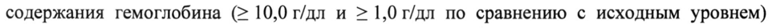
- стр. 3: «Концентрация гемоглобина достигала значений > 10 г/дл у >98 % (р< 0,001) детей,» — низкая уверенность: «10» (66), «>98» (62)  
  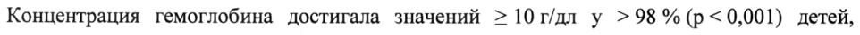
- стр. 3: «введением препарата один раз в неделю и 0,76 (0,21) мкг/кг (диапазон: 0,3-1,5 мкг/кг) в две» — низкая уверенность: «0,3-1,5» (48)  
  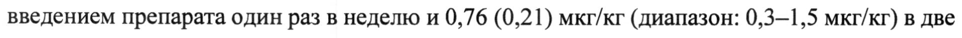
- стр. 4: «хронической болезнью почек (13 (4,1 %) пациентов в возрасте < 1 года, 83 (26,0 %)» — низкая уверенность: «1» (69)  
  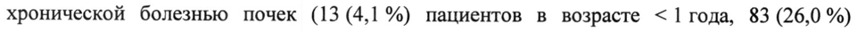
- стр. 5: «приблизительно эквивалентен объему плазмы (50 мл/кг). При подкожном введении» — низкая уверенность: «(50» (78)  
  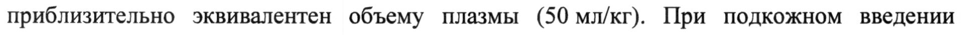
- стр. 5: «~ препарата его биодоступность соответствовала 37%. При ежемесячном подкожном» — повторное чтение: «~ npenapara “ero |  идостулвости соответствовала ome При ежемесячном подкожном»  
  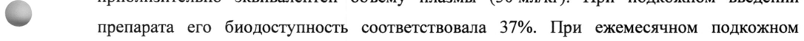
- стр. 5: «введении дарбэпоэтина альфа в дозе oT0,6 до 2,1 мкг/кг его конечный период» — низкая уверенность: «2,1» (53)  
  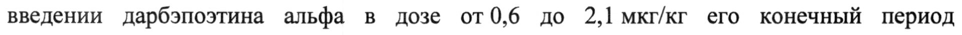
- стр. 7: «выше 12 г/дл. У пациентов, не находящихся на диализе, подкожный способ введения» — низкая уверенность: «12» (71)  
  
- стр. 7: «w стойкого повышения содержания гемоглобина выше 12 г/дл, указания по модификации» — низкая уверенность: «12» (79)  
  
- стр. 10: «гемоглобина. В случае, когда содержание гемоглобина превышает 12 г/дл, следует» — низкая уверенность: «12» (58)  
  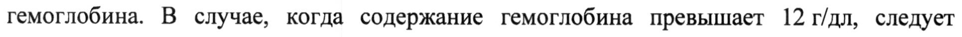
- стр. 11: «гемоглобина. В случае, когда содержание гемоглобина превышает 12 г/дл, следует» — низкая уверенность: «12» (73)  
  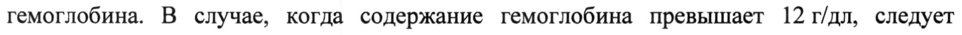
- стр. 12: «2,25 мкг/кг 1раз в неделю. Если клинический ответ (утомляемость, содержание» — низкая уверенность: «1раз» (59)  
  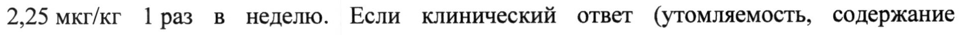
- стр. 12: «< Если содержание гемоглобина превышает 13 г/дл, следует временно прекратить» — низкая уверенность: «13» (73); повторное чтение: «~ Если содержание  емоглобина превышает | 13 v/s, cnenyer  ременно прекратить»  
  
- стр. 22: «гемоглобина 12г/дл у пациентов с активной злокачественной опухолью, не» — низкая уверенность: «12г/дл» (75)  
  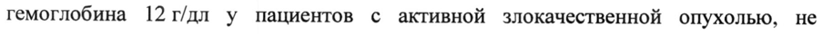
