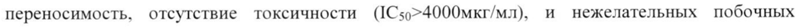

# Дезоксирибонуклеат натрия с железом комплекс — парентерально

- Препарат: Ферровир® (раствор для внутримышечного введения;)
- АТХ: J05AX
- Источник: ГРЛС, инструкция по медицинскому применению, РУ Р N000630/01, файл от  (https://grls.rosminzdrav.ru/Grls_View_v2.aspx?routingGuid=662ad1fe-d40a-42d0-b5a7-cec560e309f3)
- Распознано автоматически (OCR): 4 из 4 стр.
- Сомнительных строк после OCR: 1 (см. раздел «Проверка распознавания»)

## Общие сведения

P №0009050/01-109/19 МИНИСТЕРСТВО ЗДРАВООХРАНЕНИЯ РОССИЙСКОЙ ФЕДЕРАЦИИ
ИНСТРУКЦИЯ ПО МЕДИЦИНСКОМУ ПРИМЕНЕНИЮ ПРЕПАРАТА
ФЕРРОВИР”® Регистрационный номер Р №000630/0]1
Торговое наименование Ферровир* Химическое наименование
Дезоксирибонуклеат натрия с железом комплекс.

## 3. Лекарственная форма

© Раствор для внутримышечного введения.
© Раствор для внутримышечного введения.

## 2. Состав

Действующее вещество:
Действующее вещество:
Дезоксирибонуклеат натрия с железом комплекс - 75,24 мг
Вспомогательное вещество: вода для инъекций — до 5 мл
Описание Прозрачная желтая жидкость.
Фармакотерапевтическая группа Иммуномодулирующее и противовирусное средство.
Код ATX: JOSAX.
Фармакологические свойства © Фармакодинамика

Ферровир* представляет собой биологически активное вещество — вытяжку из молок осетровых или лососевых рыб (очищенная и стандартизованная комплексная соль дезоксирибонуклеата натрия с железом). Препарат оказывает противовирусное и иммуномодулирующее действия, активизирует противовирусный. противогрибковый и противомикробный иммунитеты.
Проявляет противовирусное действие в отношение различных РНК- и ДНК-содержащих вирусов. Клинический опыт применения препарата показал его высокую активность, хорошую переносимость, отсутствие токсичности (1С59>4000мкг/мл), и нежелательных побочных эффектов. При терапии СПИД/ВИЧ-инфекции 14-ти дневное курсовое применение препарата
Ферровир” повышает уровень СО4+лимфоцитов в крови. Это повышение продолжается в течение 1-1,5 месяца после окончания курса лечения. Одновременно снижается вирусная нагрузка в организме, выражающаяся в снижении концентрации РНК ВИЧ в сравнении с исходным уровнем. При рецидивирующей герпетической инфекции сокращается тяжесть и
P NUUU0S5U/U1L-LOU/LY продолжительность рецидива, наступает быстрая и длительная ремиссия после 10-ти дневного курсового лечения. Применение препарата Ферровир® в комплексном лечении больных хроническим гепатитом С способствует улучшению переносимости лечения (уменьшение головокружения, тошноты и т.д.), снижению репликативной активности всех генотипов вируса
НСУ, переведению процесса в латентную фазу с восстановлением клеток печени и отсутствием вирусной репликации. Препарат характеризуется высокой степенью активности при совместном присутствии вирусов основного и оппортунистического заболеваний.

## 5.2. Фармакокинетика

При внутримышечном введении рекомендуемой дозы, препарат быстро всасывается и распределяется в органах и тканях с участием эндолимфатического пути транспорта; обладает высокой тропностью к органам кроветворной системы: принимает активное участие в клеточном метаболизме, встраиваясь в клеточные структуры. В процессе ежедневного
При внутримышечном введении рекомендуемой дозы, препарат быстро всасывается и распределяется в органах и тканях с участием эндолимфатического пути транспорта; обладает высокой тропностью к органам кроветворной системы: принимает активное участие в клеточном метаболизме, встраиваясь в клеточные структуры. В процессе ежедневного

w курсового применения обладает свойством кумулироваться в органах и тканях. Время достижения максимальной концентрации при одноразовом введении — 0,5 часа, после чего начинается снижение концентрации препарата в крови, связанное с его распределением в органах и тканях. При многократном введении препарата каждые 24 часа в течение 4 суток, наблюдается наибольшее его накопление в селезенке, лимфоузлах и костном мозге. После 5-го введения концентрация препарата при последующих введениях во всех органах и тканях не повышается, наблюдается его постепенное снижение.

Метаболизм и выведение

Препарат экскретируется из организма (в виде метаболитов). частично кишечником и в большей степени почками. Среднее время удержания препарата в органах и тканях — 72 часа.
Время полувыведения — 36 часов.

& Показания к применению Ферровир” применяется в комбинированной терапии ВИЧ-инфицированных больных и больных СПИДом, ВИЧ-инфицированных больных с гепатитом С, ВИЧ-инфицированных больных с рецидивирующей герпетической инфекцией. При лечении больных клещевым энцефалитом, гепатитом С, герпесом.

## 4.3. Противопоказания

Повышенная чувствительность к действующему веществу или любому другому компоненту препарата, детский возраст до 18 лет.

## 4.6. Применение при беременности и в период грудного вскармливания

Противопоказано применение препарата при беременности и в период грудного вскармливания.

## 4.2. Способ применения и дозы

При лечении ВИЧ-инфекции или СПИДа, взрослым препарат назначается внутримышечно:
5 мл (15 мг/мл) раствора для внутримышечного введения (75 мг в пересчете на сухое вещество)
P NUUUOSU/UL-LOU/LY 2 раза в сутки, в течение 14 дней. При необходимости, в зависимости ОТ динамики количества
Т4-лимфоцитов и уровня РНК ВИЧ-1 в периферической крови, через 1-1,5 месяца назначается повторный курс терапии.
При лечении герпеса — 5 мл (15 мг/мл) раствора для внутримышечного введения 2 раза в сутки, в течение 10 дней.
При лечении гепатита С Ферровир* вводится внутримышечно 2 раза в сутки по 5 мл (15 мг/мл)
раствора для внутримышечного введения в течение 14 дней. В последующие 14 дней препарат вводится в той же суточной дозе через день.
При клещевом энцефалите препарат вводится 2 раза в сутки по 5 мл (15 мг/мл) раствора для внутримышечного введения в течение 5 - 10 дней.

## 4.8. Побочное действие

Возможно кратковременное повышение температуры тела (до 38°C), гиперемия и умеренная
Возможно кратковременное повышение температуры тела (до 38°C), гиперемия и умеренная

we болезненность в месте инъекции.

## 4.9. Передозировка

Негативных явлений от передозировки не выявлено.
Негативных явлений от передозировки не выявлено.

## 4.5. Взаимодействие с другими лекарственными средствами

Умеренно усиливает действие антикоагулянтов.
В комплексной терапии снижает токсичность и негативное воздействие применяемых препаратов (антибактериальных, противовирусных, противогрибковых и цитостатиков) по средствам цитопротекторных свойств и оптимизации обменных процессов гепатоцита.

## 4.4. Особые указания

Для уменьшения болезненности Ферровир” вводят внутримышечно медленно, в течение 12 мин. Раствор для инъекций следует полностью использовать сразу после вскрытия флакона,
Для уменьшения болезненности Ферровир” вводят внутримышечно медленно, в течение 12 мин. Раствор для инъекций следует полностью использовать сразу после вскрытия флакона,
& He допускается хранение открытых флаконов.

Внутривенное введение препарата не допускается!

## 4.7. Влияние на способность управлять транспортными средствами, механизмами

Влияние препарата на способность к управлению транспортными средствами или движущимися механизмами не отмечено.

## 6.5. Форма выпуска

Раствор для внутримышечного введения 15 мг/мл. По 5 мл во флаконах из бесцветного или коричневого стекла, герметично укупоренные резиновыми пробками и обкатанные алюминиевыми колпачками с отрывной пластиковой накладкой Flip off, в упаковке контурной пластиковой (поддон) в картонной пачке № 5.
Раствор для внутримышечного введения 15 мг/мл. По 5 мл во флаконах из бесцветного или коричневого стекла, герметично укупоренные резиновыми пробками и обкатанные алюминиевыми колпачками с отрывной пластиковой накладкой Flip off, в упаковке контурной пластиковой (поддон) в картонной пачке № 5.

## 6.4. Условия хранения

В защищенном от света месте при температуре от +4°C до +20°С. Хранить в местах недоступных для детей.
В защищенном от света месте при температуре от +4°C до +20°С. Хранить в местах недоступных для детей.
P №009050/01-1090/15 Срок годности 5 лет. Не использовать препарат после истечения срока годности, указанного на упаковке.
Условия отпуска Отпускают по рецепту.
Производитель ООО «ФЗ Иммуннолекс»
105318, Россия, г. Москва, ул. Мироновская, д. 33, стр. 27
Владелец регистрационного удостоверения / Организация, принимающая претензии
ООО «ФармПак»
127521, Россия, г. Москва, Анненский проезд, домовладение 7, стр. 1., тел.: (495) 739-52-98,
(495) 739-52-03, сайт: www.derinat.com .
Зи, © LE el Директор OOO «ФармПай»/ | ‘ ь В.Ю. Каплин us| Фарм ак |= а ДЕ
AO 26 < ON Ad fy oe 48K oy Rees x > ФГБУ |
EI ole а а мых = ВЕ.
|< 8 85 ‚> > 513 isis Я mS ОВ в о] | ян |
>Я | i) В: ЗО ПИ Ге | | ПИОЕПН | 117042
## Проверка распознавания

Страницы-сканы распознаны автоматически. В 1 строках с дозировками цифры могли распознаться с ошибкой — сверьте с вырезкой из оригинала:

- стр. 1: «переносимость, отсутствие токсичности (1С59>4000мкг/мл), и нежелательных побочных» — низкая уверенность: «(1С59>4000мкг/мл),» (0)  
  
