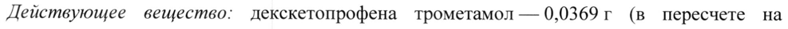
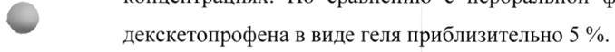
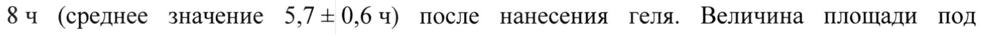
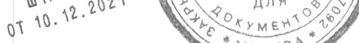

# Декскетопрофен — наружно

- Препарат: Фламадекс® (гель для наружного применения;)
- АТХ: M02AA27
- Источник: ГРЛС, инструкция по медицинскому применению, РУ ЛП-007945, файл от 2025-07-17 (https://grls.rosminzdrav.ru/Grls_View_v2.aspx?routingGuid=f292ba5b-94a4-47a5-8c2a-0ed54143a751)
- Распознано автоматически (OCR): 5 из 5 стр.
- Инструкция к другому РУ того же препарата: ЛП-007945 (национальное РУ, переоформленное по правилам ЕАЭС, решение от 09.07.2025). Текст может быть старше действующего
- Сомнительных строк после OCR: 4 (см. раздел «Проверка распознавания»)

## Общие сведения

МИНИСТЕРСТВО ЗДРАВООХРАНЕНИЯ РОССИЙСКОЙ ФЕДЕРАЦИИ
ИНСТРУКЦИЯ ПО МЕДИЦИНСКОМУ ПРИМЕНЕНИЮ ЛЕКАРСТВЕННОГО ПРЕПАРАТА
Фламадекс®

Регистрационный номер:

Торговое наименование: Фламадекс®

Международное непатентованное или группировочное наименование: декскетопрофен
~ Лекарственная форма: гель для наружного применения

## 2. Состав

Состав на 1 г геля:

Действующее вещество: декскетопрофена трометамол — 0,0369 г (в пересчете на
& декскетопрофен) — 0,025 г;

вспомогательные вещества: этанол 95 % (в пересчете на этанол) — 0,2265 г,

диметилсульфоксид — 0,08 г, эдетол (тетрагидроксипропилэтилендиамин, Neutrol®

ТЕ) — or 0,027 г до 0,043 г (до РН 6,5-7,5), карбомер (Carbopol® Ultrez 21) — 0,013 г,

лаванды масло — 0,0006 г, вода очищенная — до | г.
> Описание: прозрачный или почти прозрачный бесцветный однородный гель со

специфическим запахом.

Фармакотерапевтическая группа: нестероидный противовоспалительный препарат для

наружного применения

Код ATX: М02АА27

Фармакологические свойства

## 5.1. Фармакодинамика

Фламадекс® гель содержит декскетопрофен — нестероидный противовоспалительный

препарат (НПВП), производное пропионовой кислоты. Препарат оказывает анальгезирующее и противовоспалительное действие, тем самым снижая ощущения жара в месте воспаления. Механизм действия связан с ингибированием синтеза простагландинов на уровне циклооксигеназы-1 и циклооксигеназы-2.
При местном применении препарат уменьшает боль в области сустава в покое и при движении. Способствует увеличению объема движений.
Входящий в состав вспомогательных веществ диметилсульфоксид усиливает проникновение лекарственных средств через кожу.

## 5.2. Фармакокинетика

Абсорбция При наружном применении препарата Фламадекс® гель декскетопрофен медленно всасывается в системный кровоток, обнаруживается в плазме крови в следовых
Абсорбция При наружном применении препарата Фламадекс® гель декскетопрофен медленно всасывается в системный кровоток, обнаруживается в плазме крови в следовых
, концентрациях. По сравнению с пероральной формой, относительная биодоступность
© декскетопрофена в виде геля приблизительно 5 %.
Максимальная концентрация (Cmax) декскетопрофена 200 + 22 нг/мл достигается спустя 484 (среднее значение 5,7-0,6 ч) после нанесения геля. Величина площади под фармакокинетической кривой (AUCo+) составила 1283 + 203 нгхч/мл.
Распределение = Среднее время удерживания декскетопрофена в плазме — 7,29 + 1,71 4.
Выведение Метаболизм декскетопрофена в основном происходит путем конъюгации с глюкуроновой кислотой с последующим выведением почками. Период полувыведения (Т!/2)
декскетопрофена составил 7,23 + 1,63 ч.
v Показания к применению Остеоартроз (гонартроз коленных суставов П-Ш степени по Келлгрену).
Применяется для симптоматической терапии, уменьшения боли и воспаления; на прогрессирование заболевания не влияет.

## 4.3. Противопоказания

Гиперчувствительность к декскетопрофену и другим компонентам препарата (в т. ч. к другим НПВП); полное или неполное сочетание бронхиальной астмы, рецидивирующего полипоза носа и околоносовых пазух и непереносимости ацетилсалициловой кислоты или других НПВП (в т. ч. в анамнезе); повышенная чувствительность кожи к воздействию солнечного излучения (фотосенсибилизация) в анамнезе; кожная аллергия в анамнезе на декскетопрофен, кетопрофен, тиапрофеновую кислоту, фенофибрат, солнцезащитные средства и парфюмерию; воздействие солнца на обрабатываемые участки, включая солярий, в течение курса применения препарата и 2 недели после; нарушение целостности кожных покровов в местах предполагаемого нанесения; детский возраст (до 18 лет)
Гиперчувствительность к декскетопрофену и другим компонентам препарата (в т. ч. к другим НПВП); полное или неполное сочетание бронхиальной астмы, рецидивирующего полипоза носа и околоносовых пазух и непереносимости ацетилсалициловой кислоты или других НПВП (в т. ч. в анамнезе); повышенная чувствительность кожи к воздействию солнечного излучения (фотосенсибилизация) в анамнезе; кожная аллергия в анамнезе на декскетопрофен, кетопрофен, тиапрофеновую кислоту, фенофибрат, солнцезащитные средства и парфюмерию; воздействие солнца на обрабатываемые участки, включая солярий, в течение курса применения препарата и 2 недели после; нарушение целостности кожных покровов в местах предполагаемого нанесения; детский возраст (до 18 лет)
(эффективность и безопасность не установлены); беременность, период грудного вскармливания.

## 4.3. С осторожностью

тяжелые нарушения функции почек, сердечная недостаточность, бронхиальная астма.
тяжелые нарушения функции почек, сердечная недостаточность, бронхиальная астма.

## 4.6. Применение при беременности и в период грудного вскармливания

Применение при беременности и в период грудного вскармливания противопоказано.
® Способ применения и дозы Режим дозирования
Наносить легкими втирающими движениями в области пораженного коленного сустава 2 раза в сутки по 7 см геля в течение 10 дней.
Способ применения | Наружно. Наносить только на неповрежденные участки кожи, избегая попадания на открытые раны. Не применять внутрь!

## 4.8. Побочное действие

Представленные ниже нежелательные явления классифицированы по системно-органным классам и частоте возникновения. Частота возникновения побочных эффектов
Представленные ниже нежелательные явления классифицированы по системно-органным классам и частоте возникновения. Частота возникновения побочных эффектов
< определялась в соответствии с классификацией Всемирной Организации Здравоохранения:
очень часто (> 1/10), часто (от > 1/100 до < 1/10), нечасто (от > 1/1000 до < 1/100), редко
(от> 1/10000 до < 1/1000), очень редко (< 1/10000), частота неизвестна (частота не может быть определена на основе имеющихся данных).
Нарушения со стороны мышечной, скелетной и соединительной ткани: частота неизвестна - боль в тазобедренном суставе.
Лабораторные и инструментальные данные: частота неизвестна - увеличение скорости оседания эритроцитов.

## 4.9. Передозировка

Ввиду низкой системной абсорбции при аппликации Фламадекс® геля, передозировка при наружном применении маловероятна.
Ввиду низкой системной абсорбции при аппликации Фламадекс® геля, передозировка при наружном применении маловероятна.

## 4.5. Взаимодействие с другими лекарственными средствами

Фламадекс® гель не следует применять вместе с другими препаратами для наружного применения.

## 4.4. Особые указания

Фламадекс® гель рекомендуется наносить только на неповрежденные участки кожи, избегая попадания на открытые раны. Следует избегать попадания геля в глаза, на кожу вокруг глаз и слизистые оболочки.
Фламадекс® гель рекомендуется наносить только на неповрежденные участки кожи, избегая попадания на открытые раны. Следует избегать попадания геля в глаза, на кожу вокруг глаз и слизистые оболочки.
Рекомендуется тщательно мыть руки после применения препарата.
Не применять в виде герметических повязок. Не использовать в сочетании с герметичной одеждой.
Длительное применение средств местного действия может приводить к повышению
~ чувствительности или местному раздражению. Bo избежание каких-либо проявлений гиперчувствительности или фотосенсибилизации, следует избегать воздействия прямых солнечных лучей (в том числе посещение солярия) в период лечения и в течение двух недель после применения препарата и рекомендуется закрывать обрабатываемые участки одеждой.
-

## 4.7. Влияние на способность управлять транспортными средствами, механизмами

Влияние препарата на способность управлять транспортными средствами, механизмами не изучалось.

## 6.5. Форма выпуска

~ Гель для наружного применения 2,5 %.
~ Гель для наружного применения 2,5 %.
По 30r, 50г или 100г в тубы алюминиевые с бушонами полимерными или тубы из комбинированного материала (полиэтилен/алюминий/полиэтилен) с бушонами для упаковывания лекарственных средств.
Каждая туба вместе с инструкцией по применению в пачке из картона.

## 6.4. Условия хранения

Хранить при температуре не выше 25 °С.
Хранить при температуре не выше 25 °С.
Хранить в недоступном для детей месте.

## 6.3. Срок годности

2 года.
2 года.
Не применять по истечении срока годности.
Условия отпуска Отпускают без рецепта.
Производитель ООО НПО «ФармВИЛАР», Россия 249096, Калужская обл., Малоярославецкий район, г. Малоярославец, ул. Коммунистическая, д. 115.
Владелец регистрационного удостоверения/ Организация, принимающая претензии
© потребителей ЗАО «ФармФирма «Сотекс»
141345, Россия, Московская область, Сергиево-Посадский район, пос. Беликово, д. 11
Т./ф.: +7(495) 956-29-30 ОЕ ОБ м 7, ke, сом Ф ни \

Генеральный директор < 21-7.8 > VN Яцук В.Р.

А У < — "2 ЗАО «ФармФирма «Cotexcy? ¥ Е : | Core KC jeg

№ ove? TELA < [5 it 9024 \ a ‚ ANA © АУ | gi 10% RES mens AY
“ моск
## Проверка распознавания

Страницы-сканы распознаны автоматически. В 4 строках с дозировками цифры могли распознаться с ошибкой — сверьте с вырезкой из оригинала:

- стр. 1: «Действующее вещество: декскетопрофена трометамол — 0,0369 г (в пересчете на» — низкая уверенность: «0,0369» (20)  
  
- стр. 2: «© декскетопрофена в виде геля приблизительно 5 %.» — повторное чтение: «- cemismmanibesn виде ress т omeareRnA See.»  
  
- стр. 2: «84 (среднее значение 5,7-0,6 ч) после нанесения геля. Величина площади под» — низкая уверенность: «5,7-0,6» (63)  
  
- стр. 5: «gi 10% RES mens AY» — низкая уверенность: «10%» (45); повторное чтение: «п. Nees OY»  
  
