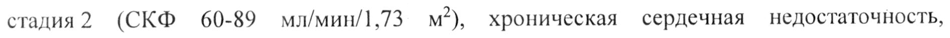

# Декскетопрофена трометамол — внутрь

- Препарат: ДЕКСКЕТОПРОФЕН ВЕЛФАРМ (таблетки, покрытые пленочной оболочкой;)
- АТХ: M01AE17
- Источник: ГРЛС, инструкция по медицинскому применению, РУ ЛП-007129, файл от 2022-11-21 (https://grls.rosminzdrav.ru/Grls_View_v2.aspx?routingGuid=115288fe-fda5-4ead-b2e5-91a54f0e126d)
- Распознано автоматически (OCR): 11 из 11 стр.
- Инструкция к другому РУ того же препарата: ЛП-007129 (национальное РУ, переоформленное по правилам ЕАЭС, решение от 17.10.2022). Текст может быть старше действующего
- Сомнительных строк после OCR: 1 (см. раздел «Проверка распознавания»)

## Общие сведения

| МИНЗДРАВ РОССИИ | | ЛИ - 007129-28062!
| a | МИНИСТЕРСТВО ЗДРАВООХРАНЕНИЯ российской ФЕЯЕРАЦИИ —
ИНСТРУКЦИЯ ПО МЕДИЦИНСКОМУ ПРИМЕНЕНИЮ ЛЕКАРСТВЕННОГО ПРЕПАРАТА
ДЕКСКЕТОПРОФЕН ВЕЛФАРМ Регистрационный номер:
Торговое наименование: Декскетопрофен Велфарм
Международное непатентованное наименование: Декскетопрофен

## 3. Лекарственная форма

таблетки, покрытые пленочной оболочкой
таблетки, покрытые пленочной оболочкой
Состав на одну таблетку:
© Действующее вещество: декскетопрофена трометамол — 36,9 мг (в пересчете на
| декскетопрофен - 25,0 мг).
Вспомогательные вещества: целлюлоза микрокристаллическая (101), крахмал кукурузный, крахмал кукурузный прежелатинизированный, гипролоза
(гидроксипропилцеллюлоза), магния стеарат.
Состав оболочки: [сухая смесь для пленочного покрытия (Опадрай® 032180011 белый), содержащая гипромеллозу, титана диоксид, макрогол 6000 или гипромеллоза
(оксипропилметилцеллюлоза), титана диоксид, макрогол 6000 (полиэтиленгликоль 6000, полиэтиленоксид 6000)].
Описание: круглые двояковыпуклые таблетки, покрытые пленочной оболочкой белого или почти белого цвета, с риской. На поперечном разрезе — ядро белого или почти белого цвета.
© Фармакотерапевтическая группа: нестероидный противовоспалительный препарат
(НИВП).
Код ATX: MOIAE17 Фармакологические свойства

## 5.1. Фармакодинамика

Декскетопрофена трометамол относится к нестероидным противовоспалительным препаратам (НПВП), оказывает обезболивающее, — противовоспалительное и жаропонижающее действие. Механизм действия декскетопрофена основан На ингибировании синтеза простагландинов на уровне циклооксигеназ (ЦОГ-1 и ЦОГ-2).
Декскетопрофена трометамол относится к нестероидным противовоспалительным препаратам (НПВП), оказывает обезболивающее, — противовоспалительное и жаропонижающее действие. Механизм действия декскетопрофена основан На ингибировании синтеза простагландинов на уровне циклооксигеназ (ЦОГ-1 и ЦОГ-2).
Обезболивающий эффект наступает через 30 мин после приема препарата внутрь, продолжительность терапевтического действия составляет 4-6 ч.

## 5.2. Фармакокинетика

Всасывание. Время достижения максимальной концентрации (TCmax) декскетопрофена в
Всасывание. Время достижения максимальной концентрации (TCmax) декскетопрофена в

плазме крови после однократного приема внутрь разовой дозы составляет в среднем

30 мин (15-60 мин). Одновременный прием пищи замедляет всасывание декскетопрофена.

Площади под кривой «концентрация-время» (AUC) после однократного и повторного

приемов сходны, что указывает на отсутствие кумуляции препарата.

Распределение. Для декскетопрофена характерна высокая степень связывания с белками

плазмы крови (99 %). Среднее значение объема распределения (Va) составляет менее

0,25 л/кг, период полураспределения составляет около 0,35 ч.

Метаболизм и выведение. Основным путем метаболизма декскетопрофена является его

конъюгация с глюкуроновой кислотой с последующим выведением почками. Период

полувыведения (Ту?) декскетопрофена составляет 1,65 ч. У лиц пожилого возраста
© наблюдается удлинение периода полувыведения до 48 % и снижение общего клиренса

препарата.

## 4.1. Показания к применению

Мышечно-скелетная боль (слабо или умеренно выраженная), альгодисменорея, зубная

боль.

Препарат предназначен для симптоматического лечения, уменьшения боли и воспаления

на момент применения.

## 4.3. Противопоказания

- гиперчувствительность к декскетопрофену, другим компонентам препарата и другим

НПВП;

- полное или неполное сочетание бронхиальной астмы, рецидивирующего полипоза носа и

околоносовых пазух и непереносимости ацетилсалициловой кислоты или других НПВП (в
> том числе в анамнезе);

- эрозивно-язвенные поражения желудочно-кишечного тракта в стадии обострения;

- желудочно-кишечные кровотечения или перфорации в анамнезе, включая связанные с

предшествующим применением НПВП;

- желудочно-кишечные кровотечения; другие активные кровотечения (в том числе

подозрение на внутричерепное кровоизлияние);

- воспалительные заболевания кишечника (болезнь Крона, язвенный колит) в стадии

обострения;

- печеночная недостаточность тяжелой степени тяжести (10-15 баллов по шкале Чайлд-

Нью);

- прогрессирующие заболевания почек, подтвержденная гиперкалиемия;

- хроническая болезнь почек: стадия За (скорость клубочковой фильтрации (СКФ) 45-

59 мл/мин/1,73 м²), 36 (СКФ 30-44 мл/мин/1,73 м²) и 4 (СКФ < 30 мл/мин/1,73 м²);
- период после проведения аортокоронарного шунтирования;
- тяжелая сердечная недостаточность (Ш-У класс по классификации NYHA);
- геморрагический диатез и другие нарушения свертывания крови;
- возраст до 18 лет (в связи с отсутствием данных по эффективности и безопасности);
- беременность и период грудного вскармливания.

## 4.3. С осторожностью

Язвенная болезнь желудка и двенадцатиперстной кишки, язвенный колит, болезнь Крона, заболевания печени в анамнезе, печеночная порфирия, хроническая болезнь почек, стадия? (СКФ 60-89 мл/мин/1,73 м²), хроническая сердечная недостаточность, артериальная гипертензия, значительное снижение объема циркулирующей крови (в том
Язвенная болезнь желудка и двенадцатиперстной кишки, язвенный колит, болезнь Крона, заболевания печени в анамнезе, печеночная порфирия, хроническая болезнь почек, стадия? (СКФ 60-89 мл/мин/1,73 м²), хроническая сердечная недостаточность, артериальная гипертензия, значительное снижение объема циркулирующей крови (в том

© числе после хирургического вмешательства), пожилые пациенты старше 65 лет (в ТОМ числе получающие диуретики, ослабленные пациенты и пациенты с низкой массой тела), бронхиальная астма, одновременный прием глюкокортикостероидов (в том числе преднизолона), антикоагулянтов (в том числе варфарина), антиагрегантов (в том числе ацетилсалициловой кислоты, клопидогрела), селективных ингибиторов обратного захвата серотонина (в том числе циталопрама, флуоксетина, пароксетина, сертралина), ишемическая болезнь сердца, цереброваскулярные заболевания, дислипидемия/гиперлипидемия, сахарный диабет, заболевания периферических артерий, курение, наличие инфекции Helicobacter pylori, системная красная волчанка (СКВ) и другие системные заболевания соединительной ткани, длительное применение НИВП, туберкулез, выраженный остеопороз, алкоголизм, тяжелые соматические заболевания.

| Применение при беременности и в период грудного вскармливания

& Применение декскетопрофена при беременности и в период грудного вскармливания противопоказано.

## 4.2. Способ применения и дозы

Декскетопрофен принимают внутрь во время еды. Одновременный прием пищи замедляет всасывание декскетопрофена, поэтому в случае острой боли рекомендуется применение препарата не менее чем за 30 мин до приема пищи.
Декскетопрофен принимают внутрь во время еды. Одновременный прием пищи замедляет всасывание декскетопрофена, поэтому в случае острой боли рекомендуется применение препарата не менее чем за 30 мин до приема пищи.
В зависимости от интенсивности болевого синдрома, рекомендуемая доза для взрослых составляет 12,5 мг декскетопрофена (1/2 таблетки) каждые 4-6 ч или 25 мг декскетопрофена (1 таблетка) каждые 8 ч.
Максимальная суточная доза — 75 мг.
Декскетопрофен не предназначен для длительной терапии, курс лечения препаратом не должен превышать 3-5 дней.

Пациенты 65 лет и старше

Пациентам пожилого возраста следует принимать препарат, начиная с минимальной

рекомендованной дозы.

Максимальная суточная доза составляет 50 мг.

В случае хорошей переносимости могут применяться дозы, рекомендованные для общей

популяции.

Пациенты с печеночной недостаточностью

Пациентам с печеночной недостаточностью легкой и средней степени тяжести следует

принимать препарат, начиная с минимальной рекомендованной дозы.

Максимальная суточная доза составляет 50 мг.

Применение декскетопрофена у пациентов с печеночной недостаточностью тяжелой
© степени тяжести противопоказано.

Пациеиты с почечной недостаточностью

Пациентам с почечной недостаточностью легкой степени тяжести — хроническая болезнь

почек, стадия 2 (СКФ 60-89 мл/мин/1,73 м²) следует принимать декскетопрофен, начиная с

минимальной рекомендованной дозы.

Максимальная суточная доза составляет 50 мг.

Применение декскетопрофена у пациентов с хронической болезнью почек стадий За (СКФ

45-59 мл/мин/1,73 м²), 36 (СКФ 30-44 мл/мин/1,73 м²) и 4 (СКФ < 30 мл/мин/1,73 м²)

противопоказано.

## 4.8. Побочное действие

Возможные побочные эффекты приведены в соответствии с классификацией Всемирной

организации здравоохранения ниже по убыванию частоты возникновения: очень часто
& (21/10), часто (21/100 и <1/10), нечасто (>1/1000 и <1/100), редко (21/10000 и <1/1000),

очень редко (<1/10000), включая отдельные сообщения.

Нарушения со стороны крови и лимфатической системы: очень редко — нейтропения,

тромбоцитопения.

Нарушения со стороны иммунной системы: редко — отек гортани; очень редко —

анафилактические реакции, включая анафилактический шок.

Нарушения со стороны обмена веществ и питания: редко — анорексия.

Нарушения психики: нечасто — бессонница, ощущение беспокойства.

Нарушения со стороны нервной системы: нечасто — головная боль, головокружение,

сонливость; редко — парестезии, синкопальные состояния (преходящие кратковременные

обмороки).

Нарушения со стороны органа зрения: очень редко — нечеткость зрения.

Нарушения со стороны органа слуха и лабиринтные нарушения: нечасто — вертиго; очень редко — шум в ушах.

Нарушения со стороны сердца: нечасто — ощущение сердцебиения, чувство жара, гиперемия кожных покровов; редко — повышение артериального давления; очень редко — тахикардия, снижение артериального давления.

Нарушения со стороны дыхательной системы, органов грудной клетки и средостения:
редко — брадипноэ; очень редко — бронхоспазм, одышка.

Нарушения со стороны желудочно-кишечного тракта: часто — тошнота, рвота, боль в животе, диспепсия, диарея; нечасто — гастрит, запор, сухость во рту, метеоризм; редко — эрозивно-язвенные поражения желудочно-кишечного тракта (ЖКТ), кровотечение из язвы или ее перфорация; очень редко — поражение поджелудочной железы.

© Нарушения со стороны печени и желчевыводящих путей: редко — гепатит, повышение активности «печеночных» ферментов, в том числе аспартатаминотрансферазы и

| аланинаминотрансферазы (АСТ и AJIT); очень редко — поражение печени.

Нарушения со стороны кожи и подкожных тканей: нечасто — кожная сыпь; редко — крапивница, угревая сыпь, потливость; очень редко — тяжелые кожные реакции (синдром
Стивенса-Джонсона, токсический эпидермальный некролиз (синдром Лайелла)), ангионевротический отек, отек лица, аллергический дерматит, фотосенсибилизация, кожный зуд.

Нарушения со стороны скелетно-мышечной и соединительной ткани: редко — боль в спине.

Нарушения со стороны почек и мочевыводящих путей: редко — полиурия, острая почечная недостаточность; очень редко — нефрит или нефротический синдром.

w Нарушения со стороны половых органов и молочной железы: редко — у женщин — нарушение менструального цикла, у мужчин — преходящее нарушение функции предстательной железы при длительном применении.

Общие расстройства и нарушения в месте введения: нечасто — повышенная утомляемость, астения, озноб, общее недомогание; очень редко — периферические отеки.
Как и при применении других НПВП, возможно развитие следующих побочных эффектов:
асептический менингит, возникающий преимущественно у пациентов с системной красной волчанкой или другими системными заболеваниями соединительной ткани, гематологические нарушения (тромбоцитопеническая пурпура, апластическая и гемолитическая анемии), редко — агранулоцитоз и гипоплазия костного мозга.

## 4.9. Передозировка

Симптомы: тошнота, анорексия, боль в животе, головная боль, головокружение, дезориентация, бессонница.
Симптомы: тошнота, анорексия, боль в животе, головная боль, головокружение, дезориентация, бессонница.
Лечение: симптоматическая терапия, при необходимости — промывание желудка, прием активированного угля; гемодиализ малоэффективен.

## 4.5. Взаимодействие с другими лекарственными средствами

Нижеследующие взаимодействия характерны для всех НПВП.
Нежелательные комбинации С другими НПВП, включая салицилаты в высоких дозах (более 3 г в сутки): одновременное применение нескольких НПВП вследствие синергического эффекта повышает риск развития желудочно-кишечного кровотечения и язвы.
С антикоагулянтами: декскетопрофен, как и другие НПВП, может усиливать эффект антикоагулянтов, таких как варфарин в связи с высокой степенью связывания с белками
© плазмы крови, ингибированием агрегации тромбоцитов и поражением слизистой оболочки желудочно-кишечного тракта. В случае необходимости одновременного применения необходим тщательный контроль за состоянием пациента и регулярный мониторинг лабораторных показателей.
С гепарином: при одновременном применении повышается риск развития кровотечения (в связи с ингибированием агрегации тромбоцитов и повреждающим действием на слизистую оболочку желудочно-кишечного тракта). В случае необходимости одновременного применения необходим тщательный контроль за состоянием пациента и регулярный мониторинг лабораторных показателей.
С глюкокортикостероидами: при одновременном применении повышается риск язвенного поражения желудочно-кишечного тракта и кровотечений.
С препаратами лития: НИВПИ повышают концентрацию лития в плазме крови вплоть до w токсической в связи с чем, данный показатель необходимо контролировать при одновременном применении с декскетопрофеном, изменении дозировки, а также после отмены НПВП.
С метотрексатом в высоких дозах (15 Me в неделю и более): возможно повышение гематологической токсичности метотрексата в связи CO снижением его почечного клиренса при одновременном применении с НПВП.
С гидантоинами и сульфонамидами: возможно усиление их токсического действия.
Комбинации, требующие осторожности С Диуретиками, ингибиторами ангиотензинпревращающего фермента (АПФ), антибиотиками из группы аминогликозидов, антагонистами рецепторов ангиотензинаIJ; одновременное применение с НПВП связано с риском развития острой почечной недостаточности у обезвоженных пациентов (снижение клубочковой фильтрации, обусловленное сниженным синтезом простагландинов). При одновременном применении
НИВИ могут уменьшать антигипертензивный эффект некоторых препаратов. При одновременном применении декскетопрофена и диуретиков необходимо убедиться, что у пациента отсутствуют признаки обезвоживания, а также в начале одновременного применения контролировать функцию почек.
С метотрексатом в низких дозах (менее 15 мг в неделю): возможно повышение гематологической токсичности метотрексата в связи со снижением его почечного клиренса на фоне терапии НПВП. Необходимо проводить подсчет клеток крови в начале одновременного применения. При наличии нарушения функции почек даже легкой степени, а также у лиц пожилого возраста, необходимо тщательное медицинское наблюдение.
© С пентоксифиллином: возможно повышение риска развития кровотечения. Необходим тщательный клинический мониторинг и регулярная проверка времени кровотечения
(времени свертываемости крови).
С зидовудином: существует риск усиления токсического действия на эритроциты, обусловленного воздействием на ретикулоциты, с развитием тяжелой анемии через неделю после начала применения НПВП. Необходимо проведение общего анализа крови с подсчетом количества ретикулоцитов через 1-2 недели после начала терапии НПВП.
С пероральными гипогликемическими средствами: НПВП могут усиливать гипогликемическое действие препаратов сульфонилмочевины вследствие вытеснения ее из мест связывания с белками плазмы крови.
Комбинации, которые необходимо принимать во внимание
С бета-адреноблокаторами: при одновременном применении с НПВИ может
- уменьшаться антигипертензивный эффект бета-адреноблокаторов — вследствие ингибирования синтеза простагландинов.
С циклоспорином и такролимусом: НПВП могут увеличивать нефротоксичность, что опосредовано действием ренальных простагландинов. Во время проведения одновременной терапии необходимо контролировать функцию почек.
С тромболитиками: повышенный риск развития кровотечений.
Увеличивается риск развития кровотечения из ЖКТ при одновременном применении с ингибиторами обратного захвата серотонина (циталопрам, флуоксетин, сертралин) и антикоагулянтами.
С пробенецидом: возможно повышение концентрации НПВП в плазме крови, что может быть обусловлено ингибирующим эффектом пробенецида на почечную тубулярную секрецию и/или конъюгацию с глюкуроновой кислотой, что требует коррекции дозы
НИВИ.
С сердечными гликозидами: одновременное применение с НПВП может приводить к повышению концентрации сердечных гликозидов в плазме крови.
С мифепристоном: в связи с теоретическим риском изменения эффективности мифепристона под влиянием ингибиторов синтеза простагландинов, НПВП не следует назначать ранее, чем через 8-12 сут после отмены мифепристона.
С хинолонами: данные, полученные в экспериментальных исследованиях на животных, указывают на высокий риск развития судорог при одновременном применении НПВП с хинолонами в высоких дозах.
В случае необходимости одновременного — применения декскетопрофена с вышеперечисленными лекарственными средствами следует проконсультироваться с
© врачом.

## 4.4. Особые указания

Нежелательные побочные эффекты можно свести к минимуму при применении препарата в наименьшей эффективной дозе при минимальной длительности применения, необходимой для купирования болевого синдрома.
Нежелательные побочные эффекты можно свести к минимуму при применении препарата в наименьшей эффективной дозе при минимальной длительности применения, необходимой для купирования болевого синдрома.
Риск возникновения осложнений со стороны ЖКТ повышается у пациентов с язвенным поражением ЖКТ в анамнезе, у пожилых пациентов, при увеличении дозы НПВП;
поэтому применение декскетопрофена у этой категории пациентов следует начинать с наименьшей рекомендуемой дозы.
Пациентам вышеперечисленных категорий, а также пациентам, которым требуется одновременное применение низких доз ацетилсалициловой кислоты или других средств,
| повышающих риск возникновения осложнений со стороны ЖКТ, рекомендуется w дополнительно одновременное применение гастропротекторов (мизопростол или блокаторы протонной помпы).
У пациентов, одновременно принимающих антиагреганты или антикоагулянты, глюкокортикостероиды, также повышается риск возникновения желудочно-кишечного кровотечения.
Пациенты с нарушениями со стороны желудочно-кишечного тракта или желудочнокишечными заболеваниями в анамнезе должны находиться под тщательным медицинским наблюдением. В случае возникновения желудочно-кишечного кровотечения или язвенного поражения терапию декскетопрофеном следует отменить.
Декскетопрофен следует применять с осторожностью у пациентов с желудочнокишечными заболеваниями в анамнезе (язвенный колит, болезнь Крона), поскольку возможно обострение этих заболеваний.
| 8 Bee НПВП могут ингибировать агрегацию тромбоцитов и увеличивать время кровотечения за счет ингибирования синтеза простагландинов. В связи с этим применение декскетопрофена у пациентов, одновременно принимающих препараты, влияющие на систему гемостаза, такие как варфарин, производные кумарина и гепарины, ие рекомендовано.
Как и другие НПВП, декскетопрофен может приводить к повышению концентрации креатинина и азота в плазме крови. Как и другие ингибиторы синтеза простагландинов, декскетопрофен может оказывать побочное действие на мочевыделительную систему, что может привести к развитию гломерулонефрита, интерстициального нефрита, папиллярного некроза, нефротического синдрома и острой почечной недостаточности.
Следует соблюдать осторожность при применении препарата у пациентов, одновременно
© применяющих диуретики и пациентов, у которых возможно развитие гиповолемии, в связи с повышенным риском нефротоксичности.
Как и при применении других НПВП, на фоне терапии декскетопрофеном может наблюдаться небольшое преходящее повышение активности «печеночных» ферментов. У пациентов пожилого возраста необходим контроль функции печени и почек. В случае значительного повышения соответствующих показателей декскетопрофен следует отменить.
Как и другие НПВП, декскетопрофен может маскировать симптомы инфекционных заболеваний. В случае обнаружения признаков инфекции или ухудшения самочувствия на фоне терапии декскетопрофеном пациенту необходимо сразу обратиться к врачу.
Препарат может вызывать задержку жидкости в организме, поэтому у пациентов ©
| артериальной гипертензией, с почечной и/или сердечной недостаточностью ew декскетопрофен следует применять с особой осторожностью. В случае ухудшения состояния применение препарата необходимо прекратить.
У пациентов с неконтролируемой артериальной гипертензией, ишемической болезнью сердца, застойной сердечной недостаточностью, заболеваниями периферических артерий и/или цереброваскулярными заболеваниями препарат следует применять © осторожностью. Аналогичный подход применим к пациентам с факторами риска развития сердечно-сосудистых заболеваний (артериальная гипертензия, гиперлипидемия, сахарный диабет, курение).
Необходимо соблюдать осторожность при назначении декскетопрофена пациентам с наличием в анамнезе сердечно-сосудистых заболеваний, особенно пациентам с сердечной недостаточностью, в связи с возможным риском прогрессирования.
Клинические исследования и эпидемиологические данные позволяют сделать вывод о том, что НПВП, особенно в высоких дозах и при длительном применении, могут приводить к незначительному риску развития острого инфаркта миокарда или инсульта.
Для исключения риска данных событий при применении декскетопрофена данных недостаточно.
Пожилые пациенты особенно подвержены неблагоприятным реакциям при применении
НПВП, в том числе, риску возникновения желудочно-кишечных кровотечений и перфораций, угрожающим жизни пациента, снижению функций почек, печени и сердца.
При применении декскетопрофена у данной категории пациентов необходим надлежащий клинический контроль.
Имеются данные о возникновении редких случаев кожных реакций (таких как эксфолиативный дерматит, синдром Стивенса-Джонсона, токсический эпидермальный
© некролиз) при применении НПВП. При первых проявлениях кожной сыпи, поражении слизистых оболочек или других признаках аллергической реакции прием декскетопрофена следует немедленно прекратить и обратиться к врачу.

## 4.7. Влияние на способность управлять транспортными средствами, механизмами

В связи с возможным головокружением и сонливостью в период приема декскетопрофена, способность к концентрации внимания и быстрота психомоторных реакций у пациентов могут снижаться, особенно в первый час после приема препарата. Поэтому в период лечения декскетопрофеном следует соблюдать осторожность при управлении транспортными средствами и занятиях потенциально опасными видами деятельности, требующими повышенной концентрации внимания и быстроты психомоторных реакций.

## 6.5. Форма выпуска

| Таблетки, покрытые пленочной оболочкой 25 мг.
| Таблетки, покрытые пленочной оболочкой 25 мг.
w 10, 24, 30 таблеток в контурную ячейковую упаковку из пленки поливинилхлоридной и фольги алюминиевой печатной лакированной.
10, 20, 30, 40, 50, 60 таблеток в банку полимерную из полипропилена с крышкой натягиваемой из полиэтилена высокого давления или в банку полимерную из полиэтилена низкого давления с крышкой натягиваемой из полиэтилена низкого давления или с крышкой навинчиваемой из полиэтилена низкого давления.
При отсутствии уплотнителя пробки свободное пространство в банке заполняют ватой медицинской гигроскопической или амортизатором.
Каждую банку, 1, 2, 3, 4, 5, 6 контурных ячейковых упаковок с инструкцией по применению помещают в пачку из картона.

## 6.4. Условия хранения

При температуре не выше 25 °С.
При температуре не выше 25 °С.
Хранить в местах, недоступных для детей.

## 6.3. Срок годности

3 года.
3 года.
Не применять по истечении срока годности.
Условия отпуска Отпускают без рецепта.
Юридическое лицо, на имя которого выдано регистрационное удостоверение
Общество с ограниченной ответственностью «Велтрэйд» (OOO «Велтрэйд»), Россия
Производитель/ Организация, принимающая претензии
Общество с ограниченной ответственностью «Велфарм» (OOO «Велфарм»), Россия
Курганская обл., г. Курган, проспект Конституции, д. 1]
© Teut.: (3522) 48-60-00 e-mail: fsk@velpharm.ru
Сообщить о нежелательных реакциях препарата можно по телефону (3522) 55-51-80 или на сайте: уму. brightway.ru, в разделе «УЕГРНАКМ» — «Фармаконадзор».
ЧВЕТСТВЕК ОЕ ON Lie AP <e\ 3/ $ NP Представитель фирмы 52 (Da = С.А. Гасанова
ONE Mg — 9 > «РТ к уме” ty «у Onl weve HQ)
*м к OCKs 1]
## Проверка распознавания

Страницы-сканы распознаны автоматически. В 1 строках с дозировками цифры могли распознаться с ошибкой — сверьте с вырезкой из оригинала:

- стр. 3: «стадия? (СКФ 60-89 мл/мин/1,73 м²), хроническая сердечная недостаточность,» — низкая уверенность: «60-89» (72), «мл/мин/1,73» (29), «м2),» (61)  
  