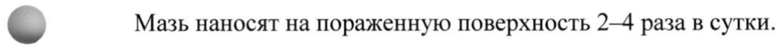

# Декспантенол + Лидокаина гидрохлорид + Преднизолона капронат — наружно

- Препарат: АУРОБИН® (мазь для местного и наружного применения;)
- АТХ: C05AA04
- Источник: ГРЛС, инструкция по медицинскому применению, РУ П N014951/01, файл от 2022-05-13 (https://grls.rosminzdrav.ru/Grls_View_v2.aspx?routingGuid=ed6bcb81-6621-4c59-b2cd-1761cb706f98)
- Распознано автоматически (OCR): 8 из 8 стр.
- Инструкция к другому РУ того же препарата: П N014951/01 (национальное РУ, переоформленное по правилам ЕАЭС, решение от 21.03.2022). Текст может быть старше действующего
- Сомнительных строк после OCR: 1 (см. раздел «Проверка распознавания»)

## Общие сведения

МИНЗДРАВ РОССИИ ЛОАь; fra 20419 | МИНИСТЕРСТВО ЗДРАВООХРАНЕНИЯ РОССИЙСКОЙ АЦИИ
‘ KOREA | ИНСТРУКЦИЯ ПО МЕДИЦИНСКОМУ ПРИМЕНЕНИЮ ЛЕКАРСТВЕННОГО ПРЕПАРАТА
Aypooun®(Aurobin®)
наименование лекарственного препарата © Регистрационный номер: П №014951/01
Торговое наименование: Ауробин® Лекарственная форма: мазь для местного и наружного применения

## 2. Состав

1 гмази содержит:
1 гмази содержит:
Действующие вещества: преднизолона капронат - 2 мг; декспантенол - 20 мг; лидокаина гидрохлорид — 20 мг.
Вспомогательные вещества: полисорбат 60; триклозан; метилпарагидроксибензоат;
цетиловый спирт; глицерол; пропиленгликоль; макрогола стеарат; парафин жидкий;
диметикон; триглицериды среднецепочечные; стеариновая кислота; вода очищенная.
Описание: гомогенная мазь белого или почти белого цвета, практически без запаха.
Фармакотерапевтическая группа: средства для лечения геморроя и анальных трещин для местного применения — глюкокортикостероиды.
Код ATX: COSAA04 Фармакологические свойства

## 5.1. Фармакодинамика

Ауробин® — комбинированный препарат для лечения воспалительных заболеваний перианальной области.
Ауробин® — комбинированный препарат для лечения воспалительных заболеваний перианальной области.
Преднизолона капронат является негалогенизированным глюкокортикостероидом. Оказывает местное противовоспалительное действие, а также снижает проницаемость сосудов, повышает тонус стенок сосудов и уменьшает симптомы воспаления.
Лидокаин — местный анестетик, быстро устраняет боль и чувство жжения.
Декспантенол — способствует регенерации поврежденного эпителия и слизистой оболочки.

## 5.2. Фармакокинетика

Исследований фармакокинетики мази не проводилось.
Исследований фармакокинетики мази не проводилось.

## 4.1. Показания к применению

Воспалительные заболевания перианальной области, в том числе анальный зуд, перианальная
Воспалительные заболевания перианальной области, в том числе анальный зуд, перианальная
© экзема и дерматит, геморрой, анальные трещины.
Противопоказания e Повышенная чувствительность к компонентам препарата.
e Повышенная чувствительность в отношении местных анестетиков группы амидов
(бупивакаин, этидокаин, мепивакаин и прилокаин).
e Розацеа лица, вульгарные угри, периоральный дерматит, опрелости, туберкулез кожи, кожные проявления сифилиса, сухое мелкопластинчатое шелушение кожного покрова.
® Применение в области глаз или периорбитальной области.
» Бактериальные, вирусные (например, простой герпес) или грибковые инфекции кожи.
® Одновременное применение лидокаина по другим показаниям.
= e Детский возраст до 1 года.
® Первый триместр беременности.
e Период грудного вскармливания.

## 4.6. Применение при беременности и в период грудного вскармливания

Нет достаточных данных о безопасном применении препарата у беременных женщин, поэтому в первом триместре беременности препарат применять нельзя. Во втором и третьем триместрах беременности при назначении препарата необходимо тщательно оценить соотношение пользы и риска. Местное применение кортикостероидов у беременных может вызвать повреждение плода (например, расщелина неба и внутриутробные пороки развития).
Период грудного вскармливания Глюкокортикостероиды и лидокаин проникают в грудное молоко.
Глюкокортикостероиды могут влиять на функцию надпочечников у новорожденных и могут привести к нарушениям развития. Небольшие количества лидокаина обнаруживаются в грудном молоке. Применение препарата противопоказано в период грудного вскармливания.

## 4.2. Способ применения и дозы

Местно, наружно.
Местно, наружно.
Вне зависимости от возраста пациента следует избегать длительного применения на поврежденных участках кожи, кожных складках или на обширных участках.
Не рекомендуется применение под окклюзионные повязки.
Взрослые, пожилые пациенты © Мазь наносят на пораженную поверхность 2-4 раза в сутки.
При уменьшении выраженности симптомов препарат можно применять реже. Курс лечения можно продолжать в течении 5-7 дней.
Дети Препарат Ауробин® противопоказан детям младше 1 года.
Применение данного препарата у детей старше 1 года возможно только в исключительных случаях и в наименьших дозах, достаточных для достижения терапевтического эффекта.
Продолжительность лечения не должна превышать 5 дней.
Для минимизации побочных эффектов препарат следует наносить на пораженные участки не чаще 2 раз в день.
Независимо от возраста ребенка следует избегать длительного применения и нанесения на
© обширные участки.

## 4.8. Побочное действие

При местном применении стероидных препаратов преимущественно сообщалось о развитии местных побочных реакций. В зависимости от степени абсорбции стероидов и лидокаина в системный кровоток, могут также развиться системные эффекты.
При местном применении стероидных препаратов преимущественно сообщалось о развитии местных побочных реакций. В зависимости от степени абсорбции стероидов и лидокаина в системный кровоток, могут также развиться системные эффекты.
При длительном местном применении глюкокортикостероидов или при обширном их нанесении на кожу может развиться угнетение функции надпочечников. Особенно часто это явление наблюдается у детей и при нанесении препарата Ауробин® на кожу под окклюзионной повязкой. Катаболизм белков может привести к отрицательному азотистому балансу.

Системная абсорбция лидокаина в достаточно болышом количестве после местного применения может вызвать стимуляцию и/или угнетение центральной нервной системы.
Частота возникновения нежелательных явлений не установлена (не может быть определена на основании имеющихся данных).
Инфекционные и паразитарные Обострение скрытых инфекционных заболевания заболеваний;
сглаживание проявлений инфекционных заболеваний;
оппортунистические инфекции.
© Нарушения co стороны иммунной | Реакции гиперчувствительности системы
Нарушения со стороны Угнетение функции коркового слоя эндокринной системы надпочечников
Нарушения co стороны обмена Гипокалиемический алкалоз;
веществ и питания задержка жидкости;
гипокалиемия;
задержка ионов натрия в организме.
Нарушения психики Бессонница;
психические расстройства.
Нарушения со стороны нервной Судороги;
© системы головокружение;
головная боль;
увеличение внутричерепного давления.
Нарушения со стороны органа Катаракта*;
зрения субкапсулярная катаракта;
экзофтальм;
глаукома;
отек соска зрительного нерва;
язва роговицы;
хориоретинопатия;
нечеткость зрения.
Нарушения co стороны сердца Сердечная недостаточность;
нарушение проводимости сердца.
Нарушения со стороны сосудов Артериальная гипертензия;
периферическая вазодилатация.
Нарушения со стороны желудочно- | Желудочное кровотечение;
кишечного тракта желудочно-кишечное кровотечение;
перфорация желудочно-кишечного тракта;
эзофагит;
панкреатит;
пептическая язва.
Нарушения со стороны кожи и Дерматит;
© подкожных тканей фолликулит (в месте применения);
акнеподобные высыпания;
контактный дерматит;
сухость и истончение кожи;
эритема;
крапивница;
гирсутизм;
гипергидроз;
опрелость;
зуд;
атрофия кожи;
© гипопигментация;
раздражение кожи;
образование стрий;
телеангиэктазия;
ощущение жжения кожи.
Нарушения со стороны скелетно- Стероидная миопатия;
мышечной системы и остеонекроз;
соединительной ткани остеопороз.
Общие расстройства и нарушения | Замедленное заживление ран в месте введения
Влияние на результаты Повышение внутриглазного давления;
лабораторных и отрицательный азотистый баланс;
инструментальных данных замедленная реакция при проведении кожных аллерготестов.
Дети * — У детей вероятность развития катаракты выше. Может встречаться замедление роста.
Если любые из указанных в инструкции побочных эффектов усугубляются, или вы заметили любые другие побочные эффекты, не указанные в инструкции, сообщите об этом лечащему врачу.
w Передозировка В зависимости от количества абсорбированного глюкокортикостероида или лидокаина возможно развитие местных и общих реакций.
Специфической антидот отсутствует, необходимо применять поддерживающую терапию.

## 4.5. Взаимодействие с другими лекарственными средствами

Исследования лекарственных взаимодействий с препаратом AypoOun® не проводились.
Не следует применять препарат Ауробин® при одновременном применении лидокаина по другим показаниям.
Следует применять с осторожностью вместе с другими антиаритмическими препаратами.
~ Особые указания При появлении раздражения или болезненности кожи следует немедленно прекратить лечение и назначить соответствующую поддерживающую терапию.
Местные и системные токсические эффекты можно предотвратить, если избегать нанесения мази на большие или поврежденные участки кожи, складки кожи, под окклюзионные повязки и в течение длительного времени.
В месте применения препарата Ауробин®, особенно у молодых пациентов, при длительном применении может развиться атрофия кожи.
В случае грибковых или бактериальных инфекций необходимо проведение соответствующего местного или системного лечения.
Применение препарата требует повышенной осторожности у пациентов с сахарным диабетом, туберкулезом и анемией, а также у пациентов детского возраста в связи с возможностью подавления гипоталамо-гипофизарно-надпочечниковой системы под влиянием входящего в состав препарата глюкокортикостероида.
Нарушения зрения Во время применения глюкокортикостероидов местного и системного действия могут возникать нарушения зрения. При возникновении нечеткости зрения или других нарушений зрения пациента следует направить к офтальмологу для выявления возможных причин, которые могут включать катаракту, глаукому или редкие заболевания, такие как центральная серозная хориоретинопатия (ЦСХ). Перечисленные заболевания могут возникать после применения глюкокортикостероидов местного и системного действия.

©, Препарат Ауробин® содержит B качестве вспомогательных веществ метилпарагидроксибензоат, цетиловый спирт и пропиленгликоль. Метилпарагидроксибензоат
(вещество, также известное под названием парабен) может вызвать аллергические реакции
(возможно, замедленного типа). Цетиловый спирт может вызвать местные реакции со стороны кожи (например, контактный дерматит). Пропиленгликоль может вызвать раздражение кожи.

## 4.7. Влияние на способность управлять транспортными средствами, механизмами

Нет данных о влиянии препарата Ауробин® на способность управлять транспортными средствами или работать в условиях, требующих повышенного внимания.

## 6.5. Форма выпуска

© Мазь для местного и наружного применения.
По 20 г препарата в алюминиевую тубу. По 1 тубе вместе с инструкцией по применению в картонную пачку.

## 6.4. Условия хранения

При температуре от 8 до 15 °С.
При температуре от 8 до 15 °С.
Хранить в недоступном для детей месте.

## 6.3. Срок годности

2 года.
2 года.
Не применять по истечении срока годности, указанного на упаковке.

Условия отпуска Отпускают по рецепту.
Производитель ОАО «Гедеон Рихтер»
1103 Будапешт, ул. Дёмрёи, 19-21, Венгрия
Претензии потребителей направлять по адресу:
Московское Представительство ОАО «Гедеон Рихтер»
119049 г. Москва, 4-й Добрынинский пер., дом 8
©, Электронный адрес: drugsafety@g-richter.ru
Телефон: (495) 363-39-50 + TON we oe Заместитель Директора Представительства" ® ь ху
ОАО «Гедеон Рихтер» (Венгрия), г. Москва а Волович Н.В.
## Проверка распознавания

Страницы-сканы распознаны автоматически. В 1 строках с дозировками цифры могли распознаться с ошибкой — сверьте с вырезкой из оригинала:

- стр. 3: «© Мазь наносят на пораженную поверхность 2-4 раза в сутки.» — низкая уверенность: «2-4» (45)  
  
