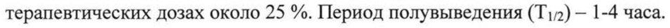
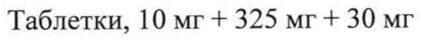

# Декстрометорфана гидробромид + Парацетамол + Псевдоэфедрина гидрохлорид — внутрь

- Препарат: ГРИППЕКС® (таблетки;)
- АТХ: R05X
- Источник: ГРЛС, инструкция по медицинскому применению, РУ ЛС-000891, файл от 2025-12-08 (https://grls.rosminzdrav.ru/Grls_View_v2.aspx?routingGuid=34d9fca7-c37a-475a-abc8-a35e22deb6d0)
- Распознано автоматически (OCR): 13 из 13 стр.
- Инструкция к другому РУ того же препарата: ЛС-000891 (национальное РУ, переоформленное по правилам ЕАЭС, решение от 04.12.2025). Текст может быть старше действующего
- Сомнительных строк после OCR: 2 (см. раздел «Проверка распознавания»)

## Общие сведения

ПС-000891 от 02.11, 2024 СООТВЕТСТВУЕТ ЭКСПЕРТНОМУ ОТЧЕТУ от 31.10.2024 № 24060
МИНИСТЕРСТВО ЗДРАВООХРАНЕНИЯ РОбсийской'ФЕДЕРАЦИИ
ИНСТРУКЦИЯ по медицинскому применению лекарственного препарата
ГРИППЕКС® Регистрационный номер:
Торговое наименование препарата: ГРИППЕКС®
Группировочное наименование:
Декстрометорфан + Парацетамол + Псевдоэфедрин

## 3. Лекарственная форма

таблетки Состав:
таблетки Состав:
Одна таблетка содержит:
Действующие вещества:
Парацетамол 325,0 мг Псевдоэфедрина гидрохлорид 30,0 мг
Декстрометорфан в пересчёте на декстрометорфана гидробромид 10,0 мг
- Вспомогательные вещества: целлюлоза микрокристаллическая, тип 102 - 90,86 мг, крахмал кукурузный прежелатинизированный - 63,00 мг, кроскармеллоза натрия - 15,00 мг, стеариновая кислота - 12,00 мг, магния стеарат - 6,00 мг, кремния диоксид коллоидный - 2,00 мг.
Описание Круглые плоскоцилиндрические таблетки от белого или почти белого до светло-желтого или светло-коричневого цвета, с фаской с двух сторон и риской на одной стороне. Допускается мраморность.
от 31.10.2024 № 24060

Фармакотерапевтическая группа (Входящий M3 №4273688)

ОРЗ и «простуды» симптомов средство устранения (анальгезирующее

ненаркотическое средство + — симпатомиметическое средство +

противокашлевое опиоидное средство)

Код ATX: /^05Х]

Фармакологические свойства

## 5.1. Фармакодинамика

Таблетки ГРИППЕКС® содержат парацетамол (анальгетик и

жаропонижающее средство), псевдоэфедрин (средство против заложенности
& носа для приема внутрь) и декстрометорфан (противокашлевое средство).

Препарат облегчает выраженность симптомов, обычно сопровождающих

«простудные» заболевания.

Парацетамол снижает повышенную температуру тела и облегчает боль.

Парацетамол блокирует циклооксигеназу (ЦОГ) только в центральной

нервной системе, воздействуя на центры боли и терморегуляции (в

воспаленных тканях клеточные пероксидазы нейтрализуют влияние

парацетамола на ЦОГ), что объясняет практически полное отсутствие

противовоспалительного эффекта. Отсутствие влияния на синтез
® простагландинов (Pg) в периферических тканях обусловливает отсутствие у

него отрицательного влияния на водно-солевой обмен (задержка натрия и

воды) и слизистую оболочку желудочно-кишечного тракта.

Псевдоэфедрин способствует сужению сосудов слизистой оболочки носа и

глотки, уменьшает отек слизистых оболочек и пазух носа, вследствие чего

облегчается дыхание.

Декстрометорфан угнетает возбудимость кашлевого центра, подавляет

кашель любого происхождения, не вызывает эффекта привыкания.

ГРИППЕКС® обеспечивает эффективное облегчение симптомов ОРЗ и

«простуды»: повышенная температура, озноб, ощущение заложенности носа,

боль в горле, кашель, головная боль, боль в мышцах и в суставах.

от 31.10.2024 № 24060 Фармакокинетика (Входящий МЗ №4273688)
Парацетамол быстро и почти полностью всасывается из желудочнокишечного тракта. Максимальная концентрация в крови достигается в среднем через | час. Парацетамол слабо связывается с белками плазмы, в терапевтических дозах около 25 %. Период полувыведения (Т!/2) — 1-4 часа.
Парацетамол выводится почками в виде метаболитов, преимущественно конъюгатов, от 2 до 4 % в неизменном виде. Основным путем выведения лекарственного средства является его биотрансформация в печени.
Основным метаболитом парацетамола у взрослых является конъюгация с глюкуроновой кислотой, а у детей - с серной. Образующийся в небольшом
& количестве гепатотоксический промежуточный метаболит М-ацетил-пбензохиноимин быстро конъюгируется с глутатионом и выводится с мочой после конъюгации с цистеином или меркаптуровой кислотой. Этот механизм легко вызывает насыщение при приеме высоких доз парацетамола. Запасы глутатиона печени могут истощаться, вызывая накопление токсического метаболита в печени, что может привести к повреждению и некрозу гепатоцитов и острой печеночной недостаточности.
Псевдоэфедрин хорошо абсорбируется после приема внутрь, максимальная концентрация в плазме крови достигаются через 1,5 ч. Противоотечное
© действие на слизистую оболочку носа достигается примерно через 30 минут после приема. Максимальное действие достигается через 30-60 минут.
Действие сохраняется до 4 часов. Прием пищи не оказывает большого влияния на всасывание. Метаболизируется с участием моноаминоксидазы.
Выводится на 70-90 % с мочой в неизмененном виде.
Декстрометорфан хорошо абсорбируется после приема внутрь.
Противокашлевое действие проявляется примерно через 15-30 минут и сохраняется около 4 часов. Декстрометорфан метаболизируется в печени и выводится с мочой в неизмененном виде и в виде метаболитов.
Декстрометорфан подвергается быстрому и полному метаболизму при первом прохождении через печень, при пероральном приеме, путем от 31.10.2024 № 24060 генетически контролируемого О-деметилирова вии которое Является основным способом фармакокинетики декстрометорфана у добровольцев.
Предполагается, что существуют разные фенотипы для этого процесса окисления, что приводит к высокой вариабельности фармакокинетических параметров между субъектами. Неметаболизированный декстрометорфан вместе с тремя деметилированными метаболитами морфина: декстрорфаном
(также известным как 3-гидрокси-М№-метилморфинан), 3гидроксиморфинаном и 3-метоксиморфинаном были идентифицированы в моче как конъюгированные продукты.

Основным метаболитом является декстрорфан, который также проявляет
® противокашлевое действие.
У некоторых людей метаболизм протекает медленнее, и поэтому в крови и моче преобладает неизмененная форма декстрометорфана.

## 4.1. Показания к применению

Симптоматическое лечение «простудных» заболеваний.
Симптоматическое лечение «простудных» заболеваний.

## 4.3. Противопоказания

Повышенная чувствительность к препарату или какому-либо его компоненту;
Повышенная чувствительность к препарату или какому-либо его компоненту;
© . _ тяжелые нарушения функции печени или почек;
. артериальная гипертензия ИБС (ишемическая болезнь сердца), стенокардия;
‚ _ Детский возраст до 12 лет;
. одновременный прием антидепрессантов, противопаркинсонических лекарственных средств;
. одновременный прием ингибиторов моноаминооксидазы (МАО), а также прием препарата в течение последующих двух недель после окончания лечения ингибиторами МАО;
. — врожденный дефицит глюкозо-6-фосфатдегидрогеназы;
. _ бронхиальная астма;
от 31.10.2024 № 24060 5 алкоголизм; (Входящий МЗ №4273688)
‚ _ беременность, период грудного вскармливания.

## 4.3. С осторожностью

Необходимо соблюдать осторожность при использовании препарата у пациентов с доброкачественной гипербилирубинемией (в т.ч. синдромы
Необходимо соблюдать осторожность при использовании препарата у пациентов с доброкачественной гипербилирубинемией (в т.ч. синдромы
Жильбера, Дубина-Джонсона и Ротора), заболеваниями крови (тяжелые формы анемий), а также у пациентов в пожилом возрасте.
Пациенты с легким и умеренным снижением функции почек и печени могут принимать таблетки ГРИППЕКС® только по рекомендации врача.
Рекомендуется соблюдать осторожность при применении препарата
© пациентами с заболеваниями сердца (стенокардией, аритмией), артериальной гипертензией, эмфиземой, заболеваниями щитовидной железы, повышенным внутриглазным давлением, гиперплазией предстательной железы, гипертиреозом, сахарным диабетом и теми, кто использует анксиолитики, трициклические антидепрессанты, другие симпатомиметические лекарственные средства (противоотечные, подавители аппетита и амфетаминоподобные психостимуляторы).
Препарат следует применять с осторожностью людям, принимающим антикоагулянты.
we Необходимо соблюдать осторожность при использовании препарата у ослабленных и истощенных пациентов, и больным алкоголизмом.

## 4.6. Применение при беременности и в период грудного вскармливания

Препарат противопоказан во время беременности и в период грудного вскармливания.

## 4.2. Способ применения и дозы

Внутрь. Взрослым и детям старше 12 лет по 1-2 таблетки не более 4 раз в день. Принимать препарат не более 3-5 дней. Интервал между дозами должен быть не менее 4 часов.
Внутрь. Взрослым и детям старше 12 лет по 1-2 таблетки не более 4 раз в день. Принимать препарат не более 3-5 дней. Интервал между дозами должен быть не менее 4 часов.
от 31.10.2024 № 24060 Побочные действия (Входящий МЗ №4273688)
Для оценки частоты нежелательных реакций (НР) использованы следующие критерии:
очень часто (> 1/10); часто (> 1/100, < 1/10); нечасто (> 1/1000, < 1/100); редко
(> 1/10000, < 1/1000); очень редко (< 1/10000); частота неизвестна (по имеющимся данным оценить невозможно).
Нарушения со стороны крови и лимфатической системы очень редко: гранулоцитопения, агранулоцитоз, тромбоцитопения.
Нарушения со стороны иммунной системы редко: аллергические реакции (кожная сыпь, зуд, крапивница, отек Квинке).
& Нарушения психики частота неизвестна: галлюцинации (особенно у детей).
Нарушения со стороны нервной системы частота неизвестна: сонливость, головокружение.
Нарушения со стороны сердца частота неизвестна: тахикардия.
Нарушения со стороны сосудов частота неизвестна: незначительное повышение артериального давления.
Нарушения со стороны дыхательной системы, органов грудной клетки и
© средостения

очень редко: приступ бронхиальной астмы.
Нарушения со стороны желудочно-кишечного тракта редко: тошнота, рвота.
частота неизвестна: ишемический колит толстой кишки.
Нарушения со стороны печени и желчевыводящих путей очень редко: повреждение печени, которое чаще всего возникает в результате передозировки.
Нарушения со стороны кожи и подкожных тканей редко: кожные аллергические реакции, покраснение кожи, сыпь.

от 31.10.2024 № 24060 частота неизвестна: тяжелые кожные pear!” Мвкючае острый генерализованный экзантематозный пустулез (ОГЭП).
Нарушения со стороны почек и мочевыводящих путей очень редко: почечная колика, почечный папиллярный некроз, острая почечная недостаточность, мочекаменная болезнь, нарушения мочеиспускания, задержка мочи, особенно у пациентов с гиперплазией предстательной железы.
Общие расстройства и нарушения в месте введения нечасто: усталость.
Нарушения со стороны органов зрения & частота неизвестна: ишемическая невропатия зрительного нерва.

## 4.9. Передозировка

Симптомы:
Симптомы:
Парацетамол Передозировка парацетамола может вызвать бледность кожных покровов, анорексию, тошноту, рвоту и тяжелые повреждения печени. Развернутая клиническая картина поражения печени проявляется через 1-6 дней. Редко нарушение функции печени развивается молниеносно и может осложняться почечной недостаточностью (тубулярный некроз).
> Псевдоэфедрин

Передозировка псевдоэфедрина может вызвать возбуждение, раздражительность, беспокойство, тремор, судороги, повышение артериального давления и нарушения ритма сердца, патологический нистагм, нарушения сна, тошноту и рвоту, редко галлюцинации.
Декстрометорфан Передозировка декстрометорфана может стать причиной тошноты, рвоты, дистонии, возбуждения, спутанности сознания, головокружения, сонливости, нарушения зрения, заторможенности, нарушения координации движений, кардиотоксичности (тахикардия, аномальная ЭКГ с удлинением интервала
ОТ), токсического психоза со зрительными галлюцинациями.

от 31.10.2024 № 24060 В случае сильной передозировки MOTI наблю Я Яующие“Вимитомы:
кома, угнетение дыхания, судороги.
При случайной передозировке необходимо срочно обратиться к врачу.
Лечение: промывание желудка с последующим — назначением активированного угля; симптоматическая терапия, введение метионина в течение 8-9 часов после передозировки, ацетилцистеина — в течение 12 4.
Можно принять активированный уголь пациентам с неразвившимися симптомами, которые получили передозировку декстрометорфаном в течение прошедшего часа.
При передозировке декстрометорфаном пациенты, которые находятся в oe седативном или коматозном состоянии, может быть применен налоксон в стандартных дозах для лечения передозировки опиоидами. Могут быть использованы бензодиазепины, в том числе показанные для лечения судорог, и внешние охлаждающие меры при гипертермии от серотонинового синдрома.

## 4.5. Взаимодействие с другими лекарственными средствами

Проинформируйте лечащего врача, если Вы принимаете какие-либо другие лекарственные препараты.
Парацетамол © Препарат ГРИППЕКС® не следует применять одновременно с другими препаратами, содержащими парацетамол.
Метоклопрамид и домперидон увеличивают скорость всасывания парацетамола и, соответственно, начало — обезболивающего и жаропонижающего действия.
Пропантелин и другие препараты, замедляющие эвакуацию из желудка, снижают скорость всасывания парацетамола, что может отсрочить или уменьшить наступление эффекта.
Риск гепатотоксического действия парацетамола повышается при одновременном приеме барбитуратов, фенитоина, фенобарбитала, от 31.10.2024 № 24060 карбамазепина, рифампицина, изониазида зиобеоИий Уругйх ИндУкторов микросомальных ферментов печени.

Парацетамол усиливает эффекты ингибиторов МАО, седативных средств и

антикоагулянтов (производных кумарина).

При совместном применении хлорамфеникола и парацетамола период

полувыведения хлорамфеникола может увеличиться.

Гепатотоксичность парацетамола может усиливаться при хроническом или

чрезмерном потреблении алкоголя.

Псевдоэфедрин

Использование одновременно с — альбутеролом может усилить

6 сосудосуживающее действие.

При одновременном применении — псевдоэфедрина с — другими

симпатомиметическими лекарственными средствами возможно аддитивное

действие и развитие токсических эффектов; с ингибиторами МАО возможно

развитие гипертонического криза (применять препарат можно не ранее чем

через 2 недели после прекращения приема ингибиторов МАО).

Пропранолол может усиливать прессорный эффект псевдоэфедрина;

псевдоэфедрин может уменьшать гипотензивное действие резерпина,

метилдопы, альфа- и бета-адреноблокаторов, мекамиламина и алкалоидов

© чемерицы.

Декстрометорфан

Не использовать вместе с ингибиторами МАО.

Декстрометорфан метаболизируется ферментом CYP2D6 и подвергается

интенсивному пресистемному метаболизму. Одновременное применение

мощных ингибиторов фермента CYP2D6 может увеличить концентрацию

декстрометорфана в организме до уровня, во много раз превышающего

нормальный. Это увеличивает риск токсического — воздействия

декстрометорфана (возбуждение, дезориентация, тремор, бессонница, диарея

и угнетение дыхания) и развитие серотонинового синдрома. Мощные

ингибиторы фермента CYP2D6 включают флуоксетин, пароксетин, хинидин от 31.10.2024 № 24060

и тербинафин. При одновременном применений“ Ном‘ концентрация декстрометорфана в плазме может увеличиваться в 20 раз, что увеличивает риск побочных эффектов со стороны центральной нервной системы, связанных с использованием этого лекарственного средства. Аналогичное влияние на метаболизм декстрометорфана также оказывают амиодарон, флекаинид и пропафенон, сертралин, бупропион, метадон, цинакальцет, галоперидол, перфеназин и тиоридазин. В случае необходимости одновременного применения ингибиторов CYP2D6 и декстрометорфана пациент должен находиться под постоянным наблюдением. Также может потребоваться снижение дозы декстрометорфана.

© Особые указания Не превышать рекомендуемую дозу.

Без рекомендации врача не следует принимать препарат более 5 дней. Если состояние не улучшается или даже ухудшается, необходимо проконсультироваться с врачом.

Применение лекарственного препарата пациентами с печеночной недостаточностью, злоупотребляющими алкоголем и голодающими создает риск повреждения печени.

Не следует применять при хроническом кашле с выделением мокроты.

& Сообщалось о случаях злоупотребления декстрометорфаном и появления зависимости. Особенно рекомендуется соблюдать осторожность при применении у подростков и молодых людей, а также у пациентов со случаями злоупотребления наркотиками или психоактивными веществами в анамнезе.

Декстрометорфан метаболизируется в печени с помощью цитохрома Р450
206. Активность этого фермента определяется генетически. Примерно у 10% населения от общей популяции метаболизм CYP2D6 является пониженным.
Такие пациенты при одновременном применении ингибиторов CYP2D6 могут почувствовать симптомы передозировки и/или увеличение продолжительности действия дестрометорфана. Поэтому следует соблюдать

от 31.10.2024 № 24060 осторожность при назначении [па wentane SMe Щи “2 пониженный метаболизм CYP2D6 или использующих ингибиторы CYP2D6 (см. раздел
«Взаимодействие с другими лекарственными препаратами»).

Прием препарата пациентами с низким уровнем глутатиона может повышать риск развития метаболического ацидоза.
Серотониновый синдром: серотонинергические эффекты, включая развитие потенциально опасного для жизни серотонинового синдрома, были зарегистрированы для декстрометорфана при одновременном применении с серотонинергическими агентами, такими как селективные ингибиторы обратного захвата серотонина (СИОЗС), препараты, которые нарушают
& метаболизм серотонина (включая ингибиторы моноаминоксидазы (ИМАО)) и ингибиторы CYP2D6.
Серотониновый синдром может включать в себя изменения психического статуса, вегетативную нестабильность, нервно-мышечные нарушения и/или желудочно-кишечные симптомы.
При подозрении на серотониновый синдром лечение препаратом
ГРИППЕКС® следует прекратить.
При применении псевдоэфедринсодержащих препаратов могут возникнуть серьезные кожные реакции, такие как острый генерализованный
© экзантематозный пустулез. Острое пустулезное высыпание может произойти в течение первых 2 дней лечения с лихорадкой и многочисленными небольшими, в основном нефолликулярными, пустулами, возникающими при широко распространенной отечной эритеме и в основном локализованными на кожных складках, туловище и верхних конечностях. За пациентами следует вести тщательный контроль. Если наблюдаются такие признаки и симптомы, как гипертермия, эритема или множество мелких гнойничков, применение препарата следует прекратить и при необходимости принять соответствующие меры.
При использовании псевдоэфедрина сообщалось о нескольких случаях ишемического колита. Следует прекратить применение псевдоэфедрина и от 31.10.2024 № 24060

обратиться за медицинской помощью при ВОЗНИНоВеНИЙ ВНезар ОЙ боли в животе, ректального кровотечения или других симптомов ишемического колита.
Сообщалось о случаях ишемической оптической нейропатии при применении псевдоэфедрина. Прием псевдоэфедрина следует прекратить при внезапной потере зрения или снижении остроты зрения, например, при скотоме.
При передозировке у детей могут возникнуть серьезные побочные действия, в том числе неврологические расстройства (см. раздел «Передозировка»).

© Влияние на способность к управлению транспортными средствами, механизмами
Препарат может снижать психомоторные реакции пациентов, поэтому рекомендуется соблюдать осторожность при управлении автомобилем и работе с механизмами.

## 6.5. Форма выпуска

Таблетки, 10 мг + 325 мг + 30 мг
Таблетки, 10 мг + 325 мг + 30 мг
По 10 таблеток в блистере из плёнки ПВХ и фольги алюминиевой, по | или 2 блистера вместе с инструкцией по применению помещают в картонную

© пачку. | Условия хранения При температуре не выше 25 °С.
Хранить в недоступном для детей месте.

## 6.3. Срок годности

3 года. Не использовать по истечении срока годности.
3 года. Не использовать по истечении срока годности.
Условия отпуска Без рецепта.

от 31.10.2024 № 24060 Производитель (Входящий МЗ №4273688)
Федеральное государственное унитарное предприятие «Московский эндокринный завод», Россия 109052, г. Москва, ул. Новохохловская, д. 25
Тел.: +7 (495) 678-00-50 Факс: +7 (495) 911-42-10
Электронная почта: mez@endopharm.ru Держатель регистрационного удостоверения
Юнифарм, Инк., США ® Пятая Авеню 350, офис 6701, г. Нью-Йорк, штат Нью-Йорк, 10118, США
Организация, уполномоченная принимать претензии потребителей
ООО «Юнифарм», Россия 115162, г. Москва, ул. Шаболовка, д. 31, стр. Б
Тел./факс: +7 (495) 995-77-67 Электронная почта: info@unipharm.ru www.unipharm.ru
Vi ers)
И авы, inc, \o Директор отдела регистрации, и = w развития и качества & ОКУ oH lg Е.В. Ненелева
< < МосквА * Y
## Проверка распознавания

Страницы-сканы распознаны автоматически. В 2 строках с дозировками цифры могли распознаться с ошибкой — сверьте с вырезкой из оригинала:

- стр. 3: «терапевтических дозах около 25 %. Период полувыведения (Т!/2) — 1-4 часа.» — низкая уверенность: «(Т!/2)» (25)  
  
- стр. 12: «Таблетки, 10 мг + 325 мг + 30 мг» — повторное чтение: «Таблетки, 10 мг + 325 mr + 30 мг»  
  
