# Джевтана — парентерально

- Препарат: Джевтана (концентрат для приготовления раствора для инфузий)
- АТХ: 
- Источник: ОХЛП, Единый реестр ЛС ЕАЭС, запись 5d8a040b2946bf042f938cfb, документ от 2019-11-12
- Распознано автоматически (OCR): 33 из 33 стр.
- Сомнительных строк после OCR: 17 (см. раздел «Проверка распознавания»)

## Общие сведения

И-М (000015) - (PP-RU)-121119 ОБЩАЯ ХАРАКТЕРИСТИКА ЛЕКАРСТВЕННОГО ПРЕПАРАТА

## 1. Наименование лекарственного препарата

Джевтана® 60 мг, концентрат для приготовления раствора для инфузий.

## 2. Качественный и количественный состав

Действующее вещество: кабазитаксел (в виде ацетонового сольвата).
В 1 мл концентрата для приготовления раствора для инфузий содержится 40 мг кабазитаксела (в виде ацетонового сольвата).
Один флакон 1,5 мл содержит 60 мг кабазитаксела (в виде ацетонового сольвата).

© В 1 мл раствора после первоначального разведения всем растворителем содержится 10 мг кабазитаксела (в виде ацетонового сольвата).
Один флакон с растворителем содержит этанол 96 % - 573,3 мг.
Полный перечень вспомогательных веществ приведен в разделе 6.1.

## 3. Лекарственная форма

Концентрат для приготовления раствора для инфузий: прозрачная маслянистая жидкость от желтого до коричневато-желтого цвета.
Растворитель: прозрачная бесцветная жидкость.

## 4. Клинические данные

&

## 4.1. Показания к применению

Метастатический кастрационно-резистентный рак предстательной железы у пациентов, ранее получавших химиотерапию с включением доцетаксела (в комбинации с преднизолоном).

## 4.2. Режим дозирования и способ применения

Применение препарата Джевтана® должно проводиться только в специализированных онкологических отделениях под наблюдением врача, имеющего специальную подготовку по проведению противоопухолевой химиотерапии. В отделении должны быть необходимые условия и медикаменты для оказания помощи при возникновении реакций гиперчувствительности, таких как снижение артериального давления (АД) и бронхоспазм
(см. раздел 4.4).
Премедикация

ЛП-М (000015) - (РГ-КИ)-121119 Для уменьшения риска развития и тяжести реакций гиперчувствительности перед введением препарата Джевтана® проводится премедикация следующими вводимыми внутривенно лекарственными препаратами:
- антигистаминные препараты (дексхлорфенирамин 5 мг или дифенгидрамин 25 мг или аналогичный препарат в эквивалентных дозах);
- глюкокортикостероиды (дексаметазон 8 мг или эквивалентные дозы другого глюкокортикостероида);
- блокаторы Н2-гистаминовых рецепторов (ранитидин или аналогичный препарат в эквивалентных дозах) (см. раздел 4.4).
Рекомендуется профилактическое применение противорвотных средств внутрь или, при необходимости, внутривенно.
Режим дозирования w Рекомендованная доза препарата Джевтана® составляет 25 мг/м? площади поверхности тела, которая вводится путем одночасовой внутривенной инфузии каждые 3 недели в комбинации с приемом внутрь преднизолона 10 мг ежедневно в течение всего периода лечения препаратом Джевтана*.
Коррекция вводимой дозы Рекомендуемые изменения вводимой дозы из-за развития неблагоприятных реакций у пациентов, получающих препарат Джевтана*:
Длительная (более 1 недели) нейтропения | Отсрочка следующего цикла лечения до
> 3 степени тяжести, несмотря на | восстановления количества нейтрофилов в
| применение соответствующего лечения, | периферической крови до > 1500
- включая введение — гранулоцитарного | клеток/мм°, затем снижение дозы в колониестимулирующего фактора (Г-| последующих циклах с 25 мг/м? до 20 мг/м?
КСФ). площади поверхности тела.
Фебрильная нейтропения или | Отсрочка следующего цикла лечения до нейтропеническая инфекция. уменьшения или разрешения фебрильной нейтропении и до восстановления количества нейтрофилов в периферической крови до > 1500 клеток/мм?, затем снижение дозы в последующих циклах с 25 мг/м? до 20 мг/м?
площади поверхности тела.
Диарея > 3 степени тяжести или упорно | Отсрочка следующего цикла лечения до продолжающаяся диарея, несмотря на | уменьшения или разрешения диареи, затем
Н1-М (000015) - (PP-RU)-121119 проведение соответствующей терапии и | снижение дозы в последующих циклах с 25 восполнение потерь жидкости и 1 мг/м? до 20 мг/м? площади поверхности тела.
электролитов.
Периферическая нейропатия > 2 степени | Отсрочка лечения до уменьшения симптомов, тяжести затем снижение дозы в последующих циклах с 25 мг/м? до 20 мг/M? площади поверхности тела.
Если у пациента при введении препарата в дозе 20 мг/M? площади поверхности тела продолжают возникать любые из указанных выше реакций, то рекомендуется снизить дозу препарата Джевтана® до 15 мг/м? площади поверхности тела или рассмотреть вопрос о прекращении лечения препаратом Джевтана®. Данные о применении препарата в дозе
| менее 20 мг/м? площади поверхности тела ограничены.
- Особые группы пациентов
Пациенты пожилого возраста Не требуется специальной коррекции режима дозирования при применении препарата
Джевтана® у пациентов пожилого возраста (см. также разделы 4.3, 4.4 и 5.2).
Пациенты с печеночной недостаточностью Препарат Джевтана*, в основном, метаболизируется печенью.
У пациентов с печеночной недостаточностью легкой степени тяжести (общий билирубин сыворотки крови >1 и <1,5 х ВГН (верхней границы нормы) или АСТ сыворотки крови > 1,5 х ВГН) дозу кабазитаксела следует снизить до 20 мг/м? площади поверхности тела, при этом требуется соблюдать осторожность, тщательно контролировать состояние пациентов и проводить мониторинг нежелательных реакций (НР).
~ У пациентов с печеночной недостаточностью средней степени тяжести (общий билирубин
>1,5 и < 3х BIH) максимальная переносимая доза кабазитаксела составляет 15 мг/м?
площади поверхности тела. Если предусмотрено лечение пациентов с печеночной недостаточностью средней степени тяжести доза кабазитаксела не должна превышать 15 мг/м? площади поверхности тела. Однако имеются ограниченные данные об эффективности этой дозы.
Препарат Джевтана® противопоказан пациентам с печеночной недостаточностью тяжелой степени (общий билирубин сыворотки крови >3 х ВГН) (см. разделы 4.3, 4.4 и 5.2).
Пациенты с почечной недостаточностью Кабазитаксел выводится почками в минимальной степени.
Не требуется коррекции режима дозирования у пациентов с почечной недостаточностью без проведения гемодиализа. Однако у пациентов с терминальной стадией почечной
ЛП-М (000015) - (PF-RU)-121119 недостаточности (клиренс креатинина < 15 мл/мин/1,73 м²), в связи с их состоянием и ограниченными данными, лечение следует проводить с осторожностью и при тщательном медицинском контроле во время лечения.
Одновременное применение кабазитаксела с индукторами и ингибиторами изоферментов подсемейства СУРЗА
Следует избегать одновременного применения лекарственных средств, которые являются сильными индукторами изоферментов подсемейства СУРЗА или сильными ингибиторами изоферментов подсемейства СУРЗА. Однако, если пациенту необходимо одновременное применение кабазитаксела и сильных ингибиторов изоферментов подсемейства СУРЗА, следует рассмотреть вопрос о снижении дозы кабазитаксела на 25 % (см. разделы 4.4 и 5.2).
Дети и подростки до 18 лет . Безопасность и эффективность препарата Джевтана® у детей и подростков до 18 лет в

~ настоящее время не установлены (CM. раздел 5.1).
Способ применения Внутривенная инфузия.
Во время внутривенного введения инфузионного раствора кабазитаксела используйте вставленный в систему для внутривенных инфузий фильтр с номинальным диаметром пор 0,22 мкм.
Препарат Джевтана®, концентрат для приготовления раствора для инфузий, перед добавлением в инфузионный раствор следует всегда разводить ВСЕМ содержимым прилагаемого растворителя.
Препарат Джевтана® не должен смешиваться с другими лекарственными препаратами и

| растворами, за исключением 5 % раствора декстрозы и 0,9 % раствора натрия хлорида.

~ Препарат Джевтана® содержит в своем составе полисорбат-80, который, как известно, увеличивает скорость экстракции ди-(2-этилгексил) фталата из поливинилхлорида (ПВХ).
В связи с этим нельзя использовать контейнеры для инфузионных жидкостей из ПВХ и наборы для проведения внутривенных инфузий из полиуретана для приготовления и введения инфузионного раствора кабазитаксела.
Инструкции по приготовлению лекарственного препарата перед применением см. раздел 6.6.

## 4.3. Противопоказания

- Гиперчувствительность к кабазитакселу или другим таксанам или к любому из

вспомогательных веществ, перечисленных в разделе 6.1.
- Количество нейтрофилов в периферической крови менее 1500/мм?.
ЛП-М (000015) - (РГ-КО)-121119 - Печеночная недостаточность тяжелой степени (общий билирубин сыворотки крови > 3 x
ВГН).
- Одновременное применение с вакциной против желтой лихорадки, а также с другими живыми ослабленными вакцинами (см. раздел 4.5).
- Детский и подростковый возраст до 18 лет (безопасность и эффективность не установлены) (см. раздел 5.1).

## 4.4. Особые указания и меры предосторожности при применении

Препарат следует применять с осторожностью у пациентов с терминальной стадией почечной недостаточности (клиренс креатинина < 15 мл/мин) (в связи с их состоянием и ограниченными данными, лечение следует проводить с осторожностью и при тщательном медицинском контроле во время лечения) (см. разделы 5.2, 4.2); у пациентов с печеночной
© недостаточностью легкой (общий билирубин сыворотки крови >1 и <1,5 х ВГН или АСТ
[аспартатаминотрансфераза] сыворотки крови > 1,5 х ВГН) и средней (общий билирубин > 1,5 и $3,0 x ВГН) степени тяжести (см. разделы 5.2, 4.2 и 4.4); у пациентов с содержанием гемоглобина в периферической крови < 10 г/дл; у пациентов с состояниями или заболеваниями, предрасполагающими к развитию нейтропении и/или увеличению осложнений при продолжительной нейтропении (возраст старше 65 лет, низкие показатели общего состояния, низкая масса тела, предшествующие эпизоды фебрильной нейтропении, предшествующая интенсивная лучевая терапия, другие серьезные сопутствующие заболевания) (требуется тщательный медицинский контроль во время лечения, возможно профилактическое введение Г-КСФ); у пациентов с высоким риском развития желудочнокишечных осложнений: пациентов с нейтропенией; пациентов пожилого возраста;
© пациентов, одновременно принимающих нестероидные противовоспалительные препараты
(НПВП), антиагреганты или антикоагулянты; пациентов с заболеваниями желудочнокишечного тракта, такими как язвенные поражения желудочно-кишечного тракта и желудочно-кишечные кровотечения в анамнезе; у пациентов с алкоголизмом, пациентов с заболеваниями печени и эпилепсией (так как в состав прилагаемого растворителя входит этанол) (см. раздел 4.4); у пациентов с ранее проведенной лучевой терапией абдоминальнотазовой области (см. раздел 4.4); у пациентов, одновременно принимающих сильные/умеренные ингибиторы изоферментов подсемейства СУРЗА и сильные индукторы изоферментов подсемейства СУРЗА (см. разделы 5.2, 4.2, 4.5, 4.4); у пациентов, одновременно принимающих препараты зверобоя продырявленного (см. разделы 5.2, 4.2, 4.5, 4.4).
Угнетение костномозгового кроветворения При применении кабазитаксела угнетение костномозгового кроветворения проявляется в
ЛИ-М (000015) - (РГ-КИ)-121119 виде нейтропении, анемии, тромбоцитопении, или возможно развитие панцитопении (см.
ниже дополнительную информацию в подразделах «Нейтропения» и «Анемия» в разделе 4.4).

Нейтропения В соответствии с рекомендациями Американского общества клинической онкологии и/или современными утвержденными руководствами для уменьшения риска возникновения или лечения нейтропенических осложнений (фебрильная нейтропения, продолжительная нейтропения или нейтропеническая инфекция) пациенты, получающие лечение препаратом
Джевтана*, могут с профилактической целью получать Г-КСФ.
Следует рассмотреть вопрос о первичной профилактике нейтропении с помощью Г-КСФ у пациентов с высокими факторами риска возникновения нейтропении, которые увеличивают вероятность развития осложнений от продолжительной нейтропении (возраст
- старше 65 лет, низкие показатели общего состояния, предшествующие эпизоды фебрильной нейтропении, интенсивная предшествующая лучевая терапия, пониженное питание или другие серьезные сопутствующие заболевания).
Было показано, что применение Г-КСФ уменьшает частоту возникновения и тяжесть нейтропении.
Нейтропения является наиболее часто встречающейся НР при применении препарата
Джевтана® (см. раздел 4.8). Требуется еженедельный контроль количества форменных элементов крови (полный общий анализ крови) во время первого цикла (цикл 1) лечения и затем перед каждым следующим циклом лечения для того, чтобы при необходимости уменьшить дозу препарата в следующем цикле (см. раздел 4.2).
При развитии фебрильной нейтропении или продолжительной нейтропении, несмотря на
- проводимое соответствующее лечение, лечение кабазитакселом может быть продолжено только после повышения количества нейтрофилов в периферической крови до > 1500/мм?
(см. раздел 4.3).
Реакции гиперчувствительности Все пациенты перед введением препарата Джевтана® должны получать премедикацию (см.
раздел 4.2).
Пациенты должны тщательно наблюдаться на предмет развития реакций гиперчувствительности, особенно во время первой и второй внутривенной инфузии кабазитаксела. Реакции гиперчувствительности могут развиться в течение первых нескольких минут после начала внутривенной инфузии кабазитаксела, поэтому необходимо иметь всё необходимое оборудование и лекарственные препараты для оказания неотложной помощи при снижении АД или развитии бронхоспазма. Могут развиваться тяжелые 6 ‘ 11-М (000015) - (PI-RU)-121119 реакции, такие как генерализованная сыпь/эритема, снижение АД и бронхоспазм. При развитии тяжелых реакций гиперчувствительности требуется немедленное прекращение внутривенной инфузии кабазитаксела и проведение необходимого лечения. Пациентам, имевшим в анамнезе тяжелую реакцию гиперчувствительности, нельзя проводить повторное введение препарата Джевтана* (см. раздел 4.3).

Риск развития тошноты, рвоты, диареи и обезвоживания
Если у пациентов после введения препарата Джевтана® развивается диарея, им следует проводить лечение обычно применяемыми противодиарейными препаратами. Следует принимать соответствующие меры по восстановлению потерь жидкости, определению и коррекции электролитного состава сыворотки крови, особенно концентрации ионов калия.
Диарея чаще может развиваться у пациентов, которым ранее была проведена лучевая терапия абдоминально-тазовой области. Обезвоживание чаще развивается у пациентов 65
- лет и старше. При развитии диареи > 3 степени тяжести может потребоваться отсрочка следующего цикла лечения или уменьшение дозы (см. раздел 4.2). При возникновении у пациента тошноты и рвоты, возможно применение противорвотных средств.
Риск развития серьезных реакций со стороны желудочно-кишечного тракта
Сообщалось о развитии желудочно-кишечных кровотечений и перфорации, кишечной непроходимости, колита, в том числе и с летальным исходом у пациентов, получающих лечение кабазитакселом (см. раздел 4.8). Следует соблюдать осторожность у пациентов с высоким риском развития желудочно-кишечных осложнений, а именно у пациентов с нейтропенией, пожилого возраста, одновременно принимающих НПВП, получающих антиагрегантную терапию или антикоагулянты, а также у пациентов с ранее проведенной лучевой терапией органов малого таза, заболеваниями желудочно-кишечного тракта,
- такими как язвенные поражения желудочно-кишечного тракта и желудочно-кишечное кровотечение в анамнезе.
Ранними проявлениями серьезной желудочно-кишечной токсичности могут быть такие симптомы, как абдоминальные боли и болезненность в области живота, лихорадка, упорный запор, диарея с нейтропенией или без нейтропении. Следует регулярно мониторировать состояние пациента на наличие этих симптомов, и в случае их обнаружения немедленно проводить их лечение. Может потребоваться отсрочка или прекращение лечения кабазитакселом.
Периферическая нейропатия У пациентов, получавших лечение кабазитакселом, наблюдались случаи периферической нейропатии, включая периферическую сенсорную нейропатию (парестезия, дизестезия) и периферическую моторную нейропатию. Пациентам, получающим — лечение и)
ЛП-М (000015) - (РГ-КО)-121119 кабазитакселом, следует рекомендовать перед продолжением лечения информировать своего лечащего врача о развившихся у них симптомах нейропатии, таких как боль, чувство жжения, покалывание, онемение или повышенная утомляемость. Врач должен оценивать наличие или усиление симптомов нейропатии перед каждым циклом лечения. Введение кабазитаксела должно быть отложено до уменьшения симптомов. При персистирующей периферической нейропатии > 2 степени тяжести доза кабазитаксела должна быть снижена с 25 мг/м? до 20 мг/м? площади поверхности тела (см. раздел 4.2).

Риск развития почечной недостаточности

Сообщалось о нарушениях функции почек в сочетании с сепсисом, тяжелым

обезвоживанием вследствие диареи, рвоты и обструктивной уропатией. Наблюдалось

развитие почечной недостаточности, включая случаи с летальным исходом. Следует

принимать соответствующие меры для выявления причины развития почечной lw недостаточности и проводить интенсивную терапию пациентов с развивающейся почечной

недостаточностью. Следует мониторировать функцию почек.

При лечении кабазитакселом следует проводить адекватную гидратацию пациента.

Пациенту следует рекомендовать немедленно сообщать о любых изменениях в объеме

выделяемой за сутки мочи. Следует определять содержание креатинина в сыворотке крови

перед лечением, при каждом исследовании общего анализа крови и в случае сообщения

пациента об изменении выделения мочи. В случае развития почечной недостаточности

> 3 степени тяжести лечение кабазитакселом должно быть прекращено.

Риск развития цистита вследствие феномена возврата лучевой реакции

У пациентов, получавших ранее лучевую терапию в области таза, и схему лечения,

содержащую доцетаксел, сообщалось о развитии цистита вследствие феномена возврата her лучевой реакции в ранее облученной области. Поэтому при развитии данной нежелательной

реакции должны быть приняты соответствующие меры. Может возникнуть необходимость

прерывания или отмены терапии кабазитакселом.

Риск развития нарушений ритма сердца

Сообщалось о развитии нарушений ритма сердца, наиболее часто тахикардии и

мерцательной аритмии (см. раздел 4.8).

Риск развития нарушений со стороны дыхательной системы

Сообщалось о случаях развития интерстициальной — пневмонии/пневмонита,

интерстициальной болезни легких, острого респираторного дистресс-синдрома, в том числе

с летальным исходом (см. раздел 4.8).

При развитии новых симптомов со стороны дыхательной системы или ухудшении

имеющихся симптомов необходимо тщательно наблюдать за состоянием пациентов,

ITI-N (000015) - (РГ-КО)-121119 оперативно обследовать их и проводить соответствующее лечение. Рекомендуется прервать терапию кабазитакселом до подтверждения диагноза. Раннее применение поддерживающей терапии способствует улучшению состояния пациента. Польза от возобновления терапии кабазитакселом должна быть тщательно оценена.

Репродуктивная функция

Вследствие потенциального нежелательного воздействия на мужские гаметы (половые

клетки) и потенциального поступления препарата в семенную жидкость, мужчины,

получающие лечение кабазитакселом, и их сексуальные партнерши с детородным

потенциалом должны использовать надежные методы контрацепции во время лечения и в

течение 6 месяцев после введения последней дозы кабазитаксела.

В связи с потенциальным поступлением кабазитаксела в семенную жидкость, мужчины,
| получающие лечение кабазитакселом, во время лечения должны предотвращать контакт

- эякулята с тканями другого человека, включая беременных и кормящих грудью женщин.

Пациентам, которым планируется лечение кабазитакселом, рекомендуется провести

криоконсервацию спермы перед началом лечения.

Пациенты пожилого возраста

Пациенты пожилого возраста (> 65 лет) могут быть более предрасположены к некоторым

НР, включая нейтропению или фебрильную нейтропению (см. раздел 4.8).

Пациенты с печеночной недостаточностью

Кабазитаксел интенсивно метаболизируется в печени (см. раздел 5.2). Препарат Джевтана®

противопоказан у пациентов с печеночной недостаточностью тяжелой степени (общий

билирубин > 3 х ВГН) (см. разделы 4.3 и 5.2). У пациентов с печеночной недостаточностью
| легкой степени тяжести (общий билирубин сыворотки крови >1 и < 1,5 х ВГН или АСТ >

~ 1,5 x BIH) и средней степени тяжести (общий билирубин >1 и < 3 x BIH) следует

уменьшить дозу кабазитаксела (см. разделы 4.2 и 5.2). При этом требуется соблюдать

осторожность, тщательно контролировать состояние пациентов и проводить мониторинг

НР,

Анемия

У пациентов, получающих лечение кабазитакселом, сообщалось о развитии анемии (см.

раздел 4.8). Показатели гемоглобина и гематокрита должны быть проверены до начала

терапии кабазитакселом, а также, если у пациентов отмечаются симптомы или признаки

анемии или кровопотери. Рекомендуется с осторожностью применять кабазитаксел у

пациентов с содержанием гемоглобина в периферической крови < 10 г/дл. Следует

проводить соответствующие лечебные мероприятия, направленные на повышение

содержания гемоглобина в периферической крови.

ПИ-М (000015) - (РГ-ВО)-121119 Лекарственное взаимодействие
Следует избегать одновременного применение сильных ингибиторов и индукторов изоферментов подсемейства СУРЗА с кабазитакселом, так как они могут, соответственно, увеличивать или уменьшать концентрацию кабазитаксела в плазме крови (см. разделы 4.2 и 4.5).
Вспомогательные вещества В состав прилагаемого растворителя входит 573 мг этанола 96 %, что необходимо учитывать при применении препарата у пациентов с алкоголизмом, а также у пациентов группы высокого риска (пациентов с заболеваниями печени и эпилепсией).

## 4.5. Взаимодействие с другими лекарственными препаратами и другие виды взаимодействия

Ингибиторы изоферментов подсемейства СУРЗА

© Метаболизм кабазитаксела изменяется при одновременном применении веществ, известных как сильные ингибиторы изоферментов подсемейства СУРЗА (например, кетоконазол, итраконазол, кларитромицин, атазанавир, индинавир, нефазодон, нелфинавир, ритонавир, саквинавир, телитромицин, вориконазол).
Следует избегать одновременного применения сильных ингибиторов изоферментов подсемейства CYP3A. Если нельзя избежать одновременного применения кабазитаксела и сильного ингибитора изоферментов подсемейства СУРЗА необходимо рассмотреть вопрос о тщательном наблюдении за пациентом и снижении дозы кабазитаксела (см. разделы 4.2 и 4.4).
Следует соблюдать осторожность при одновременном применении кабазитаксела и

© умеренных ингибиторов изоферментов подсемейства CYP3A.
Индукторы изоферментов подсемейства СУРЗА
Метаболизм кабазитаксела изменяется при одновременном применении веществ, известных как сильные индукторы изоферментов подсемейства СУРЗА (например, фенитоин, карбамазепин, рифампицин, рифабутин, рифапентин, фенобарбитал).
Следует избегать одновременного применения сильных индукторов изоферментов подсемейства СУРЗА, так как они могут уменьшить системную экспозицию кабазитаксела
(см. разделы 4.2 и 4.4).
Зверобой продырявленный Пациенты, получающие лечение кабазитакселом, должны воздерживаться от приема препаратов травы зверобоя продырявленного (так как он также является индуктором изофермента СУРЗА4).
Субстраты транспортного полипептида органических анионов (ОАТР1В1).

ЛП-М (000015) - (РГ-КО)-121119

[п vitro кабазитаксел также продемонстрировал способность ингибировать ОАТР1ВТ. Риск взаимодействия с субстратами ОАТР1ВТ (например, ингибиторами ГМГ-КоА-редуктазы
[статинами], валсартаном, репаглинидом) является возможным во время проведения внутривенной инфузии (1 час) и до 20 минут после ее окончания, и в это время возможно увеличение системной экспозиции субстратов ОАТР1В1. Рекомендуется соблюдение следующих временных интервалов при одновременном применении субстратов OATP IB:
принимать их за 12 часов до введения кабазитаксела и через, как минимум, 3 часа после введения кабазитаксела.
Преднизолон Преднизолон/преднизон, принимаемый по 10 мг ежедневно, не оказывает влияния на фармакокинетику кабазитаксела.
Варфарин

ww Кабазитаксел не ингибирует in vitro главный путь биотрансформации варфарина в 7гидроксиварфарин, который осуществляется с помощью изофермента СУР2С9. Поэтому не ожидается какого-либо фармакокинетического взаимодействия кабазитаксела и варфарина in vivo.
Вакцинация Применение живых вакцин или ослабленных живых вакцин у пациентов со сниженным в результате лечения химиотерапевтическими препаратами иммунитетом может приводить к развитию серьезных или фатальных инфекций. Следует избегать вакцинации живыми ослабленными вакцинами у пациентов, получающих лечение кабазитакселом. Убитые или инактивированные вакцины применять можно, однако реакция организма на такие вакцины может быть менее выраженной.

-

## 4.6. Фертильность, беременность и лактация

Не применимо. Информацию см. в разделах 4.4 и 5.3.
4.7 Влияние на способность управлять транспортными средствами и работать с механизмами
Исходя из профиля безопасности кабазитаксела, препарат может оказывать умеренное влияние на способность управлять транспортными средствами или пользоваться другими механизмами, так как может вызывать повышенную утомляемость и головокружение. При появлении подобных нежелательных реакций во время лечения пациентам следует рекомендовать воздержаться от управления транспортными средствами и занятий другими потенциально опасными видами деятельности, требующими повышенной концентрации внимания и быстроты психомоторных реакций.

## 4.8. Нежелательные реакции

1] ЛИ-М (000015) Г-КО)-121119 Резюме профиля безопасности
Безопасность препарата Джевтана® в комбинации с преднизолоном/преднизоном оценивалась у 371 пациента с метастатическим кастрационно-резистентным раком предстательной железы. Медиана полученных пациентами циклов препарата Джевтана® составляла 6 циклов.
Очень часто встречающимися (> 10 %) НР всех степеней тяжести были анемия, лейкопения, нейтропения, тромбоцитопения, диарея, повышенная утомляемость, тошнота, рвота, запор, астения, абдоминальные боли, гематурия, боли в позвоночнике, артралгия, анорексия, периферическая нейропатия (включая периферическую сенсорную и моторную нейропатии), лихорадка, одышка, дисгевзия, кашель, алопеция.
Часто встречающимися (> 5%) НР >23 степени тяжести при применении препарата
Джевтана® были нейтропения, лейкопения, анемия, фебрильная нейтропения, диарея, w повышенная утомляемость и астения.
Прекращение лечения вследствие развития НР имело место у 68 (18,3 %) пациентов, получавших лечение препаратом Джевтана”. Наиболее часто встречающимися НР, приводящими к прекращению лечения препаратом Джевтана”, были нейтропения и почечная недостаточность.
Наиболее частыми НР, приводящими к смерти у пациентов, получавших лечение препаратом Джевтана®, были инфекции. Большинство НР в виде развития фатальных инфекций возникало после однократного введения препарата Джевтана*.
Ниже представлены НР, разделенные по системно-органным классам согласно классификации Медицинского словаря для нормативно-правовой деятельности (Мед ОКА).
Тяжесть НР классифицировалась в соответствии с Общепринятыми терминологическими
- критериями для НР (CTCAE 4.0) (степень тяжести > 3 = G > 3).
Использовалась классификация частоты возникновения НР Всемирной Организации
Здравоохранения: очень часто (> 10 %); часто (> 1 % и < 10%); нечасто (> 0,1 % и < 1%);
редко (> 0,01 % и < 0,1 %); очень редко (< 0,01 %); неизвестная частота (по имеющимся данным определить частоту встречаемости НР не представляется возможным).
В пределах каждой группы по частоте встречаемости НР, последние даны в порядке уменьшения их серьезности.
Инфекционные и паразитарные заболевания Часто: септический шок (все случаи > 3 степени тяжести); сепсис (все случаи > 3 степени тяжести); воспаление подкожно-жировой клетчатки, инфекции мочевыводящих путей всех степеней тяжести; грипп; цистит; инфекции верхних дыхательных путей; инфекции, вызванные Varicella zoster (герпес зостер); кандидоз.
ЛИ-М (000015) - (PF-RU)-121119

Нечасто: воспаление подкожно-жировой клетчатки >23 степени тяжести, цистит
> 3 степени тяжести.
Нарушения со стороны крови и лимфатической системы
Очень часто: нейтропения всех степеней тяжести, включая нейтропению с клиническими проявлениями >3 степени тяжести; анемия всех степеней тяжести; лейкопения всех степеней тяжести; тромбоцитопения.
Часто: фебрильная нейтропения, все случаи > 3 степени тяжести, тромбоцитопения
> 3 степени тяжести.
Нейтропенические осложнения включали нейтропеническую инфекцию, нейтропенический сепсис и септический шок, которые в некоторых случаях приводили к летальному исходу.

ow Было показано, что применение Г-КСФ уменьшает частоту возникновения и тяжесть нейтропении (см. разделы 4.2 и 4.4).
Нарушения со стороны иммунной системы Часто: реакции гиперчувствительности, в том числе и тяжелые реакции, такие как генерализованная сыпь/эритема, снижение АД и бронхоспазм.
Нарушения со стороны обмена веществ Очень часто: анорексия.
Часто: обезвоживание всех степеней тяжести, гипергликемия, гипокалиемия.
Нечасто: анорексия >3 степени тяжести, гипергликемия >3 степени тяжести, гипокалиемия > 3 степени тяжести.
Нарушения психики

- Часто: беспокойство, спутанность сознания.
Нарушения со стороны нервной системы Очень часто: дисгевзия (извращение вкуса).
Часто: периферическая нейропатия: периферическая сенсорная нейропатия (парестезия, дизестезия, гипестезия) и периферическая моторная нейропатия; головокружение, головная боль, летаргия, ишиас.
Нечасто: периферическая нейропатия > 3 степени тяжести; периферическая сенсорная нейропатия > 3 степени тяжести, летаргия > 3 степени тяжести, ишиас > 3 степени тяжести.
Нарушения со стороны органа зрения Часто: конъюнктивит, усиленное слезоотделение.
Нарушения со стороны органа слуха и лабиринтные нарушения
Часто: звон в ушах, вертиго (чувство отклонения или кружения собственного тела или

ЛИ-М (000015) - (РГ-КО)-121119

окружающих предметов).
Нарушения со стороны сердца Часто: мерцательная аритмия (фибрилляция предсердий), тахикардия (ни одного случая тахикардии > 3 степени тяжести).
Нечасто: мерцательная аритмия (фибрилляция предсердий) > 3 степени тяжести.
При приеме кабазитаксела наблюдались случаи развития сердечной недостаточности (у двух пациентов). Один пациент в группе кабазитаксела умер от сердечной недостаточности.
Наблюдались летальные фибрилляция желудочков у | пациента и остановка сердца у 2 пациентов. Однако ни один из этих случаев не был расценен исследователями, как связанный с применением кабазитаксела.
Нарушения со стороны сосудов Часто: снижение АД, повышение АД, тромбоз глубоких вен всех степеней тяжести,

w повышение АД, ортостатическая гипотония, «приливы» крови к коже лица с чувством жара, гиперемия (покраснение кожи).
Нечасто: снижение АД >3 степени тяжести, повышение АД >3 степени тяжести, ортостатическая гипотония > 3 степени тяжести.
Нарушения со стороны дыхательной системы, органов грудной клетки и средостения
Очень часто: одышка, кашель.
Часто: одышка > 3 степени тяжести, боль в ротовой полости и глотке, пневмония всех степеней тяжести.
Отмечались случаи развития интерстициальной пневмонии/пневмонита, интерстициальной болезни легких, острого респираторного дистресс-синдрома, в том числе с летальным

| исходом.

- Нарушения со стороны желудочно-кишечного тракта
Очень часто: диарея, тошнота, рвота, запор, абдоминальные боли.
Часто: диарея > 3 степени тяжести, тошнота > 3 степени тяжести, рвота > 3 степени тяжести, запор > 3 степени тяжести, абдоминальные боли > 3 степени тяжести, диспепсия, боли в эпигастральной области, геморрой, гастроэзофагеальная рефлюксная болезнь, кровотечение из прямой кишки, сухость слизистой оболочки полости рта, вздутие живота.
Нечасто: кровотечение из прямой кишки > 3 степени тяжести, сухость слизистой оболочки полости рта > 3 степени тяжести, вздутие живота > 3 степени тяжести.
Неизвестная частота: сообщалось о развитии колита, энтероколита, гастрита, нейтропенического энтероколита, желудочно-кишечного кровотечения и перфорации желудочно-кишечного тракта, кишечной непроходимости и кишечной обструкции.
Нарушения со стороны кожи и подкожных тканей

ПП-М (000015) - (PI-RU)-121119%

Очень часто: алопеция.
Часто: сухость кожи, эритема.
Нарушения со стороны скелетно-мышечной и соединительной ткани
Очень часто: боли в позвоночнике, артралгия.
Часто: боли в позвоночнике > 3 степени тяжести, артралгия > 3 степени тяжести, боли в конечностях всех степеней тяжести, мышечные спазмы, миалгия, мышечно-скелетные боли в области грудной клетки, боли по боковым поверхностям туловища.
Нечасто: миалгия > 3 степени тяжести, мышечно-скелетные боли в области грудной клетки > 3 степени тяжести, боли по боковым поверхностям туловища > 3 степени тяжести.
Нарушения со стороны почек и мочевыводящих путей
Очень часто: гематурия всех степеней тяжести (в 2/3 случаев определялись отягощающие факторы, такие как прогрессирование заболевания, инструментальные вмешательства,

= сопутствующие инфекции, одновременный прием антикоагулянтов, нестероидных противовоспалительных препаратов, ацетилсалициловой кислоты).
Часто: острая почечная недостаточность всех степеней тяжести; почечная недостаточность всех степеней тяжести; дизурия; почечная колика; гематурия > 3 степени тяжести;
поллакиурия; гидронефроз; задержка мочи; недержание мочи; обструкция мочеточников всех степеней тяжести.
Нечасто: почечная колика > 3 степени тяжести, поллакиурия > 3 степени тяжести, гидронефроз > 3 степени тяжести, задержка мочи > 3 степени тяжести.
Нарушения со стороны половых органов и молочной железы
Часто: боли в области малого таза.

_ Нечасто: боли в области малого таза > 3 степени тяжести.

we Общие расстройства и нарушения в месте введения
Очень часто: повышенная утомляемость, астения, пирексия.
Часто: повышенная утомляемость > 3 степени тяжести; астения > 3 степени тяжести;
пирексия > 3 степени тяжести; периферические отеки; воспаление слизистых оболочек;
боли всех степеней тяжести; боли в грудной клетке; отеки; озноб; недомогание.
Нечасто: периферические отеки > 3 степени тяжести, воспаление слизистых оболочек
> 3 степени тяжести, боли в грудной клетке > 3 степени тяжести, отеки > 3 степени тяжести.
Лабораторные и инструментальные данные Часто: снижение массы тела, увеличение активности АЛТ в сыворотке крови.
Нечасто: увеличение сывороточной концентрации билирубина, увеличение активности
АСТ в сыворотке крови.
НР у особых групп пациентов

ЛП-М (000015) - (PI-RU)-121119 Пациенты пожилого возраста
Из 371 пациента, получавших лечение препаратом Джевтана® в исследовании по лечению рака предстательной железы, 240 пациентов были в возрасте 65 лет и старше, из них 70 пациентов - старше 75-летнего возраста. Следующие НР встречались на > 5 % чаще у пациентов в возрасте 65 лет и старше по сравнению с пациентами более молодого возраста:
повышенная утомляемость, нейтропения с клиническими проявлениями, астения, пирексия, головокружение, инфекции мочевыводящих путей и обезвоживание.
Частота следующих НР > 3 степени тяжести была выше у пациентов > 65 летнего возраста по сравнению с пациентами более молодого возраста: нейтропения по результатам лабораторных анализов, нейтропения с клиническими проявлениями и фебрильная нейтропения (см. разделы 4.2 и 4.4).
Из 595 пациентов, получавших лечение препаратом Джевтана® в исследовании EFC11785
~ по лечению рака предстательной железы, 420 пациентов были в возрасте 65 лет и старше.
Следующие НР встречались на > 5 % чаще у пациентов в возрасте 65 лет и старше, по сравнению с пациентами более молодого возраста: диарея, повышенная утомляемость, астения, запор, нейтропения с клиническими проявлениями, фебрильная нейтропения, одышка.
Пострегистрационные данные Нарушения со стороны почек и мочевыводящих путей
Нечасто: цистит, развившийся вследствие феномена возврата лучевой реакции в ранее облученной области.

## 4.9. Передозировка

Симптомы - Ожидаемые симптомы передозировки: усиление дозозависимых НР, таких как симптомы подавления костномозгового кроветворения и нарушения со стороны желудочнокишечного тракта.
Лечение Отсутствует известный антидот кабазитаксела. В случае передозировки пациент должен быть помещен в специализированное отделение под тщательное медицинское наблюдение.
После того, как станет известно о передозировке, пациенты должны, как можно скорее, начать получать Г-КСФ. Также следует проводить другое симптоматическое лечение.

## 5. Фармакологические свойства

## 5.1. Фармакодинамические свойства

ЛИ-М (000015) - (PI-RU)-121119 Фармакотерапевтическая группа: противоопухолевое средство, алкалоид.
Код ATX: LO1CD04 Механизм действия Кабазитаксел является противоопухолевым средством, которое действует путем разрушения клеточной сети микротрубочек. Кабазитаксел связывается с тубулином и способствует сборке тубулина в микротрубочки и одновременно ингибирует их разборку.
Это приводит к стабилизации микротрубочек, что в итоге ингибирует митотическую и интерфазную активность клетки.
Фармакодинамические эффекты Кабазитаксел продемонстрировал широкий спектр противоопухолевой активности в отношении поздних стадий опухолей человека, ксенотрансплантированных мышам.
6 Кабазитаксел активен в отношении чувствительных к доцетакселу опухолей. Кроме этого, кабазитаксел показал активность в отношении опухолевых моделей, нечувствительных к химиотерапии, включая доцетаксел.
Клиническая эффективность и безопасность
Взрослые пациенты Эффективность и безопасность лекарственного препарата Джевтана® в комбинации с преднизолоном или преднизоном были оценены в рандомизированном открытом международном многоцентровом исследовании Ш фазы (исследование EFC6193) у пациентов с метастатическим кастрационно-резистентным раком предстательной железы, ранее получавших режимы химиотерапии, включавших доцетаксел.
Первичной конечной точкой исследования была общая выживаемость (ОВ).
> Вторичные конечные точки включали выживаемость без прогрессирования (ВБИ), определяемую как время от рандомизации до прогрессирования опухоли, биохимического прогрессирования (по уровню простат-специфического антигена [ПСА]), прогрессии боли или смерти по любой причине, в зависимости от того, что произойдет раньше, частоту ответа опухоли по критериям RECIST (Tumor Response Rate based on Response Evaluation
Criteria in Solid Tumors), прогрессию по уровню ПСА (определяемую как > 25% увеличение или > 50% увеличение уровня ПСА у пациентов, не отвечающих и отвечающих на терапию, соответственно), ответ по уровню ПСА (снижение концентрации ПСА в сыворотке крови как минимум на 50%), прогрессию боли (оценивалась с помощью шкалы интенсивности боли (Present Pain Intensity [PPI]) из опросника McGill-Melzack и анальгетической шкалы
(Analgesic Score [А$]) и ответ в отношении интенсивности боли (определяемый как снижение в 2 раза по сравнению с базовой медианой значения PPI при отсутствии
ЛИ-М (000015) - (РГ-ВО)-121119 возрастания баллов по А$, или уменьшением > 50 % в использовании анальгетиков по .
сравнению с исходным средним значением по шкале AS без одновременного усиления интенсивности боли).
В общей сложности 755 пациентов были рандомизированы для получения терапии кабазитакселом в дозе 25 мг/м? площади поверхности тела внутривенно каждые 3 недели в течение максимум 10 циклов в комбинации с преднизолоном или преднизоном в дозе 10 мг/сутки ежедневно (количество пациентов 378) или митоксантроном в дозе 12 мг/м?
внутривенно каждые 3 недели с преднизолоном или преднизоном в дозе 10 мг внутрь ежедневно (количество пациентов 377).
В это исследование включались пациенты старше 18 лет с метастатическим кастрационнорезистентным раком предстательной железы с измеряемыми очагами по критериям RECIST или с неизмеряемыми очагами, но с возрастающим уровнем ПСА или с появлением новых w очагов, и с состоянием функциональной активности пациента по ECOG (Eastern Cooperative
Oncology Group - Западная Кооперативная Онкологическая группа) от 0 до 2. В исследование включались только пациенты с количеством нейтрофилов > 1500/мм?, тромбоцитов > 100000/мм?, концентрациями гемоглобина > 10 г/дл, креатинина < 1,5 x ВГН
(верхняя граница нормы), общего билирубина <1x BIH, АСТЛ`ОТС <1,5 BIH и
AJIT/TIITC < 1,5 ВГН.
Пациенты с указаниями в анамнезе на застойную сердечную недостаточность или инфаркт миокарда в течение последних 6-ти месяцев или пациенты с неконтролируемыми нарушениями сердечного ритма, стенокардией и/или артериальной гипертензией в исследование не включались.
Демографические характеристики, включая расовую принадлежность, и состояние
- функциональной активности по шкале ЕСОС (0 - 2) были сбалансированы между группами лечения. В группе препарата Джевтана® средний возраст пациентов составил 68 лет (46-92 года), а распределение по расовой принадлежности было: 83,9 % - европеоиды, 6,9 % - монголоиды, 5,3 % - негроиды и 4 % - другие расы.
Медиана числа циклов составляла 6 циклов в группе препарата Джевтана*® и 4 цикла - в группе митоксантрона. Количество пациентов, получивших запланированные 10 циклов терапии составило 29,4 % в группе препарата Джевтана* и 13,5 % - в группе митоксантрона.
Общая выживаемость была более продолжительной в группе кабазитаксела, риск смерти снизился на 30% в группе кабазитаксела по сравнению с группой митоксантрона
[отношение рисков = 0,70, 95 % ДИ (0,59-0,83)] (см. Таблица | и Рисунок 1).
ЛИ-М (000015) - (РГ-КИ)-121119 Таблица 1. Эффективность препарата Джевтана® в исследовании EFC6193 при лечении пациентов с метастатическим кастрационно-резистентным раком предстательной железы
Препарат Джевтана® + Митоксантрон + преднизолон преднизолон n=378 n=377
Число пациентов с 234 (61,9%) 279 (74%)
летальными исходами (%)
Медиана выживаемости 15,1 (14,1-16,3) 12,7 (11,6-13,7)
(месяцы) (95% ДИ)
Отношение рисков(ОР)! 0,70 (0,59-0,83)
(95% ДИ)
<0.0001 'OP оценивалось с использованием Сох-модели; отношение рисков менее чем |
& свидетельствует в пользу препарата Джевтана®
Рисунок 1. Кривые общей выживаемости Каплан-Мейера (исследование EFC6193)
100 7 2 —— Митоксантрон +преднизолон 90 a= a Кабазитаксел
+преднизолон я = 3 70 = 8, 8 >.
= 60 % = у = 50 , > Че.
. Я . Е 2% - oO 40 = as (>) Sn.
. м tee И I е «вече 5.
= 20 a 0 6 12 18 24 30 Численность Время (месяцы)
Митоксантрон +преднизолон 377 300 188 67 И 1
Кабазитаксел +преднизолон 378 321 231 90 28 4
Выживаемость без прогрессирования в группе препарата Джевтана® по сравнению с
ЛП-М (000015) - (PP-RU)-121119 группой митоксантрона составила 2,8 (2,4-3,0) месяца против 1,4 (1,4-1,7), соответственно,
ОР (95 % ДИ) 0,74 (0,64 - 0,86), р < 0,0001.

Частота ответа опухоли в группе препарата Джевтана® была достоверно выше и составила 14,4 % (95 % ДИ: 9,6-19,3) против 4,4 % (95 %ДИ: 1,6-7,2) в группе пациентов, получавших терапию митоксантроном, р=0,0005.

Преимущество препарата Джевтана® было продемонстрировано в отношении вторичных конечных точек, оцененных по изменению уровня ПСА. Медиана прогрессирования по уровню ПСА составила 6,4 месяцев (95 % ДИ: 5,1-7,3) для пациентов в группе препарата
Джевтана® по сравнению с 3,1 месяцами ((95 % ДИ: 2,2-4,4) в группе митоксантрона, ОР 0,75 месяцев (95 % ДИ 0,63-0,90), р=0,0010. Ответ в отношении уровня ПСА был отмечен у 39,2 % пациентов в группе препарата Джевтана® (95 % ДИ): 33,9-44,5) против 17,8 % у пациентов в группе митоксантрона (95 % ДИ: 13,7-22,0), р=0,0002.

- Митоксантрон показан для терапии пациентов с гормонорезистентым раком предстательной железы с болевым синдромом. Не было отмечено статистически значимых различий в обеих группах в отношении прогрессии боли или частоты ответа в отношении уровня боли.

В многоцентровом многонациональном рандомизированном открытом исследовании дизайна «non-inferiority» Ш фазы (исследование EFC11785) 1200 пациентов с метастатическим кастрационно-резистентным раком предстательной железы, ранее получавших химиотерапию, содержащую доцетаксел, были рандомизированы на 2 группы:
терапия кабазитакселом в дозе 25 мг/м? (n=602) или в дозе 20 мг/м” (n=598). Первичной конечной точкой исследования была общая выживаемость (ОВ).
Исследование достигло первичной конечной точки, продемонстрировав не меньшую wr эффективность кабазитаксела в дозе 20 мг/м? по сравнению с дозой 25 мг/M? (см. Таблицу 2). Частота ответа по ПСА была статистически достоверно выше в группе кабазитаксела 25 мг/м? (42,9 %) по сравнению с группой 20 мг/м? (29,5 %), р<0,001. В группе кабазитаксела 20 мг/м? риск прогрессирования по ПСА был статистически достоверно выше, чем в группе пациентов с дозой 25 мг/м? (ОР 1,195; 95 % ДИ: 1,025-1,393). Статистически достоверного различия между группам сравнения в отношении других вторичных конечных точек отмечено не было (выживаемость без прогрессирования, ответ опухоли и ответ в отношении боли, прогрессия опухоли и боли, 4 подкатегории функциональной оценки противоопухолевой терапии предстательной железы (ЕАСТ-Р)).
Таблица 2. Общая выживаемость в исследовании EFC11785 в группе кабазитаксела 25 мг/м? по сравнению с группой кабазитаксела 20 мг/м?.
ЛИ-М (000015) - (PP-RU)-121119 И С ССС О ООО И

Медиана ОВ (95 % ДИ) 13,4 (12,19-14,88) 14,5 (13,47-15,28)
О И ПВН СО ООО И О ООС ООО О ООС И а ООС И
Кабази20 = кабазитаксел 20 мг/м?, Кабази 25 = кабазитаксел 25 мг/м*,П = преднизолон/преднизон, ДИ = доверительный интервал, LCI = нижняя граница доверительного интервала, UCI = верхняя граница доверительного интервала, ОВ — общая

© выживаемость.
“ - Отношение рисков оценивалось с использованием Cox Propotional Hazard model.
Соотношение < | указывает на меньший риск в группе кабазитаксела в дозе 20 мг/М? по сравнению с дозой 25 мг/м°.
Исследование EFC11785 показало лучший профиль безопасности у кабазитаксела в дозе 20 мг/м?. Профиль безопасности кабазитаксела 25 мг/м?, наблюдавшийся в этом исследовании был количественно и качественно схож с профилем безопасности, наблюдавшемся в исследовании ЕЕС6193. Медиана количества курсов терапии кабазитакселом пациентов в группе 20 мг/M? составила 6 курсов (медиана длительности терапии - 18 недель), в то время как медиана терапии в группе 25 мг/м? - 7 циклов (медиана длительности терапии - 21 неделя). В группе кабазитаксела 25 мг/м? у 128 пациентов (21,5 %) доза лекарственного

© препарата была снижена с 25 до 20 мг/м?, у 19 пациентов (3,2 %) доза кабазитаксела снижена с 20 до 15 мг/м? иу 1 пациента (0,2 %) доза лекарственного препарата была снижена с 15 до 12 мг/м?. В группе кабазитаксела 20 мг/м? у 58 пациентов (10,0 %) доза была снижена с 20 до 15 мг/м? иу9 пациентов (1,6 %) с 15 до 12 мг/м?. Все нежелательные реакции любой степени тяжести с частотой более 10 % отмечались чаще у пациентов,

получавших 25 мг/м?, чем у пациентов, получавших 20 мг/м?: диарея (39,8 % против 30,7
%), тошнота (32,1 % против 24,5 %), слабость (27,1 % против 24,7 %), гематурия (20,8 % против 14,1 %), астения (19,7 % против 15,3 %), пониженный аппетит (18,5 % против 13,1
%), рвота (18,2 % против 14,5 %), запор (18,0 % против 17,6 %), боль в спине (13,9 % против 11,0 %), клиническая нейтропения (10,9 % против 3,1 %), инфекция мочевыводящих путей
(10,8 % против 6,9 %), периферическая сенсорная нейропатия (10,6 % против 6,6 %) и дисгевзия (10,6 % против 7,1 %). Нежелательные реакции со степенью тяжести 23 с

ЛП-М (000015) - (PT-RU)-121119 частотой больше 5 % наблюдались только у пациентов, получавших дозу 25 мг/M?:
клиническая нейтропения (9,6 % при 25 мг/м? против 2,4 % при 20 мг/м?) и фебрильная нейтропения (9,2 % при 25 мг/м? против 2,1 % при 20 мг/м?). Согласно лабораторным данным меньшее количество нарушений гематологических показателей отмечалось у пациентов, получавших кабазитаксел 20 мг/м?, по сравнению с пациентами, получавших 25 мг/м?: 73,3 % при 25 мг/м? против 41,8 % при 20 мг/м? для нейтропении > 3 степени тяжести, 13,7 % против 9,9 % соответственно для анемии > 3 степени тяжести, 4,2 % против 2,6 % соответственно для тромбоцитопении > 3 степени тяжести.

Дети Препарат Джевтана* оценивался в многоцентровом открытом исследовании, проводимом в двух фазах (п=39). В 1 фазе была подобрана максимально переносимая доза (MTD)
кабазитаксела у детей (в возрасте 4-18 лет) с рецидивирующими или рефрактерными
- солидными опухолями на основании дозолимитирующей токсичности (DLTs). Во 2 фазе исследования была оценена активность и безопасность применения кабазитаксела в максимально переносимой дозе у детей (в возрасте 3-16 лет) с рецидивирующей или рефрактерной глиомой высокой степени злокачественности или с диффузной глиомой моста головного мозга. Первичными конечными точками 2 фазы исследования являлись определение частоты объективных ответов и длительности ответа.
Все пациенты получали профилактику Г-КСФ. В 1 фазе исследования 23 пациента получили кабазитаксел в дозах от 20 мг/м? до 35 мг/м?. Максимально переносимая доза составила 30 мг/м?.
Bo 2 фазе исследования 16 пациентов получили кабазитаксел в дозе 30 мг/м.
Эффективность терапии была оценена у 11 пациентов. У пациентов с диффузной глиомой ow моста головного мозга и глиомой высокой степени злокачественности не было отмечено объективных ответов на терапию.
Самыми частыми нежелательными реакциями любой степени тяжести, возникающими на фоне лечения (> 25 %) были слабость (39,1 %), головная боль, диарея, тошнота (в целом 34,8 %), рвота (30,4 %) и запор (26,1 %) в 1 фазе исследования; диарея (43,8 %), дисфагия
(37,5 %), тошнота (31,3 %), рвота и головная боль (обе у 25,0 %) у пациентов во 2 фазе исследования.
Серьезные нежелательные реакции, отмечавшиеся более чем у 2 пациентов в любой фазе исследования, включали в себя: в 1-й фазе - фебрильная нейтропения у 5 пациентов (21,7
%) иво 2-й фазе - фебрильная нейтропения, анафилактическая реакция и прогрессирование заболевания у 3 пациентов (18,8 %).
ЛИ-М (000015) - (PP-RU)-121119

## 5.2. Фармакокинетические свойства

Фармакокинетика

Популяционный анализ фармакокинетических показателей проводился у пациентов с

местно-распространенными солидными опухолями, метастатическим раком молочной

железы и метастатическим раком предстательной железы. Эти пациенты получали

кабазитаксел в диапазоне доз 10-30 мг/м? площади поверхности тела еженедельно или

каждые 3 недели.

Абсорбция

После одночасовой внутривенной инфузии кабазитаксела в дозе 25 мг/м? площади

поверхности тела у пациентов с метастатическим раком предстательной железы

максимальная концентрация (Cmax) кабазитаксела в плазме крови достигалась к концу |

одночасовой инфузии (Tmax), среднее значение Cmax составляло 226 нг/мл. Среднее значение
© площади под фармакокинетической кривой «концентрация-время» (AUC) составляло

991 ur * ч/мл.

У пациентов с местно-распространенными солидными опухолями не наблюдалось больших

отклонений в дозопропорциональности концентраций кабазитаксела в плазме крови в

диапазоне доз 10-30 мг/м? площади поверхности тела.

Распределение

Объем распределения в равновесном состоянии (Vs) составлял 4870 л (2640 л/м? для

пациентов с медианой площади поверхности тела, составляющей 1,84 м?).

[п vitro связь кабазитаксела с человеческими сывороточными белками составляла 89-92 %

и была ненасыщаемой до концентрации 50000 нг/мл, которая превышает Cmax,

наблюдавшуюся при клиническом применении препарата. Кабазитаксел, главным образом,
% связывается с сывороточным альбумином (82,0%) и липопротеинами (87,9 % для

липопротеинов высокой плотности; 69,8 % для липопротеинов низкой плотности и 55,8 %

для липопротеинов очень низкой плотности). /n vitro в человеческой крови соотношение

концентрации в крови и концентрации в плазме крови находится в диапазоне 0,90 - 0,99,

что указывает на одинаковое распределение кабазитаксела в крови и плазме крови.

Исследования, проведенные на животных, показали, что кабазитаксел и его метаболиты

экскретируются в грудное молоко, а кабазитаксел также проникает через плацентарный

барьер.

Метаболизм

Кабазитаксел интенсивно метаболизируется в печени (> 95 %), главным образом, с

помощью изоферментов подсемейства CYP3A (80 - 90 %). Кабазитаксел является основным

соединением, циркулирующим в плазме крови. Помимо него, в плазме крови было

ЛП-М (000015) - (РГ-КУ)-121119 идентифицировано 7 метаболитов (включая 3 активных метаболита, образующихся в результате О-деметилирования). Концентрация в плазме крови главного из этих метаболитов составляет 5 % от концентрации в плазме крови неизмененного кабазитаксела.
Около 20 метаболитов кабазитаксела выводятся с мочой и калом.
По данным исследований in vitro потенциальный риск ингибирования кабазитакселом печеночного метаболизма в клинически значимых концентрациях возможен в отношении препаратов, которые, главным образом, являются субстратами изоферментов подсемейства
СУРЗА. Однако отсутствует какой-либо потенциальный риск ингибирования метаболизма препаратов, которые являются субстратами других изоферментов CYP (CYP1A2, CYP2B6,
CYP2C8, CYP2C9, CYP2C19, СУР2Е1 и CYP2D6). Также in vitro кабазитаксел не индуцирует изофермент CYP2C9 и изоферменты подсемейства CYP1A и CYP3A.
Исследования по взаимодействию, проведенные у человека, показали, что кабазитаксел tw (вводимый в виде одночасовой внутривенной инфузии в дозе 25 мг/м? площади поверхности тела) не изменял плазменных концентраций мидазолама, эталонного субстрата изоферментов подсемейства CYP3A. Таким образом, in vivo кабазитаксел не ингибирует изоферменты подсемейства CYP3A.
Сильные индукторы или ингибиторы изоферментов подсемейства СУРЗА могут изменять плазменные концентрации кабазитаксела в плазме крови, так как кабазитаксел в основном метаболизируется с помощью изоферментов подсемейства СУРЗА.
Преднизолон, принимаемый в дозе 10 мг/сутки, не изменяет фармакокинетику кабазитаксела.
т vitro кабазитаксел не ингибирует белки множественной резистентности к химиотерапевтическим препаратам (МКР! и МКР?) или транспортер органических
- катионов (OCT1). Кабазитаксел ингибирует транспорт Р-гликопротеина (P-gp) (дигоксин, винбластин), белков резистентности к химиотерапевтическим препаратам при раке молочной железы (BCRP) (метотрексат) и полипептидов, транспортирующих органические анионы (ОАТР1ВЗ) (холецистокинин - ССК8), в концентрациях, как минимум, в 15 раз превышающих концентрации, наблюдаемые в клинических условиях, а также ингибирует транспорт OATPIBI1 (эстрадиол-17В-глюкуронид) в концентрациях, только в 5 раз превышающих наблюдаемые в клинических условиях. Поэтому в дозе 25 мг/м? площади поверхности тела риск взаимодействия кабазитаксела in vivo с субстратами MRP, OCT1, Рgp, BCRP и ОАТР1ВЗ маловероятен. Риск взаимодействия кабазитаксела с транспортером
ОАТР1В] возможен, в особенности, во время проведения внутривенной инфузии (1 4) и до 20 мин после окончания инфузии (см. раздел 4.5).
Выведение ПИ-М (000015) - (PF-RU)-121119

После одночасовой внутривенной инфузии ["*С]-кабазитаксела (меченого радиоизотопом кабазитаксела) в дозе 25 мг/M? площади поверхности тела у онкологических пациентов приблизительно 80 % введенной дозы выводится в течение двух недель. Кабазитаксел, главным образом, выводится из организма через кишечник (с калом) в виде многочисленных метаболитов (76 % дозы); в то время как почечная экскреция кабазитаксела и его метаболитов составляет менее 4 % от введенной дозы (2,3 % введенной дозы выводится с мочой в неизмененном виде).
Кабазитаксел имеет высокий плазменный клиренс, составляющий 48,5 л/ч (26,44 л/ч/м?
площади поверхности тела у пациентов с медианой площади поверхности тела 1,84 м), и длительный период полувыведения, составляющий 95 ч.
Особые группы пациентов Пациенты пожилого возраста

-
При популяционном анализе фармакокинетических данных пациентов в возрасте 65 лет и старше не наблюдалось какого-либо влияния возраста на фармакокинетику кабазитаксела.
Пациенты детского возраста Безопасность и эффективность препарата Джевтана® у детей и подростков до 18 лет не установлены.
Печеночная недостаточность Кабазитаксел выводится из организма в основном путем печеночного метаболизма.
Печеночная недостаточность легкой (общий билирубин сыворотки крови >| и < 1,5 x ВГН или АСТ [аспартатаминотрансфераза] сыворотки крови > 1,5 х BIH) и средней (общий билирубин > 1,5 и < 3,0 x BPH) степени тяжести не оказывала влияния на фармакокинетику

© кабазитаксела у пациентов в специальном исследовании. У пациентов с печеночной недостаточностью тяжелой степени (общий билирубин > 3,0 х ВГН) наблюдалось снижение клиренса кабазитаксела на 39 %, что указывает на влияние тяжелой степени печеночной недостаточности на фармакокинетику препарата.
Почечная недостаточность Кабазитаксел незначительно выводится почками (2,3 % от дозы).
Популяционный фармакокинетический анализ, проведенный по данным 170 пациентов, в составе которых было 59 пациентов с почечной недостаточностью легкой степени тяжести
(клиренс креатинина 50-80 мл/мин) и 14 пациентов с почечной недостаточностью средней степени тяжести (клиренс креатинина 30-50 мл/мин) показал, что почечная недостаточность легкой и средней степени тяжести не оказывала существенного влияния на фармакокинетику кабазитаксела. Это было подтверждено сравнительным исследованием фармакокинетики у пациентов с солидными опухолями с нормальной

ЛИ-М (000015) - (PF-RU)-121119 функцией почек (8 пациентов), пациентов с почечной недостаточностью средней степени тяжести (8 пациентов) и пациентов с почечной недостаточностью тяжелой степени (9 пациентов), которые получали лечение кабазитакселом в виде внутривенной инфузии в дозе до 25 мг/м? площади поверхности тела. В исследовании было два пациента с клиренсом креатинина < 15 мл/мин/1,73 м² (8 мл/мин/1,73 м² и 14 мл/мин/1,73 м²). Следовательно, имеются ограниченные данные о применении кабазитаксела у пациентов с терминальной стадией почечной недостаточности. Результаты исследования фармакокинетики и безопасности кабазитаксела на 8 пациентах показали, что тяжелая почечная недостаточность не оказывала значительного влияния на фармакокинетику и безопасность кабазитаксела.

Фармакокинетическое взаимодействие с другими лекарственными средствами
Кабазитаксел, главным образом, метаболизируется с помощью изоферментов подсемейства
- СУРЗА.
Курсовой прием кетоконазола (400 мг два раза в сутки), сильного ингибитора изоферментов подсемейства CYP3A, приводил к уменьшению клиренса кабазитаксела на 20% с соответствующим увеличением его AUC на 25%. Одновременное применение апрепитанта, умеренного ингибитора изоферментов подсемейства СУРЗА, не оказывало эффекта на клиренс и системную экспозицию кабазитаксела.
Курсовой прием рифампина (600 мг один раз в сутки), сильного индуктора изоферментов подсемейства СУРЗА, приводил к увеличению клиренса на 21% и соответствующему уменьшению AUC на 17 %.
| 5.3 Данные доклинической безопасности -
Общая токсичность Влияние на печень Гиперплазия желчных протоков, артериальный/периартериальный некроз и/или гепатоцеллюлярный некроз наблюдались у собак после однократного введения дозы
(0,25 мг/кг [5 мг/м?]), 5-дневного введении (0,2 мг/кг [4 мг/м?]) и еженедельного введения
(0,325 мг/кг [6,5 мг/м?]). У крыс наблюдалась пигментация клеток Купффера и дегенерация/регенерация желчных протоков в печени при воздействии кабазитаксела в наивысшей летальной дозе, составляющей 10 мг/кг (60 мг/м?), в исследовании на крысах продолжительностью 10 циклов терапии.
Нейротоксичность У мышей через 10 или 20 недель после однократного введения наблюдалась необратимая периферическая нейротоксичность, гистологически характеризующаяся дегенерацией
ПИ-М (000015) - (РГ-ВО)-121119 седалищных нервов и корешков пояснично-крестцовых нервов. Доза, при которой не наблюдалось неблагоприятных эффектов (NOEL), составляла 15 мг/кг (45 мг/м”) после однократного внутривенного введения в течение 1 часа.

У мышей отмечалась центральная нейротоксичность, — гистопатологически характеризующаяся некрозом и/или вакуолизацией нейронов в головном мозге, аксональным отеком и дегенерацией шейного отдела спинного мозга, после однократной одночасовой внутривенной инфузии в дозе 15 мг/кг (45 мг/м?), считающейся достаточной для превышения максимальной экспозиции препарата у человека. Доза, при которой не наблюдалось неблагоприятных эффектов (NOEL), составляла 10 мг/кг (30 мг/м?)
(приблизительно 7-кратное превышение AUC у пациентов с раком при использовании в рекомендованной у человека дозе) после однократного внутривенного введения в течение
1 часа.
w Нарушения со стороны глаз Субкапсульный отек/дегенерация волокон хрусталика наблюдался у крыс в течение 10циклового исследования по токсичности в дозах 10-20 мг/кг (60-120 мг/м?) (приблизительно 2-кратное превышение AUC у пациентов с раком при использовании препарата в рекомендованных у человека дозах). Доза, при которой не наблюдалось неблагоприятных эффектов (NOEL) на хрусталик, составляла 5 мг/кг (30 мг/м?) (приблизительно AUC у пациентов с раком в рекомендованных у человека дозах). Эти эффекты были необратимыми через 8 недель.
Оценка риска для окружающей среды Результаты оценки риска на окружающую среду показали, что Джевтана® не обладает
| каким-либо значимым воздействием на окружающую среду (см. раздел 6.6).
- Канцерогенность
Длительные исследования на животных для оценки канцерогенного потенциала кабазитаксела не проводились.
Мутагенность Бактериальный тест обратимой мутагенности (тест Эймса) для кабазитаксела отрицательный.
Генотоксичность Для кабазитаксела не отмечено кластогенности в in vitro тесте с лимфоцитами человека
(кабазитаксел не индуцировал структурных хромосомных аберраций, но увеличивал количество полиплоидных клеток) и индуцировал увеличение микроядер in vivo у крыс в дозах > 0,5 мг/кг. Однако, эти данные по генотоксичности присущи фармакологической активности соединения (ингибирования деполимеризации тубулина).
ЛП-М (000015) - (РГ-ВУ)-121119 Тератогенность
Доклинические исследования на крысах и кроликах показали, что кабазитаксел обладает эмбриотоксическим, фетотоксическим и абортирующим действием. Когда самкам крыс с 6 по 17 день гестации внутривенно вводили кабазитаксел 1 раз в сутки, наблюдалась эмбриофетальная токсичность при меньшей системной экспозиции, чем наблюдаемой у людей, получавших клинически значимые дозы кабазитаксела, и проявлялась в виде гибели плода и снижении среднего веса эмбрионов, связанного с задержкой оссификации скелета.
Кабазитаксел не вызывал аномалии развития плода у крыс и кроликов. Кабазитаксел проникал через плацентарный барьер у крыс.
После однократного внутривенного введения ['*С]-кабазитаксела в дозе 0,08 мг / кг самкам крыс в период лактации в материнском молоке в течение 24 часов обнаруживалось менее 1,5 % введенной дозы.
ww Нарушения фертильности Кабазитаксел не влияет на способность к спариванию или фертильность получавших его в дозах 0,05, 0,1 и 0,2 мг/кг/сутки самцов крыс. Однако во многоцикловых исследованиях на крысах, получавших внутривенно кабазитаксел в дозе 5 мг/кг, наблюдались дегенерация семенных пузырьков и атрофия семенных канальцев, а у собак, получавших кабазитаксел в дозе 0,5 мг/кг - минимальная тестикулярная дегенерация (минимальный некроз одиночных эпителиальных клеток в эпидидимисе). Системная экспозиция у животных была подобной или более низкой, чем таковая, наблюдавшаяся у человека, при применении клинически значимых доз кабазитаксела.
©

## 6. Фармацевтические свойства

6.1 Перечень вспомогательных веществ
Концентрат полисорбат-80 лимонная кислота
Растворитель этанол 96 % вода для инъекций

## 6.2. Несовместимость

Этот лекарственный препарат не должен смешиваться с другими лекарственными препаратами, за исключением указанных в разделе 6.6.
JITI-N (000015) - (РГ-КУ)-121119

Не использовать инфузионные контейнеры из ПВХ или инфузионные наборы из

полиуретана для приготовления и введения инфузионного раствора.

## 6.3. Срок годности (срок хранения)

3 года.

Условия хранения разведенного раствора

Стабильность первоначально разведенного концентрата прилагаемым растворителем

(премикса) во флаконе

После первоначального разведения препарата Джевтана® прилагаемым растворителем

получившаяся в результате смесь концентрат-растворитель (премикс) остается химически

и физически стабильной в течение 1 часа при хранении при обычной

температуре (15 °С — 30 °С). С микробиологической точки зрения смесь концентрат-
& растворитель должна использоваться немедленно после приготовления. Если она He

использована немедленно после приготовления, то ответственность за время и условия ее

хранения несет пользователь. Обычно ее не следует хранить более 24 часов при

температуре 2 °С - 8 °С, при условии, что разведение было проведено в контролируемых и

валидированных асептических условиях.

Стабильность окончательно разведенного раствора в инфузионной емкости

После окончательного разведения в инфузионной емкости/флаконе химическая и

физическая стабильность раствора была продемонстрирована в течение 8 часов при

комнатной температуре (включая 1-часовую внутривенную инфузию) и в течение 48 часов

при хранении в холодильнике.

С микробиологической точки зрения инфузионный раствор должен вводиться немедленно
= после приготовления. Если он He введен немедленно после приготовления, то

ответственность за время и условия его хранения несет пользователь. Обычно его не

следует хранить более 24 часов при температуре 2 °С - 8 °С, при условии, что разведение

было проведено в контролируемых и валидированных асептических условиях.

6.4 Особые меры предосторожности при хранении

Хранить при температуре не выше 30 °С.

Не хранить в холодильнике.

Условия хранения после разведения лекарственного препарата см. в разделе 6.3.

6.5 Характер и содержание первичной упаковки

Одна пачка содержит 1 флакон с концентратом и 1 флакон с растворителем:

Концентрат: По 1,5 мл препарата во флакон из прозрачного стекла (тип 1), укупоренный

пробкой из хлорбутила, обжатой алюминиевым колпачком, закрытым сверху защитной

ЛП-М (000015) - (PI'-RU)-121119 пластмассовой крышечкой типа «flip-off».
Растворитель: По 4,5 мл растворителя во флакон из прозрачного стекла (тип 1), укупоренный пробкой из хлорбутила, обжатой алюминиевым колпачком, закрытым сверху защитной пластмассовой крышечкой типа «Я р-оЁр>.
По 1 флакону с препаратом и 1 флакону с растворителем в прозрачную пластиковую упаковку или в прозрачную пластиковую упаковку, запаянную прозрачной пленкой.
По | пластиковой упаковке или | пластиковой упаковке, запаянной прозрачной пленкой, вместе с листком-вкладышем в картонную пачку.
6.6 Особые меры предосторожности при уничтожении использованного лекарственного препарата или отходов, полученных после применения лекарственного препарата, и другие манипуляции с препаратом
6 Приготовление раствора для инфузий и обращение с препаратом
Как и при работе с другими противоопухолевыми препаратами, следует соблюдать осторожность и использовать перчатки при работе с препаратом Джевтана® и при приготовлении его инфузионного раствора.
Если раствор препарата Джевтана® на любом этапе работы с ним попал на кожу, следует немедленно и тщательно промыть место контакта водой с мылом. При попадании препарата на слизистые оболочки, следует немедленно и тщательно промыть их водой.
Работать с препаратом Джевтана® должен только персонал, владеющий навыками обращения с цитотоксическими препаратами.
Беременные женщины не должны работать с этим препаратом.
Внимательно прочитайте ВСЮ нижеследующую информацию по подготовке препарата для
© внутривенного введения перед его смешиванием и разведением.
Каждый флакон с концентратом содержит 60 мг препарата Джевтана” в 1,5 мл
(номинальный объем) (при объеме наполнения флакона 1,83 мл, содержащем 73,2 мг препарата Джевтана*).
Каждый флакон с растворителем содержит 4,5 мл (номинальный объем) (при объеме наполнения 5,67 мл растворителя).
Примечание Эти объемы наполнения были установлены во время разработки препарата для того, чтобы компенсировать потери жидкости во время приготовления премикса (раствора, полученного в результате первичного разведения концентрата прилагаемым растворителем). Таким образом, флаконы как концентрата препарата Джевтана®, так и растворителя содержат избыточное количество активного вещества и растворителя, чтобы компенсировать потери жидкости в процессе приготовления раствора. Это избыточное
ЛИ-М (000015) - (РГ-КО)-121119 количество активного вещества и растворителя гарантирует, что после разведения.
концентрата препарата Джевтана” ВСЕМ содержимым входящего в состав упаковки флакона с растворителем, премикс будет содержать раствор препарата Джевтана® с | концентрацией 10 мг/мл.

Концентрат препарата Джевтана® нуждается в ДВУХ разведениях перед введением.
Следуйте инструкциям по приготовлению раствора, представленным ниже.
Приготовление раствора для инфузий проводится в асептических условиях в 2 этапа.
Этап 1. Первоначальное разведение препарата Джевтана®, концентрат ona приготовления раствора для инфузий, прилагаемым растворителем.

- Осмотрите флакон концентрата Джевтана® и прилагающийся к нему растворитель.
Раствор концентрата должен быть прозрачным.

- Извлеките ВСЕ содержимое прилагаемого растворителя с помощью шприца,

- немного наклонив флакон, и введите во флакон с концентратом Джевтана”. Для максимального уменьшения пенообразования при введении растворителя через иглу во флакон с концентратом направляйте иглу на внутреннюю стенку флакона и вводите растворитель медленно.

- Удалите шприц и иглу и перемешивайте содержимое флакона приблизительно в течение 45 секунд, осторожно несколько раз переворачивая флакон, до получения прозрачного и гомогенного раствора.

- Оставьте постоять полученный раствор в течение нескольких минут
(приблизительно в течение 5 минут) и затем проверьте раствор на гомогенность и прозрачность. В течение этого времени в норме возможно сохранение небольшого количества пены.

- Получившаяся в результате смесь (премикс) имеет концентрацию кабазитаксела 10 мг/мл
(извлекаемый объем составляет 6 мл). Для получения раствора для инфузий премикс должен быть немедленно (в течение 1 часа) разведен (см. этап 2).

Этап 2. Приготовление раствора для инфузий

Извлеките необходимое количество первоначально разведенного препарата Джевтана®

(раствор с концентрацией 10 мг/мл кабазитаксела) с помощью градуированного шприца

(из-за возможности содержания во флаконе пены вводите иглу шприца во время извлечения

раствора в середину пробки флакона) и введите его в стерильный контейнер с инфузионным

раствором (кроме контейнера из ПВХ) (5 % раствор декстрозы или 0,9 % раствор натрия

хлорида). Концентрация инфузионного раствора кабазитаксела должна быть от 0,10 мг/мл

до 0,26 мг/мл.

Для введения предписанной дозы может потребоваться более одного флакона 1 1-М (000015) - (РГ-КО)-121119

первоначально разведенного раствора.

Извлеките шприц и перемешайте содержимое инфузионного контейнера или флакона

вручную покачивающими движениями.

Как и все другие растворы для парентерального введения, получившийся в результате

раствор должен быть визуально осмотрен перед применением. Раствор, в котором

содержатся преципитаты, вводить пациенту нельзя, и его следует утилизировать в

соответствии с национальными требованиями по утилизации таких веществ.

Инфузионный раствор Джевтана”® должен вводиться сразу же после приготовления. Однако

при специальных условиях (см. раздел 6.3) время его хранения может быть более

продолжительным.

Неиспользованный препарат или расходные материалы должны утилизироваться в
| соответствии с национальными требованиями по утилизации таких веществ.

- Так как инфузионный раствор является перенасыщенным, он может со временем кристаллизоваться. В этом случае, раствор вводиться не должен и его следует утилизировать в соответствии с национальными требованиями по утилизации таких веществ.

## 7. Держатель регистрационного удостоверения

Франция.
АО «Санофи-авентис груп».
54, Rue la Воейе, F-75008 Paris, France.
7.1 Представитель держателя регистрационного удостоверения на территории Союза
Претензии потребителей направлять по адресу:
| в Российской Федерации:
Представительство АО «Санофи-авентис груп», Франция 125009, г. Москва, ул. Тверская, 22, тел.: +7 (495) 721-14-00, факс: +7 (495) 721-14-11;
адрес электронной почты: Communication.Russia@sanofi.com;
в Республике Беларусь (Беларусь):
Представительство AO «Sanofi-Aventis Groupe» Французская Республика 220004, г. Минск, ул. Димитрова 5, офис 5/2, тел.: +375-17-203-33-11, факс: +375-17-203-25-24 адрес электронной почты: Pharmacovigilance-B Y@sanofi.com в Республике Казахстан и Кыргызстан:
ТОО «Санофи-авентис Казахстан»
ITI-N (000015) - (РГ-КУ)-121119

050013, г. Алматы, пр. Н. Назарбаев, 187Б, тел.: +7 (727) 244-50-96/97, факс: +7 (727) 258-25-96.
адрес электронной почты: info.KZ@emailph4.aventis.com

## 8. Номер регистрационного удостоверения

## 9. Дата первичной регистрации

Дата первичной регистрации:
10. Дата пересмотра текста
## Проверка распознавания

Страницы-сканы распознаны автоматически. В 17 строках с дозировками цифры могли распознаться с ошибкой — сверьте с вырезкой из оригинала:

- стр. 1: «© В 1 мл раствора после первоначального разведения всем растворителем содержится 10 мг» — повторное чтение: «. ph Ma рава О OLLIE всем растворителем содержится 10 мг»  
  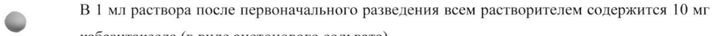
- стр. 3: «>1,5 и < 3х BIH) максимальная переносимая доза кабазитаксела составляет 15 мг/м?» — низкая уверенность: «3х» (57)  
  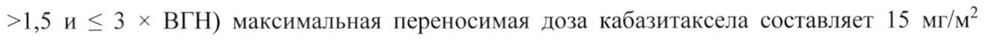
- стр. 5: «гемоглобина в периферической крови < 10 г/дл; у пациентов с состояниями или» — низкая уверенность: «10» (47)  
  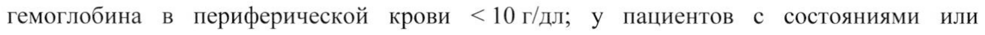
- стр. 12: «Часто встречающимися (> 5%) НР >23 степени тяжести при применении препарата» — низкая уверенность: «5%)» (0), «>23» (37)  
  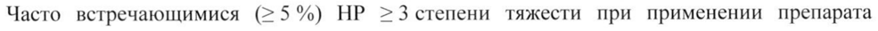
- стр. 12: «Здравоохранения: очень часто (> 10 %); часто (> 1 % и < 10%); нечасто (> 0,1 % и < 1%);» — низкая уверенность: «10%);» (69), «1%);» (0)  
  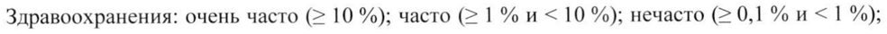
- стр. 12: «редко (> 0,01 % и < 0,1 %); очень редко (< 0,01 %); неизвестная частота (по имеющимся» — низкая уверенность: «0,1» (68)  
  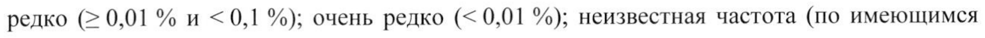
- стр. 15: «ПП-М (000015) - (PI-RU)-121119%» — низкая уверенность: «(PI-RU)-121119%» (20)  
  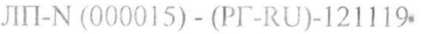
- стр. 18: «кабазитакселом в дозе 25 мг/м? площади поверхности тела внутривенно каждые 3 недели в» — повторное чтение: «кабазитакселом в дозе 25 мг/M? площади поверхности тела внутривенно каждые 3 недели в»  
  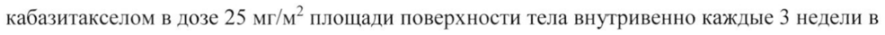
- стр. 18: «мг/сутки ежедневно (количество пациентов 378) или митоксантроном в дозе 12 мг/м?» — низкая уверенность: «12» (62)  
  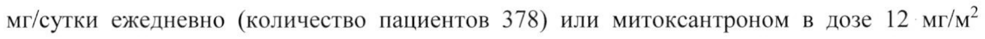
- стр. 18: «тромбоцитов > 100000/мм?, концентрациями гемоглобина > 10 г/дл, креатинина < 1,5 x ВГН» — низкая уверенность: «100000/мм?,» (42)  
  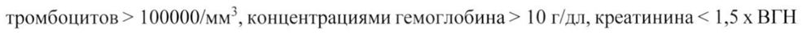
- стр. 19: «= 60 %» — повторное чтение: «= 60 ©»  
  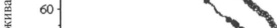
- стр. 19: «. Я . Е 2%» — низкая уверенность: «2%» (27); повторное чтение: «в. Е a | ``»  
  
- стр. 21: «© препарата была снижена с 25 до 20 мг/м?, у 19 пациентов (3,2 %) доза кабазитаксела» — повторное чтение: «© препарата scan anexers a 93a SE ori у ав 0 ane Баковьдан»  
  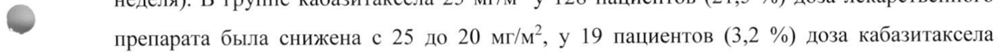
- стр. 23: «Объем распределения в равновесном состоянии (Vs) составлял 4870 л (2640 л/м? для» — низкая уверенность: «4870» (62)  
  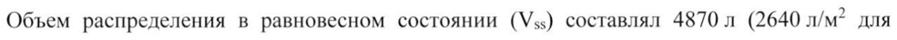
- стр. 23: «и была ненасыщаемой до концентрации 50000 нг/мл, которая превышает Cmax,» — низкая уверенность: «50000» (69)  
  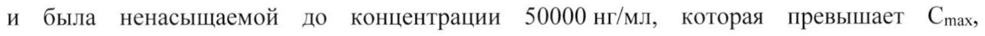
- стр. 24: «анионы (ОАТР1ВЗ) (холецистокинин - ССК8), в концентрациях, как минимум, в 15 раз» — низкая уверенность: «(ОАТР1ВЗ)» (76)  
  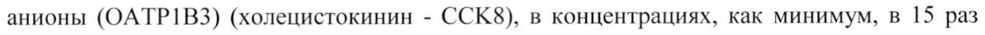
- стр. 24: «транспорт OATPIBI1 (эстрадиол-17В-глюкуронид) в концентрациях, только в 5 раз» — низкая уверенность: «OATPIBI1» (47)  
  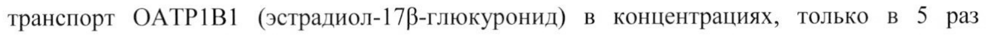