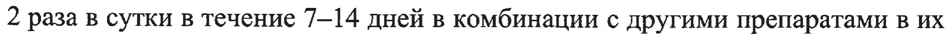
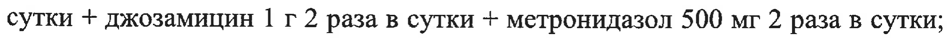
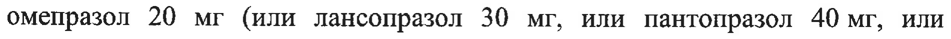
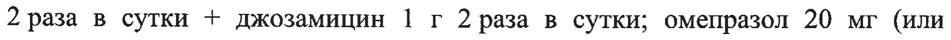
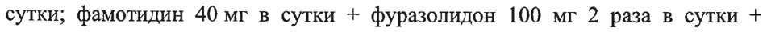
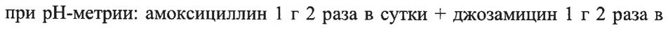
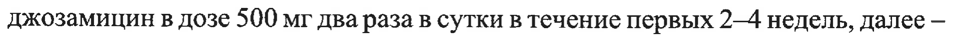

# Джозамицин — внутрь

- Препарат: ВИЛЬПРАМИЦИН CAP® (таблетки диспергируемые;)
- АТХ: J01FA07
- Источник: ГРЛС, инструкция по медицинскому применению, РУ ЛП-008850, файл от 2024-12-13 (https://grls.rosminzdrav.ru/Grls_View_v2.aspx?routingGuid=096fb9f5-3258-4bc0-8199-741cdd8731ae)
- Распознано автоматически (OCR): 12 из 12 стр.
- Инструкция к другому РУ того же препарата: ЛП-008850 (национальное РУ, переоформленное по правилам ЕАЭС, решение от 13.11.2024). Текст может быть старше действующего
- Сомнительных строк после OCR: 7 (см. раздел «Проверка распознавания»)

## Общие сведения

ЕЕ т .
МИНИСТЕРСТВО ЗДРАВООХРАНЕНИЯ РОССИЙСКОЙ ФЕДЕРАЦИИ
ИНСТРУКЦИЯ ПО МЕДИЦИНСКОМУ ПРИМЕНЕНИЮ ЛЕКАРСТВЕННОГО ПРЕПАРАТА
ВИЛЬПРАМИЦИН САР® Регистрационный номер:
Торговое наименование: ВИЛЬПРАМИЦИН САР®
Международное непатентованное наименование: джозамицин

## 3. Лекарственная форма

таблетки диспергируемые
таблетки диспергируемые

## 2. Состав

Состав на 1 таблетку:
Состав на 1 таблетку:
Действующее вещество: джозамицина пропионат — 1067,66 мг, в пересчете на джозамицин — 1000 мг.
Вспомогательные вещества: целлюлоза микрокристаллическая — 564,53 мг, гипролоза низкозамещенная (ГН 22) - 199,82 мг, натрия докузат — 10,02 мг, аспартам (E951) — 10,09 мг, кремния диоксид коллоидный — 2,91 мг, ароматизатор клубничный — 50,05 мг, магния стеарат — 34,92 мг.
Описание Таблетки овальные, двояковыпуклые с риской на одной стороне, почти белые или белые с желтоватым оттенком или желтого цвета, с запахом клубники.
Фармакотерапевтическая группа: антибиотик-макролид.
Код ATX: JO1FA07 Фармакологические свойства

## 5.1. Фармакодинамика

Антибактериальный препарат из группы макролидов. Механизм действия связан с нарушением синтеза белка в микробной клетке вследствие обратимого связывания с 505-субъединицей рибосомы. В терапевтических концентрациях, как правило, оказывает бактериостатическое действие, замедляя рост и размножение бактерий. При создании в очаге воспаления высоких концентраций возможен бактерицидный эффект.
Антибактериальный препарат из группы макролидов. Механизм действия связан с нарушением синтеза белка в микробной клетке вследствие обратимого связывания с 505-субъединицей рибосомы. В терапевтических концентрациях, как правило, оказывает бактериостатическое действие, замедляя рост и размножение бактерий. При создании в очаге воспаления высоких концентраций возможен бактерицидный эффект.
Джозамицин активен в отношении грамположительных бактерий
(Staphylococcus 5рр., в том числе метициллин-чувствительные штаммы
Staphylococcus aureus), Streptococcus spp., в том числе Streptococcus pyogenes и
Streptococcus pneumoniae, Corynebacterium diphtheriae, Listeria monocytogenes,
Propionibacterium acnes, Bacillus anthracis, Clostridium spp., Peptococcus spp.,
Peptostreptococcus spp., грамотрицательных бактерий (Neisseria meningitidis,
Neisseria gonorrhoeae, Moraxella catarrhalis, Bordetella spp., Brucella spp.,
Legionella spp., Haemophilus ducreyi, Haemophilus influenzae, Helicobacter pylori, Campylobacter jejuni), чувствительность Bacteroides fragilis может быть вариабельной, Chlamydia spp., в том числе С. trachomatis, Chlamydophila spp., в том числе Chlamydophila pneumoniae (ранее называлась Chlamydia pneumoniae), Mycoplasma spp., в том числе Mycoplasma pneumoniae,
Mycoplasma hominis, Mycoplasma genitalium, Ureaplasma spp., Treponema pallidum, Borrelia burgdorferi.
Kak правило, неактивен в отношении энтеробактерий, поэтому незначительно влияет на микрофлору желудочно-кишечного тракта (ЖКТ). В ряде случаев сохраняет активность при резистентности к эритромицину и другим 14- и 15членным макролидам (стрептококки, стафилококки). Резистентность к джозамицину встречается реже, чем к 14- и 15-членным макролидам.

## 5.2. Фармакокинетика

Абсорбция После приема внутрь джозамицин быстро всасывается из ЖКТ, прием пищи не влияет на биодоступность. Максимальная концентрация джозамицина в плазме достигается через 1 час после приема. При приеме в дозе 1 г максимальная концентрация в плазме крови составляет 2—3 мкг/мл. Около 15 % джозамицина связывается с белками плазмы.
Абсорбция После приема внутрь джозамицин быстро всасывается из ЖКТ, прием пищи не влияет на биодоступность. Максимальная концентрация джозамицина в плазме достигается через 1 час после приема. При приеме в дозе 1 г максимальная концентрация в плазме крови составляет 2—3 мкг/мл. Около 15 % джозамицина связывается с белками плазмы.
Распределение Джозамицин хорошо распределяется в органах и тканях (за исключением головного мозга), создавая концентрации, превышающие плазменную и сохраняющиеся на терапевтическом уровне длительное время. Особенно высокие концентрации джозамицин создает в легких, миндалинах, слюне, поте и слезной жидкости. Концентрация в мокроте превышает концентрацию в плазме в 8-9 раз. Проходит плацентарный барьер, секретируется в грудное молоко.
Биотрансформация Джозамицин метаболизируется в печени до менее активных метаболитов и экскретируется главным образом с желчью.
Элиминация Период полувыведения (Ту) препарата составляет 1-2 часа, однако может удлиняться у пациентов с нарушением функции печени. Экскреция препарата почками не превышает 10 %.

## 4.1. Показания к применению

Инфекционно-воспалительные заболевания, вызванные чувствительными к препарату микроорганизмами:
Инфекционно-воспалительные заболевания, вызванные чувствительными к препарату микроорганизмами:
Инфекции верхних дыхательных путей и ЛОР-органов:
— тонзиллит, фарингит, паратонзиллит, ларингит, средний отит, синусит, дифтерия (дополнительно к лечению дифтерийным анатоксином), скарлатина
(в случае гиперчувствительности к пенициллину).
Инфекции нижних дыхательных путей:
— острый бронхит, обострение хронического бронхита, внебольничная пневмония, в том числе вызванная атипичными возбудителями, коклюш, пситтакоз.
Инфекции в стоматологии:
— гингивит, перикоронит, периодонтит, альвеолит, альвеолярный абсцесс.

Инфекции в офтальмологии:

— блефарит, дакриоцистит.

Инфекции кожных покровов и мягких тканей:

— фолликулит, фурункул, фурункулез, абсцесс, сибирская язва, рожа, акне,

лимфангит, лимфаденит, флегмона, панариций, раневые (в том числе

послеоперационные) и ожоговые инфекции.

Инфекции мочеполовой системы:

— уретрит, цервицит, эпидидимит, простатит, вызванные хламидиями и/или

микоплазмами, гонорея, сифилис (при гиперчувствительности к

пенициллину), венерическая лимфогранулема.

Заболевания желудочно-кишечного тракта, ассоциированные с Helicobacter

pylori:

— язвенная болезнь желудка и двенадцатиперстной кишки, хронический

гастрит и другие.

## 4.3. Противопоказания

— Гиперчувствительность к джозамицину или к любому из вспомогательных

веществ препарата.

— Гиперчувствительность к другим макролидам.

— Тяжелые нарушения функции печени.

— Дети с массой тела менее 10 кг (для данной лекарственной формы).

## 4.3. С осторожностью

Джозамицин следует применять с осторожностью у пациентов с нарушением

функции печени.

Следует избегать совместного применения джозамицина с алкалоидами

спорыньи; антигистаминными препаратами, содержащими терфенадин и

астемизол; теофиллином; бромокриптином; циклоспорином и такролимусом;

антикоагулянтами для приема внутрь.

## 4.6. Применение при беременности и в период грудного вскармливания

Разрешено применение при беременности и в период грудного вскармливания после врачебной оценки пользы/риска.

## 4.2. Способ применения и дозы

Непосредственно перед приемом таблетку следует растворить в небольшом количестве воды (не менее 50 мл) и тщательно перемешать до получения суспензии. Полученную суспензию необходимо принять сразу после приготовления или поместить на хранение при температуре от 2 до 8°С остаток суспензии до следующего приема в случае разделения готовой суспензии на два приема.
Непосредственно перед приемом таблетку следует растворить в небольшом количестве воды (не менее 50 мл) и тщательно перемешать до получения суспензии. Полученную суспензию необходимо принять сразу после приготовления или поместить на хранение при температуре от 2 до 8°С остаток суспензии до следующего приема в случае разделения готовой суспензии на два приема.
Рекомендуемая суточная доза для взрослых и подростков в возрасте старше 14 лет составляет от 1 до 2 г джозамицина. Суточная доза должна быть разделена на 2—3 приема. В случае необходимости доза может быть увеличена до 3 гв сутки.
Дети в возрасте 1 года имеют среднюю массу тела 10 кг. Суточная доза для детей с массой тела не менее 10 кг назначается исходя из расчета 40-50 мг/кг массы тела ежедневно, разделенная на 2—3 приема:
® для детей с массой тела 10—20 кг препарат назначается по 250-500 мг 2 раза в сутки (1/2 таблетки, растворенной в 50 мл воды). Если препарат назначен в дозе 500 мг, полученная суспензия должна быть принята полностью. Если препарат назначен в дозе 250 мг, полученная суспензия от 1/2 таблетки разделяется на два приема (по 25 мл на каждый прием), вторая половина суспензии помещается на хранение при температуре от 2 до 8°С до следующего приема, но не более чем на 12 часов. Срок хранения полученной суспензии не должен превышать 12 часов).
® для детей с массой тела 20-40 кг препарат назначается по 500 мг — 1000 мг (1/2 таблетки — 1 таблетка, растворенная в 50 мл воды) 2 раза в сутки, более 40 кг — по 1000 мг (1 таблетка, растворенная в 50 мл воды} 2 раза в сутки.
Обычно продолжительность курса терапии определяется врачом, составляя от 5 до 21 дня в зависимости от характера и тяжести инфекции. В соответствии с рекомендациями Всемирной организации здравоохранения (ВОЗ), длительность лечения стрептококкового тонзиллита должна составлять не менее 10 дней.
В схемах антихеликобактерной терапии джозамицин назначается в дозе 1 г 2 раза в сутки в течение 7-14 дней в комбинации с другими препаратами в их стандартных дозах (фамотидин 40 мг в сутки или ранитидин 150 мг 2 раза в сутки + джозамицин 1 г 2 раза в сутки + метронидазол 500 мг 2 раза в сутки;
омепразол 20 мг (или лансопразол 30 мг, или пантопразол 40 мг, или эзомепразол 20 мг, или рабепразол 20 мг) 2 раза в сутки + амоксициллин 1 г 2 раза в сутки + джозамицин 1 г 2 раза в сутки; омепразол 20 мг (или лансопразол 30 мг, или пантопразол 40 мг, или эзомепразол 20 мг, или рабепразол 20 мг) 2 раза в сутки + амоксициллин 1 г 2 раза в сутки + джозамицин 1 г 2 раза в сутки + висмута трикалия дицитрат 240 мг 2 раза в сутки; фамотидин 40 мг в сутки + фуразолидон 100 мг 2 раза в сутки + джозамицин 1 г 2 раза в сутки + висмута трикалия дицитрат 240 мг 2 раза в сутки).
При наличии атрофии слизистой желудка с ахлоргидрией, подтвержденной при рН-метрии: амоксициллин 1 г 2 раза в сутки + джозамицин 1 г 2 раза в сутки + висмута трикалия дицитрат 240 мг 2 раза в сутки.
В случае обыкновенных и шаровидных угрей рекомендуется назначать джозамицин в дозе 500 мг два раза в сутки в течение первых 2-4 недель, далее — 500 мг джозамицина 1 раз в сутки в качестве поддерживающего лечения в течение 8 недель.

## 4.8. Побочное действие

Ниже перечислены нежелательные реакции, возможные при приеме джозамицина.
Ниже перечислены нежелательные реакции, возможные при приеме джозамицина.
Частота нежелательных реакций определяется следующим образом: очень часто (> 1/10), часто (> 1/100, но < 1/10), нечасто (> 1/1000, но < 1/100), редко
(> 1/10000, но < 1/1000), очень редко (< 1/10000), частота неизвестна (на основании имеющихся данных оценить невозможно).

Инфекционные и паразитарные заболевания Очень редко: псевдомембранозный колит.
Нарушения со стороны иммунной системы Редко: анафилактические реакции.
Нарушения со стороны обмена веществ и питания
Редко: снижение аппетита.
Нарушения со стороны сердца Неизвестно: аритмия.
Нарушения со стороны желудочно-кишечного тракта
Часто: дискомфорт в желудке, тошнота.
Нечасто: дискомфорт в животе, рвота, диарея.
Редко: стоматит, запор, снижение аппетита.
Очень редко: псевдомембранозный колит.
Нарушения со стороны печени и желчевыводящих путей
Очень редко: нарушение функции печени.
Неизвестно: желтуха, обычно характеризующаяся, но не ограничиваясь, холестатическими реакциями, связанными с умеренным повреждением печени.
Нарушения со стороны кожи и подкожных тканей
Редко: крапивница, ангионевротический отек. .
Очень редко: буллезный дерматит, мультиформная эритема, пурпура, синдром
Стивенса-Джонсона.
Неизвестно: токсический эпидермальный некролиз.
Общие расстройства и нарушения в месте введения
Неизвестно: отек лица.

## 4.9. Передозировка

До настоящего времени нет данных о специфических симптомах передозировки. В случае передозировки следует предполагать возникновение симптомов, описанных в разделе «Побочное действие», особенно со стороны желудочно-кишечного тракта.
До настоящего времени нет данных о специфических симптомах передозировки. В случае передозировки следует предполагать возникновение симптомов, описанных в разделе «Побочное действие», особенно со стороны желудочно-кишечного тракта.

## 4.5. Взаимодействие с другими лекарственными средствами

Джозамицин является субстратом и ингибитором изоферментов цитохрома

Р4503А. Одновременное применение джозамицина и лекарственных средств,

которые являются субстратами цитохрома P4503A, может увеличивать

концентрацию одновременно применяемых веществ в плазме крови.

Антигистаминные средства

Джозамицин может взаимодействовать с антигистаминными препаратами,

содержащими терфенадин или астемизол, задерживая выведение этих

препаратов, что, в свою очередь, может привести к критической аритмии

сердца (см. раздел «Особые указания»).

Алкалоиды спорыньи

Одновременное применение с алкалоидами спорыньи может вызвать

повышенную — вазоконстрикцию. Следует избегать одновременного

применения алкалоидов спорыньи и джозамицина, а в случае возникновения

признаков со стороны периферической нервной системы и симптомов

отравления спорыньей (эрготизма) следует прекратить применение препарата

и обеспечить надлежащее лечение, такое как местное применение тепла и

введение вазодилататоров.

Циклоспорин и такролимус

Одновременное применение джозамицина и циклоспорина/такролимуса

может приводить к повышению концентрации циклоспорина/такролимуса, что

ведет к поражению почек. Следует регулярно контролировать концентрацию

циклоспорина/такролимуса в плазме крови.

Триазолам

Джозамицин может усиливать действие триазолама и вызывать сонливость. В

случае передозировки триазоламом рекомендуется временное прекращение

приема препарата.

Бромокриптин

Джозамицин может усиливать действие бромокриптина и вызывать

сонливость, головокружение, атаксию и т.п. В случае интоксикации бромокриптином рекомендуется временное прекращение применения этого

препарата.

Теофиллин

Сообщается, что джозамицин повышал уровень теофиллина в сыворотке крови

у детей. Концентрация теофиллина может повышаться из-за длительного Ти.

В случае токсического действия теофиллина дополнительные дозы

теофиллина должны быть соответствующим образом скорректированы с

учетом концентрации теофиллина в сыворотке крови.

Антикоагулянты для приема внутрь

Джозамицин может усиливать действие антикоагулянтов для приема внутрь,

таких как варфарин и его производные, которые являются антагонистами

витамина К. Джозамицин уменьшает выработку витамина К кишечными

бактериями. В случае кровотечения рекомендуется прекращение приема

джозамицина и/или антикоагулянтов для приема внутрь и применение

витамина К в зависимости от тяжести кровотечения или степени коагулопатии

на основании протромбинового времени или — международного

нормализованного отношения (МНО).

Субстраты Р-гликопротеинов

Сообщается, что совместное применение макролидов с субстратами Р-

гликопротеинов вызывает увеличение концентрации последних в сыворотке

крови. В частности, совместное применение джозамицина и дигоксина может

приводить к повышению концентрации дигоксина в сыворотке крови, что, в

свою очередь, приводит к интоксикации дигоксином, в том числе — к сердечной

аритмии. При лечении джозамицином и после его отмены показан

клинический мониторинг, а также мониторинг концентрации дигоксина в

сыворотке крови.

## 4.4. Особые указания

Тяжелые нежелательные реакции со стороны кожи

У некоторых пациентов, получавших джозамицин, отмечали серьезные

нежелательные реакции CO стороны кожи, такие как токсический эпидермальный некролиз и синдром Стивенса-Джонсона. При возникновении

тяжелых нежелательных реакций со стороны кожи следует отменить

джозамицин и провести соответствующую терапию и/или соответствующие

мероприятия.

Нарушение функции печени

У пациентов с нарушением функции печени концентрация препарата в плазме

может быть повышена. Таким образом, джозамицин следует применять с

осторожностью у пациентов с нарушением функции печени.

Одновременное применение с терфенадином или астемизолом

Совместное применение джозамицина и антигистаминных препаратов,

содержащих терфенадин или астемизол, следует проводить с осторожностью,

так как это может вызвать задержку выведения этих препаратов, что, в свою

очередь, может привести к критической аритмии сердца.

Перекрестная резистентность между макролидными антибиотиками

Может возникать перекрестная резистентность между другими макролидными

антибиотиками.

## 4.7. Влияние на способность управлять транспортными средствами, механизмами

с механизмами

Не отмечено влияния джозамицина на способность управлять транспортными

средствами и работать с механизмами.

## 6.5. Форма выпуска

Таблетки диспергируемые, 1000 мг.

По 5 таблеток в контурную ячейковую упаковку из пленки ПВХ/ЛИВДХ и

фольги алюминиевой печатной лакированной.

По 7, 14, 28 таблеток в банку из полиэтилена высокой плотности, укупоренную

крышкой навинчиваемой из полипропилена с контролем первого вскрытия со

вставкой из силикагеля или в банку полимерную из полиэтилена низкого

давления, укупоренную крышкой навинчиваемой из полиэтилена низкого

давления с контролем первого вскрытия для лекарственных средств, или в банку из полиэтилена низкого давления, укупоренную крышкой навинчиваемой из полиэтилена низкого давления и смеси из полиэтилена высокого давления и полиэтилена низкого давления с контролем первого вскрытия.
Допускается вкладывать в банку пакет-осушитель (силикагель) и/или вату медицинскую гигроскопическую.
Одну банку или 1, 2 контурные ячейковые упаковки по 5 таблеток вместе с инструкцией по медицинскому применению помещают в пачку из картона.

## 6.3. Срок годности

3 года.
3 года.

## 6.4. Условия хранения

Хранить при температуре не выше 25 °С. Хранить в оригинальной упаковке
Хранить при температуре не выше 25 °С. Хранить в оригинальной упаковке
(пачке).
Хранить в недоступном для детей месте.
Условия отпуска Отпускают по рецепту.
Держатель регистрационного удостоверения
ООО «ПРОМОМЕД РУС», Россия Адрес: 129090, г. Москва, проспект Мира, дом 13, строение 1, офис 13
Производитель AO «Биохимик», Россия Юридический адрес: 430030, Республика Мордовия, г. Саранск, ул. Васенко, д. 15А
Адрес места производства: 430030, Республика Мордовия, г. Саранск, ул. Васенко, д. 15А
Телефон: +7 (8342) 38-03-68 Адрес электронной почты: biohimic@promomed.pro

Организация, принимающая претензии потребителей |
ООО «ПРОМОМЕД РУС», Россия Адрес: 129090, г. Москва, проспект Мира, дом 13, строение 1, офис 13
Телефон: +7 (495) 640-25-28 Адрес электронной почты: reception@promomed.pro
(GS Менеджер по регистрации |: 1 \ с\ ОМОМ >|) А.А. Восканян лекарственных средств . }3}
A /$)
‚ Ч.
Shock ak
## Проверка распознавания

Страницы-сканы распознаны автоматически. В 7 строках с дозировками цифры могли распознаться с ошибкой — сверьте с вырезкой из оригинала:

- стр. 6: «2 раза в сутки в течение 7-14 дней в комбинации с другими препаратами в их» — низкая уверенность: «7-14» (75)  
  
- стр. 6: «сутки + джозамицин 1 г 2 раза в сутки + метронидазол 500 мг 2 раза в сутки;» — низкая уверенность: «2» (78)  
  
- стр. 6: «омепразол 20 мг (или лансопразол 30 мг, или пантопразол 40 мг, или» — низкая уверенность: «40» (70)  
  
- стр. 6: «2 раза в сутки + джозамицин 1 г 2 раза в сутки; омепразол 20 мг (или» — низкая уверенность: «2» (67)  
  
- стр. 6: «сутки; фамотидин 40 мг в сутки + фуразолидон 100 мг 2 раза в сутки +» — низкая уверенность: «40» (69)  
  
- стр. 6: «при рН-метрии: амоксициллин 1 г 2 раза в сутки + джозамицин 1 г 2 раза в» — низкая уверенность: «1» (79)  
  
- стр. 6: «джозамицин в дозе 500 мг два раза в сутки в течение первых 2-4 недель, далее —» — низкая уверенность: «2-4» (78)  
  
