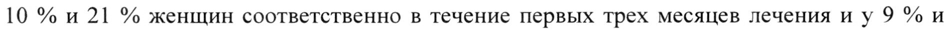
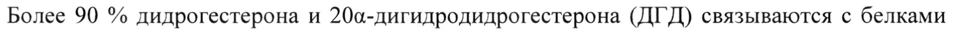

# Дидрогестерон + Эстрадиол и Эстрадиол — внутрь

- Препарат: Фемостон® мини (таблетки, покрытые пленочной оболочкой;)
- АТХ: G03FB08
- Источник: ГРЛС, инструкция по медицинскому применению, РУ ЛП-003754, файл от  (https://grls.rosminzdrav.ru/Grls_View_v2.aspx?routingGuid=5cfd219f-d3a9-4f22-b71e-dd98ff7d5080)
- Распознано автоматически (OCR): 19 из 19 стр.
- Инструкция к другому РУ того же препарата: ЛП-003754 (национальное РУ, переоформленное по правилам ЕАЭС, решение от 27.07.2021). Текст может быть старше действующего
- Сомнительных строк после OCR: 3 (см. раздел «Проверка распознавания»)

## Общие сведения

МИНИСТЕРСТВО ЗДРАВООХРАНЕНИЯ РОССИЙСКОЙ ФЕДЕРАЦИИ
ИНСТРУКЦИЯ ПО МЕДИЦИНСКОМУ ПРИМЕНЕНИЮ ЛЕКАРСТВЕННОГО ПРЕПАРАТА
Фемостон® мини

= —ы=— |

| МИНЗДРАВ РОССИИ | Регистрационный номер: ЛП-003754 | Wy-0O3P 54-2 70721, |
Торговое наименование: Фемостон® мини | |
Группировочное наименование: Г син. — | дидрогестерон + эстрадиол

© Лекарственная форма: таблетки, покрытые пленочной оболочкой

## 2. Состав

Действующие вещества: дидрогестерон — 2,5 мг, эстрадиола гемигидрат — 0,517 мг (в пересчете на эстрадиол - 0,5 мг).
Действующие вещества: дидрогестерон — 2,5 мг, эстрадиола гемигидрат — 0,517 мг (в пересчете на эстрадиол - 0,5 мг).
Вспомогательные вещества: лактозы моногидрат — 117,4 мг; гипромеллоза (НРМС 2910)
— 2,8 мг; крахмал кукурузный — 14,7 мг; кремния диоксид коллоидный - 1,4 мг; магния стеарат — 0,7 мг.
Пленочная оболочка: пленочное покрытие YELLOW 1* (макрогол 3350 — 20,2 %, поливиниловый спирт — 40,0 %, тальк — 14,8 %, титана диоксид (Е 171) — 20,55 %, краситель железа оксид желтый (Е 172) - 4,45 %) — 4,0 мг.
* Может быть использовано готовое пленочное покрытие идентичного состава, например, we Opadry® П желтый 85F3233 1
Описание Круглые двояковыпуклые таблетки, покрытые пленочной оболочкой желтого цвета, с гравировкой «379» на одной стороне. Вид таблеток на поперечном разрезе: белая, шероховатая поверхность.
Фармакотерапевтическая группа: противоклимактерическое средство комбинированное (эстроген + гестаген).
Код ATX: G03FA14 Фармакологические свойства

## 5.1. Фармакодинамика

Эстрадиол Действующее вещество препарата, синтетический 17В-эстрадиол, идентичен по химическому составу и биологическому действию эндогенному женскому половому гормону человека эстрадиолу.
Эстрадиол Действующее вещество препарата, синтетический 17В-эстрадиол, идентичен по химическому составу и биологическому действию эндогенному женскому половому гормону человека эстрадиолу.
Эстрадиол восполняет дефицит эстрогенов в организме у женщин в постменопаузальном периоде и уменьшает выраженность менопаузальных симптомов.
Дидрогестерон Дидрогестерон — прогестаген, эффективный при приеме внутрь и имеющий схожую с

[1 парентерально вводимым прогестероном активность.
Поскольку эстрогены способствуют пролиферации эндометрия, заместительная гормональная терапия (ЗГТ) только эстрогенами повышает риск гиперплазии эндометрия и рака. Включение дидрогестерона значительно снижает увеличенный под действием эстрогенов риск развития гиперплазии эндометрия у женщин с сохраненной маткой.
Информация, полученная в ходе клинических исследований:
Влияние на выраженность менопаузальных симптомов:
При назначении препарата Фемостон® мини ослабление менопаузальных симптомов достигалось в течение первых недель лечения: снижение частоты «приливов» средней тяжести и тяжелой степени было статистически достоверным по сравнению с плацебо, начиная с 4 недели терапии. Количество умеренных и выраженных приливов далее снижалось до прекращения терапии на 13 неделе.

ww Влияние на выраженность симптомов, связанных с нехваткой эстрогенов, и характер кровотечений:
В ходе клинических исследований было показано, что препарат Фемостон® мини обеспечивает ослабление симптомов, связанных с нехваткой эстрогенов, и характера кровотечений. В двух исследованиях аменорея (отсутствие кровотечения и кровянистых выделений) наблюдалась у 91 % и 88 % женщин соответственно в течение 10-12 месяцев с начала лечения. Нерегулярные кровотечения или кровянистые выделения появились у 10 % и 21 % женщин соответственно в течение первых трех месяцев лечения иу 9 %и 12 % - в течение 10-12 месяцев с начала лечения.

## 5.2. Фармакокинетика

Эстрадиол Всасывание
Эстрадиол Всасывание

р.
Всасывание эстрадиола зависит от размера частиц, микронизированный эстрадиол легко всасывается из желудочно-кишечного тракта.
В таблице ниже представлены фармакокинетические параметры эстрадиола (E2), эстрона
(El) и эстрона сульфата (Е1$) для каждой дозы микронизированного эстрадиола. Данные представлены в виде среднего значения (SD).
С О О О С С ОО О И © ооо ею [aa eH [AvE raion |
Распределение Эстрадиол (как и другие эстрогены) можно обнаружить как в связанном, так и в свободном состоянии. Около 98-99 % дозы эстрадиола связывается с белками плазмы крови, из которых 30-52 % — с альбумином и около 46-69 % — с глобулином, связывающим половые гормоны (ГСПГ). Эстрогены проникают в грудное молоко.
Метаболизм После приема внутрь эстрадиол активно = метаболизируется. Основными неконъюгированными и конъюгированными метаболитами являются эстрон и эстрона сульфат, обладающие эстрогенной активностью, либо непосредственно, либо после перехода в эстрадиол. Эстрона сульфат может подвергаться кишечно-печеночной
- рециркуляции.
Выведение Эстрон и эстрадиол выводятся в конъюгированном с глюкуроновой кислотой состоянии почками. Период полувыведения (Ty) составляет 10-16 4.
Зависимость концентрации эстрадиола от времени и дозы
При ежедневном приеме препарата Фемостон® мини концентрация эстрадиола в плазме крови достигает постоянной величины примерно через 5 дней. Обычно данный показатель достигается в течение 8-11 суток после начала приема препарата.
Дидрогестерон Всасывание После приема внутрь дидрогестерон быстро всасывается. Значение времени наступления максимальной концентрации (Tmax) для дидрогестерона варьирует от 30 минут до 2,5 часов. Абсолютная биодоступность дидрогестерона — 28 %.

В таблице ниже представлены фармакокинетические параметры дидрогестерона (0) и 20а-дигидродидрогестерона (ОНО). Данные представлены в виде среднего значения (SD).
О ОО С ПОС ОИ С ОСИ ОИ

с Распределение Более 90 % дидрогестерона и 204а-дигидродидрогестерона (ДГД) связываются с белками плазмы крови.
Метаболизм После приема внутрь дидрогестерон быстро метаболизируется до ДГД. Максимальная концентрация ДГД в плазме крови достигается приблизительно через 1,5 4 после приема препарата. Концентрация ДГД в плазме крови существенно превышает исходную концентрацию дидрогестерона, соотношения значений площади под кривой
«концентрация-время» (AUC) и максимальной концентрации (Cmax) ДГД к дидрогестерону составляют около 40 и 25 соответственно. Период полувыведения составляет для

‘ww дидрогестерона 5-7 часов, для ДГД 14-17 часов.
Общей характерной особенностью всех метаболитов дидрогестерона является сохранение конфигурации 4,6-диен-3-она исходного вещества и отсутствие 17а-гидроксилирования, что обуславливает отсутствие эстрогенной и андрогенной активностей.
Выведение Полностью дидрогестерон выводится через 72 ч. В среднем, 63 % от принятой дозы выводится почками. Общий плазменный клиренс — 6,4 л/мин. ДГД определяется в моче преимущественно в виде конъюгата глюкуроновой кислоты.
Зависимость концентрации дидрогестерона от времени и дозы
Сравнение кинетики разовой и многократных доз (от 2,5 до 10 мг) показывает, что фармакокинетические свойства дидрогестерона и ДГД не меняются при приеме многократных доз.

Равновесная концентрация дидрогестерона была достигнута через 3 суток после начала приема препарата.

## 4.1. Показания к применению

Заместительная гормональная терапия расстройств, обусловленных дефицитом эстрогенов у женщин в постменопаузе (не ранее, чем через 12 месяцев после последней менструации).

## 4.3. Противопоказания

e Гиперчувствительность к дидрогестерону, эстрадиолу и/или к любому вспомогательному веществу в составе препарата.

e Диагностированный или предполагаемый рак молочной железы (РМЖ).

© e Диагностированные или предполагаемые эстрогензависимые злокачественные новообразования (например, рак эндометрия).

e Диагностированные или предполагаемые прогестагензависимые новообразования
(например, менингиома).

e Кровотечения из влагалища неясной этиологии.

® Нелеченная гиперплазия эндометрия.

e Тромбозы (артериальные и венозные) и тромбоэмболии в настоящее время или в анамнезе (в том числе тромбоз, тромбоз глубоких вен; тромбоэмболия легочной артерии, инфаркт миокарда, ишемические или геморрагические цереброваскулярные нарушения).

® Острые или хронические заболевания печени в настоящее время или в анамнезе (до нормализации показателей функциональных проб печени), в том числе

_ злокачественные опухоли печени.

® Порфирия.

® Множественные или выраженные факторы артериального или венозного тромбоза, стенокардия, длительная иммобилизация, тяжелые формы ожирения (индекс массы тела более 30 кг/м”), заболевания сосудов головного мозга или коронарных артерий, транзиторные ишемические атаки, осложненные поражения клапанного аппарата сердца, фибрилляция предсердий.

e Выявленная наследственная или приобретенная предрасположенность к артериальным или венозным тромбозам/тромбоэмболиям, например:
гипергомоцистеинемия, дефицит антитромбина Ш, дефицит протеина С, дефицит протеина $, наличие антифосфолипидных антител (антитела к кардиолипину, волчаночный антикоагулянт).

® Беременность и период грудного вскармливания.
e Непереносимость галактозы, недостаточность лактазы, синдром мальабсорбции глюкозы-галактозы.
e Менингиома.
Прием препарата Фемостон® мини следует немедленно прекратить при выявлении противопоказаний и/или при возникновении следующих состояний:
® желтухи и/или нарушения функции печени;
® неконтролируемой артериальной гипертензии;
® впервые появившейся на фоне применения препаратов для ЗГТ мигренеподобной головной боли;
® беременности.
— С осторожностью Применение препаратов для ЗГТ, в том числе, препарата Фемостон® мини, требует соблюдения мер предосторожности при наличии какого-либо из перечисленных ниже заболеваний/состояний и факторов риска:
® Лейомиома матки, эндометриоз.
e Наличие факторов риска для возникновения эстрогензависимых опухолей
(например, родственников 1-ой степени родства с РМЖ).
® Артериальная гипертензия.
e Доброкачественные опухоли печени.
® Сахарный диабет, как при наличии сосудистых осложнений, так и в случае их
| отсутствия.
~ e Холелитиаз.
e Мигрень или сильная головная боль.
® Системная красная волчанка.
® Гиперплазия эндометрия в анамнезе.
® Эпилепсия.
® Бронхиальная астма.
e Отосклероз.
Следует принимать во внимание, что данные заболевания/состояния и факторы риска могут рецидивировать или усилиться во время терапии препаратом Фемостон® мини.
Необходимо соблюдать меры предосторожности в следующих случаях:
® у пациенток с хронической сердечной и почечной недостаточностью;
» у пациенток в случае наличия факторов риска развития тромбозов и тромбоэмболий в семейном анамнезе (тромбоз или тромбоэмболические осложнения у родственников 1-й степени родства в возрасте менее 50 лет (у таких пациенток следует провести скрининг, предварительно проинформировать, что с помощью скрининга можно выявить только часть тромбофилических нарушений);

® у пациенток, получающих антикоагулянтную терапию, необходимо тщательно

| оценивать соотношение «польза-риск» применения препарата Фемостон® мини.
Применение во время беременности и в период грудного вскармливания
Применение препарата Фемостон® мини во время беременности и в период грудного вскармливания противопоказано.
© При возникновении беременности на фоне приема препарата, следует немедленно прекратить его применение.
Результаты большинства эпидемиологических исследований с анализом данных касательно случайного приема комбинации эстрогена и прогестагена в ранние сроки беременности, свидетельствуют об отсутствии тератогенного и фетотоксического действия препаратов. Имеющиеся данные о приеме эстрадиола/дидрогестерона беременными женщинами ограничены.
Препарат Фемостон® мини не применяется у женщин репродуктивного возраста.

## 4.2. Способ применения и дозы

Препарат принимают внутрь ежедневно в течение 28 дней, в непрерывном режиме по 1 таблетке в сутки (желательно в одно и то же время суток), независимо от приема пищи.
Препарат принимают внутрь ежедневно в течение 28 дней, в непрерывном режиме по 1 таблетке в сутки (желательно в одно и то же время суток), независимо от приема пищи.
w При переходе с другого непрерывного последовательного или циклического режима приема препарата, следует закончить текущий цикл, а затем перейти на препарат
Фемостон® мини. Пациентки, не получающие препараты для ЗГТ или переходящие с непрерывного режима применения комбинированных препаратов для ЗГТ, могут начинать прием препарата Фемостон® мини в любой день.
Если пациентка пропустила прием таблетки, ее необходимо принять в течение 12 часов после обычного времени приема; если с момента пропуска очередного приема препарата
Фемостон® мини прошло более 12 часов, пропущенную таблетку принимать не следует, продолжить прием препарата нужно на следующий день в обычное время. Пропуск приема препарата может увеличивать вероятность «прорывного» маточного кровотечения или мажущих кровянистых выделений.
Для начала и продолжения лечения ЗГТ расстройств, обусловленных дефицитом эстрогенов, комбинацию дидрогестерон + эстрадиол следует применять в наименьшей эффективной дозе и в течение наименьшего периода времени (см. раздел «Особые указания»). Непрерывную комбинированную терапию можно начинать с препарата
Фемостон® мини в зависимости от времени после наступления менопаузы и тяжести симптомов дефицита эстрогенов.
Прием комбинированного препарата для ЗГТ Фемостон® мини у женщин с естественной менопаузой можно начинать не ранее, чем через 12 месяцев после последней менструации.
Женщины, у которых менопауза обусловлена хирургическим вмешательством, могут начинать прием препарата сразу (по назначению врача в случае наличия симптомов).
Применение в особых клинических группах пациенток
© Дети и подростки до 18 лет Показания к применению лекарственного препарата Фемостон® мини у детей отсутствуют.
Пациентки пожилого возраста Опыт применения препарата у женщин в возрасте старше 65 лет отсутствует.
Нарушение функции почек Эстрогены могут вызывать задержку жидкости в организме, поэтому пациентки с почечной недостаточностью должны находиться под наблюдением врача.
Нарушение функции печени Острые или хронические заболевания печени в настоящее время или в анамнезе (до нормализации показателей функциональных проб печени) являются противопоказанием к применению препарата.
w Побочное действие В клинических исследованиях у пациенток, получавших терапию комбинацией эстрадиол
+ дидрогестерон, наиболее часто встречались: головная боль, боль в животе, напряжение/болезненность молочных желез и боль в спине.

## 4.8. Побочное действие

, наблюдающиеся в клинических исследованиях, распределены по системно-органным классам с указанием частоты их возникновения согласно рекомендациям ВОЗ (количество зарегистрированных случаев/количество пациенток):
, наблюдающиеся в клинических исследованиях, распределены по системно-органным классам с указанием частоты их возникновения согласно рекомендациям ВОЗ (количество зарегистрированных случаев/количество пациенток):
очень часто часто нечасто редко > 1/10 ot = 1/100 до <1/10 ot = 1/1000 до ot = 1/10000 до
<1/100 <1/1000 О О ОО Увеличение размера лейомиомы
Гемолитическая анемия* Гиперчувствительность
& Депрессия, Изменение либидо нервозность
Головная боль Мигрень, Менингиома* головокружение
Непереносимость контактных линз*, увеличение кривизны роговицы*
О О И С и Венозная тромбоэмболия, артериит, заболевания периферических сосудов, варикозное расширение вен
Боль в животе Тошнота, рвота, | Диспепсия метеоризм
Я Нарушение функции печени, иногда в сочетании с желтухой, астенией, недомоганием, заболевания желчного пузыря
Аллергические Сосудистая пурпура, © реакции, такие как ангионевротический крапивница, кожная отек, узловатая сыпь и зуд эритема, хлоазма и меланодермия, которые могут остаться после прекращения терапии*
Боль B спине Судороги мышц (пояснице) нижних
| конечностей* ° Напряжение/ Нарушения Увеличение болезненность менструального молочных желез, молочных желез цикла (включая | предменструально-
«мажущие» подобный синдром кровянистые выделения В постменопаузе, метроррагию, меноррагию, олиго-
/аменоррагию, нерегулярные

менструации,

дисменорею), боль

внизу живота,

изменение

влагалищной

секреции

Астенические

состояния (слабость,

недомогание,

© усталость),

периферические

отеки

Увеличение массы | Снижение массы

тела тела * — нежелательные реакции, полученные из спонтанных сообщений, были включены в частоту «редко».
Другие нежелательные реакции, вызванные лечением комбинации эстрогена и прогестагена (включая эстрадиол/дидрогестерон):
Доброкачественные, злокачественные и неуточненные новообразования:

wr эстрогензависимые доброкачественные и злокачественные новообразования, в том числе рак эндометрия, рак яичников. Увеличение размеров прогестагензависимых новообразований, в том числе менингиомы.
Нарушения со стороны иммунной системы: системная красная волчанка.
Нарушения со стороны обмена веществ и питания: гипертриглицеридемия, ухудшение течения сопутствующей порфирии.
Нарушения со стороны нервной системы: риск развития деменции, хорея, провоцирование приступов эпилепсии.
Нарушения со стороны сосудов: артериальная тромбоэмболия.
Нарушения со стороны желудочно-кишечного тракта: панкреатит (у пациенток с гипертриглицеридемией).
Нарушения со стороны кожи и подкожных тканей: многоформная эритема.
Нарушения со стороны почек и мочевыводящих путей: недержание мочи, цистит.

Нарушения со стороны половых органов и молочной железы: фиброзно-кистозная

мастопатия, эрозия шейки матки.

Лабораторные и инструментальные данные: повышение концентрации тиреоидных

гормонов в плазме крови.

Риск развития рака молочной железы

У женщин, получавших комбинированную терапию препаратом эстрогеном-

прогестагеном на протяжении 5 и более лет, отмечалось двукратное увеличение риска

развития РМЖ.

Любое увеличение риска у женщин, получавших ЗГТ только эстрогеном, было меньшим

по сравнению с женщинами, получавшими комбинированную ЗГТ препаратом
© эстрогеном-прогестагеном.

Степень повышения риска зависит от продолжительности терапии.

## 4.9. Передозировка

Эстрадиол и дидрогестерон — вещества с низкой токсичностью.

Симитомы

В случае передозировки могут развиться такие симптомы, как: тошнота, рвота,

напряжение молочных желез, головокружение, боль в области живота,

сонливость/слабость и кровотечение «отмены».

Лечение.

Симптоматическое.

Информация, приведенная выше, также применима в случае неумышленной w передозировки у детей при случайном приеме препарата.

## 4.5. Взаимодействие с другими лекарственными средствами

Исследований по изучению взаимодействия с другими лекарственными препаратами не

проводилось.

Влияние других лекарственных препаратов на комбинацию эстроген+прогестаген:

e Метаболизм эстрогена и прогестагена может усиливаться при одновременном приеме с препаратами-индукторами микросомальных ферментов печени системы цитохрома Р450 (изоферментов CYP2B6, 3A4, ЗА5, 3A7): противосудорожными
(фенобарбитал, карбамазепин, фенитоин), противомикробными и противовирусными препаратами (рифампицин, рифабутин, невирапин, эфавиренз).

e Ритонавир и нелфинавир, хотя и известны как сильные ингибиторы изоферментов
СУРЗА4, А5, А7, при одновременном применении с половыми гормонами могут усиливать их метаболизм.

e Препараты растительного происхождения, содержащие зверобой продырявленный
(Hypericum perforatum), могут усиливать метаболизм эстрогена и прогестагена.

e Усиление метаболизма эстрогена и прогестагена клинически может проявляться снижением эффекта от применения препарата и появлением кровянистых выделений из влагалища.

e Влияние эстрогена на другие лекарственные средства:

Эстрогены могут влиять на метаболизм других лекарственных средств за счет конкурентного связывания с изоферментами системы цитохрома Р450 (СУР). Это
© необходимо учитывать для препаратов с узкой широтой терапевтического действия, таких как такролимус и циклоспорин А (CYP3A4, ЗАЗ), фентанил (СУРЗА4) и теофиллин
(СУР1А2), так как данный вид взаимодействия может привести к увеличению концентрации в плазме крови вышеуказанных препаратов до токсического уровня. В связи с этим может потребоваться тщательное наблюдение за приемом лекарственных средств в течение длительного периода времени и, возможно, уменьшение дозы такролимуса, фентанила, циклоспорина А и теофиллина.

## 4.4. Особые указания

Препарат назначают только при наличии симптомов, неблагоприятно влияющих на качество жизни женщины. Терапию следует продолжать до тех пор, пока польза от приема препарата превышает риск развития нежелательных реакций.
Препарат назначают только при наличии симптомов, неблагоприятно влияющих на качество жизни женщины. Терапию следует продолжать до тех пор, пока польза от приема препарата превышает риск развития нежелательных реакций.
© Опыт применения препарата у женщин старше 65 лет ограничен.
Сведения о рисках, связанных с ЗГТ в случае преждевременной менопаузы, ограничены.
Из-за низкого уровня абсолютного риска у женщин более молодого возраста, соотношение «польза-риск» у них может быть более благоприятным, чем у женщин пожилого возраста.
Медицинское обследование Перед назначением или возобновлением терапии препаратом Фемостон® мини необходимо собрать полный медицинский и семейный анамнез и провести общее и гинекологическое обследования (в том числе и молочных желез) пациентки с целью выявления возможных противопоказаний и состояний, требующих соблюдения мер предосторожности. Во время лечения препаратом Фемостон® мини рекомендуется проводить периодические обследования, частоту и характер которых определяют индивидуально, но не менее | раза в 6 месяцев. Целесообразно проведение инструментальных методов исследования (например, маммография) для дополнительного обследования молочных желез. Женщины должны быть проинформированы в отношении возможных изменений в молочных железах, о которых следует сообщить лечащему врачу.
Применение эстрогенов может повлиять на результаты следующих лабораторных тестов:
определение толерантности к глюкозе, исследование функций щитовидной железы и печени.
Гиперплазия и рак эндометрия У женщин с сохраненной маткой риск развития гиперплазии и рака эндометрия увеличивается при длительной монотерапии эстрогенами. Риск развития рака эндометрия при применении пациентками только эстрогенов зависит от дозы и продолжительности

© лечения и увеличивается от 2 до 12 раз по сравнению с пациентками, не получающими терапию; риск может оставаться повышенным в течение 10 лет после прекращения терапии.
У женщин с сохраненной маткой не рекомендуется применение препаратов для ЗГТ, содержащих только эстроген, в связи с повышенным риском развития рака эндометрия.
Циклическое применение прогестагена (по крайней мере, в течение 12 дней 28-дневного цикла), или применение комбинированных препаратов для ЗГТ в непрерывном режиме у женщин с сохраненной маткой может предотвратить повышенный эстрогенами риск гиперплазии и рака эндометрия.
В целях своевременной диагностики целесообразно проведение ультразвукового скрининга, при необходимости — проведение гистологического (цитологического)
исследования.

w Кровянистые выделения из влагалища В первые месяцы лечения препаратом могут отмечаться «прорывные» кровотечения и/или скудные кровянистые выделения из влагалища. Если подобные кровотечения появляются через некоторое время после начала терапии или продолжаются после прекращения лечения, следует установить их причину. Возможно проведение биопсии эндометрия для исключения злокачественного новообразования.
Венозная тромбоэмболия ЗГТ связана с 1,3-3—кратным риском развития венозной тромбоэмболии (ВТЭ), т.е.
тромбоза глубоких вен или тромбоэмболии легочной артерии. Такое осложнение наиболее вероятно в течение первого года ЗГТ.
При наличии в семейном анамнезе тромбозов/тромбоэмболий у родственников 1-Й степени родства в возрасте менее 50 лет, а также при привычном невынашивании

беременности в анамнезе, необходимо проводить исследование гемостаза (в ходе скрининга выявляется только часть нарушений системы свертывания крови).

Необходима тщательная оценка соотношения ожидаемой пользы к возможному риску проведения ЗГТ у пациенток, принимающих антикоагулянтные препараты в постоянном режиме.

При выявлении тромбофилического состояния у члена семьи и/или в случае серьезности или тяжести дефекта (например, дефицит антитромбина Ш, дефицит протеина $ или С, а также при комбинации дефектов) препарат Фемостон® мини противопоказан.

Поскольку у пациенток с диагностированными тромбофилическими состояниями есть повышенный риск развития венозной тромбоэмболии, назначение препарата Фемостон® мини, который увеличивает этот риск, противопоказано.

© В большинстве случаев к факторам риска развития ВТЭ относятся: применение эстрогенов, пожилой возраст, обширные хирургические вмешательства, длительная иммобилизация, ожирение (индекс массы тела > 30 кг/м”), беременность или послеродовой период, системная красная волчанка и рак. Нет единого мнения о возможной роли варикозного расширения вен в развитии ВТЭ.

В послеоперационном периоде обязательным является проведение профилактики ВТЭ.

Для предотвращения ВТЭ в случае длительной иммобилизации после оперативного вмешательства, большой операции, операции на нижних конечностях, в области таза или нейрохирургической операции, обширной травмы прием препарата прекращают и возобновляют только после восстановления полной подвижности женщины. В случае планового оперативного вмешательства прием препарата прекращают за 4-6 недель до операции.

& Если ВТЭ развивается уже после начала терапии, TO следует прекратить прием препарата, a пациентки должны быть информированы, что они должны немедленно обратиться к своему врачу в случае возникновения каких-либо возможных симптомов тромбоза/тромбоэмболии (например, болезненность или отечность нижних конечностей, внезапная боль в груди, одышка).

Рак молочной железы Результаты клинических исследований указывают на повышенный риск развития РМЖ у женщин, получающих ЗГТ монопрепаратов эстрогена или комбинированными препаратами (эстроген+прогестаген). Этот риск зависит от продолжительности ЗГТ. У женщин, принимающих комбинированные препараты для ЗГТ более 5 лет, риск развития
РМЖ может увеличиться до 2-х раз.
Терапия только эстрогеном

По результатам исследования WHI не отмечалось повышения риска развития РМЖ у

женщин с предшествующей гистерэктомией, получавших ЗГТ только эстрогеном.

ЗГТ комбинированными (эстроген+прогестаген) препаратами

Рандомизированное плацебо-контролируемое исследование (исследование «Инициатива

BO имя здоровья женщины» (WHI)) и метаанализ проспективных эпидемиологические

исследования показали повышение риска развития РМЖ у женщин, принимающих ЗГТ

комбинированными (эстроген + прогестаген) препаратами.

Повышенный риск РМЖ наблюдается примерно через 3 (1-4) года ЗГТ.

Данные результатов, полученных при проведении масштабного метаанализа,

свидетельствуют об уменьшении повышенного риска РМЖ после прекращения ЗГТ.

Время, необходимое для возвращения к исходному уровню риска зависит от
© продолжительности терапии. Если ЗГТ проводилась более 5 лет, риск развития РМЖ

может сохраняться в течение 10 лет и более.

В большинстве наблюдательных исследований было показано небольшое повышение

риска РМЖ, при этом, данный риск был заметно ниже у женщин, принимавших

комбинированную терапию эстрогеном и прогестагеном.

На фоне ЗГТ, особенно ЗГТ комбинированными (эстроген+прогестаген) препаратами,

наблюдается увеличение плотности тканей молочной железы при проведении

маммографии, что может затруднять диагностирование РМЖ.

Рак яичников

Рак яичников встречается значительно реже РМЖ. Эпидемиологические данные,

полученные в результате проведения крупномасштабного метаанализа, свидетельствуют о

незначительном повышении риска развития рака яичников у женщин, получающих ЗГТ w как комбинированными препаратами, так и препаратами, содержащими только эстроген.

По данным проведенных исследований риск развития рака яичников повышается при

длительности терапии более 5-ти лет, а после ее прекращения постепенно снижается.

Результаты ряда других исследований, включая WHI, указывают на то, что

комбинированная ЗГТ связана с аналогичным или несколько меньшим риском развития

рака яичников.

Риск ишемического инсульта

Комбинированная терапия эстрогеном и прогестагеном или терапия только эстрогеном

связана с повышением относительного риска ишемического инсульта в 1,5 раза. Риск

геморрагического инсульта при применении препаратов для ЗГТ не повышается.

Относительный риск не зависит от возраста или времени наступления менопаузы, однако

исходный риск сильно зависит от возраста, таким образом общий риск инсульта у

женщин, получающих ЗГТ, будет повышаться с возрастом.

Ишемическая болезнь сердца (ИБС)

В рандомизированных контролируемых клинических исследованиях не было получено

свидетельств защитного действия ЗГТ против инфаркта миокарда у женщин с/без ИБС,

которые получали ЗГТ комбинированными (эстроген+прогестаген) препаратами или

только эстрогеном.

ЗГТ комбинированными (эстроген+прогестаген) препаратами

Относительный риск ИБС во время применения ЗГТ комбинированными

(эстроген+прогестаген) препаратами незначительно повышается. В связи с тем, что

абсолютный риск ИБС сильно зависит от возраста, число дополнительных случаев ИБС

из-за приема ЗГТ комбинированными (эстроген+прогестаген) препаратами у здоровых
© женщин пременопаузального возраста очень невелико, однако оно увеличивается с

возрастом.

Риск немного выше у женщин в возрасте старше 60 лет.

Другие состояния

Эстрогены могут вызвать задержку жидкости, что может неблагоприятно сказаться на

состоянии пациенток с нарушением функции почек и сердца. Данной группе пациенток

следует находиться под медицинским наблюдением.

У женщин с гипертриглицеридемией на фоне приема препаратов для ЗГТ в очень редких

случаях может значительно повышаться концентрация в плазме крови триглицеридов, что

способствует развитию панкреатита.

Эстрогены повышают концентрацию тироксинсвязывающего глобулина, что приводит к

общему увеличению концентрации циркулирующих гормонов щитовидной железы, что
© измеряется определением йода, связанного с белками плазмы, концентрации тироксина

(Т4) — хроматографический или радиоиммунный анализ или трийодтиронина (ТЗ) —

радиоиммунный анализ. Тест захвата меченого трийодтиронина показывает повышенный

уровень тироксинсвязывающего глобулина. Уровни свободного Т4 и ТЗ остаются

неизменными. Концентрация других связывающих белков в плазме крови (например,

транскортин, глобулин, связывающий половые гормоны) также может повышаться, что

приводит к увеличению концентрации циркулирующих глюкокортикостероидов и

половых гормонов.

Концентрации свободных или биологически активных гормонов не изменяются.

Возможно увеличение концентрации других плазменных белков (ренин-ангиотензиновая

система, а-1-антитрипсин, церулоплазмин).

Применение ЗГТ не улучшает когнитивные функции. Имеются сообщения о повышении риска развития деменции у женщин, начавших применение ЗГТ (комбинированной или только эстрогенсодержащей) после 65 лет.
Препарат Фемостон® мини не является контрацептивным средством.

## 4.7. Влияние на способность управлять транспортными средствами, механизмами

Препарат не оказывает значимого влияния на способность к управлению транспортными средствами и работе с механизмами.

## 6.5. Форма выпуска

Таблетки, покрытые пленочной оболочкой, 2,5 мг + 0,5 мг
Таблетки, покрытые пленочной оболочкой, 2,5 мг + 0,5 мг
7 По 28 таблеток в ПВХ/Ал блистер.
По 1, 3 или 10 блистеров в картонную пачку вместе с инструкцией по применению.

## 6.4. Условия хранения

Хранить при температуре не выше 25 °С.
Хранить при температуре не выше 25 °С.
Хранить в недоступном для детей месте!

## 6.3. Срок годности

4 года.
4 года.
Не применять по истечении срока годности.
Условия отпуска w Отпускают по рецепту.
Владелец регистрационного удостоверения Эбботт Хелскеа Продактс Б.В.
С.Д. ван Хоутенлаан 36, НЛ-1381 СП Веесп, Нидерланды.
Производитель Эбботт Биолоджикалз Б.В.
Веервег 12, 8121 AA Ольст, Нидерланды.
Организация, принимающая претензии от потребителей:
ООО «Эбботт Лэбораториз»
125171, Москва, Ленинградское шоссе, дом 16A, стр. 1.
Тел.: +7 (495) 258 42 80 Факс: +7 (495) 258 42 81 abbott-russia@abbott.com rf)
Руководитель группы регистрации / JES ООО «Эбботт Лэбораториз» | (ве Щуклин М.
4 ote op я Sere Ея МЕ RDCCDS000421/11 papa питов 2
ON porn” /s | WS . +5 Ета
## Проверка распознавания

Страницы-сканы распознаны автоматически. В 3 строках с дозировками цифры могли распознаться с ошибкой — сверьте с вырезкой из оригинала:

- стр. 2: «10 % и 21 % женщин соответственно в течение первых трех месяцев лечения иу 9 %и» — низкая уверенность: «21» (0)  
  
- стр. 4: «Более 90 % дидрогестерона и 204а-дигидродидрогестерона (ДГД) связываются с белками» — низкая уверенность: «204а-дигидродидрогестерона» (55)  
  
- стр. 18: «7 По 28 таблеток в ПВХ/Ал блистер.» — низкая уверенность: «7» (74)  
  
