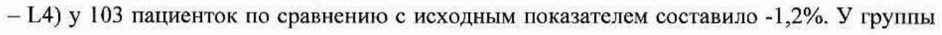
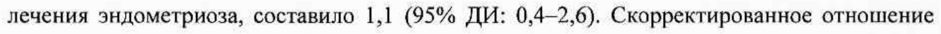
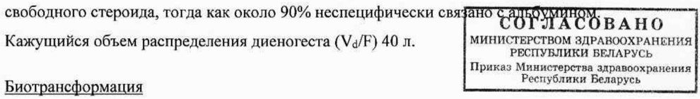
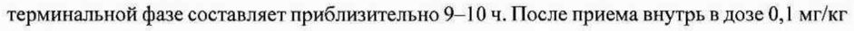

# Диеногест — внутрь

- Препарат: Визанна (таблетки)
- АТХ: G03DB08
- Источник: ОХЛП, Единый реестр ЛС ЕАЭС, запись 66ab80e130dcf88d7dd89cd5, документ от 2023-09-29
- Распознано автоматически (OCR): 20 из 20 стр.
- Сомнительных строк после OCR: 4 (см. раздел «Проверка распознавания»)

## Общие сведения

ЛП-№001547-ГП-ВУ от 05.12.2022 № 28136 ПОСЛЕДОВАТЕЛЬНОСТЬ 0002)
ОБЩАЯ ХАРАКТЕРИСТИКА ЛЕКАРЕТВЕ ОГО НРЕНАР
И мии Овны

## 1. Наименование лекарственного препарата

РЕСПУБЛИКИ БЕЛАРУСЬ

Приказ Министерства здравоохранения Визанна, 2 мг. таблетки ons PROF tess, Lege

## 2. Качественный и количественный состав

Действующее вещество: диеногест микронизированный.
Каждая таблетка содержит 2,000 мг диеногеста микронизированного.
Вспомогательные вещества, наличие которых надо учитывать в составе лекарственного препарата: лактозы моногидрат (62,800 мг) (см. раздел 4.4.).
Полный перечень вспомогательных веществ приведен в разделе 6.1.

## 3. Лекарственная форма

Таблетки.
Круглые белые или почти белые таблетки с плоской поверхностью и скошенными краями, с гравировкой “В” на одной стороне.

## 4. Клинические данные

## 4.1. Показания к применению

Препарат Визанна показан для лечения эндометриоза у взрослых и детей в возрасте от 12 до 18 лет после наступления менархе.

## 4.2. Режим дозирования и способ применения

Режим дозирования До начала приема препарата Визанна необходимо прекратить применение гормональной контрацепции. Если контрацепция необходима, то следует использовать негормональные методы контрацепции (например, барьерный метод).
Начало приема препарата Визанна возможно в любой день менструального цикла. Таблетки необходимо принимать непрерывно вне зависимости от кровотечений из влагалища. После завершения приема таблеток из одной упаковки начинают прием из следующей упаковки, не делая перерыва в приеме препарата.
При пропуске таблеток и в случае рвоты и/или диареи (если это происходит в пределах 3— 4 часов после приема таблетки) эффективность препарата Визанна может снижаться. В
СООТВЕТСТВУЕТ ЭКСПЕРТНОМУ ОТЧЕТУ от 05.12.2022 Ne 28136
< = 4 ele ad th случае пропуска одной или нескольких таблфток xe nei trey 4 Иня бд у аб)
как только она об этом вспомнит, а затем на следующий день продолжить прием таблеток в обычное время. Вместо таблетки, которая не абсорбировалась вследствие рвоты или иареи, также следует принять одну таблетку.

пер pe ВБ any У am СОГЛАСОВАНО Связь приема препарата с приемом пищи отсутствует. ИНИСТЕРСТВОМ ЗДРАВООХРАНЕНИЯ

р ропар р ПОТ, РЕСПУБЛИКИ БЕЛАРУСЬ

Приказ ‘иимотеротва здравоохранения Особые группы пациенток еспублики Беларусь
Пациентки пожилого возраста Нет соответствующих оснований для применения препарата Визанна у пациенток пожилого возраста.
Пациентки с нарушением функции печени Препарат Визанна противопоказан при тяжелых заболеваниях печени в настоящее время или в анамнезе (см. раздел 4.3).
Пациентки с нарушением функции почек Нет данных, свидетельствующих о необходимости изменения дозы у пациенток с нарушением функции почек.
Дети Безопасность и эффективность препарата Визанна у детей в возрасте от 0 до 12 лет не установлены.
Препарат Визанна может применяться у детей с 12-летнего возраста после наступления менархе. Режим дозирования для детей от 12 до 18 лет не отличается от режима дозирования для взрослых.
Способ применения Внутрь.
Препарат принимают по одной таблетке в сутки без перерыва, предпочтительно в одно и то же время каждый день, при необходимости запивая водой или другой жидкостью.

## 4.3. Противопоказания

Применение препарата Визанна противопоказано при наличии любого из перечисленных ниже состояний, часть из которых является общей для всех препаратов, содержащих только гестагенный компонент. Если какое-либо из данных состояний разовьется на фоне применения препарата Визанна, лечение препаратом следует немедленно прекратить:
ЛП-№001547-ГП-ВУ от 05.12.2022 № 28136 - Гиперчувствительность к действующему веществ Вы He HO BURAK IEP Berto Gra О ных веществ, перечисленных в разделе 6.1;
- Острый тромбофлебит, венозные тромбоэмболии в настоящее время;
- Заболевания сердца и артерий, в основе которых лежат атеросклеротические поражения сосудов (в том числе ишемическая болезнь сердца, инфаркт гиттотеартая ey транзиторная ишемическая атака) в настоящее время или в анамнезВуинистерством здрРАВООХРАНЕНИЯ
РЕСПУБЛИКИ БЕЛАРУСЬ - Сахарный диабет с сосудистыми поражениями; Приказ Министерства здравоохранения
Республики Беларусь

- Тяжелые заболевания печени в настоящее время или в анамнезе (при ОТСУТСТВИР нормализации функциональных проб печени);
- Опухоли печени (доброкачественные или злокачественные) в настоящее время или в анамнезе;
- Выявленные или подозреваемые гормонозависимые злокачественные опухоли, в том числе рак молочной железы;
- Кровотечения из влагалища неясного генеза;
- Холестатическая желтуха беременных в анамнезе;
- Непереносимость галактозы, дефицит лактазы, глюкозо-галактозная мальабсорбция;
- Детский возраст до 12 лет (до наступления менархе).

## 4.4. Особые указания и меры предосторожности при применении

С осторожностью Депрессия в анамнезе, внематочная беременность в анамнезе, артериальная гипертензия, хроническая сердечная недостаточность, мигрень с аурой, сахарный диабет без сосудистых осложнений, гиперлипидемия, тромбофлебит глубоких вен в анамнезе, венозные тромбоэмболии в анамнезе (см. раздел 4.4 ниже).
Перед началом применения препарата Визанна необходимо исключить беременность. Во время применения препарата Визанна при необходимости контрацепции пациенткам рекомендуется применять негормональные контрацептивные методы (например, барьерный).
Вероятность наступления эктопической беременности выше у пациенток, принимающих с целью контрацепции препараты, содержащие только гестагенный компонент, по сравнению с пациентками, принимающими комбинированные — пероральные контрацептивы. Таким образом, для женщин с внематочной беременностью в анамнезе или

ЛП-№001 54 7-ГП-ВУ от 05.12.2022 № 28136 при непроходимости маточных труб следует оценив НОНО НЫЫ я sek? hep I применением препарата Визанна.
Поскольку Визанна представляет собой препарат только с гестагенным компонентом, можно предположить, что особые указания и меры предосторожности, установленные для других препаратов такого типа, актуальны и в отношении препарата Визанна, хотя не все из данных предостережений были подтверждены в процессе клинических исследований препарата Визанна.
При наличии или усугублении любого из перечисленных ниже состояний или факторов
, = риска перед началом или продолжением применения препарата Визанц FANS GREET индивидуальную оценку соотношения пользы и риска. siege ope вы
Приказ Министерства здразоохранения Нарушения кровообращения Республики Беларусь
В процессе эпидемиологических исследований было получено недостаточно фактов, подтверждающих наличие связи между использованием препаратов только с гестагенным компонентом и повышенным риском инфаркта миокарда или тромбоэмболии сосудов головного мозга. Риск сердечно-сосудистых эпизодов и нарушений мозгового кровообращения связан скорее с увеличением возраста, артериальной гипертензией и курением. Риск развития инсульта у женщин с артериальной гипертензией может немного повышаться на фоне применения препаратов только с гестагенным компонентом.
Некоторые исследования указывают на возможность статистически незначительного повышения риска венозной тромбоэмболии (тромбоза глубоких вен, эмболии легочной артерии) в связи с применением препаратов только с гестагенным компонентом. К общепризнанным факторам риска развития венозной тромбоэмболии (ВТЭ) относятся соответствующий семейный анамнез (ВТЭ у брата, сестры или у одного из родителей в относительно раннем возрасте), возраст, ожирение, продолжительная иммобилизация, обширное хирургическое вмешательство или серьезная травма. В случае длительной иммобилизации рекомендуется прекратить применение препарата Визанна (при плановой операции по крайней мере за четыре недели до нее) и возобновить применение препарата только через две недели после полного восстановления двигательной способности.
Следует учитывать повышенный риск развития тромбоэмболии в послеродовом периоде.
При развитии или подозрении на развитие артериального или венозного тромбоза применение препарата следует немедленно прекратить.
Опухоли ПП- #00154 7-ГП-ВУ СООТВЕТСТВУЕТ ЭКСПЕРТНОМУ ОТЧЕТУ от 05.12.2022 № 28136
Мета-анализ 54 эпидемиологических исдле оваН ОБЕ ВАБЫЬНЕТ 94 ние относительного риска (ОР=1,24) развития рака молочной железы у женщин, использовавших на момент исследования пероральные контрацептивы, преимущественно эстроген-прогестагенные препараты. Этот повышенный риск п HE. PAGRB as > о течение 10 лет после прекращения использования комбиниррааиныви, Epo pe BHA >
‘ Здравоохранения |

контрацептивов (КОК). Поскольку pak молочной железы редко Вере ЩЕ ее моложе 40 лет, некоторое увеличение количества подобных диагнозов у женщин, принимающих КОК в настоящий момент или использовавших КОК ранее, невелико по отношению к общему показателю риска возникновения рака молочной железы. Риск выявления рака молочной железы у женщин, использующих препараты только с прогестагенным компонентом, возможно, схож по величине с соответствующим риском, связанным с применением КОК. Однако данные, относящиеся к препаратам только с прогестагенным компонентом, основаны на гораздо меньших по численности популяциях принимающих их женщин, и поэтому являются менее убедительными, чем данные по КОК.
Установить причинно-следственную связь на основе этих исследований не представляется возможным. Выявленная картина возрастания риска может обуславливаться более ранней диагностикой рака молочной железы у женщин, принимающих пероральные контрацептивы, биологическим действием пероральных контрацептивов или сочетанием обоих факторов. У женщин, применявших гормональные контрацептивы, диагностируются более ранние клинические стадии рака молочной железы, чем у женщин, никогда их не применявших.
В редких случаях на фоне использования гормональных веществ, подобных тому, которое содержится в препарате Визанна, отмечались доброкачественные, и еще реже — злокачественные опухоли печени. В отдельных случаях эти опухоли приводили к представляющему угрозу для жизни внутрибрюшному кровотечению. Если у женщины, принимающей препарат Визанна, имеют место сильные боли в верхней части живота, увеличена печень, или присутствуют признаки внутрибрюшного кровотечения, то при дифференциальной диагностике следует учесть вероятность наличия опухоли печени.
Изменение характера кровотечений У большинства женщин применение препарата Визанна влияет на характер менструальных кровотечений.
На фоне применения препарата Визанна могут усиливаться маточные кровотечения, например, у женщин с аденомиозом или лейомиомой матки. Обильные и продолжительные

10-#001547-ГП-ВУ от 05.12.2022 № 28136 по времени кровотечения могут приводить [к анемК И ЕН белу asi СЖеНИЙ). В таких случаях следует рассмотреть вопрос об отмене Е
МИНИСТЕРСТВОМ ЗДРАВООХРАНЕНИЯ РЕСПУБЛИКИ БЕЛАРУСЬ
Изменения минеральной плотности костной ткани (МПК) Приказ Министерства здравоохранения
Республики Беларусь :

Врач должен рассмотреть пользу препарата по отношению к возможным рискам’ Дия каждой пациентки, также принимая во внимание возможность возникновения факторов риска развития остеопороза (например, дисметаболическая остеопатия, семейный анамнез остеопороза, низкий индекс массы тела или расстройства пищевого поведения, длительное применение лекарств, которые могут уменышить костную массу, например, противосудорожные лекарственные средства или глюкокортикоиды, предшествующие переломы вследствие незначительной травмы, злоупотребление алкоголем и/или курение).
Женщинам любого возраста важно принимать кальций и витамин О, вне зависимости от соблюдения определенной диеты или применения витаминных добавок.
У взрослых пациенток снижения МПК отмечено не было.
Дети При применении препарата Визанна у подростков (12—18 лет) в течение 12 месяцев лечения было отмечено снижение МПК поясничного отдела в среднем на 1,2%. После прекращения лечения МПК у данных пациенток снова увеличилась.
Снижение МПК вызывает особые опасения в подростковом возрасте и в старшем подростковом возрасте, поскольку это особенно важный период для роста костей.
Неизвестно, влияет ли снижение МПК на максимальную костную массу у данной популяции и повышает ли риск переломов в дальнейшем.
Другие состояния Пациентки с депрессией в анамнезе нуждаются в тщательном наблюдении. Если депрессия рецидивирует в серьезной форме, препарат следует отменить.
В целом препарат Визанна, по всей видимости, не влияет на артериальное давление (АД) у женщин с нормальным АД. Однако если на фоне применения препарата Визанна возникает стойкая клинически значимая артериальная гипертензия, рекомендуется отменить препарат и назначить гипотензивное лечение.
При рецидиве холестатической желтухи и/или холестатического зуда, впервые возникших на фоне беременности или предшествующего применения половых гормонов, препарат
Визанна необходимо отменить.

ЛП-№001547-ГП-ВУ от 05.12.2022 № 28136

Препарат Визанна может оказывать не начитеД ЗЕ ЛБДИЯЕИЕ ТЕНЬ риф Ч ОКую инсулинорезистентность и толерантность к глюкозе. Женщины, страдающие сахарным диабетом, в особенности при наличии сахарного диабета беременных в анамнезе, во время применения препарата Визанна нуждаются в тщательном наблюдении.
В некоторых случаях может иметь место хлоазма, особенно у женщин с хлоазмой беременных в анамнезе. Женщинам, склонным к развитию хлоазмы, в период применения препарата Визанна следует избегать воздействия солнца или ультрафиолетового излучения.
Во время применения препарата Визанна могут возникать персистирующие фолликулы в яичниках (часто называемые функциональными кистами яичников). В большинстве случаев наличие таких фолликулов носит асимитоматический характер, хотя некоторые могут сопровождаться болью в области таза. СОГЛАСОВАНО

МИНИСТЕРСТВОМ ЗДРАВООХРАНЕНИЯ

РЕСПУБЛИКИ БЕЛАРУСЬ тоя Пациентам с редко встречающейся наследственной непереносимостью галактозы, дефицитом лактазы лопарей или глюкозо-галактозной мальабсорбцией не следует принимать этот препарат.
Медицинское обследование Перед началом или возобновлением применения препарата Визанна следует подробно ознакомиться с историей болезни пациентки и провести физикальное и гинекологическое обследование. Частота и характер таких обследований должны основываться на существующих нормах медицинской практики при необходимом учете индивидуальных особенностей каждой пациентки (но не реже чем 1 раз в 3—6 месяцев) и должны включать измерение артериального давления, оценку состояния молочных желез, органов брюшной полости и тазовых органов, включая цитологию шейки матки.

## 4.5. Взаимодействие с другими лекарственными препаратами и другие виды взаимодействия

Влияние других лекарственных средств на препарат Визанна
Гестагены, в том числе диеногест, метаболизируются преимущественно с участием изоферментов системы цитохрома Р450 3А4 (CYP3A4), расположенной как в слизистой кишечника, так и в печени. Следовательно, индукторы или ингибиторы СУРЗА4 могут влиять на метаболизм гестагенных препаратов.

ЛП-№001547-ГП-ВУ СООТВЕТСТВУЕТ ЭКСПЕРТНОМУ ОТЧЕТУ от 05.12.2022 № 28136
Повышенный клиренс половых гормонов, 46 словА АЙ AroTy Kh mab Trot Veber приводить к снижению терапевтического эффекта препарата Визанна, а также вызывать нежелательные реакции (НР), например изменение характера маточных кровотечений.
Снижение клиренса половых гормонов в связи с ингибированием_ ферментов может увеличивать экспозицию диеногеста и вызывать НР.
РЕСПУБЛИКИ БЕЛАРУСЬ

Вещества, повышающие клиренс половых гормонов (снижение| эффекмивностти» вупаелкранения

Республики Беларусь индукции ферментов)
Фенитоин, барбитураты, примидон, карбамазепин, рифампицин, а также, возможно, окскарбазепин, топирамат, фелбамат, гризеофульвин и препараты, содержащие Зверобой продырявленный.
Индукция ферментов, как правило, отмечается через несколько дней после начала терапии, максимальная индукция отмечается в течение нескольких недель и затем может сохраняться в течение 4 недель после прекращения терапии.
Эффект индуктора СУРЗА4 рифампицина изучался у здоровых женщин в постменопаузе.
При одновременном применении рифампицина с таблетками, содержащими эстрадиола валерат/диеногест отмечалось существенное снижение равновесной концентрации и системной экспозиции диеногеста. Системная экспозиция диеногеста при равновесной концентрации, определяемая по величине AUC (0-24 4), была снижена на 83%.
Вещества с вариабельным влиянием на клиренс половых гормонов
При совместном применении с половыми гормонами многие препараты для лечения ВИЧ и гепатита С и ненуклеозидные ингибиторы обратной транскриптазы могут увеличить или снизить концентрации прогестинов в плазме крови. В некоторых случаях такие изменения могут быть клинически значимыми.
Вещества, снижающие клиренс половых гормонов (ингибиторы ферментов)
Диеногест является субстратом цитохрома P450 (CYP) ЗА4.
Высокоактивные ингибиторы и ингибиторы СУРЗА4 с умеренной активностью, например, азольные фунгициды (итраконазол, вориконазол, флуконазол), верапамил, макролиды
(кларитромицин, эритромицин), дилтиазем и грейпфрутовый сок могут привести к увеличению концентрации гестагена в плазме крови.
В одном исследовании, в процессе которого изучался эффект ингибиторов СУРЗА4
(кетоконазола, эритромицина), концентрации эстрадиола валерата и диеногеста в плазме крови при равновесной концентрации были повышены. В случае одновременного применения с мощным ингибитором кетоконазолом величина AUC (0-24 4) при

ЛП-№001 54 7-ГЛ-ВУ СООТВЕТСТВУЕТ ЭКСПЕРТНОМУ ОТЧЕТУ от 05.12.2022 № 28136 равновесной концентрации у диеногеста Возр осл | AGG EATS uj Oh временном применении с умеренным ингибитором СУРЗА4 эритромицином величина AUC (0-24 ч) у диеногеста при равновесной концентрации увеличилась в 1,62 раза. Клиническое значение этих взаимодействий не выяснено.
МИНИСТЕРСТВОМ ЗДРАВООХРАНЕНИЯ Влияние диеногеста на другие лекарственные препараты РЕСПУБЛИКИ БЕЛАРУСЬ
Приказ Министерства здравоохранения Республики Беларусь

Исходя из данных исследований ингибирования т vitro; е м Or взаимодействие препарата Визанна с другими лекарственными препаратами, метаболизируемыми посредством ферментов системы цитохрома Р450, маловероятно.
Взаимодействие с пищевыми продуктами Прием пищи с высоким содержанием жиров не влиял на биодоступность препарата
Визанна.
Другие виды взаимодействия Применение гестагенов может влиять на результаты некоторых лабораторных исследований, включая биохимические параметры функции печени, щитовидной железы, надпочечников и почек, плазменные концентрации белков (-носителей), например, фракции липидов/липопротеидов, параметры углеводного обмена и параметры свертывания.

## 4.6. Фертильность, беременность и лактация

Беременность Опыт применения диеногеста беременными женщинами очень ограничен. В исследованиях на животных репродуктивной токсичности, генотоксичности и канцерогенности при применении препарата не выявлено. Препарат Визанна не должен назначаться беременным женщинам, в связи с отсутствием необходимости лечения эндометриоза в период беременности.
Лактация Прием препарата Визанна в период грудного вскармливания не рекомендован, так как исследования на животных показали, что диеногсест проникает в грудное молоко. Решение о прекращении грудного вскармливания или об отказе от приема Визанны принимается исходя из оценки соотношения пользы грудного вскармливания для ребенка и пользы лечения для женщины.

СООТВЕТСТВУЕТ ЭКСПЕРТНОМУ ОТЧЕТУ от 05.12.2022 № 28136
Фертильность (ПОСЛЕДОВАТЕЛЬНОСТЬ 0002)
Согласно имеющимся данным, во время применения препарата Визанна у большинства пациенток происходит подавление овуляции. Однако Визанна не является контрацептивом.
Контрацептивная эффективность не изучалась у препарата Визанна, однако, как было показано в исследовании, у 20 женщин доза диеногеста 2 мг подавляла овуляцию через 1 месяц лечения.
Согласно имеющимся данным, физи i ЬНЫЙ щ д IM, физиологический менструальный циклевортанява ется о
М ТЕРСТВОМ ЗДРАВООХРАНЕНИЯ | пределах 2 месяцев после прекращения применения препарата В РТВ UKE ВЕНА
Приказ Министерства здравоохранения Республики Беларусь

4.7. Влияние на способность управлять транспортными средствами и работать с механизмами
Не отмечено отрицательного влияния препарата Визанна на способность к управлению транспортными средствами и механизмами, однако пациентки, у которых в течение периода адаптации (первые 3 месяца применения препарата) отмечаются нарушения концентрации внимания, должны соблюдать осторожность.

## 4.8. Нежелательные реакции

Резюме профиля безопасности НР возникают чаще в первые месяцы приема препарата Визанна, и со временем их число уменьшается. К наиболее частым НР относятся: кровотечения из влагалища (включая мажущие выделения, метроррагии, меноррагии, нерегулярные кровотечения), головная боль, дискомфорт в молочных железах, снижение настроения и акне.
В таблице 1 приводятся НР, распределенные по классам системы органов. НР в каждой частотной группе представлены в порядке убывания частоты. Частота определяется как
"часто" (от >1/100 до <1/10) и "нечасто" (от >1/1000 до <1/100).
Табличное резюме нежелательных реакций

Системно-органный Часто (21/100, но <1/10) Нечасто (21/1000, но <1/100)

класс

нарушения со стороны Анемия

крови и лимфатической

системы

нарушения Увеличение массы тела Снижение массы тела

метаболизма и питания Повышение аппетита

ЛП-№001547-ГЛ-ВУ от 05.12.2022 № 28136 психические Сниженное настррение “Тревожность COVE TD 9902] | нарушения Нарушение сна (включая Депрессия бессонницу) Перепады настроения
Нервозность Потеря либидо Изменение настроения нарушения со стороны | Головная боль Дисбаланс переферической нервной системы мигрень нервной системы
Нарушение внимания нарушения со стороны Ощущение сухости глаз а ПО а нарушения со стороны Звонвушх СОГЛАСОВАНО
РОЗ ООО ВВ = лабиринта Приказ Министерства здра вдохранения нарушения со стороны Неуточнейнее-наруднение РР сердца кровообращения
Ощущение сердцебиения нарушения со стороны Артериальная гипотензия fe | ee нарушения со стороны Одышка дыхательной системы, органов грудной клетки и средостения желудочно-кишечные | Тошнота Диарея нарушения Боли в области живота Запор
(включая боли внизу Дискомфорт в области живота живота и боли в Воспалительные заболевания эпигастрии) желудочно-кишечного тракта
Метеоризм Гингивит Ощущение распирания живота
Рвота нарушения со стороны | Акне Сухость кожи кожи и подкожных Алопеция Гипергидроз тканей Зуд
Аномалии роста волос, в том числе гирсутизм и гипертрихоз
Онихоклазия Перхоть Дерматит Реакции фоточувствительности
Нарушение пигментации СООТВЕТСТВУЕТ ЭКСПЕРТНОМУ ОТЧЕТУ от 05.12.2022 № 28136 нарушения со стороны |Боливспие = [|__| Bort косых РТУТЬ 99947 | мышечной, скелетной и Спазм мышц соединительной ткани Боли в конечностях
Ощущение тяжести в конечностях нарушения со стороны Инфекция мочевых путей почек и {включая цистит)
мочевыводящих путей нарушения со стороны | Дискомфорт в молочных Кандидоз влагалища репродуктивной железах (включая Сухость слизистой вульвы и системы и молочных увеличение молочных влагалища желез желез и боли в молочных Выделения из половых органов железах) Боли в тазовой области
Киста яичника (включая Атрофический вульвовагинит геморрагическую кисту) Фиброзно-кистозная
Приливы жара мастопатия Уплотнение Маточные кровотечения/ молочных желез кровотечения из влагалища
(включая мажущие СОГЛАСОВАНО выделения, метроррагии, МИНИСТЕРСТВОМ ЗДРАВООХРАНЕ меноррагии, нерегулярные РЕСПУБЛИКИ БЕЛАРУСЬ
Приказ Министерства здравоохране кровотечения) Республики Беларусь
Аменорея общие нарушения и Астеническое состояние Отек (включая отек лица)
реакции в месте (включая утомляемость, введения астению и недомогание)
Раздражительность Сообщение а подозреваемых нежелательных реакциях
Важно сообщать о подозреваемых НР после регистрации лекарственного препарата с целью обеспечения непрерывного мониторинга соотношения «польза — риск» лекарственного препарата. Медицинским работникам рекомендуется сообщать о любых подозреваемых НР лекарственного препарата через национальные системы сообщения о нежелательных реакциях государств — членов Евразийского экономического союза.
Российская Федерация Федеральная служба по надзору в сфере здравоохранения (Росздравнадзор)
Адрес: 109012, Москва, Славянская площадь, д. 4, стр. |
Телефон горячей линии: +7 800 550 99 03 Факс: +7-495-698-15-73
AN-#001547-rn-py от 05.12.2022 № 28136 Электронная почта: pharm@roszdravnadzor.gpv.ru (ПОСЛЕДОВАТЕЛЬНОСТЬ 0002)
https://roszdravnadzor.gov.ru СОГЛАСОВАНО
ПУБЛИКИ ВЕЛАРУСЬ

Республика Казахстан «Национальный центр экспертизы лекарственных средств и медицинских изделий»
Комитета медицинского и фармацевтического контроля Министерства Здравоохранения
Республики Казахстан Адрес: 010000, г. Астана, район Байконыр, ул. А. Иманова, 13 (БЦ «Нурсаулет 2»)
Телефон: + 7 7172 23-51-35 Электронная почта: farm@dari.kz http://www.ndda.kz
Республика Беларусь РУП «Центр экспертиз и испытаний в здравоохранении»
Адрес: 220037, г. Минск, Товарищеский nep., 2a
Телефон: +375 17 242 00 29 Факс: +375 17 252 53 58
Электронная почта: repl@rceth.by http://www.rceth.by
Республика Армения АОЗТ «Научный центр экспертизы лекарств и медицинских технологий им. академика Э.
Габриеляна» M3 PA Адрес: 0051, г. Ереван, np. Комитаса 49/5
Телефоны горячей линии: +374 10 20 05 05; +374 96 22 05 05
Факс: +374 10 23 21 18 Электронная почта: vigilance@pharm.am http://pharm.am

## 4.9. Передозировка

О серьезных нарушениях при передозировке не сообщалось.

ЛП-№001 54 7-ГЛ-ВУ от 05.12.2022 № 28136
Compas (ПОСЛЕДОВАТЕЛЬНОСТЬ 0002)
При передозировке могут отмечаться следующие симптомы: тошнота, рвота, мажущие кровянистые выделения или метроррагия. ры
МИНИСТЕРСТВОМ ЗДРАВООХРАНЕНИЯ РЕСПУБЛИКИ БЕЛАРУСЬ
Лечение Приказ Министерства здравоохранения
Республики Беларусь

Специфического антидота нет, следует проводить симптомати ;

## 5. Фармакологические свойства

## 5.1. Фармакодинамические свойства

Фармакотерапевтическая группа: половые гормоны и модуляторы половой системы;
гестагены; производные прегнадиена Код ATX: 0030808
Механизм действия Диеногест воздействует на эндометриоз, путем подавления трофических эффектов эстрогенов в отношении эутопического и эктопического эндометрия, вследствие снижения продукции эстрогенов в яичниках и уменьшения их концентрации в плазме.
При продолжительном применении вызывает начальную децидуализацию ткани эндометрия с последующей атрофией эндометриоидных очагов.
Фармакодинамические эффекты Диеногест является производным нортестостерона, характеризуясь антиандрогенной активностью, составляющей примерно одну треть от активности ципротерона ацетата.
Диеногест связывается с рецепторами прогестерона в матке человека, обладая лишь 10 % относительного сродства прогестерона. Несмотря на низкое сродство к рецепторам прогестерона, диеногест характеризуется мощным прогестагенным эффектом in vivo.
Диеногест не обладает существенной андрогенной, минералокортикоидной или глюкокортикоидной активностью in Vivo.
Клиническая эффективность и безопасность
Преимущество препарата Визанна по сравнению с плацебо в отношении тазовой боли, ассоциированной с эндометриозом, было продемонстрировано в клиническом исследовании, в которое были включены 198 пациенток, продолжительностью 3 месяца.
Тазовую боль, ассоциированную с эндометриозом, оценивали по визуальной аналоговой шкале (ВАШ, 0-100 мм). Через 3 месяца лечения препаратом Визанна была показана

ЛП-№001547-ГЛ-ВУ от 05.12.2022 № 28136 статистически достоверная разница в сравнении с nine nebo (AY ВАНИЕ ДИ ‘his i:
р <0,0001), a также клинически значимое уменьшение боли по сравнению с исходными показателями (среднее = 27,4 мм + 22,9).
Через 3 месяца лечения у 37,3% пациенток отмечено уменьшение интенсивности тазовой боли, ассоциированной с эндометриозом, на 50% и более без повышения дозы дополнительного обезболивающего средства, которое они принимали (плацебо: 19,8%); у 18,6% пациенток отмечено уменьшение интенсивности тазовой боли, ассоциированной с эндометриозом, на 75% и более без повышения дозы дополни сельце роза EPA ALE By средства, которое они принимали (плацебо: 7,3%). и ee al
В продленной открытой фазе данного плацебо-контра м co Aee AAR наблюдалось устойчивое уменьшение тазовой боли, ассоциированной с эндометриозом, при продолжительности лечения до 15 месяцев.
Результаты плацебо-контролируемого исследования были подтверждены данными, полученными в ходе 6-месячного исследования в сравнении с агонистом гонатропинрилизинг гормона (ГнРГ), включавшем 252 пациентки с эндометриозом.
В трех исследованиях, в которых в общей сложности приняло участие 252 пациентки, получавших суточную дозу диеногеста 2 мг, было продемонстрировано существенное уменьшение эндометриоидных очагов через 6 месяцев лечения.
В небольшом исследовании (п=8 на каждую дозовую группу) было показано, что суточная доза в виде 1 мг диеногеста вызывает подавление овуляции после 1 месяца лечения.
Контрацептивная эффективность препарата Визанна не была изучена в более масштабных исследованиях.
Уровень эндогенных эстрогенов умеренно подавляется во время лечения препаратом
Визанна.
Минеральная плотность костной ткани (МПК) оценивалась у 21 взрослой пациентки до начала лечения и через 6 месяцев применения препарата, снижения среднего показателя
МПК отмечено не было.
У 29 пациентов, получавших лейпрорелин ацетат (ЛА), через тот же период времени было отмечено снижение в среднем на 4,04% + 4,84 (А между группами = 4,29%; 95% ДИ: 1,93 - 6,66; р <0,0003).
Данные по безопасности у подростков Безопасность препарата Визанна в отношении МПК была исследована в неконтролируемом клиническом исследовании в течение 12 месяцев у 111 пациенток (12—18 лет, после
ЛП-№001547-ГП-ВУ СООТВЕТСТВУЕТ ЭКСПЕРТНОМУ ОТЧЕТУ от 05.12.2022 № 28136 менархе) с клинически подозреваемым илй подтве жденным “St home Basan. ОВВЕДнее относительное изменение показателя МПК поясничного отдела позвоночника (позвонки L.2
— 1.4) у 103 пациенток по сравнению с исходным показателем составило -1,2%. У группы пациенток, у которых наблюдалось снижение МПК, через 6 месяцев после окончания лечения в рамках периода продолженного наблюдения данный параметр снова был измерен, и анализ показал повышение уровня МПК до -0,6%.
Во время применения препарата Визанна продолжительностью до 15 месяцев значительного влияния препарата на стандартные лабораторные параметры, включая гематологию, химический состав крови, показатели ферментов печени, липидов и гликолизированного гемоглобина, не наблюдалось.
МИНИСТЕРСТВОМ ЗДРАВООХРАНЕНИЯ РЕСПУБЛИКИ БЕЛАРУСЬ
Данные по безопасности длительного применения Приказ Министерства здравоохранения
Республики Беларусь Для изучения частоты возникновения или ухудшения клинйтестки“зттаегитугстй-жеттрессти ми?
возникновения анемии было проведено длительное наблюдательное постмаркетинговое исследование с активным контролем. Всего в исследование было включено 27 840 женщин с впервые назначенной гормональной терапией по поводу эндометриоза с последующим наблюдением в течение 7 лет.
В общей сложности 3023 женщины начали прием диеногеста в дозе 2 мг, а 3371 пациентка начала прием других одобренных препаратов для лечения эндометриоза. Общее скорректированное отношение рисков новых случаев анемии по сравнению с пациентками, получавшими диеногест, и пациентками, получавшими другие одобренные препараты для лечения эндометриоза, составило 1,1 (95% ДИ: 0,4-2,6). Скорректированное отношение рисков развития депрессии при сравнении диеногеста и других одобренных препаратов для лечения эндометриоза составило 1,8 (95% ДИ: 0,3-9,4). Нельзя исключить повышенный риск депрессии у пациенток, принимавших диеногест, по сравнению с пациентками, принимавшими другие одобренные препараты для лечения эндометриоза.

## 5.2. Фармакокинетические свойства

Абсорбция После перорального применения диеногест быстро и практически полностью всасывается.
Максимальная концентрация в плазме крови, составляющая 47 нг/мл, достигается примерно через 1,5 ч после разового перорального приема. Биодоступность составляет около 91%. Фармакокинетика диеногеста в дозовом диапазоне от | до 8 мг характеризуется дозозависимостью.
ЛП-#001547-ГП-ВУ :аспределение от 05.12.2022 № 28136
Распределение {ПОСЛЕДОВАТЕЛЬНОСТЬ 0002)
Диеногест связывается с альбумином в плазме и не связывается с глобулином, связывающим половые гормоны (ГСПГ), а также с кортикостероид-связывающим глобулином (КСГ). 10% от общей концентрации вещества в плазме крови находится в виде свободного стероида, тогда как около 90% неспецифически Е - =
Кажущийся объем распределения диеногеста (Vq/F) 40 л.
РЕСПУБЛИКИ БЕЛАРУСЬ Приказ Министерства здравоохранения

Buor ансф аа Республики Беларусь Диеногест почти полностью метаболизируется преимущественно путем гидроксилирования с образованием нескольких практически неактивных метаболитов.
Исходя из результатов исследований in vitro и т ViVO, основным ферментом, участвующим в метаболизме диеногеста, является СУРЗА4. Метаболиты выводятся очень быстро, так что преобладающей фракцией в плазме крови является неизмененный диеногест.
Скорость метаболического клиренса (СИР) из плазмы крови составляет 64 мл/мин.
Элиминация Концентрация диеногеста в плазме крови снижается двухфазно. Период полувыведения в терминальной фазе составляет приблизительно 9-10 4. После приема внутрь в дозе 0,1 мг/кг диеногест выводится в виде метаболитов почками и через кишечник в соотношении примерно 3:1. Период полувыведения метаболитов почками составляет 14 ч. После перорального применения приблизительно 86% полученной дозы выводится в течение 6 дней, причем основная часть выводится за первые 24 часа, преимущественно почками.
Фармакокинетическая-фармакодинамическая зависимость
Фармакокинетика диеногеста не зависит от уровня ГСПГ. Концентрация диеногеста в плазме крови после ежедневного применения возрастает примерно в 1,24 раза, достигая равновесной концентрации через 4 дня приема. Фармакокинетика диеногеста после многократного применения препарата Визанна может быть спрогнозирована на основе фармакокинетики после разового применения.

## 6. Фармацевтические свойства

6.1. Перечень вспомогательных веществ
Лактозы моногидрат Крахмал картофельный

ЛП-№001547-ГП-ВУ СООТВЕТСТВУЕТ ЭКСПЕРТНОМУ ОТЧЕТУ от 05.12.2022 № 28136
Целлюлоза микрокристаллическая (ПОСЛЕДОВАТЕЛЬНОСТЬ 0002)
Повидон-К25 СОГЛАСОВАНО МИНИСТЕРСТВОМ ЗДРАВООХРАНЕНИЯ
Тальк РЕСПУБЛИКИ БЕЛАРУСЬ Приказ Министерства здравоохранения

Кросповидон Республики Беларусь Магния стеарат

## 6.2. Несовместимость

Не применимо.

## 6.3. Срок годности (срок хранения)

5 лет.
6.4. Особые меры предосторожности при хранении
Хранить при температуре не выше 30°С.
6.5. Характер и содержание первичной упаковки
По 14 таблеток в блистере из ПВХЛПВДХ и алюминиевой фольги. По 2 или 6 блистеров вместе с листком-вкладышем вкладывают в картонную пачку с контролем первого вскрытия.
6.6. Особые меры предосторожности при уничтожении использованного лекарственного препарата или отходов, полученных после применения лекарственного препарата и другие манипуляции с препаратом
Весь оставшийся лекарственный препарат и отходы следует уничтожить в установленном порядке.

## 7. Держатель регистрационного удостоверения

Байер АГ, Кайзер-Вильгельм-Аллее, 1, 51373 Леверкузен, Германия
Bayer AG, Kaiser-Wilhelm-Allee, |, 51373 Leverkusen, Germany
Тел.: +49 214 30-1 Электронная почта: pharma@bayer.com

ЛП-#00\557-ГП-ВУ СООТВЕТСТВУЕТ ЭКСПЕРТНОМУ ОТЧЕТУ от 05.12.2022 № 28136
7.1. Представитель держателя регистрацифнного постовер ЯАТЕЛЬНОСТЬ 0002)
Претензии потребителей направлять по адресу:
В Российской Федерации: с о ГЛАСОВАНО AO «БАЙЕР» МИ РЕСПУВЛИКИ ВЕЛАСЬ Я 107113 Москва, 3-я Рыбинская ул., д.18, стр.2, Россия nen ен
Тел.: +7 (495) 231 12 00 www. bayer.ru В Республике Казахстан:
ТОО «Байер КАЗ»
050057 Алматы, ул. Тимирязева, 42, пав. 15, офис 301, Казахстан
Тел.: +7 727 258 80 40 факс: +7 727 258 80 39
Электронная почта: kz.claims@bayer.com www. bayer.ru
В Республике Беларусь:
220089 г. Минск, пр. Дзержинского 57, помещение 54, Беларусь
Тел.: +375 17 239-54-20 www. bayer.ru Республика Армения
ООО «ЭМ ДЖИ ЭФ Груп», агент Байер АГ 0033 г. Ереван, ул. Баграмяна 59, Армения
Тел.: +374(11)201-550 www.bayer.ru

## 8. Номер регистрационного удостоверения

## 9. Дата первичной регистрации

(ПОДТВЕРЖДЕНИЯ РЕГИСТРАЦИИ,

ПЕРЕРЕГИСТРАЦИИ)
Дата первой регистрации:
10. ДАТА ПЕРЕСМОТРА ТЕКСТА
| ЛП-№001547-ГП-ВУ от 05.12.2022 № 28136
Общая характеристика лекарственного препарата в ДОСУИНЕЕН Информ КУНном портале Евразийского экономического союза в информационно-коммуникационной сети
«Интернет» http://eec.eaeunion.org.
мн О М Республики Беларусь
## Проверка распознавания

Страницы-сканы распознаны автоматически. В 4 строках с дозировками цифры могли распознаться с ошибкой — сверьте с вырезкой из оригинала:

- стр. 16: «— 1.4) у 103 пациенток по сравнению с исходным показателем составило -1,2%. У группы» — низкая уверенность: «1.4)» (54)  
  
- стр. 16: «лечения эндометриоза, составило 1,1 (95% ДИ: 0,4-2,6). Скорректированное отношение» — низкая уверенность: «0,4-2,6).» (68)  
  
- стр. 17: «свободного стероида, тогда как около 90% неспецифически Е - =» — повторное чтение: «т a п atin ~ sare»  
  
- стр. 17: «терминальной фазе составляет приблизительно 9-10 4. После приема внутрь в дозе 0,1 мг/кг» — низкая уверенность: «9-10» (45)  
  
