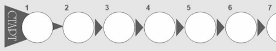

# Диеногест + Этинилэстрадиол — внутрь

- Препарат: ПланиЖенс® дие (таблетки, покрытые пленочной оболочкой)
- АТХ: G03AA16
- Источник: ОХЛП, Единый реестр ЛС ЕАЭС, запись 67caaf3230dcf83481cfd11a, документ от 2025-08-15
- Распознано автоматически (OCR): 1 из 24 стр.
- Сомнительных строк после OCR: 1 (см. раздел «Проверка распознавания»)

## Общие сведения

ОБЩАЯ ХАРАКТЕРИСТИКА ЛЕКАРСТВЕННОГО ПРЕПАРАТА

## 1. Наименование лекарственного препарата

ПланиЖенс дие, 2 мг + 0,03 мг, таблетки, покрытые пленочной оболочкой.

## 2. Качественный и количественный состав

Действующие вещества: диеногест + этинилэстрадиол.
Каждая таблетка, покрытая пленочной оболочкой, содержит 2,00 мг диеногеста и 0,03 мг этинилэстрадиола.
Вещества, наличие которых надо учитывать в составе лекарственного препарата: лактоза (см.
разделы 4.3., 4.4.).
Полный перечень вспомогательных веществ приведен в разделе 6.1.

## 3. Лекарственная форма

Таблетки, покрытые пленочной оболочкой.
Круглые двояковыпуклые таблетки, покрытые пленочной оболочкой, белого или почти белого цвета. На поперечном разрезе ядро таблетки белого или почти белого цвета.

## 4. Клинические данные

## 4.1. Показания к применению

Препарат ПланиЖенс дие показан в качестве пероральной контрацепции для женщин после наступления менархе.

## 4.2. Режим дозирования и способ применения

Режим дозирования Календарная упаковка препарата ПланиЖенс дие содержит 21 таблетку. Упаковка также содержит блок наклеек, состоящий из 7 самоклеящихся полосок с отмеченными на них названиями дней недели, необходимый для оформления календаря приема. Необходимо выбрать полоску, где первым указан тот день недели, в которой начинается прием таблеток.
Например, если начало приема таблеток приходится на среду, следует использовать полоску, которая начинается со «Ср.» (рис. 1).

СООТВЕТСТВУЕТ ЭКСПЕРТНОМУ ОТЧЕТУ от 21.07.2025 № 18081
| {НОСЯЕЛОВАЧЕЛЬНОСТЬ 0002)
Выберите наклейку, соответствующую названию дня приема первой таблетки,
И приклейте ее к упаковке над надписью Старт.
Например, если первый день приема Среда, выберите наклейку, начинающуюся со Ср.
nH. BT. СР. ЧТ. пт. CB. BC.
BT. СР. ЧТ. пт. CB. BC. nH.
СР. чт. пт. CB. BC. nH. BT.
UT. пт. CB. BC. nH. BT. СР.
пт. CB. BC. nH. BT. СР. Чт.
CB. BC. nH. BT. СР. ЧТ. пт.
BC. nH. BT. CP. чт. ПТ. CB.
Рис. | Полоску наклеивают вдоль верхней части упаковки так, чтобы обозначение первого дня находилось над той таблеткой, на которую направлена стрелка с надписью «Старт» (рис.2).
Е 1 Г C) () 5 6 7 8 9 10 11 12 13 14 уху»
№ 9 —_ 15 16 () () 19 () 21 Puc. 2 Теперь видно, в какой день недели следует принять каждую таблетку (рис. 3)
СР чт nt СБ BC NH BT Е 1 2 3 4 $ 6 | | 8 9 10 11 12 13 14 15 16 17 18 19 20 21
Рис. 3

Прием таблеток всегда начинается с таблетки, помеченной «СТАРТ», а затем продолжается ежедневно по стрелкам.
Следуют по направлению стрелки, пока все 21 таблетки не будут приняты. В течение следующих 7 дней не принимают препарат. Кровотечение «отмены» должно начаться в течение этих 7 дней. Обычно оно начинается на 2–3 день после приема последней таблетки и может еще не завершиться до начала приема таблеток из следующей упаковки. После 7дневного перерыва начинают прием таблеток из следующей упаковки, даже если кровотечение еще не прекратилось. Это означает, что начинать прием таблеток из новой упаковки необходимо в один и тот же день недели, и, что каждый месяц кровотечение
«отмены» будет наступать примерно в один и тот же день каждого месяца.
Особые группы пациентов Пациенты пожилого возраста
Не применимо. Препарат ПланиЖенс дие не применяется после наступления менопаузы.
Пациенты с почечной недостаточностью Препарат ПланиЖенс дие специально не изучался у пациенток с нарушениями функции почек.
Имеющиеся данные не предполагают коррекции режима дозирования препарата у таких пациенток.
Пациенты с печеночной недостаточностью Препарат ПланиЖенс дие противопоказан женщинам с тяжелыми заболеваниями печени до тех пор, пока показатели функции печени не придут в норму.
Дети Препарат ПланиЖенс дие показан только после наступления менархе.
Способ применения Таблетки следует принимать внутрь в одно и то же время каждый день, запивая небольшим количеством воды.
Прием таблеток из первой упаковки препарата ПланиЖенс дие
Когда никакое гормональное противозачаточное средство не применялось в предыдущем месяце
Прием препарата ПланиЖенс дие начинается в 1-й день менструального цикла, то есть в 1-й день менструального кровотечения. Необходимо принять таблетку, которая промаркирована соответствующим днем недели. Затем следует принимать таблетки по порядку. Допускается начинать прием препарата на 2–5 день менструального цикла, но в этом случае в течение первых 7 дней приема таблеток из первой упаковки рекомендуется дополнительно использовать барьерный метод контрацепции (например, презерватив).
При переходе с комбинированных контрацептивных препаратов (КОК, вагинального кольца или контрацептивного пластыря)
Предпочтительно начинать прием препарата ПланиЖенс дие на следующий день после приема последней активной (содержащей гормоны) таблетки из упаковки предыдущего КОК, но ни в коем случае не позднее следующего дня после обычного 7-дневного перерыва (для препаратов, содержащих 21 таблетку) или после приема последней неактивной таблетки (для препаратов, содержащих 28 таблеток в упаковке). Начинать прием препарата ПланиЖенс дие следует после обычного перерыва в приеме активных таблеток в случае перехода с контрацептивных препаратов с пролонгированным режимом приема таблеток. Прием препарата ПланиЖенс дие следует начинать в день удаления вагинального кольца или

пластыря, но не позднее дня, когда должно быть введено новое кольцо или наклеен новый пластырь.
При переходе с контрацептивов, содержащих только гестагены («мини-пили», инъекционные формы, имплантат), или с внутриматочной терапевтической системы с высвобождением гестагена
Перейти с «мини-пили» на препарат ПланиЖенс дие можно в любой день (без перерыва), с имплантата или внутриматочного контрацептива с гестагеном – в день их удаления, с инъекционной формы — в день, когда должна быть сделана следующая инъекция. Во всех этих случаях в течение первых 7 дней приема таблеток необходимо дополнительно использовать барьерный метод контрацепции (например, презерватив).
После аборта (в том числе самопроизвольного) в первом триместре беременности
Начинать прием препарата можно немедленно. При соблюдении этого условия дополнительных мер контрацепции не требуется.
После родов (при отсутствии грудного вскармливания) или прерывания беременности (в том числе самопроизвольного) во втором триместре
Прием препарата рекомендуется начинать на 21–28 день после родов (при отсутствии грудного вскармливания) или прерывания беременности во втором триместре. Если прием препарата начат позднее, необходимо использовать дополнительно барьерный метод контрацепции в течение первых 7 дней приема таблеток. Если половой контакт имел место до начала приема препарата ПланиЖенс дие, необходимо исключить беременность.
Рекомендации в случае пропуска приема препарата
Если опоздание в приеме препарата составило менее 12 часов, контрацептивная защита не снижается. Нужно принять пропущенную таблетку как можно скорее, следующая таблетка принимается в обычное время.
Если опоздание в приеме таблетки составило более 12 часов, контрацептивная защита может быть снижена. При этом необходимо помнить:
 Прием препарата никогда не должен быть прерван более чем на 7 дней.
 7 дней непрерывного приема таблеток требуется для достижения адекватного подавления гипоталамо-гипофизарно-яичниковой системы.
Соответственно, если опоздание в приеме таблетки составило более 12 часов (интервал с момента приема последней таблетки больше 36 часов), в зависимости от недели, когда пропущена таблетка, женщина должна придерживаться следующих рекомендаций:
Первая неделя приема препарата Необходимо принять последнюю пропущенную таблетку как можно скорее, как только женщина вспомнит об этом (даже если это означает прием 2-х таблеток одновременно).
Следующую таблетку необходимо принять в обычное время. В течение следующих 7 дней дополнительно должен быть использован барьерный метод контрацепции (например, презерватив). Если половой контакт имел место в течение недели перед пропуском таблетки, необходимо учитывать вероятность наступления беременности. Чем больше таблеток пропущено, и чем ближе они к перерыву в приеме таблеток, тем выше вероятность беременности.
Вторая неделя приема препарата Необходимо принять последнюю пропущенную таблетку как можно скорее, как только женщина вспомнит об этом (даже если для этого нужно принять 2 таблетки одновременно).
Следующую таблетку необходимо принять в обычное время. При условии соблюдения

режима приема таблеток в течение 7 дней, предшествующих первой пропущенной таблетке, нет необходимости в использовании дополнительных мер контрацепции. В противном случае, а также при пропуске 2-х и более таблеток, необходимо дополнительно использовать барьерные методы контрацепции (например, презерватив) в течение последующих 7 дней.
Третья неделя приема препарата Риск снижения контрацептивной надежности неизбежен из-за предстоящего перерыва в приеме таблеток. В этом случае необходимо придерживаться следующих рекомендаций:
- если в течение 7 дней, предшествующих первой пропущенной таблетке, все таблетки принимались правильно, нет необходимости использовать дополнительные методы контрацепции. При приеме пропущенных таблеток следует руководствоваться пунктами 1 или 2;
- если в течение 7 дней, предшествующих первой пропущенной таблетке, таблетки принимались неправильно, то в течение последующих 7 дней необходимо дополнительно использовать барьерный метод контрацепции (например, презерватив) и в этом случае следует руководствоваться пунктом 1 для приема пропущенных таблеток.
1. Необходимо принять пропущенную таблетку как можно скорее, как только женщина вспомнит об этом (даже если это означает прием 2-х таблеток одновременно). Следующую таблетку принимают в обычное время, пока не закончатся таблетки из текущей упаковки.
Прием таблеток из следующей упаковки следует начинать сразу же без обычного 7-дневного перерыва. Кровотечение «отмены» маловероятно, пока не закончатся таблетки из второй упаковки, но могут отмечаться «мажущие» выделения и/или «прорывные» кровотечения в дни приема препарата.
2. Можно также прервать прием таблеток из текущей упаковки, сделать перерыв на 7 или менее дней (включая день пропуска таблетки), после чего начинать прием таблеток из новой упаковки.
Если женщина пропустила прием таблеток, и затем во время перерыва в приеме кровотечение
«отмены» не наступило, необходимо удостовериться в отсутствии беременности.
Допускается прием не более 2-х таблеток в течение 1 суток.
Рекомендации при желудочно-кишечных расстройствах
При тяжелых желудочно-кишечных расстройствах всасывание может быть неполным, поэтому следует использовать дополнительные методы контрацепции.
Если в течение 3–4 часов после приема таблетки отмечается рвота или диарея, следует ориентироваться на рекомендации при пропуске таблетки. Если женщина не хочет менять свою обычную схему приема и переносить начало кровотечения «отмены» на другой день недели, дополнительную таблетку следует принять из другой упаковки.
Прекращение приема препарата ПланиЖенс дие
Прием препарата ПланиЖенс дие можно прекратить в любое время. Если беременность не планируется, следует позаботиться о других методах контрацепции. Если планируется беременность, рекомендуется прекратить прием препарата и подождать естественного менструального кровотечения.
Отсрочка начала менструальноподобного кровотечения
Для того чтобы отсрочить начало менструальноподобного кровотечения, необходимо продолжить прием таблеток из новой упаковки препарата ПланиЖенс дие сразу после того, как будут приняты все таблетки из предыдущей упаковки, без перерыва в приеме. Таблетки из новой упаковки можно принимать так долго, как это необходимо, в том числе до тех пор, пока таблетки в упаковке не закончатся. На фоне приема препарата из второй упаковки могут

отмечаться «мажущие» кровянистые выделения и/или «прорывные» кровотечения.
Возобновить прием препарата ПланиЖенс дие из следующей упаковки следует после обычного 7-дневного перерыва.
Изменение дня начала менструальноподобного кровотечения
Для того чтобы перенести день начала менструальноподобного кровотечения на другой день недели, следует сократить (но не удлинять) ближайший 7-дневный перерыв в приеме таблеток на столько дней, на сколько женщина хочет. Например, если цикл обычно начинается в пятницу, а в будущем женщина хочет, чтобы он начинался во вторник (3 днями ранее), прием таблеток из следующей упаковки нужно начинать на 3 дня раньше, чем обычно. Чем короче интервал, тем выше вероятность, что менструальноподобное кровотечение не наступит, и во время приема таблеток из второй упаковки будут наблюдаться «мажущие» выделения и/или
«прорывные» кровотечения.

## 4.3. Противопоказания

Прием диеногеста + этинилэстрадиола противопоказан при наличии следующих заболеваний
/ состояний или факторов риска:
 Гиперчувствительность к диеногесту, этинилэстрадиолу или к любому из вспомогательных веществ, перечисленных в разделе 6.1.
 Венозный тромбоз или тромбоэмболия (ВТЭ), в том числе, тромбоз глубоких вен (ТГВ) и тромбоэмболия легочной артерии (ТЭЛА), в настоящее время или в анамнезе.
 Артериальный тромбоз или тромбоэмболия (АТЭ), в том числе инфаркт миокарда и инсульт; или продромальные состояния (транзиторная ишемическая атака, стенокардия), в настоящее время или в анамнезе.
 Выявленная наследственная или приобретенная предрасположенность к ВТЭ или АТЭ, включая резистентность к активированному протеину С, гипергомоцистеинемию, дефицит антитромбина
III, дефицит протеина С, дефицит протеина
S, антифосфолипидные антитела (антитела к кардиолипину, волчаночный антикоагулянт).
 Наличие нескольких факторов высокого риска ВТЭ или АТЭ (курение в возрасте старше 35 лет; ожирение с индексом массы тела [ИМТ] 30 кг/м2 и более; любое оперативное вмешательство на нижних конечностях, в области таза или нейрохирургическая операция;
осложненные пороки клапанов сердца, фибрилляция предсердий), или одного такого серьезного фактора риска как:
– неконтролируемая артериальная гипертензия;
– сахарный диабет с диабетической ангиопатией;
– тяжелая дислипопротеинемия.
 Объемные оперативные вмешательства с длительной иммобилизацией.
 Мигрень с очаговой неврологической симптоматикой в настоящее время или в анамнезе.
 Печеночная недостаточность, острые или хронические заболевания печени тяжелой степени (до нормализации показателей функциональных проб печени).
 Опухоли печени (доброкачественные или злокачественные), в настоящее время или в анамнезе.
 Диагностированные гормонозависимые злокачественные новообразования (в том числе половых органов или молочной железы) или подозрение на них.
 Кровотечение из половых путей неясной этиологии.

 Беременность, в том числе предполагаемая.
 Период грудного вскармливания.
 Непереносимость лактозы, дефицит лактазы, синдром глюкозо-галактозной мальабсорбции.
 Совместное применение с лекарственными препаратами, содержащими омбитасвир, паритапревир, ритонавир и дасабувир.
В случае выявления или развития впервые какого-либо из этих заболеваний / состояний или факторов риска на фоне применения диеногеста + этинилэстрадиола, прием контрацептива следует немедленно прекратить.

## 4.4. Особые указания и меры предосторожности при применении

При применении препарата следует соблюдать осторожность:
Следует тщательно взвешивать потенциальный риск и ожидаемую пользу применения КОК в каждом индивидуальном случае при наличии следующих заболеваний/состояний и факторов риска:
 Факторы риска развития тромбоза и тромбоэмболий:
курение;
ожирение;
дислипопротеинемия; контролируемая артериальная гипертензия; мигрень без очаговой неврологической симптоматики; заболевания клапанов сердца, включая неосложненные заболевания клапанов сердца; наследственная предрасположенность к тромбозу
(тромбозы, инфаркт миокарда или нарушение мозгового кровообращения в возрасте менее 50 лет у кого-либо из ближайших родственников)
 Другие заболевания, при которых могут отмечаться нарушения периферического кровообращения:
сахарный диабет;
системная красная волчанка;
гемолитикоуремический синдром; болезнь Крона и язвенный колит; серповидно-клеточная анемия;
флебит поверхностных вен  Наследственный ангионевротический отек
 Гипертриглицеридемия  Заболевания печени, не относящиеся к противопоказаниям (см. раздел 4.3.)
 Заболевания, впервые возникшие или усугубившиеся во время беременности или на фоне предыдущего приема половых гормонов (например, желтуха и/или зуд, связанные с холестазом, заболевания желчного пузыря, отосклероз с ухудшением слуха, порфирия, гестационный герпес, хорея Сиденгама)
 Эпилепсия  Депрессия  Послеродовый период
Если какие-либо из состояний, заболеваний или факторов риска, указанных ниже, имеются в настоящее время, то следует тщательно взвешивать потенциальный риск и ожидаемую пользу применения диеногеста + этинилэстрадиола в каждом индивидуальном случае и обсудить его с женщиной до того, как она решит начать прием препарата. В случае утяжеления, усиления или первого проявления любого из этих состояний, заболеваний или факторов риска, женщина должна проконсультироваться со своим врачом, который может принять решение о необходимости отмены препарата.

В случае подозрения или подтверждения тромбоза прием КОК необходимо прекратить. В связи с тератогенностью антикоагулянтной терапии (кумарины) следует перейти на подходящий альтернативный метод контрацепции.
 Нарушения кровообращения Риск развития венозной тромбоэмболии (ВТЭ)
Применение любого КОК увеличивает риск развития венозной тромбоэмболии.
Лекарственные препараты, содержащие левоноргестрел, норгестимат или норэтистерон, имеют самый низкий риск развития ВТЭ. Другие КОК, такие как комбинация диеногеста и этинилэстрадиола, могут иметь повышенный риск развития ВТЭ в 1,6 раза. Решение об использовании препарата, не относящегося к препаратам с наименьшим риском ВТЭ, должно приниматься только после обсуждения с женщиной, чтобы убедиться, что она полностью понимает следующее:
– риск развития ВТЭ, связан с применением диеногеста + этинилэстрадиола;
– как имеющиеся у нее факторы риска влияют на этот риск;
– риск развития ВТЭ максимален в первый год применения КОК. Существуют также указания на то, что риск повышается, если применение КОК возобновляется после перерыва длительностью 4 или более недель.
Примерно у 2-х женщин из 10 000, не принимающих КОК и не беременных, ВТЭ развивается в течение одного года. Однако у отдельной женщины риск ВТЭ может быть значительно выше в зависимости от имеющихся у нее факторов риска (см. ниже). Эпидемиологические исследования среди женщин, принимающих КОК в низкой дозе (<50 мкг этинилэстрадиола), показали, что в течение одного года ВТЭ развивается примерно у 6–12 из 10 000 женщин.
По имеющимся оценкам, примерно у 6 из 10 000 женщин, использующих низкие дозы КОК, содержащие левоноргестрел, в течение одного года развивается ВТЭ (средняя точка диапазона составляет 5–7 на 10 000 пациенто-лет, исходя из относительного риска для КОК, содержащих левоноргестрел, по сравнению с отсутствием применения, составляющего приблизительно 2,3–3,6).
По имеющимся оценкам, у 8–11 из 10 000 женщин, использующих КОК, содержащие диеногест и этинилэстрадиол, в течение одного года развивается ВТЭ. По данным метаанализа, риск ВТЭ у женщин, принимающих диеногест + этинилэстрадиол, несколько выше по сравнению с женщинами, принимающими КОК, содержащие левоноргестрел (отношение рисков 1,57, риск варьируется от 1,07 до 2,30).
Количество ВТЭ за год ниже ожидаемого числа случаев ВТЭ во время беременности и в послеродовый период.
ВТЭ может оказаться жизнеугрожающей или привести к летальному исходу (в 1–2 % случаев).
Крайне редко при применении КОК возникает тромбоз других кровеносных сосудов, например, печеночных, брыжеечных, почечных или сосудов сетчатки глаза.
Факторы риска ВТЭ У женщин с сочетанием нескольких факторов риска или высокой выраженностью одного из них следует рассматривать возможность их взаимоусиления. В подобных случаях степень повышения риска тромбообразования может оказаться более высокой, чем при простом суммировании факторов. В этом случае прием диеногеста + этинилэстрадиола противопоказан
(см. раздел 4.3.). Если соотношение риск/польза считается неблагоприятным, КОК не следует назначать.

Риск развития ВТЭ повышается:
– при наличии ожирения (индекс массы тела 30 кг/м2 и более) – риск значительно возрастает с увеличением ИМТ. Особенно важно учитывать при наличии дополнительных факторов риска;
– при длительной иммобилизации, обширного хирургического вмешательства, любой операции на нижних конечностях (включая тазобедренные суставы) или обширной травмы.
В этих случаях прием диеногеста + этинилэстрадиола необходимо прекратить (в случае планируемой операции, по крайней мере, за четыре недели до нее) и не возобновлять прием в течение двух недель после окончания иммобилизации. Временная иммобилизация (например, авиаперелет длительностью более 4 часов) может также являться фактором риска развития венозной тромбоэмболии, особенно при наличии других факторов риска. Следует рассмотреть целесообразность антитромботической терапии, если прием диеногеста + этинилэстрадиола не был прекращен заранее;
– при наличии отягощенного семейного анамнеза ВТЭ (случаи ВТЭ у близких родственников или родителей в возрасте менее 50 лет). В случае наследственной или приобретенной предрасположенности женщина должна быть осмотрена соответствующим специалистом для решения вопроса о возможности приема диеногеста
+ этинилэстрадиола;
– при других состояниях здоровья, связанных с ВТЭ: злокачественная опухоль, системная красная волчанка, гемолитико-уремический синдром, хроническое воспалительное заболевание кишечника (болезнь Крона или язвенный колит) и серповидноклеточная анемия;
– с возрастом (особенно старше 35 лет).
Вопрос о возможной роли варикозного расширения вен и поверхностного тромбофлебита в развитии ВТЭ остается спорным.
Следует учитывать повышенный риск развития тромбоэмболий во время беременности и в послеродовом периоде (особенно в течение первых 6 недель).
Симптомы ВТЭ В случае появления симптомов пациентке следует немедленно обратиться за медицинской помощью и сообщить медицинским работникам, что она принимает КОК.
Симптомы тромбоза глубоких вен (ТГВ): односторонний отек нижней конечности или отек вдоль вены на нижней конечности, боль или дискомфорт в нижней конечности только в вертикальном положении или при ходьбе, локальное повышение температуры в пораженной нижней конечности, покраснение или изменение окраски кожных покровов нижней конечности.
Симптомы тромбоэмболии легочной артерии (ТЭЛА) могут включать в себя внезапный приступ одышки неизвестного происхождения или учащенное дыхание; внезапный кашель, в том числе с кровохарканием; острая боль в грудной клетке; острое предобморочное состояние или головокружение; учащенное или нерегулярное сердцебиение. Некоторые из этих симптомов (например, одышка, кашель) являются неспецифическими и могут быть истолкованы неверно как признаки других более часто встречающихся и менее тяжелых состояний/заболеваний (например, инфекции дыхательных путей).
Другие признаки закупорки сосудов могут включать в себя резкую боль, а также отечность и незначительную синюшность конечности.

При окклюзии сосудов глаза симптомы могут варьироваться от безболезненного снижения остроты зрения до потери зрения. В некоторых случаях потеря зрения происходит почти мгновенно.
Риск развития артериальной тромбоэмболии (АТЭ)
Результаты эпидемиологических исследований указывают на наличие взаимосвязи между применением КОК и повышенным риском артериальной тромбоэмболии (инфаркт миокарда)
или нарушением мозгового кровообращения (например, транзиторная ишемическая атака, инсульт). Артериальные тромбоэмболические осложнения могут иметь летальный исход.
Факторы риска АТЭ У женщин, принимающих КОК, с наличием нижеуказанных факторов, увеличивается риск артериальных тромбоэмболических осложнений или нарушения мозгового кровообращения.
Диеногест + этинилэстрадиол противопоказан при наличии серьезного фактора риска или при наличии нескольких факторов риска АТЭ.
У женщин с сочетанием нескольких факторов риска или высокой выраженностью одного из них следует рассматривать возможность их взаимоусиления. В этом случае необходимо учитывать общий риск. Если соотношение риск/польза является неблагоприятным, КОК не следует назначать.
Риск развития АТЭ повышается:
– с возрастом (особенно у женщин старше 35 лет);
– у курящих (с повышением возраста риск нарастает, особенно у женщин старше 35 лет – рекомендуется использовать другой метод контрацепции);
– при наличии артериальной гипертензии;
– при наличии ожирения (индекс массы тела 30 кг/м2 и более) – риск значительно возрастает с увеличением ИМТ. Особенно важно учитывать при наличии дополнительных факторов риска;
– при наличии отягощенного семейного анамнеза АТЭ (случаи АТЭ у близких родственников или родителей в возрасте менее 50 лет). В случае наследственной или приобретенной предрасположенности женщина должна быть осмотрена соответствующим специалистом для решения вопроса о возможности приема диеногеста
+ этинилэстрадиола;
– при наличии мигрени (увеличение частоты или интенсивности приступов мигрени во время приема КОК, которое может быть предвестником нарушения мозгового кровообращения, может быть причиной для немедленной отмены препарата);
– при других состояниях здоровья, связанных с нежелательными явлениями со стороны сосудов (сахарный диабет, гипергомоцистеинемия, заболевания клапанов сердца и фибрилляция предсердий, дислипопротеинемия и системная красная волчанка).
Симптомы АТЭ В случае появления симптомов пациентке следует немедленно обратиться за медицинской помощью и сообщить медицинским работникам, что она принимает КОК.
К симптомам инсульта относят: внезапная слабость или потеря чувствительности лица, конечностей, особенно с одной стороны тела, внезапное нарушение походки, головокружение, потеря равновесия или координации движений; спутанность сознания, проблемы с речью и пониманием; внезапная одно- или двухсторонняя потеря зрения; внезапная, тяжелая или продолжительная головная боль без видимой причины; потеря сознания или обморок с эпилептическим припадком или без него.

Преходящий характер симптомов свидетельствует о транзиторной ишемической атаке (ТИА).
Симптомы инфаркта миокарда могут включать в себя: боль, дискомфорт, давление, тяжесть, чувство сжатия или распирания в груди или за грудиной, с иррадиацией в спину, челюсть, левую верхнюю конечность, область эпигастрия; чувство тяжести, расстройство пищеварения или приступ удушья; потливость, тошнота, рвота или головокружение; сильная слабость, тревога или одышка; учащенное или нерегулярное сердцебиение.
Опухоли В некоторых эпидемиологических исследованиях имеются сообщения о повышении риска развития рака шейки матки при длительном применении КОК. Сохраняются противоречия относительно степени влияния полового поведения и других факторов, таких как инфекция вируса папилломы человека (ВПЧ), которые трудно поддаются количественной оценке на данный патологический процесс.
Мета-анализ 54 эпидемиологических исследований показал, что имеется несколько повышенный относительный риск развития рака молочной железы
(РМЖ), диагностированного у женщин, принимающих КОК в настоящее время (относительный риск 1,24). В течение 10 лет после прекращения приема этих препаратов, повышенный риск постепенно возвращается к исходному уровню риска, характерному для соответствующей возрастной категории. В связи с тем, что РМЖ отмечается редко у женщин до 40 лет, увеличение числа диагнозов РМЖ у женщин, принимающих КОК в настоящее время или принимавших недавно, является незначительным по отношению к общему риску для этого заболевания.
В редких случаях на фоне применения КОК наблюдалось развитие доброкачественных, а в крайне редких — злокачественных опухолей печени, которые в отдельных случаях приводили к угрожающему жизни внутрибрюшному кровотечению. В случае появления сильных болей в области живота, увеличения печени или признаков внутрибрюшного кровотечения у женщин, применяющих КОК, следует учитывать вероятность опухоли печени при проведении дифференциального диагноза.
Злокачественные опухоли могут представлять собой угрозу для жизни или привести к летальному исходу.
Другие состояния У женщин с гипертриглицеридемией (или наличием этого состояния в семейном анамнезе)
возможно повышение риска развития панкреатита во время приема КОК.
Несмотря на то, что небольшое повышение артериального давления было описано у многих женщин, принимающих КОК, клинически значимые повышения отмечались редко. Тем не менее, если во время приема КОК развивается стойкое клинически значимое повышение артериального давления, следует отменить эти препараты и начать лечение артериальной гипертензии. Прием препарата может быть продолжен, если с помощью гипотензивной терапии достигнуты нормальные значения артериального давления. Однако если при применении КОК женщинами с повышенным артериальным давлением проводимая гипотензивная терапия не оказывает адекватного воздействия на значения стабильно повышенного артериального давления или на значительное повышение артериального давления, то применение КОК следует отменить.
Следующие состояния, как сообщалось, развиваются или ухудшаются как во время беременности, так и при приеме КОК, но их связь с приемом КОК не доказана: желтуха и/или зуд, связанный с холестазом; формирование камней в желчном пузыре; порфирия; системная красная волчанка; гемолитико-уремический синдром; хорея Сиденгама; гестационный герпес;
потеря слуха, связанная с отосклерозом. Также описаны случаи ухудшения течения

эндогенной депрессии, эпилепсии, болезни Крона и язвенного колита на фоне применения
КОК.
У женщин с наследственными формами ангионевротического отека экзогенные эстрогены могут вызывать или ухудшать симптомы ангионевротического отека.
Острые или хронические нарушения функции печени могут потребовать отмены КОК до тех пор, пока показатели функции печени не вернутся в норму. Рецидив холестатической желтухи, развившейся впервые во время предшествующей беременности или предыдущего приема половых гормонов, требует прекращения приема КОК.
Хотя КОК могут оказывать влияние на инсулинорезистентность и толерантность к глюкозе, необходимости в коррекции дозы гипогликемических препаратов у пациенток с сахарным диабетом, применяющих низкодозированные КОК (<0,05 мг этинилэстрадиола), как правило, не возникает. Тем не менее, женщины с сахарным диабетом должны находиться под тщательным наблюдением во время приема КОК.
Психические расстройства Подавленное настроение и депрессия — хорошо известные нежелательные реакции гормональных контрацептивов (см. раздел 4.8.). Депрессия может быть серьезной проблемой и является хорошо известным фактором риска суицидального поведения и суицида.
Женщинам рекомендуется обратиться к врачу в случае изменения настроения и появления депрессивных симптомов, в том числе вскоре после начала лечения.
Иногда может развиваться хлоазма, особенно у женщин с наличием в анамнезе хлоазмы беременных. Женщины со склонностью к хлоазме во время приема диеногеста + этинилэстрадиола должны избегать длительного пребывания на солнце и воздействия ультрафиолетового излучения.
Повышение уровня АЛТ В ходе клинических исследований с участием пациентов, инфицированных вирусом гепатита
С, получавших лечение препаратами, содержащими омбитасвир/паритапревир/ритонавир и дасабувир с рибавирином или без него, повышение уровня трансаминаз (АЛТ) более чем в 5 раз выше верхней границы нормы значительно чаще наблюдалось у женщин, принимавших препараты, содержащие этинилэстрадиол, такие как
КОК.
При необходимости одновременного применения препаратов для терапии вирусного гепатита С, женщина должна перейти на альтернативный метод контрацепции (например, только прогестагенами или негормональными методами) до начала терапии. Возобновить прием диеногеста + этинилэстрадиола можно будет через 2 недели после прекращения противовирусной терапии.
Медицинские осмотры Перед началом или возобновлением применения диеногеста + этинилэстрадиола необходимо ознакомиться с анамнезом жизни, семейным анамнезом женщины, провести тщательное общемедицинское обследование (включая измерение артериального давления) с учетом противопоказаний и особых указаний, исключить беременность. Важно обратить внимание женщины на информацию о венозном и артериальном тромбозах, включая риск образования тромбов, связанный с применением диеногеста + этинилэстрадиола в сравнении с другими
КОК, симптомы ВТЭ и АТЭ, выявленные факторы риска образования тромбов и необходимые действия в случае предполагаемого тромбоза.
При возобновлении приема диеногеста + этинилэстрадиола объем дополнительных исследований и частота контрольных осмотров определяется индивидуально и должны соответствовать установленным рекомендациям по обследованию.
Необходимо иметь в виду, что диеногест + этинилэстрадиол не предохраняет от ВИЧинфекции (СПИД) и других заболеваний, передающихся половым путем!

Снижение эффективности Эффективность диеногеста + этинилэстрадиола может быть снижена в следующих случаях:
при пропуске таблеток, желудочно-кишечных расстройствах или в результате лекарственного взаимодействия.
Недостаточный контроль менструальноподобного цикла
На фоне приема диеногеста + этинилэстрадиола могут отмечаться нерегулярные кровотечения
(«мажущие» кровянистые выделения и/или «прорывные» маточные кровотечения), особенно в течение первых месяцев применения. Поэтому оценка любых нерегулярных кровотечений должна проводиться только после периода адаптации, составляющего приблизительно 3 цикла.
Если нерегулярные кровотечения повторяются или развиваются после предшествующих регулярных циклов, следует провести тщательное обследование для исключения злокачественных новообразований или беременности. При этом также может проводиться выскабливание полости матки.
Отсутствие очередного менструальноподобного кровотечения
У некоторых женщин во время перерыва в приеме таблеток может не развиться менструальноподобное кровотечение. Если диеногест + этинилэстрадиол принимался согласно рекомендациям, то маловероятно, что женщина беременна. Тем не менее, если до этого препарат применялся нерегулярно или если отсутствуют подряд два менструальноподобных кровотечения, прием препарата не может быть продолжен до тех пор, пока беременность не будет исключена.
Вспомогательные вещества Данный препарат содержит лактозу. Данный лекарственный препарат не следует принимать пациентам с редко встречающейся наследственной непереносимостью галактозы, лактазной недостаточностью или глюкозо-галактозной мальабсорбцией.

## 4.5. Взаимодействие с другими лекарственными препаратами и другие виды взаимодействия

Влияние других лекарственных средств на комбинацию диеногеста и этинилэстрадиола
Возможно взаимодействие с лекарственными средствами, индуцирующими микросомальные ферменты, в результате чего может увеличиваться клиренс половых гормонов, что, в свою очередь, может приводить к «прорывным» маточным кровотечениям и/или снижению контрацептивного эффекта.
Индукция микросомальных ферментов печени может наблюдаться уже через несколько дней совместного применения. Максимальная индукция микросомальных ферментов печени обычно наблюдается в течение нескольких недель. После отмены препарата индукция микросомальных ферментов печени может сохраняться в течение 4 недель.
Краткосрочная терапия Женщинам, которые получают лечение такими препаратами в дополнение к диеногесту + этинилэстрадиолу, рекомендуется использовать барьерный метод контрацепции или выбрать иной негормональный метод контрацепции. Барьерный метод контрацепции следует использовать в течение всего периода приема сопутствующих препаратов, а также в течение 28 дней после их отмены. Если применение препарата – индуктора микросомальных ферментов продолжается после приема последней таблетки диеногеста + этинилэстрадиола из текущей упаковки, следует начать прием таблеток из новой упаковки без обычного 7-дневного перерыва.

Долгосрочная терапия Женщинам, длительно принимающим препараты – индукторы микросомальных ферментов печени, рекомендуется использовать другой надежный негормональный метод контрацепции:
 Вещества, увеличивающие клиренс комбинации диеногеста и этинилэстрадиола
(ослабляющие эффективность путем индукции ферментов):
фенитоин, барбитураты, примидон, карбамазепин, рифампицин и, возможно, также окскарбазепин, топирамат, фелбамат, гризеофульвин, а также препараты, содержащие зверобой продырявленный.
 Вещества с различным влиянием на клиренс действующих веществ комбинации диеногеста и этинилэстрадиола
При совместном применении с комбинацией диеногеста и этинилэстрадиола многие ингибиторы протеаз ВИЧ или вируса гепатита С и ненуклеозидные ингибиторы обратной транскриптазы могут как увеличивать, так и уменьшать концентрацию эстрогена или прогестагена в плазме крови. В некоторых случаях такое влияние может быть клинически значимо.
 Вещества, снижающие клиренс КОК (ингибиторы ферментов)
Диеногест является субстратом цитохрома Р450 (CYP3A4).
Сильные и умеренные ингибиторы CYP3A4, такие как азольные антимикотики (например, итраконазол, вориконазол, флуконазол), верапамил, макролиды (например, кларитромицин, эритромицин), дилтиазем и грейпфрутовый сок могут повышать плазменные концентрации эстрогена или прогестагена, или их обоих.
Было показано, что эторикоксиб в дозах 60 и 120 мг/сутки при совместном приеме с КОК, содержащими 0,035 мг этинилэстрадиола, повышает концентрации этинилэстрадиола в плазме крови в 1,4 и 1,6 раза, соответственно.
Влияние комбинации диеногеста и этинилэстрадиола на другие лекарственные препараты
КОК могут влиять на метаболизм других препаратов, что приводит к повышению (например, циклоспорин) или снижению (например, ламотриджин) их концентрации в плазме крови и тканях.
In vitro этинилэстрадиол является обратимым ингибитором CYP2C19, CYP1A1 и CYP1A2, а также необратимым ингибитором CYP3A4/5, CYP2C8 и СYР2Ј2. В клинических исследованиях назначение гормонального контрацептива, содержащего этинилэстрадиол, не приводило к какому-либо повышению или приводило лишь к слабому повышению концентраций субстратов CYP3A4 в плазме крови (например, мидазолама), в то время как плазменные концентрации субстратов CYP1A2 могут возрастать слабо (например, теофиллин)
или умеренно (например, мелатонин и тизанидин).
Фармакодинамические взаимодействия В клинических исследованиях у пациенток, получающих терапию вирусного гепатита С противовирусными препаратами прямого действия (омбитасвиром, паритапревиром, ритонавиром и дасабувиром с рибавирином или без него) и принимавших также этинилэстрадиолсодержащие комбинированные гормональные контрацептивы, наблюдалось повышение активности аланинаминотрансферазы (АЛТ) более чем в 5 раз в сравнении с верхней границей нормы у здоровых и инфицированных вирусом гепатита С женщин.

## 4.6. Фертильность, беременность и лактация

Беременность Диеногест + этинилэстрадиол противопоказан во время беременности.
Если беременность выявляется во время приема диеногеста + этинилэстрадиола, прием препарата должен быть немедленно прекращен.
Обширные эпидемиологические исследования не выявили повышенного риска дефектов развития у детей, рожденных женщинами, получавших половые гормоны до беременности, или тератогенного действия, когда половые гормоны принимались по неосторожности в ранние сроки беременности.
Лактация Диеногест + этинилэстрадиол противопоказан в период грудного вскармливания.
Прием КОК может уменьшать количество грудного молока и изменять его состав, поэтому применение диеногеста
+ этинилэстрадиола в период грудного вскармливания противопоказано. Небольшое количество половых гормонов и/или их метаболитов может проникать в грудное молоко.
4.7. Влияние на способность управлять транспортными средствами и работать с механизмами
Прием диеногеста + этинилэстрадиола не оказывает влияния на способность управлять транспортными средствами и механизмами.

## 4.8. Нежелательные реакции

Табличное резюме нежелательных реакций Возможные нежелательные реакции при применении диеногеста + этинилэстрадиола приведены в таблице ниже в соответствии с системно-органным классом MedDRA. Частоты определяются как: часто (≥1/100, но <1/10), нечасто (≥1/1000, но <1/100) и редко (≥1/10000, но
<1/1000).
Системноорганные классы (версия MedDRA 12.0)
Часто (≥1/100, но <1/10)
Нечасто (≥1/1000, но <1/100)
Редко (≥1/10000, но <1/1000)
Частота неизвестна Инфекции и инвазии

Вагинит/ вульвовагинит

Вагинальный кандидоз или другие грибковые вульвовагинальные инфекции
Сальпингоофорит (аднексит)

Инфекции мочевыводящих путей

Цистит

Мастит

Цервицит

Грибковые инфекции

Кандидоз

Герпетическое поражение полости рта

Системноорганные классы (версия MedDRA 12.0)
Часто (≥1/100, но <1/10)
Нечасто (≥1/1000, но <1/100)
Редко (≥1/10000, но <1/1000)
Частота неизвестна Грипп

Бронхит

Синусит

Инфекции верхних дыхательных путей

Вирусная инфекция Доброкачествен ные, злокачественные и неуточненные новообразования
(включая кисты и полипы)

Миома матки

Липома молочной железы

Нарушения со стороны крови и лимфатической системы

Анемия

Нарушения со стороны иммунной системы

Аллергические реакции Эндокринные нарушения

Вирилизм

Нарушения метаболизма и питания

Повышение аппетита Анорексия

Психические нарушения

Подавленное настроение Депрессия

Психические нарушения

Бессонница

Нарушения сна

Агрессия Изменения настроения

Снижение либидо

Повышение либидо Нарушения со стороны нервной системы
Головная боль Головокружение

Мигрень Ишемический инсульт

Цереброваскулярные расстройства

Дистония

Нарушения со стороны органа зрения

Сухость слизистой оболочки глаз

Раздражение слизистой оболочки глаз

Осциллопсия Непереноси мость контактных линз
(неприятные ощущения

Системноорганные классы (версия MedDRA 12.0)
Часто (≥1/100, но <1/10)
Нечасто (≥1/1000, но <1/100)
Редко (≥1/10000, но <1/1000)
Частота неизвестна

Нарушения зрения при их ношении)
Нарушения со стороны органа слуха и лабиринта

Внезапная потеря слуха

Шум в ушах

Вертиго

Нарушение слуха

Нарушения со стороны сердца

Сердечно-сосудистые расстройства

Тахикардия

Нарушения со стороны сосудов

Повышение артериального давления

Понижение артериального давления Венозные и артериальные тромбоэмболические осложнения*

Тромбофлебит

Диастолическая гипертензия

Ортостатическая циркуляторная дистония

«Приливы»

Варикозное расширение вен

Патология вен

Боль в области вен

Нарушения со стороны дыхательной системы, органов грудной клетки и средостения

Бронхиальная астма

Гипервентиляция

Нарушения со стороны желудочнокишечного тракта

Боль в животе, включая боли в верхних и нижних отделах живота, дискомфорт / вздутие

Тошнота

Рвота

Диарея Гастрит

Энтерит

Диспепсия

Системноорганные классы (версия MedDRA 12.0)
Часто (≥1/100, но <1/10)
Нечасто (≥1/1000, но <1/100)
Редко (≥1/10000, но <1/1000)
Частота неизвестна Нарушения со стороны кожи и подкожных тканей

Акне

Алопеция

Сыпь, включая макулярную сыпь

Зуд, включая генерализованный зуд Аллергический дерматит

Атопический дерматит / нейродермит

Экзема

Псориаз

Гипергидроз

Хлоазма

Нарушение пигментации / гиперпигментация

Себорея

Перхоть

Гирсутизм

Патология кожи

Кожные реакции

Целлюлит

Сосудистые звездочки Крапивница

Узловатая эритема

Многоформ ная эритема Нарушения со стороны мышечной, костной и соединительной ткани

Боли в спине

Дискомфорт в области мышц и скелета

Миалгия

Боли в конечностях

Нарушения со стороны репродуктивной системы и молочных желез
Боль в молочных железах Ощущение дискомфорта, нагрубание молочных желез
Изменения объема, продолжительности и интервала менструальноподобных кровотечений, включая:
обильные менструальноподобные кровянистые выделения / кровотечения, скудные или редкие менструальноподобные кровотечения, отсутствие
Дисплазия шейки матки

Кисты придатков матки

Боль в области придатков матки

Кисты молочных желез

Фиброзно-кистозная мастопатия

Диспареуния

Выделения из молочных желез

Системноорганные классы (версия MedDRA 12.0)
Часто (≥1/100, но <1/10)
Нечасто (≥1/1000, но <1/100)
Редко (≥1/10000, но <1/1000)
Частота неизвестна менструальноподобных кровотечений, ациклические кровянистые выделения / кровотечения

Увеличение размеров молочных желез

Набухание и распирание молочных желез

Отек молочной железы

Болезненные менструальноподобные кровянистые выделения / кровотечения

Выделения из половых путей / выделения из влагалища

Кисты яичника

Боли в области малого таза Галакторея

Нарушения менструального цикла Общие нарушения и реакции в месте введения

Утомляемость

Астения

Плохое самочувствие Боли в груди

Периферические отеки

Гриппоподобные явления

Воспаление

Повышенная температура

Раздражительность Задержка жидкости Лабораторные и инструменталь ные данные

Изменения массы тела (увеличение, снижение и колебания массы тела)
Увеличение концентрации триглицеридов в крови

Гиперхолестеринемия

Врожденные, семейные и генетические нарушения

Обнаружение дополнительной молочной железы / полимастия

* Расчетная частота по данным эпидемиологических исследований, охватывавших группу КОК.
Описание отдельных нежелательных реакций
Венозные и артериальные тромбоэмболические осложнения объединяют следующие нозологические формы: окклюзия периферических глубоких вен, тромбоз и тромбоэмболия / окклюзия легочных сосудов, тромбоз, эмболия и инфаркт / инфаркт миокарда / церебральный инфаркт и инсульт, не классифицированный как геморрагический.
Ниже перечислены нежелательные реакции с очень низкой частотой возникновения или с отсроченным развитием симптомов, которые считаются связанными с группой КОК (см.
также разделы 4.3, 4.4):
Опухоли  У женщин, применяющих КОК, очень незначительно повышена частота выявления рака молочной железы (РМЖ). Поскольку РМЖ редко встречается у женщин моложе 40 лет, повышение частоты рака у женщин, применяющих КОК, незначительно по отношению к общему риску возникновения РМЖ. Причинно-следственная связь с применением КОК неизвестна.
 Опухоли печени (доброкачественные и злокачественные).
Прочие состояния  Женщины с гипертриглицеридемией (повышенный риск панкреатита при применении
КОК).
 Повышение артериального давления.
 Наступление или ухудшение состояний, при которых связь с применением КОК не является неоспоримой: желтуха и/или зуд, связанные с холестазом; образование камней желчного пузыря; порфирия; системная красная волчанка; гемолитико-уремический синдром; хорея
Сиденгама; гестационный герпес; потеря слуха, связанная с отосклерозом.
 У женщин с наследственным ангионевротическим отеком экзогенные эстрогены могут вызвать или усилить симптомы ангионевротического отека.
 Нарушения функции печени.
 Нарушения толерантности к глюкозе или влияние на периферическую инсулинорезистентность.
 Болезнь Крона, язвенный колит.
 Хлоазма.
Взаимодействие Вследствие взаимодействия других препаратов (индукторов ферментов) с пероральными контрацептивами могут возникать
«прорывные»
кровотечения и/или снижение контрацептивного эффекта (см. раздел 4.5).
Сообщение о подозреваемых нежелательных реакциях
Важно сообщать о подозреваемых нежелательных реакциях после регистрации лекарственного препарата с целью обеспечения непрерывного мониторинга соотношения
«польза – риск» лекарственного препарата. Медицинским работникам рекомендуется сообщать о любых подозреваемых нежелательных реакциях лекарственного препарата через национальные системы сообщения о нежелательных реакциях государств – членов
Евразийского экономического союза.
Российская Федерация

Федеральная служба по надзору в сфере здравоохранения (Росздравнадзор)
Адрес: 109012, г. Москва, Славянская площадь, д. 4, стр. 1
Телефон: +7 800 550 99 03 Электронная почта: pharm@roszdravnadzor.gov.ru
Сайт в информационно-телекоммуникационной сети «Интернет»:
https://www.roszdravnadzor.gov.ru/

## 4.9. Передозировка

О серьезных нарушениях при передозировке не сообщалось.
Симптомы Симптомы, которые могут отмечаться при передозировке:
тошнота, рвота и менструальноподобные кровотечения. Последние могут возникать у девочек, не достигших возраста менархе, при приеме препарата по неосторожности.
Лечение Специфического антидота нет, следует проводить симптоматическое лечение.

## 5. Фармакологические свойства

## 5.1. Фармакодинамические свойства

Фармакотерапевтическая группа: половые гормоны и модуляторы половой системы;
гормональные контрацептивы системного действия; гестагены и эстрогены, фиксированные комбинации.
Код ATX: G03AA16.
Механизм действия Диеногест + этинилэстрадиол
– низкодозированный монофазный пероральный комбинированный (эстроген+гестаген) контрацептивный препарат.
Контрацептивный эффект диеногеста + этинилэстрадиола осуществляется посредством взаимодополняющих механизмов, к наиболее важным из которых относятся подавление овуляции и повышение вязкости секрета шейки матки, в результате чего она становится непроницаемой для сперматозоидов.
Фармакодинамические эффекты Гестагенный компонент диеногеста + этинилэстрадиола – диеногест – обладает антиандрогенной активностью, что подтверждено результатами ряда клинических исследований.
У женщин, принимающих КОК, цикл становится более регулярным, реже наблюдаются болезненные менструации, уменьшается интенсивность и продолжительность кровотечения, в результате чего снижается риск железодефицитной анемии.
Клиническая эффективность и безопасность
При правильном применении препарата индекс Перля (показатель, отражающий число беременностей у 100 женщин, принимающих контрацептив в течение года) составляет менее
1. При пропуске таблеток или неправильном применении индекс Перля может возрастать.

## 5.2. Фармакокинетические свойства

Диеногест Абсорбция При пероральном приеме диеногест быстро и полностью абсорбируется, его максимальная концентрация в плазме крови, равная 51 нг/мл, достигается примерно через 2,5 часа.
Биодоступность составляет приблизительно 96 %.
Распределение Диеногест связывается с альбумином плазмы крови и не связывается с глобулином, связывающим половые гормоны (ГСПГ) и кортикостероид-связывающим глобулином (КСГ).
В свободном виде находится около 10 % общей концентрации в плазме крови; около 90 % - неспецифически связаны с альбумином плазмы крови. Индукция этинилэстрадиолом синтеза
ГСПГ не влияет на связывание диеногеста с белками плазмы крови.
Биотрансформация Диеногест почти полностью метаболизируется. Клиренс из плазмы крови после приема однократной дозы составляет примерно 3,6 л/ч.
Элиминация Период полувыведения составляет около 8,5–10,8 ч. Незначительное количество в неизмененном виде выводится почками. Его метаболиты – выводятся почками и через кишечник в соотношении примерно 3:1, период полувыведения составляет 14,4 часа.
Фармакокинетическая-фармакодинамическая зависимость
На фармакокинетику диеногеста не влияет концентрация ГСПГ в плазме крови. В результате ежедневного приема препарата концентрация диеногеста в плазме крови увеличивается примерно в 1,5 раза, достигая равновесного состояния после примерно 4-дневного приема.
Этинилэстрадиол Абсорбция После приема внутрь этинилэстрадиол быстро и полностью абсорбируется. Максимальная концентрация в плазме крови, равная примерно 67 пг/мл, достигается за 1,5–4 часа. Во время всасывания и «первичного» прохождения через печень этинилэстрадиол метаболизируется, в результате чего его биодоступность при приеме внутрь составляет в среднем около 44 %.
Распределение Этинилэстрадиол практически полностью (приблизительно 98 %), хотя и неспецифично, связывается альбумином. Этинилэстрадиол индуцирует синтез ГСПГ. Кажущийся объем распределения этинилэстрадиола равен 2,8–8,6 л/кг.
Биотрансформация Этинилэстрадиол подвергается пресистемной конъюгации, как в слизистой оболочке тонкой кишки, так и в печени. Основной путь метаболизма – ароматическое гидроксилирование.
Скорость клиренса из плазмы крови составляет 2,3–7 мл/мин/кг.
Элиминация Уменьшение концентрации этинилэстрадиола в плазме крови носит двухфазный характер;
первая фаза характеризуется периодом полувыведения около 1 часа, вторая 10–20 часов. В неизмененном виде из организма не выводится. Метаболиты этинилэстрадиола выводятся почками и через кишечник в соотношении 4 : 6 с периодом полувыведения около 24 ч.

Фармакокинетическая-фармакодинамическая зависимость
Равновесная концентрация достигается на протяжении второй половины цикла приема препарата.

## 6. Фармацевтические свойства

6.1. Перечень вспомогательных веществ
Ядро Лактозы моногидрат Гипролоза низкозамещенная
Целлюлоза микрокристаллическая 200 Повидон К30
Кремния диоксид коллоидный Тальк Магния стеарат
Пленочная оболочка Поливиниловый спирт Макрогол 4000
Тальк Триэтилцитрат Титана диоксид

## 6.2. Несовместимость

Не применимо.

## 6.3. Срок годности (срок хранения)

3 года.
6.4. Особые меры предосторожности при хранении
В защищенном от света месте при температуре не выше 25 °C.
6.5. Характер и содержание упаковки
Первичная упаковка лекарственного препарата
По 21 таблетке помещают в контурную ячейковую упаковку из пленки поливинилхлоридной и фольги алюминиевой печатной лакированной.
Вторичная упаковка лекарственного препарата
По 1 контурной ячейковой упаковке вклеивают в книжку-раскладушку из картона для потребительской тары. По 1 или 3 книжки-раскладушки вместе с инструкцией по медицинскому применению и равным количеством самоклеящихся календарей приема из бумаги этикеточной, или писчей, или из полимерных материалов запечатывают в прозрачную пленку из полипропилена с нанесением отрывной ленты. На пленку может быть наклеена этикетка из бумаги этикеточной или писчей, или из полимерных материалов, самоклеящаяся.
Самоклеящийся календарь приема состоит из 7 самоклеящихся полосок на подложке из полимерных материалов.

6.6. Особые меры предосторожности при утилизации использованного лекарственного препарата или отходов, полученных после применения лекарственного препарата, и другие манипуляции с препаратом
Особые требования отсутствуют.

## 7. Держатель регистрационного удостоверения

Российская Федерация ООО «Фармасинтез-Тюмень»
625059, Тюменская обл., г. Тюмень, тракт Велижанский 7 км, д. 2
Тел.: 8 (345) 239-38-56 Адрес электронной почты: info-pst@pharmasyntez.com
7.1. Представитель держателя регистрационного удостоверения
Претензии потребителей направлять по адресу:
Российская Федерация ООО «Фармасинтез-Тюмень»
625059, Тюменская обл., г. Тюмень, тракт Велижанский 7 км, д. 2
Тел.: 8-800-100-15-50 Адрес электронной почты: info-pst@pharmasyntez.com

## 8. Номер регистрационного удостоверения

(НОМЕРА) РЕГИСТРАЦИОННОГО УДОСТОВЕРЕНИЯ

9. КАТЕГОРИЯ ОТПУСКА ЛЕКАРСТВЕННОГО ПРЕПАРАТА
Лекарственный препарат относится к категории отпуска по рецепту.
Общая характеристика лекарственного препарата ПланиЖенс дие доступна в едином реестре зарегистрированных лекарственных средств Евразийского экономического союза и на официальном сайте уполномоченного органа
(экспертной организации)
https://grls.rosminzdrav.ru.
## Проверка распознавания

Страницы-сканы распознаны автоматически. В 1 строках с дозировками цифры могли распознаться с ошибкой — сверьте с вырезкой из оригинала:

- стр. 2: «Е 1 Г C) () 5 6 7» — повторное чтение: «- 9200000»  
  
