# Диклофенак диэтиламин + Левоментол + Метилсалицилат — наружно

- Препарат: Диклоран® Плюс (гель для наружного применения;)
- АТХ: M02AA15
- Источник: ГРЛС, инструкция по медицинскому применению, РУ П N012077/01, файл от 2024-11-12 (https://grls.rosminzdrav.ru/Grls_View_v2.aspx?routingGuid=f7bfaa6c-f937-4550-95c8-e68e94ea8704)
- Распознано автоматически (OCR): 4 из 4 стр.
- Инструкция к другому РУ того же препарата: П N012077/01 (национальное РУ, переоформленное по правилам ЕАЭС, решение от 16.10.2024). Текст может быть старше действующего
- Сомнительных строк после OCR: 11 (см. раздел «Проверка распознавания»)

## Текст

| TI №012077/01-160911 | МИНИСТЕРСТВО ЗДРАВООХРАНЕНИЯ И СОЦИАЛЬНОГО РАЗВИТИЯ
РОССИЙСКОЙ ФЕДЕРАЦИИ ИНСТРУКЦИЯ | по применению лекарственного препарата для медицинского применения
| | ДИКЛОРАН® ПЛЮС | Торговое название препарата: ДИКЛОРАН® ПЛЮС
| Лекарственная форма: гель для наружного применения
| Состав на 1 r rena | | Активные вещества:
О. Диклофенак диэтиламина ................... 4. ни 11,61 МГ
| | что эквивалентно диклофенаку натрия.................... 10,0 мг
| . | \JIbHa посевного семян масло ....... ec. ccccccccccccuceeceence 30,0 mr
JICBOMCHTOM ......... ини 50,0 мг | | Метилсалицилат ............... ее енининниннннннньнн:.. 100,0 МГ вспомогательные вещества:
утилгидроксианизол ................... нана... 0,20 МГ
Бутилгидрокситолуол ................ нение... 250 МГ визиловый спирт 10,0 мкл
| инатрия эдетат ........... иене лненннннннье. = 1,0 МГ lhe vee ee cess seeeeecceeeessccescetseetseessseeeseees 75 МКЛ
Kap6omep 980... нение нненнннин::. = 10,8 МГ
Пимонной кислоты моногидрат -.ssceescsseeceeccsse 1,0 мг
Maxporona глицерилгидроксистеарат | Кремофор ВН-40) .e-ccccssccsscessesesseseeveesessecesse 35,0 мг
Пропиленгликоль и 100,0 мг | BOM cesses ec Ск. треб. до 1,0 rp армакотерапевтическая группа лекарственного препарата
| Нестерондный противовоспалительный препарат (НПВП).
| рармакологические свойства | стеродный противовоспалительный препарат (НПВП) для наружного применения.
Оказывает местное анальгезирующее, противовоспалительное и антиэкссудативное
| | П N012077/01-160911 действие. Диклофенак натрия и метилсалицилат - НПВП, механизм действия которых обусловлен подавлением синтеза простагландинов. При местном применении уменьшают боль и воспаление в суставах, утреннюю скованность и припухлость суставов,
| способствуют увеличению объема движений. Основным компонентом льняного масла
| является а — линоленовая кислота, также обладающая противовоспалительным действием.
Левоментол вызывает раздражение нервных окончаний, оказывает местное отвлекающее
| | и легкое анальгезирующее действие, вызывает ощущение прохлады в месте нанесения
| | препарата.
| Фармакокинетика | При местном применении диклофенак натрия, метилсалицилат и льняное масло
_ : всасываются и проникают в подкожную клетчатку, мышечную ткань и суставную капсулу.
| | Показания для применения | | - заболевания опорно-двигательного аппарата (ревматоидный артрит,
| псориатический артрит, анкилозирующий спондилоартрит, остеоартроз
| периферических суставов и позвоночника, остеохондроз с корешковым синдромом,
| ! радикулит);
В - ревматические поражения мягких тканей (тендовагинит, бурсит); |
- мышечные боли ревматического и неревматического происхождения (вызванные, в том числе чрезмерными физическими нагрузками);
| - Посттравматическое воспаление мягких тканей и суставов (вследствие
| растяжений, перенапряжений и ушибов).
Противопоказания для применения овышенная чувствительность к диклофенаку, метилсалицилату или другим
| компонентам, входящим в состав препарата, полное или неполное сочетание
Бронхиальной астмы, рецидивирующего полипоза слизистой оболочки носа и
| колоносовых пазух и непереносимости ацетилсалициловой кислоты или других стероидных противовоспалительных препаратов (в т. ч. в анамнезе), беременность (Ш
| rower) период лактации (грудное вскармливание), детский возраст (до 6 лет),
| нарушение целостности кожных покровов.
Режим дозирования и способ введения | Наружно. Взрослым и детям старше 12 лет препарат наносят на кожу 3-4 раза в сутки и
| | егка втирают. Необходимое количество препарата зависит от размера болезненной
| оны, Разовая доза препарата - 2-4 г (4-8 см при полностью открытой горловине тубы).
Mera сбдо 12 лет применять не чаще 2 раз в день, разовая доза препарата до 2 г.
Продолжительность лечения без консультации врача не должна превышать 10 дней.
i | IT N012077/01-160911 | Вопрос о возможности более длительного применения препарата врач решает индивидуально. |
Меры предосторожности при применении | Только для наружного применения.
| ДИКЛОРАН® ПЛЮС следует наносить только на неповрежденную кожу, избегая
| попадания на открытые раны. После нанесения геля не следует накладывать
| окклюзионную повязку. При длительном нанесении на открытые поверхности возможно
1 развитие системных побочных эффектов вследствие резорбтивного действия. Не следует
| | допускать попадания препарата в глаза и на слизистые оболочки.
| | С осторожностью следует назначать препарат при тяжелых нарушениях функции
| | печени и почек, бронхиальной астме, в Ги II триместре беременности, пациентам
| пожилого возраста. | | | Особые указания
| Если лекарственное средство пришло в негодность или истек срок годности - не
| | выбрасывайте его в сточные воды или на улицу! Поместите лекарственное средство в
_. 1 пакет и положите в мусорный контейнер. Эти меры помогут защитить окружающую
Г. | | | среду!
Симптомы передозировки, меры по оказанию помощи при передозировке
| | При наружном применении в рекомендуемых дозах крайне низкая системная абсорбция
| активных компонентов препарата делает передозировку практически невозможной. При случайном приеме внутрь возможно развитие системных побочных эффектов. Лечение ри попадании внутрь: промывание желудка, индукция рвоты, прием активированного | угля, форсированный диурез, симптоматическая терапия. Диализ неэффективен ввиду высокой степени связывания диклофенака с белками плазмы крови (около 99%).
Возможные побочные действия при применении препарата
Местные реакции: экзема, фотосенсибилизация, контактный дерматит (зуд, покраснение, течность обрабатываемого участка кожи, папулы, везикулы, шелушение).
Системные реакции: генерализованная кожная сыпь, аллергические реакции (крапивница,
| ыгионевротический отек, бронхоспастические реакции).
Beaumonelicraue с другими лекарственными препаратами
Диклофенак может усиливать действие препаратов, вызывающих фотосенсибилизацию.
Клинически значимого взаимодействия с другими лекарственными препаратами не
| писано.
| | | | TI №012077/01-160911 Указание возможности и особенностей медицинского применения лекарственного препарата беременными женщинами и женщинами в период грудного вскармливания
| Препарат противопоказан в Ш триместре беременности. Вопрос о применении препарата в Ти II триместрах беременности решается индивидуально. Из-за отсутствия опыта
| | применения ДИКЛОРАНА® ПЛЮС в период лактации, применение препарата в данный
| период не рекомендуется.
| Сведения © возможном влиянии лекарственного препарата для медицинского
| применения на способность управлять транспортными средствами, механизмами
| | Препарат не влияет Ha способность управлять автомобилем и обслуживать движущееся
| механическое оборудование.
| | Срок годности и указание Ha запрет применения лекарственного препарата по
| истечении срока годности | | 3 года.
Не использовать по истечении срока годности, указанного на упаковке.
| | | Условия хранения | При температуре не выше 30 °С. Не замораживать. |
Указание на необходимость хранения лекарственного препарата в местах, недоступных для детей
| Хранить в местах, недоступных для детей.
Условия отпуска: без рецепта.
Наименование, адрес производителя лекарственного препарата и адрес места производства лекарственного препарата
Производитель Фирма «Юник Фармасьютикал Лабораториз»
(Отделение фирмы «Дж.Б.Кемикалс энд Фармасьютикалс Лтд.»)
орли, Мумбай - 400 030, Индия Адрес производственной площадки blot №.304-308, G.I.D.C. Industrial Area, Panoli: 394 116, Gujarat State, India.
| Представительство в России | а Москва 121059, ул. Брянская, д.5 a LLIN
| Тел: (495) 662 1811, Факс: (495) 662 1812 Sine) |
| Py о epresentarivey =)\ | MD: | Offic: }
| редставитель фирмы Рог. м: L Аркатова ~~ й
| > в | | |
## Проверка распознавания

Страницы-сканы распознаны автоматически. В 11 строках с дозировками цифры могли распознаться с ошибкой — сверьте с вырезкой из оригинала:

- стр. 1: «О. Диклофенак диэтиламина ................... 4. ни 11,61 МГ» — низкая уверенность: «4.» (0), «11,61» (57)  
  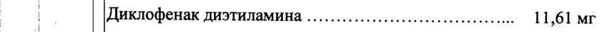
- стр. 1: «| | что эквивалентно диклофенаку натрия.................... 10,0 мг» — низкая уверенность: «10,0» (0); повторное чтение: «»  
  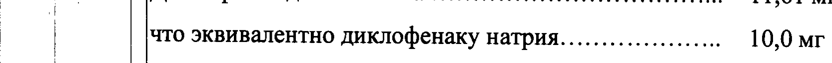
- стр. 1: «утилгидроксианизол ................... нана... 0,20 МГ» — повторное чтение: «‚утилгидроксианизол .............. аа инлилиннинь ан... 0520 MP»  
  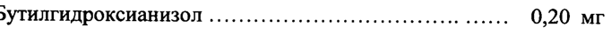
- стр. 1: «Бутилгидрокситолуол ................ нение... 250 МГ» — низкая уверенность: «250» (77); повторное чтение: «Бутилгидрокситолуол ини... 2.0 МГ»  
  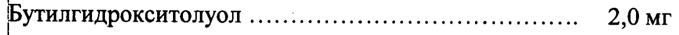
- стр. 1: «| инатрия эдетат ........... иене лненннннннье. = 1,0 МГ» — низкая уверенность: «1,0» (73); повторное чтение: «»  
  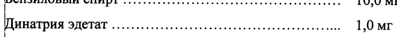
- стр. 1: «Kap6omep 980... нение нненнннин::. = 10,8 МГ» — низкая уверенность: «Kap6omep» (67), «980...» (16), «10,8» (68); повторное чтение: «»  
  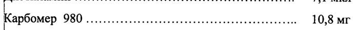
- стр. 1: « Пимонной кислоты моногидрат -.ssceescsseeceeccsse 1,0 мг» — повторное чтение: «Шмонной кислоты MOHOTHAPET том»  
  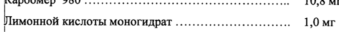
- стр. 1: « Кремофор ВН-40) .e-ccccssccsscessesesseseeveesessecesse 35,0 мг» — низкая уверенность: «ВН-40)» (36)  
  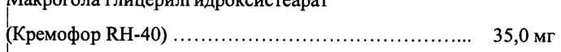
- стр. 1: « Пропиленгликоль и 100,0 мг» — повторное чтение: «Попиленгликоль „а наиььььь 1000»  
  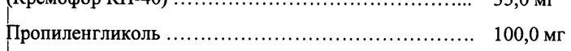
- стр. 1: «| BOM cesses ec Ск. треб. до 1,0 rp» — искажённая единица измерения  
  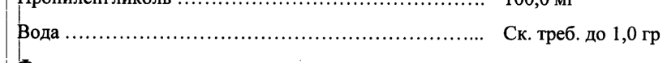
- стр. 2: «Mera сбдо 12 лет применять не чаще 2 раз в день, разовая доза препарата до 2 г.» — низкая уверенность: «2» (68); повторное чтение: «beam бл > net применять не аще разв нь, разовая доза  пепарата 2 .»  
  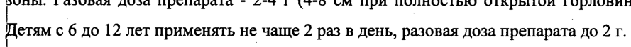
