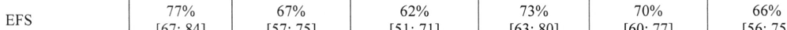
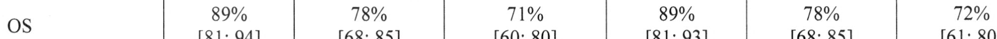
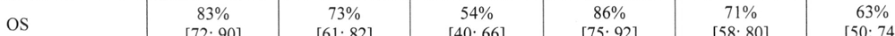
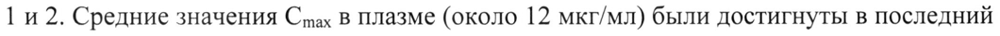
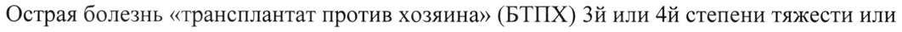
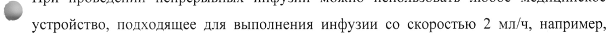
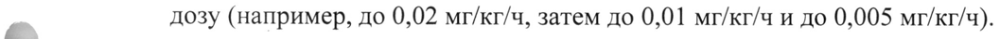
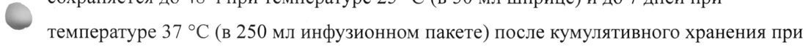
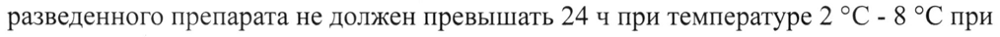

# Динутуксимаб бета — парентерально

- Препарат: Карзиба (концентрат для приготовления раствора для инфузий;)
- АТХ: L01FX06
- Источник: ГРЛС, инструкция по медицинскому применению, РУ ЛП-008352, файл от 2024-09-23 (https://grls.rosminzdrav.ru/Grls_View_v2.aspx?routingGuid=95bb2f4b-fb59-46cd-b4f2-b7fd178156a1)
- Распознано автоматически (OCR): 23 из 23 стр.
- Инструкция к другому РУ того же препарата: ЛП-008352 (национальное РУ, переоформленное по правилам ЕАЭС, решение от 09.09.2024). Текст может быть старше действующего
- Сомнительных строк после OCR: 10 (см. раздел «Проверка распознавания»)

## Общие сведения

МИНИСТЕРСТВО ЗДРАВООХРАНЕНИЯ РОССИЙСКОЙ ФЕДЕРАЦИИ
ИНСТРУКЦИЯ ПО МЕДИЦИНСКОМУ ПРИМЕНЕНИЮ ЛЕКАРСТВЕННОГО ПРЕПАРАТА
КАРЗИБА Регистрационный номер:
Торговое наименование: Карзиба Международное непатентованное наименование: динутуксимаб бета

## 3. Лекарственная форма

концентрат для приготовления раствора для инфузий
концентрат для приготовления раствора для инфузий

## 2. Состав

В 1мл препарата содержится:
w действующее вещество: динутуксимаб бета 4,5 мг;

вспомогательные вещества: гистидин, сахароза, полисорбат 20, вода для инъекций, хлористоводородная кислота (для регулирования рН).
Описание: прозрачная от бесцветного до светло-желтого цвета жидкость.
Фармакотерапевтическая группа: антинеопластические средства, моноклональные антитела
Код ATX: L0O1XC16 Фармакологические свойства

## 5.1. Фармакодинамика

Механизм действия
Механизм действия

® Динутуксимаб бета представляет собой химерное моноклональное антитело IgGl, специфически нацеленное на углеводный фрагмент дисиалоганглиозида 2 (GD2), который в высокой степени экспрессируется на клетках нейробластомы.
Фармакодинамические эффекты В условиях in vitro было показано, что динутуксимаб бета связывается с клеточными линиями нейробластомы, которые, как известно, экспрессируют GD2 и индуцируют комплемент-зависимую цитотоксичность (СОС) и антитело-зависимую клеточную цитотоксичность (ADCC). В присутствии человеческих эффекторных клеток, включая ядросодержащие клетки периферической крови и гранулоциты, полученные у здоровых доноров, было обнаружено, что динутуксимаб бета дозозависимым образом опосредует

лизис клеточных линий нейробластомы и меланомы человека. Кроме того, исследования 11 Vivo в сингенной мышиной модели метастазов в печени показали, что динутуксимаб бета может подавлять метастазы в печени.
Нейротоксичность, связанная с динутуксимабом бета, вероятно, обусловлена индукцией механической аллодинии, которая может быть опосредована реакцией динутуксимаба бета с антигеном GD2, расположенным на поверхности периферических нервных волокон и миелина.
Клиническая эффективность Эффективность динутуксимаба бета была оценена в рандомизированном контролируемом исследовании, сравнивающем применение динутуксимаба бета с интерлейкином-2 (ИЛ-2) или без него в качестве первой линии терапии у пациентов с
© нейробластомой высокого риска и в двух одногрупповых исследованиях при рецидивирующем/рефрактерном заболевании.
Пациенты с рецидивирующим и рефрактерным заболеванием
В исследовании фазы I (исследование 1) 54 пациента получали динутуксимаб бета в дозе 10 мг/м* в сутки в виде непрерывной 10-дневной внутривенной инфузии в течение 5-недельного курса лечения, одновременно с подкожным введением ИЛ-2 (6x10°)
МЕ/м?/сут в дни 1-5 и 8-12 каждого курса), а затем 13-цис-РК внутрь (160 mr/M?/cyT в течение 14 дней на курс лечения). Такая же схема лечения применялась в исследовании фазы IT (исследование 2), в которое были включены 44 пациента.
В целом, у этих 98 пациентов была первичная рефрактерная нейробластома (40
© пациентов) или рецидивирующая нейробластома (49 пациентов); были включены еще 9 пациентов, ранее получавших терапию первой линии. 61 пациент были мужского пола и 37 — женского пола. Возраст пациентов составлял от | года до 26 лет (медиана — 5 лет).
Большинство из них имели первоначальный диагноз стадии 4 по Международной системе стадирования нейробластом (INSS) без амплификации гена MYCN (у 16% пациентов была опухоль с амплификацией гена MYCN, у 14% - эта информация отсутствовала). Большинство пациентов с рецидивирующим заболеванием были включены в исследование после первого рецидива, и медианное время с момента постановки диагноза до первого рецидива составляло около 14 месяцев.
Предшествующее лечение заболевания перед иммунотерапией включало интенсивную химиотерапию с последующей трансплантацией аутологичных стволовых клеток
(ASCT), лучевую терапию и хирургическую операцию. На исходном уровне у 72 пациентов было поддающееся измерению заболевание, иу 26 пациентов заболевание не поддавалось измерению.
Показатели выживаемости (бессобытийная выживаемость, общая выживаемость)
представлены в таблице | в зависимости от типа заболевания. Частота общего ответа
(полный ответ плюс частичный ответ) у пациентов с признаками заболевания на исходном уровне составила 36% (95% доверительный интервал [25; 48]), этот показатель был выше у пациентов с рефрактерным заболеванием (41% [23; 57]) по сравнению с пациентами с рецидивирующим заболеванием (29% [15; 46]).
Таблица 1. Показатели бессобытийной выживаемости (EFS) и общей выживаемости
© (OS) при рецидивирующем и рефрактерном заболевании
N=29 N=19 N=15 N=25 ee ee ee ee Tepanua первой линии после трансплантации аутологичных стволовых клеток
В исследование 3 были включены пациенты с нейробластомой высокого риска, которые ранее получали индукционную химиотерапию и достигли, по меньшей мере,
© частичного ответа. Этим пациентам затем проводили миелоаблативную терапию и трансплантацию стволовых клеток. Пациенты с прогрессирующим заболеванием были исключены. Динутуксимаб бета вводили в дозе 20 мг/м?/сут в течение 5 дней подряд в виде 8-часовой внутривенной инфузии в рамках 5-недельного курса лечения в комбинации с 13-цис-РК и с дополнительным подкожным введением ИЛ-2 в той же дозе, что и в предыдущих исследованиях, или без него.
В общей сложности 370 пациентов были рандомизированы и получали лечение. Среди них 64% пациентов мужского пола и 36% пациентов женского пола (медианный возраст 3 года, диапазон от 0,6 до 20 лет); у 89% пациентов была опухоль стадии 4 по INSS, у 44% пациентов была амплификация гена МУСМ. Первичной конечной точкой эффективности была 3-летняя EFS, а вторичной конечной точкой являлась OS.
Показатели EFS и OS представлены в таблицах 2 и 3 в соответствии с наличием признаков заболевания на исходном уровне. У пациентов, не имеющих признаков заболевания на исходном уровне, добавление ИЛ-2 не улучшало EFS и OS.
Таблица 2: Показатели бессобытийной выживаемости (EFS) и общей выживаемости
(05) [95% доверительный интервал] у пациентов без признаков заболевания на исходном уровне (полный ответ на первоначальное лечение)
без ИЛ-2 N=104 с ИЛ-2 N=107 Эффективность
FS 77% 67% 62% 73% 70% 66% © [67; 84] [57; 75] [51;71] [63; 80] [60; 77] [56; 75] 05 89% 78% 71% 89% 78% 72%
[81; 94] [68; 85] [60; 80] [81; 93] [68; 85] [61; 80]
Таблица 3: Показатели бессобытийной выживаемости (EFS) и общей выживаемости
(OS) [95% доверительный интервал] у пациентов с признаками заболевания на исходном уровне (отсутствие полного ответа на первоначальное лечение)
без ИЛ-2 с ИЛ-2 N=73 N=76 Эффективность — 67% 58% 46% 72% 62% 54%
[55; 76] [45; 69] [33; 58] [60; 81] [49; 72] [41; 65] ee 83% 73% 54% 86% 71% 63%
& (72; 90] (61; 82] [40; 66] (75; 92] [58; 80] [50; 74]
Иммуногенность Выработка нейтрализующих антител (ADA) является классовым эффектом моноклональных химерных антител. В целом, у 65 (62%) из 105 обследованных пациентов были обнаружены измеримые титры АПА.
Учитывая лимитированные опции биоаналитических методов, данные в настоящее время недостаточны для оценки влияния образования нейтрализующих антител на фармакокинетические и фармакодинамические параметры, а также на эффективность и безопасность динутуксимаба бета.

## 5.2. Фармакокинетика

Распределение Расчеты фармакокинетических параметров динутуксимаба бета основаны на измерениях с использованием невалидированных биоаналитических методик. Это необходимо учитывать при интерпретации параметров фармакокинетики, перечисленных ниже (максимальная концентрация (Cmax), экспозиция, период полувыведения).
Распределение Расчеты фармакокинетических параметров динутуксимаба бета основаны на измерениях с использованием невалидированных биоаналитических методик. Это необходимо учитывать при интерпретации параметров фармакокинетики, перечисленных ниже (максимальная концентрация (Cmax), экспозиция, период полувыведения).
Фармакокинетику динутуксимаба бета при 10-дневной непрерывной внутривенной инфузии в дозе 10 мг/м?/сут (в общей дозе 100 мг/м”/курс), оценивали в исследованиях 1 и 2. Средние значения Cmax в плазме (около 12 мкг/мл) были достигнуты в последний

~ день инфузии. Средние значения Cmax в плазме, наблюдаемые в течение 8-часовых инфузий (20 мг/м? в сутки в течение 5 дней подряд), были определены в другом исследовании (п=15). Наблюдаемые Cmax были несколько выше (16,5 мкг/мл) и были достигнуты в день пятой инфузии.
Метаболизм Динутуксимаб бета — это белок, для которого ожидаемым метаболическим путем биотрансформации является деградация до малых пептидов и отдельных аминокислот с помощью универсальных протеолитических ферментов. Исследования биотрансформации не проводились.

„_ Выведение

© Период полувыведения, наблюдаемый в исследованиях | и 2, составлял 190 4, то есть 8 дней.
Особые популяции Дети Для исследования влияния ковариат использовали моделирование популяционной фармакокинетики. Модель популяционной фармакокинетики включала аллометрическое масштабирование (эталонная масса 18,1 кг) по клиренсу и объему распределения с экспонентами 0,75 и | соответственно.
Воздействие (Cmax и AUCz4, в дни 1 и 10 10-дневной инфузии), по прогнозам, будет одинаковым у пациентов в возрасте 12 лет или младше и незначительно меньшим у

пациентов более старшего возраста и пациентов с более тяжелым течением заболевания. Было выявлено, что пол и возраст не влияют на фармакокинетику динутуксимаба бета, данные детей в возрасте до 2 лет очень ограничены и недостаточны для оценки режима дозирования.

Было выявлено влияние образования ADA на объем распределения (увеличение объема на 37%). Таким образом, образование ADA, по прогнозам, окажет незначительный эффект на воздействие (снижение менее чем на 10%) в течение 24 ч после введения в период до достижения равновесной концентрации. После достижения равновесного состояния, разницы в воздействии при образовании ADA или в отсутствие ADA не ожидается.

Нарушение функции почек и печени

\ Показатели функции почек (расчетная скорость клубочковой фильтрации, рСКФ) и печени (концентрация билирубина) не демонстрируют взаимосвязи с воздействием
(Стах и АУ Соч в дни | и 10 10-дневной инфузии).

## 4.1. Показания к применению

Лечение нейробластомы высокого риска у пациентов в возрасте от 12 месяцев и старше, ранее получавших индукционную химиотерапию и достигших, по меньшей мере, частичного ответа, с последующей миелоаблативной терапией и трансплантацией стволовых клеток,

а также у пациентов с рецидивирующей или рефрактерной нейробластомой в анамнезе, с остаточной болезнью или без нее.

- Перед лечением рецидивирующей нейробластомы следует добиться стабилизации любого активно прогрессирующего заболевания другими подходящими методами терапии.

У пациентов с рецидивирующим/рефрактерным заболеванием и у пациентов, которые не достигли полного ответа после первой линии терапии, препарат Карзиба следует комбинировать с интерлейкином-2 (ИЛ-2).

## 4.3. Противопоказания

Гиперчувствительность к действующему веществу или к любому из вспомогательных веществ препарата.
Гиперчувствительность к действующему веществу или к любому из вспомогательных веществ препарата.

Острая болезнь «трансплантат против хозяина» (БТПХ) 3% или 4й степени тяжести или распространенная хроническая БТИХ.
Беременность, период грудного вскармливания.

## 4.6. Применение при беременности и в период грудного вскармливания

Беременность Данные о применении динутуксимаба бета у беременных женщин отсутствуют. Данные о тератогенности или эмбриотоксичности у животных отсутствуют. Мишень динутуксимаба бета (GD2) экспрессируется в нейрональных тканях, особенно во время эмбриофетального развития, и динутуксимаб бета может проникать через плаценту;
таким образом, препарат Карзиба может причинить вред плоду при применении
_ беременными женщинами.
~ Применение препарата Карзиба во время беременности противопоказано.
Период грудного вскармливания Данные о применении у женщин в период грудного вскармливания отсутствуют.
Неизвестно, проникает ли динутуксимаб бета в молоко человека. Грудное вскармливание следует прекратить на время лечения препаратом Карзиба и на период до 6 месяцев после введения последней дозы.
Фертильность Влияние динутуксимаба бета на репродуктивную функцию у людей неизвестно. У животных специальных исследований влияния на фертильность не проводили. Тем не
_ менее, нежелательных эффектов в отношении органов репродуктивной системы в
© исследованиях токсичности, проведенных у морских свинок и яванских макак, He наблюдалось.
Препарат Карзиба не следует применять у женщин с сохраненным репродуктивным потенциалом, не использующих контрацепцию. Женщинам с COXpaHeHHbIM репродуктивным потенциалом рекомендуется продолжать использовать контрацепцию в течение 6 месяцев после прекращения лечения динутуксимабом бета.

## 4.2. Способ применения и дозы

Препарат Карзиба следует вводить только в условиях лечебного учреждения и строго под наблюдением врача, имеющего опыт в проведении противоопухолевой терапии.
Препарат Карзиба следует вводить только в условиях лечебного учреждения и строго под наблюдением врача, имеющего опыт в проведении противоопухолевой терапии.
Препарат должен вводиться медицинским работником, который обучен купированию тяжелых аллергических реакций, включая анафилаксию, в условиях непосредственной доступности средств для проведения реанимации.
Режим дозирования Лечение препаратом Карзиба состоит из 5 последовательных курсов, продолжительность каждого из которых составляет 35 дней. Индивидуальную дозу определяют на основе площади поверхности тела, и она должна составлять в общей сложности 100 мг/м? на курс.
Возможны два способа применения:
* непрерывная инфузия в течение первых 10 дней каждого курса (в общей сложности 240 ч) в суточной дозе 10 мг/м?;
° или 5 ежедневных инфузий по 20 мг/м? , вводимых в течение 8 4, в первые 5
© дней каждого курса.
Если в комбинации с препаратом Карзиба вводят ИЛ-2, его следует вводить в виде подкожных инъекций 6х10° МЕ/м?/сут, в течение 2 периодов по 5 последовательных дней, при этом общая доза должна составлять 60 10° ME/M? на курс. Первый 5-дневный курс должен начинаться за 7 дней до первой инфузии динутуксимаба бета, а второй 5дневный курс должен начинаться одновременно с инфузией динутуксимаба бета (дни с 1 по 5 каждого курса динутуксимаба бета).
Перед началом каждого курса лечения необходимо оценить следующие клинические показатели, и если эти показатели не достигнуты, лечение следует отложить до
© восстановления этих показателей:
° пульсоксиметрия >94% в помещении;
° адекватная функция костного мозга: абсолютное количество нейтрофилов
>500/мкл, количество тромбоцитов >20,000/мкл, гемоглобин >8,0 г/дл;
° адекватная функция печени: аланинаминотрансфераза
(АЛТ)/аспартатаминотрансфераза (ACT) <5 верхней границы нормы (ВГН);
e адекватная функция почек: клиренс креатинина или рСКФ >60 мл/мин/1,73 м².
Модификация дозы динутуксимаба бета Основываясь на оценке врачом степени тяжести нежелательных лекарственных реакций (НЛР) при применении динутуксимаба бета, может быть выполнено снижение дозы на 50% или временное прерывание инфузии. Как следствие, период инфузии может быть продлен или, если пациент хорошо переносит инфузию, скорость инфузии может быть увеличена до 3 мл/ч (непрерывная инфузия) для введения полной дозы.
Рекомендации по модификации дозы динутуксимаба бета реакция
Любая Степень 1-2 Снижение скорости инфузии на 50%.
После разрешения НЛР возобновление инфузии при первоначальной скорости
Реакция например, артериальная Прерывание инфузии и проведение гиперчувствите | гипотензия вспомогательных мероприятий.
льности После разрешения возобновление инфузии при первоначальной
©. скорости Расширение зрачков с замедленным Прерывание инфузии.
зрачковым рефлексом+/- фотофобия После разрешения возобновление инфузии при скорости 50% от первоначальной
Любая Степень >3 Прерывание инфузии и проведение вспомогательных мероприятий.
Возобновление инфузии при скорости 50% от первоначальной в случае разрешения НЛР или улучшения степени тяжести до 1—2.
После разрешения НЛР увеличение скорости инфузии до первоначальной повторные НЛР Прекращение инфузии.

& Возобновление инфузии Ha следующий день, при условии разрешения НЛР

Реакция например, бронхоспазм, Немедленное прерывание инфузии и гиперчувствите | ангионевротический отек | проведение надлежащего лечения
JIbHOCTH (см. раздел «Особые указания»).
Возобновление лечения для завершения последующих курсов
Синдром Прерывание инфузии и проведение повышенной вспомогательных мероприятий.
проницаемости Возобновление инфузии при капилляров скорости 50% от первоначальной в случае разрешения НЛР или лучшения степени тяжести до 1-2
Лечение динутуксимабом бета должно быть окончательно прекращено, если возникают следующие токсические проявления:
* анафилаксия степени 3 или 4;
° длительная периферическая моторная нейропатия степени 2;
* периферическая нейропатия степени 3;
e токсичность в отношении органа зрения степени 3;
° гипонатриемия степени 4 (< 120 мэкв/л), несмотря Ha надлежащую коррекцию водного баланса;
° повторные НЛР или синдром повышенной проницаемости капилляров степени 4 (требуется поддержка ИВЛ).
„ Нарушение функции почек и печени © Данные о безопасности и эффективности динутуксимаба бета у пациентов с нарушениями функции почек и печени отсутствуют.
Дети Безопасность и эффективность препарата Карзиба у детей в возрасте до 12 месяцев не установлена. Данные отсутствуют.
Способ введения Препарат Карзиба предназначен для внутривенной инфузии. Раствор следует вводить через периферический или центральный внутривенный катетер. Другие одновременно вводимые препараты, предназначенные для внутривенного введения, следует вводить с
© использованием отдельной инфузионной системы.
При проведении непрерывных инфузий раствор вводят со скоростью 2 мл/ч (48 мл в сутки) с использованием инфузионной помпы.
В случае проведения 8-часовых ежедневных инфузий раствор вводят со скоростью примерно 13 мл/ч.
Перед началом каждой инфузии всегда следует рассмотреть необходимость проведения премедикации (см. раздел «Особые указания»).
Инструкция по разведению лекарственного препарата перед введением
Раствор для инфузии должен быть подготовлен в асептических условиях. Раствор не должен подвергаться воздействию прямых солнечных лучей или тепла.
Специфическую для пациента суточную дозу препарата Карзиба рассчитывают на основе площади поверхности тела.
Препарат Карзиба следует разводить в асептических условиях до конкретной концентрации/дозы раствором хлорида натрия 9 мг/мл (0,9%) для инфузий, содержащим 1% альбумина человека (например, 5 мл альбумина человека 20% на 100 мл раствора хлорида натрия).
При проведении непрерывных инфузий раствор для инфузии можно готовить ежедневно или приготовить достаточное количество на срок до 5 дней. Суточная доза — 10 мг/м?. Количество раствора, который вводится в сутки (за курс лечения продолжительностью 10 дней подряд), должно составлять 48 мл; 240 мл для 5-дневной
_ дозы. Рекомендуется готовить 50 мл раствора в шприце объемом 50 мл или 250 мл в
~ инфузионном мешке, подходящем для используемой инфузионной помпы, TO есть с обеспечением резервного объема 2 мл (шприц) или 10 мл (инфузионный мешок), чтобы обеспечить мертвый объем для инфузионных систем.
При проведении многократных ежедневных 8-часовых инфузий суточная доза составляет 20 мг/м? и рассчитанную дозу следует разводить в 100 мл хлорида натрия 9 мг/мл (0,9%), содержащего 1% альбумина человека.
Перед введением препарата следует провести визуальный осмотр содержимого упаковки на наличие твердых частиц. Во время инфузии рекомендуется использовать встроенный фильтр с диаметром пор 0,22 мкм.
_ При проведении непрерывных инфузий можно использовать любое медицинское
© устройство, подходящее для выполнения инфузии со скоростью 2 мл/ч, например, инфузоры/инфузионные помпы, электронные амбулаторные инфузионные помпы.
Следует обратить внимание, что эластомерные помпы в комбинации со встроенными фильтрами не считаются подходящими.
Любой неиспользованный лекарственный препарат или отходы должны быть утилизированы в соответствии с надлежащими требованиями.

## 4.8. Побочное действие

Резюме профиля безопасности
Резюме профиля безопасности
Безопасность динутуксимаба бета оценивали y 628 пациентов с рецидивирующей/рефрактерной нейробластомой высокого риска, которые получали a!
его в виде непрерывной инфузии (212 пациентов) или в виде многократных ежедневных инфузий (416 пациентов). У большинства пациентов препарат комбинировали с 13-цисретиноиновой кислотой, и у 307 пациентов — с ИЛ-2.
Наиболее распространенными нежелательными реакциями (НР) были пирексия (88%)
и боль (77%), которые развивались несмотря на обезболивающее лечение. Другими частыми НР были гиперчувствительность (74,1%), рвота (57%), диарея (51%), синдром повышенной проницаемости капилляров (40%), анемия 72,3%, нейтропения 52%, тромбоцитопения 49,6%, и артериальная гипотензия (42,2%).
Табличный перечень нежелательных реакций
Нежелательные реакции, полученные в клинических исследованиях, обобщены в
_ таблице ниже. Эти НР сгруппированы по системно-органному классу MedDRA и
© частоте встречаемости. Частотные категории определяются следующим образом: очень часто (>1/10), часто (от >1/100 до <1/10) и нечасто (от >1/1000 до <1/100). В каждой частотной категории НР представлены в порядке уменьшения степени тяжести.
Структура и характер нежелательных реакций, зарегистрированных в реальной клинической практике, соответствуют нежелательным реакциям, зарегистрированным в клинических исследованиях.
Системно- Очень часто Часто Нечасто органный класс
Инфекции и инфекция (в том Сепсис паразитарные | числе пневмония,
(> | заболевания кожная инфекция, герпес-вирусная инфекция, миелит, энцефаломиелит), инфекция, связанная с устройством
Нарушения со | анемия, лейкопения, |лимфопения синдром стороны крови | нейтропения, диссеминированно и тромбоцитопения ro лимфатической внутрисосудистого системы свертывания, эозинофилия
Нарушения со | гиперчувствительнос |анафилактическая сывороточная стороны ть, синдром реакция болезнь
Системно- Очень часто Часто Нечасто органный класс
= = | ПО системы цитокинов Нарушения со задержка жидкости снижение аппетита, стороны обмена гипоальбуминемия, веществ и гипонатриемия, питания гипокалиемия, гипофосфатемия, гипомагниемия, гипокальциемия, обезвоживание
— ee ПИ психики беспокойство Нарушения со | головная боль периферическая повышение
& стороны нейропатия, внутричерепного нервной судороги, парестезия, | давления, синдром системы головокружение, задней обратимой тремор энцефалопатии
Нарушения со | мидриаз, офтальмоплегия, отек стороны органа | нейротоническая диска зрительного зрения зрачковая реакция, нерва, нарушение отек глаза (века, аккомодации, периорбитальный нечеткость зрения, отек фотофобия
Нарушения со | тахикардия сердечная стороны сердца недостаточность, дисфункция левого желудочка,
© перикардиальный выпот Нарушения со | артериальная артериальная гиповолемический стороны гипотензия, синдром | гипертензия шок, сосудов повышенной веноокклюзионная проницаемости болезнь капилляров
Нарушения со | гипоксия, кашель бронхоспазм, стороны одышка, дыхательная дыхательной недостаточность, системы, инфильтрация органов легких, отек легких, грудной клетки плевральный выпот, и средостения тахипноэ, ларингоспазм
Системно- Очень часто Часто Нечасто органный класс
Нарушения со | рвота, диарея, запор, | тошнота, отек губ, энтероколит стороны стоматит асцит, вздутие желудочно- живота, кишечная кишечного непроходимость, тракта сухость губ
Нарушения со гепатоцеллюлярно стороны печени е повреждение и желчевыводящ их путей
Нарушения со | Кожный зуд, кожная | дерматит (в том стороны кожи и | сыпь, крапивница числе
. подкожной эксфолиативный w ткани дерматит), эритема, сухость кожи, гипергидроз, петехии, реакция фоточувствительност и
Нарушения со мышечные спазмы стороны скелетномышечной и соединительной ткани
Нарушения со олигурия, задержка почечная стороны почек мочи, недостаточность
© и гиперфосфатурия, мочевыводящи гематурия, х путей протеинурия
Общие пиретическая реакция в месте расстройства и | реакция, озноб, инъекции нарушения в боль*, месте введения | периферические отеки, отек лица
Лабораторные | увеличение массы снижение массы тела, отклонения тела, повышение снижение скорости активности клубочковой трансаминаз, фильтрации, повышение гипертриглицеридем активности гамма- ия, удлинение глутамилтрансферазы | активированного
Системно- Очень часто Часто Нечасто органный класс
‚ повышение частичного концентрации тромбопластинового билирубина в крови, | времени, удлинение повышение протромбинового концентрации времени, удлинение креатинина в крови тромбинового времени
* включает боль в животе, боль в конечностях, боль в ротоглотке и боль в спине, о которых сообщалось у > 10% пациентов. Также часто встречались другие типы боли, такие как артралгия, боль в месте инъекции, скелетно-мышечная боль, боль в костях, боль в груди, боль в шее.
w Описание отдельных нежелательных реакций
Гиперчувствительность Наиболее частыми реакциями гиперчувствительности были артериальная гипотензия
(42,2%), крапивница (15%) и бронхоспазм (5,3%). Синдром высвобождения цитокинов также был зарегистрирован у 32% пациентов. Серьезные анафилактические реакции были зарегистрированы у 3,5% пациентов.
Боль Боль, как правило, возникает во время первой инфузии динутуксимаба бета и уменьшается при последующих курсах лечения. Чаще всего пациенты сообщали о боли в животе, конечностях, спине, груди или артралгии.
wo Синдром повышенной проницаемости капилляров (CLS)
В целом, 10% случаев CLS были тяжелыми (степень 3-4), и их частота снижалась при последующих курсах лечения.
Нарушения со стороны органа зрения К их числу относятся нарушение зрительной аккомодации, которое корректируется с помощью очков, а также мидриаз (10,7%), периорбитальный отек и отек век (7,1%), нечеткость зрения (3%) или фотофобия (3%), которые обычно были обратимыми после прекращения лечения. Также сообщалось о тяжелых нарушениях со стороны органа зрения, включая офтальмоплегию (2%) и атрофию зрительного нерва.
Периферическая нейропатия В общей сложности у 9% пациентов были зарегистрированы случаи моторной и сенсорной периферической нейропатии. Большинство явлений относились к степени тяжести | или 2 и разрешились.

Профиль безопасности при применении совместно с ИЛ-2 и без него

Комбинация препарата Карзиба с ИЛ-2 повышает риск НР по сравнению с применением препарата Карзиба без ИЛ-2, особенно это касается пирексии (92% по сравнению с 79%), CLS (50% по сравнению с 25%), боли, связанной с динутуксимабом бета (75% по сравнению с 63%), артериальной гипотензии (43% по сравнению с 26%) и периферической нейропатии (14% по сравнению с 7%), соответственно.

## 4.9. Передозировка

Сообщений о случаях передозировки динутуксимаба бета не поступало.

- В случае передозировки следует тщательно контролировать признаки или симптомы НР у пациентов и проводить поддерживающее лечение, в зависимости от обстоятельств.

## 4.5. Взаимодействие с другими лекарственными средствами

Исследований взаимодействия динутуксимаба бета с другими лекарственными средствами не проводилось. Не исключен риск опосредованного снижения активности ферментов CYP из-за повышенных уровней ФНО-а и ИЛ-6 и, следовательно, взаимодействия с одновременно применяемыми лекарственными препаратами.
Глюкокортикостероиды (ГКС)

В связи с иммуносупрессивным действием ГКС их сопутствующее применение не
© рекомендуется в течение 2 недель до первого курса лечения и на период до 1 недели

после последнего курса лечения динутуксимабом бета, за исключением их применения

для купирования жизнеугрожающих состояний.

Вакцинация

Следует избегать вакцинации во время введения динутуксимаба бета в течение до 10

недель после последнего курса лечения, из-за стимуляции иммунитета динутуксимабом

бета и возможного риска редких неврологических токсических проявлений.

Внутривенный иммуноглобулин

Сопутствующее внутривенное введение иммуноглобулинов не рекомендуется,

поскольку они могут препятствовать опосредованной динутуксимабом бета клеточной

цитотоксичности.

Несовместимость

Лекарственный препарат не следует смешивать с другими лекарственными

препаратами, за исключением тех, которые указаны в разделе «Способ применения и

дозы».

## 4.4. Особые указания

Боль

Нейропатическая боль обычно возникает в начале лечения, и перед каждой инфузией

динутуксимаба бета требуется премедикация анальгетиками, в том числе

внутривенными опиоидами. Для лечения боли рекомендуется трехкомпонентная

терапия, включающая неопиоидные анальгетики (согласно рекомендации ВОЗ),

габапентин и опиоидные анальгетики. Индивидуальная доза указанных препаратов

~ может значительно варьироваться.

Неопиоидные анальгетики

Во время лечения следует постоянно применять неопиоидные анальгетики, например,

парацетамол или ибупрофен.

Габапентин

За 3 дня до проведения инфузии динутуксимабом бета пациенту должен быть назначен

габапентин внутрь в дозе 10 мг/кг/сут. Суточную дозу габапентина увеличивают до 10

мг/кг 2 раза в сутки внутрь на следующий день и до 10 мг/кг 3 раза в сутки внутрь за

день до начала инфузии динутуксимаба бета и далее продолжают применение в этой
_ Дозе. Максимальная разовая доза габапентина составляет 300 мг. Этот режим
© дозирования должен поддерживаться до Tex пор, пока это необходимо пациенту.

Дозу габапентина для приема внутрь следует постепенно снижать до полной отмены

после прекращения внутривенной инфузии морфина, самое позднее, после

прекращения инфузии динутуксимаба бета.

Опиоидные анальгетики

Применение опиоидных анальгетиков является стандартной процедурой при введении

динутуксимаба бета. В первый день инфузии во время первого курса инфузии

динутуксимаба бета обычно требуется более высокая доза опиодиов по сравнению с

последующими днями и курсами.

° Перед началом непрерывной внутривенной инфузии морфина, необходимо начать внутривенную болюсную инфузию морфина в дозе от 0,02 до 0,05 мг/кг/ч за 2 ч до начала инфузии динутуксимаба бета.

+ Впоследствии при одновременной инфузии динутуксимаба бета рекомендуемая скорость введения морфина составляет 0,03 мг/кг/ч.

® При ежедневных инфузиях динутуксимаба бета инфузию морфина следует продолжать при пониженной скорости (например, 0,01 мг/кг/ч) в течение 4 4 после окончания инфузии динутуксимаба бета.

* При непрерывной инфузии, в зависимости от восприятия боли пациентом, можно постепенно отменять морфин в течение 5 дней, медленно уменьшая его

р дозу (например, до 0,02 мг/кг/ч, затем до 0,01 мг/кг/ч и до 0,005 мг/кг/ч).
ba + Если требуется постоянная инфузия морфина в течение более 5 дней, дозу следует постепенно уменьшать на 20% в сутки после последнего дня инфузии динутуксимаба бета.
После прекращения внутривенного введения морфина, в случае сильной нейропатической боли, при необходимости, можно применять морфин внутрь (от 0,2 до 0,4 мг/кг каждые 4-6 ч). При умеренной нейропатической боли можно назначать трамадол внутрь.
Реакции гиперчувствительности Тяжелые инфузионные реакции, включая синдром высвобождения цитокинов (CRS),
© анафилактические реакции и реакции гиперчувствительности, могут возникать, несмотря на премедикацию. Возникновение тяжелой инфузионной реакции (включая
CRS) требует немедленного прекращения терапии динутуксимабом бета и может потребовать интенсивной терапии.
Синдром высвобождения цитокинов (СК$) часто проявляется в течение нескольких минут или часов после начала первой инфузии и характеризуется системными симптомами, такими как лихорадка, артериальная гипотензия и крапивница.
Анафилактические реакции могут возникать уже в течение нескольких минут после первой инфузии динутуксимаба бета и обычно сочетаются с бронхоспазмом и крапивницей.
Премедикация

Премедикация антигистаминными препаратами (например, дифенгидрамином) должна

проводиться путем внутривенной инъекции примерно за 20 мин до начала каждой

инфузии динутуксимаба бета. Рекомендуется повторять введение антигистаминного

препарата каждые 4-6 ч во время инфузии динутуксимаба, по необходимости.

Необходимо внимательно следить за проявлениями анафилаксии и аллергических

реакций, особенно во время первого и второго курса лечения.

Лечение реакций гиперчувствительности

Антигистаминный препарат для внутривенного введения, эпинефрин (адреналин) и

преднизолон для внутривенного введения должны находиться в непосредственной
_ доступности во время введения динутуксимаба бета для купирования
© жизнеугрожающих аллергических реакций. Рекомендуется, чтобы лечение таких

реакций включало преднизолон, вводимый внутривенно болюсно, и эпинефрин,

вводимый внутривенно болюсно каждые 3-5 мин, в зависимости от клинического

ответа. В случае реакции бронхиальной и/или легочной гиперчувствительности

рекомендуются ингаляции с эпинефрином (адреналином), которые следует повторять

каждые 2 ч в соответствии с клиническим ответом.

Синдром повышенной проницаемости капилляров (CLS)

CLS характеризуется утратой тонуса сосудов и экстравазацией белков плазмы и

жидкости BO внесосудистое пространство. CLS обычно развивается в течение
© нескольких часов после начала лечения, в то время как клинические симптомы

(например, гипотензия, тахикардия) появляются спустя 2-12 ч. Необходим тщательный

контроль функций кровообращения и дыхания.

Неврологические нарушения со стороны органа зрения

Нарушения со стороны органа зрения возможны, поскольку динутуксимаб бета

связывается с клетками зрительного нерва. При нарушении зрительной аккомодации,

которое можно скорректировать с помощью очков, модификация дозы не требуется,

при условии, что доза хорошо переносится.

Лечение следует временно приостановить у пациентов с токсическими проявлениями 3

степени со стороны органа зрения (субтотальная потеря зрения по шкале оценки

токсичности). В случае возникновения нарушений со стороны органа зрения пациенты должны быть незамедлительно направлены к офтальмологу.
Периферическая нейропатия При применении препарата Карзиба были зарегистрированы отдельные случаи периферической нейропатии. Следует оценивать случаи моторной или сенсорной нейропатии, длящиеся более 4 дней, и исключать такие невоспалительные причины, как прогрессирование заболевания, инфекции, метаболический синдром и сопутствующие лекарственные препараты.
Лечение должно быть окончательно прекращено у пациентов, испытывающих любую объективную длительную слабость, связанную с введением динутуксимаба бета. У пациентов с умеренной нейропатией степени 2 (моторная с сенсорной или без нее)
- лечение должно быть прервано и может быть возобновлено после разрешения неврологических симптомов.
Системные инфекции В результате предшествующей терапии у пациентов, вероятно, может быть ослаблен иммунитет. Поскольку пациентам, как правило, установлен центральный венозный катетер in situ, они подвержены риску развития системной инфекции. Перед началом терапии пациенты не должны иметь признаков системной инфекции и любая выявленная инфекция должна контролироваться.
Гематологическая токсичность © При применении препарата Карзиба сообщалось о развитии гематологической токсичности, например, эритропении, тромбоцитопении или нейтропении. Если гематологическая токсичность степени 4 улучшается, по меньшей мере, до степени 2 или до исходных значений к началу следующего курса лечения, коррекция дозы препарата не требуется.
Лабораторные отклонения В период лечения динутуксимабом бета рекомендуется регулярный мониторинг функции печени и концентрации электролитов.
Доклиническая безопасность Динутуксимаб бета вводили молодым особям (самцам и самкам) морских свинок, а также молодым особям (самцам и самкам) яванских макак в виде режимов с многократными дозами, превышающими рекомендованную клиническую дозу.
Следует отметить изменение (уменьшение) массы тимуса, а также изменения в костном мозге (атрофия, влияющая на линии миелоидных и эритроидных клетокпредшественников). Изменения в костном мозге представляли собой изменения от незначительных до серьезных. Отмечалось полное восстановление после прекращения введения препарата. Эффектов в отношении функции сердечно-сосудистой системы
(ЭКГ, артериальное давление) у обезьян не наблюдалось.
Доклинические исследования канцерогенности, генотоксичности или токсического действия динутуксимаба бета на репродуктивную функцию и развитие не проводились.
В ходе исследований токсичности при многократном введении доз морским свинкам и яванским макакам эффектов динутуксимаба бета в отношении органов репродуктивной ad системы при уровнях воздействия выше клинических He наблюдалось.

## 4.7. Влияние на способность управлять транспортными средствами, механизмами

Динутуксимаб бета оказывает значимое влияние на способность управлять транспортными средствами и механизмами. Пациенты не должны управлять транспортными средствами или работать с механизмами во время лечения динутуксимабом бета.

## 6.5. Форма выпуска

Концентрат для приготовления раствора для инфузий 4,5 мг/мл.
Концентрат для приготовления раствора для инфузий 4,5 мг/мл.
Каждый флакон содержит 20 мг динутуксимаба бета.
© Флакон объемом 6 мл из стекла I гидролитического класса с пробкой из галобутилового каучука, алюминиевым колпачком и отламывающимся полипропиленовым колпачком, с минимальным извлекаемым объемом концентрата для приготовления раствора для инфузий - 4, 5 мл.
1 маркированный флакон с лекарственным препаратом помещают в картонную пачку с картонным фиксатором для флакона, вместе с инструкцией по применению.
Пачка картонная снабжена двумя прозрачными этикетками первого вскрытия. По одной этикетке контроля первого вскрытия помещается на каждый закрывающийся клапан пачки.

## 6.4. Условия хранения

При температуре от 2 до 8 °С в оригинальной упаковке в защищенном от света месте.
При температуре от 2 до 8 °С в оригинальной упаковке в защищенном от света месте.
Хранить в недоступном для детей месте.
Препарат Карзиба следует использовать сразу после вскрытия.
Условия хранения после разведения см. в разделе «Срок годности».

## 6.3. Срок годности

Невскрытый флакон 3 года.
Невскрытый флакон 3 года.
Не применять по истечении срока годности, указанного на упаковке.
Дата истечения срока годности относится к последнему дню указанного месяца.
После разведения (раствор для инфузии)
Химическая и физическая стабильность при использовании разведенного препарата сохраняется до 48 ч при температуре 25 °С (в 50 мл шприце) и до 7 дней при

~ температуре 37 °С (в 250 мл инфузионном пакете) после кумулятивного хранения при температуре 2 °С - 8 °С в течение 72 часов.
С микробиологической точки зрения, препарат следует использовать немедленно. Если немедленного применения не последовало, сроки и условия хранения препарата при использовании остаются на ответственности потребителя. Обычно срок хранения разведенного препарата не должен превышать 24 ч при температуре 2 °С - 8 °C при условии, что разведение было проведено в контролируемых и отвалидированных асептических условиях.
Условия отпуска

© Отпускают по рецепту.
Владелец регистрационного удостоверения ООО «Фармамондо», Россия 109428, Москва, просп. Рязанский, д. 16, стр. 1, этаж 7, пом. I, ком. 3
Производитель Производство готовой лекарственной формы и фасовка (первичная упаковка):
Рентшлер Биофарма СЕ, Эрвин-Рентшлер-Штрассе 21, 88471 Лаупхайм, Германия
Rentschler Biopharma SE, Erwin-Rentschler-Str. 21, 88471 Laupheim, Germany
Вторичная (потребительская упаковка) и выпускающий контроль качества:

Миллмаунт Хелскеар Лтд, Корпус 7, Сити Норт Бизнес Кэмпус, Стамаллин, графство Mut, K32 YD60, Ирландия
Millmount Healthcare Limited, Block-7, City North Business Campus, Stamullen, Co. Meath, K 32 YD60, Ireland
Организация, принимающая претензии потребителей
ООО «Фармамондо», Россия 109428, Москва, просп. Рязанский, д. 16, стр. 1, этаж 7, пом. I, ком. 3
Тел.: +7 495 098 0188;
e-mail: info@farmamondo.ru ne a w ALIN Г. VQ, У 7 иректор отдела регистрации Г % А)
pPRERTOD Ovieta Deron yal fal О LLOлекарственных средств и медицинских из gi Ире
ООО «Фармамондо» \aXs, О, 3) А.И. Орищенко
NCE Lov, S—eepaunn £7 eee —
## Проверка распознавания

Страницы-сканы распознаны автоматически. В 10 строках с дозировками цифры могли распознаться с ошибкой — сверьте с вырезкой из оригинала:

- стр. 4: «FS 77% 67% 62% 73% 70% 66%» — повторное чтение: «EFS | mie | ae | в. 7 | oe | ‚ я | ОВ»  
  
- стр. 4: «05 89% 78% 71% 89% 78% 72%» — повторное чтение: «05 | Rican | Ея | J С | Кл | ah | oe»  
  
- стр. 4: «— 67% 58% 46% 72% 62% 54%» — повторное чтение: «EFS | 67% =| 5% | 4 | 7% | 6% | 5%»  
  
- стр. 4: «ee 83% 73% 54% 86% 71% 63%» — повторное чтение: «05 | ee | ain. | в.д | noe | a, a | Bid»  
  
- стр. 5: «1 и 2. Средние значения Cmax в плазме (около 12 мкг/мл) были достигнуты в последний» — низкая уверенность: «2.» (65)  
  
- стр. 7: «Острая болезнь «трансплантат против хозяина» (БТПХ) 3% или 4й степени тяжести или» — низкая уверенность: «3%» (67)  
  
- стр. 11: «© устройство, подходящее для выполнения инфузии со скоростью 2 мл/ч, например,» — повторное чтение: «© yerpotierso, подходящее ля выполнения  нифузии со скоростыо 2 anf, warpewen,»  
  
- стр. 18: «р дозу (например, до 0,02 мг/кг/ч, затем до 0,01 мг/кг/ч и до 0,005 мг/кг/ч).» — повторное чтение: «4 дозу (например, до 0,02 мг/кг/ч, затем до 0,01 мг/кг/ч и до 0,005 мг/кг/ч).»  
  
- стр. 22: «~ температуре 37 °С (в 250 мл инфузионном пакете) после кумулятивного хранения при» — повторное чтение: «- renmepatype м и тан увионасм ое spuynerenonospaneaen при»  
  
- стр. 22: «разведенного препарата не должен превышать 24 ч при температуре 2 °С - 8 °C при» — низкая уверенность: «8» (4)  
  
