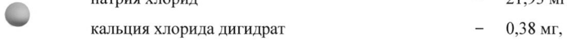
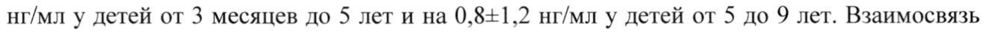

# Дорназа альфа — ингаляц

- Препарат: Тигераза® (раствор для ингаляций;)
- АТХ: R05CB13
- Источник: ГРЛС, инструкция по медицинскому применению, РУ ЛП-005537, файл от 2023-02-09 (https://grls.rosminzdrav.ru/Grls_View_v2.aspx?routingGuid=a254166a-8324-4d49-bb7d-dd9516bf0464)
- Распознано автоматически (OCR): 8 из 8 стр.
- Инструкция к другому РУ того же препарата: ЛП-005537 (национальное РУ, переоформленное по правилам ЕАЭС, решение от 01.02.2023). Текст может быть старше действующего
- Сомнительных строк после OCR: 2 (см. раздел «Проверка распознавания»)

## Общие сведения

МИНИСТЕРСТВО ЗДРАВООХРАНЕНИЯ РОССИЙСКОЙ ФЕДЕРАЦИИ
ИНСТРУКЦИЯ ПО МЕДИЦИНСКОМУ ПРИМЕНЕНИЮ ЛЕКАРСТВЕННОГО ПРЕПАРАТА
Тигераза® Регистрационный номер:
Торговое наименование: Тигераза® МНН: дорназа альфа

## 3. Лекарственная форма

раствор для ингаляций.
раствор для ингаляций.

## 2. Состав

1 ампула полимерная (2,5 мл) содержит действующее вещество:
1 ампула полимерная (2,5 мл) содержит действующее вещество:
дорназа альфа (rDnz-a)* - 2,5 mr вспомогательные вещества:
| натрия хлорид - 21,93 mr, - кальция хлорида дигидрат — 0,38 мг, вода для инъекций - дД02,5 мл
* [ мг дорназы альфа соответствует 1000 ЕД.
Описание: прозрачный бесцветный или желтоватого цвета раствор.
© Фармакотерапевтическая группа: отхаркивающее муколитическое средство.
Код ATX: [ROSCB13] Фармакологические свойства
Фармакодинамика и механизм действия Дорназа альфа (рекомбинантная человеческая дезоксирибонуклеаза | — ДНаза) — генноинженерный вариант человеческого природного фермента, который расщепляет внеклеwo точную ДНК.
Накопление вязкого гнойного секрета в дыхательных путях играет роль в нарушении функции внешнего дыхания и в обострениях инфекционного процесса у больных муковисцидозом. Гнойный секрет содержит очень высокие концентрации внеклеточной
ДНК - вязкого полианиона, высвобождающегося из разрушающихся лейкоцитов, которые накапливаются в ответ на инфекцию. /и vitro дорназа альфа гидролизирует ДНК в мокроте и выраженно уменьшает вязкость мокроты при муковисцидозе.

## 5.2. Фармакокинетика

Всасывание. Системное всасывание дорназы альфа после ингаляции аэрозоля у человека невысоко.
Всасывание. Системное всасывание дорназы альфа после ингаляции аэрозоля у человека невысоко.
стр | из 8 В норме ДНаза присутствует в сыворотке крови человека. Ингаляции дорназы альфа в дозах до 40 мг на протяжении 6 дней не приводили к достоверному увеличению концентрации ДНазы в сыворотке крови по сравнению с нормальными эндогенными уровнями. Сывороточная концентрация ДНазы не превышала 10 нг/мл. После назначения дорназы альфа по 2500 ЕД (2,5 мг) два раза в сутки на протяжении 24 недель средние сывороточные концентрации ДНазы не отличались от средних показателей до лечения
(3,5=0,1 нг/мл), что свидетельствует о низком системном всасывании или малой кумуляции.
Распределение. У больных муковисцидозом средняя концентрация дорназы альфа в мокроте через 15 минут после ингаляции препарата в дозе 2500 ЕД (2,5 мг) равняется примерно 3,0 мкг/мл. После ингаляции концентрация дорназы альфа в мокроте быстро уменьшается.
© Метаболизм. Ожидается, что дорназа альфа метаболизируется под действием протеаз, присутствующих в биологических жидкостях.
Выведение. После внутривенного введения дорназы альфа период полувыведения из сыворотки крови составляет 3-4 часа.
В течение 2 часов значение концентрации ДНазы в мокроте снижается более чем в два раза по сравнению со значением сразу после ингаляции, однако действие на реологию
© мокроты сохраняется более 12 часов.
Фармакокинетика у особых групп пациентов
Пациенты в возрасте от 3 месяцев до 9 лет
Дорназа альфа применялась у детей, больных муковисцидозом, в возрасте от 3 месяцев до 9 лет в дозе 2,5 мг в виде ингаляций 1 раз в сутки в течение 2 недель. В период 90 минут
- после первой ингаляции проводился бронхоальвеолярный лаваж (БАЛ). Концентрация
-
ДНазы в жидкости БАЛ достигла детектируемого уровня у всех пациентов, но варьировала в широком диапазоне от 0,007 до 1,8 мкг/мл.
После применения дорназы альфа в течение в среднем 14 дней концентрация ДНазы в сыворотке крови (среднее значение + стандартное отклонение) повышалась Ha 1,1+1,6 нг/мл у детей от 3 месяцев до 5 лет и на 0,8-1,2 нг/мл у детей от 5 до 9 лет. Взаимосвязь величины концентрации ДНазы в сыворотке или в жидкости БАЛ с развитием нежелательных реакций или эффективностью терапии не установлена.

## 4.1. Показания к применению

Симптоматическая терапия в комбинации со стандартной терапией муковисцидоза у пациентов со значением форсированной жизненной емкости легких (ФЖЕЛ) не менее 40 % от нормы с целью улучшения функции легких.
Симптоматическая терапия в комбинации со стандартной терапией муковисцидоза у пациентов со значением форсированной жизненной емкости легких (ФЖЕЛ) не менее 40 % от нормы с целью улучшения функции легких.

## 4.3. Противопоказания

Повышенная чувствительность к действующему веществу препарата или его компонентам.
Повышенная чувствительность к действующему веществу препарата или его компонентам.

## 4.3. С осторожностью

Беременность, период грудного вскармливания. Дети до 5 лет.
Беременность, период грудного вскармливания. Дети до 5 лет.

## 4.6. Применение при беременности и в период грудного вскармливания

Беременность Безопасность применения дорназы альфа при беременности не установлена.
Исследования дорназы альфа не свидетельствовали о нарушении фертильности, тератогенности или влиянии препарата на развитие плода у животных. Препарат
Тигераза® следует назначать при беременности с осторожностью и только в том случае, если польза для матери превышает потенциальный риск для плода.
© Период грудного вскармливания Учитывая минимальное системное всасывание дорназы альфа при соблюдении рекомендованного режима дозирования, появления измеряемых концентраций дорназы альфа в грудном молоке у женщин ожидать не следует. Назначать препарат Тигераза® кормящим матерям следует с осторожностью. У лактирующих яванских макак, получавших высокие дозы дорназы альфа внутривенно (в/в), были обнаружены низкие
& концентрации дорназы альфа в материнском молоке (< 0,1 % от сывороточных концентраций).

## 4.2. Способ применения и дозы

Раствор в ампулах предназначен только для разового ингаляционного применения.
Раствор в ампулах предназначен только для разового ингаляционного применения.
Препарат Тигераза” нельзя разводить или смешивать с другими препаратами или растворами в емкости небулайзера. Смешивание препарата с другими лекарственными
- средствами может привести к нежелательным структурным и/или функциональным изменениям препарата Тигераза® или другого компонента смеси.
2,5 мг дорназы альфа (соответствует содержимому 1 ампулы — 2,5 мл неразведенного раствора, 2500 ЕД) один раз в сутки, ингаляционно, без разведения, с помощью джетнебулайзера (см. раздел «Правила проведения ингаляции»).
У некоторых пациентов старше 21 года лучшего эффекта лечения можно добиться при применении суточной дозы препарата 2 раза в сутки. У большинства пациентов оптимального эффекта удается достичь при постоянном ежедневном применении дорназы альфа. Исследования, в которых дорназу альфа назначали в прерывистом режиме, показывают, что после прекращения терапии улучшение функции легких исчезает.
Следовательно, пациентам следует рекомендовать ежедневное применение препарата без перерыва.
Пациентам следует продолжать комплексную терапию, включая физиотерапию грудной клетки.
При обострении инфекции дыхательных путей на фоне лечения препаратом Тигераза® ero применение можно продолжать без какого-либо риска для больного.
Правила проведения ингаляции Препарат Тигераза® можно вводить с помощью джет-небулайзера с компрессором многоразового использования, кроме ультразвуковых, поскольку они могут инактивировать действующее вещество препарата или не обеспечить необходимой степени распыления жидкости.
1. Тщательно моют руки перед проведением нижеописанных процедур.
© 2. В соответствии с инструкцией фирмы-изготовителя собирают небулайзер, присоединяют мундштук или респираторную маску.
3. Вскрывают ампулу полимерную, обрезая ножницами верхнюю часть капилляра, содержимое переливают в специальную емкость небулайзера.
4. Вставляют в рот мундштук, зажимают его зубами, плотно сомкнув губы.
Пациенты, которым трудно дышать ртом в течение всего времени ингаляции, могут
© использовать респираторную маску.
Надевают респираторную маску, плотно прижимая ее к лицу.
5. Включают компрессор.
6. Начинают дышать глубоко и ровно, задерживая дыхание на две секунды после вдоха, выдыхают через нос.
© 7. Ингаляционную процедуру продолжают до использования всего препарата (начало прерывистой подачи аэрозоля).
8. Выключают компрессор.
9. Полощут рот кипяченой водой. При использовании респираторной маски промывают глаза и лицо водой.
10. Разбирают небулайзер.
11. Промывают и высушивают детали системы, в соответствии с инструкцией фирмыизготовителя.
12. Пациент должен соблюдать инструкции фирмы-изготовителя по эксплуатации и уходу за небулайзером.
Предупреждения e Перед первым использованием производят дезинфекцию и проверку правильности работы небулайзера, в соответствии с инструкцией фирмы-изготовителя.

e Перед процедурой запрещается: принимать отхаркивающие препараты, полоскать рот антисептическим раствором (перманганат калия, перекись водорода, борная кислота).

e До и после ингаляции не рекомендуется курить в течение 1 часа.

® Ингаляцию проводят сидя, при прямом положении спины, в одежде, He мешающей и не затрудняющей дыхание.

e При возникновении головокружения следует прервать ингаляционную процедуру.

## 4.8. Побочное действие

Нежелательные реакции при лечении дорназой альфа возникают редко (<1/1000), в большинстве случаев слабо выражены, носят преходящий характер и не требуют коррекции
Нежелательные реакции при лечении дорназой альфа возникают редко (<1/1000), в большинстве случаев слабо выражены, носят преходящий характер и не требуют коррекции
& дозы.
Нарушения со стороны органа зрения: конъюнктивит.
Нарушения со стороны дыхательной системы, органов грудной клетки и средостения:
изменение голоса, одышка, фарингит, ларингит, ринит (все неинфекционной природы), инфекции дыхательных путей, в том числе вызванные Pseudomonas, увеличение бронхиального секрета.
be Нарушения co стороны желудочно-кишечного тракта: диспепсия.
Нарушения со стороны кожи и подкожных тканей: сыпь, крапивница.
Общие расстройства: боль в груди (плевральная/некардиогенная), пирексия, головная боль.
Влияние на результаты лабораторных и инструментальных исследований: снижение
© показателей функции дыхания.
Пациенты, у которых возникают нежелательные явления, совпадающие с симптомами муковисцидоза, могут, как правило, продолжать применение дорназы альфа.
Нежелательные явления, приведшие к полному прекращению лечения дорназой альфа, наблюдались у очень небольшого числа пациентов, а частота прерывания терапии была сходной с назначением плацебо (2 %) и дорназы альфа (3 %).
Антитела к дорназе альфа были обнаружены менее чем у 5 % пациентов, однако ни у одного из них они не относились к классу IgE. Улучшение показателей функции легких отмечалось даже после появления антител к дорназе альфа.
В клиническом исследовании у 50 пациентов, получавших препарат Тигераза®, не было обнаружено статистически значимых различий с референтным препаратом по частоте образования антител классов IgG и IgM; так же, как и у референтного препарата, не выявлены антитела, относящиеся к классу IgE.
Пациенты в возрасте от 3 месяцев до 9 лет
Безопасность ингаляции 2,5 мг дорназы альфа 1 раз в сутки в течение 2 недель сравнивали у детей, больных муковисцидозом, в двух возрастных группах — от 3 месяцев до <5 лет и от 5 до 9 лет. Нежелательные явления были аналогичны тем, что наблюдались в других клинических исследованиях с участием детей. В младшей группе пациентов по сравнению с детьми старшего возраста чаще наблюдался кашель (как побочное действие) (45 % и 30 %, соответственно), в том числе тяжелой и средней степени тяжести (37 % и 18 %, соответственно). Остальные нежелательные реакции были легкой или средней степеней тяжести. Также в младшей группе пациентов чаще, чем в старшей группе, наблюдались ринит (35 % против 27 %) и сыпь (6 % против 0 %).
© Передозировка Случаи передозировки дорназы альфа не зарегистрированы. Пациенты с муковисцидозом получали 20 мг дорназы альфа ингаляционно два раза в день (что превышает рекомендуемую ежедневную дозу в 16 раз) в течение 6 дней или 10 мг два раза в день (что превышает рекомендуемую ежедневную дозу в 8 раз) по прерывистой схеме (2 недели терапии дорназой альфа с последующим 2-недельным периодом без терапии) в течение
& 168 дней. Шесть взрослых пациентов, не больных муковисцидозом, получали дорназу альфа внутривенно, однократно, в дозе 125 мкг/кг массы тела, а затем через 7 дней эти же пациенты получали по 125 мкг/кг дорназы альфа в виде подкожной инъекции в течение двух последовательных 5-дневных периодов. При этом не наблюдалось образования нейтрализующих антител к ДНазе и изменений концентрации антител к двухцепочечной
ДНК в сыворотке крови. Все перечисленные выше режимы дозирования переносились
- хорошо.
Системная токсичность дорназы альфа не выявлена и не является ожидаемой из-за низкой степени всасывания и короткого периода полувыведения дорназы альфа. Таким образом, в случае передозировки дорназы альфа системная терапия не требуется.

## 4.5. Взаимодействие с другими лекарственными средствами

Совместим со стандартными препаратами для лечения муковисцидоза: антибиотиками, бронхолитиками, пищеварительными ферментами, витаминами, ингаляционными и системными глюкокортикостероидами и анальгетиками.
Препарат Тигераза® представляет собой водный раствор без буферных свойств и не должен разводиться или смешиваться с другими препаратами или растворами в емкости небулайзера. Смешивание препарата с другими лекарственными средствами может привести к нежелательным структурным и/или функциональным изменениям препарата
Тигераза® или другого компонента смеси.

## 4.4. Особые указания

При терапии препаратом Тигераза® необходимо продолжать регулярное медицинское наблюдение пациента и стандартную физиотерапию.
При терапии препаратом Тигераза® необходимо продолжать регулярное медицинское наблюдение пациента и стандартную физиотерапию.
После начала терапии препаратом Тигераза®, как и любым аэрозолем, функция легких может несколько снизиться, а отхождение мокроты возрасти.
Опыт применения дорназы альфа у детей в возрасте до 5 лет ограничен. Эффективность дорназы альфа у детей в возрасте до 5 лет не изучалась.
Назначать дорназу альфа детям в возрасте до 5 лет следует только в случае возможного улучшения функции легких или снижения риска возникновения инфекций дыхательных путей.
© Эффективность и безопасность дорназы альфа у пациентов с ФЖЕЛ менее 40 % от нормы не установлены.
Допускается однократное воздействие повышенной температуры (не выше 25 °С) не более 3 суток при хранении в защищенном от света месте.

## 4.7. Влияние на способность управлять транспортными средствами, механизмами

О влиянии дорназы альфа на способность пациентов управлять транспортными
& средствами и работать с механизмами сообщений не поступало.

## 6.5. Форма выпуска

По 2,5 мг/2,5 мл раствора для ингаляций в ампулы полимерные, изготовленные методом термической экструзии. 6 ампул полимерных — в светозащитном пакете из комбинированного материала (фольга алюминиевая, покрытая с двух сторон пленкой полиэтиленовой).
По 2,5 мг/2,5 мл раствора для ингаляций в ампулы полимерные, изготовленные методом термической экструзии. 6 ампул полимерных — в светозащитном пакете из комбинированного материала (фольга алюминиевая, покрытая с двух сторон пленкой полиэтиленовой).
-
Запаянный светозащитный пакет вместе с инструкцией по медицинскому применению - в пачке из картона.
Для контроля первого вскрытия клапаны пачки фиксируют самоклеящимися этикетками.

## 6.4. Условия хранения

В защищенном от света месте, при температуре от 2 до 8 °С. Не замораживать.
В защищенном от света месте, при температуре от 2 до 8 °С. Не замораживать.
Хранить в недоступном для детей месте.

## 6.3. Срок годности

2 года.
2 года.
Не использовать позже срока, указанного на упаковке.
Условия отпуска Отпускают по рецепту.
Держатель регистрационного удостоверения

АО «ГЕНЕРИУМ»

601125, Владимирская обл., Петушинский район,

пос. Вольгинский, ул. Заводская, стр. 273,

т/ф +7 (49243) 72-5-20, 72-5-14.

Производитель

АО «ГЕНЕРИУМ»

601125, Владимирская обл., Петушинский район,

пос. Вольгинский, ул. Заводская, стр. 273,

т/ф +7 (49243) 72-5-20, 72-5-14.

Фасовщик (первичная упаковка)

ФГУП «Московский эндокринный завод»
© 109052, г. Москва, ул. Новохохловская, д. 25, стр. 1, стр. 2.

Упаковщик (вторичная /потребительская упаковка)

АО «ГЕНЕРИУМ»

601125, Владимирская обл., Петушинский район,

пос. Вольгинский, ул. Заводская, стр. 263,

т/ф +7 (49243) 72-5-20, 72-5-14.
& Выпускающий контроль качества

АО «ГЕНЕРИУМ»

601125, Владимирская обл., Петушинский район,

пос. Вольгинский, ул. Заводская, стр. 273,

т/ф +7 (49243) 72-5-20, 72-5-14.

Организация, принимающая претензии от потребителей
© AO «ГЕНЕРИУМ»

601125, Владимирская обл., Петушинский район,

пос. Вольгинский, ул. Заводская, стр. 273,

т/ф +7 (49243) 72-5-20, 72-5-14.

р Представитель / | АО «ГЕНЕРИУМ» | р Рябцева С. М.
## Проверка распознавания

Страницы-сканы распознаны автоматически. В 2 строках с дозировками цифры могли распознаться с ошибкой — сверьте с вырезкой из оригинала:

- стр. 1: «- кальция хлорида дигидрат — 0,38 мг,» — повторное чтение: «- алия  лорида дигидрат - аб»  
  
- стр. 2: «нг/мл у детей от 3 месяцев до 5 лет и на 0,8-1,2 нг/мл у детей от 5 до 9 лет. Взаимосвязь» — низкая уверенность: «0,8-1,2» (71)  
  
