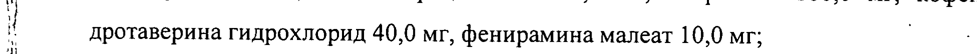
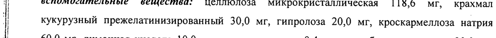
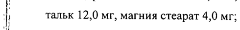
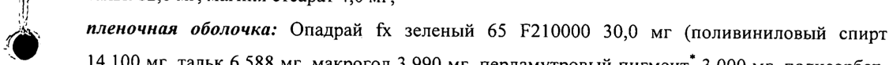
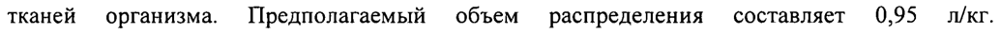

# Дротаверин + Кофеин + Напроксен + Парацетамол + Фенирамин — внутрь

- Препарат: СПАЗМАЛГОН® ЭФФЕКТ (таблетки, покрытые пленочной оболочкой;)
- АТХ: N02BE71
- Источник: ГРЛС, инструкция по медицинскому применению, РУ ЛП-003690, файл от 2023-01-16 (https://grls.rosminzdrav.ru/Grls_View_v2.aspx?routingGuid=3817a98b-ead4-4510-897c-b5492bf13efb)
- Распознано автоматически (OCR): 9 из 9 стр.
- Инструкция к другому РУ того же препарата: ЛП-003690 (срок действия истёк, решение от 30.12.2022). Текст может быть старше действующего
- Сомнительных строк после OCR: 6 (см. раздел «Проверка распознавания»)

## Общие сведения

МИНИСТЕРСТВО ЗДРАВООХРАНЕНИЯ POCCHHGK Ob PEAR AM
| ЛП - 003690 - 200616
7 СОГЛАСОВАНО |
ИНСТРУКЦИЯ по применению лекарственного препарата для медицинского применения
СПАЗМАЛГОН® ЭФФЕКТ Регистрационный номер:
Торговое название препарата: СПАЗМАЛГОН® ЭФФЕКТ
МНН или группировочное название: дротаверин + кофеин + напроксен + парацетамол + к 7 фенирамин
И Лекарственная форма: таблетки, покрытые пленочной оболочкой
| | Состав i 1 таблетка, покрытая пленочной оболочкой, содержит:
| действующие вещества: парацетамол 325,0 мг, напроксен 100,0 мг, кофеин 50,0 мг,
| дротаверина гидрохлорид 40,0 мг, фенирамина малеат 10,0 мг; | :
| вспомогательные вещества: целлюлоза микрокристаллическая 118,6 мг, крахмал
| кукурузный прежелатинизированный 30,0 мг, гипролоза 20,0 мг, кроскармеллоза натрия
Hi 60,0 мг, лимонная кислота 10,0 мг, динатрия эдетат 0,4 мг, аскорбиновая кислота 20,0 мг,
| тальк 12,0 мг, магния стеарат 4,0 мг;
® пленочная оболочка: Опадрай fx зеленый 65 F210000 30,0 мг (поливиниловый спирт ь 14,100 мг, тальк 6,588 мг, макрогол 3,990 мг, перламутровый пигмент” 3,000 мг, полисорбат- | 80 0,810 мг, титана диоксид 0,750 мг, алюминиевый лак на основе красителя индигокармин | 0,507 мг, алюминиевый лак на основе красителя хинолиновый желтый 0,255 мг). | у Перламутровый пигмент состоит из слюды и содержит 69-75% алюмосиликата калия (Е555) и 2531% титана диоксида (El п”).
| ОПИСАНИЕ Продолговатые, двояковыпуклые таблетки, покрытые пленочной оболочкой, зеленого цвета с риской с одной стороны. |
| | | | о | | | ФАРМАКОТЕРАПЕВТИЧЕСКАЯ ГРУППА
Анальгезирующее средство (анальгезирующее ненаркотическое средство + нестероидный | противовоспалительный препарат + психостимулирующее средство + спазмолитическое .
средство + Н!-гистаминовых рецепторов блокатор)
| Код ATX: №02ВЕ71 | ФАРМАКОЛОГИЧЕСКИЕ СВОЙСТВА

## 5.1. Фармакодинамика

Комбинированный препарат, оказывает анальгезирующее, противовоспалительное, спазмолитическое, жаропонижающее действие.
Комбинированный препарат, оказывает анальгезирующее, противовоспалительное, спазмолитическое, жаропонижающее действие.
| Парацетамол — ненаркотический анальгетик, оказывает жаропонижающее и обезболивающее
| действие, обусловленное блокадой циклооксигеназы (ЦОГ) в центральной нервной системе
(ЦНС) и воздействием на центры боли и терморегуляции.
Напроксен -— нестероидный противовоспалительный препарат (НПВП), оказывает
| противовоспалительное, анальгезирующее и жаропонижающее действие, связанное с неселективным подавлением активности ЦОГ, регулирующей синтез простагландинов.
| Кофеин — вызывает расширение кровеносных сосудов скелетных мышц, сердца, почек;
повышает умственную и физическую работоспособность, способствует устранению утомления и сонливости; увеличивает проницаемость гистогематических барьеров и
| повышает биодоступность ненаркотических анальгетиков, способствуя тем самым усилению
| терапевтического эффекта. Оказывает тонизирующее действие на сосуды головного мозга.
| Дротаверин — оказывает миотропное спазмолитическое действие, обусловленное
> ингибированием фосфодиэстеразы IV, действует на гладкие мышцы желудочно-кишечного тракта (ЖКТ), желчевыводящих путей, мочеполовой системы, сосудов.
Фенирамин — Н!-гистаминовых рецепторов блокатор. Оказывает спазмолитическое и легкое седативное действие, уменьшает явления экссудации, а также усиливает анальгезирующее
| действие парацетамола и напроксена.

## 5.2. Фармакокинетика

| Парацетамол Характеризуется высокой и быстрой абсорбцией из ЖКТ, преимущественно в тонком кишечнике. Время достижения максимальной концентрации в плазме крови (TCiax) — 0,5-1,5 часа после приема внутрь. Максимальная концентрация в плазме крови (Cmax) - 5-20 мкг/мл. Связь с белками плазмы незначительная - 15%. Парацетамол равномерно
| Парацетамол Характеризуется высокой и быстрой абсорбцией из ЖКТ, преимущественно в тонком кишечнике. Время достижения максимальной концентрации в плазме крови (TCiax) — 0,5-1,5 часа после приема внутрь. Максимальная концентрация в плазме крови (Cmax) - 5-20 мкг/мл. Связь с белками плазмы незначительная - 15%. Парацетамол равномерно
_ . Be распределяется и проникает через гематоэнцефалический барьер, а также в большинство тканей организма. Предполагаемый объем распределения составляет 0,95 л/кг.
Метаболизируется в печени (90-95%): 80% вступает в реакции конъюгации с глюкуроновой кислотой и сульфатами с образованием неактивных метаболитов; 17% подвергается гидроксилированию с образованием 8 активных метаболитов, которые конъюгируют с глутатионом с образованием уже неактивных метаболитов. При недостатке глутатиона эти метаболиты могут блокировать ферментные системы гепатоцитов и вызывать их некроз. В метаболизме препарата также участвует изофермент СУР2Е1. Период полувыведения (Т!/2) —
| 1,5-2,5 часа. Выводится почками в виде метаболитов, преимущественно конъюгатов, только 3% в неизмененном виде. У пожилых пациентов снижается клиренс препарата и увеличивается Т!/2.
Напроксен | Абсорбция из ЖКТ напроксена быстрая и полная. Биодоступность - 95%. Прием пищи практически не влияет ни на полноту, ни на скорость всасывания. TCmax - 1-2 часа.
| | Связывание с белками плазмы — более 99%. Равновесная концентрация достигается к приему
‚| 4-5 доз препарата (2-3 дня). Метаболизируется в печени до диметилнапроксена с участием
| изофермента CYP2C9. Тур - 12-15 часов. Клиренс — 0,13 мл/мин/кг. Выводится почками
| (98%), 10% из которых - в неизмененном виде; с желчью выводится 0,5-2,5% принятой дозы.
| При почечной недостаточности возможна кумуляция метаболитов.
‚| Кофеин ‹ : Кофеин, входящий в состав препарата, почти полностью и быстро всасывается, максимальная д концентрация в плазме крови достигается через 1 час. Быстро проходит через гематоэнцефалический и плацентарный барьеры, поступает в грудное молоко, выводится (в
|| т.ч. в виде метаболитов) в основном почками около 65-80%. Основные метаболиты —
‚| 1-метилксантин, 1-метилмочевая кислота и ацетилированные производные урацила, небольшое количество кофеина превращается в теофиллин и теобромин. Тиз — 3,5 часа.
Дротаверин j При пероральном приеме абсорбция дротаверина высокая и быстрая. Биодоступность — 100%. После пресистемного метаболизма в системный кровоток поступает 65% принятой дозы дротаверина. Время достижения Cmax в крови — 45-60 минут. Связывание с белками плазмы — 95-97%, преимущественно с альбумином, гамма- и бета-глобулинами, а также
‚® | Липопротеинами высокой плотности. Равномерно распределяется в тканях, проникает в гладкомышечные клетки. Не проникает через гематоэнцефалический барьер. Дротаверин
Hy | : | О ООО | | и/или его метаболиты могут незначительно проникать через плацентарный барьер. Тир - 8-10 часов. Почти полностью метаболизируется в печени путем О-дезэтилирования.
| Метаболиты быстро конъюгируют с глюкуроновой кислотой. Главный метаболит - 4’- дезэтилдротаверин, другие метаболиты — 6-дезэтилдротаверин и 4’-дезэтилдротавералдин.
| Tin - 8-10 часов. За 72 часа практически полностью выводится из организма. В основном
| (более 50% дротаверина) выводится почками, преимущественно в виде метаболитов, в меньшей степени (около 30%) — с желчью. Неизмененный дротаверин в моче не обнаруживается. |
Фенирамин ` Максимальная концентрация фенирамина в плазме крови достигается примерно через ys 1-2,5 часа. Tin — 16-19 часов. 70-83% принятой дозы выводится из организма через почки в
_ } виде метаболитов или в неизмененном виде.

## 4.1. Показания к применению

- болевой синдром различного генеза, включая боли в суставах, мышцах; при радикулите, альгодисменорее (менструальных болях), невралгиях, зубной боли, головной боли (в том числе при головной боли, обусловленной спазмом сосудов головного мозга);
- болевой синдром различного генеза, включая боли в суставах, мышцах; при радикулите, альгодисменорее (менструальных болях), невралгиях, зубной боли, головной боли (в том числе при головной боли, обусловленной спазмом сосудов головного мозга);
- болевой синдром, связанный со спазмом гладкой мускулатуры, в том числе при
| хроническом холецистите, желчекаменной болезни, постхолецистэктомическом синдроме, почечной колике;
- посттравматический и послеоперационный болевой синдром, в том числе сопровождающийся воспалением;
- простудные заболевания, сопровождающиеся лихорадочным синдромом (в качестве симптоматической терапии).
| ПРОТИВОПОКАЗАНИЯ | - повышенная чувствительность к компонентам препарата;
- эрозивно-язвенные поражения ЖКТ(В фазе обострения); `
- желудочно-кишечное кровотечение;
| | - полное или неполное сочетание бронхиальной астмы, рецидивирующего полипоза носа и
| околоносовых пазух и непереносимости ацетилсалициловой кислоты или других НПВП (в
| том числе в анамнезе);
- Тяжелая печеночная недостаточность; |
| | - тяжелая почечная недостаточность;
| - угнетение костномозгового кроветворения;
| - состояние после проведения аортокоронарного шунтирования;
| - тяжелые органические заболевания сердечно-сосудистой системы (в том числе острый инфаркт миокарда);
| - Пароксизмальная тахикардия;
- частая желудочковая экстрасистолия;
- тяжелая артериальная гипертензия; |
- гиперкалиемия;
| - беременность и период грудного вскармливания;
- детский и подростковый возраст до 18 лет.
_ С ОСТОРОЖНОСТЬЮ С осторожностью следует применять препарат у пациентов с цереброваскулярными заболеваниями, сахарным диабетом, заболеваниями периферических артерий, язвенными поражениями ЖКТ в анамнезе, при почечной и печеночной недостаточности легкой или средней степени тяжести, вирусном гепатите, алкогольном поражении печени,
| доброкачественной гипербилирубинемии (синдромы Жильбера, Дубина-Джонсона и Ротора), эпилепсии, при склонности к судорожным припадкам, дефиците глюкозо-6- |
| фосфатдегидрогеназы, у пациентов пожилого возраста. |
При наличии любого из перечисленных заболеваний/состояний пациент перед применением препарата должен обраться за консультацией к врачу.

## 4.6. Применение при беременности и в период грудного вскармливания

| ВСКАРМЛИВАНИЯ Противопоказано применение препарата при беременности и в период грудного вскармливания. ,
/ СПОСОБ ПРИМЕНЕНИЯ И ДОЗЫ Препарат принимают внутрь по 1 таблетке 1-3 раза в день. Максимальная суточная доза - 4 таблетки.
| ОНИ a Длительность лечения составляет ‘не более 3 дней в качестве жаропонижающего средства и не более 5 дней - в качестве обезболивающего. Продолжение лечения препаратом возможно только после консультации с врачом.
Не следует превышать указанные дозы препарата!

## 4.8. Побочное действие

Аллергические реакции: кожная сыпь, зуд, крапивница, ангионевротический отек.
Аллергические реакции: кожная сыпь, зуд, крапивница, ангионевротический отек.
Со стороны органов кроветворения: тромбоцитопения, лейкопения, агранулоцитоз, анемия, метгемоглобинемия.
Со стороны ЦНС: возбуждение, тревожность, усиление рефлексов, тремор, головная боль, |
| нарушения сна, головокружение, снижение концентрации внимания.
Со стороны сердечно-сосудистой системы: ощущение сердцебиения, аритмии, повышение артериального давления (АД).
Со стороны пищеварительной системы: эрозивно-язвенные поражения ЖКТ, тошнота, рвота, дискомфорт в эпигастрии, боли в животе, запор, нарушение функции печени.
| Co стороны мочевыделительной системы: нарушение функции почек.
| Со стороны органов чувств: снижение слуха, шум в ушах, повышение внутриглазного
| давления у пациентов с закрытоугольной глаукомой.
Прочие: дерматит, тахипноэ (учащение дыхания).
Если любые указанные побочные эффекты усугубляются, или пациент отмечает какие-либо
| | другие побочные эффекты, не указанные в инструкции, он должен сообщить об этом врачу.

## 4.9. Передозировка

Симптомы: бледность кожных покровов, анорексия (отсутствие аппетита), боль в животе,
Симптомы: бледность кожных покровов, анорексия (отсутствие аппетита), боль в животе,
| тошнота, рвота, желудочно-кишечное кровотечение, возбуждение, двигательное беспокойство, спутанность сознания, тахикардия, аритмия, гипертермия (повышение температуры тела), учащенное мочеиспускание, головная боль, тремор или мышечные
| подергивания; пилелтические припадки, повышение активности «печеночных» трансаминаз,
| гепатонекроз, увеличение протромбинового времени.
Симптомы нарушения функции печени могут появиться через 12-48 ч после передозировки.
| При тяжелой передозировке развивается печеночная недостаточность с прогрессирующей | энцефалопатией, кома, смерть; острая почечная недостаточность с тубулярным некрозом; |
| у | | аритмия, панкреатит. При подозрёнии на передозировку необходимо немедленно обратиться за медицинской помощью к врачу.
Лечение: промывание желудка с последующим приемом активированного угля.
Специфическим антидотом при отравлении парацетамолом является ацетилцистеин.
Введение ацетилцистеина актуально в течение 8 ч после приема парацетамола. При желудочно-кишечном кровотечении необходимо введение антацидных средств и промывание желудка ледяным 0,9% раствором хлорида натрия; поддержание вентиляции легких и оксигенации; при эпилептических припадках - внутривенное введение диазепама; | поддержание баланса жидкости и солей в организме. |

## 4.5. Взаимодействие с другими лекарственными средствами

_ При одновременном приеме препарата СПАЗМАЛГОН® ЭФФЕКТ с барбитуратами,
| трициклическими антидепрессантами, рифампицином, алкогольсодержащими напитками
| увеличивается риск гепатотоксического действия (данных комбинаций следует избегать).
| Парацетамол усиливает действие антикоагулянтов непрямого действия и снижает
| эффективность урикозурических препаратов.
| Длительное применение барбитуратов снижает эффективность парацетамола.
| При одновременном применении парацетамола с этанолом (напитки и лекарственные
| препараты, содержащие алкоголь) повышается риск возникновения острого панкреатита.
Ингибиторы микросомального окисления (в том числе циметидин) снижают риск гепатотоксического действия парацетамола.
Дифлунисал повышает плазменную концентрацию парацетамола на 50%, что повышает риск развития гепатотоксичности.
| Напроксен способен вызывать уменьшение диуретического эффекта фуросемида, усиление эффекта непрямых антикоагулянтов, повышает токсичность сульфаниламидов и метотрексата, снижает выведение лития и повышает его концентрацию в. плазме крови. |
При совместном применений кофеина и барбитуратов, примидона, противосудорожных |
| средств (производные гидантоина, особенно фенитоин) возможно усиление метаболизма и | увеличение клиренса кофеина; при одновременном приеме кофеина и циметидина, | пероральных контрацептивных средств, дисульфирама, ципрофлоксацина, норфлоксацина - снижение метаболизма кофеина в печени (замедление его выведения и увеличение
‚ концентрации в крови). .
| 7 Одновременное употребление кофеинсодержащих напитков и других средств,
| стимулирующих ЦНС, может приводить к чрезмерной стимуляции ЦНС.

‚ При одновременном применении дротаверин может ослабить противопаркинсонический

эффект леводопы.

При одновременном применении фенирамина с транквилизаторами, снотворными средствами, ингибиторами моноаминоксидазы, алкоголем возможно усиление угнетающего влияния на ЦНС.

| ОСОБЫЕ УКАЗАНИЯ

‚ Следует избегать одновременного применения препарата СПАЗМАЛГОН® ЭФФЕКТ с

“| другими средствами, содержащими парацетамол и/или другие НПВП, в том числе со

й средствами для облегчения симптомов «простуды», гриппа и заложенности носа.

При применении препарата СПАЗМАЛГОН® ЭФФЕКТ более 5-7 дней следует контролировать показатели периферической крови и функциональное состояние печени.
Парацетамол искажает результаты лабораторных исследований содержания глюкозы и мочевой кислоты в плазме крови.

` При необходимости определения 17-кетостероидов СПАЗМАЛГОН® ЭФФЕКТ следует

| отменить за 48 ч до исследования. Следует учитывать, что напроксен увеличивает время

' кровотечения.

| Влияние кофеина на ЦНС зависит от типа нервной системы и может проявляться как возбуждением, так и торможением высшей нервной деятельности.

В период лечения пациент должен избегать употребления алкоголя.
| ВЛИЯНИЕ НА СПОСОБНОСТЬ УПРАВЛЕНИЯ ТРАНСПОРТНЫМИ СРЕДСТ_ | ВАМИИ МЕХАНИЗМАМИ
| | В отдельных случаях возможно снижение концентрации внимания и скорости
‚ психомоторных реакций, поэтому в период лечения пациент должен соблюдать осторожность при вождении автотранспорта и занятии другими потенциально опасными видами
‚ деятельности, требующими повышенной концентрации внимания и быстроты психомоторных реакций.
` | ФОРМА ВЫПУСКА Таблетки, покрытые пленочной оболочкой. По 10 таблеток в блистер из трехслойной
| | ПВХ/ПВДХ/ПВХ пленки или двухслойной ПВХ/ПВДХ пленки и алюминиевой фольги. По 1, 2 или 3 блистера вместе с инструкцией по применению в картонной пачке.

## 6.4. Условия хранения

| При температуре не выше 25 °С. Хранить в недоступном для детей месте!
| При температуре не выше 25 °С. Хранить в недоступном для детей месте!
‚ СРОК ГОДНОСТИ ‚ 2 года. Не применять по истечении срока годности.
УСЛОВИЯ ОТПУСКА ; Отпускается без рецепта.
| ПРОИЗВОДИТЕЛЬ «Балканфарма-Дупница» АД, ул. Самоковское шоссе 3, Дупница 2600, Болгария.
Претензии потребителей направлять по адресу
ООО «Актавис»
119017, г. Москва, ул. Б. Ордынка, д. 40, стр. 4
’ Тел.: (495) 644-44-14 Факс: (495) 644-44-24
ХВЕТСТВЕН i Zs? Seo Менеджер по регистрации ООО «Актавис» ky, “> Ноина С. В.
= Е | s\(AKTABHO|:
о У : ro) Ke} ) о &) | | / ONSEN | 9
## Проверка распознавания

Страницы-сканы распознаны автоматически. В 6 строках с дозировками цифры могли распознаться с ошибкой — сверьте с вырезкой из оригинала:

- стр. 1: «| дротаверина гидрохлорид 40,0 мг, фенирамина малеат 10,0 мг; | :» — повторное чтение: «|  протаверина  идрохлорид 40,0 мг, фенирамина малеат 10.0 MI; oe a»  
  
- стр. 1: «| кукурузный прежелатинизированный 30,0 мг, гипролоза 20,0 мг, кроскармеллоза натрия» — повторное чтение: «т пы ‘pone поно = | ый 30.0 1 типом 200 “ spoctenuen oa np»  
  
- стр. 1: «| тальк 12,0 мг, магния стеарат 4,0 мг;» — повторное чтение: «| тальк 12,0 мг, магния стеарат 40 мг:»  
  
- стр. 1: «® пленочная оболочка: Опадрай fx зеленый 65 F210000 30,0 мг (поливиниловый спирт» — повторное чтение: «® menownan oon: Ото © „Зеленый 63 Р2100ОО 30:0 мг (поливиниловый спирт»  
  
- стр. 1: «ь 14,100 мг, тальк 6,588 мг, макрогол 3,990 мг, перламутровый пигмент” 3,000 мг, полисорбат- |» — повторное чтение: «dt 14,100 мг, тальк 6,588 мг, макрогол 3,990 мг, перламутровый пигмент” 3,000 мг, полисорбат- |»  
  
- стр. 3: «тканей организма. Предполагаемый объем распределения составляет 0,95 л/кг.» — низкая уверенность: «0,95» (68)  
  
