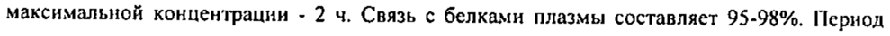
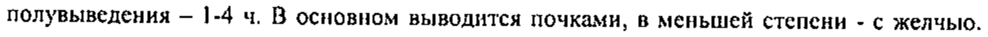

# Дротаверин + Парацетамол — внутрь

- Препарат: Но-шпа® Дуо (таблетки;)
- АТХ: N02BE51
- Источник: ГРЛС, инструкция по медицинскому применению, РУ ЛСР-000858/10, файл от 2023-01-26 (https://grls.rosminzdrav.ru/Grls_View_v2.aspx?routingGuid=a7c870a0-a6e2-4088-a6e1-3ca13aa526d5)
- Распознано автоматически (OCR): 6 из 6 стр.
- Инструкция найдена по торговому наименованию: Но-шпа® Дуо, РУ ЛСР-000858/10
- Сомнительных строк после OCR: 2 (см. раздел «Проверка распознавания»)

## Общие сведения

, JICP-000858/10-1002 10 | | . | | ИНСТРУКЦИЯ по медицинскому применению препарата
ЮНИСПАЗ?Н . Регистрационный номер:
. Торговое название препарата: ЮНИСПАЗ®Н .:
Группировочное название: Дротаверин + Парацетамол
_ Лекарственная форма: таблетки | | Состав о 1 таблетка содержит:
Активные вещества:
Дротаверина гидрохлорид.......................40,0 мг
Парацетамол........ cece cecececeeeeeeeeeeeeseee ees ee S00 MP
Вспомогательные вещества: крахмал кукурузный, крахмал прежелатинизированный, краситель хинолиновый жёлтый, карбоксиметилкрахмал натрия, магния стеарат, тальк, целлюлоза микрокристаллическая.
Описание | Желтые, продолговатые таблетки с риской с одной стороны, |
. .
Фармакотерапевтическая група © Анальгезирующее средство комбинированное (анальгезирующее ненаркотическое
| . средство + спазмолитическое средство). .
i ATX [NO2BE51] Фармакологические свойства
| , Фармакодинамика о , Комбинированный препарат, действие которого обусловлено входящими в его состав
| компонентами.
Дротаверин - производное изохинолина, обладающее спазмолитическим действием в
| . отношении гладкой мускулатуры (ингибирование фермента фосфодиэстеразы 1V,
| . .
. 50932 , JICP-000858/10-100210 | увеличение концентрации цАМФ, который, инактивируя фермент = миозинкиназу, приводит к расслаблению гладкой мускулатуры). Дротаверин также обладает слабым ингибирующим действием на кальмодулин-зависимые кальциевые каналы. Независимо от типа вегетативной иннервации, дротаверин эффективен при спазмах гладкой мускулатуры. Он действует на гладкие мышцы, находящиеся в сосудистой, желудочнокишечной, желчевыводящей и урогенитальной системах (содержание фосфодиэстеразы [У
| в различных тканях различно). :
Парацетамол оказывает анальгетическое и жаропонижающее действие преимущественно путем ингибирования синтеза простагландинов в центральной нервной системе. В воспаленных тканях клеточные пероксидазы нейтрализуют действие парацетамола, что объясняет практически полное отсутствие противовоспалительного эффекта. Отсутствие о блокирующего влияния на синтез Pg в периферических тканях обуславливает отсутствие у парацетамола отрицательного влияния на водно-солевой обмен (задержка натрия н воды} и слизистую оболочку желудочно-кишечного тракта.

## 5.2. Фармакокинетика

Парацетамол быстро всасывается в желудочно-кишечном тракте и распределяется в большинство органов и тканей. Абсорбция - высокая, время достижения максимальной концентрации достигается через 0.5-2 ч; максимальная концентрация - 5-20 мкг/мл. Связь с белками плазмы - 15%. Проникает через гематоэнцефалический барьер. Менее 1% от принятой кормящей матерью дозы парацетамола проникает в грудное молоко.
Парацетамол быстро всасывается в желудочно-кишечном тракте и распределяется в большинство органов и тканей. Абсорбция - высокая, время достижения максимальной концентрации достигается через 0.5-2 ч; максимальная концентрация - 5-20 мкг/мл. Связь с белками плазмы - 15%. Проникает через гематоэнцефалический барьер. Менее 1% от принятой кормящей матерью дозы парацетамола проникает в грудное молоко.
Метаболизируется в печени (90-95%): 80% вступает в реакции копыюгации с о глюкуроновой кислотой и сульфатами с образованием неактивных метаболитов; 17% подвергается гидроксилированию с образованием 8 активных метаболитов, которые | конъюгируют с глутатионом с образованием уже неактивных метаболитов. При недостатке глутатиона эти метаболиты могут блокировать ферментные системы гепатоцитов н вызывать их некроз. В метаболизме препарата также участвует изофермент
CYP2Ei. Период полувыведения - 1-4 4. Выводится почками в виде метаболитов,
| преимущественно конъюгатов, только 3% - в неизмененном виде. У пожилых больных
| снижается клиренс препарата и увеличивается период полувыведения
Дротаверин при приеме внутрь быстро и практически полностью всасывается, абсорбция
- высокая, период полуабсорбции - 12 мин. Биодоступность - 100%. Равномерно распределяется в тканях, проникает в.гладкомышечные клетки. Время достижения
| 50932 * ET JICP-000858/10-100210 максимальной концентрации - 2 4. Связь с белками плазмы составляет 95-98%, Период полувыведения — |-4 ч. В основном выводится почками, в меньшей степени - с желчыо.
Не проникает через гематоэнцефалический барьер.

## 4.1. Показания к применению

Болевой синдром слабой и умеренной интенсивности (зубная и головная боль, боли в суставах, мышцах, невралгия, альгодисменорея), обусловленный, в том числе и спазмами гладкой мускулатуры внутренних органов (почечная колика, желчная колика, дискинезия желчевыводящих путей и желчного пузыря по гиперкинетическому типу, кишечная колика, спастические запоры, спастический колит, тенезмы).
Болевой синдром слабой и умеренной интенсивности (зубная и головная боль, боли в суставах, мышцах, невралгия, альгодисменорея), обусловленный, в том числе и спазмами гладкой мускулатуры внутренних органов (почечная колика, желчная колика, дискинезия желчевыводящих путей и желчного пузыря по гиперкинетическому типу, кишечная колика, спастические запоры, спастический колит, тенезмы).
о Противопоказания Гиперчувствительность; тяжелая почечная и печеночная недостаточность; тяжелая хроническая сердечная недостаточность (П-ГУ функциональный класс по классификации
NYHA), атриовентрикулярная блокада П-Ш степени, кардиогенный шок; дыхательная недостаточность, бронхиальная астма; хронический алкоголизм; заболевания крови
(тромбоцитопения, лейкопения, агранулоцитоз}; дефицит глюкозо-б-фосфатдегидрогеназы; внутричерепная гипертензия; применение одновременно других препаратов, содержащих парацетамол; лечение ингибиторами моноаминооксидазы (и в течение еще 14 дней после их отмены); беременность и период лактации; детский возраст до 6 лет.
С осторожностью назначают больным с доброкачественной гипербилирубинемией
(синдром Жильбера), больным с атриовентрикулярной блокадой | степени, а также лицам
@) пожилого возраста. | Способ применения и дозы
Внутрь, с большим количеством жидкости через 1-2 часа после приема пищи (прием препарата сразу' после еды приводит к задержке наступления действия). Детям в возрасте от 6 до 12 лет препарат назначают в разовой дозе 1/2 таблетки. Повторное применение
| препарата возможно через 10-12 часов, максимальная доза составляет 2 таблетки в CYTKH.
Взрослым и подросткам старше 12 лет препарат рекомендуется применять по 1-2 таблетки
| за один прием, при необходимости прием можно повторить через 8 часов. При коротком
(не более 3 дней) курсе лечения максимальная суточная доза составляет 6 таблеток, при более длительном курсе лечения она не должна превышать 4 таблеток в день.
90932 , ЛСР-000858/10-100210 Пациентам пожилого возраста с нормальной функцией печени и почек коррекции дозы препарата нс требуется, у пациентов с печеночной и/или почечной недостаточностью доза препарата должна быть снижена и установлена индивидуально.

Максимальная продолжительность лечения без консультации врача - 3 дня.

## 4.8. Побочное действие

Со стороны центральной нервной системы (обычно развивается при приеме высоких й 903}: головокружение, головная боль, COHJIHBOCTb. у
Со стороны центральной нервной системы (обычно развивается при приеме высоких й 903}: головокружение, головная боль, COHJIHBOCTb. у
Со стороны сердечно-сосудистой системы: артериальная ‘гипотензия, аритмия, тахикардия, «приливы».
Со стороны пищеварительной системы: тошнота, запоры, редко (при применении о высоких доз) — токсическое поражение печени.
Со стороны органов кроветворения: при длительном применении в больших дозах - апластическая анемия, агранулоцитоз, тромбоцитопения.
Аллергические реакции: кожная сыпь, очень редко — бронхоспазм, отек слизистой оболочки носа.

## 4.9. Передозировка

Симптомы обусловленные передозировкой парацетамола: в течение первых 24 4 после приема - бледность кожных покровов, тошнота, рвота, анорексия, абдоминальная боль;
Симптомы обусловленные передозировкой парацетамола: в течение первых 24 4 после приема - бледность кожных покровов, тошнота, рвота, анорексия, абдоминальная боль;
нарушение метаболизма глюкозы, метаболический ацидоз.
Симптомы нарушения функции печени могут появиться через 12-48 ч после о передозировки. При тяжелой передозировке - печеночная недостаточность с прогрессирующей энцефалопатией, кома; острая почечная недостаточность с тубулярным некрозом (в т.ч. при отсутствии тяжелого поражения печени}; аритмия, панкреатит.
Гепатотоксический эффект у взрослых проявляется при приеме 10 ги более.
Лечение: промывание желудка, солевые слабительные, введение донаторов SH-rpynn и предшественников снитеза глутатиона - метионина через 8-9 4 после передозировки
° и М№ацетилцистеина - через .12 4. Необходимость в проведенни дополнительных терапевтических мероприятий (дальнейшее введение метионина, внутривенное введение М-ацетилцистеина) определяется в зависимости от концентрации парацетамола в крови, а также от времени, прошедшего после его приема. При тяжелом повреждении
-. 60932 4
' ЛСР-000858/10-100210 .
центральной нервной системы может понадобиться искусственная вентиляция легких, кислородотерапия.
Взаимодействие с другими лекарственными средствами
Дротаверин снижает действие леводопы (могут усиливаться тремор и ригидность).
При совместном применении парацетамола с хлорамфениколом увеличивается период полувыведения хлорамфеникола и усиливается его токсичность.
“Одновременное применение парацетамола с доксирубицином увеличивает риск развития нарушений функции печени. Парацетамол снижает эффект урикозурических препаратов.
Метоклопрамид и домперидон усиливают абсорбцию парацетамола, а колестирамин ее уменьшает. Сопутствующее применение парацетамола в высоких дозах повышает эффект
@) антикоагулянтных лекарственных средств (снижение синтеза прокоагулянтных факторов в печени). Индукторы микросомального окисления в печени (фенитоин, барбитураты, рифампицин, фенилбутазон, трициклические антидепрессанты), этанол и гепатотоксические лекарственные средства увеличивают продукцию гидроксилированных активных метаболитов, что обусловливает возможность развития тяжелых интоксикаций даже при небольшой передозировке. Длительное использование барбитуратов снижает эффективность парацетамола. Этанол способствует развитию острого панкреатита.
Ингибиторы микросомального окисления (в т.ч. циметидин) снижают риск гепатотоксического действия. Длительное, совместное использование парацетамола и других неспецифических противовоспалительных препаратов повышает риск развития
"анальгетической” нефропатин ин почечного папиллярного некроза, наступления о терминальной стадни почечной недостаточности. Одновременное длительное назначение парацетамола в высоких дозах и салицилатов повышает риск развития рака почки или мочевого пузыря. Дифлунисал повышает плазменную концентрацию парацетамола на 50% - риск развития гепатотоксичности. Миелотоксические лекарственные средства усиливают проявления гематотоксичности парацетамола.

## 4.4. Особые указания

Риск развития повреждений печени возрастает у больных алкогольным гепатозом. При почечной и печеночной недостаточности легкой и средней степени тяжести доза должна устанавливаться индивидуально. При применении препарата свыше 3 дней и/или высоких доз необходим контроль картины периферической крови (числа лейкоцитов,
Риск развития повреждений печени возрастает у больных алкогольным гепатозом. При почечной и печеночной недостаточности легкой и средней степени тяжести доза должна устанавливаться индивидуально. При применении препарата свыше 3 дней и/или высоких доз необходим контроль картины периферической крови (числа лейкоцитов,
-_ 50932 5 a ;
. ЛСР-000858/10-100210 р тромбоцитов) и функционального состояння печени (активности «печеночных»
ферментов). Клинические и лабораторные симптомы гепатотоксического действия начинают проявляться в течение 48-72 ч после приема больших доз препарата. В период лечения необходимо воздерживаться от вождения автотранспорта и занятий другими потенциально опасными видами деятельности, требующими повышенной концентрации внимання н быстроты психомоторных реакций.

## 6.5. Форма выпуска

Таблетки.
Таблетки.
По 6 таблеток в блистер АЛ/АЛ; 1 блистер (6 таблеток) или 2 блистера (12 таблеток)
вместе с ниструкцией по применению в картонную пачку.

## 6.4. Условия хранения

Хранить в сухом месте прн температуре не выше 30 °С.
Хранить в сухом месте прн температуре не выше 30 °С.
Хранить в местах, недоступных для детей.

## 6.3. Срок годности

3 года. Не использовать после истечения срока годности, указанного на упаковке.
3 года. Не использовать после истечения срока годности, указанного на упаковке.
Условия отпуска из аптек: без рецепта Название и адрес фирмы производителя |
Фирма «Юник Фармасьютикал Лабораториз» |
[® (отделение фирмы «Дж.Б.Кемикалс энд Фармасьютикалс Лтд.»,

| Ворли, Мумбай, 400 030, Индия

Представительство в России

1 г. Москва 121059, ул. Брянская, д.5

|

| Тел: (495) 662-18-11, Факс: (495) 662-18-12

|

УСА

ie Wne\,

| Глава представительства фирмы ЗИ вл 2 О.В.Некрасова

| т, , МОМ

| or о

Pe He eet f COL Ste РОСЗДРАВНАДЗОРА >| — ЭКСПЕРТНЫЙ ОТЧЕТ =
. - ДЕИСТВИТЕЛЕНК ДЛЯ ДАННОЙ [©

mh ВЕРСИИ OKY MEHTA к

ооо 6000003

-_. 60932 6
## Проверка распознавания

Страницы-сканы распознаны автоматически. В 2 строках с дозировками цифры могли распознаться с ошибкой — сверьте с вырезкой из оригинала:

- стр. 3: «максимальной концентрации - 2 4. Связь с белками плазмы составляет 95-98%, Период» — повторное чтение: «максимальной концентрации - 2 ч. Связь с белками плазмы составляет 95-98%. Пернод»  
  
- стр. 3: «полувыведения — |-4 ч. В основном выводится почками, в менышей степени - с желчыо.» — повторное чтение: «полувыведения — 1-4 ч. В основном выводится почками, в меныней степени - с желчыо.»  
  
