# Дупилумаб — парентерально

- Препарат: Дупиксент® (раствор для подкожного введения;)
- АТХ: D11AH05
- Источник: ГРЛС, инструкция по медицинскому применению, РУ ЛП-005440, файл от 2025-02-24 (https://grls.rosminzdrav.ru/Grls_View_v2.aspx?routingGuid=feae14bc-d775-4190-ae20-9db94eeb6547)
- Распознано автоматически (OCR): 78 из 78 стр.
- Инструкция к другому РУ того же препарата: ЛП-005440 (национальное РУ, переоформленное по правилам ЕАЭС, решение от 12.02.2025). Текст может быть старше действующего
- Сомнительных строк после OCR: 58 (см. раздел «Проверка распознавания»)

## Общие сведения

| СООТВЕТСТВУЕТ ЭКСПЕРТНОМУ ОТЧЕТУ | . oT 18.04.2023 № 7422
| Входящий МЗ №4232107 , ИНСТРУКЦИЯ ПО МЕДИЦИНСКОМУ ПРИМЕНЕНИЮ
ЛЕКАРСТВЕННОГО ПРЕПАРАТА | | Дупиксент® | |
Регистрационный номер: ЛП-005440 | Торговое наименование препарата: Дупиксент®.
Международное непатентованное наименование: дупилумаб. | |

## 3. Лекарственная форма

раствор для подкожного введения.
раствор для подкожного введения.

## 2. Состав

| | Количество Количество | | ©) (дозировка 150 | (дозировка 175
| | Количество Количество | | ©) (дозировка 150 | (дозировка 175
| Ингредиент мг/мл мг/мл В В | | шприце шприце
| —_ _| L-ructuguua гидрохлорида | 3,1 мг° 6,2 мг 3,1 мг° 3,54 мг® моногидрат 10,51 мге | 12,01 мг 49,88 мг | 57,00 мг
Полисорбат-80 s . ' . 1 : МЛ .
*) В расчете на 2,0 мл препарата.
>) В расчете на 1,14 мл препарата. | | °) Содержание ТГ-гистидина и Г-гистидина гидрохлорида приведено в пересчете на Г-гистидин (М=155,16 г/моль), исходя из общей концентрации гистидина в препарате 20 MM.
9) Содержание Г.-аргинина гидрохлорида приведено в пересчете на Г.-аргинин
(М=174,20 г/моль), исходя из молярной концентрации Г.-аргинина в препарате
25 MM. Номинальное содержание Г.-аргинина гидрохлорида (М=2 10,66 г/моль)
в одном шприце составляет 10,5 мг. | . : . 1. .
| - 152683 от 18.04.2023 № 7422 ° (Входящий МЗ №4232107
°) Содержание Г.--аргинина гидрохлорида приведено в пересчете на Г-аргинин =
(M=174,20 г/моль), исходя из молярной концентрации Г.-аргинина в препарате |
50 MM. Номинальное содержание Г-аргинина гидрохлорида (М=210,66 г/моль)
| Для дозировки 175 мг/мл составляет 9,93 мг.
5 Содержание натрия ацетата тригидрата и уксусной кислоты ледяной приведено, исходя из общей концентрации ацетат иона в препарате 12,5 мМ.
=) Содержание сахарозы приведено в пересчете Ha миллиграммы, исходя из
| масса-объемной концентрации сахарозы в препарате 5 %.
п) Содержание полисорбата-80 приведено в пересчете на миллиграммы,
‚ исходя из масса-объемной концентрации полисорбата-80 в препарате 0,2 %.
© .
Описание Прозрачная или слегка опалесцирующая, бесцветная или желтоватого цвета
| ЖИДКОСТЬ.
Фармакотерапевтическая группа: ингибиторы интерлейкина.
Код ATX: D11AHOS.
Фармакологические свойства | | | | Механизм действия
Препарат Дупиксент® является рекомбинантным человеческим
| > моноклональным антителом (1204), которое блокирует передачу сигналов | |
| интерлейкина-4 (ИЛ-4) и интерлейкина-13 (ИЛ-13) путем специфического
| | связывания с П.-4Ва-субъединицей, общей для рецепторных комплексов ИЛ- }
| ; 4 и ИЛ-13. Препарат Дупиксент® блокирует передачу сигналов ИЛ-4 через рецепторы I типа (IL-4Ra/yc) и общую передачу сигналов ИЛ-4 и ИЛ-13 через рецепторы П типа (П.-4Ва / IL-13Ra). ИЛ-4 и ИЛ-13 являются ключевыми
| цитокинами воспаления 2-го типа (в том числе продуцируемые и ТЬ2лимфоцитами), вовлеченными в патогенез атопических заболеваний.
| о Воспаление 2-го типа играет важную роль в патогенезе многих атопических заболеваний, включая бронхиальную астму, способствует ограничению
| ПИ | | от 18.04.2023 № 7422 | _ Входящий M3.N24232107 |
. воздушного потока и увеличивает риск обострений. ИЛ-4 и ИЛ-13 выступают —
| | _в качестве основных факторов воспаления 2-го типа, активируя
| множественные типы клеток (например, тучные клетки, . лимфоциты,
| эозинофилы, нейтрофилы, макрофаги) и индуцируя множественные медиаторы (например, ‘иммуноглобулин Е, гистамин, эйкозаноиды,
, лейкотриены, хемокины и цитокины, включая эотаксин/ССГ1 1, TARC/CCL17 и ИЛ-5), участвующие в воспалении 2-го типа. Блокирование пути передачи сигналов ИЛ-4/ИЛ-13 дупилумабом у пациентов снижает концентрации — многих из этих маркеров воспаления 2-го типа, включая иммуноглобулин E, периостин и множественные провоспалительные цитокины и хемокины
| © (например, эотаксин, ТАВС), а также снижает уровень фракции оксида азота
|: выдыхаемом воздухе (ЕеМО) - маркер воспаления в легких. Было показано, что блокирование пути передачи сигналов ИЛ-4/ИЛ-13 дупилумабом в
| гуманизированных моделях животных предотвращает последующие действия
| этих цитокинов и хемокинов, в TOM числе гиперплазию бокаловидных клеток, гиперреактивность гладкомышечных клеток дыхательных путей, эозинофильное воспаление в легких, другие воспалительные процессы в | легких, ‘а также предотвращает нарушение функции легких; при этом снижение выраженности эозинофильного воспаления в легких происходит независимо от нормального или повышенного уровня эозинофилов в крови.
® Дупилумаб производится с помощью технологии рекомбинантной ДНК в суспензионной культуре клеток яичника китайского хомячка. -
| Дупилумаб имеет молекулярную массу приблизительно 147 кДа.
Дупилумаб нормализует профиль экспрессии РНК по данным эзофагеальной |
| биопсии, включая гены, связанные с воспалением 2-го типа, эозинофилами и другими биологическими сигнальными путями, задействованными в развитии эозинофильного эзофагита (например, пролиферация клеток, барьерная функция, фиброз и ремоделирование).
| Фармакодинамика | Атопический дерматит от 18.04.2023 № 7422
Входящий МЗ №4232107 | В клинических исследованиях лечение препаратом Дупиксент® приводилок =
_ снижению в сыворотке крови концентраций биомаркеров, связанных с цитокинами воспаления 2-го типа, таких как тимус ассоциированного регуляторного хемокина (TARC/CCL17), общего — сывороточного | иммуноглобулина Е и аллерген-специфического иммуноглобулина Е. Также наблюдалось снижение активности лактатдегидрогеназы (ЛДГ), биомаркера, связанного со степенью тяжести атопического дерматита и его активностью.
Препарат Дупиксент® уже в начале 2-й недели лечения вызывал супрессию хемокина ТАВС по сравнению с плацебо, с тенденцией продолжения его снижения до максимальной и устойчивой супрессии к 12-й неделе лечения.
© `У пациентов, получавших препарат Дупиксент® в дозе 300 мг 1 разв 2 недели
- и в дозе 300 мг 1 раз в неделю, общий сывороточный иммуноглобулин Е к 52й неделе терапии снизился на -74,8 % и -73,9 % (медиана изменения по | сравнению с исходным уровнем), соответственно, по сравнению с -0% в группе плацебо. Аналогичные тенденции наблюдались в отношении антигенспецифических иммуноглобулинов Е, в том числе энтеротоксина А, специфического для золотистого стафилококка (5. aureus), аллергенов трав и деревьев.
Бронхиальная астма . | В соответствии с ингибированием передачи сигналов ИЛ-4 и ИЛ-13, лечение — w дупилумабом заметно уменьшало уровень FeNO и концентрации эотаксина-3, общего иммуноглобулина Е, аллерген-специфического иммуноглобулина Е,
ТАВС и периостина у пациентов с бронхиальной астмой по сравнению с плацебо. Эти снижения уровней биомаркеров воспаления были сопоставимы
| для режимов дозирования 200 мг 1 раз в 2 недели и 300 мг 1 разв 2 неделии ‘ были близки к максимальному подавлению через 2 недели лечения, за исключением иммуноглобулина Е, который уменыпался медленнее.
‚` Описанные эффекты были устойчивыми во время лечения.
| Хронический полипозный риносинусит | от 18.04.2023 № 7422 |.
| Входящий МЗ N24232107 | У участников исследований с хроническим полипозным риносинуситом
(ХПРС) на фоне лечения дупилумабом также наблюдалось снижение в моче
| уровня лейкотриена 4 (LTE4), маркера, связанного с активацией тучных клеток, базофилов и эозинофилов. _ |
Клиническая эффективность | | Атопический дерматит | | ; ,
| Эффективность и безопасность препарата Дупиксент® в монотерапии или в
| сочетании с топическими глюкокортикостероидами (ГКС) оценивали в трех основных рандомизированных, двойных слепых, плацебо-контролируемых a исследованиях (SOLO 1, SOLO 2 и CHRONOS) с участием 2119 пациентов в
© возрасте 18 лет и старше со среднетяжелым и тяжелым течением атопического дерматита. | 16-недельные исследования монотерапии (SOLO lu SOLO 2)
Показателя общей оценки исследователя (IGA) 0 или 1 («чистая» или «почти.
чистая кожа») к 16-й неделе лечения в клиническом исследовании SOLO 1 — достигли 37,9 % пациентов, получавших Дупиксент® в дозе 300 мг 1 pa3 B 2 недели, и 37,2 % пациентов, получавших Дупиксент® в дозе 300 мг 1 раз в неделю, против 10,3 % пациентов в группе плацебо, а в исследовании SOLO 2
—36,1 %и 36,4 % против 8,5 %, пациентов, соответственно. |
Улучшение не менее чем на 75 % от исходного значения по индексу тяжести - e и площади экземы (EASI-75) к 16-й неделе лечения в исследовании SOLO 1 достигли 51,3 % пациентов, получавших Дупиксент® в дозе 300 мг 1 разв 2 1 недели, и 52,5 % пациентов, получавших Дупиксент® в дозе 300 мг 1 раз в 1 неделю, против 14,7 % пациентов в группе плацебо, а в исследовании ЗОГО 2
— 44,2 % и 48,1 % против 11,9 %, соответственно. |
Не менее чем 4-бального уменьшения зуда по пиковым значениям числовой шкалы оценки выраженности зуда (NRS) к 16-й неделе лечения BC исследовании SOLO 1 достигли 40,8 % пациентов, получавших Дупиксент® в дозе 300 мг 1 разв 2 недели, и 40,3 % пациентов, получавших Дупиксент® в дозе 300 мг |1 раз в неделю, против 12,3 % пациентов в группе плацебо, а в от 18.04.2023 № 7422
Входящий МЗ N24232107 исследовании SOLO2 - 36,0 % и 39,0% пациентов против 9,5%,
`° соответственно. Значительно больший процент пациентов, получавших |
Дупиксент®, достигал быстрого улучшения по шкале оценки тяжести зуда
NRS по сравнению с пациентами в группе плацебо (определяемого как > 4балльное улучшение уже на 2-Й неделе), причем процент пациентов, у которых наблюдалось уменьшение тяжести зуда по шкале NRS, продолжал увеличиваться в течение всего периода лечения.
52-недельное клиническое исследование с одновременным применением топических ГКС (CHRONOS)
IGA 0 или 1 к 16-Й неделе лечения достигли 38,7 % пациентов, получавших
> Дупиксент® в дозе 300 мг 1 раз в 2 недели + топические ГКС, и 39,2 %
| пациентов, получавших Дупиксент® в дозе 300 мг 1 раз в неделю + топические _
ГКС, против 12,4 % пациентов в группе плацебо, а к 52-Й неделе — 36,0 % и 40,0 % против 12,5 % пациентов, соответственно. |
EASI-75 к 16-й неделе лечения достигли 68,9 % пациентов, получавших
Дупиксент® в дозе 300 мг 1 раз в 2 недели + топические TKC, и 63,9 % пациентов, получавших Дупиксент® в дозе 300 мг 1 раз в неделю + топические |
ГКС, против 23,2 % пациентов в группе плацебо + топические ГКС, ак 52-Й неделе — 65,2 % и 64,1 % против 21,6 % пациентов, соответственно.
Не менее чем 4-бального улучшения по шкале тяжести зуда NRS к 16-й неделе
® лечения достигли 58,8 % пациентов, получавших Дупиксент® в дозе 300 мг 1 раз в 2 недели + топические ГКС, и 50,8 % пациентов, получавших препарат
| Дупиксент® в дозе 300 мг 1 раз в неделю + топические ГКС, против 19,7 %
‚ пациентов в группе плацебо + топические ГКС, а к 52-Й неделе — 51,2% и ©
_ 39,0% против 12,9% пациентов, соответственно. Более значительный процент пациентов, получавших препарат Дупиксент® + топические ГКС, достигал быстрого улучшения по шкале тяжести зуда NRS по сравнению с пациентами в группе плацебо + топические ГКС (определяемого как >4- | балльное улучшение уже на 2-Й неделе; р <0,05), причем доля пациентов, у oo я
.. от 18.04.2023 № 7422 | Входящий МЗ №4232107 которых наблюдалось уменьшение тяжести зуда по шкале NRS, продолжала = увеличиваться в течение всего периода лечения. |
Эффекты лечения в подгруппах (с распределением по массе тела, возрасту,
| ° полу, pace и сопутствующей терапии, в том числе с применением иммунодепрессантов) в исследованиях SOLO 1, SOLO 2 и CHRONOS в целом согласуются с результатами, полученными в общей исследуемой популяции.
Клиническая эффективность у пациентов, которым не рекомендовалось лечение циклоспорином |
У пациентов, которым не рекомендовалось лечение циклоспорином или оно
| . было неэффективно, монотерапия препаратом Дупиксент® в обеих группах |
> лечения, приводила к значительному улучшению признаков и симптомов атопического дерматита по сравнению с плацебо. Больший процент
| | пациентов, получавших Дупиксент®, по сравнению с группой плацебо
| достигал IGA 0 или 1 и снижения по сравнению с исходным значением на
> 2 балла к 16-й неделе (29,5 % против 6,8 %), EASI-75 к 16-Й неделе (38 % против 11,4 %), а также снижения не менее чем на 4 балла индекса тяжести.
| зуда от исходного значения к 16-й неделе (34,9 % по сравнению с 8 %) (р о. <0,001 для всех 3 конечных точек). Аналогичные результаты наблюдались у
| пациентов, получавших Дупиксент® одновременно с топическими ГКС.
Эффективность комбинации препарата. Дупиксент® + топические ГКС e сохранялась до 52-й недели терапии.
Подростки (в возрасте от 12 до 17 nem)
= Эффективность и безопасность применения препарата Дупиксент® в
° монотерапии у пациентов оценивалась в мультицентровом,
| ‘рандомизированном, `двойном-слепом, плацебо-контролируемом
° исследовании (AD-1526) с участием 251 пациента в возрасте от 12 до 17 лет с |
‘атопическим дерматитом среднетяжелого и тяжелого течения.
Соответствующие пациенты, включенные в данное исследование,
| продемонстрировали неадекватный ответ на предварительную терапию :
топическими препаратами. | | 7 от 18.04.2023 № 7422
Входящий МЗ N24232107 | Пациенты получали: начальную дозу 400 мг препарата Дупиксент® (2 инъекции по 200 мг) с последующим введением 200 мг каждые 2 недели для
’ пациентов с базовой массой тела менее 60 кг или начальную дозу препарата
‚ Дупиксент® 600 мг (2 инъекции по 300 мг) с последующим введением 300 мг
| каждые 2 недели для пациентов с базовой массой тела более 60 кг; либо начальную дозу препарата Дупиксент® 600 мг (2 инъекции по 300 мг) с
| последующим введением.300 мг каждые 4 недели независимо от массы тела;
либо плацебо. :
| В целом, 92,0 % пациентов имели как минимум одно коморбидное р аллергическое состояние; у 65,5 % пациентов наблюдался аллергический
| %) ринит; у 53,6 % пациентов ‘была бронхиальная астма иу 60,8% пациентов.
| наблюдалась пищевая аллергия.
Клинический ответ | | Показателя общей оценки исследователя (IGA) 0 или | («чистая» или «почти чистая кожа») к 16-й неделе лечения в исследовании AD-1526 достигли 24,4 %
-_ пациентов, получавших Дупиксент® в дозе 300 мг'l разв 2 недели (> 60 кг)
| или 200 мг 1 разв 2 недели (< 60 кг) против 2,4 % пациентов в группе плацебо.
Улучшение не менее чем на 75% от исходного значения по индексу тяжести и
| площади экземы (EASI-75) к 16-й неделе достигли 41,5 % пациентов,
| | получавших Дупиксент® против 8,2 % пациентов в группе плацебо.
w Не менее чем 4-бального уменьшения зуда по пиковым значениям числовой
| шкалы оценки выраженности зуда (NRS) к 16-й неделе лечения в | исследовании достигли 36,6 % пациентов, получавших Дупиксент®, против 4,8 |
% пациентов в группе плацебо. Значительно больший процент пациентов, :
получавших Дупиксент®, достигал быстрого улучшения по шкале оценки тяжести зуда NRS по сравнению с пациентами в группе плацебо
(определяемого как > 4-балльное улучшение уже на 2-й неделе), причем процент пациентов, у которых наблюдалось уменьшение тяжести зуда по
| шкале МВ$, продолжал увеличиваться в течение всего периода лечения.
| от 18.04.2023 № 7422 Входящий МЗ №4232107).
Значительно больший процент пациентов, рандомизированных на терапию препаратом Дупиксент® достиг быстрого улучшения по шкале оценки выраженности зуда (NRS) по сравнению с плацебо (улучшение более чем в 4 раза уже на 4-й неделе; номинальное. значение р < 0,001) и доля пациентов, ответивших на терапию по шкале NRS, наблюдалась в сочетании с
‚ _ улучшением объективных признаков атопического дерматита.
Долгосрочные исследования эффективности терапии препаратом Дупиксент®.
у пациентов подросткового возраста с атопическим дерматитом среднетяжелого и тяжелого течения, которые принимали участие в предыдущих клинических исследованиях препарата Дупиксент® были
© оценены в открытом продолженном исследовании (AD-1434). Данные в отношении эффективности, полученные в данном исследовании, предполагают, что клиническое преимущество, полученное на 16-й неделе терапии, является стабильным в течение 52 недель терапии.
Дети (в возрасте от 6 до 11 лет)
Эффективность и безопасность применения препарата Дупиксент® у пациентов детского возраста в сочетании с топическими ГКС изучалась в многоцентровом рандомизированном — двойном слепом — плацебоконтролируемом исследовании (AD-1652) с участием 367 пациентов в возрасте от 6 до 11 лет с атопическим дерматитом, характеризующимся we значениями IGA > 4 (по шкале от 0 до 4), EASI > 21 (по шкале от 0 до 72), а | также минимальной пораженной площади поверхности тела > 15 %. У | подходящих пациентов, включенных в это исследование, ранее наблюдался = недостаточный ответ на топические препараты. Пациентов стратифицировали
| в зависимости от массы тела на исходном уровне (< 30 кг, > 30 кг). | |
Пациенты в группе, получавшей препарат Дупиксент® 1 раз в 2 недели + топические ГКС с исходной массой тела < 30 кг получали начальную дозу препарата 200 мг в день и затем по 100 мг 1 раз в 2 недели со 2 по 14 неделю, .
а пациенты с исходной массой тела > 30 Kr получали первоначальную дозу
| препарата Дупиксент® 400 мг в день и затем 200 мг 1 разв 2 недели со 2 по 14 | от 18.04.2023 № 7422
| Входящий МЗ №4232107 1 неделю. Пациенты в группе, получавшей препарат Дупиксент® 1 разв 4 недели =
| + топические ГКС получали первоначальную дозу препарата 600 мг в день и
| ‘затем 300 мг 1 раз в 4 недели с 4 по 12 неделю, независимо от массы тела. В целом, 91,7% пациентов имели как минимум одно коморбидное аллергическое состояние; у 64,4% наблюдалась пищевая аллергия, у.62,7% — другие виды аллергии, у 60,2% наблюдался аллергический ринит, у 46,7% пациентов
| наблюдалась бронхиальная астма. | | | Клинический ответ ,
Показателя общей оценки исследователя (IGA) 0 или 1 («чистая» или «почти чистая кожа») к 16-й неделе лечения в исследовании AD-1652 достигли 29,5 %
‘= | пациентов с массой тела менее 30 кг, получавших Дупиксент® в дозе 300 мг 1 раз в 4 недели, против 13,1% в группе плацебо; 39,0 % пациентов с массой тела - 30 и более кг, получавших Дупиксент® в дозе 200 мг 1 разв 2 недели, против 9,7% в группе плацебо. |
| Улучшение не менее чем на 75% от исходного значения по индексу тяжести‘и
| площади экземы (EASI-75) к 16-й неделе лечения в исследовании AD-1652 ©
| достигли 75,4 % пациентов с массой тела менее 30 кг, получавших Дупиксент®
‚ в дозе 300 мг 1 раз в 4 недели, против 27,9 % в группе плацебо; 74,6 % пациентов с массой тела 30 и более кг, получавших Дупиксент® в дозе 200 мг 1 разв 2 недели, против 25,8% в группе плацебо. | |
“> Не менее чем 4-бального уменьшения зуда по пиковым значениям числовой
° шкалы оценки выраженности зуда (NRS) к 16-й неделе лечения в
| - исследовании AD-1652 достигли 54,1 % пациентов с массой тела менее 30 кг, получавших Дупиксент® в дозе 300 мг 1 раз в 4 недели, против 11,7 % в группе
| плацебо; 61,4 % пациентов с массой тела 30 и более кг, получавших |
‚ Дупиксент® в дозе 200 мг 1 раз в 2 недели, против 12,9 % в группе плацебо.
° Значительно больший процент пациентов, получавших Дупиксент®, достигал
| быстрого улучшения по шкале оценки тяжести зуда NRS по сравнению с
| пациентами в группе плацебо (определяемого как > 4-балльное улучшение уже |
Ha 2-й неделе), причем процент пациентов, у которых наблюдалось от 18.04.2023 № 7422
Входящий МЗ №4232107 уменьшение тяжести зуда по шкале МВ$, продолжал увеличиваться в течение всего периода лечения. | |
° Значительно больший процент пациентов, рандомизированных на терапию | препаратом Дупиксент® в сочетании с топическими ГКС, достиг быстрого улучшения по шкале оценки выраженности зуда (NRS) по сравнению с плацебо (улучшение >4 балла на 4-й неделе). | | | |
Долгосрочная эффективность терапии препаратом Дупиксент® в сочетании с топическими ГКС у пациентов детского возраста с атопическим дерматитом, .
: _ которые принимали участие в предшествующих клинических исследованиях — препарата Дупиксент® в сочетании с топическими ГКС изучалась в
>) продолженном открытом исследовании (AD-1434). Данные по эффективности из этого исследования позволяют предположить, что клиническое улучшение, наблюдавшееся на 16 неделе, сохранялось в течение 52 недель терапии
‘включительно. о | Дети (в возрасте от 6 месяцев до 5 лет) |
| Эффективность и безопасность применения препарата Дупиксент® у пациентов детского возраста в сочетании с топическими ГКС изучалась в | многоцентровом рандомизированном двойном слепом — плацебоконтролируемом исследовании (AD-1539) с участием 162 пациентов в !
| возрасте от 6 месяцев до 5 лет с атопическим дерматитом среднётяжелого и |
& тяжелого течения, характеризующимся значениями IGA > 3 (по шкале от 0 до .
4), EASI> 16 (по шкале от 0 до 72), а также минимальной пораженной площади |
° Поверхности тела > 10 %. У подходящих пациентов, включенных в это. | исследование, ранее наблюдался недостаточный ответ на топические |
| препараты. Пациентов стратифицировали в зависимости от массы тела на исходном уровне (oT > 5 до < 15 кгиот > 15 до < 30 xr). В целом у 81,4 % пациентов наблюдалось как минимум одно сопутствующее аллергическое заболевание; у 68,3 % были пищевые аллергии, у 52,8 % другие аллергии, у 44.1 % аллергический ринит иу 25,5 % астма.
| | и.
| от 18.04.2023 № 7422 | Входящий МЗ №4232107 |
Пациенты в группе, получавшей препарат Дупиксент® 1 раз в 4 недели + топические ГКС с исходной массой тела от > 5 до < 15 кг получали начальную
`дозу препарата 200 мгв 1 день и затем по 200 мг 1 раз в 4 недели с 4 по 12 |
‘неделю, а пациенты с исходной массой тела от > 15 до < 30 кг получали первоначальную дозу препарата Дупиксент® 300 мг в 1 день и затем 300 мг 1 раз в 4 недели с 4 по 12 неделю.
Клинический ответ `’ Показателя общей оценки исследователя (IGA) 0 или 1 («чистая» или «почти
° чистая кожа») к 16-й неделе лечения в исследовании AD-1539 достигли 27,7% пациентов, получавших Дупиксент® 1 раз в 4 недели, против 3,9% в группе
© плацебо. Улучшение не менее чем на 75% от исходного значения по индексу - тяжести и площади экземы (EASI-75) к 16-й неделе лечения в исследовании
AD-1539 достигли 53% пациентов, получавших Дупиксент® 1 раз в 4 недели, против 10,7% в группе плацебо. | |
Не менее чем 4-бального уменьшения зуда по пиковым значениям числовой шкалы оценки выраженности зуда (NRS) к 16-й неделе лечения в исследовании AD-1539 достигли 48,1 % пациентов, получавших Дупиксент® 1 |
1 раз в 4 недели, против 8,9% в группе плацебо.
Значительно больший процент пациентов, получавших Дупиксент® в
’ сочетании с топическими ГКС, достигал быстрого улучшения по шкале w оценки тяжести зуда NRS по сравнению с пациентами в группе плацебо |
(определяемого как > 4-балльное улучшение уже на 3-й неделе, номинальное значение р < 0,005), причем процент пациентов, у которых наблюдалось уменьшение тяжести зуда по шкале NRS, продолжал увеличиваться в течение всего периода лечения. . | |
Долгосрочная эффективность терапии препаратом Дупиксент® в сочетании с
| топическими ГКС у пациентов детского возраста с атопическим дерматитом, которые принимали участие в предшествующих клинических исследованиях препарата Дупиксент® в сочетании с топическими ГКС, изучалась в продолженном открытом исследовании (AD-1434). Данные по эффективности от 18.04.2023 № 7422
Входящий МЗ N24232107 из этого исследования позволяют предположить, что клиническое улучшение,
| наблюдавшееся на 16 неделе, сохранялось в’течение 52 недель терапии включительно.
| Бронхиальная астма Было проведено три рандомизированных, двойных слепых, плацебо-
| контролируемых, многоцентровых исследования в параллельных группах
(DRI12544, QUEST и VENTURE) продолжительностью от 24 до 52 недель с | участием 2888 пациентов (в возрасте 12 лет и старше). Во все три о исследования пациенты были включены независимо от минимального
| исходного уровня эозинофилов или другого биомаркера воспаления 2-го типа
> (например, уровня FeNO или иммуноглобулина Е).
Обострения бронхиальной астмы | В исследованиях DRI12544, QUEST и VENTURE оценивали частоту тяжелых
‚ обострений астмы независимо от минимального количества эозинофилов или любых других биомаркеров воспаления 2-го типа (например, FeNO или
. | иммуноглобулин Е) в начале исследования. В общей популяции, независимо от содержания эозинофилов и других биомаркеров воспаления 2-го типа, у
| _ пациентов, получавших 200 или 300 мг препарата Дупиксент® один раз в две недели, произошло. значительное снижение частоты тяжелых обострений астмы по сравнению с группой плацебо. В исследованиях DRI12544 и QUEST
- частота тяжелых обострений при применении препарата Дупиксент® в дозе 200 мг 1 разв 2 недели снижалась на 70 % и 48 %; а при применении в дозе 300 мг 1 раз в 2 недели — на 70 % и 46 %, соответственно; и на 59 % в
| исследовании VENTURE. | а | В объединенном анализе исследований DRI12544 и QUEST частота тяжелых о обострений, приводящих к госпитализации и/или посещениям отделений неотложной помощи, снизилась на 25,5 % и 46,9 % при применении препарата
‚ Дупиксент® в дозах 200 мг или 300 мг 1 раз в 2 недели, соответственно.
Кумулятивное среднее число тяжелых обострений было более низкое у. | пациентов, получавших препарат Дупиксент® по сравнению с плацебо в
= 13 от 18.04.2023 № 7422 Входящий МЗ №=4232107 исследованиях 08112544, QUEST и VENTURE (в общей популяции up популяции с исходным числом эозинофилов > 150 клеток/мкл или ЕеМО > 25 ppb) в течение 24- или 52-недельного периода лечения в обеих группах режимов дозирования препарата.
| В исследовании QUEST у пациентов, получавших ингаляционные глюкокортикостероиды (ИКС) в средней дозе, наблюдалось сходное снижение частоты тяжелых обострений астмы по сравнению с пациентами, получавшими ИКС в высокой дозе.
Функция легких Клинически значимое увеличение пред-бронходилатационного значения’
> объема форсированного выдоха за 1-ю секунду (ОФВ1) наблюдалось на 12-й неделе в общей популяции независимо от уровня эозинофилов или других
’ биомаркеров воспаления 2-го типа (например, FeNO или иммуноглобулин Е).
В исследованиях DRI12544, QUEST и VENTURE, по сравнению с плацебо, большее улучшение ОФВ] наблюдалось также у пациентов с FeNO > 25 ppb.
Улучшение ОФВ1 было одинаковым, независимо от того, получали ли пациенты ИКС в средней дозе, ИКС в высокой дозе или пероральные
| _ глюкокортикостероиды (OKC).
Значительные улучшения ODB1 наблюдались уже в течение второй недели
(28112544, QUEST и VENTURE) после первой инъекции препарата w) Дупиксент® в дозе как 200 мг, так и 300 мг и сохранялись в течение 24 недель
(28112544 и VENTURE) и 52 недель (QUEST).
Скорректированная средняя разность абсолютных значений ОФВ1 была 0,20 ли 0,14 л в группах, получавших Дупиксент® 200 мг 1 раз в 2 недели, по сравнению с плацебо; 0,16 и 0,13 л в группах, получавших 300 мг 1 разв 2 недели по сравнению с плацебо, соответственно в исследованиях DRI12544 и
QUEST. Соответствующее процентное изменение ОФВ] составляло от 9,2 до
| 11,9 % для дозы 200 мг 1 разв 2 недели и от 9,4 до 11,7 % для дозы 300 мг 1 и раз в 2 недели. Скорректированная' средняя разность абсолютных значений пре-бронходилатационного ОФВ! от исходного уровня к 24-й неделе 14 | от 18.04.2023 № 7422
| Входящий МЗ №4232107 | (достаточное время для достижения максимального снижения дозы
: пероральных глюкокортикостероидов) в исследовании VENTURE составила 7 0,22 л в группе применения препарата Дупиксент® по сравнению с плацебо,
| что соответствовало улучшению на 15,1 % по сравнению с исходным уровнем. |
’ Кроме того, у пациентов, получавших препарат Дупиксент®, значительно улучшился пост-бронходилатационный показатель ОФВ1 по сравнению с
‘исходным уровнем на 12-й и 52-й неделях по сравнению с плацебо, что
| указывает на TO, что препарат Дупиксент® улучшает фиксированную
: обструкцию дыхательных путей. В группе применения препарата Дупиксент® в течение года наблюдения не было зарегистрировано снижения функции
>) легких с учетом значения пост-бронходилатационного значения ОФВТ.
| Снижение дозы пероральных глюкокортикостероидов
В исследовании УЕМТОВЕ оценивалось влияние препарата Дупиксент® на снижение: применения ‚ поддерживающих пероральных глюкокортикостероидов. Исходная средняя — доза пероральных
| кортикостероидов составляла 11,75 мг в группе плацебо и 10,75 мг в группе,
| получавшей препарат Дупиксент®. По сравнению с плацебо, у пациентов,
| получавших Дупиксент®, отмечалось большее снижение ежедневной дозы
- пероральных глюкокортикостероидов при сохранении контроля над астмой. |
Среднее общее снижение — ежедневной дозы пероральных ie | глюкокортикостероидов при сохранении контроля над астмой составляло 7 0,1
| ‚ % по сравнению с исходным уровнем у пациентов, получавших Дупиксент® и 41,9 % в группе плацебо.
Исходы, сообщаемые пациентами т р Кроме того, во всех 3-х исследованиях Дупиксент® обеспечил клинически |
| значимое улучшение показателей контроля бронхиальной астмы в общей популяции по сравнению с группой плацебо, о чем свидетельствуют | показатели АСО-5 и соответствующее улучшение качества жизни, измеренное |
| по шкале AQLQ(S). Улучшение показателей АСО-5 и AQLQ(S) были | зарегистрированы уже через 2 недели и это улучшение сохранялось на
| 15 | ot 18.04.2023 № 7422 _ | Входящий МЗ N24232107 протяжении 24-х недель в исследовании DRI12544 и 52-х недель В исследовании QUEST. В общей популяции исследования QUEST доля пациентов, ответивших на лечение, что выражалось в’ достижении минимального клинически-значимого различия показателей АСО-5 и
AQLQ(S), была существенно выше к 52-й неделе в группе, получавшей обе дозы препарата Дупиксент®.
Долгосрочное продленное исследование (TRAVERSE)
Долгосрочную эффективность препарата Дупиксент® у 2282 взрослых и
| подростков со среднетяжелой и тяжелой бронхиальной астмой, и у взрослых
_ пациентов с гормонозависимой астмой, которые принимали участие в
| w предыдущих клинических испытаниях препарата Дупиксент®, оценивали BOC
| рамках открытого продленного исследования (TRAVERSE). В данном исследовании препарата Дупиксеня® улучшение клинических показателей, в
| том числе снижение количества обострений и улучшение функции легких,
| | ` сохранялось в течение 96 недель. У пациентов с гормонозависимой астмой, .
. несмотря Ha продолжающееся снижение или отмену пероральных глюкокортикостероидов, отмечалось снижение количества обострений и устойчивое улучшение функции легких в течение 96 недель. Частота тяжелых обострений в течение 96 недель составила 0,3 и 0,27; а улучшение ОФВ! от
© исходного значения — 0,33 л (21,1 %) и 0,42 л (27,3 %) у пациентов с уровнем эозинофилов в крови > 150 клеток/мкл и > 300 клеток/мкл соответственно.
Аналогичное сохранение эффекта наблюдалось и по параметрам АСО-5 и
AQLQ(S). Аналогичные результаты отмечались и в подгруппе пациентов, получавших высокие дозы ИКС. | |
Дети в возрасте от 6 до 11 лет Эффективность и безопасность препарата Дупиксент® у детей оценивали в ходе многоцентрового рандомизированного двойного слепого плацебоконтролируемого исследования (VOYAGE) продолжительностью 52 недели с
| участием 408 пациентов в возрасте от 6 до 11 лет со среднетяжелой или тяжелой бронхиальной астмой, получавших либо средние или высокие дозы от 18.04.2023 № 7422
| Входящий МЗ N24232107 ИКС и один препарат базисной терапии, либо только ИКС в высокой дозе.
’ _ Пациентов рандомизировали в группы применения препарата Дупиксент® (М
= 273) или соответствующего плацебо (М = 135) 1 раз/2 нед в зависимости от | массы тела < 30 кг или > 30 кг соответственно. Эффективность оценивали в популяции пациентов с признаками воспаления 2 типа (уровни эозинофилов в
° крови > 150 клеток/мкл или Ее МО > 20 ppb).
| ° Основной первичной конечной точкой была частота тяжелых обострений в годовом исчислении в течение 52-недельного периода. В исследовании
VOYAGE у пациентов с признаками воспаления 2-го типа частота тяжелых .
обострений составила 0,31 в годовом исчислении при применении препарата
>) | Дупиксент® 100 мг u 200 мг каждые 2 недели, что соответствует снижению на 59,3% по сравнению с плацебо. Ключевой вторичной конечной точкой было изменение значения ОФВ] в процентах от нормы до применения бронходилататора на 12-й неделе относительно исходного уровня. Изменение скорректированного среднего значения относительно исходного уровня | составило 10,53% в группе применения препарата Дупиксент® и 5,32% в группе‘ применения плацебо. Изменение скорректированного среднего значения ОФВ] до ингаляции бронходилататора на 12-й неделе относительно исходного уровня составило 0,22 л в группе применения препарата
Дупиксент® и 0,12 л в группе применения плацебо. Терапевтический эффект
> сохранялся на протяжении 52-недельного периода лечения с разницей 0,17 ‘OW
(95 % ДИ: 0,09, 0,24) между скорректированными средними значениями ОФВ!
до ингаляции бронходилататора в группах применения препарата Дупиксент® и плацебо на 52-й неделе. Улучшение оценки по опросникам АСО-7-ГА и .
| PAQLQ(S)-IA наблюдалось на 24-й неделе по сравнению с плацебо и ‘ сохранялось вплоть до 52-й недели.
Хронический полипозный риносинусит | Программа клинических исследований применения препарата при ХПРС
’ включала два рандомизированных двойных слепых многоцентровых плацебоконтролируемых исследования в параллельных группах (SINUS-24 и SINUS-
| 17 от 18.04.2023 № 7422 Входящий МЗ N24232107

, 52) с участием 724 пациентов в возрасте 18 лет и старше, получающих базисную терапию интраназальными кортикостероидами (ИНКС). Эти

исследования включали пациентов с тяжелым течением ХПРС, несмотря на | ранее проведенное хирургическое вмешательство на придаточных пазухах носа или лечение системными кортикостероидами на протяжении последних 2 лет. В ходе исследования было разрешено лечение системными кортикостероидами или хирургическое вмешательство по решению исследователя. В исследовании SINUS-24 в общей сложности 276 пациентов
| были рандомизированы либо в группу Дупиксент® 300 мг (N=143), либо в
| | | группу плацебо (N=133), инъекции осуществляли 1 раз в 2 недели на

& протяжении 24 недель. В исследовании SINUS-52 в общей сложности 448 ы пациентов были рандомизированы либо B группу препарата Дупиксент® 300 мг 1 разв 2 недели на протяжении 52 недель (N=150), либо в группу препарата о Дупиксент® 300 мг 1 раз в 2 недели на протяжении 24 недель, а затем 300 мг 1 раз в 4 недели до недели 52 (N=145), либо в группу плацебо (N=153).

| Комбинированными первичными конечными точками было изменение балла выраженности полипоза при эндоскопической риноскопии (по’шкале NPS от 0 до 8 баллов) относительно исходного уровня к 24-й неделе
(централизованная маскированная оценка результатов), а также изменение
| балла. заложенности носа/назальной обструкции относительно исходного

С | уровня к 24-й неделе (усредненный балл за 28 дней, шкала NC от 0 до3 - баллов), определяемое самим пациентом на основании ежедневных записей в дневнике. В обоих исследованиях вторичные конечные точки на 24 неделе включали изменения по сравнению с исходным уровнем таких показателей,

| | как: балл по шкале Лунда-Маккея (ШЛМ), оцененный при компьютерной | |

томографии придаточных пазух носа (КТ ПИН), количественная оценка выраженности симптомов (TSS), тест на идентификацию запахов
| Пенсильванского университета (UPSIT), ежедневная оценка снижения обоняния и опросник для оценки исхода болезней носа и околоносовых пазух из 22 вопросов (SNOT-22). Была выполнена обобщающая результаты двух

| 18 от 18.04.2023 № 7422 oo ` (Входящий МЗ №4232107 | исследований оценка уменьшения доли пациентов, которым не требовалось = неотложное применение курсов системных кортикостероидов и/или хирургических вмешательств на придаточных пазухах носа, а также - улучшения показателя ОФВ] в подгруппе пациентов с бронхиальной астмой.
Статистически и клинически значимая эффективность наблюдалась в отношении улучшения выраженности полипоза носа по шкале NPS на 24 неделе в SINUS-24 (скорректированная средняя разность -2,06 по сравнению с
| группой плацебо) и в ‘SINUS-52 на 24 и 52 неделе с дальнейшим прогрессивным улучшением (скорректированная средняя разность -1,8 и -2,4. |
| по сравнению с группой плацебо при терапии препаратом Дупиксент® 300 мг
| >) \ 1 раз в 2 недели, соответственно на 24 и 52 неделях). У пациентов, получавших препарат Дупиксент®, отмечалось значимое снижение заложенности носа/назальной обструкции по сравнению с плацебо на 24 неделе в SINUS-24
(скорректированная средняя разность -0,89 по сравнению с группой плацебо)
и на 24 и 52 неделе в SINUS-52 (скорректированная средняя разность -0,87 и - 0,98 по сравнению с группой плацебо при терапии препаратом Дупиксент® 300.
мг 1 разв 2 недели, соответственно на 24 и 52 неделях). В обоих исследованиях - | значимое улучшение в отношении заложенности носа/назальной обструкции относительно исходного уровня по шкале NC и ежедневной оценки снижения обоняния отмечалось уже при первой оценке на 4 неделе. Значимое снижение |
> балла по ШЛМ, оцененного при KT ПИН, наблюдалось на 24 неделе в SINUS24 (скорректированная средняя разность -7,44 по сравнению с группой
® _ Плацебо) и в SINUS-52 на 24 неделе с дальнейшим улучшением к 52 неделе
(скорректированная средняя разность -5,13 и -6,94 по сравнению с группой плацебо при терапии препаратом Дупиксент® 300 мг 1 раз в 2 недели, соответственно на 24 и 52 неделях). Обобщающая результаты двух исследований оценка продемонстрировала снижение доли пациентов, которым требовалось неотложное применение курсов системных кортикостероидов, на 74%, хирургических вмешательств на придаточных пазухах носа — на 83%, при применении препарата Дупиксент® по сравнению
| от 18.04.2023 № 7422 Входящий МЗ №4232107 с плацебо. В подгруппе пациентов с сопутствующей бронхиальной астмой'
‚ отмечалось значимое улучшение показателей пред-бронходилатационного
| ОФВ1 на 24 неделе терапии препаратом Дупиксент® вне зависимости от
‚ исходного уровня эозинофилов: скорректированная средняя разность от исходного уровня ОФВ1 на 24 неделе для дозы препарата Дупиксент® 300 мг 1 pa3 B 2 недели составила 0,14 л против -0,07 л в группе плацебо, разность
_ 0,21 л. Эффективность в отношении первичных конечных точек — изменения
| балла выраженности полипоза по шкале NPS и изменение балла заложенности носа/назальной обструкции по шкале МС относительно исходного уровня к 24- |
HM неделе — и ключевой вторичной конечной точки (балл по ШЛМ, оцененный
> при КТ ПИН) в подгруппах пациентов с сопутствующей бронхиальной астмой |
| | или аспирин-индуцированным респираторным заболеванием (АИРЗ, |
| аспириновой астмой) была схожей с общей популяцией пациентов с _ | хроническим полипозным риносинуситом.
Эозинофильный эзофагит | Программа исследований эозинофильного эзофагита (909) включала
| протокол из 3 частей (TREET), состоящих из двух отдельных
| рандомизированных двойных слепых многоцентровых — плацебоконтролируемых исследований B параллельных группах с
> продолжительностью лечения 24 недели (TREET, часть A, и ТВЕЕТ, часть В)
у взрослых пациентов и детей в возрасте 12-17 лет. `В исследования не включали п падиентов с массой тела <,40 кг. В обеих частях исследования y | пациентов должно было быть > 15 интраэпителиальных эозинофилов в поле
| зрения при большом увеличении (эоз/ибу) после курса ингибитора протонной
| помпы (ИПП) в высокой дозе продолжительностью не менее 8 недель либо до, либо во время периода скрининга, а также балл по опроснику для оценки | симптомов дисфагии (DSQ) > 10 no шкале от 0 до 84. Пациентов стратифицировали на основании возраста на _ визите скринингового , обследования (12—17 лет или 18 лет и старше) и применения ИПП при
| | `. 20 от 18.04.2023 № 7422 {Входящий МЗ №4232107 рандомизации. Исследование TREET, часть A, проводили первым. =
Исследование ТВЕЕТ, часть В, было начато после завершения набора |
_ участников исследования ТВЕЕТ, часть А. Пациенты, завершившие 24 недели лечения в двойном слепом режиме в частях А и В, могли принять участие в 28недельном периоде активного лечения в дополнительном исследовании
(ТВЕЕТ, часть С).
В части А 81 пациент, среди которых был 61 взрослый пациент и 20 детей в возрасте 12—17 лет, были рандомизированы для получения дупилумаба в дозе
| 300 мг один раз в неделю (М = 42) или плацебо (N = 39). В части В 240
| пациентов, среди которых был 161 взрослый и 79 детей в возрасте 12—17 лет, ь были рандомизированы для получения дупилумаба в дозе 300 мг один раз в’ неделю (М = 80), дупилумаба в дозе 300 мг один раз в две недели (М = 81) или
| плацебо (М = 79). В части С все пациенты, ранее участвовавшие в части А, получали дупилумаб в дозе 300 мг один раз в неделю (М = 77). Среди пациентов, ранее участвовавших в части В, пациенты, получавшие дупилумаб
| в части В, продолжали лечение по той же схеме в части С, а пациенты,
| получавшие плацебо, были рандомизированы для лечения по одной из двух схем терапии в течение дополнительных 28 недель. |
| Составными первичными конечными точками эффективности в обоих
© исследованиях были доли пациентов, достигших гистологической ремиссии,
О определяемой как максимальное число интраэпителиальных эозинофилов пищевода < 6 эоз/пбу на 24-й неделе, и абсолютное изменение сообщаемой | пациентами оценки 250 на 24-й неделе относительно исходного уровня.
| - В исследованиях ТВЕЕТ, части А и В, доля пациентов, достигших
| | гистологической ремиссии (максимальное число интраэпителиальных озинофилов пищевода < 6 эоз/пбу) в группах пациентов, получавших
| дупилумаб 300 мг 1 раз в неделю, составила 59,5 % и 58,8 %, соответственно |
(скорректированная средняя разность с плацебо в части А и части В составила | 55,3 и 53,5 % соответственно). |
| | | 21 | | от 18.04.2023 № 7422 Входящий МЗ N24232107
Абсолютное изменение DSQ относительно исходного уровня =
(скорректированное среднее значение) в группах пациентов, получавших
| дупилумаб 300 мг 1 раз в неделю, составило -21,92 и -23,78 в части А и части
В соответственно (скорректированная средняя разность с плацебо составила - 12,32 в части А и -9,92 в части В). Лечение дупилумабом также обеспечивало статистически значимое улучшение скорректированного среднего значения оценки DSQ по сравнению с плацебо уже на 4-й неделе, которое сохранялось до 24-й недели (ТВЕЕТ, часть В). . |
Улучшение, наблюдаемое через 24 недели при применении дупилумаба в дозе | 300 мг 1 р/нед в части А, сохранялось до 52-й недели (ТВЕЕТ, части А и С). |
= Доля пациентов с гистологической ремиссией, наблюдаемой через 24 недели в части А, сохранялась до 52-й недели в части С. Аналогичным образом другие |
| гистологические и эндоскопические улучшения сохранялись до 52-Й недели.
Узловатая почесуха ‹ | | Программа исследований узловатой почесухи _ (УП) включала, два рандомизированных ДВОЙНЫХ слепых плацебо-контролируемых | многоцентровых исследования в параллельных группах продолжительностью
| | 24 недели (PRIME u PRIME2) у 311 пациентов в возрасте 18 лет и старше с узловатой почесухой с сильно выраженным зудом (наихудший зуд за
> последние 24 часа по шкале от 0 до 10 (WI-NRS).> 7) и количеством узлов 20 | и более, у которых отмечался недостаточный ответ на терапию топическими
| | лекарственными препаратами или такие препараты не были рекомендованы к применению. |
В этих двух Инеледованиях пациенты получали дупилумаб в дозе 600 мг подкожно (две инъекции по 300 мг) в 1-й день, с последующим применением
‚ в дозе 300 мг один раз в две недели (1 p/2 нед) в течение 24 недель, либо
| соответствующее плацебо. Основной конечной точкой эффективности была доля пациентов с улучшением (снижением) оценки по WI-NRS на > 4 балла на | 12 неделе в исследовании PRIME2 и на 24 неделе в исследовании PRIME.
от 18.04.2023 № 7422 Входящий МЗ N24232107 |
Ключевыми дополнительными конечными точками были доля участников с
IGA PN-S (шкала оценки приблизительного количества узлов, от 0 до 4) 0 или |
_ 1 (эквивалент поражения кожи в 0—5 узлов) и доля пациентов, достигших.
ответа как по WI-NRS, так и по IGA PN-S.
В исследованиях PRIME и PRIME2 в группах пациентов, получавших дупилумаб в дозе 300 мг 1 раз в 2 недели, доля пациентов с улучшением
: (снижением) оценки WI-NRS на > 4 балла на 24-й неделе относительно исходного уровня составила 600 % и 57,7 % соответственно
| (скорректированная средняя разность с плацебо составила 42,7 % и 42,6 % соответственно в PRIME и PRIMEZ2). Доля пациентов с улучшением
& _ (снижением) оценки WI-NRS на > 4 балла на 12-й неделе относительно |
| исходного уровня в группах пациентов, получавших дупилумаб в дозе 300 мг 1 раз в 2 недели, составила 44 % и 37,2 % (скорректированная средняя разность ~ с плацебо составила 29,2 % и 16,8 % соответственно в исследованиях PRIME > и PRIME2). Доля пациентов с IGA PN-S 0 или 1 на 24-й неделе в этих группах составила 48 % и 44,9 % (скорректированная средняя разность с плацебо составила 28,3 % и 30,8 % соответственно в PRIME и PRIME2). Доля пациентов, достигших ответа как по WI-NRS, так и по [СА PN-S, на 24-й
| ‘неделе в группах пациентов, получавших дупилумаб в дозе 300 мг 1 pa3 B2 . 1 недели, составила 38,7 % и 32,1 % (скорректированная средняя разность с |
& плацебо составила 29,6 % и 25,5 % соответственно в исследованиях PRIME и |
PRIME2). Значимое изменение оценки WI-NRS относительно исходного
` уровня, которое определяли как временную точку, в которой различие с плацебо было и оставалось статистически значимым (номинальное значение р
| < 0,05) для еженедельной средней суточной оценки WI-NRS, наблюдалось уже на 3-й неделе в исследовании PRIME и на 4-Й неделе в исследовании PRIMEZ2. |
Влияние лечения на выраженность зуда и очагов поражения в подгруппах (с
| распределением по массе тела, возрасту, полу, расе, атопии в анамнезе, предшествующему применению иммунодепрессантов и нейромодуляторов,
| от 18.04.2023 № 7422 .
| Входящий МЗ №4232107 о сопутствующему применению ТКС) согласуется -c результатами, =
| полученными в общей исследуемой популяции на 24-й неделе. `
- Фармакокинетика
| Фармакокинетика дупилумаба аналогична у пациентов с атопическим дерматитом, бронхиальной астмой, хроническим полипозным риносинуситом, эозинофильным эзофагитом и узловатой почесухой. |
| Абсорбция | | После однократного подкожного введения 75-600 мг дупилумаба, медиана
| времени достижения максимальной концентрации в сыворотке крови (Tmax)
составляла 3—7 дней. Абсолютная биодоступность дупилумаба после введения
© подкожной дозы сходна между пациентами с атопическим дерматитом, бронхиальной астмой, хроническим полипозным — риносинуситом,
| эозинофильным эзофагитом и узловатой почесухой и составляет 61-64 %
(установлена при популяционном фармакокинетическом анализе).
| Введение однократной нагрузочной дозы в первый день приводит к быстрому достижению клинически эффективных концентраций в течение 2-х недель.
При ‘схеме лечения 200 мг или 300 мг 1 раз в 2 недели, начиная с нагрузочной
1 дозы 400 мг или 600 мг, равновесные концентрации дупилумаба обычно достигаются в среднем к 16-Й неделе лечения. В состоянии достижения
| равновесных концентраций средняя остаточная концентрация перед |
© введением следующей дозы составляла 29-37 мг/л при применении 200 мг 1 раз в 2 недели, 60-80 мг/л при применении 300 мг 1 раз в 2 недели и 172-195 мг/мл при применении 300 мг 1 раз в неделю. oe
Линейность дозы ° Из-за нелинейности клиренса системная экспозиция дупилумаба, определяемая по площади под фармакокинетической кривой «концентрациявремя» (AUC), увеличивается быстрее, непропорционально увеличению дозы после однократного подкожного введения препарата в дозах от 75 мг до 600 |
MI. , | Распределение . | | | 24 от 18.04.2023 № 7422
| Входящий МЗ №=4232107 Объем распределения дупилумаба составляет приблизительно 4,6 л, чо a указывает на его распределение главным образом в сосудистой системе. |
Метаболизм Поскольку дупилумаб является белком, специальных исследований его метаболизма не проводилось. Предполагается, что дупилумаб расщепляется
‚до низкомолекулярных пептидов и отдельных аминокислот. | к Выведение | | _
Выведение дупилумаба ‘осуществляется параллельно линейными и нелинейными путями. При более высоких концентрациях выведение`
| | дупилумаба осуществляется главным образом через ненасыщаемый |
& протеолитический путь, в то время как при более низких концентрациях
‚ выведение препарата преимущественно осуществляется через нелинейное
_ насыщаемое связывание с мишенью IL-4Ra.
После введения последней дозы дупилумаба 300 мг 1 раз в неделю, 300 мг 1 раз в 2 недели, 200 мг 1 разв 2 недели, 300 мг 1 раз в 4 недели или 200 мг 1 раз в 4 недели в состоянии равновесной концентрации медиана времени до
| неопределяемых концентраций дупилумаба, составляет 9-13 недель для взрослых пациентов и подростков и была приблизительно в 1,5 раза и 2,5 раза _ дольше у детей B возрасте 6-11 лет и детей в возрасте младше 6 лет
| соответственно. | | | © Особые группы пациентов |
Пол Пол пациента не влиял на фармакокинетические показатели препарата.
Дупиксент®. 7 _ | ° Возраст | | | 4 Установлено, что возраст не связан с каким-либо клинически значимым влиянием на системное воздействие дупилумаба, определенное на основании
ФК анализа популяции у взрослых пациентов и детей в возрасте 6-17 лет. У | детей в возрасте от 6 месяцев до 5 лет клиренс увеличивался с возрастом, однако это учтено в рекомендуемом режиме дозирования |
- 25 7 от 18.04.2023 № 7422
Входящий МЗ №4232107 Пациенты пожилого возраста | | |
По данным популяционного анализа фармакокинетических показателей | возраст пациентов не влиял на эффективность и безопасность препарата
Дупиксент®.
Пациенты детского возраста | Безопасность и эффективность препарата Дупиксент® были установлены у
| пациентов в возрасте 6 лет и старше со среднетяжелым ‘и тяжелым атопическим дерматитом. Безопасность и эффективность у детей в возрасте от
| 6 месяцев до 1 лет, подростков и взрослых были сопоставимы. Безопасность .
_и эффективность у детей в возрасте младше 6 месяцев с атопическим
& дерматитом не изучена. в Бронхиальная астма |
| Подростки (в возрасте от 12 do 17 лет)
Долгосрочную безопасность и эффективность препарата Дупиксент® | оценивали у 89 пациентов подросткового возраста со среднетяжелой и
| тяжелой ‘бронхиальной астмой, которые были включены в открытое продленное исследование (TRAVERSE). В исследовании наблюдение продолжалось в течение 96 недель, что составило 99 пациенто-лет
‚ кумулятивного воздействия препарата Дупиксент®. Профиль безопасности | препарата Дупиксент® в исследовании TRAVERSE соответствовал профилю
© безопасности, зарегистрированному в базовых исследованиях по лечению астмы в течение 52 недель терапии. Дополнительных нежелательных реакций oe
| выявлено не было. В этом исследовании клиническая польза препарата
| Дупиксент®, включая уменьшение количества обострений и улучшение функции легких, наблюдаемое в базовых исследованиях лечения пациентов с 7 астмой, сохранялась до 96-й недели.
Дети в возрасте от 6 до 1 лет В общей сложности 408 детей в возрасте от 6 до 11 лет со среднетяжелой или .
° тяжелой бронхиальной астмой были включены в исследование VOYAGE, в ходе которого оценивали дозы 100 мг 1 разв 2 недели и 200 мг 1 разв 2 недели.
от 18.04.2023 № 7422 | Входящий МЗ N24232107 |
Эффективность препарата Дупиксент® в дозе 300 мг 1 р/4 нед у детей в возрасте от 6 до 11 лет была установлена путем экстраполяции данных по
| эффективности доз 100 мги 200 мг 1 разв 2 недели в исследовании VOYAGE | и 200 мг и 300 мг 1 раз в 2 недели у взрослых и подростков (QUEST).
Пациенты, завершившие период лечения в исследовании УОУАСЕ, могли
| участвовать в открытом дополнительном исследовании (EXCURSION). В ходе | данного исследования 14 пациентов (с массой тела.от > 15 до < 30 кг) из 365
| получали дозу 300 мг 1 раз в 4 недели, и профиль безопасности у этих | пациентов был сопоставим с таковым, наблюдавшимся в исследовании
VOYAGE. .
| © Безопасность и эффективность препарата у детей (младше 6 лет) с
., бронхиальной астмой не изучалась. Профиль нежелательных явлений у |
| подростков сопоставим с таковым у взрослых (см. раздел «Побочные действия»).
Хронический полипозный риносинусит Обычно хронический полипозный риносинусит не встречается у детей.
Фармакокинетика дупилумаба не изучалась у детей (пациентов младше 18 лет)
с хроническим полипозным риносинуситом.
| Эозинофильный эзофагит | | | В исследование TREET, части А и B, были включены 35 подростков в возрасте
© | от 12 до 17 лет с массой тела > 40 кг. Пациенты получали дозу 300 мг 1 разв неделю. Равновесная концентрация дупилумаба составила 227 + 95,3 мкг/мл
| (среднее значение + стандартное отклонение).
Узловатая почесуха | | Узловатая почесуха редко встречается у детей. Фармакокинетику дупилумаба
| у детей (в возрасте < 18 лет) не изучали. |
Расовая принадлежность | Согласно результатам популяционного фармакокинетического анализа расовая принадлежность не влияла на фармакокинетические показатели препарата Дупиксент®. | |
| р a oT 18.04.2023 № 7422 | ‚ (Входящий МЗ №4232107
° _ Печеночная недостаточность о | Дупилумаб представляет собой моноклональное антитело, поэтому не | ожидается, что он подвергается значительной. печеночной элиминации.
| Клинические исследования для оценки влияния печеночной недостаточности
| на фармакокинетику дупилумаба не проводились.
| Почечная недостаточность | Дупилумаб представляет собой моноклональное антитело, поэтому не
| _ ожидается; что он подвергается значительной почечной элиминации. |
| Клинические исследования для оценки влияния почечной недостаточности на
| фармакокинетику дупилумаба не проводились. Результаты популяционных
& фармакокинетических анализов показали, что нарушение функции почек легкой и средней степени тяжести существенным образом не влияет на системную экспозицию дупилумаба. Нет данных о применении дупилумаба у пациентов с тяжелой почечной недостаточностью.
Масса тела | Не требуется коррекции режима дозирования в зависимости от массы тела для пациентов с бронхиальной астмой от 12 лет и старше и взрослых пациентов с.
атопическим дерматитом. .. о Для пациентов 6 — 17 лет с атопическим дерматитом рекомендованная доза 300 мг каждые четыре недели (с массой тела 15- < 30 кг), 200 мг каждые две
| © недели (с массой тела 30 - < 60 xr) и 300 мг каждые две недели (с массой тела 60 кги более). |
.. Для пациентов в возрасте от 6 месяцев до.5 лет с атопическим дерматитом
| рекомендованная доза составляет 200 мг каждые 4 недели (с массой тела от 5 кг до < 15 кг) и 300 мг каждые 4 недели (с массой тела от 15 кг до < 30 кг).
Для пациентов 6 - 11 лет с бронхиальной астмой рекомендованная доза составляет 300 мг каждые четыре недели (с массой тела 15 кг - < 30 кг), 200 мг каждые две недели или 300 мг каждые четыре недели (с массой тела 30 - < 60 кг) и 200 мг каждые две недели (с массой тела 60 кги более). |
Показания к применению oT 18.04.2023 № 7422
_ (Входящий МЗ №4232107 © Атопический дерматит среднетяжелого и тяжелого течения у пациентов = от 6 месяцев и старше при недостаточном ответе на терапию
| топическими лекарственными препаратами или в случае, когда такие ;
препараты не рекомендованы к применению.
Препарат Дупиксент® может применяться в монотерапии или одновременно с топическими лекарственными препаратами.
® В качестве дополнительной поддерживающей терапии бронхиальной | астмы среднетяжелого и тяжелого течения у пациентов в возрасте от 6 лет и старше с эозинофильным фенотипом или у пациентов .с
| гормональнозависимой бронхиальной — астмой, получающих |
| © . пероральные глюкокортикостероиды.
| | e В качестве дополнительной поддерживающей терапии взрослых пациентов с плохо контролируемым тяжелым хроническим полипозным
_ риносинуситом. | e Для лечения эозинофильного эзофагита у пациентов в возрасте от 12 лет и старше. .
e Для лечения узловатой почесухи у взрослых пациентов при |
| недостаточном ответе на терапию топическими лекарственными а препаратами или в случае, когда такие препараты не рекомендованы к
© применению. Препарат Дупиксент® может применяться в монотерапии р или одновременно с топическими глюкокортикостероидами. = |
° Противопоказания | ’ ` Повышенная чувствительность к дупилумабу или любому из
, вспомогательных веществ препарата (см. раздел «Особые указания).
| С осторожностью | | При беременности (только если ожидаемая польза превышает потенциальный риск для плода).

## 4.6. Применение при беременности и в период грудного вскармливания

| Беременность | 29 от 18.04.2023 № 7422
| Входящий МЗ №4232107) — ‚ Имеются лишь ограниченные данные по применению дупилумаба у —
| беременных женщин. В исследованиях, проведенных на животных, прямых i
| косвенных неблагоприятных эффектов в отношении репродуктивной
‚ токсичности не обнаружено. Препарат Дупиксент® можно применять во время беременности только в том случае, если ожидаемая польза для матери превышает потенциальный риск для плода.
Период грудного вскармливания | Неизвестно, экскретируется ли дупилумаб в грудное молоко человека.
| Следует, с учетом пользы грудного вскармливания для ребенка и преимущества дальнейшего применения препарата для матери, принять
& _ решение о прекращении кормления грудью или отмене препарата Дупиксент®
| в течение периода грудного вскармливания.
_ Способ применения и дозы | Общие рекомендации - | |
Препарат Дупиксент® вводится подкожно.
- Атопический дерматит | о
° Рекомендуемая доза препарата Дупиксент® у взрослых пациентов: |
| | ® начальная доза — 600 мг (2 инъекции по 300 мг), далее — по 300 мг каждые | 2 недели. В зависимости от индивидуального терапевтического ответа доза может быть увеличена до 300 мг еженедельно.
© ‚ Рекомендуемая доза препарата Дупиксент® у пациентов в возрасте 6 — 17 лет:
. для пациентов с массой тела от 15 до < 30 кг: начальная доза — 600 мг (2 ©
| инъекции по 300 мг), далее по 300 мг каждые 4 недели;
‚ ® ДЛЯ panwesred с массой тела от 30 до < 60 кг: начальная доза - 400 мг (2
| - инъекции по 200 мг), далее по 200 мг каждые 2 недели. | |
| ® для пациентов с массой тела 60 кг и более: начальная доза - 600 мг (2
| | инъекции по 300 мг), далее по 300 мг каждые 2 недели.
Рекомендуемая доза препарата Дупиксент®у детей в возрасте от 6 месяцев до | 5 лет:
| al р ° 30 | _ Бы от 18.04.2023 № 7422 Входящий МЗ N24232107 |
» для пациентов с массой тела от 5 до <15 кг: HayambHaao3a—200мг(1 — инъекция 200 мг), далее по 200 мг каждые 4 недели;
® для пациентов с массой тела от 15 до < 30 кг: начальная доза - 300 мг (1 инъекция 300 мг), далее по 300 мг каждые 4 недели.
Бронхиальная астма .
Взрослые и подростки | | Рекомендуемая доза препарата Дупиксент® у взрослых пациентов и подростков (12 лет и старше):
® начальная доза— 400 мг (2 инъекции по 200 мг), далее — по 200 мг каждые
| 2 недели;
& ИЛИ ® начальная доза — 600 мг (2 инъекции по 300 мг), далее — по 300 мгкаждые 2 недели для пациентов с глюкокортикостероидозависимой бронхиальной астмой или с сопутствующим среднетяжелым или’ тяжелым атопическим дерматитом или пациентам с сопутствующим тяжелым хроническим полипозным риносинуситом, при которых показано применение препарата Дупиксент®.
Дети (от 6 до 11 лет) | | Рекомендуемая доза препарата Дупиксент® у детей в возрасте от 6 до-11 лет:
© e ДЛЯ Пациентов с массой тела от 15 до < 30 кг: начальная и последующие
—_ дозы — 300 мг каждые 4 недели;
°® для пациентов с массой тела от 30 до < 60 кг: начальная и последующие `
1 дозы — 200 мг каждые 2 недели или 300 мг каждые 4 недели;
® ДЛЯ пациентов с массой тела 60 кг и более: начальная и последующие дозы - 200 мг каждые 2 недели.
| Рекомендуемая доза препарата Дупиксент® у детей в возрасте 6-11 лет с
| бронхиальной астмой и сопутствующим среднетяжелым или тяжелым
. атопическим дерматитом:
а © для пациентов с массой тела от 15 до < 30 кг: начальная доза — 600 мг (2 инъекции по 300 мг), далее по 300 мг каждые 4 недели;
и 31 | от 18.04.2023 № 7422 | Входящий МЗ №4232107
© для пациентов с массой тела от 30 до < 60 кг: начальная доза — 400 мг (2 инъекции по 200 мг), далее по 200 мг каждые 2 недели;
© для пациентов с массой тела 60 кг и более: начальная доза - 600 мг (2 инъекции по 300 мг), далее по 300 мг каждые 2 недели.
Хронический полипозный риносинусит , ® начальная рекомендуемая доза для взрослых пациентов - 300 мг, далее 300 мг каждые 2 недели. |
ЭЗозинофильный эзофагит Рекомендуемая доза препарата Дупиксент® у пациентов в возрасте от 12 лети | старше составляет 300 мг 1 раз в неделю.
> Применение препарата Дупиксент® в дозе 300 мг у пациентов с
| эозинофильным эзофагитом с массой тела менее 40 кг не изучалось.
Узловатая почесуха | | Рекомендуемая доза препарата Дупиксент® у взрослых пациентов:
® начальная доза — 600 мг (2 инъекции по 300 мг), далее по 300 мг каждые
| 2 недели.
Пропуск дозы | | В случае пропуска дозы, принимаемой 1 раз в неделю, следует ввести пропущенную дозу как можно скорее. Введение препарата по новому графику | о следует продолжить, начиная с этой даты.
- В случае пропуска дозы, принимаемой 1 раз каждые 2 недели, следует ввести
’ инъекцию в течение 7 дней с даты пропуска дозы, а затем возобновить применение по исходному графику. Если пропущенная доза не была введена в течение 7 дней, следует продолжить лечение в соответствии с назначенным исходным режимом введения препарата. |
| В случае пропуска дозы, принимаемой 1 раз каждые 4 недели, следует ввести инъекцию в течение 7 дней с даты пропуска дозы; а затем возобновить применение по исходному графику. Если пропущенная доза не была введена в течение 7 дней, следует BBECTH эту дозу и продолжить введение препарата по новому графику, начиная с этой даты. | от 18.04.2023 № 7422
Входящий МЗ №4232107) ' Особые группы пациентов | |
Дети о | | Безопасность и эффективность препарата Дупиксент® у детей до 6 месяцев с атопическим дерматитом, у детей до 6 лет с бронхиальной астмой, у детей до 12 лет с эозинофильным эзофагитом и у пациентов младше 18 лет с хроническим полипозным риносинуситом и узловатой почесухой не
| установлена. | | _ _ Пациенты пожилого возраста |
У пациентов пожилого возраста коррекции дозы не требуется (см. раздел
«Фармакокинетика»). - | | | | © Печеночная недостаточность |
Отсутствуют. данные по применению препарата у пациентов с печеночной .
недостаточностью (см. раздел «Фармакокинетика»).
Почечная недостаточность — У пациентов с легкой или средней степенью тяжести почечной недостаточности коррекции дозы не требуется. Отсутствуют данные по
| применению препарата у пациентов с тяжелой почечной недостаточностью
(см. раздел «Фармакокинетика»).
` Масса тела Не требуется коррекции режима дозирования в зависимости от массы тела для
- пациентов с бронхиальной астмой и эозинофильным эзофагитом в возрасте от 12 лет и старше и взрослых пациентов с атопическим дерматитом, хроническим полипозным риносинуситом или узловатой почесухой (см.
разделы «Фармакокинетика», «Способ применения и дозы»).
| Для пациентов в возрасте от 6 месяцев до 5 лет с атопическим дерматитом рекомендуемая доза составляет 200 мг 1 раз каждые 4 недели (с массой тела от 5 кг до < 15 кг) и 300 мг 1 раз каждые 4 недели (с массой тела от 15 кг до < 30 кг) | Г |
Для пациентов 6 — 17 лет с атопическим дерматитом рекомендованная доза 300 мг каждые четыре недели (с массой тела 15 — < 30 кг), 200 мг каждые две
| 33 - от 18.04.2023 № 7422 | | Входящий МЗ N24232107 недели (с массой тела 30 - < 60 кг) и 300 мг каждые две недели (с массой тела = 60 кг и более). ` -
Для пациентов 6 - 11 лет с бронхиальной астмой рекомендованная доза составляет 300 мг каждые четыре недели (с массой тела 15 кг- < 30 кг), 200 мг
| каждые две недели или 300 мг каждые четыре недели (с массой тела 30 - < 60 — кг) и 200 мг каждые две недели (с массой тела 60 кг и более). |
Способ применения | Перед введением препарата следует осмотреть его на предмет наличия в |
| растворе твердых частиц или появления нехарактерной окраски раствора.
Если в препарате содержатся твердые частицы или у раствора появилась
=) нехарактерная окраска, вводить препарат нельзя. ,
| Раствор в предварительно заполненном шприце с системой защиты или
| предварительно заполненном шприце перед проведением инъекции препарата
| | Дупиксент® должен. нагреться до комнатной температуры. Для этого
| рекомендуется выдержать его при комнатной температуре в течение 45 мин
(для дозировки 300 мг) или 30 мин (для дозировки 200 мг). |
| В случае необходимости предварительно заполненный шприц можно хранить при комнатной температуре (до 25 °С) в течение максимум 14 дней. Препарат.
нельзя хранить при температуре выше 25°С. После извлечения из ов. холодильника Дупиксент® должен быть использован в течение 14 дней или
© | утилизирован.
| [npuusi следует защищать от нагревания и воздействия прямого солнечного света.
| Если начальная доза составляет 600 мг, следует сделать две инъекции по 300 мг в разные места для инъекций. |
Если начальная доза составляет 400 мг, следует сделать две инъекции по
| 200 мг в разные места для инъекций.
_ Лечение препаратом Дупиксент® следует проводить под медицинским
| наблюдением. Инъекцию препарата может делать себе либо сам пациент, либо | лицо, ухаживающее за ним.
| 34 | от 18.04.2023 № 7422 | ‚(Входящий МЗ №4232107
Необходимо до начала применения препарата Дупиксент® обучить пациентов
| и/или ухаживающих за ними лиц подготовке и проведению инъекции препарата Дупиксент®, согласно указаниям в «Инструкции по подготовке и | проведению инъекции препарата Дупиксент®, 300 мг в предварительно заполненном одноразовом шприце с системой защиты», «Инструкции по подготовке и проведению инъекции препарата Дупиксент®, 300 мг в в предварительно заполненном одноразовом шприце» и «Инструкции по
| | подготовке и проведению инъекции препарата Дупиксент®, 200 мг B
| предварительно заполненном одноразовом шприце с системой защиты».
Препарат Дупиксент® может вводиться самим пациентом подкожно с
& помощью предварительно заполненного одноразового шприца в область бедра
. или живота, за исключением области диаметром 5 см непосредственно вокруг
-’ ^_^ Шупка. Еели инъекцию проводит другой человек, препарат также можно вводить в верхнюю часть плеча. | — |
| Рекомендуется менять места инъекций при каждом введении препарата.
Инъекцию препарата `Дупиксент® не следует проводить в участки с болезненной и поврежденной кожей, в места с кровоподтеками или рубцами.
Все остатки неиспользованного препарата и расходные материалы должны
| ‚ _ утилизироваться в соответствии с требованиями местного законодательства.
Побочное действие ber Наиболее распространенными нежелательными явлениями в контролируемых
| клинических исследованиях применения дупилумаба для лечения =~ атопического дерматита, астмы и ХПРС были реакции в месте инъекции
(включая покраснение, отек, зуд, боль и отечность), конъюнктивит, артралгия,
— | герпес полости рта и эозинофилия. Дополнительная нежелательная реакция
(кровоподтек в месте инъекции) была отмечена при эозинофильном эзофагите.
Также отмечены редкие случаи сывороточной болезни, реакции, подобной сывороточной болезни, анафилактических реакций и язвенного кератита.
В исследованиях монотерапии для лечения атопического дерматита у взрослых пациентов доля пациентов, прекративших лечение из-за
| | | | 35 oT 18.04.2023 № 7422 Входящий МЗ N24232107
` нежелательных реакций, составила 1,9 % в группе плацебо, 1,9 % в группе пациентов, получавших дупилумаб в дозе 300 мг 1 разв 2 недели, и 1,5 % в группе пациентов, получавших дупилумаб в дозе 300 мг 1 раз в неделю. В исследовании применения в комбинации с топическими кортикостероидами
(ТКС) у взрослых пациентов с атопическим дерматитом доля пациентов, прекративших лечение из-за нежелательных явлений, составила 7,6 % в группе
| плацебо + ТКС, 1,8 % в группе пациентов, получавших дупилумаб в дозе 300 мг 1 разв 2 недели + ТКС, и 2,9 % в группе пациентов, получавших дупилумаб в дозе 300 мг 1 раз в неделю + ТКС.
| В исследованиях лечения бронхиальной астмы DRI12544 и QUEST доля
| ~~) пациентов, прекративших лечение из-за нежелательных реакций, составила 4,3 % в группе плацебо, 3,2 % в группе пациентов, получавших дупилумаб в дозе 200 мг 1 раз в 2 недели, и 6,1 % в группе пациентов, получавитих
‚ дупилумаб в дозе 300 мг 1 раз в 2 недели.
. В исследованиях лечения ХПРС SINUS-24 и SINUS-52 доля пациентов, прекративших лечение из-за нежелательных явлений, составила 2,0 % в группе пациентов, получавших дупилумаб 300 мг 1 разв 2 недели, и 4,6 % в группе .
плацебо.
| В объединенной выборке для оценки безопасности в исследовании лечения
| эозинофильного эзофагита (ТВЕЕТ, части А и В) доля пациентов, |
> прекративших лечение из-за нежелательных реакций, составила 1,7 % в группе
| плацебо и 2,5 % в группе пациентов, получавших дупилумаб в дозе 300 мг 1 раз в неделю. |
В исследованиях лечения узловатой почесухи PRIME | и PRIME2 доля пациентов, прекративших лечение из-за нежелательных реакций, составила 0
% в группе пациентов, получавших дупилумаб в дозе 300 мг 1 разв 2 недели, и 2,5 % в группе плацебо. |
В таблице 1 перечислены нежелательные реакции, наблюдаемые у пациентов с атопическим дерматитом, бронхиальной астмой или хроническим полипозным риносинуситом, наблюдаемые во время клинических и от 18.04.2023 № 7422
Входящий МЗ №4232107 постмаркетинговых исследований. Для описания частоты встречаемости
| нежелательных реакций используется следующая классификация: очень часто
> 10%; часто > 1 %и< 10 И; нечасто > 0,1 Жи< 1%; редко > 0,01 %и< 0,1 %;
очень редко < 0,01%; частота неизвестна (невозможно определить по имеющимся данным частоту встречаемости нежелательной реакции).
Табл. 1. Нежелательные реакции | Инфекционные и | Часто Конъюнктивит* | паразитарные заболевания Герпес ротовой полости*
Нарушения со стороны крови и | Часто Эозинофилия
> | лимфатической системы Нарушения со стороны | Редко Сывороточная болезнь иммунной системы Реакция, подобная
| сывороточной болезни | Анафилактическая реакция
Нечасто Ангионевротический отек | Нарушения со стороны органа | Часто Аллергический зрения | конъюнктивит*
Нечасто Зуд в глазах*1 © | | Блефарит *1
Кератит* | Сухость глаз *1 Редко Язвенный кератит* 1"
Нарушения со стороны кожи и | Нечасто Кожная сыпь на лице подкожных тканей ` |
Нарушения co стороны | Часто Артралгия скелетно-мышечной и | соединительной ткани |
| 37 от 18.04.2023 № 7422 Входящий МЗ №=4232107
| Общие нарушения и нарушения | Часто Реакции в месте инъекции
| в месте введения препарата (включая эритему, отек, зуд,
, | боль, припухлость)
* Нарушения со стороны органа зрения и герпес ротовой полости наблюдались преимущественно в исследованиях у пациентов с атопическим дерматитом.
+ Частота глазного зуда,блефарита и сухости глаз была частым явлением, а язвенный кератит встречался нечасто в исследованиях у пациентов с атопическим дерматитом.

а‘ В ходе многоцентрового открытого продолженного исследования Ш фазы
(AD-1225) оценивали долгосрочную безопасность при многократном применении препарата Дупиксент® у взрослых с АД. среднетяжелого и

© тяжелого течения, ранее принимавших участие в контролируемых

исследованиях препарата Дупиксент® или прошли скрининг для участия в

исследовании Ш фазы (ЗОГО1 или SOLO2). Данные по безопасности,

полученные в ходе исследования AD-1225, отражают воздействие препарата
Дупиксент® у 2677 взрослых пациентов с атопическим дерматитом, в том `

числе 2254, которые завершили не менее 52 недель, 1192, которые завершили

не менее 100 недель, и 357, которые завершили не менее 148 недель

исследования. Большинство пациентов в исследовании AD-1225 (99,7 %)

| получали препарат Дупиксент® в дозе 300 мг еженедельно (1 р/нед).

Долгосрочный профиль безопасности, наблюдаемый в данном исследовании

Q на протяжении периода до 3 лет, в целом соответствовал профилю

безопасности препарата Дупиксент®, наблюдаемому в контролируемых

| исследованиях.

Долгосрочную безопасность препарата Дупиксент® оценивали в открытом

продленном исследовании с участием 2282 пациентов в возрасте от 12 лет и

| ° старше со среднетяжелой и тяжелой бронхиальной астмой (TRAVERSE). В

этом исследовании наблюдение продолжалось в течение. 96 недель, что

составило 3169 пациенто-лет кумулятивного воздействия препарата

| Дупиксент®. Профиль безопасности препарата Дупиксент® в исследовании

TRAVERSE соответствовал профилю безопасности, зарегистрированному в

| - 38 от 18.04.2023 № 7422 ‚ (Входящий МЗ №4232107
. базовых исследованиях по лечению астмы в течение 52 недель. Не было выявлено дополнительных нежелательных реакций.
Долгосрочную безопасность препарата Дупиксент® оценивали в течение 52 недель у пациентов с эозинофильным эзофагитом в исследовании ТВЕЕТ, часть А, в дальнейшем включенных в часть С. Исследуемый профиль безопасности препарата Дупиксент® в целом соответствовал профилю | безопасности, наблюдаемому на 24-й неделе.
| Подростки (в возрасте от 12 до 17 лет)
Безопасность применения Дупиксента® была оценена в исследовании с 250 пациентами в возрасте от 12 до 17 лет с атопическим дерматитом
O | среднетяжелого и тяжелого течения (AD-1526). Профиль безопасности в течение 16 недель был сопоставим с профилем безопасности взрослых пациентов, принимавших участие в исследованиях.
Безопасность при длительном применении Дупиксента® была оценена в долгосрочном открытом продолженном исследовании с участием пациентов 12 — 17 лет с атопическим дерматитом среднетяжелого и тяжелого течения |
(AD-1434). Профиль безопасности в течение 52 недель был сравним с профилем безопасности пациентов, принимавших участие в 16-ти недельном исследовании (AD-1526). Профиль безопасности при длительном применении
Дупиксента® подростками соответствовал таковому у взрослых пациентов.
~) | Профиль безопасности комбинированного лечения препаратом Дупиксент® в | сочетании с топическими ГКС в течение 52 недель соответствует профилю его безопасности, наблюдавшемуся к 16-й неделе.
Дети (в возрасте от 6 до 11 лет)
Безопасность препарата Дупиксент® изучали в исследовании при участии 367 | пациентов в возрасте от 6 до 11 лет с тяжелым атопическим дерматитом (AD1652). Профиль безопасности препарата Дупиксент® в сочетании с топическими ГКС у этих пациентов, наблюдение за которыми вели до 16 недели включительно, оказался сопоставимым с профилем безопасности
| | | от 18.04.2023 № 7422.
| | Входящий МЗ №4232107 ‚ препарата в исследованиях с участием взрослых пациентов с атопическим дерматитом. |
|. Долгосрочная безопасность препарата Дупиксент® в сочетании с топическими
ГКС оценивали в открытом продолженном исследовании у 368 пациентов в
_ ‘возрасте от 6 до 11 лет с атопическим дерматитом (AD-1434). На момент включения в исследование. AD-1434 у 110 (29,9 %) пациентов был среднетяжелый атопический дерматит, ау 72 (19,6 %) пациентов был тяжелый атопический дерматит. Профиль безопасности препарата Дупиксент® в
_ сочетании с топическими ГКС у пациентов, наблюдение за которыми вели в течение 52 недель, был схожим с профилем безопасности, установленным на |
© 16 неделе в исследовании AD-1652. Долгосрочный профиль безопасности
- ‘препарата Дупиксент® в сочетании с топическими ГКС у детей был сопоставим с таковым у взрослых пациентов и подростков с атопическим | дерматитом.
Безопасность препарата Дупиксент® оценивали у 405 пациентов в возрасте 6-11 лет со среднетяжелой или тяжелой бронхиальной астмой (УОУАСЕ).
Профиль безопасности препарата Дупиксент® у этих пациентов до 52-й недели
| _ был аналогичен таковому, наблюдавшемуся в исследованиях у взрослых и = подростков со среднетяжелой или тяжелой бронхиальной астмой, при этом ` дополнительно были выявлены такие нежелательные реакции, как энтеробиоз
® и зозинофилия. Энтеробиоз был зарегистрирован у 1,8 % (5 человек)
пациентов в группах применения препарата Дупиксент® и ни у одного из пациентов в группе применения плацебо. Во всех случаях энтеробиоз был легкой или средней степени тяжести, и выздоровления удавалось достичь посредством. противогельминтной терапии без прекращения применения |
‚_ препарата Дупиксент®. Эозинофилия (при содержании эозинофилов в крови > |
| 3000 — клеток/мкл . или классифицированная исследователем как —
' «нежелательная реакция»), была зарегистрирована у 6,6 % пациентов в группе применения препарата Дупиксент® иу 0,7 % пациентов в группе применения плацебо. | | |
. .- 40 | от 18.04.2023 № 7422 Входящий МЗ №=4232107 |
| Дети (в возрасте от 6 месяцев до 5 лет) ——“‘“a‘ est*”*””
| Безопасность препарата Дупиксент® + ТКС оценивали в исследовании у 161 пациента в возрасте от 6 месяцев до 5 лет с атопическим дерматитом среднетяжелого и тяжелого течения (AD-1539). Профиль безопасности
Дупиксент® + ТКС этих пациентов при последующем наблюдении в течение
| 16 недель был аналогичен профилю безопасности в исследованиях у взрослых пациентов и детей в возрасте 6-17 лет с атопическим дерматитом.
Долгосрочный профиль безопасность препарата Дупиксент® + ТКС оценивали |
И в открытом продолженном исследовании у 180 пациентов в возрасте от 6
‚ месяцев до 5 лет с атопическим дерматитом (AD-1434). Профиль безопасности
> препарата Дупиксент® +. ТКС при последующем наблюдении в течение 52 недель был аналогичен наблюдаемому в течение 16 недель в исследовании
AD-1539. Профиль долгосрочной безопасности препарата Дупиксент® + ТКС у детей в возрасте от 6 месяцев до 5 лет соответствовал наблюдаемому у
_взрослых пациентов и детей в возрасте 6-17 лет с атопическим дерматитом.
Описание отдельных нежелательных реакций ` = a
Явления, связанные с конъюнктивитом и кератитом
| Конъюнктивит и кератит чаще всего наблюдались у пациентов с атопическим дерматитом, получавших препарат Дупиксент® в плацебо-контролируемых клинических исследованиях. У большинства пациентов конъюнктивит или
~ кератит разрешался полностью или частично в течение периода лечения.
| Частота развития коньюнктивита и кератита He возрастала на протяжении
, _ Злет терапии дупилумабом в рамках долгосрочного открытого продолженного исследования (AD-1225). Среди пациентов с астмой частота
| конъюнктивита и кератита была низкой и сходной между группами, получавшими препарат Дупиксент® и плацебо. У пациентов с ХПРС и узловатой почесухой частота конъюнктивита была низкой, хотя частота в группе, получавших препарат Дупиксенл®, была выше, чем в группе плацебо.
В программе клинических исследований у пациентов с ХПРС и узловатой почесухой не было зарегистрировано ни одного случая кератита (см. раздел
| 41 от 18.04.2023 № 7422 Входящий МЗ N24232107
«Особые указания»). У пациентов с эозинофильным эзофагитом частота
’ развития конъюнктивита была низкой и схожей в группах применения дупилумаба и плацебо. (Случаи развития кератита в клинических | исследованиях у пациентов с эозинофильным эзофагитом отсутствовали. -
’ Герпетическая экзема и Herpes zoster —
В клинических исследованиях у пациентов с атопическим дерматитом частота | герпетической экземы была схожей в группе пациентов, получающих препарат Дупиксент®, по сравнению с группой плацебо. По данным 16недельных исследований монотерапии, Herpes zoster был зарегистрирован в
| <0,1 % случаев в группе, получающей Дупиксент® (<1 на 100 пациенто-лет), и
| ~ <1 % в группе плацебо (1 на 100 пациенто-лет). В 52-недельном клиническом .
исследовании с одновременным применением топических ГКС (CHRONOS) |
Herpes zoster был зарегистрирован в 1 % случаев в группе, получающей.
| Дупиксент® + топические ГКС (1 на 100 пациенто-лет) и, в 2 % в группе | плацебо (2 на 100 пациенто-лет). В клинических исследованиях у пациентов с
- бронхиальной астмой частота Herpes zoster была схожей в группах,
| получающих препарат Дупиксент® или плацебо. |
Гиперчувствительность | Сообщалось о реакциях гиперчувствительности, включая анафилаксию и я сывороточную болезнь или реакциях, подобных сывороточной болезни (см.
w разделы «Противопоказания» и «Особые указания»).
Эозинофилы У пациентов, получавших препарат Дупиксент®, наблюдалось более высокое .
среднее начальное увеличение от исходного уровня эозинофилов по
| сравнению `с пациентами, получавшими плацебо, при лечении АД, | бронхиальной астмы и ХПРС. Количество эозинофилов снижалось почти до базовых уровней во время исследования. В рамках открытого продленного
‚ исследования (TRAVERSE) у пациентов с бронхиальной астмой количество
’ эозинофилов продолжало снижаться ниже исходного уровня. Среднее значение и медиана числа эозинофилов в крови снижались почти до исходного
| | 42 | от 18.04.2023 № 7422 | Входящий МЗ N24232107 значения у пациентов с эозинофильным эзофагитом (ТВЕЕТ, части А иВ)на —
| фоне исследуемого лечения. По сравнению с плацебо у пациентов с узловатой почесухой (PRIME и PRIMEZ2) не наблюдалось повышение числа эозинофилов в крови. | —
При атопическом дерматите, астме и ХПРС частота эозинофилии, возникшей в ходе лечения (> 500 клеток/мкл), была сходной в группе пациентов, | получавших препарат Дупиксент®, и группе пациентов, получавитих плацебо. |
При эозинофильном эзофагите частота эозинофилии, возникшей в ходе
| В лечения (> 500 клеток/мкл), была ниже в группе пациентов, получавших препарат Дупиксент®, по сравнению с группой плацебо. При узловатой
| почесухе частота эозинофилии, возникшей в ходе лечения (> 500 клеток/мкл), — была ниже в группе пациентов, получавших препарат Дупиксент®, по
| сравнению с группой пациентов, получавших плацебо. Эозинофилия, возникшая в ходе лечения (> 5000 клеток/мкл), наблюдалась у < 3 % пациентов, получавших препарат Дупиксент® и < 0,5 % пациентов, получавших плацебо (исследования SOLO1, SOLO2, AD-1021; DRI12544,
QUEST и VOYAGE; SINUS-24 и SINUS-52; ТВЕЕТ, части A и В; PRIME и.
PRIME2). | | Эозинофилия, возникшая в ходе лечения (> 5000 клеток/мкл) наблюдалась у
| | 8,4 % пациентов, получавших препарат Дупиксент®, и 0 % пациентов,
& получавших плацебо, в исследовании AD-1539, со снижением медианы числа эозинофилов ниже исходного значения в конце периода лечения.
Инфекции | | | Количество серьезных инфекций у пациентов с атопическим дерматитом, | бронхиальной астмой, хроническим полипозным риносинуситом, эозинофильным эзофагитом и узловатой почесухой было сопоставимо у пациентов, получавших Дупиксент® и плацебо. |
В первичных исследованиях безопасности клинических исследованиях пациентов с атопическим дераматитом не наблюдалось увеличения общей частоты инфекций или серьезных инфекций во время лечения препаратом
| от 18.04.2023 № 7422

| Входящий МЗ N24232107 Дупиксент® по сравнению с плацебо. В 16-недельных первичных клинических исследованиях безопасности, в которых проводилась монотерапия препаратом
Дупиксент®, были зарегистрированы серьезные инфекции у 0,5 % пациентов, получавших дупилумаб и у 1,0% пациентов, получавших плацебо. В 52недельном исследовании СНКОМОЗ серьезные инфекции были зарегистрированы у 0,2 % пациентов, получавших препарат Дупиксент® и у 0,6 % пациентов, получавших плацебо. Частота развития серьезных инфекций не изменялась в течение 3 лет терапии дупилумабом в рамках долгосрочного открытого продолженного исследования (AD-1225).

В клинических исследованиях у пациентов с бронхиальной астмой не
© наблюдалось увеличения общей частоты инфекций или серьезных инфекций | во время лечения препаратом Дупиксент® по сравнению с плацебо. В 24-

недельном клиническом исследовании были зарегистрированы серьезные инфекции у 1,0 % пациентов, получавших дупилумаб, и у 1,1% пациентов, получавших плацебо. В 52-недельном исследовании QUEST серьезные | инфекции были зарегистрированы у 1,3% пациентов, получавших дупилумаб,
| иу 1,4% пациентов, получавших плацебо. a
В клинических исследованиях у пациентов с хроническим полипозным
| риносинуситом не наблюдалось увеличения общей частоты инфекций. В 24недельном клиническом исследовании серьезные инфекции были
) зарегистрированы у 0,7 % пациентов, получавших Дупиксент® uy 11%
| пациентов, получавших плацебо. В ходе исследования SINUS-52 продолжительностью 52 недели серьезные инфекции были зарегистрированы у 1,3 % пациентов, получавших дупилумаб, и у 13 % пациентов, получавших плацебо.
Общая частота развития инфекций была численно выше в группе пациентов, получавших Дупиксент® (32,0 %), по сравнению с пациентами, получавшими | плацебо (24,8 %), в объединенной популяции пациентов с эозинофильным эзофагитом для оценки безопасности в исследовании ТВЕЕТ (части АиВ). В объединенной выборке для оценки безопасности за 24 недели лечения
' от 18.04.2023 № 7422 | Входящий МЗ №4232107
| ° серьезные инфекции наблюдались у 0,5 % пациентов в группе, получавших =
| 8 | ‚ _ Дупиксент®, и отсутствовали у пациентов, получавших плацебо. |
’ ` Повышение общей частоты развития инфекций при применении препарата
Дупиксент®` по сравнению с плацебо в объединенной выборке для оценки
_ безопасности в клинических исследованиях узловатой —’почесухи | отсутствовало. В объединенной выборке для оценки безопасности серьезные
| инфекции были отмечены у 1,3 % пациентов, получавших Дупиксент®, и у 1,3
% пациентов, получавших плацебо. | | Сердечно-сосудистые события
В 1-летнем плацебо контролируемом исследовании у пациентов с
& | бронхиальной астмой (QUEST) сердечно-сосудистые тромбоэмболические события (сердечно-сосудистые смерти, нефатальные инфаркты миокарда и | нефатальные инсульты) были зарегистрированы в 1 случае (0,2 %) в группе пациентов, получавших Дупиксент® 200 мг 1 раз в 2 недели; в 4 случаях (0,6
%) в группе пациентов, получавших Дупиксент® 300 мг 1-pa3'B 2 недели, ив2 случаях (0,3 %) в группе плацебо. В 1-летнем плацебо контролируемом исследовании у пациентов с атопическим дерматитом (CHRONOS) сердечно- о сосудистые тромбоэмболические события (сердечно-сосудистые смерти,
‚ нефатальные инфаркты миокарда и нефатальные инсульты) были =
‘зарегистрированы в 1 случае (0,9 %) в группе пациентов, получавших
> Дупиксент® 300 мг 1 раз в 2 недели + топические ГКС; в 0 случаев (0,0 %) в. | группе пациентов, получавших Дупиксент® 300 мг 1 раз в неделю + топические ГКС, и в 1 случае (0,3 %) в группе плацебо + топические ГКС. _ ‚
Иммуногенность | Как и все белковые лекарственные препараты, препарат Дупиксент® обладает потенциалом иммуногенности. |
Примерно у 5 % пациентов с атопическим дерматитом, бронхиальной астмой
| или хроническим полипозным риносинуситом, которые получали препарат
| | Дупиксент® в дозе 300 мг 1 раз в 2 недели в течение 52 недель, отмечалось | образование антител против дупилумаба (АТ); приблизительно y2% ©
| 45 | от 18.04.2023 № 7422 Входящий МЗ №4232107}
| пациентов АТ стойко сохранялись и приблизительно 2 % имели и нейтрализующие антитела. Аналогичные результаты наблюдались y взрослых пациентов с узловатой почесухой, получавших препарат Дупиксент® в дозе 300 мг 1 разв 2 недели в течении 24 недель, у пациентов детского возраста (OT . | 6 месяцев до 11 лет) с атопическим дерматитом, которые получали препарат |
Дупиксент® в дозе 200 мг 1 разв 2 недели или 300 мг 1 раз в 4 недели в течение
- 16 недель, и у детей (в возрасте от 6 до 11 лет) с бронхиальной астмой, которые получали препарат Дупиксент® в дозе 100 мг 1 разв 2 недели или 200 мг 1 раз в 2 недели в течение 52 недель. |
Приблизительно у 16 % подростков с атопическим дерматитом, получавших
& препарат Дупиксент® в дозе 300 мг или 200 мг 1 раз в 2 недели в течение 16 недель, отмечалось образование антител к дупилумабу; приблизительно у3 %
| АТ устойчиво сохранялись и приблизительно у 5 % пациентов были выявлены нейтрализующие антитела. |
Примерно у 9 % пациентов с бронхиальной ‘астмой, которые получали препарат Дупиксент® в дозе 200 мг 1 раз в 2 недели в течение 52 недель,
_ отмечалось образование антител к дупилумабу; приблизительно у 4 % АТ устойчиво сохранялись и приблизительно 4 % имели нейтрализующие антитела. |
‚ Приблизительно у 1 % пациентов с эозинофильным эзофагитом, получавших
> препарат Дупиксент® в дозе 300 мг 1 раз в неделю или 300 мг 1 разв 2 недели.
в течение 24 недель, образовались антитела к дупилумабу.
| Независимо от возраста и популяции примерно у 2—4 % пациентов в группах плацебо в 52-недельных исследованиях имелись антитела к дупилумабу; ‹
| приблизительно у 2% антитела устойчиво сохранялись и приблизительно 1% имел нейтрализующие антитела. |
Реакция образования антител обычно не влияла на системную экспозицию, безопасность или эффективность препарата Дупиксент®. Менее чем у 1% пациентов, получавших препарат Дупиксент® в зарегистрированной дозе, были выявлены высокие титры антител к препарату, ассоциирующиеся со
| 46 | _ от 18.04.2023 № 7422 о | Входящий МЗ №4232107 снижением его системной экспозиции и эффективности. Кроме того, у одного =
| пациента была обнаружена сывороточная болезнь, а у другого реакция, подобная сывороточной болезни (<0,1%), ассоциировавшиеся с высокими | титрами антител. (см. раздел «Особые указания»)
| Наблюдаемая частота стойкого сохранения антител и нейтрализующей |
| активности в значительной степени зависят от чувствительности и специфичности используемого аналитического метода. Кроме того, наблюдаемая частота АТ-положительного статуса в анализе может зависеть от нескольких факторов, в том числе методики анализа, способа обработки проб, ‘ времени сбора проб, сопутствующих препаратов, а также статуса основного
© заболевания в каждом отдельном случае. По этим причинам сравнение частоты образования антител к дупилумабу с частотой выработки антител к другим препаратам может ввести в заблуждение.

## 4.9. Передозировка

В клинических исследованиях не было выявлено проблем, связанных с безопасностью, при однократном внутривенном введении доз до 12 мг/«r.
В клинических исследованиях не было выявлено проблем, связанных с безопасностью, при однократном внутривенном введении доз до 12 мг/«r.
Специфического антидота ‘при передозировке препаратом Дупиксент® не
| существует. В случае передозировки необходимо контролировать состояние
| пациента для своевременного выявления признаков и симптомов.
_ нежелательных явлений и незамедлительно назначать соответствующее
© симптоматическое лечение. | | Взаимодействие с другими лекарственными средствами
`Живые вакцины | Применение препарата Дупиксент® с живыми вакцинами не изучалось. |
| Во время лечения препаратом Дупиксент® не следует проводить вакцинацию
| живыми вакцинами.
Неживые (инактивированные) вакцины — Иммунные реакции на вакцинацию изучались в исследовании, в котором
| пациенты с атопическим дерматитом получали еженедельно препарат
Дупиксент® в дозе 300 мг в течение 16 недель. После 12 недель терапии
| 47 от 18.04.2023 № 7422 Входящий МЗ N24232107 дупилумабом пациентов вакцинировали вакциной Tdap (Т-клеточно- =
| зависимая, Adacel®) и менингококковой полисахаридной вакциной (Тклеточно-независимая, Menomune®) и оценивали иммунные реакции по истечении 4 недель. У пациентов, получавших как дупилумаб, так и плацебо,
| реакции с образованием антител к противостолбнячной и менингококковой |
| полисахаридной вакцинам были сходными. В этом исследовании не было - обнаружено нежелательных взаимодействий между любой из этих неживых вакцин и дупилумабом.
| Взаимодействие с субстратами изоферментов СУР450
В клиническом исследовании, проведенном у пациентов с атопическим
> дерматитом, оценивались эффекты дупилумаба на фармакокинетику субстратов изоферментов СУР. Данные, полученные в этом исследовании, не указывают на клинически значимое влияние дупилумаба на активность изоферментов CYP1A2, CYP3A, CYP2C19, CYP2D6 или СУР2С9. |

## 4.5. Взаимодействие с другими лекарственными средствами

Влияние дупилумаба на фармакокинетику одновременно назначаемых препаратов не ожидается. Данные, полученные на основании популяционного анализа, не указывают на влияние одновременно назначаемых препаратов на фармакокинетику дупилумаба у пациентов со среднетяжелым или тяжелым
- | течением бронхиальной астмы. .. |

## 4.4. Особые указания

Гиперчувствительность .
Гиперчувствительность .
При возникновении системной реакции гиперчувствительности лечение
| | препаратом Дупиксент® должно быть немедленно прекращено, и начата’
| соответствующая терапия. Сообщалось о реакциях гиперчувствительности, включая анафилаксию, сывороточной болезни или реакциях, подобных сывороточной болезни, и ангиоотеке. Анафилактические реакции и ангиоотек развивались в период от нескольких минут до семи дней после введения дупилумаба (см. раздел «Побочное действие»). |
| 48 от 18.04.2023 № 7422 | Входящий МЗ №4232107
| Конъюнктивит и явления, связанные с кератитом о
Конъюнктивит и явления, связанные с кератитом, чаще встречались у
_ пациентов с атопическим дерматитом, получавших препарат Дупиксент®. У о некоторых пациентов наблюдалось нарушение зрения (например, затуманенное зрение), связанное с конъюнктивитом или кератитом (см. раздел
«Побочное действие»). Пациенты должны сообщать о первом появлении или
| | ухудшении симптомов со стороны глаз своему лечащему врачу. Пациенты, .
получающие лечение препаратом Дупиксент®, у которых развивался |
‚ конъюнктивит, не проходящий после стандартного лечения, или признаки MO симптомы кератита, должны пройти соответствующее офтальмологическое
& обследование («Побочное действие»). | |
Эозинофильные состояния | У пациентов с бронхиальной астмой может развиться серьезная системная
| эозинофилия, иногда в виде клинических признаков эозинофильной пневмонии или васкулита, соответствующих эозинофильному гранулематозу
| с полиангиитом, которые часто лечатся системными кортикостероидами. Эти
| | события, как правило, но не всегда, могут быть связаны с сокращением приема пероральных кортикостероидов. Врачи должны быть внимательны K
| васкулитной сыпи, ухудшающимся легочным симптомам, сердечным
| осложнениям и/или нейропатии, возникающим у их пациентов с.
w эозинофилией. Сообщалось о случаях эозинофильной пневмонии и васкулита,
| соответствующих эозинофильному гранулематозу с полиангиитом, при применении препарата Дупиксент® у взрослых пациентов, которые участвовали в клиническом исследовании препарата при бронхиальной астме,
| _ а также ‚у взрослых пациентов с сопутствующей бронхиальной астмой, | принимавших участие в клиническом исследовании препарата при хроническом полипозном риносинусите. Связь между применением препарата
Дупиксент® и этими состояниями не была установлена. |
Симптомы обострения бронхиальной астмы или ухудшающееся
` состояние | | — | | 49 | _ от 18.04.2023 № 7422
| ‚ (Входящий МЗ №4232107 Препарат Дупиксент® не следует назначать для лечения симптомов остро —
| возникшего ухудшения или обострений астмы. Препарат Дупиксент® не применяется для лечения острого бронхоспазма или астматического статуса.
| Снижение дозы глюкокортикостероидов | ‚ Не следует резко прерывать применение системных, местных или |
| ‘ингаляционных глюкокортикостероидов после начала терапии препаратом
Дупиксент®. Сокращение дозы глюкокортикостероидов, при необходимости, должно быть постепенным и должно выполняться под непосредственным наблюдением врача. Уменьшение дозы глюкокортикостероидов может |
| сопровождаться системными симптомами отмены и/или манифестацией
| &® состояний, которые ранее не проявлялись из-за системной терапии | глюкокортикостероидами. = | |
| | Гельминтозы (глистные инвазии) | | |
| | Пациенты с обнаруженным гельминтозом не включались в’ клинические
| исследования. Возможно, дупилумаб оказывает влияние на иммунный ответ при гельминтозах посредством ингибирования передачи сингалов
ИЛ-4/ИЛ-13.. Необходимо провести лечение пациентов с имеющимся
‚ гельминтозом перед тем, как начинать лечение препаратом Дупиксент®. Если |
И BO время лечения препаратом Дупиксент® пациент заражается гельминтозом,
| а антигельминтные препараты оказываются неэффективными, следует
| & ‚. прекратить лечение препаратом Дупиксент® до излечения паразитарного
| заболевания. | | Сообщалось о случаях развития энтеробиоза у детей в возрасте от 6 до 11 лет, которые принимали участие в программе клинических исследований бронхиальной астмы у детей (см. раздел «Побочное действие»).
| Сопутствующие атопические заболевания |
| `’ Пациентам с атопическим дерматитом или тяжелым ХПРС и с сопутствующей бронхиальной астмой следует рекомендовать не изменять и не прекращать своего лечения, не проконсультировавшись с лечащим врачом. Прекращая о 50 от 18.04.2023 № 7422
Входящий МЗ №4232107 лечение препаратом Дупиксент®, следует принимать во внимание возможные = эффекты на течение других атопических заболеваний.
Вакцинация | | | Живые и живые ослабленные вакцины не следует вводить одновременно с.
применением препарата Дупиксент®, поскольку клиническая безопасность и эффективность не установлены. Оценка иммунного ответа на введение
АКДС-вакцины и менингококковой полисахаридной вакцины приведена в
_ разделе «Взаимодействие с другими лекарственными средствами». Пациентам
| следует проводить иммунизацию живыми и живыми ослабленными | вакцинами в соответствии с текущими указаниями по иммунизации до начала
& лечения препаратом Дупиксент®. _ | Содержание натрия |
Дупиксент® содержит менее 1 ммоль натрия (23 мг) на дозы 300 мг или 200 мг,
| | т.е. по существу не содержит натрия. |

## 4.7. Влияние на способность управлять транспортными средствами, механизмами

Препарат Дупиксент® не оказывает или оказывает незначительное влияние на | способность управлять транспортными средствами и работать с другими механизмами.

## 6.5. Форма выпуска

| “> | , Раствор для подкожного введения, 150 мг/мл, 175 мг/мл.
| “> | , Раствор для подкожного введения, 150 мг/мл, 175 мг/мл.
Для дозировки 150 мг/мл: | По 2,00 мл в одноразовый шприцлиприц с системой защиты из прозрачного стекла (тип Г), снабженный несъемной иглой из нержавеющей стали,
| защищенной колпачком из мягкого эластомера с/без твердой крышкой(-и). |
, По 1 или 2 шприца/ишприца с системой защиты с инструкцией по применению
’ вкартонную пачку с заклеенными клапанами. о
Или | | | | 2 51 от 18.04.2023 № 7422 Входящий МЗ №4232107) | | о По 2`шприцаЛиприца с системой защиты в промежуточную картонную упаковку, по 3 промежуточных картонных упаковки с инструкцией по применению в картонную пачку с заклеенными клапанами.
, На каждую картонную пачку нанесен антиконтрафактный стикер.
Или ° По 2 шприца с системой защиты в промежуточную картонную упаковку, по 3 промежуточных картонных упаковки с инструкцией по применению в картонную пачку с заклеенными клапанами.
На каждую картонную пачку нанесен антиконтрафактный стикер.
Для дозировки 175 мг/мл:
| © ` _ По 1,14 мл в одноразовый шприц с системой защиты из прозрачного стекла
(тип I), снабженный несъемной иглой из нержавеющей стали, защищенной колпачком из мягкого эластомера с/без твердой крышкой(-и).
По 1 или 2 шприца с системой защиты с инструкцией по применению в картонную пачку с заклеенными клапанами.
_Или По 2 шприца с системой защиты в промежуточную картонную упаковку, по 3 промежуточных картонных упаковки с инструкцией по применению в
_ картонную пачку с заклеенными клапанами.
На каждую картонную пачку нанесен антиконтрафактный стикер.
& Условия хранения Хранить при температуре от 2'до 8 °С в оригинальной упаковке для защиты от света. Не замораживать. | |
Хранить в недоступном для детей месте. |

## 6.3. Срок годности

| - | | Для дозировки 150 мг/мл — 36 мес.
| - | | Для дозировки 150 мг/мл — 36 мес.
Для дозировки 175 мг/мл — 36 мес.
Не использовать после окончания срока годности, указанного на упаковке.
. ‚ Условия отпуска . | Отпускают по рецепту. | |
| 52 от 18.04.2023 № 7422 ‚ Юридическое лицо, на имя которого выдано регистрационное удостоверение |
| АО Санофи-авентис груп, Франция.
| Производитель - | | Санофи Винтроп Индустрия, Франция (150 мг/мл, 175 ‚мг/мл: шприцы, шприцы с системой защиты) | | 1051 бульвар Индустриель, 76580 Ле-Тре, Франция
Каталент Индиана, ЛЛС, США (150 мг/мл; шприцы) a 1300 Саут Паттерсон Драйв, Блумингтон, Индиана 47403, Соединенные
| Штаты Америки В | > Фасовщик (первичная упаковка) |
Санофи Винтроп Индустрия, Франция (150 мг/мл, 175 мг/мл: шприцы, шприцы с системой защиты) | 1051 бульвар Индустриель, 76580 Ле-Тре, Франция _
Кук Фармика ЛЛС (150 мг/мл; шприцы)
_ 1300 Саут Паттерсон Драйв, Блумингтон, Индиана 47403, Соединенные
| ° Штаты Америки | | | Упаковщик (вторичная (потребительская) упаковка)
Санофи Винтроп Индустрия. Франция (150_мг/мл, 175 мг/мл; шприцы, шприцы с системой защиты) |
“> 1051 бульвар Индустриель, 76580 Ле-Тре, Франция
Кук Фармика ЛЛС (150 мг/мл; шприцы) | 1300 Саут Паттерсон Драйв, Блумингтон, Индиана 47403, Соединенные
Штаты Америки | | _ АО «Санофи Восток», Россия |
. 302516, Россия, Орловская область, Орловский район, |
| с/п Большекуликовское, ул. Ливенская, д. 1. —_
| Выпускающий контроль качества — | | Санофи-Авентис Дойчланд ГмбХ, Германия (150 мг/мл, 175 мг/мл; шприцы, шприцы с системой защиты) о
СООТВЕТСТВУЕТ ЭКСПЕРТНОМУ ОТЧЕТУ oT 18.04.2023 № 7422
(Входящий МЗ №24232107 Индустрипарк Хёхст — Брюнингштрассе 50, H500, H590, H600 65926
| Франкфурт-на-Майне, Германия Санофи Винтроп Индустрия, Франция (150 мг/мл, 175 мг/мл: шприцы, шприцы с системой защиты)
1051 бульвар Индустриель, 76580 Ле-Тре, Франция |
АО «Санофи Восток», Россия | 302516, Россия, Орловская. область, Орловский район, с/п Большекуликовское, ул. Ливенская, д. 1.
Претензии потребителей направлять по адресу в России: |
- АО «Санофи Россия». | | |
© 125009, г. Москва, ул. Тверская, 22: -.
°— - Телефон: (495) 721-14-00.
_ Факс: (495) 721-14-11.
> СООТВЕТСТВУЕТ ЭКСПЕРТНОМУ ОТЧЕТУ от 18.04.2023 № 7422
(Входящий МЗ №4232107)
В случае использования одноразового шприца с системой защиты, содержащего 300 мг препарата Дупиксент®, к инструкции по медицинскому применению лекарственного препарата прилагается «Инструкция по подготовке и проведению инъекции препарата Дупиксент®, 300 мг в предварительно заполненном одноразовом ширице с системой защиты»
ИНСТРУКЦИЯ ПО ПОДГОТОВКЕ И ПРОВЕДЕНИЮ ИНЪЕКЦИИ
ПРЕПАРАТА ДУПИКСЕНТ®, 300 мг В ПРЕДВАРИТЕЛЬНО
ЗАПОЛНЕННОМ ОДНОРАЗОВОМ ШПРИЦЕ С СИСТЕМОЙ
ЗАЩИТЫ w Перед началом применения препарата Дупиксент® в предварительно заполненном одноразовом шприце с системой защиты внимательно прочитайте эту инструкцию.
Элементы предварительно заполненного одноразового шприца с системой защиты показаны на рисунке ниже:
До использования После использования d Шток | поршня ly ome пальцев pete) |
© A — ВВ ee Этикетка 1 Смотровое - та : OKHO Se i
CI a ry at | .
== Корпус шприца ==, Защитный У Бы колпачок для р Игла ИГЛЫ
| Колпачок ИГЛЫ Данное устройство представляет собой предварительно заполненный одноразовый шприц с системой защиты (далее называется «шприц»). В нём содержится раствор для подкожного введения, содержащий 300 мг препарата
Дупиксент®.
от 18.04.2023 № 7422 (Входящий МЗ №4232107)
Важная информация

e Не пытайтесь провести инъекцию самостоятельно или с помощью когото до тех пор, пока лечащий врач или медицинский работник не обучат
Вас правильной технике проведения подкожной инъекции.

e Перед использованием шприца внимательно прочитайте информацию по его использованию.

® Узнайте у своего лечащего врача, как часто Вам необходимо проводить инъекции препарата Дупиксент®.

e Попросите своего лечащего врача или медицинского работника показать, как правильно пользоваться шприцем, перед тем как в первый

- раз самостоятельно провести инъекцию препарата Дупиксент®.

® Рекомендуется менять место инъекции при каждом введении препарата.

e Не используйте шприц, если он упал на твердую поверхность или поврежден.

® Нельзя использовать шприц, если отсутствует колпачок иглы, или он не был надежно зафиксирован.

e Не дотрагивайтесь до штока поршня до тех пор, пока вы не будете готовы провести инъекцию.

e Не проводите инъекции через одежду.

© ® Не пытайтесь удалить воздушные пузырьки из шприца.

e Для Toro чтобы снизить риск случайного укола иглой, каждый предварительно заполненный одноразовый шприц оборудован устройством безопасности с системой защиты, которое автоматически активируется, закрывая иглу, после того как Вы провели инъекцию.

® Не тяните шток поршня назад.

e Шприц не подлежит повторному использованию.

Как хранить шприц

® Храните шприцы в недоступном для детей месте.

от 18.04.2023 № 7422 (Входящий МЗ №4232107)

® Храните неиспользуемые шприцы в оригинальной картонной упаковке в холодильнике при температуре от 2 °С до 8 °С.

e После извлечения из холодильника шприц следует оставить на 45 мин при комнатной температуре и дать возможность ему нагреться перед тем, как делать инъекцию препарата Дупиксент®.

® Шприцы можно хранить при комнатной температуре в течение не более чем 14 дней.

e Не встряхивайте шприц.

® Не подвергайте шприц тепловому воздействию.

e He замораживайте шприц.
® e Не допускайте воздействия на шприц прямых солнечных лучей.
Шаг 1: Извлечение шприца из упаковки Извлеките шприц из картонной упаковки, взяв его за середину корпуса.
A Не снимайте колпачок иглы до момента проведения инъекции.
А Нельзя использовать шприц, если он упал на твёрдую поверхность или повреждён.
р © о =\ a Шаг 2: Подготовка Убедитесь, что у Вас есть все необходимое для проведения инъекции:
- предварительно заполненный шприц;
- | салфетка, смоченная спиртом;*
- | ватный тампон или марлевая салфетка; *
- устойчивый к проколам контейнер* (см. Шаг 12).
СООТВЕТСТВУЕТ ЭКСПЕРТНОМУ ОТЧЕТУ от 18.04.2023 № 7422
(Входящий МЗ №4232107)
* не содержатся в картонной упаковке.
Внимательно проверьте маркировку:
- проверьте дату истечения срока годности;
- убедитесь в том, что у Вас правильный препарат и правильная доза.
А Нельзя использовать шприц после истечения срока годности, указанного на этикетке.
||| WAL тот B= = | р Годен до... р Шаг 3. Проверка
Осмотрите раствор через смотровое окно на шприце: проверьте, является ли раствор прозрачным, является ли жидкость бесцветной или имеющей светложелтый оттенок.
Примечание: Вы можете обнаружить воздушные пузырьки, это нормально.
А Нельзя использовать шприц, если жидкость изменила цвет или помутнела, или если в ней есть заметные хлопья или частицы.
Смотровое OKHO : п - ПИ ет | PAN ТИТ ПГ ГПРС
| = = )
U Шаг 4: Подождите 45 мин Положите шприц на плоскую поверхность, не менее чем на 45 мин, пусть шприц нагреется до комнатной температуры.
А Не нагревайте шприц.
A He подвергайте шприц прямому воздействию солнечных лучей.
СООТВЕТСТВУЕТ ЭКСПЕРТНОМУ ОТЧЕТУ от 18.04.2023 № 7422
(Входящий МЗ №=4232107)

A Шприц нельзя хранить при комнатной температуре более 14 дней.
Шаг 5: Выбор места инъекции Выберите место инъекции.

- Вы можете сделать инъекцию в наружную поверхность бедра или в
~ переднюю часть живота, за исключением области диаметром 5 см

непосредственно вокруг пупка.

- Если инъекцию осуществляет другой человек, для инъекции также можно

использовать участок кожи в верхней части плеча.

A Инъекции препарата Дупиксент® не следует осуществлять на участках с болезненной или поврежденной кожей, кровоподтеками или рубцами.

За w ae

| - Места, где могут проводить инъекции сам пациент или ухаживающий за ним человек
| - Места, где может проводить инъекции только ухаживающий за пациентом человек
Шаг 6: Обработка места инъекции

e Вымойте руки.
e Протрите участок кожи, предназначенный для инъекции салфеткой, смоченной спиртом.
e Дайте коже высохнуть перед проведением инъекции.
СООТВЕТСТВУЕТ ЭКСПЕРТНОМУ ОТЧЕТУ от 18.04.2023 № 7422
(Входящий МЗ №4232107)
A Не дотрагивайтесь до обработанного участка кожи руками и не дуйте на него перед проведением инъекции.
у Www Я Шаг 7: Удаление колпачка иглы Держите шприц за середину корпуса, игла должна быть направлена в сторону от Вас, и снимите колпачок с иглы.
© A Не надевайте колпачок обратно Ha иглу.
А Не касайтесь иглы.
Лекарственный препарат необходимо ввести сразу же после удаления колпачка иглы. | toe
© Шаг 8: Формирование складки кожи Сформируйте складку кожи в месте инъекции, как показано на рисунке.
СООТВЕТСТВУЕТ ЭКСПЕРТНОМУ ОТЧЕТУ от 18.04.2023 № 7422
(Входящий МЗ №4232107)
Шаг 9: Введение иглы Полностью введите иглу в сформированную складку кожи под углом приблизительно 45°.
ео =.
= ay ар Шаг 10: Введение раствора & Ослабьте сформированную складку кожи.
Медленно и непрерывно нажимайте на шток поршня для введения всего раствора, пока шприц не опустеет.
Примечание: Вы почувствуете некоторое сопротивление. Это нормально.
™ ^ (р = LY AY < Base . aut fake pean peo,
& Шаг 11: Завершение инъекции и извлечение иглы |
Поднимите большой палец, снимая давление со штока поршня, игла будет втянута внутрь защитного колпачка для иглы, а затем удалите шприц из места инъекции.
Слегка прижмите ватный тампон или марлевую салфетку к месту инъекции, если Вы заметите кровь.
A Не надевайте колпачок иглы снова на иглу.
A He растирайте кожу после инъекции.
СООТВЕТСТВУЕТ ЭКСПЕРТНОМУ ОТЧЕТУ от 18.04.2023 № 7422
(Входящий МЗ №=4232107)
Ne УХ em By Шаг 12: Утилизация | После использования следует поместить шприц и колпачок иглы в устойчивый к проколам контейнер.
A Не надевайте колпачок иглы снова на иглу.
Храните контейнер в недоступном для детей месте.
Колпачок je ИГЛЫ “A Е Шприц СООТВЕТСТВУЕТ ЭКСПЕРТНОМУ ОТЧЕТУ от 18.04.2023 № 7422
(Входящий МЗ №4232107)
В случае использования одноразового шприца, содержащего 300 мг препарата
Дупиксент®, к инструкции по медицинскому применению лекарственного препарата прилагается «Инструкция по подготовке и проведению инъекции
® препарата Дупиксент®, 300 мг в предварительно заполненном одноразовом шприце»
ИНСТРУКЦИЯ ПО ПОДГОТОВКЕ И ПРОВЕДЕНИЮ ИНЪЕКЦИИ
ПРЕПАРАТА ДУПИКСЕНТ®, 300 мг В ПРЕДВАРИТЕЛЬНО
ЗАПОЛНЕННОМ ОДНОРАЗОВОМ ШПРИЦЕ Перед началом применения препарата Дупиксент® в предварительно
& заполненном одноразовом шприце внимательно прочитайте эту инструкцию.
Элементы предварительно заполненного шприца показаны на рисунке ниже:
До использования После использования Шток поршня
Упордля eS CON пальцев iW поршня Этикетка ;
Kopnyc 13 шприца = Игла Y Игла & Колпачок иглы*
*Шприц может иметь твердый или мягкий колпачок иглы.
Данное устройство представляет собой предварительно заполненный одноразовый шприц (далее называется «шприц»). В нём содержится раствор для подкожного введения, содержащий 300 мг препарата Дупиксент”.
Важная информация e Не пытайтесь провести инъекцию самостоятельно или с помощью кого-то до тех пор, пока лечащий врач или медицинский работник не обучат Вас правильной технике проведения подкожной инъекции.
от 18.04.2023 № 7422 (Входящий МЗ №4232107)

e Перед использованием шприца внимательно прочитайте информацию по его использованию.

» Узнайте у своего лечащего врача, как часто Вам необходимо проводить инъекции препарата Дупиксент®.

» Попросите своего лечащего врача или медицинского работника показать, как правильно пользоваться шприцем, перед тем как в первый раз самостоятельно провести инъекцию препарата Дупиксент®.

e Рекомендуется менять место инъекции при каждом введении препарата.

e Не используйте шприц, если он поврежден.

e Нельзя использовать шприц, если отсутствует колпачок иглы или он не

~ был надежно зафиксирован.

» Не дотрагивайтесь до штока поршня до тех пор, пока Вы не будете готовы провести инъекцию.

e Не проводите инъекции через одежду.

e Не пытайтесь удалить воздушные пузырьки из шприца.

e Не тяните шток поршня назад.

e Шприц He подлежит повторному использованию.

Как хранить шприц e Храните шприцы в недоступном для детей месте.
© » Храните неиспользуемые шприцы в оригинальной картонной упаковке в холодильнике при температуре от 2 °С до 8 °С.

e После извлечения из холодильника шприц следует оставить на 45 мин при комнатной температуре и дать возможность ему нагреться перед тем, как проводить инъекцию препарата Дупиксент®.

e Шприцы можно хранить при комнатной температуре в течение не более чем 14 дней.

e Не встряхивайте шприц.

e Не подвергайте шприц тепловому воздействию.

e He замораживайте шприц.

СООТВЕТСТВУЕТ ЭКСПЕРТНОМУ ОТЧЕТУ от 18.04.2023 № 7422
(Входящий МЗ №4232107)
e Не допускайте воздействия на шприц прямых солнечных лучей.
Шаг 1: Извлечение шприца из упаковки Извлеките шприц из картонной упаковки, взяв его за середину корпуса.
AN Не снимайте колпачок иглы до момента проведения инъекции.
А Нельзя использовать шприц, если он был повреждён.
y coe KH Sah ии ©) ешь -. < Е О Шаг 2: Подготовка
Убедитесь, что у Вас есть все необходимое для проведения инъекции:
- предварительно заполненный шприц;
- 1 салфетка, смоченная спиртом;*
- | ватный тампон или марлевая салфетка;*
- устойчивый к проколам контейнер* (см. Шаг 12).
© * не содержатся в картонной упаковке.
Внимательно проверьте маркировку:
- проверьте дату истечения срока годности;
- убедитесь в том, что у Вас правильный препарат и правильная доза.
A Нельзя использовать шприц после истечения срока годности, указанного на этикетке.
(t= Годен до СООТВЕТСТВУЕТ ЭКСПЕРТНОМУ ОТЧЕТУ от 18.04.2023 № 7422
(Входящий МЗ №4232107)

Шаг 3. Проверка Осмотрите раствор в шприце: проверьте, является ли раствор прозрачным, является ли жидкость бесцветной или имеющей светло-желтый оттенок.
Примечание: Вы можете обнаружить воздушные пузырьки, это нормально.
А Нельзя использовать шприц, если жидкость изменила цвет или помутнела, или если в ней есть заметные хлопья или частицы.

ме | Шаг 4: Подождите 45 мин Положите шприц на плоскую поверхность, не менее чем на 45 мин, пусть шприц нагреется до комнатной температуры.

А Не нагревайте шприц.

A He подвергайте шприц прямому воздействию солнечных лучей.

А Шприц нельзя хранить при комнатной температуре более 14 дней.

a a a р

к at |

Шаг 5: Выбор места инъекции

Выберите место инъекции.

СООТВЕТСТВУЕТ ЭКСПЕРТНОМУ ОТЧЕТУ от 18.04.2023 № 7422
(Входящий МЗ №4232107)

- Вы можете сделать инъекцию в наружную поверхность бедра или в переднюю часть живота, за исключением области диаметром 5 см непосредственно вокруг пупка.

- Если инъекцию осуществляет другой человек, для инъекции также можно использовать участок кожи в верхней части плеча.

А Инъекции препарата Дупиксент® не следует осуществлять на участках с болезненной или поврежденной кожей, кровоподтеками или рубцами.

> -

ш - Места, где могут проводить инъекции сам пациент или ухаживающий за ним человек

|= = Места, где может проводить инъекции только ухаживающий за пациентом человек
Этап 6: Обработка участка инъекции

e Вымойте руки.
e Протрите участок кожи, предназначенный для инъекции салфеткой, смоченной спиртом.
w e Дайте коже высохнуть перед проведением инъекции.
A Не дотрагивайтесь до обработанного участка кожи руками и He дуйте на него перед проведением инъекции.
ys © то ЕЕ Шаг 7: Удаление колпачка иглы
СООТВЕТСТВУЕТ ЭКСПЕРТНОМУ ОТЧЕТУ от 18.04.2023 № 7422
(Входящий МЗ №=4232107)
Держите шприц за середину корпуса, игла должна быть направлена в сторону от Вас, и снимите колпачок иглы.
А Не надевайте колпачок иглы обратно на иглу.
A Не касайтесь иглы.
Лекарственный препарат необходимо ввести сразу же после удаления колпачка иглы.
-- w |
Шаг 8: Формирование складки кожи Сформируйте складку кожи на участке инъекции, как показано на рисунке.
bs Шаг 9: Введение иглы - Полностью введите иглу в сформированную складку под углом приблизительно 45°.
о;
~ Шаг 10: Введение раствора Ослабьте сформированную складку кожи.
СООТВЕТСТВУЕТ ЭКСПЕРТНОМУ ОТЧЕТУ от 18.04.2023 № 7422
(Входящий МЗ №4232107)
Медленно и непрерывно нажимайте на шток поршня для введения всего раствора, пока шприц не опустеет.
Примечание: Вы почувствуете некоторое сопротивление. Это нормально.
м C\O “WY, » =, ее © Шаг 11: Извлечение иглы
Извлеките иглу из кожи под тем же углом, под которым она была введена.
A Не надевайте колпачок иглы снова на иглу.
Слегка прижмите ватный тампон или марлевую салфетку к месту инъекции, если Вы заметите кровь.
А Не растирайте кожу после инъекции.
° a as

Шаг 12: Утилизация После использования следует поместить шприц и колпачок иглы в устойчивый к проколам контейнер.

СООТВЕТСТВУЕТ ЭКСПЕРТНОМУ ОТЧЕТУ от 18.04.2023 № 7422
(Входящий МЗ №4232107)

ИК Не надевайте колпачок иглы снова на иглу.

Храните контейнер в недоступном для детей месте.
8-

Колпачок ИГЛЫ yi ren СООТВЕТСТВУЕТ ЭКСПЕРТНОМУ ОТЧЕТУ от 18.04.2023 № 7422
(Входящий МЗ №4232107)
В случае использования одноразового шприца с системой защиты, содержащего 200 мг препарата Дупиксент“, к инструкции по медицинскому применению лекарственного препарата прилагается «Инструкция по подготовке и проведению инъекции препарата Дупиксент®, 200 мг в предварительно заполненном одноразовом шприце с системой защиты»
ИНСТРУКЦИЯ ПО ПОДГОТОВКЕ И ПРОВЕДЕНИЮ ИНЪЕКЦИИ
ПРЕПАРАТА ДУПИКСЕНТ®, 200 мг В ПРЕДВАРИТЕЛЬНО
ЗАПОЛНЕННОМ ОДНОРАЗОВОМ ШПРИЦЕ С СИСТЕМОЙ
ЗАЩИТЫ w Перед началом применения препарата Дупиксент” в предварительно заполненном одноразовом шприце с системой защиты внимательно прочитайте эту инструкцию.
Элементы предварительно заполненного одноразового шприца с системой защиты показаны на рисунке ниже:
До использования После использования 5 ara
, Шток To Шток | поршня | | поршня (
1 Упор для [ са | w == — де= пальцев === FF ——
Этикетка | Смотровое + Игла
3 OKHO ct
== Корпус шприца oa С Ч” Защитный р Игла колпачок для
ИГЛЫ Колпачок ИГЛЫ Данное устройство представляет собой предварительно заполненный одноразовый шприц с системой защиты (далее называется «иириц»). В нём содержится раствор для подкожного введения, содержащий 200 мг препарата
Дупиксент®.
Важная информация от 18.04.2023 № 7422 (Входящий МЗ №4232107)

e Не пытайтесь провести инъекцию самостоятельно или с помощью когото до тех пор, пока лечащий врач или медицинский работник не обучат
Вас правильной технике проведения подкожной инъекции.

e Перед использованием шприца внимательно прочитайте информацию по его использованию.

e Узнайте у своего лечащего врача, как часто Вам необходимо проводить инъекции препарата Дупиксент®.

e Попросите своего лечащего врача или медицинского работника показать, как правильно пользоваться шприцем, перед тем как в первый раз самостоятельно провести инъекцию препарата Дупиксент®.

- e Рекомендуется менять место инъекции при каждом введении препарата.

e Не используйте шприц, если он упал на твердую поверхность или поврежден.

e Нельзя использовать шприц, если отсутствует колпачок иглы, или OH не был надежно зафиксирован.

e He дотрагивайтесь до штока поршня до тех пор, пока вы не будете готовы провести инъекцию.

e Не проводите инъекции через одежду.

e Не пытайтесь удалить воздушные пузырьки из шприца.

© e Для того чтобы снизить риск случайного укола иглой, каждый предварительно заполненный одноразовый шприц оборудован устройством безопасности с системой защиты, которое автоматически активируется, закрывая иглу, после того как Вы провели инъекцию.

e Не тяните шток поршня назад.

e Шприц He подлежит повторному использованию.

Как хранить шприц

e Храните шприцы в недоступном для детей месте.

» Храните неиспользуемые шприцы в оригинальной картонной упаковке в холодильнике при температуре от 2 °С до 8 °С.

от 18.04.2023 № 7422 (Входящий МЗ №4232107)

e После извлечения из холодильника шприц следует оставить Ha 30 мин при комнатной температуре и дать возможность ему нагреться перед тем, как делать инъекцию препарата Дупиксент®.

e Шприцы можно хранить при комнатной температуре в течение не более чем 14 дней.

e Не встряхивайте шприц.

e Не подвергайте шприц тепловому воздействию.

e Не замораживайте шприц.

e Не допускайте воздействия на шприц прямых солнечных лучей.

| Шаг 1: Извлечение шприца из упаковки ~ Извлеките шприц из картонной упаковки, взяв его за середину корпуса.
A Не снимайте колпачок иглы до момента проведения инъекции.
А Нельзя использовать шприц, если он упал на твёрдую поверхность или повреждён.
ав (Ek | - НЫЕ O Шаг 2: Подготовка Убедитесь, что у Вас есть все необходимое для проведения инъекции:
- предварительно заполненный шприц;
- 1 салфетка, смоченная спиртом;*
- | ватный тампон или марлевая салфетка; *
- устойчивый к проколам контейнер* (см. Шаг 12).
* не содержатся в картонной упаковке.
Внимательно проверьте маркировку: | СООТВЕТСТВУЕТ ЭКСПЕРТНОМУ ОТЧЕТУ от 18.04.2023 № 7422
(Входящий МЗ №4232107)
- проверьте дату истечения срока годности;
- убедитесь в том, что у Вас правильный препарат и правильная доза.
A Нельзя использовать шприц после истечения срока годности, указанного на этикетке.
р vat =|)
a S| Годен до.... } Шаг 3. Проверка © Осмотрите раствор через смотровое окно на шприце: проверьте, является ли раствор прозрачным, является ли жидкость бесцветной или имеющей светложелтый оттенок.
Примечание: Вы можете обнаружить воздушные пузырьки, это нормально.
А Нельзя использовать шприц, если жидкость изменила цвет или помутнела, или если в ней есть заметные хлопья или частицы.
Смотровое OKHO ==> |e w Шаг 4: Подождите 30 мин
Положите шприц на плоскую поверхность, не менее чем на 30 мин, пусть шприц нагреется до комнатной температуры.
А Не нагревайте шприц.
A He подвергайте шприц прямому воздействию солнечных лучей.
A Шприц нельзя хранить при комнатной температуре более 14 дней.
от 18.04.2023 № 7422 (Входящий МЗ №4232107)
Шаг 5: Выбор места инъекции Выберите место инъекции.
- Вы можете сделать инъекцию в наружную поверхность бедра или в переднюю часть живота, за исключением области диаметром 5 см непосредственно вокруг пупка.
- Если инъекцию осуществляет другой человек, для инъекции также можно
© использовать участок кожи в верхней части плеча.

A Инъекции препарата Дупиксент® не следует осуществлять на участках с болезненной или поврежденной кожей, кровоподтеками или рубцами.

QD © с РАЙ Шаг 6: Обработка места инъекции e Вымойте руки.
e Протрите участок кожи, предназначенный для инъекции салфеткой, смоченной спиртом.
® Дайте коже высохнуть перед проведением инъекции.

А Не дотрагивайтесь до обработанного участка кожи руками и не дуйте на него перед проведением инъекции.

СООТВЕТСТВУЕТ ЭКСПЕРТНОМУ ОТЧЕТУ от 18.04.2023 № 7422
(Входящий МЗ №4232107)
у SS °

i Шаг 7: Удаление колпачка иглы Держите шприц за середину корпуса, игла должна быть направлена в сторону от Вас, и снимите колпачок с иглы.

A Не надевайте колпачок обратно на иглу.

© А Не касайтесь иглы.
Лекарственный препарат необходимо ввести сразу же после удаления колпачка иглы.
-—
SS

J ad Шаг 8: Формирование складки кожи Сформируйте складку кожи в месте инъекции, как показано на рисунке.
Шаг 9: Введение иглы Полностью введите иглу в сформированную складку кожи под углом приблизительно 45°.

СООТВЕТСТВУЕТ ЭКСПЕРТНОМУ ОТЧЕТУ от 18.04.2023 № 7422
(Входящий МЗ №=4232107)
SKS e Шаг 10: Введение раствора Ослабьте сформированную складку кожи.
Медленно и непрерывно нажимайте на шток поршня для введения всего раствора, пока шприц не опустеет.
& Примечание: Вы почувствуете некоторое сопротивление. ITO нормально.
~~ i» 7 < LAS м“ \> Ко. м Шаг 11: Завершение инъекции и извлечение иглы
Поднимите большой палец, снимая давление со штока поршня, игла будет втянута внутрь защитного колпачка для иглы, а затем удалите шприц из места w инъекции.
Слегка прижмите ватный тампон или марлевую салфетку к месту инъекции, если Вы заметите кровь.
А Не надевайте колпачок иглы снова на иглу.
A He растирайте кожу после инъекции.
СООТВЕТСТВУЕТ ЭКСПЕРТНОМУ ОТЧЕТУ от 18.04.2023 № 7422
(Входящий МЗ №4232107)
© Ак, Му УХ
17 ХО
< = | в — Шаг 12: Утилизация После использования следует поместить шприц и колпачок иглы в устойчивый к проколам контейнер.
A Не надевайте колпачок иглы снова Ha иглу. |
= Храните контейнер в недоступном для детей месте. |
Колпачок eИГЛЫ — Шприц К ОРНЫЙ ды, N57 Ky wT ry о
| i) “Canogyag ; % С > 5 (op “ mtg РП.
St <, fe Менеджер по регистрации А чо PE sroupe | | Ключников П.В.
а nce) ey SN oy Кировки БЕСТ НЕЫДЬ OREN ey
| M3 P@ | | | = mre) el | | be ЭКСПЕРТНЫМ ОТЧЕТ | В |
| | 2 ВИСРВИТЕЛЕН ДЛЯ ДАННОЙ & | Га! £6 tanner wean reer о | <
ВЕРСИИ ПОКУМЕНТА eS | еее и = 00006 69600 1 |
## Проверка распознавания

Страницы-сканы распознаны автоматически. В 58 строках с дозировками цифры могли распознаться с ошибкой — сверьте с вырезкой из оригинала:

- стр. 1: «49,88 мг | 57,00 мг» — повторное чтение: «49,88 миа | 57,00 мг»  
  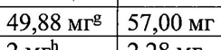
- стр. 1: «25 MM. Номинальное содержание Г.-аргинина гидрохлорида (М=2 10,66 г/моль)» — повторное чтение: «25 MM. Номинальное содержание Г-аргинина гидрохлорида (M=210,66 Г/моль)»  
  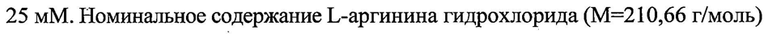
- стр. 4: «| для режимов дозирования 200 мг 1 раз в 2 недели и 300 мг 1 разв 2 неделии ‘» — низкая уверенность: «2» (0)  
  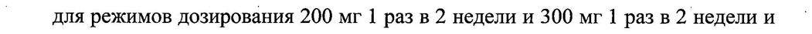
- стр. 5: «достигли 37,9 % пациентов, получавших Дупиксент® в дозе 300 мг 1 pa3 B 2» — повторное чтение: «достигли 37,9 % пациентов, получавших Дупиксент® в дозе 300 мг 1 разв 2»  
  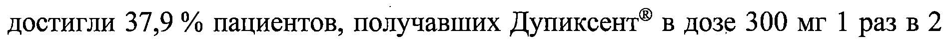
- стр. 5: «достигли 51,3 % пациентов, получавших Дупиксент® в дозе 300 мг 1 разв 2 |» — повторное чтение: «достигли 51,3 % пациентов, получавших Дупиксент® в дозе 300 wr 1 pa3 B 2 |»  
  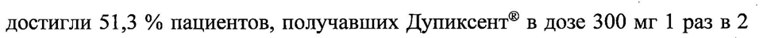
- стр. 5: «дозе 300 мг |1 раз в неделю, против 12,3 % пациентов в группе плацебо, а в» — низкая уверенность: «|1» (67)  
  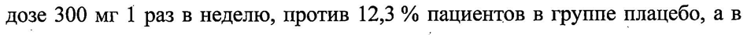
- стр. 6: «IGA 0 или 1 к 16-Й неделе лечения достигли 38,7 % пациентов, получавших» — низкая уверенность: «16-Й» (71)  
  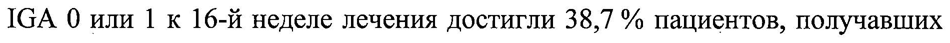
- стр. 6: «пациентов, получавших Дупиксент® в дозе 300 мг 1 раз в неделю + топические |» — низкая уверенность: «1» (76)  
  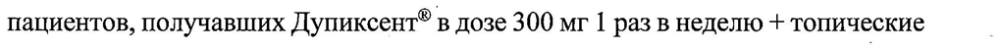
- стр. 6: «ГКС, против 23,2 % пациентов в группе плацебо + топические ГКС, ак 52-Й» — низкая уверенность: «52-Й» (75)  
  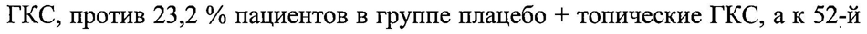
- стр. 6: «® лечения достигли 58,8 % пациентов, получавших Дупиксент® в дозе 300 мг 1» — повторное чтение: «® лечения достигли 58,8 % пациентов, получавших  Дупиксенл® в дозе 300 wr 1»  
  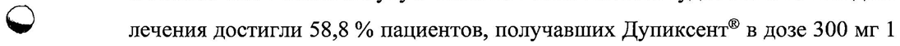
- стр. 6: «‚ пациентов в группе плацебо + топические ГКС, а к 52-Й неделе — 51,2% и ©» — низкая уверенность: «51,2%» (50)  
  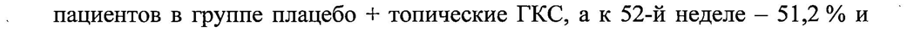
- стр. 8: «| площади экземы (EASI-75) к 16-й неделе достигли 41,5 % пациентов,» — низкая уверенность: «(EASI-75)» (80)  
  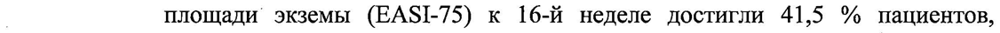
- стр. 10: «| неделю. Пациенты в группе, получавшей препарат Дупиксент® 1 разв 4 недели =» — низкая уверенность: «4» (54); повторное чтение: «| неделю. Пациенты в группе, получавшей препарат Дупиксент® 1 раз в 4 недели»  
  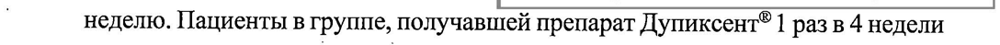
- стр. 10: «| ‘затем 300 мг 1 раз в 4 недели с 4 по 12 неделю, независимо от массы тела. В» — низкая уверенность: «1» (69)  
  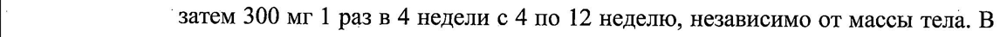
- стр. 10: «состояние; у 64,4% наблюдалась пищевая аллергия, у.62,7% — другие виды» — низкая уверенность: «у.62,7%» (56)  
  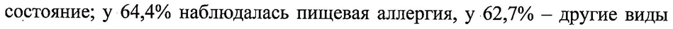
- стр. 10: «‚ в дозе 300 мг 1 раз в 4 недели, против 27,9 % в группе плацебо; 74,6 %» — повторное чтение: «‚ в дозе 300 мг 1 раз в 4 недели, против 27,9 % в группе плацебо; 74,6 %»  
  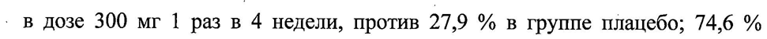
- стр. 11: «44.1 % аллергический ринит иу 25,5 % астма.» — низкая уверенность: «44.1» (73)  
  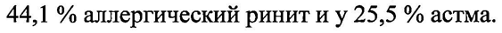
- стр. 13: «300 мг 1 раз в 2 недели — на 70 % и 46 %, соответственно; и на 59 % в» — низкая уверенность: «300» (49)  
  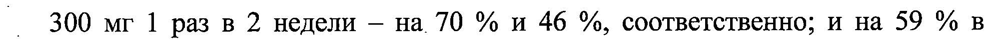
- стр. 14: «w) Дупиксент® в дозе как 200 мг, так и 300 мг и сохранялись в течение 24 недель» — повторное чтение: «w)  Дупиксент? В зе как 200 мг, так и 300 МГИ сохранялись В течение 24 дель»  
  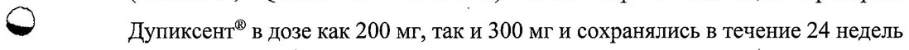
- стр. 15: «7 0,22 л в группе применения препарата Дупиксент® по сравнению с плацебо,» — низкая уверенность: «7» (20)  
  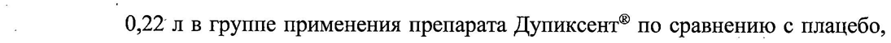
- стр. 15: «| что соответствовало улучшению на 15,1 % по сравнению с исходным уровнем. |» — низкая уверенность: «15,1» (67)  
  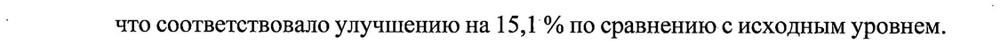
- стр. 16: «© исходного значения — 0,33 л (21,1 %) и 0,42 л (27,3 %) у пациентов с уровнем» — повторное чтение: «© о "ото чения 02а (21 Yo) W082 x (27.3 76) у пациентов с уровнем»  
  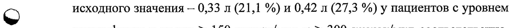
- стр. 18: «| были рандомизированы либо в группу Дупиксент® 300 мг (N=143), либо в» — повторное чтение: «| были рандомизированы либо в группу Дупиксент® 300 мг (N=143), либо в»  
  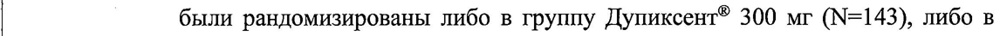
- стр. 20: «исходного уровня ОФВ1 на 24 неделе для дозы препарата Дупиксент® 300 мг» — низкая уверенность: «ОФВ1» (38)  
  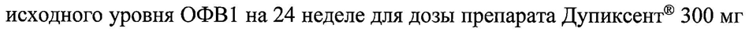
- стр. 22: «| дупилумаб 300 мг 1 раз в неделю, составило -21,92 и -23,78 в части А и части» — повторное чтение: «| дупилумаб 300 мг 1 раз в неделю, составило -21,92 и -23,78 в части А и части»  
  
- стр. 23: «дупилумаб в дозе 300 мг 1 раз в 2 недели, доля пациентов с улучшением» — низкая уверенность: «1» (68)  
  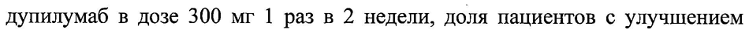
- стр. 23: «составила 28,3 % и 30,8 % соответственно в PRIME и PRIME2). Доля» — низкая уверенность: «PRIME2).» (66)  
  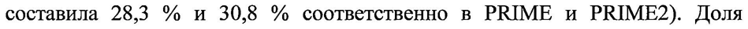
- стр. 23: «| ‘неделе в группах пациентов, получавших дупилумаб в дозе 300 мг 1 pa3 B2 . |» — повторное чтение: «| ‘неделе в группах пациентов, получавших дупилумаб в дозе 300 мг 1 раз в 2»  
  
- стр. 23: «& плацебо составила 29,6 % и 25,5 % соответственно в исследованиях PRIME и |» — повторное чтение: «& плацебо составила 29.6 % и oss % соответственно В  наспедованиях PRIME u |»  
  
- стр. 24: «После однократного подкожного введения 75-600 мг дупилумаба, медиана» — низкая уверенность: «75-600» (63)  
  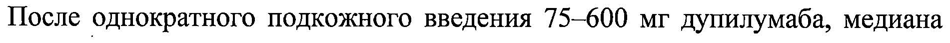
- стр. 24: «© введением следующей дозы составляла 29-37 мг/л при применении 200 мг 1» — повторное чтение: «© окдоливм следующей дозы составляла 29-37 мил при применении 200 мг 1»  
  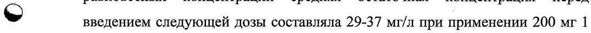
- стр. 24: «раз в 2 недели, 60-80 мг/л при применении 300 мг 1 раз в 2 недели и 172-195» — низкая уверенность: «172-195» (78)  
  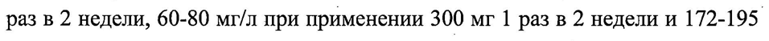
- стр. 25: «взрослых пациентов и подростков и была приблизительно в 1,5 раза и 2,5 раза _» — повторное чтение: «взрослых пациентов и подростков и была приблизительно В 15 раза и 2,5 pasa _»  
  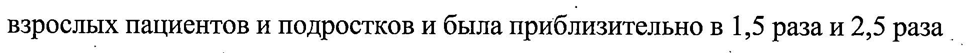
- стр. 26: «ходе которого оценивали дозы 100 мг 1 разв 2 недели и 200 мг 1 разв 2 недели.» — низкая уверенность: «1» (79)  
  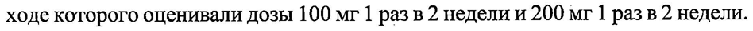
- стр. 27: «© | от 12 до 17 лет с массой тела > 40 кг. Пациенты получали дозу 300 мг 1 разв» — повторное чтение: «Ne | от 12 10 т лет с escent тела > 40 ar. Пациенты получали озу 300 мг 1 раз B»  
  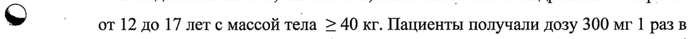
- стр. 28: «мг каждые четыре недели (с массой тела 15- < 30 кг), 200 мг каждые две» — низкая уверенность: «15-» (67), «30» (19); повторное чтение: «мг каждые четыре недели (с массой тела 15 — < 30 xr), 200 мг a две»  
  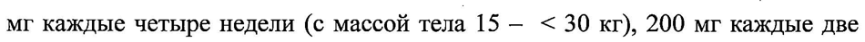
- стр. 31: «» для пациентов с массой тела от 5 до <15 кг: HayambHaao3a—200мг(1 —» — низкая уверенность: «HayambHaao3a—200мг(1» (1); повторное чтение: «© для пациентов с массой тела от 5 до <15 кг: начальная доза — 200 мг (1»  
  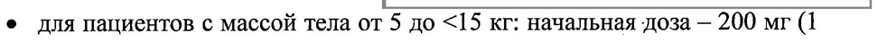
- стр. 31: «® начальная доза — 600 мг (2 инъекции по 300 мг), далее — по 300 мгкаждые» — низкая уверенность: «600» (80)  
  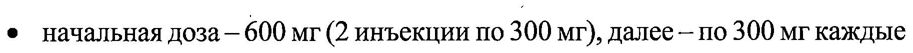
- стр. 34: «составляет 300 мг каждые четыре недели (с массой тела 15 кг- < 30 кг), 200 мг» — низкая уверенность: «30» (42)  
  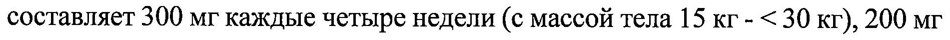
- стр. 34: «| каждые две недели или 300 мг каждые четыре недели (с массой тела 30 - < 60 —» — низкая уверенность: «60» (74)  
  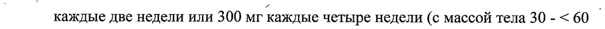
- стр. 36: «группе пациентов, получавших дупилумаб в дозе 300 мг 1 раз в неделю. В» — низкая уверенность: «1» (77)  
  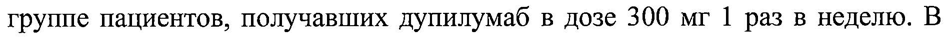
- стр. 36: «прекративших лечение из-за нежелательных явлений, составила 7,6 % в группе» — повторное чтение: «прекративших лечение из-за нежелательных явлений, составила 7 ,6 % B группе»  
  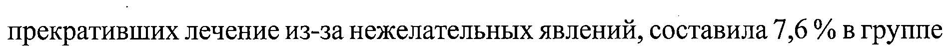
- стр. 36: «> прекративших лечение из-за нежелательных реакций, составила 1,7 % в группе» — повторное чтение: «>  прекративших чение из-за нежелательных реакций, оставила 17% в Е рупие»  
  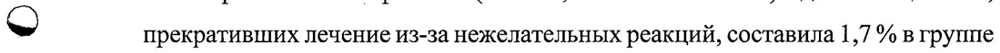
- стр. 37: «> 10%; часто > 1 %и< 10 И; нечасто > 0,1 Жи< 1%; редко > 0,01 %и< 0,1 %;» — низкая уверенность: «0,1» (16)  
  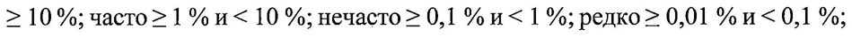
- стр. 37: «очень редко < 0,01%; частота неизвестна (невозможно определить по» — низкая уверенность: «0,01%;» (8)  
  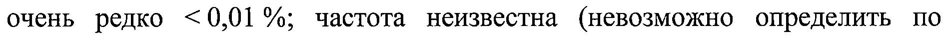
- стр. 38: «| получали препарат Дупиксент® в дозе 300 мг еженедельно (1 р/нед).» — низкая уверенность: «300» (43); повторное чтение: «| получали препарат Дупиксент® в дозе 300мг еженедельно (1 р/нед).»  
  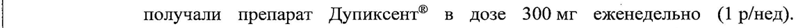
- стр. 40: «® и зозинофилия. Энтеробиоз был зарегистрирован у 1,8 % (5 человек)» — повторное чтение: «® 7 и зозинофилия. Энтеробиоз был зарегистрирован у Ls % (5 человек)»  
  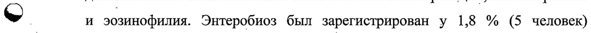
- стр. 43: «пациентов, получавших препарат Дупиксент® и < 0,5 % пациентов,» — низкая уверенность: «0,5» (16)  
  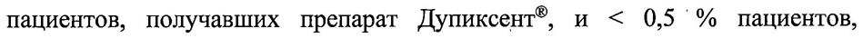
- стр. 44: «) зарегистрированы у 0,7 % пациентов, получавших Дупиксент® uy 11%» — низкая уверенность: «11%» (78); повторное чтение: «©) зарегистрированы у 0,7 % пациентов, получавших Дупиксент® uy 1,1 %»  
  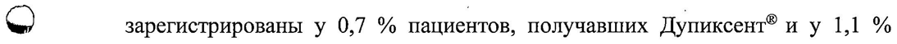
- стр. 44: «у 1,3 % пациентов, получавших дупилумаб, и у 13 % пациентов, получавших» — низкая уверенность: «13» (56)  
  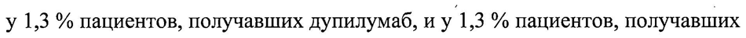
- стр. 45: «%) в группе пациентов, получавших Дупиксент® 300 мг 1-pa3'B 2 недели, ив2» — низкая уверенность: «1-pa3'B» (37)  
  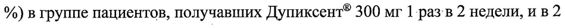
- стр. 46: «получали препарат Дупиксент® в дозе 100 мг 1 разв 2 недели или 200 мг 1 раз» — повторное чтение: «получали препарат Дупиксент® в дозе 100 мг 1 раз в 2 недели или 200 мг 1 раз»  
  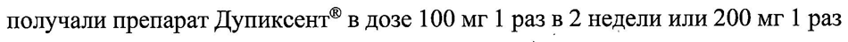
- стр. 46: «> препарат Дупиксент® в дозе 300 мг 1 раз в неделю или 300 мг 1 разв 2 недели.» — повторное чтение: «> препарат Дупиксент® В рае 300 мг 1 разв неделю ИЛИ 300 мг 1 разв 2 недели.»  
  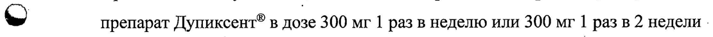
- стр. 46: «| Независимо от возраста и популяции примерно у 2—4 % пациентов в группах» — низкая уверенность: «2—4» (63)  
  
- стр. 53: «Санофи Винтроп Индустрия, Франция (150 мг/мл, 175 ‚мг/мл: шприцы,» — низкая уверенность: «(150» (63); повторное чтение: «Санофи Винтроп Индустрия, Франция (150 мг/мл, 175 мг/мл; ишприцы,»  
  
- стр. 53: «Санофи Винтроп Индустрия. Франция (150_мг/мл, 175 мг/мл; шприцы,» — повторное чтение: «Санофи Винтроп Индустрия, Франция (150 мг/мл, 175 мг/мл; шприцы,»  
  
- стр. 53: «Кук Фармика ЛЛС (150 мг/мл; шприцы) |» — повторное чтение: «Кук Фармика mac ( 150 var: шприцы) | |»  
  
- стр. 53: «Санофи-Авентис Дойчланд ГмбХ, Германия (150 мг/мл, 175 мг/мл; шприцы,» — низкая уверенность: «(150» (78)  
  
