# Дурвалумаб — парентерально

- Препарат: ИМФИНЗИ® (концентрат для приготовления раствора для инфузий;)
- АТХ: L01FF03
- Источник: ГРЛС, инструкция по медицинскому применению, РУ ЛП-005664, файл от 2025-01-14 (https://grls.rosminzdrav.ru/Grls_View_v2.aspx?routingGuid=a5285fdf-7c0d-4709-8b02-5e1251b004cf)
- Распознано автоматически (OCR): 44 из 44 стр.
- Инструкция к другому РУ того же препарата: ЛП-005664 (национальное РУ, переоформленное по правилам ЕАЭС, решение от 20.12.2024). Текст может быть старше действующего
- Сомнительных строк после OCR: 98 (см. раздел «Проверка распознавания»)

## Общие сведения

| .
от 18.12.2024 № 28039 МИНИСТЕРСТВО ЗДРАВООХРАНЕНИЯ РОСВИЙСКОЙ ФЕДЕРАЦИИ
ИНСТРУКЦИЯ No МЕДИЦИНСКОМУ ПРИМЕНЕНИЮ ЛЕКАРСТВЕННОГО ПРЕПАРАТА
ИМФИНЗИ?® | наименование лекарственного препарата ии номер: ЛП-005664
Торговое namseronaune: ИМФИНЗИ® Международное непатентованное или группировочное наименование: дурвалумаб
| Лекарственная форма: концентрат для приготовления раствора для инфузий
| Состав .
1 мл comer содержит:
Действующее вещество: дурвалумаб 50 мг;
Вспомогательный вещества: Г-гистидин 2 мг, Г-гистидина гидрохлорида моногидрат 2,7 мг, о трегаозы дигидрат 104 мг, полисорбат 80 0,2 мг, вода для инъекций приблизительно $00 MI.
Описание От прозрачной до опалесцирующей, от бесцветной до.желтоватого цвета жидкость.
ИИ группа: противоопухолевое — средство, — антитела у моноклональные
Код ATX: РЕ , Фармакологические свойства “

## 5.1. Фармакодинамика

- Механизм действия Экспрессия белка лиганда рецептора программируемой гибели клетки 1 (PD-L1) является ответом на воздействие адаптивной иммунной системы, который позволяет опухолям избегать обнаружения и элиминации иммунной системой. Экспрессия PD-L1 может индуцироваться воспалительными сигналами (например, IFN-ramMa) и происходить как в опухолевых лет ках, так и в опухолеассоциированных иммунных клетках микроокружения опухоли. PD-L1 bnoxupyer функции и активацию Т-клеток посредством взаимодействия с
- Механизм действия Экспрессия белка лиганда рецептора программируемой гибели клетки 1 (PD-L1) является ответом на воздействие адаптивной иммунной системы, который позволяет опухолям избегать обнаружения и элиминации иммунной системой. Экспрессия PD-L1 может индуцироваться воспалительными сигналами (например, IFN-ramMa) и происходить как в опухолевых лет ках, так и в опухолеассоциированных иммунных клетках микроокружения опухоли. PD-L1 bnoxupyer функции и активацию Т-клеток посредством взаимодействия с
| | ЗВ ООО ВАА eeVO СООО СОСО УСО ИИС ИИА
| | or 18.12.2024 Ne 28039 PD-1 и CD80 (B7.1). Связываясь с соответствующими рЕНЕЙорами PD-E 1 Уменьшает urroroxsrseyoskantoe Т-клеток, пролиферацию и выработку цитокинов.
Дурвалумаб является полностью человеческим, высокоаффинным моноклональным антителом, иммуноглобулином GI каппа (IgGlx), которое селективно блокирует взаимодействие PD-LI с PD-1 или CD80 (В7.1), при этом не затрагивая взаимодействие между PD-1 и plea
Дурвалумаб не Иуширует антителозависимую клеточную цитотоксичность. Селективная блокада заимод\ иствий между PD-L1 и PD-1 и РО-Г1 и CD80 приводит к усилению птивоопухолев го иммунного ответа, который может привести к элиминации опухоли. В доклинических следованиях блокада РО-Г1 приводила к увеличению активации Тлимфоцитов и к yernanenno размеров опухолей.
. Комбинация дурвалумаба, ингибитора' РО-Г.1, и тремелимумаба, ингибитора CTLA-4,
| усиливает щи и функцию противоопухолевых Т-клеток на нескольких этапах иммунного ответа, увеличивая противоопухолевый иммунитет. |

## 5.2. Фармакокинетика

Фармакокинетика дурвалумаба оценивалась при применении препарата ИМФИНЗИ® в монотерапии и | комбинации с химиотерапевтическими препаратами, в комбинации с | ремелимумабом и с химиотерапией на основе препаратов платины, в комбинации с
Фармакокинетика дурвалумаба оценивалась при применении препарата ИМФИНЗИ® в монотерапии и | комбинации с химиотерапевтическими препаратами, в комбинации с | ремелимумабом и с химиотерапией на основе препаратов платины, в комбинации с
| тремелимумабом. Фармакокинетику дурвалумаба изучали у 2903 пациентов с солидными опухолями, при Этом дозы варьировали от 0,1 мг/кг до 20 мг/кг, а препарат вводили один раз в две, три или четыре недели. Фармакокинетическое воздействие увеличивалось более
| чем пропорционально дозе (нелинейная фармакокинетика) при дозах, составляющих
< 3 мг/кг, и пропорционально дозе (линейная фармакокинетика) при дозах, составляющих
_ > 3 мг/кг. Равновёсное состояние достигалось примерно через 16 недель.
На основании поруляционного фармакокинетического анализа, включавшего данные 1878 пациентов, получавших препарат в дозах >10 мг/кг каждые 2 недели, среднее геометрическое , бъема распределения в равновесном состоянии (Vss) составляло 5,64 л.
Клиренс дурвалумаба уменьшался с течением времени, что приводило к среднему геометрическом клиренса в равновесном состоянии (CLss) равному 8,16 мл/час на 365 день терапии; уменьщение CLss не считается клинически значимым. Исходя из клиренса исходного уровни, период полувыведения составлял приблизительно 18 дней. |
Клинически на имых различий фармакокинетических параметров дурвалумаба при его применении в Нонотерапии, в комбинации с химиотерапевтическими препаратами, в комбинации с емелимумабом и с химиотерапией на основе препаратов платины или в комбинации с ромелимумабом выявлено не было.
| | C—O Е... | | | - or 18.12.2024 Ne 28039
Фармакокинетика у особых групп пациентов Входящий МЗ 44287234
Возраст (19-96 hen) масса тела (31-149 кг), пол, наличие антител к дурвалумабу, концентрация sarc активность лактатдегидрогеназы, концентрация креатинина, концентрация растворимого РО-Г.1, тип опухоли, расовая принадлежность, нарущение функции vn pr степени тяжести (клиренс креатинина (KK) 60-89 мл/мин), нарушение фун ции почек средней степени тяжести (КК 30-59 мл/мин), нарушение функции печени легкой степени тяжести (билирубин < верхней границы нормы (ВГН) и активность опар атаминотраноферазы (АСТ) > BIH или концентрация билирубина > BIH до 1,5 x ВГН пи любой активности АСТ), нарушение функции печени средней степени тяжести (commettpanis билирубина > 1,5 x ВГН до 3 x BIH и любая активность ACT) и общее состояние по шкале ВОЗ/ЕСОС не оказывали клинически значимого воздействия на
. фармакокинетику дурвалумаба.
Влияние нарушения функции почек тяжелой степени (КК 15-29 мл/мин) или нарушения функции печени тяжелой степени (концентрация билирубина >3хВГН и любая
| активность ACT ia фармакокинетику дурвалумаба неизвестно.
Пациенты пожилого возраста Коррекции дозы y пожилых пациентов (> 65 лет) не требуется.
Из 476 пациентов с местнораспространенным нерезектабельным немелкоклеточным раком легкого (НМРЛ) (первичная популяция для оценки эффективности), получавших препарат
ИМФИНЗИ®, 215 пациентов были в возрасте 65 лет и старше. В целом, между пациентами в возрасте 65 лет и старше и более молодыми пациентами не отмечалось клинически значимых различий в профилях безопасности.
Из 265 аациентой с распространенным мелкоклеточным раком легкого (МРЛ), получавших
| препарат ИМФИНЗИ" в комбинации с химиотерапией, 101 пациент (38 %) был в возрасте 65 лет и старше. т целом, не было установлено клинически значимых различий показателей
| безопасности или эффективности у пациентов в возрасте 65 лет и старше и пациентов более молодого пора
Из 338 пациентов с раком желчевыводящей системы, получавших препарат ИМФИНЗИ® в комбинации с имиотерапией, 158 пациентов (46,7 %) были в возрасте 65 лет и старше. В | целом, не было рлановлено клинически значимых различий показателей безопасности или |
| эффективности | пациентов в возрасте 65 лет и старше и пациентов более молодого | возраста. | |
Из 338 пациентов с метастатическим НМРЛ, получавших препарат ИМФИНЗИ® в
| комбинации с емелимумабом и химиотерапией на основе препаратов платины, 147 пациентов (43 %) были в возрасте 65 лет и старше. В целом, He было установлено
| .
СООТВЕТСТВУЕТ ЭКСПЕРТНОМУ ОТЧЕТУ ` клинически значимых различий показателей безопасности Wilt sex tHbHoerH иентов в возрасте 65 лет | старше и пациентов более молодого возраста. |
Из 462 a с неоперабельным гепатоцеллюлярным раком (HI LIP), получавших | однократное введение тремелимумаба с регулярным интервальным введением | дурвалумаба, 173 pares (37,4 %) были в возрасте 65 лет и старше, и 63 пациента (13,6 %) | были в возрасте 1 лет и старше. Не было установлено клинически значимых различий | показателей безопасности или эффективности у пациентов в возрасте 65 лет и старше и пациентов более молодого возраста.
Исследования no изучению лекарственного взаимодействия
Фармакокинетич ские взаимодействия дурвалумаба с — химиотерапевтическими препаратами был оценены в ходе исследования CASPIAN у пациентов с МРЛ, при этом |
№ клинически значимых взаимодействий выявлено не было.
| `- Фармакокинетические взаимодействия дурвалумаба с тремелимумабом и химиотерапией на основе препаратов платины были оценены в ходе исследования POSEIDON у пациентов с метастатическим НМРЛ, при этом клинически значимых взаимодействий выявлено не было.

## 4.1. Показания к применению

, ® Нерсзектабельный местнораспространенный немелкоклеточный рак легкого у взрослых пациентов, у Которых не выявлено прогрессирование заболевания после химиолучевой терапии на con препаратов платины.
, ® Нерсзектабельный местнораспространенный немелкоклеточный рак легкого у взрослых пациентов, у Которых не выявлено прогрессирование заболевания после химиолучевой терапии на con препаратов платины.
® Первая линия терапии распространенного мелкоклеточного рака легкого в комбинации
‚о с этопозидом й карбоплатином или цисплатином.
° Местнораспротраненный или метастатический рак желчевыводящей системы в комбинации сотен e Первая линия терапии у взрослых пациентов с метастатическим немелкоклеточным раком легкого при отсутствии активирующих мутаций в гене рецептора эпидермального фактора роста (EGFR) или слияния гена киназы анапластической лимфомы (ALK) в комбинации crewman и химиотерапией Ha основе препаратов платины.
e Неоперабельный гепатоцеллюлярный рак у взрослых пациентов в комбинации с тремелимумабом.
ИВ e Повышенная | чувствительность к дурвалумабу или вспомогательным веществам,
| | . 4 | REE EEE EREDEDEDEDEiEEEEEE OO ннния от 18.12.2024 № 28039
‘’ входящим в состав препарата. Входящий МЗ №4287234
® Детский возраст до 18 лет.
e Беременность и период грудного вскармливания.
» Нарушение функции печени тяжелой степени.

## 4.3. С осторожностью

тяжелые аутоиммунные заболевания в активной стадии, при которых дальнейшая активация иммунной системы может представлять потенциальную угрозу
тяжелые аутоиммунные заболевания в активной стадии, при которых дальнейшая активация иммунной системы может представлять потенциальную угрозу
`_ Жизни. | Применение при беременности и в период грудного вскармливания
Женщины с сохраненной детородной функцией
| Женщины с сохраненной детородной функцией должны использовать надежные методы
| контрацепции во время терапии дурвалумабом и, как минимум, в течение 3 месяцев после
| введения последней дозы препарата.
Беременность Данные о применении дурвалумаба у беременных женщин отсутствуют. С учетом механизма действия дурвалумаб может оказывать влияние на течение беременности и вредное воздействие на плод при его применении во время беременности. На модели аллогенной беременности у мышей было показано, что нарушение передачи сигнала через
РО-Г приводит к увеличению частоты потери плода. В исследованиях у животных не было выявлено репродуктивной токсичности. Человеческий иммуноглобулин IgG] проникает через плацентарный барьер. В исследованиях на животных было показано, что дурвалумаб
| проникает через плацентарный барьер. Применение дурвалумаба во время беременности
| — может причинить вред плоду. Поэтому дурвалумаб не должен применяться во время беременности и ia отсутствии надежной контрацепции во время терапии, и, как минимум, в течение 3 месяцев после введения последней дозы препарата.
Грудное скармл вание | Нет информации; касающейся экскреции дурвалумаба в грудное молоко. По результатам
| | токсикологических исследований в молоке яванских макак на 28 день после родов был выявлен дурвалумаб в низких концентрациях. У человека моноклональные антитела могут выделяться в грудное молоко, однако нет данных об их возможной абсорбции и вреде для новорожденного. Тем не менее, нельзя исключить риск для младенцев, получающих грудное вскармливание. Поэтому следует либо прекратить грудное вскармливание, либо воздержаться от терапии дурвалумабом с учетом пользы грудного вскармливания для младенца и пользы терапии дурвалумабом для женщины.
_от 18.12 2024 He 28039 | Фертильность | (Входящий МЗ №4287234
Данные о возможном влиянии дурвалумаба на фертильность у животных и у человека отсутствуют. |

## 4.2. Способ применения и дозы

.
.
Дозы | Препарат ИМФИНЗИ® необходимо вводить в виде внутривенной инфузии
| продолжительное BIO не менее 1 часа.
| При назначении ро ИМФИНЗИ® в комбинации с другими лекарственными препаратами необходимо обратиться к Инструкциям по медицинскому применению этих лекарственных препаратов для получения информации об их дозировании.
и НМРЛ и | | Рекомендуемая за препарата ИМФИНЗИ® составляет 10 мг/кг один раз в 2 недели или 1500 мг один раз | 4 недели! до прогрессирования заболевания или развития неприемлемой
‚ ТОКСИЧНОСТиИ. | | Распространенный МРЛ
| Рекомендуемая | за препарата ИМФИНЗИ® составляет 1500 мг? в комбинации с
*имиотерапевтичскими препаратами один раз в 3 недели в течение 4 циклов, затем 1500 мг
| в качестве монотерации один раз в 4 недели до прогрессирования заболевания или развития неприемлемой йсичности. |
ИО или метастатический рак желчевыводящей системы
Рекомендуемая Доза препарата ИМФИНЗИ® составляет 1500 мг? в комбинации с
*имиотерапевтичскими препаратами один раз в 3 недели, затем 1500 мг в качестве монотерапии oma раз в 4 недели до прогрессирования заболевания или развития неприемлемой rokeumoctn,
И НМРЛ Совместно с хииотерапией: рекомендуемая доза препарата ИМФИНЗИ® составляет 1500 мг? в комбиращии с тремелимумабом 75 мг и химиотерапией на основе препаратов платины каждые 3 недели (21 день) в течение 4 циклов (12 недель).
После "имиотер ции на основе препаратов платины: рекомендуемая доза препарата
ИМФИНЗИ® ос|авляет 1500 мг каждые 4 недели в монотерапии и поддерживающая“
| от 18.12.2024 № 28039 терапия пеметрекседом в зависимости от гис ологических ДАННЫХ хай able РНЕ; де: ти, и пятая доза ремелимумаба5< вместе с шестой дозой препарата ИМФИНЗИ? на неделе 16.
Лечение smal до прогрессирования заболевания или развития неприемлемой токсичности.
| нГЦР Рекомендуемая Доза препарата ИМФИНЗИ® составляет 1500 мг’ в комбинации с spent 300 мг’ в виде однократной начальной дозы в день 1 цикла | с последующей монотерапией препаратом ИМФИНЗИ® 1500 мг’ каждые 4 недели до прогрессирования заболевания или развития неприемлемой токсичности.
| ` Пациентам с |. тела 30 кг и менее препарат ИМФИНЗИ® назначают из расчета 10 мг/кг один раз в 2 недели или 20 мг/кг один раз в 4 недели в качестве монотерапии до достижения массы тела более 30 кг.
? Пациентам с accoi тела 30 кг и менее препарат ИМФИНЗИ® назначают из расчета 20 мг/кг в комбинации с введением химиотерапевтических препаратов один раз в 3 недели в течение 4 циклов, затем в качестве монотерапии в дозе 20 мг/кг один раз в 4 недели до ослижения массы тела более 30 кг.
3 Пациентам с Массой тела 30 кг и менее назначают препарат ИМФИНЗИ® из расчета
20 мг/кг до nocrmenns массы тела более 30 кг. Пациентам с массой тела 35 кг и менее назначают ремелимумаб из расчета 1 мг/кг до достижения массы тела более 35 кг.
4 По решению последователя для пациентов с неплоскоклеточным раком, которые
| получали лечение пеметрекседом и карбоплатином/цисплатином.
5 При оторочке введения дозы (доз) пятую дозу тремелимумаба можно ввести после недели 16 совместно с препаратом ИМФИНЗИ®.
$ Если пациент получают менее 4 циклов химиотерапии на основе препаратов платины, оставшиеся циклы тремелимумаба (до 5 циклов) совместно с препаратом ИМФИНЗИ® следует проводить после химиотерапии на основе препаратов платины.
7 Пациентам с | ассой тела 30 кг и менее препарат ИМФИНЗИ® назначают из расчета
20 мг/кг до < тижения массы тела более 30 кг. Пациентам с массой тела 40 кг и менее назначают ремелимумаб из расчета 4 мг/кг до достижения массы тела более 40 кг.
| Увеличение но дозы препарата ИМФИНЗИ® не рекомендуется. В случае тяжелых иммуноопосредованных нежелательных реакций (3 степень) обычно требуется
| приостановка оапии препаратом ИМФИНЗИ®. Следует прекратить терапию препаратом
| .
ПО ООО от 18.12.2024 № 28039 ИМФИНЗИ® в случае жизнеугрожающих иммуноопосредованнь Hh eat eine fet реакций
(4 степень), ton повторном возникновении тяжелых иммуноопосредованных нежелательных | реакций (3 степень), требующих применения системных иммуносупрессоров, или при невозможности снижения дозы преднизолона < 10 мг/сутки или эквивалента | течение 12 недель с момента начала терапии глюкокортикостероидами.
Информация 0б иммуноопосредованных нежелательных реакциях, требующих специфического re представлена в Таблице 1. В разделе «Особые указания»
приведены дальнейшие рекомендации по купированию нежелательных реакций, мониторингу нежелательных реакций и ведению пациентов.
| Таблица 1. _— по изменению режима терапии препаратом ИМФИНЗИ® или ИМФИНЗИ" в комбинации с тремелимумабом
И ‚ +, | Нежелательная Степень тяжести! Изменение режима пневмонит/ | 3 или 4 степень Прекращение терапии | интерстициальная болезнь легких |
Иммуноопосредованный | Активность Приостановка терапии?
гепатит аланинаминотрансферазы (АЛТ)
или аспартатаминотрансферазы (АСТ) > 3 - <5 x BIH или
| концентрация общего ° билирубина > 1,5 -<3 x ВГН
Активность АЛТ или АСТ Приостановка терапии
>5-< 10 х BIH дурвалумабом и прекращение — терапии тремелимумабом
| Одновременное повышение Прекращение терапии активности АЛТ или АСТ
>3 x ВЕН и концентрации общего билирубина > 2 x BIH?
Активность АЛТ или АСТ > 10х ВГН или концентрация общего билирубина > 3 х ВГН . | от 18.12.2024 № 28039
Нежелательная Степень тяжес иг ‘о”оАРИЗменение “режима |
Иммуноопосредованный | Активность АСТ или АЛТ > 2,5 - | Приостановка терапии?
гепатит у ациентов с | < 5х исходная активность и < 20
ГЦР (или вВричным х ВГН опухолевым поражением Активность AJIT или АСТ> 5—7 | Приостановка терапии
| печени и ходным х исходная активность и < 20 x дурвалумабом и отклонением of нормы | ВГН или одновременно прекращение терапии функциональны проб | активность AJIT или АСТ 2,5-5 | тремелимумабом
| ‚ | печени) х исходная активность и < 20 x
| BIH, и концентрация общего о билирубина > 1,5 - <2 x ВГНЗ и
| - Активность АСТ или AJIT>7 x | Прекращение терапии |
| исходная активность или > 20 x : BIH (отклонение, которое
1 разовьется раньше) | | или концентрация общего билирубина > 3 х ВГН
KONMT ИЛИ даре 3 степень при монотерапии Приостановка терапии?
3 степень для ИМФИНЗИ® в Прекращение терапии
-
| Перфорация кишечника ЛЮБОЙ | Прекращение терапии soma НИИ
Иммуноопосредованные 2—4 степень Приостановка терапии до гипертиреоз, тиреоидит достижения стабильной
| клинической ситуации | Иммуноопосредованный | 2-4 степень Без изменений (cM.
И И ee Иммуноопосредованные | 2-4 степень Приостановка терапии до едостаточност: функци достижения стабильной падпочечников, клинической ситуации
| _от 18.12 2024 № 28039.
Нежелательная Степень тяжес иг Изменение режима | гипофизит | ИЛИ гипопитуитаризм
Иммуноопосредованный | 2-4 степень Без изменений (см.
Иммуноопосредованный | 2 степень, повышение Приостановка терапии?
нефрит концентрации креатинина сыворотки > 1,5 х ВГН (или исходное значение) до 3 х ВГН
(или исходное значение)
= 3 степень, повышение Прекращение терапии 7 | концентрации креатинина
| сыворотки > 3 х исходное | значение или > 3 x ВГН до 6 x |
BIH;
4 степень, повышение концентрации креатинина сыворотки > 6 х ВГН
Иммуноопосредованная | 2 степень дольше 1 недели или3 | Приостановка терапии?
тн a Иммуноопосредованный | 2-4 степень Прекращение терапии
| миокардит | мии полимиозит/ 4 степень Прекращение терапии
Инфузионные реакции 1 или 2 степень Прервать введение препарата или уменьшить скорость инфузии (см. «Особые указания»)
| 10 | СООТВЕТСТВУЕТ ЭКСПЕРТНОМУ ОТЧЕТУ от 18.12.2024 № 28039
Нежелательная Степень тяжес зменениеё режима реакция терапии
Иммуноопосредованная 2—4 степень Прекращение терапии миастения гравис 1 хх
Иммуноопосредованный | 2-4 степень Прекращение терапии энцефалит |
Иммуноопосредованный | 2-4 степень Прекращение терапии .
y р , р синдром Гийена Bappe Другие | 2 или 3 степень Приостановка терапии?
иммуноопосредованные |4 степень Прекращение терапии реакции?’ , |
| - ' Общие терминологические критерии нежелательных явлений Национального института рака cua, версия 4.03. АЛТ: аланинаминотрансфераза; АСТ:
аспартатаминотрансфераза; ВГН — верхняя граница нормы.
| ? После приостановки терапию препаратом ИМФИНЗИ® можно возобновить в течение 12
| 1 недель, если триесть нежелательной реакции уменьшилась до <1 степени тяжести, и
1 доза глюкокортикостероидов была снижена до <10мг преднизолона или его эквивалента в сутки
| При повторном возникновении нежелательной реакции 3 степени тяжести следует
| | прекратить терапию препаратом ИМФИНЗИ®.
3 При ленин пациентов с альтернативной причиной следует придерживаться
„| - рекомендаций, касающихся повышения активности АЛТ или АСТ без одновременного |
| | повышения концентрации билирубина. |
4 Если у пациентов с опухолевым поражением печени исходная активность АСТ и АЛТв пределах Нормы или эквивалентна ВГН на исходном уровне, следует приостановить или прекратить терапию дурвалумабом, следуя рекомендациям по ведению пациентов с
| гепатитом без опухолевого поражения печени.
> При возникновении нежелательной реакции 3 степени тяжести следует прекратить терапию тромелимумабом; при этом терапию препаратом ИМФИНЗИ® можно продолжить посте разрешения нежелательной реакции. |
6 Терапию препаратом ИМФИНЗИ® следует прекратить, если нежелательная реакция не
| iv разрешится п <1 степени тяжести в течение 30 дней, или при наличии признаков дыхательной недоотаточности.
7 Включая иммунную тромбоцитопению, панкреатит, иммуноопосредованный артрит, и о
. | | , от 18.12.2024 № 28039 | увеит. (Входящий МЗ №4287234
| При возникновении неиммуноопосредованных нежелательных реакций 2 и 3 степени тяжести необхо приостановить терапию препаратом ИМФИНЗИ® до улучшения состояния до исходного или до <1 степени тяжести или исходного уровня. Терапию препаратом ИМФИНЗИ® следует прекратить при развитии нежелательной реакции 4
| степени жести Решение о прекращении терапии в случае отклонений от нормы
| лабораторных казателей 4 степени тяжести должно приниматься на основании клинической оцейки с учетом сопутствующих признаков и симптомов. |
| Применение у особых групп пациентов По данным попупящионного фармакокинетического анализа, коррекция дозы препарата
ИМФИНЗИ® в Нвисимости от возраста, массы тела, пола и расовой принадлежности не требуется (см. вадел «Фармакокинетика»).
Дети и подростки | Безопасность и эффективность дурвалумаба у детей и пациентов младше 18 лет He были установлены.
Пациенты пожилого возраста (> 65 лет)
Пациентам пожилого возраста (>65 лет) коррекция дозы не требуется (см. раздел
«Фармакокинетика».
Нарушение функции почек По данным попупяционного фармакокинетического анализа, коррекция дозы препарата
| . ИМФИНЗИ?® у «ациентов с нарущением функции почек легкой и средней степени тяжести
\ не требуется (oa, раздел «Фармакокинетика»). Препарат ИМФИНЗИ® не изучался у
| пациентов с аруением функции почек тяжелой степени.
Нарушение donna печени По данным популяционного фармакокинетического анализа, пациентам с нарушением функции never легкой или средней степени тяжести коррекция дозы He требуется.
Препарат ИМФИНЗИ? не изучался у пациентов с нарушением функции печени тяжелой степени тяжести (см. раздел «Фармакокинетика»).
Способ И Для внутривенно введения. | Приготовление pyemeopa
Препарат ИМФИНЗИ® не содержит консервантов, каждый флакон предназначен для
| от 18.12.2024 № 28039

однократного применения. Следует соблюдать п равилд о Незнайки при приготовлении

раствора.

e Перед применением проводят визуальный осмотр лекарственного препарата на предмет наличия механических включений и изменения цвета. Препарат ИМФИНЗИ® представляет | бой прозрачный или опалесцирующий раствор, от бесцветного до желтоватого ета, Если раствор мутный, его цвет изменен, и отмечаются видимые 1 частицы, флакон утилизируют. Не следует встряхивать флакон.

e Из флакона «даконов) извлекают нужный объем препарата ИМФИНЗИ? и переносят во флакон для вортривенной инфузии, содержащий 0,9 % раствор натрия хлорида для инъекций или 5% раствор декстрозы для инъекций. Перемешивают разведенный раствор посредством осторожного переворачивания. Окончательная концентрация

‚разведенного раствора должна составлять 1-15 мг/мл. Раствор не встряхивать и не заморокинть |

e Необходимо соблюдать меры для обеспечения стерильности приготовленных растворов.

e Из флакона chenyer извлекать только одну дозу препарата; не следует повторно прокалывать Ракон для извлечения еще одной дозы препарата.

® Частично использованные флаконы препарата ИМФИНЗИ? утилизируют.

Хранение раствора для инфузий

Препарат ИМФИНЗИ® не содержит консервантов. Раствор для инфузий вводят сразу же

после приготовления. Если раствор для инфузий вводят не сразу, и его необходимо хранить, |

то суммарное ремя с момента прокола флакона до начала введения не должно превышать:

e 24 часа при мени в холодильнике при температуре от 2 до 8 °С,

. e 12 часов при анении при комнатной температуре до 25 °С.

Введение |

Раствор для инфузий вводят внутривенно, продолжительность введения не менее 1 часа,

через нутривенный катетер со стерильным встроенным 0,2 или 0,22 микронным фильтром

с низким вязыанием белков. Через одну и ту же инфузионную систему нельзя

одновременно evox другие лекарственные препараты. Неиспользованный

лекарственный препарат и расходные материалы следует утилизировать в соответствии с

локальными ребъваниями.

` ИМФИНЗИ® в омбинации с химиотерапией |

При назначении! препарата ИМФИНЗИ® для терапии распространенного МРЛ, рака

желчевыводящей системы в комбинации с химиотерапией препарат ИМФИНЗИ® следует

вводить до введения химиотерапевтических препаратов в один и тот же день. |

ИМФИНЗИ® в омбинащии с тремелимумабом и химиотерапией на основе препаратов

от 18.12.2024 № 28039 платины Входящий МЗ №428/234
При метастатическом НМРЛ во время цикла | введение препарата ИМФИНЗИ?® следует начинать пример через 1 час (максимум через 2 часа) после окончания инфузии |
| тремелимумаба. Введение химиотерапии на основе препаратов платины следует начинать | примерно через час (максимум через 2 часа) после окончания инфузии препарата |
| ИМФИНЗИ®. При отсутствии клинически значимых опасений во время цикла 1, по усмотрению ра, последующие циклы препарата ИМФИНЗИ® можно начинать сразу после введения емелимумаба, а период времени между окончанием инфузии препарата
ИМФИНЗИ® и наналом химиотерапии может быть сокращен до 30 минут.
ИМФИНЗИ® в комбинации с тремелимумабом При назначени | препарата ИМФИНЗИ® для терапии нГЦР в комбинации с
_- exon тремелимумаб следует вводить до введения препарата ИМФИНЗИ?® в
~~ один и TOT же день. Препарат ИМФИНЗИ® и тремелимумаб следует вводить в виде отдельных нутривенных инфузий.
Побочное | Краткая xapaxmepucmuta профиля безопасности
Профиль безопасности препарата ИМФИНЗИ® в монотерапии был изучен на основании объединенных анных 3006 пациентов с различными типами опухолей, принимавших участие в 9 сл дованиях. Наиболее частыми нежелательными реакциями были кашель
(21,5 %), диарея о 6,3 %) и сыпь (16,0 %).
Профиль Gesonacaocrn препарата ИМФИНЗИ® в комбинации с химиотерапевтическими
, препаратами был | ценен у 265 пациентов с МРЛ в исследовании CASPIAN, у 338 пациентов
` с раком елчевыводящей системы в исследовании TOPAZ-1; он соответствует профилю
| безопасности mbenapara ИМФИНЗИ® при монотерапии и известному профилю безопасности химиотерапевтических препаратов.
Профиль езопасиости препарата ИМФИНЗИ® в комбинации с тремелимумабом и химиотерапией на основе препаратов платины был оценен у 330 пациентов в исследовании
POSEIDON (om) ляция пациентов с метастатическим НМРЛ) и соответствует известному.
профилю безопасности препарата ИМФИНЗИ® в комбинации с тремелимумабом и
| известному профилю безопасности химиотерапевтических препаратов.
Профиль езопа ности препарата ИМФИНЗИ® в комбинации с тремелимумабом был оценен у 462 пациентов с ГЦР (нГЦР) и соответствует известному профилю безопасности препарата ИМФИНЗИ? в комбинации с тремелимумабом.
от 18.12.2024 № 28039 Табличный перечень нежелательных реаки Рходящии we 74267234
Нежелательные акции сгруппированы по системно-органным классам Медицинского словаря ®орматвно-правовой деятельности (MedDRA). Внутри каждого класса нежелательные акции перечислены в порядке убывания частоты. Частота возникновения нежелательных акций представлена в следующей градации: очень часто (> 1/10), часто
(> 1/100, <1/ 0, нечасто (> 1/1000, < 1/100), редко (> 1/10000, < 1/1000), очень редко
(< 1/10000), неуточненной частоты (частота не может быть определена на основании имеющихся данных. Внутри одной категории частоты нежелательные лекарственные реакции представлены в порядке убывания серьезности. ,
Таблица 2. a реакции у пациентов, получавших препарат ИМФИНЗИ®
- в монотерапии . в комбинации с химнотерапией |
Препарат ИМФИНЗИ® в Препарат ИМФИНЗИ® в ПА
| Очень часто Инфекции верхних дыхательных ий
| | Часто _ | Пневмония”, грипп, кандидоз Пневмония?”, инфекции полости рта, инфекции зубов и верхних дыхательных путей!
мягких тканей полости рта* Нечасто Кандидоз полости рта, грипп, инфекции зубов и мягких о | тканей полости рта*
| Очень часто Анемия, лейкопения”, | | нейтропения”, тромбоцитопения?6
Часто Фебрильная нейтропения, ПИ И — И Fem обиты |
| Очень часто 1 часто | Гяпотиро о Po Часто Гипертиреозб Недостаточность функции |
ИИА ЯОСЯС ООС OOOO oo от 18.12.2024 № 28039
Препарат ИМФИНЗИ® & __ | Mpenapar MM@nH3H’ a | ое ee
О СО Нечасто Тиреоидит', недостаточность Тиреоидит’, сахарный диабет 1
Редко Сахарный диабет | типа, гипофизит/гипопитуитаризм,
| несахарный диабет О О Бай emo ОТ ОИ ‚7 Неуточненной | Неинфекционный энцефалит”,
[ee fetes | О О И С И ОИ Очень часто Диарея, боль в животе!0 Диарея, боль в животе!, запор,
МИ neal О И СИ Нечасто Интерстициальная болезнь легких | Интерстициальная болезнь
И = Очень часто Увеличение активности АСТ
БИ И-П Часто Увеличение активности АСТ или | Гепатит?“
ИЕ О ИИ о ee [eam ОИ КОИ ООО eee ОИ , oe
| _от 18.12 2024 NE 28039 | Препарат ИМФИНЗИ® в __ | Препарат ИМФИНЗИ® S|
Нечасто Дерматит Пемфигоид!5, потливость в и и пи
Я О ee | mea ~ Неуточненной | Иммуноопосредованный aprput®
«| | Часто Увеличение концентрации Увеличение концентрации креатинина в сыворотке крови, креатинина в сыворотке крови, дизурия дизурия
С С Часто Реакции, связанные с введением | Реакции, связанные с
БЕЙ ome |

Частоты нежелательных реакций могут быть обусловлены He только дурвалумабом, но и

заболеванием, и | yrs совместно применяемыми препаратами.

1 Включает адингит, назофарингит, паратонзиллярный абсцесс, фарингит, ринит, синусит, оизиллит, трахеобронхит и инфекцию верхних дыхательных путей.

? Включает пновмощистную пневмонию, пневмонию, аденовирусную пневмонию, бактернальную пневмонию, цитомегаловирусную пневмонию, пневмонию, вызванную гемофильной полок пневмококковую пневмонию, стрептококковую пневмонию, кандидозную ШО и пневмонию, вызванную легионеллой.

ИЯ ОКО ИА .
| | _от 18.12.2024 № 28039
3 Включает летальный исход. (Входящий МЗ №4287234 |
4 Включает инГивит, инфекцию полости рта, периодонтит, пульпит, абсцесс зуба и = зубную инфекцию.
° Включает yop гипотиреоз, гипотиреоз, иммуноопосредованный гипотиреоз и повышение концентрации тиреотропного гормона в крови.
6 Включает ипартиреоз и Базедову болезнь.
7 Включает аутоиммунный тиреоидит, тиреоидит и подострый тиреоидит.
$ Частота в осаБдованиях, спонсируемых компанией АстраЗенека, не включенных в пул данных по без/пасности, соответствует категории «редко». |
* Включает ayre mayen энцефалит и энцефалит.
10 Включает боль в животе, боль в нижних отделах живота, боль в верхних отделах живота
Г и боль в боковых отделах живота.
И Включает comr, энтерит, энтероколит и проктит.
1? Включает ан реатит и острый панкреатит.
13 Включает повшение активности АЛТ, АСТ, печеночных ферментов и трансаминаз. a
4 Включает ештит, аутоиммунный гепатит, токсический гепатит, синдром цитолиза, т епатоцеллюл рное повреждение острый гепатит, гепатотоксичность и | нымуноопосрдованный гепатит.
15 Включает орицоматозную сыпь, макулезную сыпь, макулопапулезную сыпь, папулезную
СЫПЬ, зудящую сыпь, пустулезную сыпь, эритему, экзему и сыпь.
16 Включает пемфигоид, буллезный дерматит и пемфигус.
17 Полимиозит d летальным исходом был отмечен у пациента, получавшего препарат |
‚ ИМФИНЗИ® | продолжающемся клиническом исследовании, спонсируемом компанией |
, АстраЗенека, be включенном в пул данных по безопасности: соответствует категории
«редко» для желательных реакций любой степени тяжести и той же категории для степеней же ти 3—5.
18 Включает Зтоиммунный нефрит, тубулоинтерстициальный нефрит, нефрит, померулонефрит и мембранозный гломерулонефрит.
19 Включает периферический отек и периферическую пастозность.
2% Включает реакции, связанные с введением препарата, и крапивницу с датой начала в день инфузии ли на следующий день.
2! Включает оматит и воспаление слизистой оболочки.
2? Включает утомляемость и астению.
23 Включает ne ферическую нейропатию, парестезию или периферическую сенсорную нейропатию.
| _от 18.12.2024 № 28039 2% Включает лойкопению и снижение количёства лейкоНийЗЕЯЩИЙ МЗ №4287234
25 Включает нейтропению и снижение количества нейтрофилов.
26 Включает тромбоцитопению и снижение количества тромбоцитов.
27 Включает nso (как единое медицинское понятие с MHO3HTOM/NOJHMHO3HTOM).
Таблица 3. Нежелательные реакции у пациентов, получавших препарат ИМФИНЗИ® в комбинации с ромелимумабом
Препарат ИМФИНЗИ® в Препарат ИМФИНЗИ® в | комбинации с тремелимумабом | комбинациие . | 75 мг и химиотерапией на тремелимумабом 300 мг | основе препаратов платины
| | . Очень часто Инфекции верхних дыхательных
ПИ a Часто Грипп, кандидоз полости рта Инфекции верхних дыхательных путей?!, пневмония?°, грипп, инфекции | зубов и мягких тканей полости
| рта?
Нечасто Инфекции зубов и мягких тканей | Кандидоз полости рта —
Е | Очень часто Анемия“, нейтропения”, Часто Фебрильная нейтропения“, a
Ро битный | Часто Гипертиреоз”, недостаточность Гипертиреоз?, тиреоидит”,
| функции надпочечников, недостаточность функции гипопитуитаризм/гипофизит, надпочечников тиреоидит |
Нечасто Несахарный диабет, сахарный Гипопитуитаризм/гипофизит
В диабет | типа от 18.12.2024 № 28039 Препарат ИМФИНЗИ® [paar nMonisHes | комбинации с тремелимумабом | комбинации с 75 мг и химиотералией на тремелимумабом 300 мг
| основе препаратов платины - | Частота. Несахарный диабет“, сахарный
| неизвестна диабет 1 типа3“ ато [epee pong |
О БО | Частота Синдром Гийена-Барре?”, Синдром Гийена-Барре”,
О Частота Увеит“ | Часто Стоматит“ 7, повышение уровня | Повышение уровня липазы, амилазы, боль в животе", повышение уровня амилазы, повышение уровня липазы, колит, панкреатит?”
, kommt’, панкреатит!
Частота Перфорация кишечника?5, Перфорация кишечника?°,
:
Нечасто Интерстициальная болезнь легких | Дисфония, интерстициальная |
| болезнь легких Очень часто Увеличение активности АСТ или | Увеличение активности АСТ mwa 20 | от 18.12.2024 № 28039
Препарат ИМФИНЗИ® [_ipanparaMonnnen | комбинации с тремелимумабом | комбинации с 75 мг и химиотерапией на тремелимумабом 300 мг
`основе препаратов платины | 1 Yacro Дерматит?3, потливость в
Нечасто Дерматит, потливость в ночное Пемфигоид
Е И — БИС п Нечасто Миозит, полимиозит Миозит, полимиозит, еее
Частота Иммуноопосредованный артрит?” И ИИ
Часто | Увеличение концентрации Увеличение концентрации
| креатинина в сыворотке крови, креатинина в сыворотке крови, |
| дизурия дизурия | | | Частота Неинфекционный цистит?“
О И ИИ Очень часто | Утомляемость*?22, лихорадка Лихорадка, периферические
ПЕ eee с ОИ С ОИ Часто Реакции, связанные с введением | Реакции, связанные с
| 21 | | от 18.12.2024 № 28039 | Включает ларингит, назофарингит, фарингит, ринит, си] Уве чОнЗиллит:трахеобронхит и инфекцию epxatux дыхательных путей.
? Включает пневмоцистную пневмонию, пневмонию, бактериальную пневмонию и пневмонию, sulasanuyto клебсиеллой.
3 Включает ты абсцесс зуба и зубную инфекцию.
4 Включает только нежелательные явления вследствие проведения химиотерапии в | клиническом исследовании POSEIDON.
> Включает нейтропению и снижение количества нейтрофилов.
$ Включает cumenne количества тромбоцитов и тромбоцитопению. |
7 Включает ей опению и снижение количества лейкоцитов.
‘ $ Включает поввинение уровня тиреотропного гормона в крови и гипотиреоз.
. 3 Включает снижение уровня тиреотропного гормона в крови и гипертиреоз. .
10 Включает утоиммунный тиреоидит и тиреоидит. |
И Включает приферическую нейропатию, парестезию и периферическую сенсорную нейропатию. | `
2 Включает энцефалит и аутоиммунный энцефалит.
13 Включает аутоиммунный миокардит и миокардит.
14 Включает боль в животе, боль в нижних отделах живота, боль в верхних отделах живота и боль в боковых отделах живота.
15 Включает ол, энтерит и энтероколит.
16 Включает ayronnmy sai панкреатит и панкреатит.
17 Включает воспаление слизистой оболочки и стоматит.
| - 18 Включает иммуноопосредованный пневмонит и пневмонит.
19 Включает nophumenne активности AJIT, ACT, печеночных ферментов и трансаминаз.
20 Включает | аутоиммунный гепатит, гепатит, гепатотоксичность и иммуноопосредованный гепатит. .
21 Включает экзему, эритему, сыпь, макулезную сыпь, макулопапулезную сыпь, папулезную ешь, зудящую сыпь и пустулезную сыпь.
2? Включает астнию и утомляемость.
23 Включает периферический отек и периферическую пастозность.
4 Включает еайщии, связанные с введением препарата, и крапивницу.
25 Включает повышение концентрации тиреотропного гормона в крови, гипотиреоз и иммуноопосредованный гипотиреоз.
| 26 Включает утриммунный тиреоидит, иммуноопосредованный тиреоидит, тиреоидит и
| подострый ти | еоидит.
ООО ООО от 18.12.2024 № 28039
27 Включает панкреатит и острый панкреатий Входящий МЗ №4287234
28 Включает ay оиммунный гепатит, гепатит, гепатоцеллюлярное повреждение, venaroroxewashors и иммуноопосредованный гепатит.
29 Включает napqgonman, пульпит, абсцесс зуба и зубную инфекцию.
30 Включает не моцистную пневмонию и пневмонию.
31 Включает аз бфарингит, фарингит, ринит, трахеобронхит и инфекцию верхних дыхательных Путей
| 3? Включает аутоиммунный нефрит и иммуноопосредованный нефрит.
| 33 Включает дерматит и иммуноопосредованный дерматит.
| 34 Ненелительна] реакция не наблюдалась у пациентов с ГЦР, но о ее развитии сообщалось у пациентов, получавших дурвалумаб и/или дурвалумаб + тремелимумаб в клинических исследованиях, спонсированных компанией АстраЗенека.
35 Henerarensa реакция He наблюдалась у пациентов с ГЦР, но о ее развитии сообщалось у пациентов, получавших дурвалумаб + тремелимумаб в клинических исследованиях, спонсированных компанией АстраЗенека. |
36 Нежелательная реакция не наблюдалась в исследовании POSEIDON, но о ее развитии сообщалось я пациентов, получавших дурвалумаб + тремелимумаб в клинических исследованиях, спонсированных компанией АстраЗенека, включенных в объединенный пул данных по всем типам опухолей.
37 Нежелательная реакция не наблюдалась в исследовании POSEIDON, но о ее развитии сообщалось у raw, получавших дурвалумаб и/или дурвалумаб + тремелимумаб в
| | клинических исследованиях, спонсированных компанией АстраЗенека.
| _ В Таблице 4 приведена информация о частоте отклонений лабораторных показателей в исследованиях монотерапии препаратом ИМФИНЗИ®.
Таблица 4. Частота отклонений лабораторных показателей от исходного значения у пациентов, получавших препарат ИМФИНЗИ? в монотерапии
Отклонения | Количество Отклонения любой | Отклонения 3-4 лабораторных, пациентов степени тяжести степени тяжести показателей | ,
Увеличение | 2866 813 (28,4 %) 69 (2,4 %)
И И И Увеличение | 2858 891 (31,2 %) 102 (3,6 %)
О И ОИ | 23 | .
ee sor 18.12.2024 Ne 28039 Отклонения Количество || Отклонения любой | Отклонения 3—4 | лабораторных пациентов степени тяжести степени тяжести показателей
Увеличение 2804 642 (22,9 %) 13 (0,5 %)
концентрации | креатинина в сыворотке крови
Увеличение 3006 566 (18,8 %) Неприменимо концентрации |
| тиреотропного гормона (ТТГ) >ВГН co ° при исходной у
- концентрации < ВГН
Снижение 3006 545 (18,1 %) Неприменимо концентрации: mn
< нижней границы нормы (НГН) пр. .
‚исходной концентрации > ГН Описание sme нежелательных реакций
Ниже приводите информация о значимых нежелательных реакциях при применении препарата ИМФИНЗИ® в монотерапии на основании объединенных данных 3006 пациентов
| с различными ппами опухолей, применении препарата ИМФИНЗИ® в комбинации с enna (5 мг один раз в 4 недели) на основании объединенных данных 2280 пациентов с различными типами опухолей и данных 462 пациентов с ГЦР, получавших препарат ИМФИНЗИ" в комбинации с тремелимумабом. Рекомендации по купированию этих нежелательных реакций приведены в разделах «Способ применения и дозы» и
«Особые казани», И пневмонит При применении препарата ИМФИНЗИ® в монотерапии иммуноопосредованный пневмонит был "мечен у 92 (3,1 %) пациентов, включая реакции 3 степени тяжести у 25 —
(0,8 %) пациентов, 4 степени тяжестиу 2 (< 0,1 %) пациентов и 5 степени тяжестиу 6 (0,2 %)
пациентов. Медиана времени до начала нежелательной реакции составила 55 дней от 18.12.2024 № 28039
(диапазон 2-785 дней). 69 из 92 пациентов 10 ВИЙ аи | eer en EME глюкокортикостероидами в высоких дозах (не менее 40 мг преднизолона или его эквивалента в сутки), 2 пациента также получали инфликсимаб, и | пациент — циклоспорин.
Терапия препаратом ИМФИНЗИ® была отменена у 38 пациентов. Реакция разрешилась у 53 пациентов. |
Иммуноопосредованный пневмонит чаще отмечался у пациентов в исследовании PACIFIC, завершивших omospeneatyi химиолучевую терапию в период от 1 до 42 дней до начала
| исследуемой терапии (9,9 %), по сравнению с другими пациентами в объединенной базе
| данных по безопасности (1,8 %).
В исследовании | PACIFIC у пациентов с местнораспространенным нерезектабельным
НМРЛ, завершивших одновременную химиолучевую терапию в период от | до 42 дней до
| начала пследуемой терапии (n=475 в группе препарата ИМФИНЗИ®, п=234 в группе
- плацебо), эымунропосредованный пневмонит развился у 47 пациентов (9,9 %) в группе
| препарата ИМФИНЗИ® иу 14 (6,0 %) пациентов в группе плацебо, включая нежелательные реакции 3 степени тяжести у 9 (1,9 %) пациентов в группе препарата ИМФИНЗИ?® по сравнению с 6 0.6 %) пациентами в группе плацебо, и реакции 5 степени тяжестиу 4 (0,8 %)
пациентов в rpynhe препарата ИМФИНЗИ® no сравнению с 3 (1,3 %) пациентами в группе плацебо. Медиана времени до начала нежелательной реакции в группе препарата
| ИМФИНЗИ® составила 46 дней (диапазон 2-342 дней) и 57 дней в группе плацебо
| (диапазон 26-253 дней). В группе препарата ИМФИНЗИ® 30 пациентов получали терапию
| системными пюкокортикостерондами в высоких дозах (не менее 40 мг преднизолона или его эквивалента 1 сутки), 2 пациента также получали инфликсимаб. В группе плацебо 12
| пациентов получали терапию системными глюкокортикостероидами в высоких дозах (не менее 40 мг преднизолона или его эквивалента в сутки), | пациент также получал циклофосфамид и такролимус. Реакция разрешилась у 29 пациентов в группе ИМФИНЗИ® иу 6 пациентов | группе плацебо.
| Объединенные данные по терапии комбинацией ИМФИНЗИ® + тремелимумаб при всех
| типах опухолей | Среди пациентов, получавших препарат ИМФИНЗИ® в комбинации с тремелимумабом,
| пимувоопосредовинный пневмонит развился у 86 (3,8%) пациентов, включая
| нежелательные реакции 3 степени тяжести у 30 (1,3 %) пациентов, 4 степени тяжести у 1
| (< 0,1 %) naunenta и 5 степени тяжести у 7 (0,3 %) пациентов. Медиана времени до начала нежелательной акции составила 57 дней (диапазон 8-912 дней). Все пациенты получали
| терапию системпыми глюкокортикостероидами, а 79 из 86 пациентов получали терапию
| системными rm окортикостероидами в высоких дозах (не менее 40 мг преднизолона или
| 25 от 18.12.2024 № 28039 его эквивалента в день). 7 пациентов также получали другие HMM yHocynpeccopst: Терапия была sem 39 пациентов. Реакция разрешилась у 5] пациента.
Объединенные данные у пациентов с ГДР При применен препарата ИМФИНЗИ® в комбинации с тремелимумабом,
| иммуноопосредованный пневмонит развился у 6 (1,3 %) пациентов, включая 1 (0,2 %)
| пациента с ee реакцией 3 степени тяжести и 1 (0,2%) пациента с нежелательной реакцией 5 степени тяжести (с летальным исходом). Медиана времени до начала нжелательной реакции составила 29 дней (диапазон 5—774 дня). Все пациенты получали рацио системными глюкокортикостероидами, а 5 из 6 пациентов получали терапию eee глюкокортикостероидами в высоких дозах (не менее 40 мг преднизолона или его эквивалента в день). Один пациент также получал другие ымуносупрессо1ы. Терапия была отменена у 2 пациентов. Реакция разрешилась у 3 пациентов.
| Иммуноопосредованный гепатит | При = препарата ИМФИНЗИ® в монотерапии иммуноопосредованный гепатит был отмечен у 67 (2,2 %) пациентов, включая реакции 3 степени тяжести у 35 (1,2 %)
пациентов, 4 епени тяжести у 6 (0,2 %) пациентов и 5 степени тяжести у 4 (0,1 %)
пациентов. Membana времени до начала нежелательной реакции составила 36 дней
(диапазон 33} дней). 44 из 67 пациентов получали терапию системными
| глюкокортикостероидами в высоких дозах (не менее 40 мг преднизолона или его
| эквивалента в сутки). 3 пациента также получали микофенолата мофетил. Терапия препаратом ИМФИНЗИ? была прекращена у 9 пациентов. Реакция разрешилась у 29
| пациентов. | | Объединенные данные по терапии комбинацией ИМФИНЗИ® + тремелимумаб при всех типах опухолей |
При применении препарата ИМФИНЗИ® в комбинации с тремелимумабом ымуноопосредованный гепатит развился у 80 (3,5 %) пациентов, включая реакции 3 степени тяжести|у 48 (2,1 %) пациентов, 4 степени тяжести у 8 (0,4 %) пациентов и 5 степени тяжести у 2 (<0,1 %) пациентов. Медиана времени до начала нежелательной реакции составила 36 дней (диапазон 1-533 дня). Все пациенты получали терапию системными пюКокортикостероидами, 68 из 80 пациентов получали терапию системными пюкокортикостроидами в высоких дозах (не менее 40 мг преднизолона или его
| эквивалента в де | ь). 8 пациентов также получали другие иммуносупрессоры. Терапия была прекращена у 27 пациентов. Реакция разрешилась у 47 пациентов. |
| от 18.12.2024 № 28039 Объединенные данные у пациентов с ГЦР Входящий МЗ №4287234
При pene препарат ИМФИНЗИ? в комбинации с тремелимумабом у пациентов с
ГЦР, иммуноопосредованный гепатит развился у 34 (7,4 %) пациентов, включая реакции 3 степени тяжести J 20 (4,3 %) пациентов, 4 степени тяжестиу 1 (0,2 %) пациента и 5 степени | тяжести (с тальным исходом) у 3 (0,6 %) пациентов. Медиана времени до начала
| нежелательной реакции составила 29 дней (диапазон 13-313 дней). Все пациенты получали терапию системными глюкокортикостероидами, 32 из 34 пациентов получали терапию системными глюкокортикостероидами в высоких дозах (не менее 40 мг преднизолона или его эквивалента В день). 9 пациентов также получали другие иммуносупрессоры. Терапия была отменена у 1 пациентов. Реакция разрешилась у 13 пациентов.
Иммуноопосредованный колит - При применении препарата ИМФИНЗИ? в монотерапии иммуноопосредованные КОЛИТ ИЛИ диарея были отмечены у 58 (1,9 %) пациентов, включая реакции 3 степени тяжести у 9
| (0,3 %) пациентов и 4 степени тяжести y 2 (< 0,1 %) пациентов. Медиана времени до начала нежелательной реакции составила 70 дней (диапазон 1-394 дней). 38 из 58 пациентов получали терапию системными глюкокортикостероидами в высоких дозах (не менее 40 мг преднизолона или его эквивалента в сутки). 1 пациент также получал инфликсимаб, еще | пациент — микофенолата мофетил. Терапия препаратом ИМФИНЗИ® была прекращена у 9 пациентов. Реакция разрешилась у 43 пациентов.
Объединенные данные по терапии комбинацией ИМФИНЗИ® + тремелимумаб при всех типах опухолей '
При применении препарата ИМФИНЗИ® в комбинации с тремелимумабом, иммуноопосредованный колит или диарея развился у 167 (7,3 %) пациентов, включая
| реакции 3 степени тяжести у 76 (3,3 %) пациентов и 4 степени тяжести у 3 (0,1 %)
пациентов. Медиана времени до начала нежелательной реакции составила 57 дней
(диапазон 3-906 дней). Все пациенты получали терапию системными глюкокортикостероидами; 151 из 167 пациентов получали терапию системными глюкокортикостероидами в высоких дозах (не менее 40 мг преднизолона или его эквивалента в день). 22 пациента также получали другие иммуносупрессоры. Терапия была прекращена у 54 пациентов. Реакция разрешилась у 14] пациента.
У пациентов, получавших препарат ИМФИНЗИ® в комбинации с тремелимумабом, отмечены случаи перфорации кишечника.
Объединенные данные у пациентов с ГЦР При применении препарата ИМФИНЗИ® в комбинации с тремелимумабом у пациентов с
| 270 от 18.12.2024 № 28039 ГЦР иммуноопосредованные колит или диарея развился У (6. A Я ключая реакции 3 crenan тяжести у 17 (3,7%) пациентов. Медиана времени до начала нежелательной акции составила 23 дня (диапазон 2-479 дней). Все пациенты получали
| терапию истемными глюкокортикостероидами, а 28 из 31 пациента получали терапию системными глюкокортикостерондами в высоких дозах (не менее 40 мг преднизолона или
| его эквивалента в день). 4 пациента также получали другие иммуносупрессоры. Терапия была отменена у 5 пациентов. Реакция разрешилась у 29 пациентов.
У пациентов, получавших препарат ИМФИНЗИ? в комбинации с тремелимумабом, не были
| отмечены случаи перфорации кишечника.
романа эндокринопатии | Иимуноопооредванный гипотиреоз .
- При применении препарата ИМФИНЗИ® в монотерапии иммуноопосредованный гипотиреоз был | мечен у 245 (8,2 %) пациентов, включая реакции 3 степени тяжести у 4
(0,1 %) naumenrob. Медиана времени до начала нежелательной реакции составила 85 дней
(диапазон 1-562 дней). 240 из 245 пациентов получали гормонозаместительную терапию, 6 пациентов — терапию системными глюкокортикостероидами в высоких дозах (не менее 40 мг преднизолона или его эквивалента в сутки) по поводу иммуноопосредованного гипотиреоза с последующим назначением гормонозаместительной терапии. Случаев прекращения терапии препаратом ИМФИНЗИ® из-за гипотиреоза не было.
Иммуноопосредованному гипотиреозу — предшествовал — иммуноопосредованный гипертиреоз у 20 пациентов и иммуноопосредованный тиреоидит у 3 пациентов. |
Объединенные данные по терапии комбинацией ИМФИНЗИ?® + тремелимумаб при всех | типах опухолей !
При применении препарата ИМФИНЗИ® в комбинации с тремелимумабом,
| иммуноопосредованный гипотиреоз развился у 209 (9,2 %) пациентов, включая реакции 3 степени тяжести у 6 (0,3 %) пациентов. Медиана времени до начала нежелательной реакции составила 85 дней (диапазон 1-624 дня). 13 пациентов получали терапию системными глюкокортикостероидами, 8 из 13 пациентов получали терапию системными глюкокортикостероидами в высоких дозах (не менее 40 мг преднизолона или эквивалента в день). 205 пациентам потребовалась эндокринная терапия. Терапия была прекращена у 3 пациентов. Реакция разрешилась у 52 пациентов. Иммуноопосредованному гипотиреозу предшествовал иммуноопосредованный — гипертиреоз у 25 пациентов или иммуноопосредованный тиреоидит у 2 пациентов.
Объединенные анны пациентов с ГИР | | ОКИ ИИА КИО
| от 18.12.2024 № 28039 При применении препарата ИМФИНЗИ? в комбинации с И о Я НАНентое
ГЦР иммуноопосредованный гипотиреоз развился у 46 (10,0%) пациентов. Медиана времени до navaha нежелательной реакции составила 85 дней (диапазон 26-763 дня). 1 пациент получал ream системными глюкокортикостероидами в высоких дозах (He менее 40 мг преднизолена или эквивалента в день). Всем пациентам потребовалось проведение терапии другими препаратами (тиамазол, карбимазол, пропилтиоурацил, перхлорат, блокаторы альцисвых каналов или бета-адреноблокаторы). Реакция разрешилась у 6 | пациентов. Иммуноопосредованному гипотиреозу предшествовал иммуноопосредованный гипертиреоз у 4 пациентов. |
Иимуноопосрелванный гипертиреоз | При применении препарата ИМФИНЗИ® в монотерапии иммуноопосредованный
- гипертиреоз был отмечен у 50 (1,7 %) пациентов. Реакций 3 и 4 степени тяжести отмечено:
~ не было. Медиана времени до начала нежелательной реакции составила 43 дня (диапазон 1-253 дней). 46 Hs 50 пациентов получали специфическую терапию (тиамазол, карбимазол, | пропилтиоурацил, перхлорат, блокаторы кальциевых каналов или бета-адреноблокаторы), 11 пациентов получали терапию системными глюкокортикостероидами, и 4 из 11 пациентов — терапию системными глюкокортикостероидами в высоких дозах (не менее 40 мг преднизолона или его эквивалента в сутки). Терапия препаратом ИМФИНЗИ® была прекращена изза иммуноопосредованного гипертиреоза у 1 пациента. Реакция разрешилась у 39 пациентов.
Объединенные иные по терапии комбинацией ИМФИНЗИ?® + тремелимумаб при всех типах опухолей |
При применении препарата ИМФИНЗИ® в комбинации с тремелимумабом |
_- нымуноопосредованный гипертиреоз развился у 62 (2,7 %) пациентов, включая реакции 3 степени тяжести ' 5 (0,2 %) пациентов. Медиана времени до начала нежелательной реакции составила 33 mp (диапазон 4-176 дней). 18 пациентов получали терапию системными глюкокортикостероидами, а 11 из 18 пациентов получали терапию системными глюкокортикостероидами в высоких дозах (не менее 40 мг преднизолона или его эквивалента в ows), 53 пациентам потребовалось проведение терапии другими | препаратами (тиамазол, карбимазол, пропилтиоурацил, перхлорат, блокаторы кальциевых каналов или бей адреноблокаторы) Терапия была прекращена у 1 пациента. Реакция разрешилась у 47 пациентов.
Объединенные иные у пациентов с ГИР При применении препарата ИМФИНЗИ?® в комбинации с тремелимумабом у пациентов с |
ГЦР, ымуноопосредованный гипертиреоз вознику 21 (4,5 %) пациента, включая реакцию от 18.12.2024 № 28039 3 степени тяжестиу 1 (0,2 %) пациента. Мед ана времени ОЗЖАЧНИЯ ножолателеной реакции составила 30 дней (диапазон 13—60 дней). 4 пациента получали терапию системными |

ожокортиоерооами при этом все 4 пациента получали терапию системными | глюкокортикостероидами в высоких дозах (не менее 40 мг преднизолона или его эквивалента в hen), 20 пациентам потребовалось проведение терапии другими препаратами и мазол, карбимазол, пропилтиоурацил, перхлорат, блокаторы кальциевых каналов или бе | зодреноблокаторьд. В связи с развитием гипертиреоза терапия была прекращенау 1 i Реакция разрешилась у 17 пациентов.
Иымуноопосрол ванный тиреоидит

| При применения препарата ИМФИНЗИ® в монотерапии иммуноопосредованный

тиреоидит был мене у 12 (0,4 %) пациентов, включая реакцию 3 степени тяжести у2 .

| (< 0,1 %) ци Медиана времени до начала нежелательной реакции составила 49 дней

- (диапазон 14-106 дней). 10 из 12 пациентов получали гормонозаместительную терапию, 1

пациент получал sepa системными глюкокортикостероидами в высоких дозах (He менее

| 40 мг преднизолона или его эквивалента в сутки). Терапия препаратом ИМФИНЗИ® была

` прекращена 3-34 иммуноопосредованного тиреоидита у 1 пациента.
Объединенные Циные по терапии комбинацией ИМФИНЗИ® + тремелимумаб при всех типах опухолей |
При применении препарата ИМФИНЗИ® в комбинации с тремелимумабом имуноопосрелованный тиреоидит возник у 15 (0,7 %) пациентов, включая реакцию 3 степени тяжести у 1 (<0,1 %) пациента. Медиана времени до начала нежелательной реакции оставила 57 дней (диапазон 22-141 дня). 5 пациентов получали терапию системными пюкокортикостероидами, 2 из 5 пациентов получали терапию системными
}

— пюкокортикост роидами в высоких дозах (не менее 40 мг преднизолона или его эквивалента в nen). 13 пациентам потребовалось проведение терапии другими препаратами, ключая гормонозаместительную терапию, тиамазол, карбимазол, попилтиоураци, перхлорат, блокаторы кальциевых каналов или бета-адреноблокаторы.
Ни один nae прекратил лечение из-за развития иммуноопосредованного тиреоидита.
Реакция разрешилась у 5 пациентов.

Объединенные иные у пациентов с ГЦР При применении препарата ИМФИНЗИ® в комбинации с тремелимумабом у пациентов с
| ГЦР, эымуноопосредованный тиреоидит возник у 6 (1,3 %) пациентов. Медиана времени до начала пожеЛательной реакции составила 56 дней (диапазон 7-84 дня). 2 пациента получали рацию системными глюкокортикостероидами, а | из 2 пациентов получал терапию истемными глюкокортикостероидами в высоких дозах (не менее 40мг x от 18.12.2024 № 28039 преднизолона или его эквивалента в день)| Всем пациен Е ЧУ ребовалоеь ‘проведение.
терапии другими препаратами, включая гормонозаместительную терапию, тиамазол, карбимазол, по|млтиоурацит, перхлорат, блокаторы кальциевых каналов или бетапреноблокаторы| Реакция разрешилась у 2 пациентов.
Иимуноопоередованная недостаточность функции надпочечников
_ При применений препарата ИМФИНЗИ® в монотерапии иммуноопосредованная недостаточность унции надпочечников была отмечена у 14 (0,5 %) пациентов, включая реакцию 3 venta тяжести у 3 (<0,1 %) пациентов. Медиана времени до начала |
| нежелательной акции составила 146 дней (диапазон 20-547 дней). Все 14 пациентов получали reparmlo системными глюкокортикостероидами, при этом 4 из 14 пациентов
. получали repamny системными глюкокортикостероидами в высоких дозах (не менее 40 мг | преднизолона ил его эквивалента в сутки). Случаев прекращения терапии препаратом. ~ .
es ‚ ИМФИНЗИ® 10-38 недостаточности функции надпочечников He было. Реакция разрешилась * у 3 пациентов. |
Объединенные данные по терапии комбинацией ИМФИНЗИ® + тремелимумаб при всех типах опухолей |
При применении препарата ИМФИНЗИ® в комбинации с тремелимумабом
‚ымуноопосредо (анная недостаточность функции надпочечников развилась у 33 (1,4 %)
| пациентов, клюЧая реакции 3 степени тяжести у 16 (0,7 %) пациентов и 4 степени тяжести
| y 1 (<0,1 %) пациента. Медиана времени до начала нежелательной реакции составила 105
1 дней маша 20-428 дней). 32 пациента получали терапию системными глюкокортикостероидами, а 10 из 32 пациентов получали терапию системными
| yy люкокортикостерондами в высоких дозах (не менее 40 мг преднизолона или его
| Se эквивалента в день). 7 пациентам потребовалась эндокринная терапия. Терапия была прекращенау 1 пациента. Реакция разрешилась у 11 пациентов.
Объединенные данные у пациентов с ГЦР | При применении препарата ИМФИНЗИ? в комбинации с тремелимумабом у пациентов с
ГЦР, иммуноопосредованная недостаточность функции надпочечников развилась у 6
(1,3 %) nanuearop, включая реакцию 3 степени тяжести у 1 (0,2 %) пациента. Медиана времени до начала нежелательной реакции составила 64 дня (диапазон 43-504 дня). Все пациенты получли терапию системными глюкокортикостероидами, а 1 из 6 пациентов получал repanmd системными глюкокортикостероидами в высоких дозах (не менее 40 мг преднизолона ant его эквивалента в день). Реакция разрешилась у 2 пациентов.
Иммуноопосре, Банный сахарный диабет 1 типа
При применении препарата ИМФИНЗИ® в монотерапии иммуноопосредованный сахарный от 18.12.2024 № 28039 диабет 1 типа 3 степени тяжести развилая < 0b A athena! Bpema 10 начала нежелательной реакции составило 43 дня. Этому пациенту потребовалась длительная терапия препаратами инсулина, и терапия препаратом ИМФИНЗИ® была прекращена из-за | ымуноопосредованного сахарного диабета.
Объединенные днные по терапии комбинацией ИМФИНЗИ® + тремелимумав при всех типах опухолей |
При применении препарата ИМФИНЗИ® в комбинации с тремелимумабом .
иммуноопосредованный сахарный диабет 1 типа развился у 6 (0,3 %) пациентов, включая сахарный nae степени тяжестиу 1 (< 0,1 %) пациента и 4 степени тяжести у 2 (< 0,1 %)
пациентов. Медиана времени до начала нежелательной реакции составила 58 дней so (диапазон 7-201 дней). Всем пациентам потребовалась терапия препаратами инсулина.
Терапия была npespaena у 1 пациента. Реакция разрешилась у | пациента.
— Объединенные данные у пациентов с ГИР ° |
| При применения препарата ИМФИНЗИ? в комбинации с тремелимумабом у пациентов с
ГЦР, случаи развития иммуноопосредованного сахарного диабета 1 типа не были отмечены. |
Иммуноопосредованный гипофизит/гипонитуитаризм
При применении препарата ИМФИНЗИ® в монотерапии иммуноопосредованный ипофизит/ипопитуитаризм был отмечену 2 (< 0,1 %) пациентов (нежелательная реакция
| 3 стецени жести). Время до начала нежелательной реакции составило 44 дня и 50 дней.
| Оба пациента ney терапию системными глюкокортикостероидами в высоких дозах
| (не менее 40 мг преднизолона или его эквивалента в сутки). Терапия препаратом
, ИМФИНЗИ® |! была прекращена из-за иммуноопосредованного т типофизита ипопитуитаризма у 1 пациента.
| Объединенные иные по терапии комбинацией ИМФИНЗИ® + тремелимумаб при всех типах опухолей |
При применении препарата ИМФИНЗИ® в комбинации с тремелимумабом иммуноопосредованный гипофизит/гипопитуитаризм развился у 16 (0,7 %) пациентов, включая реакций 3 степени тяжести у 8 (0,4 %) пациентов. Медиана времени до начала нежелательной акции составила 123 дня (диапазон 63-388 дней). Все пациенты получали терапию истемыми глюкокортикостероидами, 8 из 16 пациентов получали терапию пюжокортикост роидами в высоких дозах (не менее 40 мг преднизолона или его эквивалента в день). 4 пациентам также потребовалась эндокринная терапия. Терапия была прекращена у 2 | ациентов, Реакция разрешилась у 7 пациентов.
Объединенные иные у пациентов с ГЦР | 32 |
| | | от 18.12.2024 № 28039 | При применении препарата ИМФИНЗИ? в комбинации с Тремё Имумабом У пациентов с
ГЦР, иммуноопосредованный гипофизит/гипопитуитаризм развился у 5 (1,1 %) пациентов.
Медиана емени до начала нежелательной реакции составила 149 дней (диапазон 27-242 дня). 4 пациент! получали терапию системными глюкокортикостероидами, а 1 из 4 пациентов получал терапию системными глюкокортикостероидами в высоких дозах (не менее 40 мг педизолона или его эквивалента в день). 3 пациентам также потребовалась эндокринная терапия, Реакция разрешилась у 2 пациентов.
Иимуноопосрелованный нефрит | При применении препарата ИМФИНЗИ® в монотерапии иммуноопосредованный нефрит был отмечен у "t (0,5 %) пациентов, включая реакцию 3 степени тяжести у 2 пациентов
(< 0,1 %). Медиана времени до начала нежелательной реакции составила 71 день (диапазон
- 4-393 дней). 9 ациентов получали терапию системными глюкокортикостероидами в
| - высоких дозах Ge менее 40 мг преднизолона или его эквивалента в сутки), и 1 пациент |
` дополнительно Получал микофенолата мофетил. Терапия препаратом ИМФИНЗИ® была |
| прекращена у 5 циентов. Реакция разрешилась у 8 пациентов.
Объединенные Ннные по терапии комбинацией ИМФИНЗИ® + тремелимумаб при всех типах опухолей |
| При применении препарата ИМФИНЗИ® в комбинации с тремелимумабом, зимуноопосредованный нефрит возник у 9 (0,4 %) пациентов, включая реакцию 3 степени
| тяжести у 1 (< b.1 %) пациента. Медиана времени до начала нежелательной реакции
| ° составила 79 melt (диапазон 39-183 дней). Все пациенты получали терапию системными пюкокортикост роидами, 7 пациентов также получали терапию системными глюкокортикостероидами в высоких дозах (не менее 40 мг преднизолона или его
| ad ` эквивалента в день) Терапия была прекращена у 3 пациентов. Реакция разрешилась у 5 пациентов. |
| Объединенные данные у пациентов с ГЦР При применении препарата ИМФИНЗИ® в комбинации с тремелимумабом у пациентов с
| ГЦР, иммуноопдередованный нефрит возник у 4 (0,9 %) пациентов, включая реакции 3 степени тяжести 2 (0,4 %) пациентов. Медиана времени до начала нежелательной реакции составила 53 mus (диапазон 26-242 дня). Все пациенты получали терапию системными
| пюкокортикост рондами, 3 ‘из 4 пациентов получали терапию системными пококортикост роидами в высоких дозах (не менее 40 мг преднизолона .или его эквивалента в нь. Терапия была прекращена у 2 пациентов. Реакция разрешилась у 3 | пациентов. |
Иммуноопосредованная сыпь от 18.12.2024 № 28039
При применении препарата ИМФИНЗИ® в монотерапии о ЛонАННЫЕ Chub или дерматит (включая пемфигоид) были отмечены у 50 (1,7 %) пациентов, включая реакции 3 степени тост у 12 (0,4%) пациентов. Медиана времени до начала нежелательной реакции составила 43 дня (диапазон 4—333 дней). 24 из 50 пациентов получали терапию системными люГокортикостерондами в высоких дозах (не менее 40 мг преднизолона или его soba в сутки). Терапия препаратом ИМФИНЗИ® была прекращена у 3 пациентов. Реакция разрешилась у 31 пациента.
Объединенные данные по терапии комбинацией ИМФИНЗИ® + тремелимумаб при всех ` типах опухолей | |
При применении препарата ИМФИНЗИ® в комбинации с тремелимумабом эымуноопоёредованные сыпь или дерматит (включая пемфигоид) развились у 112 (4,9 %)
пациентов, вклю ая реакции 3 степени тяжести у 17 (0,7 %) пациентов. Медиана времени -
- до начала вжелательной реакции составила 35 дней (диапазон 1-788 дней). Все пациенты `

получали рапию системными глюкокортикостероидами, 57 из 112 пациентов получали терапию сте ными глюкокортикостероидами в высоких дозах (не менее 40 мг | преднизолона wan его эквивалента в день). Терапия была прекращена у 10 пациентов.
Реакция `азрешитась у 65 пациентов.
Объединенные anne у пациентов с ГЦР

| При применении препарата ИМФИНЗИ® в комбинации с тремелимумабом у пациентов с

ГЦР, ымунооп средованные сыпь или дерматит (включая пемфигоид) возникли у 26

| (5,6 %) пациентов, включая реакции 3 степени тяжести у 9 (1,9 %) пациентов и 4 степени

тяжести у 1 on %) пациента. Медиана времени до начала нежелательной реакции

| . составила 25 дней (диапазон 2-933 дня). Все пациенты получали терапию системными

| a глюкокортикостёроидами, а 14 из 26 пациентов получали терапию системными

| пококортикост рождами в высоких дозах (не менее 40 мг преднизолона или его

| эквивалента в день). 1 пациент также получал другие иммуносупрессоры. Терапия’ была

| прекращена у 3 пациентов. Реакция разрешилась у 19 пациентов.

|

| Реакции, связанные с введением препарата
При применении препарата ИМФИНЗИ® в монотерапии реакции, связанные с введением

| препарата, были отмены у 49 (1,6 %) пациентов, включая реакции 3 степени тяжести у 5
(0,2 %) пациентов. Реакций 4 и 5 степеней тяжести отмечено не было.
Объединенные — по терапии комбинацией ИМФИНЗИ® + тремелимумаб при всех | типах опухолей |

| При применении препарата ИМФИНЗИ® в комбинации с тремелимумабом, инфузионная

ООО ООО СООТВЕТСТВУЕТ ЭКСПЕРТНОМУ ОТЧЕТУ от 18.12.2024 № 28039
Входящий МЗ №4287234 реакция развилас у 45 (2,0 %) пациентов, вклю ая реакции епени тяжести <0.1% пациентов. Peas 4 и 5 степени тяжести отсутствовали.
| Объединенные данные у пациентов с ГЦР При применения препарата ИМФИНЗИ? в комбинации с тремелимумабом у пациентов с
| ГЦР, инфузионная реакция развилась у 13 (2,8 %) пациентов.
| Иммуногенность | Как и все терапевтические белки, дурвалумаб обладает потенциалом иммуногенности.
| Иммуногенный none препарата ИМФИНЗИ® при его применении в качестве
| монотерапии on оценен по обобщенным данным 2280 пациентов, получавших препарат о ИМФИНЗИ® в дозе 10 мг/кг один раз в 2 недели или 20 мг/кг один раз в 4 недели и р
| | , подлежавших оценке на наличие антител к лекарственному препарату. У 69 (3,0%)
— “” пациентов были выявлены антитела к дурвалумабу, образовавшиеся на фоне лечения.
| Нейтрализующие антитела к дурвалумабу были выявлены у 0,5 % (12/2280) пациентов.
Наличие антителк дурвалумабу не оказывало клинически значимого влияния на показатели дурвалумабу
| фармакокинетики, фармакодинамики и безопасности препарата.
| В исследовании САЗРТАМ у пациентов (n=201), получавших препарат ИМФИНЗИ? в дозе 1500 мг один Pas в 3 недели в комбинации с химиотерапевтическими препаратами и | подлежавших опеке на наличие антител к лекарственному препарату, не были выявлены | антитела к дурвалумабу, образовавшиеся на фоне лечения. Поэтому оценка влияния
| i антител к пурезлумасу, образовавшихся на фоне лечения, на фармакокинетические показатели и безопасность препарата в этом исследовании не проводилась.
В исследовании TOPAZ-1 у 2 (0,8%) пациентов (n=240), получавших препарат
ИМФИНЗИ? в дозе 1500 мг один раз в 3 недели в комбинации с химиотерапевтическими препаратами, с rocrexyowes монотерапией в дозе 1500 мг один раз в 4 недели и подлежавших оценке на наличие антител к лекарственному препарату, были выявлены антитела к дурвалумабу, образовавшиеся на фоне лечения. Количество пациентов, у
| | которых были выявлены антитела к дурвалумабу, образовавшиеся на фоне лечения, а также нейтрализующие антитела (по 2 пациента для каждого типа антител), было недостаточным для оценки Влияния антител к дурвалумабу, образовавшихся на фоне лечения, на
. фармакокинетич окне показатели и безопасность препарата.
В последовании POSEIDON у 29 (10,1%) пациентов (n=286), получавших препарат в дозе мг один раз в 3 недели в комбинации с тремелимумабом в дозе
ИМФИНЗИ® 1500 3 6 6 1 мг и химиотерапией на основе препаратов платины и подлежавших оценке на наличи 75 е на наличие антител к лекарственному препарату, были выявлены антитела к дурвалумабу, от 18.12.2024 № 28039 образовавшиеся на фоне лечения. У 3 (1 %) пациентов были OOH С пзующие антитела к nyppanymay. Наличие антител к дурвалумабу не оказывало явного влияния на фармакокинетик] или безопасность препарата.
В исследовании HIMALAYA у 9 (3,1 %) пациентов (n=294), получавших однократное введение тремелимумаба в комбинации с препаратом ИМФИНЗИ® и подлежавших оценке
| на наличие антител к лекарственному препарату, были выявлены антитела к дурвалумабу,
| образовавшиеся ‘на фоне лечения. Нейтрализующие антитела к дурвалумабу были
| обнаружены у 5 (1,7 %) пациентов. Наличие антител к дурвалумабу He оказывало явного
| влияния на фармакокинетику или безопасность препарата.
В исследовании HIMALAYA у 8 (2,8 %) пациентов (n=282), получавших монотерапию препаратом ИМФИНЗИ® и подлежавших оценке на наличие антител к лекарственному препарату, были выявлены антитела к дурвалумабу, образовавшиеся на фоне лечения. .
Нейтрализующие антитела к дурвалумабу были обнаружены у 2 (0,7%) пациентов.
| Наличие антител к дурвалумабу не оказывало явного влияния на фармакокинетику или безопасность препарата.
_ Результаты оценки иммуногенности в значительной степени зависят от чувствительности
| и специфичности анализа, методики анализа, обработки образцов, времени взятия
| образцов, сопутствующей лекарственной терапии и основного заболевания. В силу этих
| причин сравнение частоты образования антител к дурвалумабу с частотой образования антител к Дугин лекарственным препаратам может быть некорректным.

## 4.9. Передозировка

| При передозировке препарата ИМФИНЗИ® специфическое лечение отсутствует, симптомы передозировки | не установлены. В случае передозировки следует проводить симптоматическое лечение и общие поддерживающие мероприятия.
| При передозировке препарата ИМФИНЗИ® специфическое лечение отсутствует, симптомы передозировки | не установлены. В случае передозировки следует проводить симптоматическое лечение и общие поддерживающие мероприятия.
| | Взаимодействие с другими лекарственными препаратами
Дурвалумаб представляет собой иммуноглобулин; основными путями метаболизма дурвалумаба ляются катаболизм белков с участием ретикулоэндотелиальной системы и мишень опосредованный клиренс. Следовательно, взаимодействий с другими екарственными препаратами на уровне метаболизма не ожидается. Поэтому формальных исследований лекарственных взаимодействий дурвалумаба не проводилось. |
В исследовании CASPIAN оценивалось фармакокинетическое взаимодействие дурвалумаба ы химиотерапевтических препаратов; клинически значимого
| фармакокинетического взаимодействия выявлено не было.
| | 36 | В ee | от 18.12.2024 № 28039 В исследовании POSEIDON оценивальсь hapmakOeHlietideckoe “‘азчимодействие дурвалумаба с preven и химиотерапией на основе препаратов платины;
клинически значимого фармакокинетического взаимодействия между тремелимумабом, дурвалумабом, , 6-паклитакселом, гемцитабином, пеметрекседом, карбоплатином или цисплатином upd сопутствующем применении выявлено не было.

; B nccnenonanm} HIMALAYA оценивалось фармакокинетическое взаимодействие дурвалумаба ` тремелимумабом; клинически значимого фармакокинетического взаимодействия выявлено не было.

Применение ситемных глюкокортикостероидов или иммуносупрессоров до начала терапии дурвалумабом, за исключением системных глюкокортикостероидов в
| .. физиологической дозе (до 10 мг преднизолона в сутки или эквивалент), не рекомендуется
| ‚из-за возможно о влияния на фармакодинамическую активность и эффективность |
| | дурвалумаба. те не менее, системные глюкокортикостероиды и иммуносупрессоры могут применяться после начала терапии дурвалумабом для лечения иммуноопосредованных нежелательных акций (см. раздел «Особые указания»).
| Особые указания Прослеживаемость | Для улучшения прослеживаемости биологических лекарственных средств название и номер | серии применяемого лекарственного средства следует четко фиксировать. |
| , В разделе «Способ применения и дозы» (Таблица 1) приведены рекомендации по | изменению режима терапии препаратом ИМФИНЗИ®.
| . При подозрении на возникновение иммуноопосредованных нежелательных реакций | необходимо прорести оценку состояния для подтверждения этиологии и исключения других причин. в зависимости от степени тяжести нежелательной реакции следует | приостановить или прекратить применение препарата ИМФИНЗИ® или препарата |
' ИМФИНЗИ? в комбинации с тремелимумабом. Следует назначить глюкокортикостероиды | или эндокринную терапию. Для нежелательных реакций, требующих назначения пококортикостероидов, и после улучшения состояния до <1 степени тяжести следует
| начать снижение дозы глюкокортикостероидов и продолжать снижение в течение не менее 1 месяца. Следует рассмотреть вопрос о повышении дозы глюкокортикостероидов и/или назначении дополнительных системных иммуносупрессоров, если наблюдается ухудшение или не отмечается улучшение.
37 | | от 18.12.2024 № 28039 (Входящий МЗ №4287234
Иммуноопосредованный пневмонит Иимуноопосредованный пневмонит, или интерстициальная болезнь легких, требующие применения истемных глюкокортикостероидов и не имеющие альтернативной причины, отмечались у па ментов, получающих препарат ИМФИНЗИ® или препарат ИМФИНЗИ® в комбинации с |тремелимумабом (см. раздел «Побочное действие»). Необходимо контролировать появление признаков и симптомов пневмонита. При подозрении на пневмонит следует провести рентгенологическое исследование для подтверждения диагноза, а также исключить другие причины, инфекционные и связанные с основным заболеванием; комендации по ведению пациентов приведены в разделе «Способ применения и дозы При развитии реакций 2 степени тяжести следует назначить
‚ преднизолон в начальной дозе 1-2 мг/кг/сутки (или эквивалента) с последующим №’
| снижением дозы, При развитии реакций 3 или 4 степени тяжести следует” назначить |
| метилпреднизолон в начальной дозе 2—4 мг/кг/сутки (или эквивалента) с последующим снижением дозы! |
Пневмонит и an пневмонит Лучевой nsec часто отмечается у пациентов, получающих лучевую терапию Ha область легких, ' клинические проявления пневмонита и лучевого пневмонита очень сходные. В исследовании PACIFIC у пациентов в группе’ препарата ИМФИНЗИ?®, завершивших дповременную химиолучевую терапию в период от 1 до 42 дней до начала исследуемой sepium, отмечался как пневмонит, так и лучевой пневмонит. Пневмонит или лучевой пневмо ит развился у 161 (33,9 %) пациента в группе препарата ИМФИНЗИ?® иу
` 58 (24,8 %) ацибитоь в группе плацебо, включая реакции 3 степени тяжести у 16 (3,4 %)
пациентов в rye препарата ИМФИНЗИ® иу 7 (3,0 %) пациентов в группе плацебо, и реакции 5 creme тяжести у 5 (1,1 %) пациентов в группе препарата ИМФИНЗИ?® иу 4
(1,7 %) пациентов в группе плацебо. Медиана времени до начала нежелательной реакции составила 55 ued (диапазон 1-406 дней) в группе препарата ИМФИНЗИ® и 55 дней
(диапазон 1-255 ней) в группе плацебо.
и гепатит — Иимуноопоередаванный гепатит, требующий применения системных пюкокортикост родов и не имеющий альтернативной причины, отмечался у пациентов,
| получающих п lenapar ИМФИНЗИ® или препарат ИМФИНЗИ® в комбинации с
| тремелимумабом (см. раздел «Побочное действие»). Следует контролировать показатели | r от 18.12.2024 № 28039

функции печени |у пациентов до начала терапии и nepnonauedias = Ro ВРЕМЯ Черапии.
Рекомендации по ведению пациентов приведены в разделе «Способ применения и дозы». |
При развитии реакций любой степени тяжести следует назначить глюкокортикостероиды в | начальной = 1-2 мг/кг/сутки преднизолона (или эквивалента) с последующим снижением дозы.

|

| Иммуноонп осредованный колит и диарея ,
Иимуноопосредованные колит или диарея, требующие применения системных глюкокортикостероидов и не имеющие альтернативной причины, отмечались у пациентов, получающих препарат ИМФИНЗИ® или препарат ИМФИНЗИ® в комбинации с тремелимумабом (см. раздел «Побочное действие»). У пациентов, получающих препарат . —

ИМФИНЗИ® в комбинации с тремелимумабом, были отмечены случаи перфорации тонкой -

и толстой Кики Необходимо контролировать появление признаков и симптомов колита, | диареи или перфорации кишечника; рекомендации по ведению пациентов приведены в разделе «Способ применения и дозы». |
При развитии акций 2—4 степени тяжести следует назначить глюкокортикостероиды в начальной nee 1-2 мг/кг/сутки преднизолона (или эквивалента) с последующим снижением дозы, При подозрении на перфорацию кишечника ЛЮБОЙ степени тяжести необходимо немедленно обратиться к хирургу.
аа эндокринопатии Инмуноопосредованные гипотиреоз/гипертиреоз/тиреоидит
Иммуноопосредованные гипотиреоз, гипертиреоз и тиреоидит отмечались у пациентов, получающих препарат ИМФИНЗИ® или препарат ИМФИНЗИ® в комбинации с ремелимумабом (см. раздел «Побочное действие»). Следует контролировать показатели функции питовидной железы у пациентов до начала терапии и периодически — во время терапии. Ркоме\дации по ведению пациентов приведены в разделе «Способ применения и дозы». |

| При иммуноопосредованном гипотиреозе 2-4 степени тяжести следует начать заместительную rani гормонами щитовидной железы по клиническим показаниям. При иммуноопосредованном гипертиреозе/тиреоидите 2—4 степени тяжести следует проводить симптоматическое лечение. |
Иммуноопоередванная недостаточность функции надпочечников
Иимуноопосредованная недостаточность функции надпочечников отмечалась у пациентов, | получающих 7 enapat ИМФИНЗИ® или препарат ИМФИНЗИ® в комбинации с

| :
от 18.12.2024 № 28039 ’ тремелимумабом| (см. раздел «Побочной действие . Heobxe Maude eax пировать появление клиниеских признаков и симптомов недостаточности функции надпочечников. .
Рекомендации по ведению пациентов с недостаточностью функции надпочечников при наличии cmon приведены в разделе «Способ применения и дозы».
При развитии реакций 2—4 степени тяжести следует назначить глюкокортикостероиды в начальной nae 1-2 мг/кг/сутки преднизолона (или эквивалента) с последующим снижением дозы f гормонозаместительную терапию по клиническим показаниям.
| Иммуноопосредованный сахарный диабет 1 muna
| Иимуноопосредованный сахарный диабет | типа, который может проявляться
| диабетическим Ктоацидозом, отмечался у пациентов, получающих препарат ИМФИНЗИ® или препарат UMonH3H® в комбинации с тремелимумабом (см. раздел «Побочное
` действие»). Необходимо контролировать появление клинических признаков и симптомов сахарного auaSera 1 типа. Рекомендации по ведению пациентов с сахарным диабетом | типа при наличии атом приведены в разделе «Способ применения и дозы».
При развитии реакций 2-4 степени тяжести может быть назначена терапия препаратами инсулина по coc показаниям.
Иммуноопосредованный гипофизит/гипопитуитаризм
Hnynoonocpentrantt гипофизит/гипопитуитаризм отмечался у пациентов, получающих препарат ИМФИНЗИ® или препарат ИМФИНЗИ® в комбинации с тремелимумабом (см.
раздел soe действие»). Необходимо контролировать появление клинических признаков и симптомов гипофизита или гипопитуитаризма. Рекомендации по ведению пациентов с гипофизитом или гипопитуитаризмом при наличии симптомов приведены в разделе «Способ применения и дозы».
о При развитии реакций 2-4 степени тяжести следует назначить глюкокортикостероиды в
| начальной дозе 1-2 мг/кг/сутки преднизолона (или эквивалента) с последующим снижением пы гормонозаместительную терапию по клиническим показаниям.
ыы нефрит Иимуноопосредованный нефрит, требующий применения системных
Е пюкокортикост родов и не имеющий альтернативной причины, отмечался у пациентов, получающих епарат ИМФИНЗИ® или препарат ИМФИНЗИ® в комбинации с ремелимумабом (см. раздел «Побочное действие»). Следует контролировать показатели функции почек р пациентов до начала терапии и периодически во время монотерапии | препаратом иИМФИНЗИ® или препаратом ИМФИНЗИ® в комбинации с тремелимумабом.
Рекомендации и ведению пациентов приведены в разделе «Способ применения и дозы».
| 40 | от 18.12.2024 № 28039

При развитии реакций 2-4 степени тяжести следует назнавий и люкокорикостероиды в начальной ros 1-2 мг/кг/сутки преднизолона (или эквивалента) с последующим снижением дозы.
ИИ сыпь Иимуноопосредаванные сыпь или дерматит (включая пемфигоид), требующие применения системных ок кортикостероидов и не имеющие альтернативной причины, отмечались у | пациентов, получающих препарат ИМФИНЗИ® или препарат ИМФИНЗИ? в комбинации с | тремелимумабом (см. раздел «Побочное действие»). Необходимо контролировать появление линических признаков и симптомов сыпи или дерматита. Рекомендации по ведению “ациен\ов приведены в разделе «Способ применения и дозы». .

у = При реакции 2 пени тяжести дольше 1 недели или реакции 3 и 4 степени тяжести следует

назначить глюкокортикостероиды в начальной дозе 1-2 мг/кг/сутки преднизолона (или ~ | эквивалента) с последующим снижением дозы.
Имм И миокардит Иимуноопосредованный миокардит с возможным летальным исходом отмечался у пациентов, плузающих препарат ИМФИНЗИ® или препарат ИМФИНЗИ® в комбинации с тремелимумабом (см. раздел «Побочное действие»). Необходимо контролировать появление клинических признаков и симптомов иммуноопосредованного миокардита.
Рекомендации д ведению пациентов с иммуноопосредованным миокардитом приведены в разделе «Способ применения и дозы».
При развитии рвакций 2-4 степени тяжести следует назначить глюкокортикостероиды в начальной дозе 2-4 мг/кг/сутки преднизолона (или эквивалента) с последующим снижением дозь При отсутствии улучшения состояния в течение 2—3 дней, несмотря на применение пококортикостероидов, необходимо — незамедлительно — назначить дополнительную иммуносупрессивную терапию. После разрешения нежелательной реакции (до О степени тяжести) следует начать постепенное снижение дозы глюкокортикостероидов и продолжать снижение в течение не менее 1 месяца.

| Другие И нежелательные реакции

| С учетом механизма действия препарата ИМФИНЗИ® или препарата ИМФИНЗИ® в комбинации с | тремелимумабом, могут возникать другие иммуноопосредованные нежелательные реакции. Необходимо контролировать появление клинических признаков и симптомов. velonetina ci по ведению пациентов приведены в разделе «Способ

| | 41 от 18.12.2024 № 28039 | применения и дозы». Другими иммуноопосредованными па Ауельнами рЫкциями являются миастения гравис, миозит, полимиозит, синдром Гийена-Барре, рабдомиолиз, иммунная тромбоцитопения, панкреатит, иммуноопосредованный артрит, увеит и энцефалит (см. phanen «Побочное действие»).
При развитии ежелательных реакций 2-4 степеней тяжести следует назначить ококортикост роды в начальной дозе 1-2 мг/кг/сутки преднизолона (или эквивалента)
с последующим :нижением дозы.
Реакции, cole с введением препарата Необходимо контролировать появление клинических признаков и симптомов реакций, связанных с poejene препарата. У пациентов, получавших препарат ИМФИНЗИ® или ‹
. препарат ИМФИНЗИ® в комбинации с тремелимумабом, отмечались тяжелые реакции,
` связанные с ведьнием препарата (см. раздел «Побочное действие»). При развитии реакций 1 или 2 степени жести можно рассмотреть возможность премедикации для профилактики последующих wo pystonsax реакций.
При развитии реакций 3 или 4 степени тяжести проводят лечение тяжелых инфузионных реакций в соответствии с действующими стандартами, руководствами по клинической практике и/или ays руководствами. .
| Влияние на способность к управлению транспортными средствами и механизмами
Маловероятно, что препарат ИМФИНЗИ® оказывает влияние на способность к управлению транспортными средствами и механизмами, с учетом его фармакодинамических свойств.
Однако, при развитии нежелательных реакций, влияющих на концентрацию и скорость реакции, пациенты должны соблюдать осторожность при управлении транспортными средствами и механизмами.
| Форма арен | Концентрат для приготовления раствора для инфузий, 50 мг/мл
По 2,4 мл (120 мг / 2,4 мл) или 10,0 мл (500 мг/ 10,0 мл) в стеклянные флаконы (тип J), | закрытые резво пробкой из хлорбутила, обжатой сверху алюминиевым колпачком с пластиковой крышкой («флип-офф»). По 1 флакону с инструкцией по применению препарата в ры пачке с контролем первого вскрытия.
} Условия хранения При омпературь от 2 до 8 °С. |
| 42 о | от 18.12.2024 № 28039 Хранить в местах, недоступных для детей. (Входящий МЗ №4287234

## 6.3. Срок годности

°— Згода. | Не применять a срока годности.
°— Згода. | Не применять a срока годности.
Условия отпуска Отпускают по рецепту.
Наименование и юридический адрес держателя (владельца) регистрационного удостоверения |
АстраЗенека АБ, 58-151 85 Содерталье, Швеция : |
AstraZeneca АВ, SE-151 85 Sodertalje, Sweden
| !
| Производитель, фасовщик (первичная упаковка)
| 1. Каталент Индиана, JUIC, США 1300 Саут Паттерсон Драйв, Блумингтон, Индиана 47403, СПТА
Catalent Indiana, LLC, USA | | 1300 South Patterson Drive, Bloomington, IN 47403, USA
2. АстраЗенека AB, Швеция
Гартунаваген, Содерталье, 152 57, Швеция
AstraZeneca АВ, Sweden | Gartunavagen, зелено 152 57, Sweden
Упаковщик _— (потребительская) упаковка)
1. Каталент Индиана, ЛЛС, США |
1300 Саут Паттерсон Драйв, Блумингтон, Индиана 47403, США
Catalent Indiana, Lic USA 1300 South Patterson Drive, Bloomington, IN 47403, USA
2. АстраЗенека АБ, Швеция
Форскаргатан 8, Содерталье, 151 36, Швеция ,
° AstraZeneca AB, Sweden | Forskargatan 18, боденафе 151 36, Sweden
3. АстраЗенека АБ, Швеция
Гартунаваген, Содерталье, 152 57, Швеция
| | ;
СООТВЕТСТВУЕТ ЭКСПЕРТНОМУ ОТЧЕТУ от 18.12.2024 № 28039
AstraZeneca AB, Sweden (Входящий МЗ №4287234)
Gartunavagen, Sodertalje, 152 57, Sweden |
Выпускающий контроль качества
1. АстраЗенека Фармасьютикалс ЛП |
| 633 Ресерч Корт, Фредерик, Мэриленд (MD), 21703, США
AstraZeneca Pharmaceuticals LP 633 Research Court, Frederick, Maryland (MD), 21703, USA
2. АстраЗенека AB, Швеция |
| Гартунаваген, Содерталье, 152 57, Швеция
AstraZeneca AB, Sweden Gartunavagen, Sodertalje, 152 57, Sweden
Наименование, адрес организации, уполномоченной держателем или владельцем регистрационного удостоверения лекарственного препарата для медицинского применения на принятие претензий от потребителя:
ООО АстраЗенека Фармасьютикалз 123112, г. Москва, 1-й Красногвардейский проезд, д. 21, стр. 1, этаж 30, комнаты 13 и 14 тел. +7495 7995699
| факс +7495 7995698 | ИМФИНЗИ — товарный знак, собственность группы компаний АстраЗенека.
© AstraZeneca 2018-2024 | | | Руководитель группы по регистрации й Артеменко И. Н.
ООО «АстраЗенека Фармасьютикалз»
## Проверка распознавания

Страницы-сканы распознаны автоматически. В 98 строках с дозировками цифры могли распознаться с ошибкой — сверьте с вырезкой из оригинала:

- стр. 1: «2,7 мг, о трегаозы дигидрат 104 мг, полисорбат 80 0,2 мг, вода для инъекций» — повторное чтение: «2.7 ar, aa-rperahosst| aurunpar 104 мг,  полисорба" 80 02 мг, вода для инъекций»  
  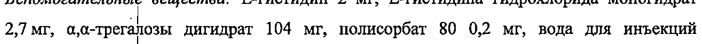
- стр. 2: «< 3 мг/кг, и пропорционально дозе (линейная фармакокинетика) при дозах, составляющих» — низкая уверенность: «3» (79)  
  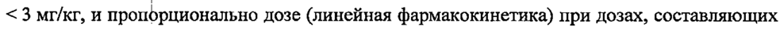
- стр. 2: «_ > 3 мг/кг. Равновёсное состояние достигалось примерно через 16 недель.» — повторное чтение: «_ > 3 мг/kr. Равновёсное состояние достигалось примерно через 16 недель.»  
  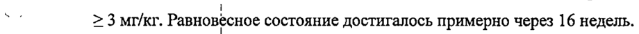
- стр. 2: «геометрическом клиренса в равновесном состоянии (CLss) равному 8,16 мл/час на 365» — повторное чтение: «»  
  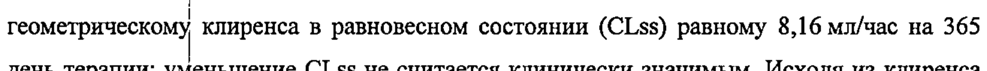
- стр. 3: «Возраст (19-96 hen) масса тела (31-149 кг), пол, наличие антител к дурвалумабу,» — повторное чтение: «Bospacr (19-96 fer), мася “rena 1-149 кг), пол, наличие антител к дурвалумабу,»  
  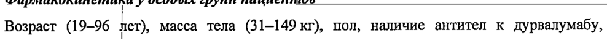
- стр. 3: «функции vn pr степени тяжести (клиренс креатинина (KK) 60-89 мл/мин),» — повторное чтение: «»  
  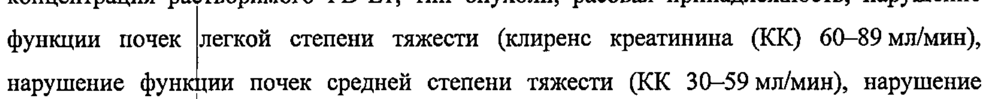
- стр. 3: «комбинации с  имиотерапией, 158 пациентов (46,7 %) были в возрасте 65 лет и старше. В |» — повторное чтение: «комбинации с rijenovepanel, 158 пациентов (46 7%) были в возрасте 65 ner n старше. в |»  
  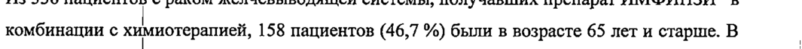
- стр. 3: «пациентов (43 %) были в возрасте 65 лет и старше. В целом, He было установлено» — повторное чтение: «пациентов (43 “) были в возрасте 65 ner и старше. В целом, не было установлено»  
  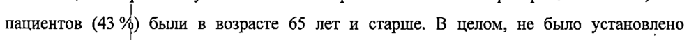
- стр. 4: «дурвалумаба, 173 pares (37,4 %) были в возрасте 65 лет и старше, и 63 пациента (13,6 %) |» — повторное чтение: «»  
  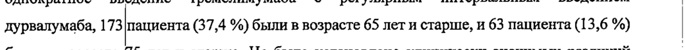
- стр. 6: «| Рекомендуемая | за препарата ИМФИНЗИ® составляет 1500 мг? в комбинации с» — низкая уверенность: «1500» (52)  
  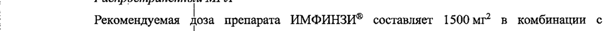
- стр. 6: « *имиотерапевтичскими препаратами один раз в 3 недели в течение 4 циклов, затем 1500 мг» — повторное чтение: «вмиотерапевтич окими препаратами один vas B3 недели p-Texenne циклов, затем 1500 и»  
  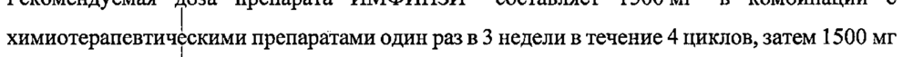
- стр. 6: «Рекомендуемая Доза препарата ИМФИНЗИ® составляет 1500 мг? в комбинации с» — низкая уверенность: «1500» (67); повторное чтение: «Рекомендуемая Joa препарата ИМФИНЗИ® оставляет 1500 vr? в комбинации с»  
  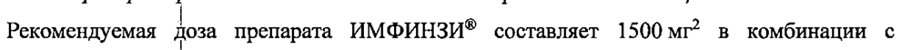
- стр. 6: « *имиотерапевтичскими препаратами один раз в 3 недели, затем 1500 мг в качестве» — низкая уверенность: «1500» (25); повторное чтение: «имиотерапевтичокими препаратами один раз 5 3 недели, затем 1 500 в качестве»  
  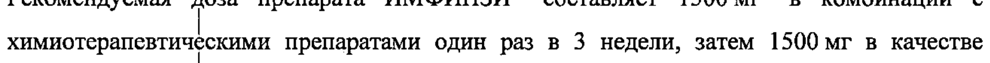
- стр. 6: «1500 мг? в комбиращии с тремелимумабом 75 мг и химиотерапией на основе препаратов» — повторное чтение: «1500.0 в комби Menem 75 и хомистераисй на основе прелараки»  
  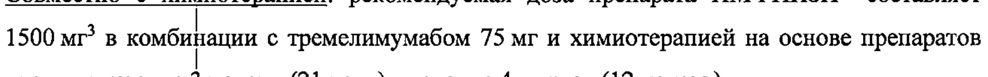
- стр. 7: «Рекомендуемая Доза препарата ИМФИНЗИ® составляет 1500 мг’ в комбинации с» — низкая уверенность: «1500» (67)  
  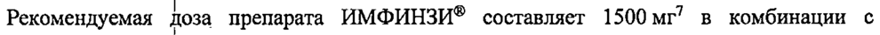
- стр. 7: «spent 300 мг’ в виде однократной начальной дозы в день 1 цикла | с» — повторное чтение: «ewemgnao 200907 mie oni ель д о . ре та :»  
  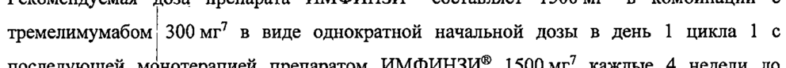
- стр. 7: «| ` Пациентам с |. тела 30 кг и менее препарат ИМФИНЗИ® назначают из расчета» — повторное чтение: «ина _ “cmt wos из расчета»  
  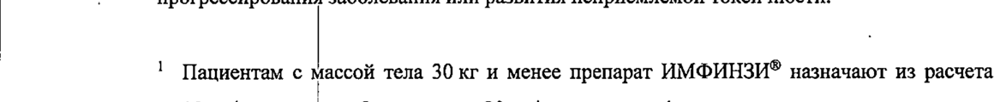
- стр. 7: «? Пациентам с accoi тела 30 кг и менее препарат ИМФИНЗИ® назначают из расчета» — низкая уверенность: «30» (75); повторное чтение: «2 Пациентам с массой тела 30 в | менее препарат ИМФИНЗИ® назначают из расчета»  
  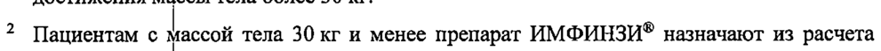
- стр. 7: «20 мг/кг в комбинации с введением химиотерапевтических препаратов один раз в 3» — повторное чтение: «миг . омбинщии © ведением химиотерапевтических препаратов. omun аз в 5»  
  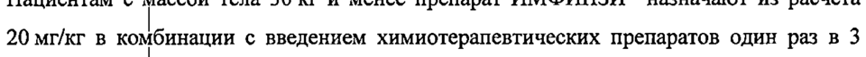
- стр. 7: «недели в течение 4 циклов, затем в качестве монотерапии в дозе 20 мг/кг один раз в 4» — повторное чтение: «Недели в течение 4 циклов, затем в качестве монотерапии в дозе 20 мейкг один раз в 4»  
  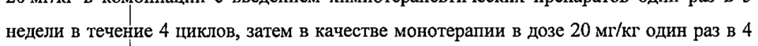
- стр. 7: «недели до  ослижения массы тела более 30 кг.» — повторное чтение: «недели до достижения массы тела более 30 xr.»  
  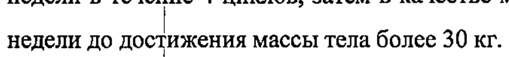
- стр. 7: «3 Пациентам с Массой тела 30 кг и менее назначают препарат ИМФИНЗИ® из расчета» — повторное чтение: «3  ациентам © ассой ‘rena 30 и менее назначают препарат ИМФИНЗИ® из расчета»  
  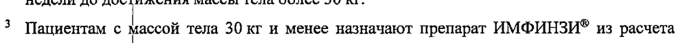
- стр. 7: «20 мг/кг до nocrmenns массы тела более 30 кг. Пациентам с массой тела 35 кг и менее» — повторное чтение: «20 var о о тижения массы ла более 30 xr Пациентам с массой ла 35 к и менее»  
  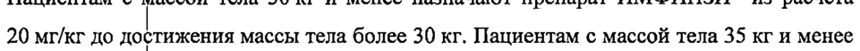
- стр. 7: «назначают  ремелимумаб из расчета 1 мг/кг до достижения массы тела более 35 кг.» — повторное чтение: «»  
  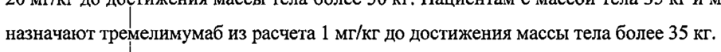
- стр. 7: «7 Пациентам с | ассой тела 30 кг и менее препарат ИМФИНЗИ® назначают из расчета» — повторное чтение: «7 Пациентам © Массой тела 30 xr менее препарат ИМФИНЗИ? назначают из расчета»  
  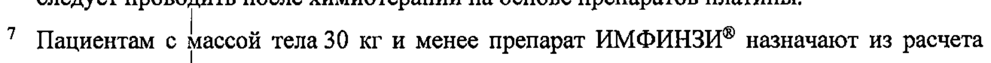
- стр. 7: «20 мг/кг до < тижения массы тела более 30 кг. Пациентам с массой тела 40 кг и менее» — повторное чтение: «20 neler 10 д ежения массы тела более 30 xr, Пациентам массой тела 40 к | менее»  
  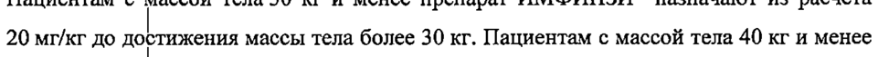
- стр. 7: «назначают  ремелимумаб из расчета 4 мг/кг до достижения массы тела более 40 кг.» — повторное чтение: «»  
  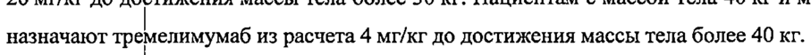
- стр. 13: «флакон для вортривенной инфузии, содержащий 0,9 % раствор натрия хлорида для» — повторное чтение: «dracon зи вфтривонтой yan, солержаший 09% раязор  атрия  орида am»  
  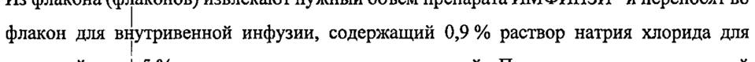
- стр. 13: «‚разведенного раствора должна составлять 1-15 мг/мл. Раствор не встряхивать и не» — низкая уверенность: «1-15» (76)  
  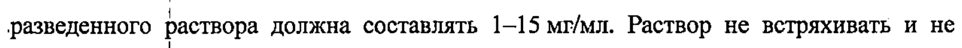
- стр. 14: «(21,5 %), диарея о 6,3 %) и сыпь (16,0 %).» — повторное чтение: «(21,5 %), диарея (16,3 %) и сыпь (16.0%).»  
  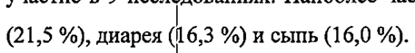
- стр. 19: «2% Включает лойкопению и снижение количёства лейкоНийЗЕЯЩИЙ МЗ №4287234» — низкая уверенность: «2%» (66); повторное чтение: «»  
  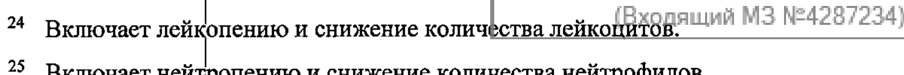
- стр. 20: «75 мг и химиотералией на тремелимумабом 300 мг» — повторное чтение: «175 мги химиотералией на | тремелимумабом 300 мг»  
  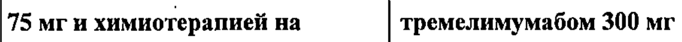
- стр. 24: «enna (5 мг один раз в 4 недели) на основании объединенных данных 2280» — низкая уверенность: «(5» (60); повторное чтение: «»  
  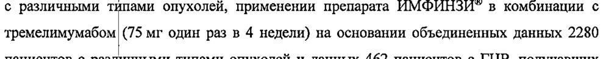
- стр. 24: «пневмонит был "мечен у 92 (3,1 %) пациентов, включая реакции 3 степени тяжести у 25 —» — повторное чтение: «евмонит был отмечен у 92 6 , 1%) n aumento 7  эклочая реакции 3 ere они тяжести y 25»  
  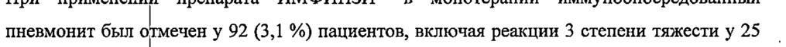
- стр. 25: «- плацебо),  эымунропосредованный пневмонит развился у 47 пациентов (9,9 %) в группе» — повторное чтение: «_ лашебо),  иымунропосредованный  нсвмонит развился у пациентов 69% : уно»  
  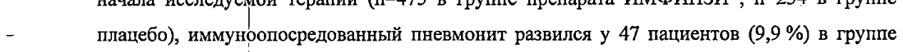
- стр. 25: «сравнению с 6 0.6 %) пациентами в группе плацебо, и реакции 5 степени тяжестиу 4 (0,8 %)» — низкая уверенность: «0.6» (72); повторное чтение: «сравнению с 6 (2,6 %) пациентами втрупие плацебо, и реакции 5 степени тяжести у 4 (0,8 %)»  
  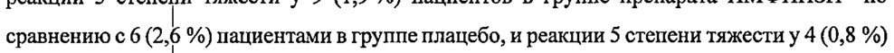
- стр. 25: «пациентов в rpynhe препарата ИМФИНЗИ® no сравнению с 3 (1,3 %) пациентами в группе» — повторное чтение: «пациентов в тре препарата ИМФИНЗИ® по сравнению с3 a3 9%) пациентами 3 rpynmne»  
  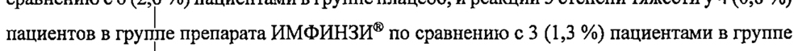
- стр. 25: «| системными  пюкокортикостерондами в высоких дозах (не менее 40 мг преднизолона или» — повторное чтение: «темными о окортикостерондами высоких. зах (ne менее 40 и  педнизолона или»  
  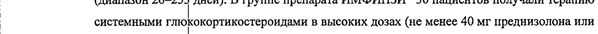
- стр. 25: «менее 40 мг преднизолона или его эквивалента в сутки), | пациент также получал» — низкая уверенность: «40» (46); повторное чтение: «менее 40 мг прёеднизолона или его эквивалента в сутки), | пациент также получал»  
  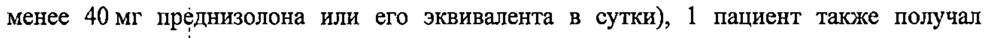
- стр. 25: «| пимувоопосредовинный пневмонит развился у 86 (3,8%) пациентов, включая» — повторное чтение: «пооуноопоорокранный пиевмонит роб у 86 G,8%) EATON, око»  
  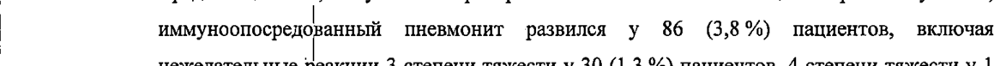
- стр. 25: «| (< 0,1 %) naunenta и 5 степени тяжести у 7 (0,3 %) пациентов. Медиана времени до начала» — повторное чтение: «0 1%) пацисн а и 5 степени яж sora y 7 0 3 % пациентов. Меди ana Bp мени до начала»  
  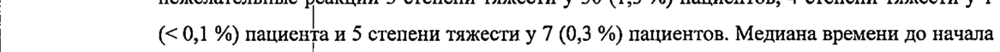
- стр. 26: «| пациента с ee реакцией 3 степени тяжести и 1 (0,2%) пациента с» — низкая уверенность: «1» (76); повторное чтение: «»  
  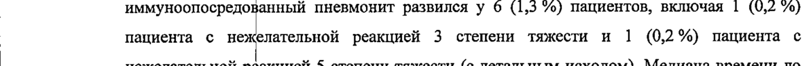
- стр. 26: «пациентов, 4 епени тяжести у 6 (0,2 %) пациентов и 5 степени тяжести у 4 (0,1 %)» — повторное чтение: «ациситов, 4 ereuenm тяжести у 6 (02%) пациентов и Е степени  пажести y 4 1 р»  
  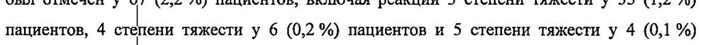
- стр. 26: «| глюкокортикостероидами в высоких дозах (не менее 40 мг преднизолона или его» — низкая уверенность: «40» (25); повторное чтение: «»  
  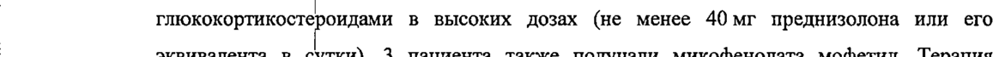
- стр. 26: « ымуноопосредованный гепатит развился у 80 (3,5 %) пациентов, включая реакции 3» — повторное чтение: «ымуноопосродованный толати  азвилоя у 80 as +4) пациентов, “wonovan реакции 3»  
  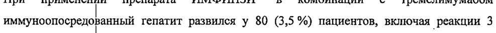
- стр. 26: « пюкокортикостроидами в высоких дозах (не менее 40 мг преднизолона или его» — низкая уверенность: «40» (43); повторное чтение: «токо ортикост рождами | в высоких позах. a : “ene dour “np низоло а и, ‘ero»  
  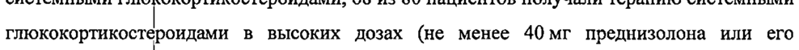
- стр. 27: «степени тяжести J 20 (4,3 %) пациентов, 4 степени тяжестиу 1 (0,2 %) пациента и 5 степени |» — повторное чтение: «степени тяжести | 20 4,3 %) пациентов, 4 степени тяжести у 1 (0. %) пациентаи 5 evenenn ==»  
  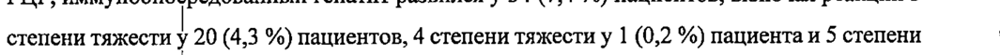
- стр. 27: «тяжести (с тальным исходом) у 3 (0,6 %) пациентов. Медиана времени до начала» — повторное чтение: «тяжести (© летаььным ноходом) у 3 (06%) пациентов. Медиана времени до начала»  
  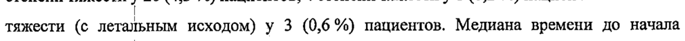
- стр. 28: «реакции 3 crenan тяжести у 17 (3,7%) пациентов. Медиана времени до начала» — повторное чтение: «акции 3 отешфни жести у 17 7% пациентов. Медиана времени до начала»  
  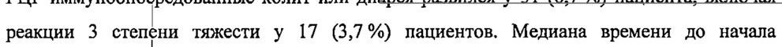
- стр. 28: «глюкокортикостероидами в высоких дозах (не менее 40 мг преднизолона или эквивалента» — повторное чтение: «люкокортикостероидами в высоких дозах (не менее 40 мг преднизолона или эквивалента»  
  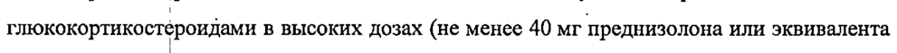
- стр. 29: «40 мг преднизолена или эквивалента в день). Всем пациентам потребовалось проведение» — повторное чтение: «{Ove прелнизолена или эквивалента в лень), Boek пациснтам потребовалось проведение»  
  
- стр. 29: «_-  нымуноопосредованный гипертиреоз развился у 62 (2,7 %) пациентов, включая реакции 3» — повторное чтение: «_ masynoonocpendpanmnit гипертиреоз развился у 69 0.7% пациентов, sxmtovan реакции 3»  
  
- стр. 29: «глюкокортикостероидами в высоких дозах (не менее 40 мг преднизолона или его» — низкая уверенность: «40» (28)  
  
- стр. 30: «глюкокортикостероидами в высоких дозах (не менее 40 мг преднизолона или его» — низкая уверенность: «40» (27)  
  
- стр. 30: «имуноопосрелованный тиреоидит возник у 15 (0,7 %) пациентов, включая реакцию 3» — повторное чтение: «оувоопоередоранный mp count? возник у. 15 02 пациентов, включая реакцию 3»  
  
- стр. 30: «—  пюкокортикост роидами в высоких дозах (не менее 40 мг преднизолона или его» — низкая уверенность: «40» (3)  
  
- стр. 30: «| ГЦР,  эымуноопосредованный тиреоидит возник у 6 (1,3 %) пациентов. Медиана времени» — повторное чтение: «| FUP, нымуноопе редованный tapeomai них 6 13 1%) пациентов, Медиана  ремени»  
  
- стр. 31: «недостаточность унции надпочечников была отмечена у 14 (0,5 %) пациентов, включая» — повторное чтение: «достаточность  узкции надпочечников была omeuena 14 05 %) пациентов, включал»  
  
- стр. 31: «реакцию 3 venta тяжести у 3 (<0,1 %) пациентов. Медиана времени до начала |» — низкая уверенность: «(<0,1» (41); повторное чтение: «реакцию 3 слешый тяжести у 3 (<0,L%) пациентов. Медиана времени до начала»  
  
- стр. 31: «. получали repamny системными глюкокортикостероидами в высоких дозах (не менее 40 мг |» — повторное чтение: «_ получали терапин) системными тлококортикостероидами в высоких дозах (не менее AO ME»  
  
- стр. 31: « ‚ымуноопосредо (анная недостаточность функции надпочечников развилась у 33 (1,4 %)» — повторное чтение: «ымуноопосредо|анная недостаточность функции надпочечников развилась у 33 (14%»  
  
- стр. 31: «| пациентов,  клюЧая реакции 3 степени тяжести у 16 (0,7 %) пациентов и 4 степени тяжести» — повторное чтение: «| ацвентов, включая акции 3 crenent жести y 16 (071%) пациентов и 4 степени тяжести»  
  
- стр. 31: «| y 1 (<0,1 %) пациента. Медиана времени до начала нежелательной реакции составила 105» — повторное чтение: «| т Ko, 19) пациента. Медиана  емени до начала ne on тельной аки в составила 105»  
  
- стр. 31: «| yy  люкокортикостерондами в высоких дозах (не менее 40 мг преднизолона или его» — повторное чтение: «у пкокортикостероидами в высоких дозах не менее 40 MI  преднизолона или его»  
  
- стр. 31: «(1,3 %) nanuearop, включая реакцию 3 степени тяжести у 1 (0,2 %) пациента. Медиана» — повторное чтение: «a3 в) пациентов, включая реакцию Е степени тяжести 1 2%) пациента. Медиана»  
  
- стр. 32: «сахарный nae степени тяжестиу 1 (< 0,1 %) пациента и 4 степени тяжести у 2 (< 0,1 %)» — повторное чтение: «»  
  
- стр. 32: « ипофизит/ипопитуитаризм был отмечену 2 (< 0,1 %) пациентов (нежелательная реакция» — повторное чтение: «ито  фзитиипотиту паризм Gun ommeven y 2 K0, 1 9%) пациентов (uexenarensian p акция»  
  
- стр. 32: «| (не менее 40 мг преднизолона или его эквивалента в сутки). Терапия препаратом» — низкая уверенность: «40» (41)  
  
- стр. 32: «включая реакций 3 степени тяжести у 8 (0,4 %) пациентов. Медиана времени до начала» — повторное чтение: «включая реакций 3 степени жести у 8 (4 %) пациентов. Медиана  ремени до начала»  
  
- стр. 32: « пюжокортикост роидами в высоких дозах (не менее 40 мг преднизолона или его» — низкая уверенность: «40» (75); повторное чтение: «пококортикост рошлами в высоких дозах (ше | менее. Our преднизолона am ero»  
  
- стр. 33: «менее 40 мг  педизолона или его эквивалента в день). 3 пациентам также потребовалась» — повторное чтение: «менее 40 MF продвизолона иди его эквивалента в день), 3 пациентам также потребовалась»  
  
- стр. 33: «был отмечен у "t (0,5 %) пациентов, включая реакцию 3 степени тяжести у 2 пациентов» — повторное чтение: «был отмечен у 1 (055% пациватов, включая реакцию 3 степени тяжести у 2 пациентов»  
  
- стр. 33: « зимуноопосредованный нефрит возник у 9 (0,4 %) пациентов, включая реакцию 3 степени» — повторное чтение: «му  оопосредованный нефрит овнику 9 (04 пациентов, включая акцию 3 степени»  
  
- стр. 33: «глюкокортикостероидами в высоких дозах (не менее 40 мг преднизолона или его» — низкая уверенность: «40» (39)  
  
- стр. 33: «степени тяжести 2 (0,4 %) пациентов. Медиана времени до начала нежелательной реакции» — повторное чтение: «степени тяжести у 2 (04 % пациентов. Медиана времени до начала нежелательной реакции»  
  
- стр. 34: «степени тост у 12 (0,4%) пациентов. Медиана времени до начала нежелательной» — повторное чтение: «»  
  
- стр. 34: « эымуноопоёредованные сыпь или дерматит (включая пемфигоид) развились у 112 (4,9 %)» — повторное чтение: «ымуноопоерело ванные coins ли  прматит (вкпочая  вемфигоид) развились у 112 (4 9 %)»  
  
- стр. 34: «пациентов, вклю ая реакции 3 степени тяжести у 17 (0,7 %) пациентов. Медиана времени -» — повторное чтение: «пациентов, клюв реакции 3 orem ни же om y 170.7%) пациентов. м нана Е exten ;»  
  
- стр. 34: «терапию сте ными глюкокортикостероидами в высоких дозах (не менее 40 мг |» — низкая уверенность: «40» (14); повторное чтение: «терапию системными гпококортикостероидами в высоких домх (не менее 40мг —»  
  
- стр. 34: «| (5,6 %) пациентов, включая реакции 3 степени тяжести у 9 (1,9 %) пациентов и 4 степени» — повторное чтение: «5 пациент, вюшочая реакции 3 степени тяжести y 9 (1.9%) пациентов и 4 стелени»  
  
- стр. 34: «| пококортикост рождами в высоких дозах (не менее 40 мг преднизолона или его» — низкая уверенность: «40» (22); повторное чтение: «кокртиет ром 5 высоких зах (не менее 40 ur spemponoHa an er»  
  
- стр. 34: «| препарата, были отмены у 49 (1,6 %) пациентов, включая реакции 3 степени тяжести у 5» — повторное чтение: «»  
  
- стр. 35: «реакция развилас у 45 (2,0 %) пациентов, вклю ая реакции епени тяжести <0.1%» — повторное чтение: «peak pasate 45 (0%) паять шеек «степени Тяжести Y 2 < %`»  
  
- стр. 35: «о ИМФИНЗИ® в дозе 10 мг/кг один раз в 2 недели или 20 мг/кг один раз в 4 недели и» — низкая уверенность: «10» (64)  
  
- стр. 35: «1500 мг один Pas в 3 недели в комбинации с химиотерапевтическими препаратами и |» — повторное чтение: «»  
  
- стр. 35: «В последовании POSEIDON у 29 (10,1%) пациентов (n=286), получавших препарат» — низкая уверенность: «(10,1%)» (65)  
  
- стр. 36: «В исследовании HIMALAYA у 9 (3,1 %) пациентов (n=294), получавших однократное» — повторное чтение: «»  
  
- стр. 36: «| обнаружены у 5 (1,7 %) пациентов. Наличие антител к дурвалумабу He оказывало явного» — низкая уверенность: «(1,7» (58); повторное чтение: «| обнаружены у 5 (7 %) пациентов. Наличие антител к дурвалумабу не оказывало явного»  
  
- стр. 36: «В исследовании HIMALAYA у 8 (2,8 %) пациентов (n=282), получавших монотерапию» — повторное чтение: «В wecnesosaun HIMALAYA у 8 (28% пациато (0-22), получавших монотерию»  
  
- стр. 36: «Нейтрализующие антитела к дурвалумабу были обнаружены у 2 (0,7%) пациентов.» — низкая уверенность: «(0,7%)» (79)  
  
- стр. 38: «‚ преднизолон в начальной дозе 1-2 мг/кг/сутки (или эквивалента) с последующим №’» — повторное чтение: «‚ преднизолон в `начальной дозе 1—2 мг/кг/сутки (или эквивалента) с последующим °°»  
  
- стр. 38: «` 58 (24,8 %)  ацибитоь в группе плацебо, включая реакции 3 степени тяжести у 16 (3,4 %)» — повторное чтение: «- 58 ав паши r03 3  руцше плацебо, вклю чая реакции степени тяжести у 16 4%»  
  
- стр. 39: «начальной = 1-2 мг/кг/сутки преднизолона (или эквивалента) с последующим» — повторное чтение: «м в 8 wiecleyrek предииошона (ши эюивалении) © последующим»  
  
- стр. 40: «начальной nae 1-2 мг/кг/сутки преднизолона (или эквивалента) с последующим» — повторное чтение: «sa | seo “atm ar ao 2 eo зол =e ceo»  
  
- стр. 40: «| начальной дозе 1-2 мг/кг/сутки преднизолона (или эквивалента) с последующим» — повторное чтение: «- анальной доза I-2unfer/eyrxat преднизолона (или экзивалента) © последующим»  
  
- стр. 41: «начальной дозе 2-4 мг/кг/сутки преднизолона (или эквивалента) с последующим» — низкая уверенность: «2-4» (75)  
  
- стр. 42: « ококортикост роды в начальной дозе 1-2 мг/кг/сутки преднизолона (или эквивалента)» — повторное чтение: «покохортикостероиды начальной nose 1-2 saherfeyrea преднизолона (или эквиваненти)»  
  
- стр. 42: «По 2,4 мл (120 мг / 2,4 мл) или 10,0 мл (500 мг/ 10,0 мл) в стеклянные флаконы (тип J), |» — низкая уверенность: «10,0» (25)  
  
