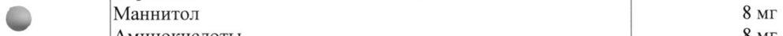
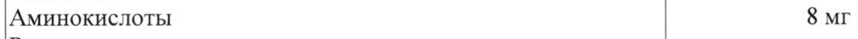

# Живой аттенуированный вирус Varicella Zoster — парентерально

- Препарат: Варилрикс® (Вакцина против ветряной оспы живая аттенуированная) (лиофилизат для приготовления раствора для внутримышечного и подкожного введения;)
- АТХ: J07BK01
- Источник: ГРЛС, инструкция по медицинскому применению, РУ ЛСР-001354/08, файл от 2023-11-13 (https://grls.rosminzdrav.ru/Grls_View_v2.aspx?routingGuid=a4eb2ebc-3815-42d3-b335-960b32db498b)
- Распознано автоматически (OCR): 13 из 13 стр.
- Инструкция к другому РУ того же препарата: ЛСР-001354/08 (национальное РУ, переоформленное по правилам ЕАЭС, решение от 26.10.2023). Текст может быть старше действующего
- Сомнительных строк после OCR: 2 (см. раздел «Проверка распознавания»)

## Общие сведения

‘en ee МИНЗДРАВ РОССИЯ 5 0919 16-00. 59/08 71 2° 8°
МИНИСТЕРСТВО ЗДРАВООХРАНЕНИЯ РОССИИСКОЙ ФЕДЕРАЦИИ

[_ СОГЛАСОВАНО |

орион ИИ

ИНСТРУКЦИЯ ПО МЕДИЦИНСКОМУ ПРИМЕНЕНИЮ ЛЕКАРСТВЕННОГО ПРЕПАРАТА
ВАРИЛРИКС® / VARILRIX® (Вакцина против ветряной оспы живая аттенуированная)

Регистрационный номер:

Торговое наименование: Варилрикс® (Вакцина против ветряной оспы живая

аттенуированная) / Varilrix®.

© Группировочное наименование: вакцина для профилактики ветряной оспы.

## 3. Лекарственная форма

лиофилизат для приготовления раствора для подкожного
лиофилизат для приготовления раствора для подкожного

введения.

## 2. Состав

1 прививочная доза (0,5 мл) содержит":

Дейвтвующее вещество |

Живой аттенуированный вирус Varicella Zoster (штамм 33 34

2 10°" БОЕ"

Oka

Вепомогательные вещества

Лактоза 32 мг

Сорбитол 6 Mr

& Маннитол 8 мг

Аминокислоты 8 мг

Растворитель

Вода для инъекций 0,5 мл

Примечания

1. Вакцина не содержит консервантов.

2. Вакцина содержит следовые количества неомицина сульфата (не более 25 мкг/дозу).

3. БОЕ — бляшкообразующие единицы.

4. Номинальный титр вируса соответствует минимальному титру, гарантируемому производителем на дату окончания срока годности. Содержание вируса в одной прививочной дозе на момент выпуска препарата должно отличаться и превышать минимальный титр, указанный в составе.

ОПИСАНИЕ

Аморфная масса или порошок от кремового до светло-желтого или светло-розового цвета;

восстановленный препарат — жидкость от чистого желто-розового до розового цвета.

C.1 из 10 Растворитель: прозрачная бесцветная жидкость без видимых механических включений.
ХАРАКТЕРИСТИКА Варилрикс* (Вакцина против ветряной оспы живая аттенуированная) (далее —
Варилрикс®) — живая аттенуированная вакцина для профилактики ветряной оспы, представляет собой живой аттенуированный вирус Varicella Zoster (штамм Oka), культивированный в культуре диплоидных клеток человека MRC-5. Варилрикс* отвечает всем требованиям Всемирной организации здравоохранения к производству медицинских иммунобиологических препаратов.
ФАРМАКО-ТЕРАПЕВТИЧЕКАЯ ГРУППА: МИБП-вакцина.
Код ATX: JO7BKO1.
ИММУНОЛОГИЧЕСКИЕ СВОЙСТВА we Иммунологическая и эпидемиологическая эффективность
Иммунологическую эффективность вакцины Варилрикс® в отношении профилактики ветряной оспы (случаи заболевания, подтвержденные результатами ПЦР или контактом с клинически подтвержденным случаем ветряной оспы) оценивали в масштабном международном клиническом исследовании с группой активного контроля, в котором дети в возрасте 12-22 месяцев получали одну дозу вакцины Варилрикс® или две дозы комбинированной вакцины для профилактики кори, паротита, краснухи и ветряной оспы.
Иммунологическая эффективность вакцинации вакциной Варилрикс® составила:
Эффективность против | Эффективность против pvuina Временной подтвержденных подтвержденных случаев руп интервал | случаев ветряной оспы |ветряной оспы умеренной любой степени тяжести или тяжелой степени
Варилрикс® (1 доза) 6 лет 67,0 % 90,3 % N =2 487
Комбинированная ВОИ 2 года 94,9 % 99,5 % профилактики кори, эпидемического паротита, краснухи и 95,0 % 99,0 % ветряной оспы (ОКа)
(2 дозы) 10 лет 95,4 % 99,1 % М = 2489 С. 2 из 13
Эпидемиологическую эффективность 1 дозы вакцины Варилрикс" оценивали в различных условиях (вспышки заболевания, исследования случай-контроль, изучение баз данных), значение величины эффективности варьировало от 20 до 92 % против ветряной оспы любой степени тяжести и от 86 до 100 % против ветряной оспы средней или тяжелой степени тяжести.
Введение 1 дозы вакцины Варилрикс® обеспечивало снижение количества госпитализаций по поводу ветряной оспы и количества амбулаторных визитов среди детей на 81 % и 87 %, соответственно.
Данные по эпидемиологической эффективности свидетельствуют о повышении уровня защиты и снижении частоты эпизодов «прорыва» ветряной оспы после введения 2 доз вакцины по сравнению с введением 1 дозы.
Иммунный ответ Здоровые лица У детей в возрасте от 11 до 21 месяца включительно сероконверсия, измеренная методом
© иммуноферментного анализа (50 мМЕ/мл) через 6 недель после вакцинации, составила 89,6 % после введения 1 дозы и 100 % после введения 2 доз вакцины.
У всех детей в возрасте от 9 месяцев до 12 лет включительно сероконверсия, измеренная в реакции иммунофлуоресценции через 6 недель после введения 1 дозы, достигала 98 %.
У детей в возрасте от 9 месяцев до блет сероконверсия, измеренная в реакции иммунофлуоресценции через 6 недель после введения второй дозы вакцины, составила 100 % (увеличение средней геометрической величины титра антител в 5—26 раз).
У детей в возрасте от 1Злет и старше сероконверсия, измеренная в реакции иммунофлуоресценции через 6 недель после введения второй дозы вакцины, составила 100 %. При контроле через 1 год после курса вакцинации все лица были серопозитивными.
В клинических исследованиях было показано, что большинство вакцинированных, находившихся впоследствии в контакте с заболевшими, либо не подвержены инфекции, либо переносят заболевание в значительно более легкой форме (меньшее количество высыпаний, отсутствие лихорадки).
& Для оценки уровня защиты OT развития осложнений ветряной оспы, таких как энцефалит, гепатит или пневмония, данных недостаточно.
Данные клинических исследований по применению вакцины Варилрикс® у пациентов из групп высокого риска развития ветряной оспы являются ограниченными. Установлено, что общая частота сероконверсии у пациентов данной категории составляет > 80 %.
У пациентов из групп высокого риска после вакцинации следует периодически осуществлять определение титра антител к вирусу ветряной оспы для принятия решения о необходимости дополнительной прививки.

## 4.1. Показания к применению

— Плановая профилактика ветряной оспы с 12 месяцев, в первую очередь у лиц, отнесенных к группам высокого риска (см. раздел «Особые указания»), не болевших ветряной оспой и не привитых ранее.
— Плановая профилактика ветряной оспы с 12 месяцев, в первую очередь у лиц, отнесенных к группам высокого риска (см. раздел «Особые указания»), не болевших ветряной оспой и не привитых ранее.
С. 3 из 13 — Экстренная профилактика ветряной оспы у лиц, не болевших ветряной оспой и не привитых ранее, находившихся в тесном контакте с больными ветряной оспой (члены семей, врачи, средний и младший медицинский персонал, а также другие лица).

## 4.3. Противопоказания

— Гиперчувствительность к какому-либо компоненту вакцины, в том числе к неомицину;
симптомы гиперчувствительности на предыдущее введение вакцины для профилактики ветряной оспы.

— Тяжелый гуморальный или клеточный иммунодефициты, такие как: первичный или приобретенный иммунодефицит (развившийся вследствие лейкоза, лимфомы, дискразии крови, клинических проявлений ВИЧ-инфекции, применения иммунодепрессантов, включая высокодозную терапию кортикостероидами), определяемый по количеству лимфоцитов — менее 1200/мм?, а также при наличии других признаков клеточного иммунодефицита.

© — Острые инфекционные и неинфекционные заболевания, обострение хронических заболеваний являются временными противопоказаниями для проведения прививок; при нетяжелых ОРВИ, острых кишечных заболеваниях вакцинацию проводят сразу после нормализации температуры.

— Беременность или планируемая беременность в течение 1 месяца после вакцинации.
Период кормления грудью.

## 4.6. Применение при беременности и в период грудного вскармливания

ВСКАРМЛИВАНИЯ

Фертильность

Данные отсутствуют.

Беременность

Беременных женщин нельзя вакцинировать препаратом Варилрикс*. Не следует допускать

наступления беременности в течение 1 месяца после вакцинации. Женщинам,

& планирующим беременность, следует рекомендовать отложить наступление беременности.

Соответствующие данные о применении препарата Варилрикс® у человека во время

беременности отсутствуют, а исследования репродуктивной токсичности на животных не

проводились.

Период грудного вскармливания

Данные о применении у женщин в период грудного вскармливания отсутствуют.

## 4.2. Способ применения и дозы

Способ введения

Вакцина Варилрикс® предназначена для подкожного введения. Вакцину следует вводить в

область дельтовидной мышцы или в переднебоковую область бедра.

Вакцину Варилрикс* нельзя вводить внутрисосудисто или внутрикожно.

Растворитель и восстановленную вакцину перед использованием необходимо визуально

проверить на отсутствие механических включений и/или изменение внешнего вида (см.

С. 4 из 13 раздел «Описание»). В случае их обнаружения следует отказаться от применения растворителя или восстановленной вакцины.
Вакцину Варилрикс® нельзя смешивать в одном шприце с другими вакцинами.
Приготовление вакцины перед введением с использованием растворителя в шприце
Вакцину Варилрикс® необходимо восстановить путем добавления полного объема растворителя из предварительно наполненного шприца во флакон, содержащий лиофилизат.
Внимание! Упаковка вакцины Варилрикс® может быть представлена двумя типами шприцев, различающихся по способу соединения иглы с носиком шприца.
Для правильного выбора способа соединения иглы и шприца следуйте представленным ниже инструкциям. Шприц, вкладываемый в упаковку вакцины Варилрикс®, может незначительно отличаться от изображения шприца на рисунке 1.
Шприц 1 типа Рисунок 1 - Игла Защитный колпачок для г ИГЛЫ
=...
Шприц fr. of} ЖИ i iy SY \ А Е Поршень шприца
Цилиндр шприца Защитный колпачок шприца о .
a :

Инструкция по подготовке шприца 1 типа (рисунок 1) к использованию:
Ly Открутите защитный колпачок шприца, поворачивая его против часовой стрелки (при

этом следует удерживать шприц за цилиндр, избегая контакта с поршнем шприца).
2. Крутящим движением по часовой стрелке соедините иглу со шприцем до момента,

когда вы ощутите их защелкивание друг на друге.
Е Удалите защитный колпачок с иглы (в отдельных случаях он может быть туго

закреплен на игле).
Шприц 2 типа

С. 5 из 13 В случае, если упаковка содержит шприц, отличный от представленного на рисунке 1, то

после удаления защитного колпачка с носика шприца игла надевается на шприц до упора

без дополнительного накручивания.

Перенести растворитель из шприца во флакон с лиофилизатом. После добавления

растворителя к лиофилизату хорошо встряхнуть образовавшуюся суспензию до полного

растворения лиофилизата в растворителе (приблизительно 3 минуты). После

восстановления вакцину необходимо незамедлительно ввести. Для введения вакцины

следует использовать новую иглу. Для введения извлекают из флакона с восстановленной

вакциной все его содержимое.

Приготовление вакцины перед введением с использованием растворителя в ампуле

Варилрикс® необходимо восстановить путем добавления полного объема растворителя из

ампулы во флакон, содержащий лиофилизат.

После добавления растворителя к лиофилизату хорошо встряхнуть образовавшуюся

суспензию до полного растворения лиофилизата в растворителе (приблизительно
© 3 минуты). После восстановления вакцину необходимо незамедлительно ввести. Для

введения вакцины следует использовать новую иглу. Для введения извлекают из флакона

с восстановленной вакциной все его содержимое.

После обработки места проведения инъекции спиртом или другим веществом,

применяющимся для дезинфекции, следует подождать, пока это вещество испарится,

поскольку при контакте с подобными соединениями может произойти инактивация

вакцинного вируса.

Вакцину следует вводить сразу после ее разведения растворителем.

Неиспользованный препарат и отходы от его использования должны быть уничтожены в

соответствии с требованиями, принятыми в Российской Федерации.

Схемы вакцинации

Плановая профилактика

По 1 дозе вакцины (0,5 мл) двукратно.

Рекомендованный минимальный интервал между прививками должен составлять 6 недель.
& Экстренная профилактика

Вакцинацию проводят однократно 1 дозой вакцины (0,5 мл) в течение первых 96 часов

после контакта (предпочтительно в течение первых 72 часов).

Вакцинация групп высокого риска

Пациенты с острым лейкозом, пациенты с тяжелыми хроническими заболеваниями и

пациенты, получающие терапию иммунодепрессантами и лучевую терапию

Иммунизация проводится в состоянии полной гематологической ремиссии. При этом

необходимо удостовериться, что общее количество лимфоцитов составляет не менее

1200/ммз, а также отсутствуют симптомы, указывающие на недостаточность клеточного

иммунитета.

Если вакцинацию планируется провести в острой фазе лейкоза, необходимо прервать

химиотерапию на срок, равный одной неделе до и одной неделе после вакцинации. Не

следует проводить вакцинацию в периоды лучевой терапии.

Пациенты, которым планируется произвести трансплантацию органа

С. биз 13 Если пациентам предстоит трансплантация органа, то курс вакцинации должен быть завершен за несколько недель до начала проведения терапии иммунодепрессантами.
Пациентам групп высокого риска могут потребоваться дополнительные дозы вакцины.
Решение о необходимости введения дополнительных доз вакцины Варилрикс® принимает лечащий врач (иммуногематолог, онколог, трансплантолог).
Взаимозаменяемость вакцин Вакцина Варилрикс® может быть введена тем, кто уже был вакцинирован другой вакциной, содержащей компонент для профилактики ветряной оспы.
Курс вакцинации против ветряной оспы, начатый вакциной Варилрикс®, может быть продолжен другой вакциной, содержащей компонент для профилактики ветряной оспы.

## 4.8. Побочное действие

Данные клинических исследований
Данные клинических исследований
Здоровые лица © Профиль безопасности вакцины, приведенный ниже, основан на данных, полученных для 5 369 доз вакцины, вводившейся детям, подросткам и взрослым.
Нежелательные реакции, представленные ниже, перечислены в соответствии с поражением органов и систем органов и частотой встречаемости. Частота встречаемости определяется следующим образом: очень часто (> 1/10), часто (> 1/100 и < 1/10), нечасто (> 1/1 000 и
< 1/100), редко (> 1/10 000 и < 1/1 000), очень редко (< 1/10 000, включая отдельные случаи).
Частота встречаемости нежелательных реакций
Инфекционные и паразитарные заболевания Нечасто: инфекции верхних дыхательных путей, фарингит.
Нарушения со стороны крови и лимфатической системы
Нечасто: лимфаденопатия.
Нарушения психики Нечасто: раздражительность.
Нарушения со стороны нервной системы © Нечасто: головная боль, сонливость.
Нарушения со стороны органа зрения Редко: KOHBIOHKTHBHT.
Нарушения со стороны дыхательной системы, органов грудной клетки и средостения
Нечасто: кашель, ринит.
Нарушения со стороны желудочно-кишечного тракта
Нечасто: тошнота, рвота.
Редко: боли в абдоминальной области, диарея.
Нарушения со стороны кожи и подкожных тканей
Часто: СЫПЬ.
Нечасто: сыпь, сходная с высыпаниями при ветряной оспе, прурит.
Редко: крапивница.
Нарушения со стороны скелетно-мышечной системы и соединительной ткани
Нечасто: артралгия, миалгия.
Общие расстройства и нарушения в месте введения
С. 7 из 13 Очень часто: боль и покраснение в месте инъекции.
Часто: отек в месте инъекции, повышение температуры тела (ректальной
> 38 °С, в подмышечной впадине или ротовой полости > 37,5 °С).
Отек в месте инъекции и повышение температуры тела встречались очень часто в исследованиях, проводимых у подростков и взрослых. Отек также очень часто встречается после введения второй дозы детям до 13 лет. Тенденция увеличения количества случаев боли, покраснения и отека в месте инъекции после введения второй дозы была сопоставима с количеством этих нежелательных реакций, наблюдавшихся после введения первой дозы.
Нечасто: повышение температуры тела (ректальной > 39,5°С; в подмышечной впадине или ротовой полости > 39°C), слабость, недомогание.
Не выявлены различия между профилем реактогенности у изначально серопозитивных и серонегативных лиц.
Пациенты из групп высокого риска Существуют только ограниченные данные клинических исследований среди пациентов
© повышенного риска осложненного течения ветряной оспы. Вакциноассоциированные реакции (в основном папуло-везикулезная сыпь и повышение температуры тела) имеют, как правило, легкое течение. Как и у здоровых лиц, покраснение, отек и боль в месте инъекции имеют легкую степень и являются преходящими.
Данные пострегистрационного наблюдения В ходе пострегистрационного наблюдения дополнительно зарегистрированы следующие нежелательные реакции после вакцинации.
Инфекционные и паразитарные заболевания Редко: инфекция, вызванная Herpes Zoster.
Нарушения со стороны крови и лимфатической системы
Редко: тромбоцитопения.
Нарушения со стороны иммунной системы Редко: реакции гиперчувствительности, анафилактические реакции.
Нарушения со стороны нервной системы ww Редко: энцефалит, острое нарушение мозгового кровообращения, церебеллит, симптомы, напоминающие церебеллит (включая преходящее нарушение походки и преходящую атаксию), судороги.
Нарушения со стороны сосудов Редко: васкулит (включая пурпуру Шонлейна-Геноха и синдром Кавасаки).
Нарушения со стороны кожи и подкожных тканей
Редко: многоформная эритема.
При наблюдении за массовым применением вакцины зарегистрированы случаи анафилактоидных реакций.

## 4.9. Передозировка

Зарегистрированы отдельные сообщения о случайной передозировке вакцины. В некоторых из них сообщалось о развитии таких симптомов, как летаргия, судороги. В других случаях передозировка не привела к развитию нежелательных явлений.
Зарегистрированы отдельные сообщения о случайной передозировке вакцины. В некоторых из них сообщалось о развитии таких симптомов, как летаргия, судороги. В других случаях передозировка не привела к развитию нежелательных явлений.
С. 8 из 13 ВЗАИМОДЕЙСТВИЕ С ДРУГИМИ ЛЕКАРСТВЕННЫМИ ПРЕПАРАТАМИ
При необходимости постановки туберкулиновой пробы она должна быть проведена до вакцинации, поскольку по имеющимся данным живые вирусные вакцины могут вызывать временное снижение чувствительности кожи к туберкулину. В связи с тем, что подобное снижение чувствительности может сохраняться до 6 недель, не следует осуществлять туберкулинодиагностику в течение указанного периода времени после вакцинации во избежание получения ложноотрицательных результатов.
Вакцинация препаратом Варилрикс® возможна не ранее чем через 3 месяца после введения иммуноглобулинов или после гемотрансфузии.
Следует избегать назначения салицилатов в течение 6 недель после вакцинации препаратом Варилрикс®, поскольку имелись сообщения о развитии синдрома Рея на фоне инфекции, вызванной естественным вирусом ветряной оспы.
Одновременное назначение с другими вакцинами
Вакцину Варилрикс® можно вводить одновременно с инактивированными вакцинами
© национального календаря профилактических прививок и календаря прививок по эпидемическим показаниям, за исключением антирабической вакцины.
Вакцину Варилрикс® можно назначать в один день с вакцинами для профилактики кори, краснухи и паротита.
При этом различные вакцины вводят в разные участки тела.
Здоровые лица Варилрикс® может применяться одновременно с любыми другими вакцинами.
При применении с коревой вакциной, в случае если прививки не были сделаны в один день, рекомендуется соблюдать интервал 30 дней.
Пациенты из групп высокого риска Вакцину Варилрикс® не следует назначать одновременно с другими живыми аттенуированными вакцинами, за исключением комбинированной вакцины против кори, краснухи и паротита. Однако если эти вакцины не были назначены одновременно, то
| интервал между их назначением для достижения максимального уровня антител должен w составлять He менее 30 дней.

## 4.4. Особые указания

Как и при любой другой вакцинации, иммунный ответ может развиться не у всех вакцинированных.
Как и при любой другой вакцинации, иммунный ответ может развиться не у всех вакцинированных.
Как и при применении других вакцин для профилактики ветряной оспы, отмечены случаи заболевания ветряной оспой у лиц, привитых вакциной Варилрикс*. Однако такие случаи ветряной оспы обычно протекают в легкой форме, с небольшим количеством элементов сыпи и менее выраженным повышением температуры тела, по сравнению со случаями ветряной оспы у невакцинированных лиц. Отмечены редкие случаи передачи вакцинного штамма вируса от вакцинированных лиц с сыпью к контактным серонегативным лицам.
Нельзя исключать передачу вакцинного штамма вируса контактным серонегативным лицам от вакцинированных лиц при отсутствии у последних элементов сыпи.
С. 9 из 13 При вакцинации в течение первых 72 часов после контакта с инфекцией, вызванной естественным вирусом ветряной оспы, защита от ветряной оспы может быть достигнута не полностью.

Вакцинированные лица, у которых выявляются высыпания в течение 3 недель после

вакцинации, должны исключить любые контакты с беременными женщинами (особенно в

течение первого триместра беременности) и с лицами с иммунодефицитными состояниями

в течение 14 дней с момента появления последнего высыпания.

Как и при парентеральном введении любых других вакцин, наготове должно быть все

необходимое для купирования возможной анафилактической реакции на вакцину

Варилрикс®. Вакцинированный должен находиться под медицинским наблюдением в

течение 30 минут после иммунизации.

После вакцинации или иногда перед ней возможен обморок (потеря сознания) как

психологическая реакция на инъекцию. Перед вакцинацией важно удостовериться, что

пациент не получит повреждений в случае обморока.

Следует принимать адекватные меры контрацепции в течение 1 месяца после введения

w вакцины Варилрикс®.

Данные о применении вакцины Варилрикс® у лиц с иммунодефицитными состояниями

ограничены, поэтому вакцинацию следует проводить с осторожностью и только в том

случае, когда, по мнению врача, польза превышает риск.

У лиц с иммунодефицитными состояниями, не имеющих противопоказаний к вакцинации

(раздел «Противопоказания»), как и у иммунокомпетентных пациентов, может не

выявиться иммунная защитная реакция, соответственно часть вакцинированных может

заразиться ветряной оспой, несмотря на правильно проведенную вакцинацию. Лица с

иммунодефицитными состояниями должны находиться под тщательным наблюдением для

выявления признаков ветряной оспы.

Сообщается о единичных случаях диссеминации вируса ветряной оспы с вовлечением в

процесс внутренних органов после вакцинации препаратом, содержащим штамм ОКа,

преимущественно у пациентов с иммунодефицитом.

При наличии первичного или приобретенного иммунодефицита вакцинацию проводят

~ после определения количества лимфоцитов.

У пациентов, которые получают массивную терапию иммунодепрессантами, после

вакцинации могут развиться клинические признаки ветряной оспы.

Пациенты из групп высокого риска

Следущие группы лиц предрасположены к развитию тяжелой формы ветряной оспы:

— пациенты с острым лейкозом;

— пациенты, получающие терапию иммуносупрессантами, включая применение кортикостероидов по поводу злокачественных солидных опухолей или по поводу тяжелых хронических заболеваний (почечная недостаточность, аутоиммунные заболевания, коллагенозы, тяжелая бронхиальная астма);

— пациенты, которым планируется произвести операцию трансплантации;

— пациенты с тяжелыми хроническими заболеваниями, такими как метаболические и эндокринные расстройства, хронические заболевания легких и сердечно-сосудистой системы, муковисцидоз и нервно-мышечные нарушения.

С. 10 из 13 Иммунизация лиц из групп высокого риска против ветряной оспы вакциной Варилрикс® позволяет снизить риск развития осложнений, вызываемых ветряной оспой.
С целью дополнительного снижения риска инфицирования пациентов из группы высокого риска рекомендуется также проводить вакцинацию лиц, находящихся в тесном контакте с заболевшими ветряной оспой или с пациентами из групп высокого риска. К данной категории относятся родители, братья и сестры пациентов из групп высокого риска, старший и средний медицинский персонал и другие лица, находившиеся в тесном контакте с лицами, заболевшими ветряной оспой.

## 4.7. Влияние на способность управлять транспортными средствами, механизмами

МЕХАНИЗМАМИ Не установлено.

## 6.5. Форма выпуска

© Лиофилизат для приготовления раствора для подкожного введения.
© Лиофилизат для приготовления раствора для подкожного введения.
Лиофилизат По 1 дозе вакцины во флаконе из прозрачного стекла типа | (Евр.Ф.) вместимостью 3 мл, укупоренном пробкой из резины и алюминиевым колпачком под обкатку, снабженным защитной пластиковой крышечкой.
Растворитель По 0,5 мл в ампуле прозрачного стекла типа 1 (Евр.Ф.) вместимостью 1 мл.
По 0,5 мл в шприце из прозрачного стекла типа I (Евр.Ф.) вместимостью 1,25 мл. Носик шприца герметично укупорен защитным резиновым колпачком или герметичной резиновой пробкой с защитным завинчивающимся пластиковым колпачком.
Комплектность По 1 флакону с лиофилизатом, 1 ампуле с растворителем в блистере из поливинилхлорида, закрытом пленкой из полиэтилентерефталата. По 1 блистеру с инструкцией по применению
© в картонной пачке.

По 1 флакону с лиофилизатом, 1 шприцу с растворителем в блистере из поливинилхлорида, закрытом пленкой из полиэтилентерефталата. По 1 блистеру с инструкцией по применению в картонной пачке.
По 1 флакону с лиофилизатом, 1 шприцу с растворителем в комплекте с | иглой в отдельном пластиковом контейнере с канюлей, закрытой пластиковым колпачком, в блистере из поливинилхлорида, закрытом пленкой из полиэтилентерефталата. По 1 блистеру с инструкцией по применению в картонной пачке.
По 1 флакону с лиофилизатом, | шприцу с растворителем в комплекте с 2 иглами в отдельных пластиковых контейнерах с канюлями, закрытыми пластиковыми колпачками, в блистере из поливинилхлорида, закрытом пленкой из полиэтилентерефталата. По 1 блистеру с инструкцией по применению в картонной пачке.
По 100 флаконов с лиофилизатом с 1 или 10 инструкциями по применению в картонной коробке. По 25 ампул с растворителем в блистере из поливинилхлорида или полиэтилена, закрытом пленкой, или без пленки. По 4 блистера в картонной коробке.

С. 11 из 13 СРОК ГОДНОСТИ Лиофилизат: 2 года.
Растворитель: 5 лет.
Срок годности комплекта указывается по наименьшему сроку годности одного из компонентов.
Не применять после истечения срока годности, указанного на упаковке.
Датой окончания срока годности является последний день месяца, указанного на упаковке.

## 6.4. Условия хранения

Лиофилизат Хранить при температуре от 2 до 8°С. Хранить в защищенном от света месте.
Лиофилизат Хранить при температуре от 2 до 8°С. Хранить в защищенном от света месте.
Растворитель Хранить при температуре от 2 до 25°С. Не замораживать.

© Комплект (лиофилизат, растворитель, с иглами или без игл)
Хранить при температуре от 2 до 8°С. Не замораживать.
Хранить в защищенном от света месте.
Хранить в недоступном для детей месте.
УСЛОВИЯ ТРАНСПОРТИРОВАНИЯ Лиофилизат Транспортировать при температуре от 2 до 8°С.
Растворитель Транспортировать при температуре от 2 до 25°C. Не замораживать.
Комплект (лиофилизат, растворитель, с иглами или без игл)
Транспортировать при температуре от 2 до 8°С. Не замораживать.
УСЛОВИЯ ОТПУСКА

~ Упаковка, содержащая 1 флакон с лиофилизатом и lamniyly или шприц с растворителем, — отпускают по рецепту.
Упаковка, содержащая 100 флаконов с вакциной, упаковка, содержащая 100 ампул с растворителем, — для лечебно-профилактических учреждений.
ПРОИЗВОДИТЕЛЬ Производитель готовой лекарственной формы
Лиофилизат «ГлаксоСмитКляйн Байолоджикалз с.а.», Бельгия
«Корикса Корпорейшен», США Растворитель «Аспен Нотр Дам де Бондевиль», Франция
«Дельфарм Тур», Франция «Каталент Бельгия с.а.», Бельгия

С. 12 из 13 Фасовщик (первичная упаковка)
Лиофилизат «ГлаксоСмитКляйн Байолоджикалз с.а.», Бельгия
«Корикса Корпорейшен», США Растворитель «Аспен Нотр Дам де Бондевиль», Франция
«Дельфарм Тур», Франция «Каталент Бельгия с.а.», Бельгия
Упаковщик (вторичная (потребительская) упаковка) |
«ГлаксоСмитКляйн Байолоджикалз с.а.», Бельгия
«Дельфарм Тур», Франция (для формы выпуска растворителя по 100 ампул)
ООО «СмитКляйн Бичем-Биомед», Россия © Выпускающий контроль качества
«ГлаксоСмитКляйн Байолоджикалз с.а.» / GlaxoSmithKline Biologicals s.a.
Рю дел’Энститю, 89, 1330 Риксенсарт, Бельгия / Rue de l'Institut, 89, 1330 Rixensart, Belgium
ООО «СмитКляйн Бичем-Биомед»
Россия, Московская обл., Красногорский р-н, с. Петрово-Дальнее
НАИМЕНОВАНИЕ И АДРЕС ДЕРЖАТЕЛЯ ИЛИ ВЛАДЕЛЬЦА
РЕГИСТРАЦИОННОГО УДОСТОВЕРЕНИЯ ЛЕКАРСТВЕННОГО ПРЕПАРАТА
АО «ГлаксоСмитКляйн Трейдинг», Россия 125167, г. Москва, Ленинградский проспект, д. 37А, корпус 4, этаж 3, помещение ХУ, комната |
Рекламации на качество препарата и развитие поствакцинальных осложнений направлять в адрес:
- Федеральной службы по надзору в сфере здравоохранения (Росздравнадзор)
109074, Россия, г. Москва, Славянская пл.., 4, стр.1
Тел.: (495) 698-45-38; (499) 578-02-30 www.roszdravnadzor.ru и
АО «ГлаксоСмитКляйн Трейдинг», Россия 125167, г. Москва, Ленинградский проспект, д. 37А, корпус 4, этаж 3, помещение ХУ, комната |
Тел.: (495) 777 89 00; факс: (495) 777 89 04
Менеджер отдела И.Артеменко регуляторных отношений
АО «ГлаксоСмитКляйн Трейдинг»
С. 13 из 13
## Проверка распознавания

Страницы-сканы распознаны автоматически. В 2 строках с дозировками цифры могли распознаться с ошибкой — сверьте с вырезкой из оригинала:

- стр. 1: «& Маннитол 8 мг» — низкая уверенность: «8» (79); повторное чтение: «- "Маннитол | =»  
  
- стр. 1: «Аминокислоты 8 мг» — повторное чтение: «Аминокислоты | 8 mr»  
  
