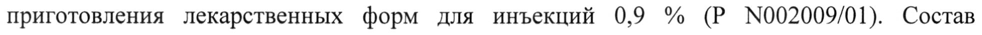

# Живые коксиеллы Бернета аттенуированного вакцинного штамма М-44 — парентерально

- Препарат: Вакцина Ку-лихорадки М-44 живая (Вакцина Ку-лихорадки М-44) (лиофилизат для приготовления суспензии для накожного скарификационного нанесения;)
- АТХ: J07X
- Источник: ГРЛС, инструкция по медицинскому применению, РУ ЛС-002153, файл от 2022-03-09 (https://grls.rosminzdrav.ru/Grls_View_v2.aspx?routingGuid=a8444b14-22c7-466e-90e0-d8ab9e9942b9)
- Распознано автоматически (OCR): 6 из 6 стр.
- Инструкция к другому РУ того же препарата: ЛС-002153 (срок действия истёк, решение от 17.01.2022). Текст может быть старше действующего
- Сомнительных строк после OCR: 1 (см. раздел «Проверка распознавания»)

## Общие сведения

| Ac-oorgsy-~ 170177 МИНИСТЕРСТВО ЗДРАВООХРАНЕНИЯ РОССИЙСКОЙ ФЕДЕРАЦИИ |
ИНСТРУКЦИЯ ПО МЕДИЦИНСКОМУ ПРИМЕНЕНИЮ ЛЕКАРСТВЕННОГО ПРЕПАРАТА
Вакцина Ку-лихорадки М-44 живая (Вакцина Ку-лихорадки М-44)
Регистрационный номер.
Торговое наименование. Вакцина Ку-лихорадки М-44 живая (Вакцина
Ку-лихорадки М-44).
Международное непатентованное или группировочное наименование. Вакцина для профилактики Ку-лихорадки.
© Лекарственная форма. Лиофилизат для приготовления суспензии для накожного скарификационного нанесения.

## 2. Состав

Одна доза вакцины содержит:
Одна доза вакцины содержит:
Действующее вещество: живые коксиеллы Бернета аттенуированного вакцинного штамма М-44 - 5X10’ - 5X10° минимальных инфицирующих доз для куриных эмбрионов
© (МИД)).
Вспомогательные вещества: компоненты среды высушивания: сахароза — 1 %, молоко питьевое обезжиренное стерильное — 49 %.
Выпускается в комплекте с растворителем — натрия хлорид растворитель для приготовления лекарственных форм для инъекций 0,9 % (Р М№002009/01). Состав растворителя на 1 мл: натрия хлорид - 9 мг, вода для инъекций — до 1 мл.
© Описание. Аморфная масса в виде таблетки (целая или раскрошенная), розового цвета с сероватым, желтоватым или коричневатым оттенком. Восстановленный препарат - густая гомогенная суспензия розового цвета с сероватым, желтоватым или коричневатым оттенком.
Характеристика препарата Вакцина представляет собой взвесь живой культуры аттенуированного вакцинного штамма М-44 коксиелл Бернета (Coxiella burnetii), выращенной в желточных мешках развивающихся куриных эмбрионов, лиофилизированную в стерильной сахарозомолочной среде высушивания.
Фармакотерапевтическая группа. МИБП-вакцина.
Код ATX. JO7X.
Фармакологические свойства

Однократное введение вакцины сопровождается развитием специфического
(гуморального и клеточного) иммунитета, иммунологическая защита достигается в течение 3-4 недель после введения препарата. Длительность максимального уровня поствакцинального иммунитета, как правило, составляет 5-6 месяцев.

## 4.1. Показания к применению

Специфическая профилактика Ку-лихорадки у взрослых и подростков в возрасте от 14 лет.

Контингенты, подлежащие прививкам:

- лица, выполняющие работы по заготовке, хранению, обработке сырья и продуктов животноводства, полученных из хозяйств, где регистрируются заболевания скота Ку-лихорадкой;

& - лица, выполняющие работы по заготовке, хранению и переработке сельскохозяйственной продукции, а также животноводы, ветеринарные работники, зоотехники в хозяйствах энзоотичных по коксиеллезу (Ку-лихорадке);

- лица, выполняющие работы по убою скота, больного коксиеллезом, заготовке и переработке полученных от него мяса и мясопродуктов;

- лица, работающие с живыми культурами возбудителей Ку-лихорадки.

~ Перед проведением иммунизации проводится медицинский осмотр всех лиц, подлежащих вакцинации (ревакцинации), с обязательным серологическим (РНИФ, ИФА,
РСК и другие) обследованием. Вакцинации подлежат лица с четкими отрицательными серологическими реакциями на коксиеллез.

## 4.3. Противопоказания

& - возраст моложе 14 лет;

- положительная серологическая реакция на коксиеллез;

- острые заболевания (инфекционные или неинфекционные); обострение хронических заболеваний (в этих случаях вакцинацию проводят через 2-4 недели после выздоровления или в стадии ремиссии). При нетяжелых острых респираторных вирусных инфекциях (ОРВИ), острых кишечных заболеваниях вакцинацию проводят после нормализации температуры;

- сильная реакция (температура выше 40 °С, отек и гиперемия в месте введения свыше 8 см в диаметре) или поствакцинальное осложнение на предыдущее введение вакцины для профилактики Ку-лихорадки;

- аллергические заболевания (по данным анамнеза): бронхиальная астма, атопический дерматит, поллиноз и др.; аллергия на куриный белок и белки молока;

- хронические заболевания верхних дыхательных путей и легких;

- системные заболевания соединительной ткани;

- иммунодефицитные состояния (первичные и вторичные);

- беременность и период грудного вскармливания;

- злокачественные заболевания.

Возможность вакцинации лиц, страдающих заболеваниями, не указанными в данном перечне противопоказаний, определяет врач, исходя из состояния здоровья прививаемого.

## 4.6. Применение при беременности и в период грудного вскармливания

Применение при беременности и в период грудного вскармливания противопоказано.

## 4.2. Способ применения и дозы

& Вакцину вводят однократно накожно методом скарификации в дозе 0,05 мл.
Ревакцинацию проводят дозой 0,05 мл не ранее чем через 1 год после первичной вакцинации лицам, в сыворотке которых отсутствуют — специфические комплементсвязывающие антитела.

В ампулу с вакциной непосредственно перед прививкой с помощью шприца вносят

| 0,5 мл натрия хлорида растворителя для приготовления лекарственных форм для

- инъекций 0,9 %. Вакцина должна раствориться в течение 2 мин с образованием густой гомогенной суспензии розового цвета с сероватым, желтоватым или коричневатым оттенком. Восстановленная вакцина годна к употреблению в течение 30 мин при хранении под стерильной салфеткой при комнатной температуре и на протяжении 60 мин при хранении при температуре от 2 до 8 °С.

& Место прививки (наружную поверхность средней трети плеча) обрабатывают 70 % раствором спирта или эфиром (применение других дезинфицирующих растворов не допускается). После их испарения шприцем через иглу наносят 2 капли восстановленной вакцины на расстоянии 30-40 мм. Стерильным скарификатором через каждую нанесенную на кожу каплю вакцины производят три крестообразные насечки длиной 8-10 мм на расстоянии 3-4 мм друг от друга таким образом, чтобы кровь проступала мелкими
«росинками». Плоской стороной скарификатора втирают вакцину в насечки, после чего вакцина должна подсохнуть в течение 5-10 мин. Последующую обработку места прививки не проводят.

Неиспользованную вакцину и шприцы необходимо утилизировать (см. раздел
«Особые указания»).

## 4.8. Побочное действие

Частота развития побочных реакций представлена в соответствии с рекомендациями Всемирной организации здравоохранения и включает следующие категории: очень часто (>1/10); часто (>1/100 и <1/10), нечасто (21/1000 до <1/100), редко
(>1/10000 и <1/1000), очень редко (<1/10000, включая отдельные случаи).

Общие нарушения и реакции в месте введения:

очень часто: покраснение и оузелковая припухлость по ходу насечек продолжительностью 3-4 суток;

нечасто: однодневное недомогание в виде озноба, головной боли, повышение температуры до 37,5 °С на 2-3 сутки после прививки.

## 4.9. Передозировка

Учитывая, что отпуск лекарственного препарата допускается только для лечебно-

& профилактических учреждений, а сама вакцинация проводится TOJIbKO квалифицированным медицинским персоналом, риск передозировки крайне низок. В случае передозировки возрастает риск нежелательных явлений, связанных с применением лекарственного препарата (см. раздел «Побочное действие»).

## 4.5. Взаимодействие с другими лекарственными средствами

Прививки проводят не ранее чем через 1 месяц после предыдущей иммунизации

~ другими вакцинами. Допускаются одновременные прививки вакцинами против Кулихорадки и бруцеллеза. Бруцеллезную вакцину вводят в соответствии с инструкцией по применению препарата в другую руку.

До проведения вакцинации врач должен быть проинформирован о недавно проводившемся или совпадающем по времени с вакцинацией применением другого (в том

© числе безрецептурного) лекарственного препарата.

## 4.4. Особые указания

Непосредственно перед прививкой врач проводит тщательный медицинский осмотр с термометрией и опрос вакцинируемых для выявления противопоказаний. При температуре выше 37 °С прививки не проводят.

Учитывая возможность возникновения анафилактического шока, необходимо обеспечить медицинское наблюдение за привитыми в течение 30 мин после введения препарата. Места проведения прививок должны быть оснащены средствами противошоковой терапии.

Профилактическую вакцинацию проводит прошедший подготовку медицинский работник в специально оборудованном прививочном кабинете.

Сведения о выполненной прививке регистрируют в соответствующих учетных

формах с указанием производителя, наименования, номера серии и срока годности вакцины, даты вакцинации, дозы, характера реакции на прививку.

Вскрытие ампул и процедуру вакцинации проводят при строгом соблюдении правил асептики и антисептики.

Перед употреблением каждую ампулу с вакциной тщательно просматривают.
Непригоден к применению препарат при наличии в ампуле трещин, посторонних включений, несвойственной вакцине окраски и других дефектов, а также нарушенной маркировки и истёкшего срока годности, хранившийся с нарушением температурных условий.

Неиспользованную вакцину, а также забракованные ампулы вскрывают и обезвреживают кипячением в воде в течение не менее 30 мин или погружением на 1 сутки в один из дезинфицирующих растворов: 3 % раствор хлорамина, 3 % раствор водорода

© пероксида с 0,5 % СМС, рабочий раствор дезинфицирующего средства на основе натриевой соли дихлоризоциануровой кислоты или трихлоризоциануровой кислоты в соответствии с инструкцией по применению.

## 4.7. Влияние на способность управлять транспортными средствами, механизмами

Некоторые нежелательные явления, связанные с применением препарата (см.
раздел «Побочное действие»), могут оказывать воздействие на способность управлять

© транспортными средствами или движущимися механизмами. Для пациентов, у которых наблюдались нежелательные реакции при введении препарата, управление транспортными средствами или движущимися механизмами возможно только после исчезновения симптомов нежелательных реакций.

## 6.5. Форма выпуска

© Лиофилизат для приготовления суспензии для накожного скарификационного нанесения — по 10 доз в ампуле. Растворитель - натрия хлорид растворитель для приготовления лекарственных форм для инъекций 0,9 % - по 5 мл в ампуле.

5 ампул с вакциной и 5 ампул с растворителем в пачке из картона вместе со скарификатором ампульным и инструкцией по применению. При упаковке ампул с кольцом излома или точкой для вскрытия скарификатор ампульный не вкладывают.

## 6.3. Срок годности

Вакцина — 2 года, растворитель — 5 лет. Срок годности комплекта определяется по наименьшему сроку годности одного из компонентов. Препарат с истекшим сроком годности применению не подлежит.
Вакцина — 2 года, растворитель — 5 лет. Срок годности комплекта определяется по наименьшему сроку годности одного из компонентов. Препарат с истекшим сроком годности применению не подлежит.

## 6.4. Условия хранения

В соответствии с СанПиН 3.3686-21 при температуре от 2 до 8 °С. Не замораживать. Хранить в недоступном для детей месте.
В соответствии с СанПиН 3.3686-21 при температуре от 2 до 8 °С. Не замораживать. Хранить в недоступном для детей месте.

Условия транспортирования. В соответствии с СанПиН 3.3686-21 при температуре от 2 до 8 °С. Не замораживать.

Условия отпуска. Для лечебно-профилактических учреждений.
Производитель.
АО «НПО «Микроген».
Россия, 115088, г. Москва, ул. 1-я Дубровская, д. 15, стр. 2, тел. (495) 710-37-87, факс (495) 783-88-04, e-mail: info@microgen.ru.
Адрес производства:
Россия, 614089, Пермский край, г. Пермь, ул. Братская, д. 177, тел. (342) 281-94-96.
Владелец регистрационного удостоверения/организация, принимающая претензии потребителя.
АО «НПО «Микроген».
Россия, 115088, г. Москва, ул. 1-я Дубровская, д. 15, стр. 2, тел. (495) 710-37-87, факс (495) 783-88-04, e-mail: info@microgen.ru.
Представитель АО «НПО «Микроген» | ИИ по доверенности CNY ким «миг 3.A. Алиева jf Kya в 3. % i НЕ Е
|| mMnrOXQ |8 \es\ для sé
## Проверка распознавания

Страницы-сканы распознаны автоматически. В 1 строках с дозировками цифры могли распознаться с ошибкой — сверьте с вырезкой из оригинала:

- стр. 1: «приготовления лекарственных форм для инъекций 0,9 % (Р М№002009/01). Состав» — низкая уверенность: «М№002009/01).» (71)  
  