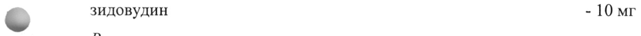
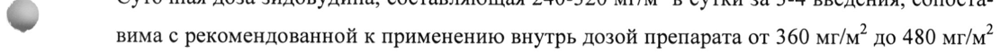
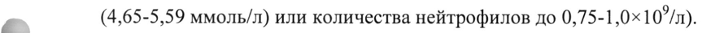

# Зидовудин — парентерально

- Препарат: Зидовудин (концентрат для приготовления раствора для инфузий;)
- АТХ: J05AF01
- Источник: ГРЛС, инструкция по медицинскому применению, РУ ЛП-007579, файл от 2021-11-29 (https://grls.rosminzdrav.ru/Grls_View_v2.aspx?routingGuid=7b14a333-6855-4f97-9cc9-7c86a8c74a91)
- Распознано автоматически (OCR): 18 из 18 стр.
- Инструкция к другому РУ того же препарата: ЛП-007579 (национальное РУ, переоформленное по правилам ЕАЭС, решение от 03.11.2021). Текст может быть старше действующего
- Сомнительных строк после OCR: 3 (см. раздел «Проверка распознавания»)

## Общие сведения

МИНИСТЕРСТВО ЗДРАВООХРАНЕНИЯ РОССИЙСКОЙ ФЕДЕРАЦИИ .
| МИНЗДРАВ PULA?
ИНСТРУКЦИЯ ПО МЕДИЦИНСКОМУ ПРИМЕНЕНИЮ 9-031121
ЛЕКАРСТВЕННОГО ПРЕПАВАТА СОГЛАСО BAH п зидовуУДинН о о
Регистрационный номер:
Торговое наименование: Зидовудин Международное непатентованное или группировочное наименование: зидовудин

## 3. Лекарственная форма

концентрат для приготовления раствора для инфузий
концентрат для приготовления раствора для инфузий

## 2. Состав

Действующее вещество:
Действующее вещество:
© зидовудин - 10 мг Вспомогательные вещества:
‘ хлористоводородной кислоты раствор 1 М - no pH 3,5 - 7,0 или натрия гидроксида раствор 1 М вода для инъекций - до 1 мл
‘ Описание: прозрачный раствор от бесцветного до светло-желтого цвета.
Фармакотерапевтическая группа: противовирусное [ВИЧ] средство
Код ATX: JOSAFO1 Фармакологические свойства
^ Фармакодинамика © Механизм действия Зидовудин - противовирусный препарат, аналог тимидина, in vitro высокоактивный в отношении ретровирусов, включая вирус иммунодефицита человека (ВИЧ).
Зидовудин подвергается фосфорилированию как в инфицированных, так и в интактных клетках с образованием монофосфата посредством клеточной тимидинкиназы. Последующее фосфорилирование зидовудина монофосфата до зидовудина дифосфата, а затем до зидовудина трифосфата катализируется клеточной тимидилаткиназой и неспецифическими киназами, соответственно.
Зидовудина трифосфат действует как ингибитор и субстрат для вирусной обратной транскриптазы. Образование провирусной ДНК блокируется встраиванием зидовудина трифосфата в ее цепь, что приводит к обрыву цепи. Конкуренция зидовудина трифосфата за обратную транскриптазу ВИЧ примерно в 100 раз сильнее, чем за клеточную а-полимеразу ДНК человека.
Антагонизма между зидовудином и другими антиретровирусными препаратами (абакавир,

диданозин, ламивудин и интерферон альфа) in vitro не наблюдалось.

Развитие резистентности к аналогам тимидина (зидовудин - один из них) происходит в

результате постепенного накопления специфических мутаций в 6 кодонах (41, 67, 70, 210,

215 и 219) обратной транскриптазы ВИЧ. Вирусы приобретают фенотипическую рези-

стентность к аналогам тимидина в результате комбинированных мутаций в кодонах 41 и

215 или накопления, по крайней мере, 4 из 6 мутаций. Данные мутации не вызывают пе-

рекрестную резистентность к другим аналогам нуклеозидов, что позволяет в дальнейшем

применять для лечения ВИЧ-инфекции другие ингибиторы обратной транскриптазы.

Два вида мутаций приводят к развитию множественной лекарственной резистентности.

В одном случае мутации происходят в 62, 75, 77, 116 и 151 кодонах обратной транскрип-
| тазы ВИЧ, и во втором случае речь идет о T69S мутации со вставкой 6-ти пар азотистых
— оснований в этой позиции, что сопровождается появлением фенотипической резистентно-

’ сти к зидовудину, а также к другим нуклеозидным ингибиторам обратной транскриптазы

(НИОТ). Оба вида этих мутаций значительно ограничивают терапевтические возможности

при ВИЧ-инфекции.

Снижение чувствительности к зидовудину т vitro изолятов ВИЧ наблюдалось при дли-

‘ тельном лечении ВИЧ-инфекции зидовудином. Имеющиеся данные указывают Ha то, что на ранних стадиях ВИЧ-инфекции частота и степень снижения чувствительности in vitro существенно меньше, чем на поздних стадиях заболевания.

В настоящее время связь между чувствительностью к зидовудину in vitro и клиническим

> эффектом терапии не изучена. Определение чувствительности in vitro не было стандартизировано, и результаты могут варьировать в зависимости от методологических факторов.
® Исследования in vitro зидовудина в комбинации с ламивудином показали, что резистентные к зидовудину изоляты вируса становятся чувствительными к зидовудину при одновременном приобретении резистентности к ламивудину. Клинические исследования продемонстрировали тот факт, что применение зидовудина в комбинации с ламивудином задерживает появление резистентных к зидовудину штаммов вируса у пациентов, ранее не получавших антиретровирусную терапию (АРТ). Зидовудин широко применяется как компонент комбинированной АРТ совместно с другими антиретровирусными препаратами этого же класса (НИОТ) или других классов (ингибиторы протеазы ВИЧ (ИП ВИЧ), ненуклеозидные ингибиторы обратной транскриптазы (ННИОТ)).

## 5.2. Фармакокинетика

Всасывание

У пациентов, получавших в течение часа инфузию зидовудином в дозе 1-5 мг/кг по

| 2 3-6 раз в день, фармакокинетика зидовудина носила дозонезависимый характер. Средняя равновесная максимальная (Сутах) и минимальная (Cysmin) концентрации зидовудина в плазме крови у взрослых после инфузии в течение 1 часа по 2,5 мг/кг каждые 4 часа составляли 4,0 и 0,4 мкмоль, соответственно (или 1,1 и 0,1 мкг/мл).
Распределение По данным исследований при внутривенном введении зидовудина средний терминальный период полувыведения из плазмы составлял 1,1 часа, средний общий клиренс составлял 27,1 мл/мин/кг, а кажущийся объем распределения составлял 1,6 л/кг.
У взрослых средний коэффициент отношения концентрации зидовудина в спинномозговой жидкости и плазме крови через 2-4 часа после введения дозы составлял примерно 0,5. Данные показывают, что зидовудин проникает через плаценту и обнаруживается в
© амниотической жидкости и крови плода. Зидовудин также был обнаружен в сперме и грудном молоке.
> Связывание с белками плазмы крови относительно низкое, составляет 34-38 %, поэтому взаимодействия с другими препаратами, влияющими на связывание зидовудина с белками плазмы, маловероятно.
Метаболизм г 5’- глюкуронид зидовудина является основным конечным метаболитом зидовудина, определяется в плазме крови и моче и составляет примерно 50-80 % от дозы препарата, которая выводится почками.
В качестве метаболита зидовудина после внутривенного введения препарата был иден2 тифицирован 3’-амино-3’-дезокситимидин (АМТ).
Выведение ~ Почечный клиренс зидовудина намного превышает клиренс креатинина, что указывает Ha преимущественное выведение зидовудина с помощью канальцевой секреции.
Особые группы пациентов Дети У детей в возрасте старше 5-6 месяцев фармакокинетические показатели сходны с таковыми у взрослых.
После внутривенного введения зидовудина в дозе 80 мг/м?, 120 мг/м? и 160 мг/м* площади поверхности тела значения Cysmax составляют соответственно 1,46 мкг/мл, 2,26 мкг/мл и 2,96 мкг/мл. У детей средний коэффициент отношения концентрации зидовудина в спинномозговой жидкости и плазме крови варьировал от 0,52 до 0,85 через 0,5-4 часов после приема препарата внутрь и составлял 0,87 через 1-5 часов после одночасовой внутривенной инфузии. Во время внутривенной инфузии среднее отношение концентрации препарата в плазме крови и спинномозговой жидкости в равновесном состоянии составляет приблизительно 0,24. При внутривенном введении средний период полувыведения и общий клиренс составляют 1,5 часа и 30,9 мл/мин/кг соответственно. Основным метаболитом является 5’- глюкуронид зидовудина. После внутривенного введения 29 % дозы препарата выделяется через почки в неизмененном виде, 45 % дозы - в виде глюкуронида.
Почечный клиренс зидовудина намного превышает клиренс креатинина, указывая на значительную канальцевую секрецию.
Фармакокинетические данные свидетельствуют о том, что глюкуронизация зидовудина у новорожденных и детей грудного возраста снижена, что приводит к увеличению биодоступности. Снижение клиренса и более продолжительный период полувыведения регир стрируются у новорожденных младше 14 дней, затем фармакокинетические параметры
© становятся сходными с таковыми у взрослых.
> Пациенты пожилого возраста Фармакокинетика зидовудина у пациентов старше 65 лет не изучалась.
Пациенты с нарушением функции почек У пациентов с прогрессирующим нарушением функции почек максимальная концентра-
, ция зидовудина в плазме крови повышается на 50 % по сравнению с таковой у пациентов с нормальной функцией почек. Системное воздействие зидовудина (площадь под кривой
«концентрация - время» зидовудина (AUC)) увеличивается на 100 %, период полувыведения значительно не изменяется. При нарушении функции почек наблюдается сущес ственная кумуляция основного метаболита 5’- глюкуронида зидовудина, однако призна-
, ков токсического действия при этом не выявляется. Гемодиализ и перитонеальный диа-
- лиз не влияют на выведение зидовудина, в то же время выведение 5’- глюкуронида зидовудина усиливается.
Пациенты с нарушением функции печени При нарушении функции печени может наблюдаться кумуляция зидовудина вследствие снижения глюкуронизации, что может потребовать коррекции дозы препарата, однако поскольку имеются только ограниченные данные, точные рекомендации предоставить невозможно.
Беременность Фармакокинетика зидовудина изучалась в исследовании у 8 женщин в течение последнего триместра беременности. По мере увеличения срока беременности признаков накопления зидовудина не наблюдалось. Фармакокинетика зидовудина была сходна с таковой у небеременных взрослых. Концентрации зидовудина в плазме крови грудных детей при рождении были аналогичны концентрациям в плазме крови у матерей, что согласуется с пассивным прохождением зидовудина через плаценту.

## 4.1. Показания к применению

Тяжелые проявления ВИЧ-инфекции у пациентов со СПИДом при невозможности перорального приема зидовудина.
Тяжелые проявления ВИЧ-инфекции у пациентов со СПИДом при невозможности перорального приема зидовудина.
ВИЧ-инфекция у беременных женщин, начиная с 14-й недели гестации, и их новорожденных детей для снижения частоты вертикальной передачи ВИЧ.

## 4.3. Противопоказания

Повышенная чувствительность к зидовудину или любому другому компоненту препарата.
Повышенная чувствительность к зидовудину или любому другому компоненту препарата.
Нейтропения (число нейтрофилов менее 0,75*10°/m).
Снижение содержания гемоглобина (менее 75 г/л или 4,65 ммоль/л).
Период грудного вскармливания.
© С осторожностью у Пациенты пожилого возраста.
Печеночная недостаточность.
Угнетение костномозгового кроветворения.
Беременность до 14 недели гестации.
é Анемия (гемоглобин 75-90 г/л).
Гепатомегалия, гепатит или любые факторы риска заболеваний печени.
Нейтропения/лейкопения (число нейтрофилов 0,75-—1,0*10°/л или 750-1000/мкл).
Дефицит цианокобаламина или фолиевой кислоты.
: Ожирение.
; Применение при беременности и в период грудного вскармливания bad Фертильность
Отсутсвуют данные по влиянию зидовудина на фертильность у женщин. У мужчин применение зидовудина не влияет на количество, морфологию и подвижность сперматозоидов.
Беременность Зидовудин проникает через плаценту. Препарат Зидовудин можно применять ранее 14 недель беременности только в том случае, если потенциальная польза для матери превышает риск для плода.
Имеются сообщения о незначительном, преходящем повышении концентрации лактата в сыворотке крови, которое может быть обусловлено дисфункцией митохондрий у новорожденных и младенцев, подвергавшихся воздействию НИОТ во внутриутробном или перинатальном периоды. Клиническая значимость преходящего повышения концентра5 ции лактата в сыворотке крови неизвестна. Имеются очень редкие сообщения о случаях задержки развития, судорожных припадков и прочих неврологических нарушений
(например, увеличение тонуса мышц). Тем не менее, причинно-следственная связь между данными явлениями и внутриутробной или перинатальной экспозицией НИОТ не установлена. Эти данные не влияют на настоящие рекомендации по применению АРТ при беременности по профилактике вертикального пути передачи ВИЧ.
Профилактика передачи ВИЧ от матери плоду
В исследовании ACTG 076 применение зидовудина после 14 недель беременности с последующим назначением его у новорожденных приводило к снижению частоты вертикальной передачи ВИЧ (частота инфицирования 23 % в группе плацебо по сравнению с 8 % в группе зидовудина). Терапия зидовудином для приема внутрь начиналась в период
, между 14-й и 34-й неделей беременности и продолжалась до начала родов. Во время po-
© дов зидовудин вводили внутривенно. Новорожденные получали зидовудин внутрь до
» 6-недельного возраста. Новорожденным, неспособным принимать препарат внутрь, BBOдили зидовудин в виде инъекции.
Отдаленные последствия применения зидовудина у детей, получивших его во внутриутробном или неонатальном периодах, неизвестны. На основании данных по канцерогенé ности и мутагенности у животных, нельзя полностью исключить возможность канцерогенного влияния у человека. Значимость этих данных для инфицированных и неинфицированных грудных детей, подвергавшихся воздействию зидовудина, неизвестна. Однако, беременные женщины, рассматривающие применение зидовудина во время беременно-
© CTH, должны учитывать эти данные.
Период грудного вскармливания v Специалисты He рекомендуют ВИЧ-инфицированным женщинам грудное вскармливание, чтобы избежать передачи ВИЧ-инфекции ребенку. Поскольку зидовудин и ВИЧ проникают в грудное молоко, грудное вскармливание противопоказано.

## 4.2. Способ применения и дозы

Лечение препаратом Зидовудин должен проводить врач, имеющий опыт лечения ВИЧинфекции.
Лечение препаратом Зидовудин должен проводить врач, имеющий опыт лечения ВИЧинфекции.
Препарат Зидовудин, концентрат для приготовления раствора для инфузий, следует вводить в разведенном виде путем медленной внутривенной инфузии в течение 1 часа. Препарат НЕЛЬЗЯ вводить внутримышечно.
Препарат Зидовудин, концентрат для приготовления раствора для инфузий, необходимо применять только до тех пор, пока пациенты не смогут принимать лекарственные формы зидовудина для приема внутрь (капсулы, раствор для приема внутрь).
Разведение Препарат Зидовудин, концентрат для приготовления раствора для инфузий, необходимо развести перед введением.
Необходимую дозу препарата Зидовудин, концентрат для приготовления раствора для инфузий, добавляют в 5 % раствор декстрозы для внутривенного введения, чтобы конечная концентрация зидовудина была равной 2 мг/мл или 4 мг/мл. Полученный раствор перемешивают. Раствор остается химически и физически стабильным в течение 48 часов при температуре от 5 до 25 °С.
Поскольку в препарате Зидовудин, концентрат для приготовления раствора для инфузий, отсутствует антимикробный консервант, разведение следует проводить в условиях полной асептики, непосредственно перед введением, неиспользованную часть раствора во
© флаконе следует уничтожить. При помутнении раствора до, во время или после разведения его следует уничтожить.
» Взрослые и подростки с массой тела He менее 30 кг
Зидовудин назначают в дозе 1 мг/кг каждые 4 часа. Эта доза при внутривенном введении обеспечивает экспозицию (AUC), сходную с таковой при приеме зидовудина внутрь в дозе 1,5 мг/кг каждые 4 часа (600 мг/сутки у пациента с массой тела 70 кг).
¢ Особые группы пациентов Дети в возрасте от 3 месяцев до 12 лет
Сведений о применении препарата Зидовудин, концентрат для приготовления раствора для инфузий, внутривенно у детей недостаточно. Рекомендуемый диапазон доз составля-
~ ет от 80 до 160 мг/м? площади поверхности тела каждые 6 часов (320-640 мг/м?/сутки).
Суточная доза зидовудина, составляющая 240-320 мг/м? в сутки за 3-4 введения, сопоста-
~ вима с рекомендованной к применению внутрь дозой препарата от 360 мг/м? до 480 мг/м?
в сутки. Однако в настоящее время нет данных об эффективности применения раствора препарата Зидовудин для внутривенного введения в таких низких дозах.
Дети в возрасте до 3 месяцев Доступные данные не позволяют сформулировать четкие рекомендации по режиму дозирования препарата.
Пациенты пожилого возраста Фармакокинетика зидовудина у пациентов в возрасте старше 65 лет не изучалась. Однако учитывая возрастное снижение функции почек и возможные изменения показателей периферической крови, у таких пациентов необходимо соблюдать особую осторожность при назначении препарата Зидовудин и осуществлять соответствующее наблюдение до и во время лечения препаратом Зидовудин.
Пациенты с нарушением функции почек При тяжелой степени нарушения функции почек рекомендуемая доза препарата Зидовудин, раствор для инфузий, составляет 1 мг/кг 3-4 раза в сутки, что соответствует рекомендованной суточной дозе 300-400 мг при приеме внутрь для пациентов данной группы.
В зависимости от реакции со стороны периферической крови и клинического эффекта может потребоваться дальнейшая коррекция дозы. Гемодиализ и перитонеальный диализ не оказывают значимого влияния на выведение зидовудина, однако ускоряют выведение 5’-глюкуронида зидовудина. Для пациентов в терминальной стадии почечной недостаточности, находящихся на гемодиализе или перитонеальном диализе, рекомендуемая доза зидовудина составляет 100 мг каждые 6-8 часов.
Пациенты с нарушением функции печени © Данные, полученные у пациентов с циррозом печени, свидетельствуют о том, что у пациентов с печеночной недостаточностью может происходить кумуляция зидовудина из-за
+ снижения глюкуронизации, в связи с чем может потребоваться коррекция дозы, HO имеющиеся данные ограничены и рекомендации не могут быть даны. Если мониторирование концентрации зидовудина в плазме невозможно, то врачу следует обращать особое внимание на клинические признаки непереносимости препарата и, при необходимости, про-
: вести коррекцию дозы и/или увеличить интервал между введениями препарата.
Коррекция дозы при нежелательных реакциях со стороны системы кроветворения
Адекватная коррекция режима дозирования (уменьшение дозы или отмена препарата Зидовудин) может потребоваться у пациентов при нежелательных реакциях со стороны си-
~ стемы кроветворения (в случае снижения содержания гемоглобина до 75-90 г/л
‹ (4,65-5,59 ммоль/л) или количества нейтрофилов до 0,75-1,0х10*/л).
~ Профилактика передачи ВИЧ-инфекции от матери плоду
Была показана эффективность следующих 2 схем профилактики для беременных женщин:
1. Беременным женщинам, начиная со срока беременности 14 недель, рекомендуется до начала родов назначать зидовудин в лекарственной форме раствор для приема внутрь, в дозе 500 мг/сутки (100 мг 5 раз в сутки). Во время родов и родоразрешения необходимо применять препарат Зидовудин, концентрат для приготовления раствора для инфузий, внутривенно в дозе 2 мг/кг в течение 1 часа с последующей продолжительной внутривенной инфузией в дозе 1 мг/кг/ч до пережатия пуповины.
Далее новорожденным следует назначать зидовудин в лекарственной форме раствор для приема внутрь, в дозе 2 мг/кг каждые 6 часов; начиная не позднее 12 часов с момента рождения и до 6-недельного возраста. Детям, которые неспособны принимать перораль8 ные формы, необходимо вводить препарат Зидовудин, концентрат для приготовления раствора для инфузий, внутривенно в дозе 1,5 мг/кг массы тела в течение 30 минут каждые 6 часов.
2. Беременным женщинам, начиная со срока беременности 36 недель, рекомендуется назначать зидовудин в дозе 600 мг/сутки (по 300 мг 2 раза в сутки) внутрь до начала родов. Затем каждые 3 часа по 300 мг зидовудина в лекарственной форме раствор для приема внутрь, от начала родов до родоразрешения.

## 4.8. Побочное действие

Профиль нежелательных реакций при применении зидовудина сходен у взрослых и детей.
Профиль нежелательных реакций при применении зидовудина сходен у взрослых и детей.
Нежелательные реакции (НР), представленные ниже, распределены в соответствии с классификацией поражения органов и систем органов согласно словарю MedDRA и классифи-
© кацией частоты развития НР ВОЗ: очень часто (> 1/10), часто (21/100 и <1/10), нечасто
(21/1000 и <1/100), редко (21/10 000 и <1/1000), очень редко (<1/10 000), частота неизм вестна (по имеющимся данным установить частоту возникновения не представляется возможным). Категории частоты были сформированы на основании клинических исследований зидовудина и пострегистрационного наблюдения.
Частота встречаемости нежелательных реакций
¢ Нарушения co стороны крови и лимфатической системы: часто - анемия (может вызвать необходимость в переливании крови), нейтропения и лейкопения. Данные нарушения встречались чаще при применении более высоких доз (1200-1500 мг/сутки) и у пациентов с поздней стадией ВИЧ-инфекции (особенно при сниженном костномозговом резерве до
` начала лечения), в частности, у пациентов с числом СО4-лимфоцитов менее 100/мм?.
© Может возникнуть необходимость в снижении дозы или прекращении терапии. Частота встречаемости нейтропении также была повышена у пациентов со сниженным числом нейтрофилов, сниженной концентрацией гемоглобина и сниженной сывороточной концентрацией витамина В1> в начале терапии зидовудином.
Нечасто - тромбоцитопения и панцитопения (с гипоплазией костного мозга); редко - истинная эритроцитарная аплазия; очень редко - апластическая анемия.
Нарушения со стороны эндокринной системы: редко - гинекомастия.
Нарушения со стороны обмена веществ и питания: часто - гиперлактатемия; редко - лактоацидоз, анорексия.
Нарушения психики: редко - тревога, депрессия.
Нарушения со стороны нервной системы: очень часто - головная боль; часто - головокружение; редко - бессонница, парестезии, сонливость, снижение ясности мышления, судороги.
Нарушения со стороны сердца: редко - кардиомиопатия.
Нарушения со стороны дыхательной системы, органов грудной клетки и средостения:
нечасто - одышка; редко - кашель.
Нарушения со стороны желудочно-кишечного тракта: очень часто - тошнота; часто - рвота, боли в животе, диарея; нечасто - метеоризм; редко - пигментация слизистой оболочки полости рта, нарушение вкуса, диспепсия.
Нарушения со стороны печени, желчевыводящий путей: часто - повышение концентрации билирубина и активности ферментов печени; редко - поражения печени, такие как выраженная гепатомегалия со стеатозом; панкреатит.
Нарушения со стороны кожи и подкожных тканей: нечасто - сыпь, кожный зуд; редко - пигментация ногтей и кожи, крапивница, повышенное потоотделение.
Нарушения со стороны скелетно-мышечной и соединительной ткани: часто - миалгия;
® нечасто - миопатия.
+ Нарушения со стороны почек и мочевыводящих путей: редко - учащенное мочеиспускание.
Общие расстройства и нарушения в месте введения: часто - недомогание; нечасто - лихорадка, генерализованный болевой синдром, астения; редко - озноб, боли в грудной e клетке, гриппоподобный синдром.
Опыт лечения зидовудином для внутривенных инфузий более двух недель ограничен, хотя некоторые пациенты получали лечение на протяжении периода до 12 недель. Наиболее часто встречающимися нежелательными реакциями были анемия, нейтропения и лейко-
. пения. Местные реакции наблюдались нечасто.
Нежелательные реакции, возникающие при применении зидовудина для профилакти-
- ки передачи ВИЧ-инфекции от матери плоду
В плацебо-контролируемом исследовании (АСТС 076) беременные женщины хорошо переносили зидовудин в рекомендованных дозах. Клинические нежелательные реакции и отклонения результатов лабораторных исследований от нормы были сходными в группах зидовудина и плацебо.
В том же исследовании у детей грудного возраста, подвергшихся воздействию зидовудина, применяемого по данному показанию, концентрация гемоглобина была незначительно ниже, чем у детей грудного возраста в группе плацебо, но потребность в переливании крови отсутствовала. Анемия разрешилась в течение 6 недель после завершения терапии зидовудином. Другие клинические нежелательные реакции и отклонения результатов лабораторных исследований от нормы были сходными в группах зидовудина и плацебо.
Долгосрочные последствия внутриутробного воздействия зидовудина и его влияния на детей в грудном возрасте неизвестны.
Липоатрофия Лечение зидовудином сопровождалось потерей подкожной жировой клетчатки, что было наиболее выражено на лице, конечностях и ягодицах. Во время терапии препаратом Зидовудин пациентов следует регулярно обследовать на предмет признаков липоатрофии, и при подозрении на развитие липоатрофии терапию препаратом Зидовудин следует прекратить.

## 4.9. Передозировка

Симптомы Возможны чувство усталости, головная боль, рвота; очень редко: изменения со стороны показателей крови. Имеется одно сообщение о передозировке неизвестным количеством
Симптомы Возможны чувство усталости, головная боль, рвота; очень редко: изменения со стороны показателей крови. Имеется одно сообщение о передозировке неизвестным количеством

© зидовудина, когда концентрация зидовудина в крови превышала в 16 раз обычную терапевтическую концентрацию, тем не менее, при этом клинические, биохимические или ге-

- матологические симптомы отсутствовали.
При применении в рамках клинических исследований максимальных доз - 7,5 мг/кг массы тела инфузионно каждые 4 часа в течение 2 недель, у одного из 5 пациентов наблюдалось беспокойство, у оставшихся 4 пациентов не развились никакие нежелательные реакции.
2 Лечение
Симптоматическая терапия и поддерживающая терапия. Гемодиализ и перитонеальный диализ не обладают высокой эффективностью для удаления зидовудина из организма, но усиливают выведение его метаболита - 5’- глюкуронида зидовудина.
‘ Взаимодействие с другими лекарственными средствами

а Зидовудин преимущественно выводится в виде неактивного метаболита, представляюще-

® го собой глюкуронидный конъюгат, образующийся в печени. Препараты, имеющие сходный путь выведения, потенциально могут ингибировать метаболизм зидовудина.
Зидовудин применяется в комбинированной антиретровирусной терапии вместе с другими нуклеозидными ингибиторами обратной транскриптазы и препаратами из других групп
(ингибиторами протеазы ВИЧ, ненуклеозидными ингибиторами обратной транскриптазы).
Перечень взаимодействий, перечисленных ниже, не следует считать исчерпывающим, однако они характерны для препаратов, которые требуют осторожного применения вместе с зидовудином.
Атовахон: зидовудин не влияет на фармакокинетические параметры атовахона. Атовахон замедляет трансформацию зидовудина в глюкуронидный метаболит (AUC зидовудина в равновесном состоянии увеличивается на 33 % и максимальные концентрации глюкуронида уменьшаются на 19 %). Маловероятно изменение профиля безопасности зидовудина

И в дозах 500 или 600 мг/сутки при сочетанном применении с атовахоном в течение трех недель для лечения пневмоцистной пневмонии. При необходимости более длительного сочетанного применения этих препаратов рекомендуется тщательное наблюдение за клиническим состоянием пациента.
Кларитромицин: уменьшает всасывание зидовудина. Перерыв между применением зидовудина и кларитромицина должен составлять не менее 2 часов.
Ламивудин: наблюдается умеренное повышение максимальной концентрации зидовудина
(Cmax) на 28 % при одновременном применении с ламивудином, однако общая экспозиция
(AUC) при этом не изменяется. Зидовудин не оказывает влияния на фармакокинетику ламивудина.
Фенитоин: при одновременном применении зидовудина с фенитоином снижается концентрация последнего в плазме крови, а в одном случае отмечалось повышение концентрации
~ фенитоина; следует контролировать концентрацию фенитоина в плазме крови при приме-
. нении этой комбинации.
Пробенецид: ограниченные данные показали, что пробенецид снижает глюкуронизацию и увеличивает средний период полувыведения и АПС зидовудина. Выведение почками глюкуронида (и, возможно, самого зидовудина) снижается в присутствии пробенецида.
7 Рибавирин: нуклеозидный аналог рибавирин является антагонистом зидовудина, и их комбинации следует избегать.
Рифампицин: ограниченные данные показали, что комбинация зидовудина с рифампицином приводит к снижению AUC для зидовудина на 48 % + 34 %, однако клиническое зна-
‘ чение этого изменения не известно.
| Ставудин: зидовудин может подавлять внутриклеточное фосфорилирование ставудина wr при совместном применении. Поэтому ставудин не рекомендуется применять совместно с зидовудином.
Доксорубицин: следует избегать совместного применения зидовудина и доксорубицина, так как несовместимость была продемонстрирована in vitro.
Вальпроевая кислота, флуконазол, метадон снижают клиренс зидовудина, из-за чего повышается его системная экспозиция.
Другие: ацетилсалициловая кислота, кодеин, морфин, метадон, индометацин, кетопрофен, напроксен, оксазепам, лоразепам, циметидин, клофибрат, дапсон, инозин пранобекс могут нарушать метаболизм зидовудина путем конкурентного ингибирования глюкуронизации или прямого подавления микросомального метаболизма в печени. К возможности применения этих препаратов в комбинации с препаратом Зидовудин, особенно при длительной терапии, следует подходить с осторожностью.
Комбинация препарата Зидовудин, особенно при неотложной терапии, с потенциально

нефротоксическими и миелотоксическими препаратами (например, пентамидином, дапсо-

HOM, пириметамином, ко-тримоксазолом, амфотерицином В, флуцитозином, ганциклови-

ром, интерфероном альфа, винкристином, винбластином, доксорубицином) может повы-

шать риск развития нежелательных реакций на препарат Зидовудин. Необходимо наблю-

дение за функцией почек и формулой крови; при необходимости снижают дозы препара-

тов.

Так как у некоторых пациентов, получающих зидовудин, могут развиваться оппортуни-

стические инфекции, существует вероятность, что придется рассмотреть сопутствующее

использование профилактической антибактериальной терапии. Такая профилактика вклю-

чала ко-тримоксазол, пентамидин в аэрозольной форме, пириметамин и ацикловир. Ограниченные данные клинических исследований зидовудина не указывают на значительно

- увеличенный риск развития нежелательных реакций на зидовудин с этими лекарственныы ми препаратами.

## 4.4. Особые указания

Пациентов следует предупредить о возможных последствиях одновременного применения

других лекарственных препаратов без назначения врача.

2 Пациентов следует предупредить о том, что не доказано предотвращение риска передачи
ВИЧ другим лицам при половых контактах или контакте с инфицированной кровью при применении препарата Зидовудин, поэтому пациенты должны продолжать соблюдать соответствующие меры предосторожности.

` Препарат Зидовудин не излечивает ВИЧ-инфекцию, и у пациентов сохраняется риск развития заболеваний, связанных с угнетением иммунитета, в том числе оппортунистических

- инфекций и новообразований. Хотя было показано снижение риска развития оппортунистических инфекций при применении зидовудина, данные по риску развития новообразований, в том числе лимфом, ограничены. Имеющиеся данные о пациентах, получавших лечение по поводу ВИЧ-инфекции на поздних стадиях, указывают на то, что риск развития лимфомы соответствует таковому у пациентов, не получавших лечение. У пациентов с ранней стадией ВИЧ-инфекции, получающих долгосрочное лечение, риск развития лимфомы неизвестен.
Беременным женщинам, рассматривающим возможность применения зидовудина во время беременности для профилактики передачи ВИЧ своим детям, следует сообщить о том, что в некоторых случаях передача вируса может произойти даже несмотря на терапию.
Профилактика после вероятного заражения ВИЧ
Согласно международным рекомендациям (Центр по контролю и профилактике заболева13 ний - июнь 1998), при случайном контакте с кровью ВИЧ-инфицированного человека
(например, через инъекционную иглу) необходимо срочно (в течение | - 2 ч) начать комбинированную терапию зидовудином и ламивудином. В случае более высокого риска заражения в схему антиретровирусной терапии должен быть включен препарат из группы ингибиторов протеазы. Антиретровирусное профилактическое лечение рекомендуется проводить в течение 4 недель. Контролируемые клинические исследования профилактического лечения после случайного заражения не проводились, обосновывающие данные ограничены.
Несмотря на быстрое начало лечения антиретровирусными препаратами, нельзя исключить возможность сероконверсии.
Нежелательные реакции со стороны крови У принимающих зидовудин пациентов с поздней стадией ВИЧ-инфекции с наличием
© симптомов можно ожидать развитие анемии (обычно наблюдается через 6 недель после х начала применения зидовудина, но иногда возникает раньше), нейтропении (обычно наблюдается через 4 недели после начала применения зидовудина, но иногда возникает раньше) и лейкопении (обычно вторичной по отношению к нейтропении). Чаще всего данные явления развиваются при применении более высоких 03 зидовудина д (1200-1500 мг/сутки) и у пациентов со сниженным костномозговым резервом до начала лечения, особенно на поздней стадии ВИЧ-инфекции.
Необходимо тщательно контролировать гематологические показатели. Как правило, во время лечения зидовудином для внутривенных инфузий рекомендуется проведение анали-
` за крови не реже одного раза в неделю.
При уменьшении концентрации гемоглобина до 7,5-9,0 г/дл (4,65-5,59 ммоль/л) или
~ уменьшении числа нейтрофилов до 0,75-1,0x10°/n можно снизить суточную дозу до появления признаков восстановления костного мозга; в качестве альтернативы можно ускорить восстановление путем краткосрочного (2-4 недели) прерывания терапии зидовудином. Восстановление костного мозга обычно наблюдается в течение 2 недель, после чего можно возобновить лечение зидовудином в более низкой дозе. Данные по внутривенному применению зидовудина в течение периодов, превышающих две недели, ограничены. У пациентов с выраженной анемией коррекция дозы не всегда устраняет необходимость в переливании крови.
Лактоацидоз и выраженная гепатомегалия со стеатозом
Имеются сообщения о развитии лактоацидоза и выраженной гепатомегалии со стеатозом, в том числе с летальным исходом, вследствие антиретровирусной терапии аналогами нуклеозидов, включая зидовудин, принимаемыми как по отдельности, так и в комбинации. В большинстве случаев эти осложнения возникают у женщин.
Клинические симптомы, которые могут указывать на развитие лактоацидоза, включают общую слабость, анорексию, отсутствие аппетита, стремительную необъяснимую потерю веса, нарушения со стороны желудочно-кишечного тракта (тошнота, рвота и боль в животе), нарушения со стороны дыхательной системы (одышка и тахипноэ) или неврологические симптомы (включая моторную слабость).
Лечение препаратом Зидовудин необходимо прекратить в случае развития симптоматической гиперлактатемии и метаболического ацидоза/лактоацидоза, прогрессирующей гепатомегалии или быстрого повышения активности аминотрансфераз.
Следует соблюдать осторожность при применении препарата Зидовудин для лечения любого пациента (в особенности - женщин с избыточной массой тела) с гепатомегалией, ге-
, патитом или другими известными факторами риска поражения печени и стеатозом печени
-
(включая применение определенных лекарственных препаратов и употребление алкоголя).
x Пациенты с ко-инфекцией вирусом гепатита С, получающие лечение интерфероном альфа и рибавирином, могут представлять собой группу особого риска. Пациенты с повышенным риском требуют особого внимания.
При появлении клинических или лабораторных признаков лактоацидоза с гепатитом или
& без него (может проявляться гепатомегалией и стеатозом даже в отсутствие выраженного повышения активности трансаминаз) лечение препаратом Зидовудин необходимо приостановить.
Липоатрофия ` Лечение зидовудином сопровождалось потерей подкожной жировой клетчатки. Частота возникновения и степень тяжести липоатрофии связаны с суммарной экспозицией. Такая
~ потеря жировой клетчатки, которая наиболее выражена Ha лице, конечностях и ягодицах, может быть обратимой лишь частично, и улучшение может наступить только через несколько месяцев после перехода на схему лечения, не содержащую зидовудин. Во время терапии зидовудином и другими препаратами, содержащими зидовудин (например: зидовудин + ламивудин; абакавир + зидовудин + ламивудин), пациентов следует регулярно обследовать на предмет признаков липоатрофии, и при подозрении на развитие липоатрофии по возможности следует перейти на альтернативный режим терапии.
Сывороточные липиды и глюкоза крови Концентрация сывороточных липидов и глюкозы крови может повышаться во время антиретровирусной терапии. Контроль заболевания и изменение образа жизни также могут вносить вклад в этот процесс. Следует рассмотреть необходимость определения концентрации сывороточных липидов и глюкозы крови. Нарушения липидного обмена необхо15 димо лечить, руководствуясь их клиническими проявлениями.
Синдром восстановления иммунитета У ВИЧ-инфицированных пациентов с тяжелым иммунодефицитом на момент начала антиретровирусной терапии возможно развитие воспалительной реакции на фоне бессимптомных оппортунистических инфекций или их остаточных явлений, что может привести к усилению симптоматики или другим тяжелым последствиям. Обычно эти реакции возникают в течение первых нескольких недель или месяцев после начала антиретровирусной терапии. Типичными примерами являются цитомегаловирусный ретинит, генерализованная и/или очаговая инфекция, вызванная микобактериями, и пневмония, вызванная
Pneumocystis jiroveci (P. carinii). Появление любых симптомов воспаления требует немедленного обследования и, при необходимости, лечения.
‹ Аутоиммунные заболевания (такие как болезнь Грейвса, полимиозит и синдром
- Гийена - Барре) наблюдались на фоне восстановления иммунитета, однако время первичх ных проявлений варьировало, и заболевание могло возникать через много месяцев после начала терапии и иметь атипичное течение.
Сопутствующий вирусный гепатит С При применении зидовудина в составе схемы лечения ВИЧ-инфекции были зарегистриро-
- ваны случаи обострения анемии на фоне приема рибавирина, точный механизм этого явления остается неизвестным. В связи с этим не рекомендуется одновременное применение зидовудина с рибавирином. Если зидовудин уже включен в схему комбинированной антиретровирусной терапии, следует рассмотреть возможность его замены. Это особенно важ-
: HO для пациентов с наличием индуцированной зидовудином анемии в анамнезе.
; У пациентов, инфицированных ВИЧ и вирусом гепатита С и получающих комбинированv ную антиретровирусную терапию по поводу ВИЧ одновременно с интерфероном альфа в сочетании с рибавирином или без него, наблюдалось развитие печеночной недостаточности (иногда с летальным исходом). Необходимо обеспечить наблюдение за пациентами, получающими интерферон альфа с рибавирином или без него и препарат Зидовудин, с целью выявления токсического действия, связанного с лечением, особенно развития печеночной недостаточности, нейтропении и анемии. В таких случаях следует рассмотреть вопрос о прекращении применения препарата Зидовудин. Также следует рассмотреть возможность снижения дозы или прекращения применения интерферона альфа, рибавирина или обоих препаратов в случае усиления клинических проявлений токсичности, включая развитие печеночной недостаточности (например, более 6 баллов по шкале Чайлд-Пью)
(см. инструкцию по применению для интерферона альфа и рибавирина).
Миопатия и миозит Миопатия и миозит с патологическими изменениями, характерными для течения ВИЧинфекции, были ассоциированы с продолжительным применением зидовудина.
Совместное применение с зидовудинсодержащими препаратами
Препарат Зидовудин не следует принимать совместно с препаратами, содержащими зидовудин в качестве одного из компонентов (например: зидовудин + ламивудин; абакавир + зидовудин + ламивудин).

## 4.7. Влияние на способность управлять транспортными средствами, механизмами

Влияние зидовудина на способность управлять автомобилем или механизмами не изучалось. Однако неблагоприятное влияние на эти способности маловероятно, исходя из фармакокинетики препарата. Тем не менее, при решении вопроса о возможности управлять автомобилем или движущимися механизмами, следует иметь в виду состояние пациента и
® возможность развития побочных реакций (головокружение, сонливость, заторможенность,
+ судороги) при приеме зидовудина.

## 6.5. Форма выпуска

Концентрат для приготовления раствора для инфузий 10 мг/мл.
Концентрат для приготовления раствора для инфузий 10 мг/мл.
По 10 мл в ампулы светозащитного стекла или коричневого стекла первого гидролитичеos ского класса с точками надлома или кольцами.
По 10 ампул вместе с инструкцией по применению помещают в коробку из картона.
По 5 ампул помещают в контурную ячейковую упаковку из пленки поливинилхлоридной.
По 2 контурные ячейковые упаковки вместе с инструкцией по применению помещают в пачку из картона.
р По 20 мл во флаконы стеклянные из коричневого стекла укупоренные пробками из резины
- и обжатые алюминиевыми колпачками.
По 5 флаконов вместе с инструкцией по применению помещают в пачку из картона.

## 6.4. Условия хранения

В защищенном от света месте при температуре не выше 30 °С.
В защищенном от света месте при температуре не выше 30 °С.
Хранить в недоступном для детей месте.

## 6.3. Срок годности

2 года.
2 года.
Не применять по истечении срока годности.
Условия отпуска Отпускают по рецепту.
Производитель / Организация, принимающая претензии потребителей:
ОАО «ДАЛЬХИМФАРМ»
Адрес: 680001, Российская Федерация, Хабаровский край, г. Хабаровск, ул. Ташкентская, 22.
Тел.: (4212) 53-91-86.
Владелец регистрационного удостоверения:
ООО «Фармацевтические технологии»
Адрес: 123458, Российская Федерация, г. Москва, ул. Таллинская, д. 26, кв. 57
Тел.: (499) 504-04-16.
<. — 9” Я ( , Генеральный директор wee А.Т`. Зимогляд
ООО «Фармацевтические технологии» ее f 0, >, hi ON
BS, Аа Ag /< АА:
51 "Фармацевтичеое | :
a технопотии" Е | ох 'Д
4 ORS wey ©
LO Kh
05 HH cS
## Проверка распознавания

Страницы-сканы распознаны автоматически. В 3 строках с дозировками цифры могли распознаться с ошибкой — сверьте с вырезкой из оригинала:

- стр. 1: «© зидовудин - 10 мг» — повторное чтение: «© iit - 10 mr»  
  
- стр. 7: «~ вима с рекомендованной к применению внутрь дозой препарата от 360 мг/м? до 480 мг/м?» — повторное чтение: «х м има оомьаавай к a npenapara ot 560 unfedno #80 seni»  
  
- стр. 8: «‹ (4,65-5,59 ммоль/л) или количества нейтрофилов до 0,75-1,0х10*/л).» — низкая уверенность: «0,75-1,0х10*/л).» (0)  
  
