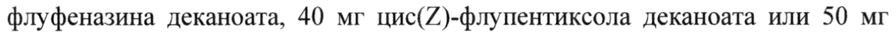

# Зуклопентиксол + Зуклопентиксола деканоат — парентерально

- Препарат: Клопиксол депо (раствор для внутримышечного введения;)
- АТХ: N05AF05
- Источник: ГРЛС, инструкция по медицинскому применению, РУ П N014165/01, файл от 2025-04-14 (https://grls.rosminzdrav.ru/Grls_View_v2.aspx?routingGuid=1b2a198d-adcf-47e6-ae84-d7803fe83a0e)
- Распознано автоматически (OCR): 19 из 19 стр.
- Инструкция к другому РУ того же препарата: П N014165/01 (национальное РУ, переоформленное по правилам ЕАЭС, решение от 08.04.2025). Текст может быть старше действующего
- Сомнительных строк после OCR: 1 (см. раздел «Проверка распознавания»)

## Общие сведения

СООТВЕТСТВУЕТ ЭКСПЕРТНОМУ ОТЧЕТУ от 12.12.2024 № 27533
(Входящий МЗ №4276592)
МИНИСТЕРСТВО ЗДРАВООХРАНЕНИЯ РОССИЙСКОЙ ФЕДЕРАЦИИ
ИНСТРУКЦИЯ по медицинскому применению лекарственного препарата
КЛОПИКСОЛ ДЕПО

Регистрационный номер: П №014165/01 Торговое наименование: Клопиксол депо
Международное непатентованное наименование: зуклопентиксол.

## 3. Лекарственная форма

раствор для внутримышечного введения (масляный).
раствор для внутримышечного введения (масляный).

## 2. Состав

Один мл раствора содержит: действующее вещество — зуклопентиксола деканоат 200 мг; вспомогательные вещества — триглицериды среднецепочные до 1 мл.
Один мл раствора содержит: действующее вещество — зуклопентиксола деканоат 200 мг; вспомогательные вещества — триглицериды среднецепочные до 1 мл.
Описание Прозрачный, желтоватого цвета масляный раствор.
Фармакотерапевтическая группа: антипсихотическое средство
(нейролептик).
Код ATX: NOSAFOS.
Фармакологические свойства Зуклопентиксол является антипсихотическим средством (нейролептиком), производным тиоксантена.

от 12.12.2024 № 27533 (Входящий МЗ №4276592)

## 5.1. Фармакодинамика

Антипсихотическое действие нейролептиков связано с блокадой дофаминовых рецепторов, а также, возможно, блокадой 5-НТ (5гидрокситриптаминовых) рецепторов. Jn vitro зуклопентиксол обладает высоким сродством к дофаминовым рецепторам ПО; и Do, а также виадренорецепторам и 5 НТ»-рецепторам и не обладает сродством к мускариновым холинергическим рецепторам. Препарат обладает слабым сродством к гистаминовым (Н!) рецепторам и не обладает Oадреноблокирующей активностью.
Антипсихотическое действие нейролептиков связано с блокадой дофаминовых рецепторов, а также, возможно, блокадой 5-НТ (5гидрокситриптаминовых) рецепторов. Jn vitro зуклопентиксол обладает высоким сродством к дофаминовым рецепторам ПО; и Do, а также виадренорецепторам и 5 НТ»-рецепторам и не обладает сродством к мускариновым холинергическим рецепторам. Препарат обладает слабым сродством к гистаминовым (Н!) рецепторам и не обладает Oадреноблокирующей активностью.
т vivo аффинитет к D2 рецепторам преобладает над аффинитетом к D, рецепторам. Во всех поведенческих (бихевиоральных) исследованиях нейролептической активности (блокирование рецепторов дофамина)
доказано, что зуклопентиксол является мощным нейролептиком. Корреляция обнаружена в экспериментальных моделях in vivo, аффинитет к участкам связывания дофамина D) in vitro равна средним суточным дозам перорального антипсихотика.
Как и большинство других нейролептиков зуклопентиксол повышает уровень пролактина в сыворотке крови.
Фармакологические исследования отчетливо показали, что масляный раствор зуклопентиксола деканоата обладает длительным нейролептическим эффектом, а также что количество препарата, необходимое для поддержания определенного эффекта на протяжении длительного периода времени, значительно меньше для препарата в форме депо, чем при ежедневном суточном приеме зуклопентиксола внутрь. С точки зрения клинической практики результаты фармакологических исследований могут указывать на то, что пролонгированный нейролептический эффект без проявления явной седации может быть клинически достигнут при применении препаратов в форме депо. Более того, предполагается низкий риск взаимодействия данного препарата с анестетиками.
Клиническая эффективность и безопасность

от 12.12.2024 № 27533 (Входящий МЗ №4276592)
В клинической практике зуклопентиксола деканоат предназначен для поддерживающего лечения пациентов с хроническими психозами.
Положительные результаты были также достигнуты при терапии гиперактивных и агрессивных пациентов с психическими заболеваниями.
Зуклопентиксола деканоат вызывает преходящий дозозависимый седативный эффект. Тем не менее, если пациента переводят на поддерживающее лечение зуклопентиксола деканоатом с принимаемого внутрь зуклопентиксола или внутримышечных инъекций зуклопентиксола ацетата, седативный эффект будет незначительным. Толерантность к неспецифическому седативному эффекту развивается быстро.
Зуклопентиксола деканоат особенно показан при лечении больных с ажитацией, беспокойством, враждебностью или агрессивностью.
Зуклопентиксола деканоат позволяет проводить непрерывное лечение, что особенно важно для пациентов, склонных не соблюдать режим приема назначенных им пероральных форм препаратов. Таким образом, зуклопентиксола деканоат предупреждает частые рецидивы, связанные с несоблюдением пациентами приема пероральных лекарственных средств.

## 5.2. Фармакокинетика

Всасывание Эстерификация зуклопентиксола с декановой кислотой преобразует зуклопентиксол в высшей степени липофильное вещество, зуклопентиксола деканоат. При растворении в масле и введении внутримышечно сложный эфир достаточно медленно диффундирует из масла в водную среду организма, где он быстро гидролизируется до освобождения активного зуклопентиксола.
Всасывание Эстерификация зуклопентиксола с декановой кислотой преобразует зуклопентиксол в высшей степени липофильное вещество, зуклопентиксола деканоат. При растворении в масле и введении внутримышечно сложный эфир достаточно медленно диффундирует из масла в водную среду организма, где он быстро гидролизируется до освобождения активного зуклопентиксола.
После внутримышечной инъекции максимальная концентрация в сыворотке крови достигается в течение 3-7 дней. Учитывая примерный период полувыведения 3 недели (что отражает выделение препарата из формы депо), равновесная концентрация достигается примерно через 3 месяца периодического введения препарата.
от 12.12.2024 № 27533 (Входящий МЗ №4276592)

Распределение Кажущийся объем распределения (У\Уа)з составляет примерно 20 л/кг.
Связывание с белками плазмы крови около 98-99 %.
Биотрансформация Метаболизм зуклопентиксола происходит тремя главными путями — сульфоксидация, М-деалкилирование боковой цепи и коньюгация глюкуроновой кислоты. Метаболиты лишены психофармакологической активности. Зуклопентиксол преобладает над метаболитами в мозге и других тканях.
Выведение Период полувыведения (Ty, в) зуклопентиксола составляет примерно 20 часов, а средний системный клиренс (С!].) примерно 0,86 л/мин.
Зуклопентиксол выделяется главным образом с калом и, частично
(приблизительно 10 %), с мочой. Только приблизительно 0,1 % дозы выделяется в неизмененном виде с мочой, что означает весьма незначительную нагрузку от лекарственного препарата на почки.
У кормящих матерей зуклопентиксол выделяется в небольших количествах с грудным молоком. При пероральном приеме или введении деканоата в равновесной концентрации среднее соотношение концентрации препарата в молоке к концентрации в сыворотке крови у женщин до приема дозы препарата составляло примерно 0,29.
Линейность Препарат имеет линейную кинетику. Средний уровень зуклопентиксола в равновесной концентрации до введения инъекции, соответствующий дозе 200 мг зуклопентиксола деканоата с частотой каждые 2 недели, составляет примерно 10 нг/мл (25 нмоль/л).
Пожилые пациенты Фармакокинетические параметры в основном не зависят от возраста пациентов.
Сниженная функция почек

от 12.12.2024 № 27533 (Входящий МЗ №4276592)

На основании вышеприведенных характеристик выведения препарата можне предположить, что снижение функции почек, вероятно, не оказывает особого влияния на концентрацию лекарственного препарата в сыворотке крови.
Сниженная функция печени Нет данных.
Полиморфизм Исследование in vivo показало, что генетические полиморфизмы, влияющие на окисление спартеина/дебризохина (цитохром изофермента CYP2D6) могут менять пути метаболизма.
Соотношение фармакокинетических/фармакодинамических параметров
Концентрация препарата в сыворотке крови (плазме) до его введения на уровне 2,8-12 нг/мл (7-30 нмоль/л) и максимальное/минимальное колебание
<2,5 рекомендуется в качестве целевого для поддерживающей терапии пациентов с шизофренией легкой/умеренной степени тяжести заболевания.
Фармакокинетически доза зуклопентиксола деканоата 200 мг 1 раз в 2 недели или 400 мг 1 раз в 4 недели эквивалентна суточной дозе 25 мгзуклопентиксола, принятого перорально.

## 4.1. Показания к применению

Поддерживающая терапия шизофрении и прочих психозов, особенно с такими симптомами, как галлюцинации, бред и нарушения мышления, наряду с ажитацией, беспокойством, враждебностью и агрессивностью.
Поддерживающая терапия шизофрении и прочих психозов, особенно с такими симптомами, как галлюцинации, бред и нарушения мышления, наряду с ажитацией, беспокойством, враждебностью и агрессивностью.

## 4.3. Противопоказания

Повышенная чувствительность к зуклопентиксолу или любому из вспомогательных веществ.
Повышенная чувствительность к зуклопентиксолу или любому из вспомогательных веществ.
Коллапс, угнетение сознания любого происхождения (например, интоксикация этанолом, барбитуратами и опиатами), кома.
Детский возраст до 18 лет.

СООТВЕТСТВУЕТ НОМ ОТЧЕТУ : от 12.12.2024 № 27533

## 4.3. С осторожностью

(Входящий МЗ №4276592)
(Входящий МЗ №4276592)
органические заболевания головного мозга, умственная отсталость, судорожные расстройства, печеночная недостаточность, сердечно-сосудистые заболевания в анамнезе, в том числе удлинение интервала ОТ, значительная брадикардия (<50 ударов в минуту), недавно перенесенный острый инфаркт миокарда, декомпенсированная сердечная недостаточность, аритмия, гипокалиемия, гипомагниемия и генетическая предрасположенность к таким состояниям, наличие факторов риска развития инсульта (включая острый артериосклероз), паркинсонизм, опиоидная и алкогольная зависимость.

## 4.6. Применение при беременности и в период грудного вскармливания

Беременность Применение препарата при беременности возможно только в случае крайней необходимости, с учетом ожидаемой пользы для матери и риска для плода.
Новорожденные, подвергающиеся воздействию антипсихотических средств
(включая зуклопентиксола деканоат) во время третьего триместра беременности, подвержены риску развития нежелательных реакций, включая экстрапирамидные симптомы и/или проявления синдрома отмены, которые могут варьировать по степени тяжести и продолжительности после родов.
Были зафиксированы случаи возбуждения, повышенного и пониженного мышечного тонуса, тремора, сонливости, респираторного дистресса, а также нарушений питания. Поэтому за новорожденными следует тщательно наблюдать.
В исследованиях на животных было показано наличие токсического действия на репродуктивную функцию.
Грудное вскармливание Применение препарата в период грудного вскармливания, особенно в первые 4 недели после родов, возможно только в случае крайней необходимости, с учетом ожидаемой пользы для матери и риска для ребенка.

от 12.12.2024 № 27533 (Входящий МЗ №4276592)

Зуклопентиксол в небольших количествах поступает в грудное молоко:
В целом рекомендуется, чтобы женщины, принимающие этот препарат, избегали грудного вскармливания.
Данные долгосрочных исследований отсутствуют.
Фертильность У человека были зафиксированы такие нежелательные явления, как гиперпролактинемия, галакторея, аменорея, эректильная дисфункция и нарушения эякуляции (см. раздел «Побочное действие»). Эти явления могут оказывать отрицательное влияние на сексуальную функцию и фертильность женщин и/или мужчин.
В случае появления клинически значимых гиперпролактинемии, галактореи, аменореи или проявлений сексуальной дисфункции необходимо рассмотреть вопрос о снижении дозы (если это возможно) или отмене препарата.
Указанные эффекты являются обратимыми после отмены препарата.
Введение зуклопентиксола самцам и самкам крыс сопровождалось небольшой задержкой спаривания. В экспериментах, когда зуклопентиксол вводился с пищей, отмечалось нарушение способности к спариванию и снижение степени оплодотворения.

## 4.2. Способ применения и дозы

Клопиксол депо вводится глубоко внутримышечно в верхний наружный квадрант ягодичной области. Местная переносимость хорошая.
Клопиксол депо вводится глубоко внутримышечно в верхний наружный квадрант ягодичной области. Местная переносимость хорошая.
Дозу и интервал между инъекциями следует подбирать индивидуально в зависимости от состояния пациента. Это необходимо для достижения максимального подавления психотических симптомов с минимальным количеством побочных эффектов.
Диапазон доз при поддерживающей терапии может колебаться и составлять 200-400 мг один раз в 1-4 недели. В зависимости от индивидуального ответа

СООТВЕТСТВУЕТ ЭКСПЕРТНОМУ ОТЧЕТУ пациента на проводимую терапию a
{Входящий МЗ Ned? 76592)

доза препарата до 600 мг в неделю. Максимальная разовая доза препарата составляет 600 мг. У пациентов, ранее не получавших антипсихотики в форме депо, лечение следует начинать с невысоких доз препарата (например, 100 мг)
для оценки переносимости проводимой терапии. Интервал между инъекциями должен составлять, по меньшей мере, 1 неделю под контролем состояния пациента.
Для достижения эффективного контроля за тяжелыми симптомами психоза может потребоваться до 4-6 месяцев лечения высокими дозами препарата.
После достижения терапевтического эффекта доза препарата может быть снижена, но должна оставаться достаточной для предотвращения рецидива заболевания.
При необходимости введения препарата в объеме, превышающем 2 мл, следует разделить объем вводимого препарата между 2 местами введения
(например, в правую и левую ягодичную область).
При введении препарата следует убедиться, что игла шприца не попала в сосуд путем аспирации шприцем, внутрисосудистое введение препарата недопустимо!
При переходе от лечения таблетками Клопиксола или Клопиксолом-акуфаз на поддерживающее лечение Клопиксолом депо следует руководствоваться следующими рекомендациями:
Переход от покрытых пленочной оболочкой таблеток Клопиксола на
Клопиксол депо:
Пероральная суточная доза Клопиксола (мг) х 8 = Клопиксол депо (мг)
внутримышечно каждые 2 недели.
Пероральная суточная доза Клопиксола (мг) х 16 = Клопиксол депо (мг)
внутримышечно каждые 4 недели.

от 12.12.2024 № 27533 (Входящий МЗ №4276592)

Пациентам следует продолжать принимать таблетки Клопиксола в течение первой недели после введения первой инъекции, но в уменьшенной дозе.
Переход от Клопиксола-акуфаз на Клопиксол депо:
Одновременно с последней инъекцией Клопиксола-акуфаз (100 мг) следует ввести внутримышечно 200-400 мг (1-2 мл) Клопиксола депо. Повторные инъекции Клопиксола депо проводятся каждые 2 недели. Могут потребоваться более высокие дозы или более короткие интервалы между инъекциями.
Зуклопентиксола ацетат и зуклопентиксола деканоат могут быть смешаны в одном шприце и введены как одна инъекция (совместная инъекция).
Пациенты, которых переводят на лечение зуклопентиксола деканоатом с приема других препаратов в форме депо, должны получать дозу в соотношении 200 мг зуклопентиксола деканоата эквивалентно 25 мг флуфеназина деканоата, 40 мг цис(7)-флупентиксола деканоата или 50 мг галоперидола деканоата.
Последующие дозы зуклопентиксола деканоата и интервалы между инъекциями следует устанавливать в соответствии с реакцией пациента.
Пожилые пациенты Пожилые пациенты должны получать дозы близкие к нижней границе рекомендованного диапазона доз.
Сниженная функция почек Клопиксол депо можно назначать в обычных дозах пациентам со сниженной функцией почек.
Сниженная функция печени Клопиксол депо следует применять с осторожностью у пациентов с заболеваниями печени. Необходим тщательный подбор дозы и, если

от 12.12.2024 № 27533 (Входящий МЗ №4276592)

возможно, рекомендуется проверятьуровень-еодержания нренарата—в сыворотке крови.

## 4.8. Побочное действие

Большинство нежелательных реакций являются дозозависимыми. Частота возникновения нежелательных реакций и их интенсивность наиболее выражены на ранних этапах лечения и снижаются по мере продолжения терапии.
Большинство нежелательных реакций являются дозозависимыми. Частота возникновения нежелательных реакций и их интенсивность наиболее выражены на ранних этапах лечения и снижаются по мере продолжения терапии.
Могут возникать экстрапирамидные реакции, особенно в течение первых нескольких дней после инъекции и на ранних стадиях лечения. В большинстве случаев эти нежелательные реакции успешно контролируются путем снижения дозы и/или применением антипаркинсонических препаратов.
Однако рутинное использование антипаркинсонических средств для профилактики нежелательных реакций не рекомендуется. Они не облегчают проявлений поздней дискинезии и могут ухудшить их. Рекомендуется снижение дозы или, если возможно, прекращение терапии зуклопентиксолом.
При персистирующей акатизии могут быть полезны бензодиазепины или пропранолол.
Информация о частоте возникновения нежелательных реакций представлена на основании данных литературы и спонтанных сообщений. Частота указана как: очень часто (>1/10), часто (от >1/100 до <1/10), нечасто (от >1/1000 до
<1/100), редко (от >1/10000 до <1/1000), очень редко (<1/10000), либо неизвестно (нельзя оценить на основании существующих данных).
Нарушения со стороны крови и лимфатической системы: редко — тромбоцитопения, нейтропения, лейкопения, агранулоцитоз.
Нарушения со стороны иммунной системы: редко — гиперчувствительность, анафилактические реакции.
Нарушения со стороны эндокринной системы: редко — гиперпролактинемия.

от 12.12.2024 № 27533 (Входящий МЗ №4276592)

Нарушения со стороны обмена веществ—и_питания: чаете — новьннение аппетита, увеличение массы тела; нечасто — снижение аппетита, снижение массы тела; редко — гипергликемия, нарушение толерантности к глюкозе, гиперлипидемия.
Нарушения психики: часто — бессонница, депрессия, тревога, нервозность, необычные сновидения, ажитация, снижение либидо; нечасто — апатия, кошмарные сновидения, повышение либидо, спутанность сознания.
Нарушения со стороны нервной системы: очень часто — сонливость, акатизия, гиперкинез, гипокинезия; часто — тремор, дистония, мышечный гипертонус, головокружение, головная боль, парестезии, нарушения внимания, амнезия, нарушения походки; нечасто — поздняя дискинезия, гиперрефлексия, дискинезия, паркинсонизм, обморок, атаксия, расстройства речи, гипотонус, судорожные расстройства, мигрень; очень редко — злокачественный нейролептический синдром.
Нарушения со стороны органа зрения: часто — нарушение аккомодации, нарушение зрения; нечасто — непроизвольное движение глазных яблок, мидриаз (расширение зрачка).
Нарушения со стороны органа слуха и лабиринтные нарушения: часто — головокружение; нечасто — гиперакузия, шум в ушах.
Нарушения со стороны сердца: часто — тахикардия, ощущение сердцебиения;
редко — удлиненный интервал ОТ на электрокардиограмме.
Нарушения со стороны сосудов: нечасто — снижение артериального давления,
«приливы»; очень редко — венозная тромбоэмболия.
Нарушения со стороны дыхательной системы, органов грудной клетки и средостения: часто — заложенность носа, одышка.
Нарушения со стороны желудочно-кишечного тракта: очень часто — сухость во рту; часто — повышенное слюноотделение, запор, рвота, диспепсия, диарея;
нечасто — боль в животе, тошнота, метеоризм.

1 от 12.12.2024 № 27533 (Входящий МЗ №4276592)

Нарушения со стороны печени и желчевыводящих путей: нечасто изменение лабораторных показателей функции печени; очень редко — холестатический гепатит, желтуха.
Нарушения со стороны кожи и подкожных тканей: часто — гипергидроз, зуд;
нечасто — кожная сыпь, фотосенсибилизация, нарушение пигментации, себорея, дерматит, пурпура.
Нарушения со стороны скелетно-мышечной и соединительной ткани: часто — миалгия; нечасто — мышечная ригидность, тризм, кривошея.
Нарушения со стороны почек и мочевыводящих путей: часто — нарушения мочеиспускания, задержка мочи, полиурия.
Беременность, послеродовые и перинатальные состояния: неизвестно — неонатальный синдром отмены.
Нарушения со стороны половых органов и молочной железы: нечасто — нарушения эякуляции, эректильная дисфункция, нарушение оргазма у женщин, вульвовагинальная сухость; редко — гинекомастия, галакторея, аменорея, приапизм.
Общие расстройства и нарушения в месте введения: часто — астения, слабость, недомогание, боли; нечасто — жажда, реакция в месте инъекции, гипотермия, пирексия.
Как и при применении других антипсихотических препаратов при применении зуклопентиксола деканоата также были зарегистрированы следующие нежелательные реакции: в редких случаях удлинение интервала ОТ, желудочковые аритмии — фибрилляция и тахикардия, внезапная необъяснимая смерть и полиморфная желудочковая тахикардия по типу «пируэт» (Torsade de Pointes).
Резкое прекращение применения зуклопентиксола деканоата может сопровождаться возникновением реакций отмены. Наиболее частые симптомы
— тошнота, рвота, анорексия, диарея, ринорея, потоотделение, миалгии, парестезии, бессонница, беспокойство, тревога и ажитация. Пациенты могут

от 12.12.2024 № 27533 (Входящий МЗ №4276592)

также испытывать головокружение, ощущения тепла и холода, тремор:
Симптомы, как правило, начинаются в течение | - 4 дней после отмены и уменьшаются в течение 7 - 14 дней.

## 4.9. Передозировка

В связи с особенностью лекарственной формы симптомы передозировки маловероятны.
В связи с особенностью лекарственной формы симптомы передозировки маловероятны.
Симптомы.
Сонливость, кома, двигательные расстройства, судороги, шок, гипертермия/гипотермия.
При передозировке одновременно с приемом препаратов, оказывающих влияние на сердечную деятельность, были зарегистрированы изменения на
ЭКГ, удлинение интервала ОТ, полиморфная желудочковая тахикардия по типу «пируэт», остановка сердца и желудочковые аритмии.
Лечение.
Лечение симптоматическое и поддерживающее. Должны быть приняты меры, направленные на поддержание деятельности дыхательной и сердечнососудистой систем. Не следует использовать эпинефрин (адреналин), т.к. это может привести к последующему понижению артериального давления.
Судороги можно купировать диазепамом, а двигательные расстройства бипериденом.

## 4.5. Взаимодействие с другими лекарственными средствами

Сочетания, требующие осторожности в применении
Зуклопентиксола деканоат может усилить седативное действие алкоголя, действие барбитуратов и других угнетающих ЦНС веществ.
Зуклопентиксол может потенциировать эффекты общих анестетиков и антикоагулянтов, а также пролонгировать действие препаратов, блокирующих нейромышечную передачу.

от 12.12.2024 № 27533 (Входящий МЗ №4276592)

Применение зуклопентиксола может усиливать а олинергическое действие атропина и других препаратов с антихолинергическими свойствами.
Нейролептики могут повышать или понижать эффект некоторых антигипертензивных средств; антигипертензивное действие гуанетидина и аналогично действующих препаратов снижается.
Одновременное применение нейролептиков и лития повышает риск нейротоксичности.
Трициклические антидепрессанты и нейролептики взаимно ингибируют метаболизм друг друга.
Зуклопентиксола деканоат может снижать эффективность леводопы и действие адренергических препаратов.
Одновременное применение с метоклопрамидом и пиперазином увеличивает риск развития экстрапирамидных нарушений.
Поскольку зуклопентиксол частично метаболизируется изоферментом
CYP2D6, то одновременный прием с препаратами, ингибирующими этот изофермент, может привести к снижению клиренса зуклопентиксола.
Увеличение интервала ОТ, характерное для терапии антипсихотическими средствами, может быть усилено при одновременном приеме препаратов, удлиняющих интервал ОТ: антиаритмических лекарственных средств 1А и Ш классов (хинидин, амиодарон, соталол, дофетилид), некоторых антипсихотических средств (тиоридазин), некоторых антибиотиковмакролидов (эритромицин) и антибиотиков хинолонового ряда
(гатифлоксацин, моксифлоксацин), некоторых антигистаминных средств
(терфенадин, астемизол), а также цизаприда, лития и других лекарственных средств, значительно увеличивающих интервал ОТ. Следует избегать одновременного применения Клопиксола депо с такими препаратами.
Препараты, вызывающие нарушения электролитного баланса, такие как тиазидные и тиазидоподобные диуретики (гипокалиемия) и препараты, повышающие концентрацию зуклопентиксола деканоата в сыворотке крови,

от 12.12.2024 № 27533 (Входящий МЗ 24276592

также следует применять с осторожностью, поскольку они могут повысить риск удлинения интервала QT и возникновения злокачественных аритмий (см.
раздел «Особые указания»).
Зуклопентиксола деканоат не следует смешивать с депо формами, в которых содержится кунжутное масло в качестве носителя, поскольку это приведет к определенным изменениям фармакокинетических свойств обоих препаратов.

## 4.4. Особые указания

При терапии любыми нейролептиками существует возможность развития злокачественного нейролептического синдрома (гипертермия, мышечная ригидность, периодические нарушения сознания, нестабильность вегетативной нервной системы). Риск, возможно, повышается при использовании более сильных препаратов. У пациентов с имеющимися органическими заболеваниями головного мозга, умственной отсталостью и опиоидной и/или алкогольной зависимостью частота случаев с летальным исходом выше.
При терапии любыми нейролептиками существует возможность развития злокачественного нейролептического синдрома (гипертермия, мышечная ригидность, периодические нарушения сознания, нестабильность вегетативной нервной системы). Риск, возможно, повышается при использовании более сильных препаратов. У пациентов с имеющимися органическими заболеваниями головного мозга, умственной отсталостью и опиоидной и/или алкогольной зависимостью частота случаев с летальным исходом выше.
Лечение: Прекратить прием нейролептиков. Назначить симптоматическую и общеукрепляющую терапию. Рекомендуется применение дантролена и бромокриптина. Симптоматика может сохраняться более недели после прекращения приема пероральных нейролептиков и дольше — при использовании депо форм.
Kak и другие нейролептики зуклопентиксола деканоат следует с осторожностью назначать пациентам с органическими заболеваниями головного мозга, судорожными расстройствами и тяжелыми нарушениями функции печени.
Как и другие психотропные препараты зуклопентиксола деканоат может изменить концентрацию инсулина и глюкозы в крови, что может потребовать коррекции доз гипогликемических препаратов у пациентов с диабетом.

от 12.12.2024 № 27533 (Входящий МЗ №4276592)

При длительной терапии, особенно вые дозами, необходимо проводить тщательный контроль, периодически оценивая состояние пациентов, чтобы принять решение о возможности уменьшения поддерживающей дозы.
Как и другие препараты, принадлежащие к терапевтическому классу нейролептиков, зуклопентиксола деканоат может вызвать удлинение интервала ОТ. Постоянно удлиненные интервалы ОТ могут повысить риск возникновения злокачественных аритмий. Поэтому зуклопентиксола деканоат следует с осторожностью применять у пациентов с гипокалиемией, гипомагниемией и генетической предрасположенностью к таким состояниям и у пациентов с сердечно-сосудистыми заболеваниями в анамнезе, например, удлинением интервала ОТ, значительной брадикардией (<50 ударов в минуту), недавно перенесенным острым инфарктом миокарда, декомпенсированной сердечной недостаточностью или аритмией. Следует избегать одновременного применения с другими антипсихотиками (см. раздел
«Взаимодействие с другими лекарственными средствами»).
Сообщалось о случаях развития венозной тромбоэмболии на фоне приема нейролептиков. В связи с тем, что пациенты, находящиеся на лечении нейролептиками, часто входят в группу риска развития венозной тромбоэмболии, до начала и во время лечения зуклопентиксола деканоатом необходимо определить факторы риска развития венозной тромбоэмболии и предпринять меры предосторожности.
При применении нейролептиков, включая зуклопентиксола деканоат, сообщалось о возникновении лейкопении, нейтропении и агранулоцитоза.
Следует с осторожностью применять нейролептики длительного действия в форме депо в сочетании с другими лекарственными средствами, обладающими миелосупрессивным действием, так как они не могут быть быстро выведены из организма, когда это может потребоваться.
Пожилые пациенты Цереброваскулярные нежелательные реакции

от 12.12.2024 № 27533 (Входящий МЗ №4276592)

В ходе рандомизированных плацебо-контролируемых — клинически:
исследований применения некоторых атипичных антипсихотических препаратов у пациентов с деменцией наблюдалось почти З-кратное увеличение риска возникновения цереброваскулярных побочных реакций.
Механизм такого повышения риска неизвестен. Нельзя исключать повышения риска и при применении других антипсихотических средств у других групп пациентов. У пациентов с риском развития инсульта следует применять зуклопентиксола деканоат с осторожностью.
Повышенная смертность у пожилых пациентов с деменцией
Данные двух болыпих наблюдательных исследований показали, что у пожилых пациентов с деменцией, принимавших антипсихотические препараты, отмечалось незначительное повышение риска смерти, по сравнению с пациентами, не принимавшими антипсихотики. Достаточных данных для надежной оценки точной величины риска нет, и причины такого повышения неизвестны.
Клопиксол депо не зарегистрирован для лечения поведенческих расстройств, связанных с деменцией.

## 4.7. Влияние на способность управлять транспортными средствами, механизмами

Клопиксол обладает седативным действием, что может быть особенно выражено в начале лечения и при увеличении дозы. У пациентов, которым назначены психотропные препараты, можно ожидать некоторое ухудшение общего уровня внимания и концентрации, снижение четкости зрения.
Пациентов следует предупредить о том, что им следует воздержаться от управления транспортными средствами и работы с механизмами во время применения препарата.

## 6.5. Форма выпуска

Раствор для внутримышечного введения (масляный), 200 мг/мл.
Раствор для внутримышечного введения (масляный), 200 мг/мл.

СООТВЕТСТВУЕТ ЭКСПЕРТНОМУ ОТЧЕТУ от 12.12.2024 № 27533
(Входящий МЗ №4276592)

По 1 мл в ампулу из бесцветного стекла типа 1 (Евр. Фарм.). На ампулу нанесена красная точка, указывающая место разлома. По 1 или 10 ампул с инструкцией по применению в картонной пачке с перфорированным контролем первого вскрытия (язычком для вскрытия) на подложке из картона, приклеенной ко дну пачки.

## 6.4. Условия хранения

При температуре не выше 25 °С в защищенном от света месте.
При температуре не выше 25 °С в защищенном от света месте.
Хранить в недоступных для детей местах.

## 6.3. Срок годности

3 года.
3 года.
Не использовать по истечении срока годности.
Условия отпуска из аптек По рецепту врача.
Производитель Х. Лундбек А/О Оттилиавай 9,
DK-2500 Вальбю, Дания Владелец регистрационного удостоверения
Х. Лундбек A/O Оттилиавай 9, DK-2500 Вальбю,
Дания

СООТВЕТСТВУЕТ ЭКСПЕРТНОМУ ОТЧЕТУ от 12.12.2024 № 27533
(Входящий МЗ №4276592)
Организация, уполномоченная на принятие претензии от потрезител ей
Представительство компании «Лундбек Экспорт А/С»
107045, г. Москва, Последний пер. д. 17 Тел. +7 (495) 380-31-97
E-mail: russia@lundbeck.com Консультант по вопросам /Черных А.А.
регуляторных отношений PROD LIFE FRANCE 40 b&tulevard Henri Sellier 92150 SURESNES
Tal 01 41 44 22 11 - Fax 01 47 72 47 55 SIRET :318 969 799 000 55
## Проверка распознавания

Страницы-сканы распознаны автоматически. В 1 строках с дозировками цифры могли распознаться с ошибкой — сверьте с вырезкой из оригинала:

- стр. 9: «флуфеназина деканоата, 40 мг цис(7)-флупентиксола деканоата или 50 мг» — низкая уверенность: «цис(7)-флупентиксола» (53)  
  
