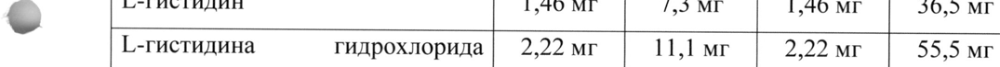
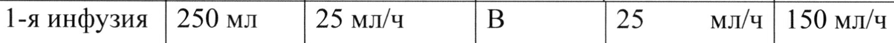
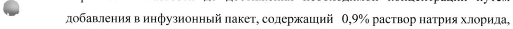
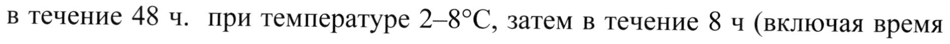
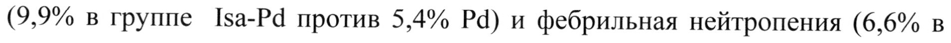
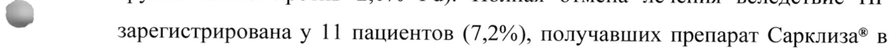
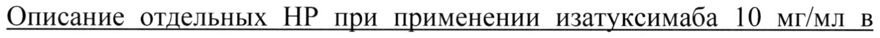
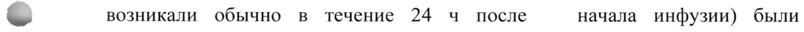
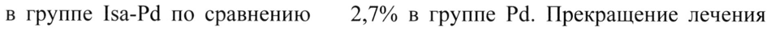
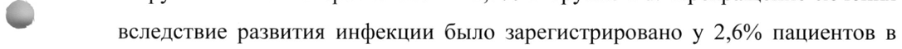

# Изатуксимаб — парентерально

- Препарат: Сарклиза® (концентрат для приготовления раствора для инфузий;)
- АТХ: L01FC02
- Источник: ГРЛС, инструкция по медицинскому применению, РУ ЛП-006430, файл от 2022-04-19 (https://grls.rosminzdrav.ru/Grls_View_v2.aspx?routingGuid=092b9ed8-e00a-4bd4-a21c-3c30b503ebdc)
- Распознано автоматически (OCR): 24 из 24 стр.
- Инструкция к другому РУ того же препарата: ЛП-006430 (национальное РУ, переоформленное по правилам ЕАЭС, решение от 23.03.2022). Текст может быть старше действующего
- Сомнительных строк после OCR: 11 (см. раздел «Проверка распознавания»)

## Общие сведения

МИНИСТЕРСТВО ЗДРАВООХРАНЕНИЯ РОССИЙСКОЙ ФЕДЕРАЦИИ ы
ИНСТРУКЦИЯ ИЗ" и | ПО МЕДИЦИНСКОМУ ПРИМЕНЕНИЮ - °°
ЛЕКАРСТВЕННОГО ПРЕПАРАТА ( от CORE САРКЛИЗА®
Регистрационный номер:
Торговое наименование: САРКЛИЗА® Международное непатентованное наименование: изатуксимаб

## 3. Лекарственная форма

концентрат для приготовления раствора для инфузий
концентрат для приготовления раствора для инфузий
© Состав:
1 мл концентрата содержит:
Содержание Содержание Ингридиент EE флаконе
® Г.-гистидина гидрохлорида | 2,22 мг 11,1 мг 2,22 мг 55,5 мг eee
Описание Прозрачная или слегка опалесцирующая, бесцветная или коричневатого
| или коричневато-желтоватого или желтоватого цвета жидкость. |
| Фармакотерапевтическая группа: моноклональные антитела

Код АТХ: не присвоен Фармакологические свойства

## 5.1. Фармакодинамика

Механизм действия

Изатуксимаб представляет собой моноклональное антитело класса 1201, которое специфично связывается с внеклеточным эпитопом CD 38 и запускает механизмы, ведущие к гибели опухолевых клеток экспрессирующих белок CD
38. CD38 — трансмембранный — гликопротеин, обладающий эктоэнзиматической активностью, характеризующийся высоким уровнем

wr экспрессии на поверхности клеток при гематологических злокачественных новообразованиях и широко экспрессируется клетками множественной миеломы.

Изатуксимаб действует посредством IgG Ес-зависимых механизмов, включающих: антителозависимую клеточно-опосредованную цитотоксичность (АЗКЦ), антителозависимый клеточный фагоцитоз (АЗКФ) и комплемент-зависимую цитотоксичность (КЗЦ). Кроме этого изатуксимаб может вызывать гибель опухолевых клеток путем индукции апоптоза посредством Ес-независимого механизма.

В периферической крови человека мононуклеарные клетки и МК клетки

> (МК-клетки — natural killers) в значительном количестве экспрессируют белок
CD38. Было показано, что изатуксимаб in vitro может активировать МК-клетки в отсутствии СО3З8-позитивных опухолевых клеток-мишеней посредством механизма, связанного с РЕс-фрагментом изатуксимаба. Кроме того, изатуксимаб ингибирует регуляторные Т-клетки, которые экспрессируют более высокие уровни CD38 у пациентов с множественной миеломой по сравнению со здоровыми людьми.

Изатуксимаб блокирует ферментативную активность СО38, катализирующую синтез и _ циклической АДФ-рибозы. АДФ-рибоа регулирует мобилизацию кальция, что может влиять на иммунорегуляцию.
Изатуксимаб ингибирует продукцию циклической АДФ-рибозы из экстрацеллюлярного никотинамидадениндинуклеотида (НАД+) в клетках множественной миеломы.

In vitro было показано, что комбинация препаратов изатуксимаб и помалидомид усиливает клеточный лизис CD 38, экспрессируемый клетками множественной миеломы, за счет эффекторных клеток (АЗКЦ) и путем прямого воздействия на опухолевые клетки по сравнению с применением препарата изатуксимаб в монорежиме.

На основании исследований in vivo, с использованием модели

= опухолевого ксенотрансплантата множественной миеломы человека, было показано, что комбинация препаратов изатуксимаб и помалидомид приводила к усилению противоопухолевой активности по сравнению с активностью препаратов изатуксимаб или помалидомид в монотерапии.

## 5.2. Фармакокинетика

Фармакокинетику изатуксимаба оценивали у 476 пациентов с множественной миеломой, получавших внутривенную инфузию препарата изатуксимаб B монотерапии ИЛИ B комбинации Е помалидомидом/дексаметазоном в дозах от | до 20 мг/кг, вводимых 1 раз в неделю; каждые 2 недели; или каждые 2 недели в течение 8 недель, а затем

~ каждые 4 недели; или каждую неделю в течение 4 недель, a затем каждые 2 недели.

Изатуксимаб демонстрирует нелинейную фармакокинетику с мишеньопосредованным распределением за счет связывания с рецептором CD38.

Экспозиция изатуксимаба в плазме крови (AUC, площадь под кривой
«концентрация-время») увеличивается пропорционально дозе от 1 до 20 мг/кг через каждые 2 недели, при этом отклонений от пропорциональности дозе не наблюдается в диапазоне от 5 до 20 мг/кг каждую неделю в течение 4 недель, а затем каждые 2 недели. После введения изатуксимаба в дозе 10 ик каждую неделю в течение 4 недель, а затем каждые 2 недели, среднее время достижения равновесного состояния составляло 8 недель с кумуляцией в 3,1 раза. Среднее (СУ%) значение максимальной концентрации (Cmax) и AUC в плазме в равновесном состоянии составило - 351 мкг/мл (36,0%) и 72,6 мкг*ч/мл (51,7%) соответственно.
Абсорбция Ввиду того, что изатуксимаб вводится внутривенно, абсорбция не наблюдается.
Распределение Расчетный общий объем распределения изатуксимаба составляет 8,75 л.
- Метаболизм
Ожидается, что изатуксимаб, как болышной белок метаболизируется в результате ненасыщаемого процесса протеолитического катаболизма.
Выведение Изатуксимаб выводится двумя параллельными путями, при этом нелинейный, мишень-опосредованный путь преобладает при низких концентрациях, а неспецифический линейный путь - при более высоких концентрациях. В диапазоне плазменных терапевтических концентраций линейный путь является доминирующим и со временем снижается на 50% от значения в равновесном состоянии 0,00955 л/ч (0,229 л/сутки). Это связано с
< конечным периодом полувыведения изатуксимаба, который составляет 28 дней.
Лекарственное взаимодействие Совместное применение препаратов изатуксимаб и помалидомид не оказывало влияния на фармакокинетику препаратов.
Особые группы пациентов Возраст, пол и раса
Популяционный фармакокинетический анализ продемонстрировал conversa экспозицию изатуксимаба у пациентов в возрасте <75 лети >75 лет. Пол и раса не оказывали клинически значимого влияния на фармакокинетику изатуксимаба.
Масса тела Экспозиция изатуксимаба (AUC) в равновесном состоянии снижается с повышением массы тела.
Печеночная недостаточность Официальных исследований изатуксимаба у пациентов с нарушениями функции печени не проводилось. При проведении популяционного фармакокинетического анализа у пациентов с легкой печеночной недостаточностью [общий билирубин в 1-1,5 раза выше верхней границы
~ нормы (ВГН) или активностью аспартатаминотрансферазы (ACT) > BIH] и умеренной печеночной недостаточностью (общий билирубин > 1,5 - 3 раза
ВГН и любая активность АСТ) было показано, что легкая печеночная недостаточность не оказывала клинически значимого влияния на фармакокинетику изатуксимаба. Влияние умеренной (общий билирубин > 1,53 раза ВГН и любая активность АСТ) и тяжелой печеночной недостаточности
(общий билирубин > 3 раза BIH и любая активность АСТ) на фармакокинетику изатуксимаба неизвестно.
Почечная недостаточность Официальных исследований изатуксимаба у пациентов с почечной
< недостаточностью не проводилось. Популяционный фармакокинетический анализ у пациентов с легкой почечной недостаточностью (60 мл/мин/1,73 м² < расчетная скорость клубочковой фильтрации (р-СКФ) < 90 мл/мин/1,73 м²M’), умеренной почечной недостаточностью (30 мл/мин/1,73 м² < р-СКФ <60 мл/мин/1,73 м²) и тяжелой почечной недостаточностью (р-СКФ <30 мл/мин/1,73 м²) показал отсутствие клинически значимого влияния почечной недостаточности от легкой до тяжелой степени на фармакокинетику изатуксимаба по сравнению с нормальной функцией почек.
| Дети | Препарат Сарклиза® не изучался у пациентов в возрасте до 18 лет.

## 4.1. Показания к применению

Лечение множественной миеломы в комбинации с помалидомидом и дексаметазоном у пациентов, которые получили, как минимум, два предшествующих режима терапии, включающих леналидомид и ингибитор протеасом.

## 4.3. Противопоказания

Гиперчувствительность к изатуксимабу или любому вспомогательному веществу (см. раздел «Состав»).

## 4.6. Применение при беременности и в период грудного вскармливания

- Беременность

Доступные данные о применении препарата Сарклиза® у беременных женщин отсутствуют. Исследования репродуктивной токсичности препарата
Сарклиза® у животных не проводились. Какие-либо выводы относительно безопасного применения препарата Сарклиза® во время беременности не могут быть сделаны.

Известно, что моноклональные антитела типа IgGl проникают через плаценту. Применение препарата Сарклиза® у беременных женщин не рекомендуется. Женщины, детородного возраста, получающие препарат
Сарклиза®, должны использовать надежные методы контрацепции во время

- лечения и в течение не менее 5 месяцев после прекращения терапии.

За информацией о других лекарственных препаратах, которые вводятся наряду с препаратом Сарклиза®, необходимо обращаться к соответствующей инструкции по медицинскому применению.

Период грудного вскармливания

Отсутствуют доступные данные о проникновении изатуксимаба в грудное молоко, о влиянии на лактацию и ребенка, находящегося на грудном вскармливании. Известно, что человеческий иммуноглобулин С присутствует

| в материнском молоке. Антитела могу секретироваться в грудное молоко.
Какие-либо выводы относительно безопасного применения препарата
Сарклиза® во время грудного вскармливания не могут быть сделаны.
Применение препарата Сарклиза® у кормящих женщин не рекомендуется.

Влияние на фертильность

Отсутствуют данные у человека и животных, позволяющие установить возможное влияние препарата Сарклиза® на фертильность мужчин и женщин.

## 4.2. Способ применения и дозы

Препарат Сарклиза® должен вводиться медицинским персоналом в помещениях, оснащенных средствами для проведения реанимации.

Премедикация

wr Для снижения риска и тяжести инфузионных реакций перед введением препарата Сарклиза® необходимо использовать премедикацию следующими препаратами:
* дексаметазон 40 мг внутрь или внутривенно [в/в] (или 20 мг перорально или в/в для пациентов >75 лет).

* парацетамол в дозе 650-1000 мг внутрь (или эквивалент).

* блокаторы Н›-гистаминовых рецепторов (ранитидин 50 мг в/в или эквивалент (например, циметидин)) или ингибиторы протонной помпы внутрь
(например, омепразол, эзомепразол).

| * дифенгидрамин в дозе 25-50 мг в/в или внутрь (или эквивалент
< (например, цетиризин, прометазин, дексхлорфенирамин)). В/в введение предпочтительно как минимум для первых 4 инфузий.

Вышеуказанная рекомендуемая доза дексаметазона (перорально или в/в)
соответствует общей дозе, которую следует вводить только 1 раз перед инфузией, как часть премедикации или основной терапии до введения изатуксимаба и помалидомида.

Рекомендуемые препараты для премедикации следует вводить за 15-60 минут до начала инфузии препарата Сарклиза®. Пациентам, у которых инфузионные реакции не АВИА б в первые 4 введения препарата
Сарклиза®*, можно пересмотреть необходимость в последующей премедикации.

Дозы и схема введения

Рекомендуемая доза препарата Сарклиза® составляет 10 мг/кг массы тела, которую вводят в виде в/в инфузии в комбинации с помалидомидом и дексаметазоном, согласно схеме, приведенной в Таблице 1.

Таблица 1. Рекомендуемая схема введения препарата Сарклиза® в комбинации с помалидомидом и дексаметазоном

.

Каждый цикл терапии составляет 28 дней. Лечение продолжается до прогрессирования заболевания или развития неприемлемой токсичности.

Для других лекарственных препаратов, которые вводятся наряду с препаратом Сарклиза®, необходимо обращаться к соответствующей инструкции по медицинскому применению.

График введения препарата должен тщательно соблюдаться. В случае, если запланированная доза препарата Сарклиза® пропущена, необходимо ввести дозу как можно скорее и соответствующим образом скорректировать

график лечения, поддерживая интервал между введениями.
< Способ введения

Препарат Сарклиза® вводится в/в в виде инфузии.

Скорость инфузии

После разведения, инфузионный раствор следует вводить в/в инфузионно со скоростью инфузии, указанной в таблице 2 ниже. Постепенное повышение скорости инфузии следует рассматривать только при отсутствии инфузионных реакций. (см. раздел Особые указания).

Таблица 2. Скорость инфузии препарата Сарклиза® i [Обы Гибавны ото пов Г Мыя разведен | скорость вие скорости ьная
ИЯ инфузии инфузио | инфузии скорость нных инфузии реакций 1-я инфузия | 250 мл 25 мл/ч В 29 мл/ч | 150 мл/ч течение | каждые 30 60 минут 1 минут 2-я инфузия | 250 мл 50 мл/ч В 50 мл/ч | 200 мл/ч течение | каждые 30 30 минут 1 минут,
— затем повышение до 100 мл/ч каждые 30 минут
Последующ | 250 мл 200 мл/ч 200 мл/ч ие инфузии
Коррекция дозы Коррекция дозы препарата Сарклиза® не требуется.
Введение препарата может потребовать коррекции дозы в случае
< развития у пациента следующих нежелательных реакций:
Инфузионные реакции ° В случае развития инфузионных реакций, следует немедленно приостановить инфузию препарата Сарклиза® и провести надлежащую симптоматическую терапию. После улучшения состояния, инфузия препарата
Сарклиза® может быть возобновлена со снижением скорости инфузии в 2 раза от первоначальной, при тщательном наблюдении и симптоматической терапии при ыы Если в течении 30 минут посте возобновления инфузии симптомы не повторяются, скорость инфузии может быть увеличена до первоначальной, а затем постепенно увеличена, как указано в таблице 2 (см.
выше).

e Если, после остановки инфузии препарата Сарклиза?® не удается быстро купировать симптомы или возникают повторные, требующие госпитализации или являются жизнеугрожающими, на фоне проведения симптоматической терапии, лечение препаратом Сарклиза® должно быть окончательно прекращено; при необходимости следует провести дополнительную поддерживающую терапию.

Нейтропения В случае развития нейтропении 4 степени введение препарата Сарклиза®
~ следует отложить до тех пор, пока число нейтрофилов не возрастет, как минимум, до 1,0 x 10°/n. Следует применять колониестимулирующие факторы
(например, гранулоцитарный колониестимулирующий фактор — Г-КСФ) в соответствии с локальными руководствами (см. раздел «Особые указания»).
Для информации по другим лекарственным препаратам, которые вводятся наряду с препаратом Сарклиза®, необходимо обращаться к соответствующей инструкции по медицинскому применению.
Особые группы пациентов Дети Безопасность и эффективность препарата Сарклиза® у детей в возрасте
< до 18 лет не установлены.
Пожилые Основываясь на результатах популяционного фармакокинетического анализа, у пожилых пациентов коррекции дозы препарата не требуется.
Пациенты с почечной недостаточностью Основываясь на результатах популяционного фармакокинетического анализа и клинической безопасности у пациентов с почечной недостаточностью от легкой до тяжелой степени коррекции дозы препарата не требуется (см. раздел «Фармакокинетика»). |
Пациенты с печеночной недостаточностью

Основываясь на результатах популяционного фармакокинетического анализа, у пациентов с легкой степенью печеночной недостаточности коррекция дозы препарата не требуется.

У пациентов с умеренно выраженной и тяжелой печеночной недостаточностью данные по применению препарата ограничены (см. раздел
«Фармакокинетика»).

Подготовка и проведение инфузии

Приготовление инфузионного раствора должно проводиться в асептических условиях.

~ На основании массы тела пациента (измеряемой перед каждым циклом для соответствующей коррекции введенной дозы), необходимо вычислить требуемую дозу (мг) концентрата препарата Сарклиза®. Для получения необходимой дозы пациенту может потребоваться более одного флакона концентрата препарата Сарклиза®.

* Флаконы с концентратом препарата Сарклиза® перед разведением должны быть визуально проверены на цвет (бесцветный или слегка желтоватый раствор) и отсутствие видимых посторонних частиц.

* Извлечь из флакона соответствующий объем концентрата препарата
Сарклиза®. Развести до достижения необходимой концентрации путем

~ добавления в инфузионный пакет, содержащий 0,9% раствор натрия хлорида, 250 мл или 5% раствор декстрозы.

* Инфузионный пакет должен быть изготовлен из полиолефинов (ПО), полиэтилен (ПЭ), полипропилена (ПП), поливинилхлорид (ПВХ) с ди-(2этилгексил) фталатом (ДЭГФ) или этил-винилацетатом (ЭВА).

. Аккуратно перевернуть пакет ДлЯ перемешивания раствора.Встряхивание запрещено.

Введение

¢ Инфузионный раствор должен вводиться путем внутривенной инфузии с использованием набора для инфузий (из ПЭ, ПВХ с/без ДЭГФ, полибутадиена или ПУ) со встроенным фильтром содержащим
(полиэфирсульфон, полисульфон или нейлон).

° Время введения инфузионного раствора будет зависеть от скорости инфузии (см. раздел «Способ применения и дозы»).

* Приготовленный инфузионный раствор может храниться до введения в течение 48 ч. при температуре 2-8°С, затем в течение 8 ч (включая время инфузии) при комнатной температуре.

* Не требуется дополнительной защиты от света инфузионного пакета, подготовленного в стандартных условиях с искусственным освещением.

- * Не следует вводить раствор препарата Сарклиза® через один и тот же внутривенный катетер одновременно с другими лекарственными препаратами.

Уничтожение

Любые неиспользованные лекарственные средства или отходы должны быть утилизированы в соответствии с локальными требованиями.

## 4.8. Побочное действие

Резюме профиля безопасности

Нежелательные реакции (НР), которые были расценены, как возможно

| или вероятно связанные с применением препарата Сарклиза®, были выявлены

~ У пациентов, получавших его в комбинации с помалидомидом и низкими дозами дексаметазона.

НР перечисляются с использованием общих критериев токсичности
Национального института рака (Common Toxicity Criteria NCI), терминов словаря COSTART (Coding Symbols for а Thesaurus of Adverse Reaction Terms)
и медицинского словаря для регуляторной деятельности MedDRA.

Частота возникновения НР определяется следующим образом: очень частые (>1 / 10), частые (> 1/100 до <1/10); нечастые (21/1000 до <1/100);
редкие (>1/ 10.000 до <1/1,000); очень редкие (<1/10,000); частота неизвестна
(не может быть оценена по имеющимся данным).

В рамках каждой частотной группы соответствующие НР представлены в порядке убывания серьезности.

Данные по безопасности, описанные в этом разделе, основаны на результатах рандомизированного открытого клинического исследования
ICARIA - ММ у предлеченных пациентов с множественной миеломой. В исследовании сравнивались 2 группы пациентов: группа пациентов получавших препарат изатуксимаб (Isa) в дозе 10 мг/кг в комбинации с помалидомидом (Р) и дексаметазоном в малых дозах (4) и группа пациентов получавших только комбинацию помалидомида с малыми дозами

ww дексаметазона.

Наиболее частыми НР (> 20% в группе пациентов Isa-Pd) были:
нейтропения (96,1% в группе Isa-Pd против 93,2% в группе Pd), инфузионные реакции (38,2% в группе Isa-Pd против 0% Pd), пневмония (30.9% в группе IsaPd против 22.8% Pd), инфекция верхних дыхательных путей (28,3% в группе
Isa-Pd против 17,4% Pd), диарея (25,7% в группе Isa-Pd против 19,5% Ра), бронхит (23,7% в группе Isa-Pd против 8,7% Pd).

Наиболее частыми серьезными НР (> 5% пациентов) были пневмония
(9,9% в группе Isa-Pd против 5,4% Ра) и фебрильная нейтропения (6,6% в группе Isa-Pd против 2,0% Pd). Полная отмена лечения вследствие НР

v зарегистрирована у 11 пациентов (7,2%), получавших препарат Сарклиза® в дозе 10 мг/кг в комбинации с помалидомидом и низкими дозами дексаметазона (Isa-Pd), и у 19 пациентов (12,8%), получавших комбинацию помалидомид и низкие дозы дексаметазона (Pd).

Табличный перечень НР

В таблицах 3 и 4 показаны НР, наблюдаемые во время лечения у 301 пациента с множественной миеломой, получавших препарат Сарклиза® в дозе 10 мг/кг в комбинации с помалидомидом и низкими дозами дексаметазона
(Isa-Pd). | | Таблица 3. HP, сообщаемые с частотой > 10% у пациентов, получавших лечение изатуксимаб + помалидомид + дексаметазон (низкие дозы, Isa-Pd), и превышавших >5% в группе помалидомид + дексаметазон (низкие дозы, Pd).

Системно- Част | Количество случаев | Част | Количество случаев органный ота** | (%) Isa-Pd, М = 152 ота** | (%) Pd, М = 149 класс Любая | 3 4 Люба | 3 4
(предпочти .. степен | степе | степе я степе | степ тельный b Hb Hb степе | Hb eHb термин)
тяжест Hb и тяжес ти Инфузионн | Инфуз | очень | 58 2 (1.3) | 2 (1.3) | Очен ble реакции | ионные 1 часто | (38.2) b
© реакци редко и Инфекции и | инфекц | очень 26 1 (0,7)
инвазии ИЯ часто Очен | (17,4)
о hi 5 (3.3) waco (28.3) | дыхате JIbHBIX путей пневмо | очень 47 33 Очен | 34 24 4
‘ 3. 22.8 16.1 2.7 НИЯ часто (30.9) | (21.7) 5 (3.3) | b (22.8) | ( ) | (2.7)
часто бронхи | очень 36 Очен | 13 1 (0,7)
| т часто (23.7) 5 (3.3) b (8,7)
>. часто Нарушения | фебрил | очень Часто |3 (2,0) | 2 (1,3) |1 со стороны | ьная часто (0,7 крови и | нейтро 18 16 2(13)
лимфатичес | пения (11.8) | (10.5) | кой системы
Нарушения | одышк | очень Очен | 15 2 (1,3)
со стороны | a часто b (10,1)
дыхательно 23 6 (3.9) часто й системы, (15.1)
грудной клетки и Нарушения | диарея | очень 39 Очен | 29 1 (0,7)
со стороны часто (25.7) 3 (2.0) b (19,5)
желудочно- 1 часто кишечного тошнот | очень Очен | 14 тракта 23 а часто b (9,4)
(15.1)
часто рвота очень | 18 2(1.3) Часто | 5 (3,4)
часто | (11.8) | “Термин пневмония включает в себя следующие термины: атипичная пневмония, бронхолегочный аспергиллез, пневмония, вызванная гемофильной палочкой, гриппозная пневмония, пневмококковая пневмония, стрептококковая пневмония, вирусная пневмония, кандидозная пневмония, бактериальная пневмония, гемофильная инфекция, легочная
\ инфекция, грибковая пневмония, пневмоцистная пневмония
** Частота относится к любой степени тяжести
| | | Таблица 4. Отклонения в общем анализе крови у пациентов, получавших лечение [5а-Ра,
Лабораторный Isa-Pd Pd степень | степень степени степень | степень
М ая | (27,9)
;
(60.5) (38,8) (31,3)
(12.5) (35,4)
w 127 (83.6) 22 (14.5) 14 (9,5) | 22 (16.4) (15,0)
Показатель, используемый для вычисления процентов, представляет собой количество пациентов, у которых был проведен, как минимум, один анализ крови в течение рассматриваемого периода наблюдения.
Описание отдельных НР при применении изатуксимаба 10 мг/мл в сочетании с помалидомидом и низкими дозами дексаметазона
Инфузионные реакции В проведенном исследовании 1САКТА-ММ инфузионные реакции
(определяемые как НР, связанные с инфузией препарата Сарклиза®, которые
| возникали обычно в течение 24 ч после начала инфузии) были зарегистрированы у 58 пациентов (38,2%). У всех пациентов инфузионные реакции развились во время 1-й инфузии препарата Сарклиза®. У 3 пациентов
(2,0%) инфузионные реакции наблюдались во время 2-й инфузии, иу 2 пациентов (1,3%) — во время 4-й инфузии. Инфузионные реакции 1 степени тяжести были зарегистрированы у 3,9% пациентов, 2-й степени - у 31,6% пациента, 3-й степени - у 1,3% пациента и 4-й степени - у 1,3% пациента.
Признаки и симптомы инфузионных реакций 3 степени тяжести и выше включали в себя одышку, гипертензию и бронхоспазм. |
Частота прерывания инфузии вследствие возникновения инфузионных реакций составила 28,9%. Среднее время прерывания инфузии составляло 55 минут. Средняя продолжительность инфузии препарата Сарклиза® составила 3,3 ч для 1-й инфузии и 2,8 ч для последующих инфузий.

В отдельном исследовании (TCD14079, часть В), препарат Сарклиза® вводился в дозе 10 мг/кг в виде инфузии в фиксированном объеме 250 мл в комбинации с помалидомидом и низкими дозами дексаметазона.
Инфузионные реакции (все 2-й степени) при 1-м введении в день проведения инфузии были зарегистрированы у 47,1% пациентов. Средняя продолжительность инфузии составила 3,94 ч для 1-й инфузии, 1,88 ч - для 2й инфузии и 1,25 ч - для 3-й и последующих инфузий. В целом, профиль

- безопасности препарата Сарклиза® в дозе 10 мг/кг, проводимой в виде инфузии в фиксированном объеме 250 мл, соответствовал профилю безопасности полученному в исследовании 1САВТА-ММ.

Инфекции

В исследовании ICARIA-MM частота развития инфекций 3 степени тяжести или выше составила 42,8%. Наиболее часто регистрируемой тяжелой инфекцией 3-й степени тяжести была пневмония. У пациентов в группе IsaPd частота развития пневмонии составила 21,7% , по сравнению с 16,1%в группе Pd. Частота развития пневмонии 4-й степени тяжести составила 3,3% в группе Isa-Pd по сравнению 2,7% в группе Pd. Прекращение лечения

® вследствие развития инфекции было зарегистрировано у 2,6% пациентов в группе Isa-Pd по сравнению с 5,4% в группе Pd. Фатальные инфекции были зарегистрированы у 3,3% пациентов в группе Isa-Pd иу 4,0% в группе Pd.

Иммуногенность

Как и все терапевтические белки, препарат Сарклиза® потенциально может оказывать иммуногенное действие.

В исследовании ICARIA-MM ни у одного пациента не было получено положительного результата на антитела против лекарственного препарата, в связи с чем, их нейтрализующий статус не определялся. Таким образом, по данным 6 клинических исследованиях при множественной миеломе с применением препарата Сарклиза® в монотерапии или в комбинированной терапии, включая исследование 1САКТА-ММ (М = 564), частота возникновения новых антител к лекарственному препарату составила 2,3%.
Влияние антител на фармакокинетику, безопасность или эффективность препарата Сарклиза® не было установлено.

## 4.9. Передозировка

Признаки и симптомы передозировки
Признаки и симптомы передозировки
Случаев передозировки в клинических исследованиях не зарегистрировано. В клинических исследованиях в/в вводимая доза препарата
- Сарклиза® не превышала 20 мг/кг.
Лечение Специфический антидот для лечения передозировки препаратом
Сарклиза® отсутствует. В случае передозировки необходимо осуществлять наблюдение за пациентом на предмет выявления симптомов и признаков НР и при необходимости немедленно начать соответствующую симптоматическую терапию.

## 4.5. Взаимодействие с другими лекарственными средствами

Препарат изатуксимаб не влияет на фармакокинетику помалидомида
| (см. раздел «Фармакокинетика»).
> Влияние на серологические тесты Поскольку CD38 протеин экспрессируется на поверхности эритроцитов, изатуксимаб, будучи антителом против CD38, может влиять Ha серологические анализы крови с регистрацией ложноположительного результата в непрямом антиглобулиновом тесте (непрямая проба Кумбса), при выявлении антител (скрининг), в панели идентификации антител и перекрестных пробах на совместимость человеческого антиглобулина у пациентов, получавших препарат Сарклиза® (см. раздел «Особые указания»).
Влияние на электрофорез ывороточного белка с иммунофиксацией |
Изатуксимаб может быть определен методом электрофореза сывороточных белков или методом иммунофиксации. Оба метода используются для мониторинга эндогенного М-протеина. Данное взаимодействие может влиять на определение достоверного ответа согласно классификации, основанной на критериях Международной рабочей группы по миеломе (International Myeloma Working Group - IMWG) (см. раздел «Особые указания»).

## 4.4. Особые указания

Инфузионные реакции

Инфузионные реакции, в основном легкие или умеренно выраженные,

- наблюдались у 38,2% пациентов, получавших препарат Сарклиза® (см. раздел

«Побочное действие»). Все инфузионные реакции развивались во время 1-й инфузии препарата Сарклиза® и у большинства пациентов купировались в TOT же день. Клинические проявления наиболее часто встречающихся симптомов инфузионных реакций включали одышку, кашель, озноб и тошноту. Также отмечались тяжелые реакции, включающие гипертензию и одышку (см. раздел
«Побочное действие»).

Для снижения риска возникновения и степени тяжести инфузионных реакций, перед применением препарата Сарклиза®, пациентам следует предварительно провести премедикацию парацетамолом, блокаторами H2-

- гистаминовых рецепторов или ингибиторов протонной — помпы, дифенгидрамин или аналогичные препараты. Дексаметазон используется как для премедикации, так и для лечения множественной миеломы (см. раздел
«Способ применения и дозы»). Во время проведения инфузии препаратом
Сарклиза® необходимо периодически контролировать основные показатели жизненно важных функций. При необходимости инфузию можно прекратить и провести соответствующие лечебные и поддерживающие мероприятия (см.
раздел «Способ применения и дозы»). В тех случаях, когда симптомы не улучшаются — после | прекрашения инфузии, — повторяются | после первоначального улучшения на фоне применения соответствующей медикаментозной терапии, требуют госпитализации или являются жизнеугрожающими, введение препарата Сарклиза® — окончательно прекращают и назначают соответствующее лечение.

Влияние на серологические тесты (непрямой антиглобулиновый тест)

Изатуксимаб связывается с CD38 на поверхности эритроцитов и может привести к ложноположительному результату при проведении непрямого антиглобулинового теста (непрямая проба Кумбса). В исследовании ICARIAММ непрямой антиглобулиновый тест был положительным во время лечения в группе Isa-Pd у 67,7% обследованных пациентов. У пациентов с

- положительным непрямым антиглобулиновым тестом переливание крови проводилось без признаков гемолиза.

Лечение препаратом Сарклиза® не влияло на типирование группы крови по системе ABO/RhD (см. раздел «Взаимодействие с другими лекарственными средствами»). Во избежание потенциальных проблем с переливанием эритроцитов, пациентам, получавшим препарат Сарклиза®, необходимо провести анализ крови и скрининг-тесты до первой инфузии.
Фенотипирование должно быть проведено до начала лечения препаратом
Сарклиза® в соответствии с локальной практикой. Если лечение препаратом
Сарклиза® уже началось, сотрудники отделения переливания крови должны

~ быть проинформированы о влиянии препарата Ha результаты серологических анализов. Возможное влияние препарата при проведении теста на совместимость крови можно устранить с помощью эритроцитов, обработанных дитиотреитолом. Если требуется экстренное переливание, могут быть предоставлены несовместимые АВО/ВЮО-совместимые эритроциты в соответствии с локальной практикой использования отделением переливания крови (см. раздел «Взаимодействие с другими лекарственными средствами»).

Нейтропения | У пациентов, получавших препарат Сарклиза®, нейтропения 3-4 степени, отмеченная как отклонения лабораторных показателей наблюдалась в (84,9%), и нейтропенические осложнения (30,3%) случаев (см. раздел «Побочное действие»).

Необходимо проводить мониторинг и подсчет общего числа клеток крови во время лечения. Во время лечения может потребоваться применение антибиотиков, противогрибковая и противовирусная профилактика.
Необходимо осуществлять мониторинг пациентов с нейтропенией на наличие признаков инфекции. Не рекомендуется снижение дозы препарата Сарклиза® .
При необходимости, возможна отсрочка введения дозы препарата Сарклиза®

- и применение колониестимулирующих факторов (например, Г-КФС) для увеличения числа нейтрофилов (см. раздел «Способ применения и дозы»).

Влияние на оценку ответа на проводимую терапию

Изатуксимаб представляет собой моноклональное антитело IgG Kanna, которое может определяться как при электрофорезе, так и при иммунофиксации сывороточного белка, используемых для клинического мониторинга эндогенного М-белка (см. раздел «Взаимодействие с другими лекарственными средствами». Данное взаимодействие о может влиять на результаты определения полного ответа на терапию у пациентов с миеломой типа IgG каппа. 22 пациента в группе Isa-Pd, которые при оценке

® эффективности терапии множественной миеломы соответствовали критериям очень хорошего частичного ответа, имели только остаточную положительную иммунную фиксацию и были протестированы на интерференцию. Образцы сыворотки этих пациентов были протестированы масс-спектрометрией для отделения сигнала *ТМ* (трансмембранный) от сигнала М-белка миеломы. У 11 из 22 пациентов не было обнаружено остаточного М-белка миеломы при уровне чувствительности теста иммунофиксации (25 мг/дл); у 10 из 11 пациентов в начале исследования обнаруживался подтип IgG каппа миеломы,

| что показало наличие влияния | аалужонмаба на результаты анализа |

иммунофиксации (см. раздел «Взаимодействие с другими лекарственными

средствами»).

## 4.7. Влияние на способность управлять транспортными средствами, механизмами

механизмами

Клинических исследований влияния препарата (Сарклиза® на

способность управления автомобилем и работу с механизмами не

проводилось. Основываясь на сообщениях о НР развивающихся на фоне

терапии препаратом Сарклиза®, влияния на способность управлять

автотранспортом и работать с механизмами не было установлено (см. раздел

«Способ применения и дозы» и «Побочное действие»). Тем не менее, у
=“ некоторых пациентов, получавших препарат Сарклиза®, сообщалось о

развитии головокружения и усталости, что следует принимать во внимание

при вождении автотранспорта и работе с механизмами.

## 6.5. Форма выпуска

Концентрат для приготовления раствора для инфузий 20 мг/мл.

Для упаковки 5 мл:

По 5 мл препарата во флаконы бесцветного прозрачного стекла

гидролитического типа | с номинальной вместимостью 6 мл, укупоренные

полимерными крышками ETFE (ко-полимер этилена и тетрафлуороэтилена),

закатанные алюминиевыми колпачками с отрывными дисками. По | или 3 wv флакона с инструкцией по медицинскому применению в пачку картонную с

заклеенным(-и) клапаном(-ами).

Для упаковки 25 мл:

По 25 мл препарата во флаконы бесцветного прозрачного стекла

гидролитического типа | с номинальной вместимостью 30 мл, укупоренные

полимерными крышками ETFE (ко-полимер этилена и тетрафлуороэтилена),

закатанные алюминиевыми колпачками с отрывными дисками. По 1 флакону

с инструкцией по медицинскому применению в пачку картонную С

заклеенным(-и) клапаном(ами). |

Каждая картонная пачка снабжена антиконтрафактным стикером.
Для однократного применения.

## 6.4. Условия хранения

Хранить при температуре от 2 до 8 °С, в защищенном от света месте.
Хранить при температуре от 2 до 8 °С, в защищенном от света месте.
Хранить в недоступном для детей месте.
Не замораживать.

## 6.3. Срок годности

3 года.
3 года.
Не применять по истечении срока годности, указанного на упаковке.
Условия отпуска = Отпускают по рецепту.
Юридическое лицо, на имя которого выдано регистрационное удостоверение
АО Санофи-авентис груп, Франция.
Производитель Санофи-Авентис Дойчланд ГмбХ, Германия
Sanofi-Aventis Deutschland GmbH, Germany.
Industriepark Hoechst - Brueningstrasse 50
H500, H590, H600 65926 Frankfurt am Main, Germany.
| Претензии потребителей направлять по адресу в России:
® АО «Санофи Россия».
125009, г. Москва, ул. Тверская, 22.
Телефон: (495) 721-14-00.
Факс: (495) 721-14-11.
yy Менеджер по регистрации 2 О.М. Ковбасенко
| | На отрезной части инструкции по медицинскому применению указывают следующую информацию
Информационная карта ПАЦИЕНТАМ, принимающим терапию моноклональными антителами анти CD 38:
Предоставьте эту карточку сотрудникам здравоохранения ПЕРЕД проведением переливания компонентов крови.
ФИО пациента, принимающего терапию моноклональными антителами антиСО 38
Я получаю следующий препарат для лечения Множественной Миеломы (указать название препарата):
Уважаемый сотрудник здравоохранения

te Моноклональные антитела анти CD38 не влияют на результаты определения группы крови по системе АВО, резус-принадлежности крови, фенотипирования антигенов эритроцитов, выполняемого в солевых средах с использованием моноклональных антител. Непрямая проба Кумбса (Непрямой антиглобулиновый тест) может показать положительный результат у пациентов получающих терапию моноклональными антителами анти CD38, даже при отсутствии в сыворотке пациента антител к антигенам эритроцитов. Если потребуется экстренное переливание эритроцитсодержащих сред, может понадобиться их индивидуальный подбор на станции (в отделении) переливания крови, либо в соответствующей лаборатории.
До начала терапии моноклональными антителами анти CD 38 мои результаты анализа крови от ----/----/----/ были:
Группа крови/ Резус фактор: OA ОВ GAB оО ОВ ORhКей +о Кей-о Ко k-o C+o C-o eto eo

’ Et+o E-o eto eo Fyaog Fybo Мо № Soa Лас Jkbo
Непрямая проба Кумбса (скрининг антител):
о отрицательная о положительная Прямая проба Кумбса:
о отрицательная о положительная Определены антитела для следующих антигенов:
Название ЛПУ:
ФИО врача: Печать ЛПУ

и 7 277 A Менеджер по регистрации Ses Lak О.М. Ковбасенко
С /
## Проверка распознавания

Страницы-сканы распознаны автоматически. В 11 строках с дозировками цифры могли распознаться с ошибкой — сверьте с вырезкой из оригинала:

- стр. 1: «® Г.-гистидина гидрохлорида | 2,22 мг 11,1 мг 2,22 мг 55,5 мг» — низкая уверенность: «2,22» (17); повторное чтение: «© аа гидрохлорида 5 = т = = _ Г —»  
  
- стр. 7: «| * дифенгидрамин в дозе 25-50 мг в/в или внутрь (или эквивалент» — повторное чтение: «; * дифенгидрамин в дозе 25-50 мг в/в или внутрь (или эквивалент»  
  
- стр. 9: «1-я инфузия | 250 мл 25 мл/ч В 29 мл/ч | 150 мл/ч» — низкая уверенность: «29» (66)  
  
- стр. 11: «~ добавления в инфузионный пакет, содержащий 0,9% раствор натрия хлорида,» — повторное чтение: «®  $обавления В ннфузнонный акст, содержащий 0596 раствор натрия хлорида»  
  
- стр. 12: «в течение 48 ч. при температуре 2-8°С, затем в течение 8 ч (включая время» — низкая уверенность: «2-8°С,» (41)  
  
- стр. 13: «(9,9% в группе Isa-Pd против 5,4% Ра) и фебрильная нейтропения (6,6% в» — низкая уверенность: «(9,9%» (80)  
  
- стр. 13: «v зарегистрирована у 11 пациентов (7,2%), получавших препарат Сарклиза® в» — повторное чтение: «- sapepieuponenay 1  ациентов (72%), получавших И»  
  
- стр. 16: «Описание отдельных НР при применении изатуксимаба 10 мг/мл в» — низкая уверенность: «10» (71)  
  
- стр. 16: «| возникали обычно в течение 24 ч после начала инфузии) были» — повторное чтение: «~ возникали обычно в течение 24 4 после начала инфузии) были»  
  
- стр. 17: «в группе Isa-Pd по сравнению 2,7% в группе Pd. Прекращение лечения» — низкая уверенность: «2,7%» (77)  
  
- стр. 17: «® вследствие развития инфекции было зарегистрировано у 2,6% пациентов в» — повторное чтение: «~ следствие развития инфекции было  “арегистрировано р 26% пациентов в»  
  
