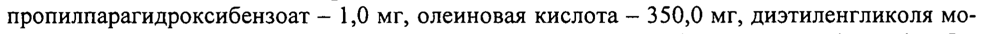
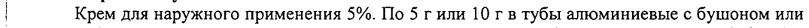

# Имихимод — наружно

- Препарат: Вартоцид® (крем для наружного применения;)
- АТХ: D06BB10
- Источник: ГРЛС, инструкция по медицинскому применению, РУ ЛП-003265, файл от 2022-09-13 (https://grls.rosminzdrav.ru/Grls_View_v2.aspx?routingGuid=75e6c7ee-e29e-458c-a5da-03d9ea3f5f94)
- Распознано автоматически (OCR): 4 из 4 стр.
- Инструкция к другому РУ того же препарата: ЛП-003265 (национальное РУ, переоформленное по правилам ЕАЭС, решение от 19.07.2022). Текст может быть старше действующего
- Сомнительных строк после OCR: 2 (см. раздел «Проверка распознавания»)

## Общие сведения

МИНИСТЕРСТВО ЗДРАВООХРАНЕНИЯ РОССИЙСКОЙ ФЕДЕРАЦИИ

| ИНСТРУКЦИЯ ЛП - 003265 - 261015

по применению eee een д имели ReOBAHO

|

Регистрационный номер:

| Торговое название: Вартоцид®

| Международное непатентованное наименование: Имихимод

Химическое название: 4-амино-1-изобутил-1Н-имидазо[4,5-с]хинолин

## 3. Лекарственная форма

Крем для наружного применения.
Крем для наружного применения.

## 2. Состав

1,0 г крема содержит:
1,0 г крема содержит:

. Активное вещество: имихимод 50 мг.

Вспомогательные вещества: феноксиэтанол - 2,0 мг, метилпарагидроксибензоат- 2,0 мг,

пропилпарагидроксибензоат - 1,0 мг, олеиновая кислота — 350,0 мг, диэтиленгликоля мо-

ноэтиловый эфир — 35,0 мг, карбомер (карбомер интерполимер) - 1,5 мг, карбомер (карбомер кополимер) - 2,5 мг, полисорбат-20 - 2,5 мг, троламин - 2,0 мг, вода очищенная — до
: 1000 мг.

Описание: Белый или белый с желтоватым оттенком крем.

Фармакотерапевтическая группа: Иммуномодулирующее средство. |

| Код ATX: D06BB10

Фармакологические свойства:

## 5.1. Фармакодинамика

Имихимод - иммуномодулирующее средство для наружного примене-
Имихимод - иммуномодулирующее средство для наружного примене-

° ния, является модификатором иммунного ответа, не обладает прямой противовирусной активностью. Действие обусловлено индукцией интерферона альфа, фактора некроза опухолей и других цитокинов. При наружном применении препарата наблюдается уменьшение процессов ангиогенеза за счет усиления продукции интерлейкина-18 и интерферона-

гамма.

## 5.2. Фармакокинетика

Менее 0,9% меченного радиоактивным изотопом имихимода всасыва-
Менее 0,9% меченного радиоактивным изотопом имихимода всасыва-
| ется через кожу человека после нанесения однократной дозы. Небольшое количество пре-
| парата, поступившего в системный кровоток, без задержки выводится из организма поч-

ками и через кишечник в соотношении приблизительно 3:1. Концентрация препарата в

сыворотке крови после однократного или многократного наружного применения не до-

стигала уровня, поддающегося количественному определению (>5 нг/мл).

р Показания к применению: Лечение наружных остроконечных кондилом с локализацией на наружных половых органах и/или в перианальной области у взрослых.

## 4.3. Противопоказания

Гиперчувствительность к имихимоду, вспомогательным компонентам препарата. Беременность, период грудного вскармливания, детский возраст до 18 лет.
Гиперчувствительность к имихимоду, вспомогательным компонентам препарата. Беременность, период грудного вскармливания, детский возраст до 18 лет.

## 4.6. Применение при беременности и в период грудного вскармливания

Препарат не назначают беременным женщинам, женщинам в период грудного вскармли-

вания. !

## 4.2. Способ применения и дозы

Наружно. Препарат применяют предпочтительно на ночь перед сном и оставляют на коже

в течение 6-10 часов. Крем наносят только на поражённые предварительно очищенные

участки кожи тонким слоем и аккуратно втирают до полного впитывания. Обработанный

участок кожи не следует закрывать повязками. Не допускается использования избыточного количества крема. По истечении указанного времени крем должен быть смыт теплой
| водой с применением мыла с нейтральным значением рН.

Разовая (суточная) доза препарата 10 мг крема на 1 см? поверхности кожи (полоса крема

диаметром 2 мм и длиной 0,5 см): Максимальная площадь нанесения 25 cM’, что соответ-

ствует максимальной дозе препарата — 250 мг. Препарат применяют 1 раз в сутки, 3 раза в неделю (например, понедельник, среда, пятница или вторник, четверг, суббота), до полного исчезновения генитальных или перианальных остроконечных кондилом, но не более 16 недель.
Если Вы забыли нанести крем по графику, нанесите пропущенную дозу препарата в максимально короткий срок, а затем восстановите регулярный график лечения. Не следует применять крем более одного раза в день.
| Побочные действия:
| Частота развития побочных эффектов определена следующим образом:
Очень часто: >1/10;
Часто:<1/10>1/100;
Нечасто: <1/100>1/1000;
Редко: <1/1000>1/10000;
Очень редко: <1/10000 . Местные кожные реакции:
Очень часто: зуд и боль в месте нанесения препарата.
Часто: инфекция, эритема, эрозии, экскориация/шелушение, отек.
Нечасто: кожный зуд, дерматит, фолликулит, эритематозная сыпь, экзема, крапивница.
® Редко: индурация, изъязвление, образование струпьев и появление пузырьков, локальная гипопигментация и гиперпигментация. |
Нарушения нервной системы:
Часто: головная боль, головокружение.
Нечасто: бессонница, депрессия, раздражительность, парестезия, мигрень, сонливость, звон в ушах.
Нарушения пищеварительной системы:
Часто: тошнота Нечасто: боль в заднем проходе, поражения прямой кишки, боль в животе, диарея, рвота, анорексия.
Нарушения мочеполовой системы:
Нечасто: грибковая, бактериальная инфекция, простой герпес, вагинит, вульвит, болезненный половой акт, боль в половом члене, боль во влагалище, атрофический вагинит.
Нарушения системы кроветворения:
Очень редко: снижение гемоглобина, лейкопения, абсолютная нейтропения, тромбоцитопения.
Нарушения дыхательной системы: .
9 Нечасто: фарингит, ринит.
Нарушения опорно-двигательного аппарата:
Нечасто: боль в пояснице, артралгия. , Прочие:
Часто: инфекция, миалгия, лихорадка, гриппоподобные симптомы, утомляемость.
Нечасто: повышенная потливость, лимфоаденопатия.

При появлении местных побочных эффектов крем следует удалить, смыв его водой с мылом. Лечение можно возобновить после купирования кожной реакции.

Если любые из указанных в инструкции побочных эффектов усугубляются, или Вы заметили любые другие побочные эффекты, не указанные в инструкции, сообщите об этом врачу.

## 4.9. Передозировка

Передозировка маловероятна из-за низкой всасываемости препарата.
При случайном попадании препарата внутрь в дозе 200 мг, что соответствует 4 г крема, могут наблюдаться тошнота, рвота, головная боль, миалгия, лихорадка. Наиболее серьезным с клинической точки зрения побочным эффектом приема внутрь нескольких доз по 200 мг является снижение артериального давления. Необходимо срочно обратиться к врачу и подобрать симптоматическую терапию.
| | | - 3 Взаимодействие с другими лекарственными средствами:
Изучение взаимодействия имихимода с другими лекарственными средствами, включая иммунодепрессанты, не проводилось. Минимальное всасывание препарата через кожу | ограничивает взаимодействие с препаратами системного действия.

## 4.4. Особые указания

При выявлении реакции гиперчувствительности рекомендуется прекратить терапию. Если местная реакция на препарат служит причиной серьезного дискомфорта для больного, либо, если в зоне применения крема возникает инфекция, разрешается сделать перерыв в лечении на несколько дней. В случае инфекции принимаются необходимые меры.
Избегайте контакта препарата с глазами. При попадании крема в глаза рекомендуется промыть их водой. .
Мужчины, которым не выполнялось обрезание, при лечении остроконечных кондилом, | расположенных под крайней плотью, должны ежедневно промывать область поражения, |
| оттянув крайнюю плоть. Рекомендуется немедленно прекратить лечение в случае обнару- | жения ранних признаков фимоза. |
Препарат следует смыть с кожи перед половым актом.
Нельзя подвергать кожу, обрабатываемую препаратом, воздействию искусственного или
< естественного (солнечного) ультрафиолетового облучения до полного окончания курса | р лечения, поскольку существует угроза получения солнечных ожогов. |
До и после применения препарата, следует тщательно вымыть руки водой с мылом. |
Не допускается применение избыточного количества крема и более длительный контакт
(более 10 часов) препарата с кожей, так как это может вызвать выраженную местную реакцию.
Препарат может вызвать обострения воспалительных заболеваний кожи.
Не рекомендуется использовать окклюзионную повязку во время лечения препаратом. В период лечения лучше использовать белье из хлопчатобумажной ткани. |
Использование препарата в дозах, превышающих рекомендуемые, может привести к по- | вышению риска развития выраженных местных реакций. |
Препарат наносится только на поражённые участки кожи. Избегать попадания препарата Г на здоровые кожные покровы и слизистые оболочки, при попадании необходимо немедленно промыть их теплой водой с мылом.
Не рекомендуется применять препарат до заживления кожи после других видов медикаментозного или хирургического лечения. .
Не применять препарат на участках кожи с открытыми ранами, язвами или эрозиями до их 9 заживления.
Не изучена эффективность и безопасность препарата при лечении остроконечных кондилом, локализующихся в мочеиспускательном канале, влагалище, шейке матки, прямой кишке и слизистой заднего прохода. При этих локализациях применять препарат не рекомендуется. |
Необходимо избегать сексуального контакта, включая половой, анальный или оральный секс, когда препарат находится на коже. Препарат может ослабить герметичность презер-
| вативов и влагалищных диафрагм. Для Вашего здоровья следует применять другие способы контрацепции в период лечения препаратом и в течение месяца после последнего применения препарата.
Так как имихимод не обладает прямым противовирусным и цитотоксическим действием,
| после проведенной терапии возможно возникновение новых кондилом генитальной и перианальной областей.
В некоторых случаях новые кондиломы могут развиваться на других участках кожи даже в период лечения препаратом. В этом случае дальнейшую тактику терапии определяет лечащий врач.
У больных с иммунодефицитом не рекомендуется применять препарат Вартоцид® повторно.
| 4.
| ;
| Влияние на способность управлять транспортными средствами, механизмами:
Препарат не влияет на способность управлять транспортными средствами, работать с движущимися механизмами и заниматься другими потенциально опасными видами деятельности, требующими повышенной концентрации внимания и быстроты психомотор-
| ных реакций.
| Форма выпуска: | | Крем для наружного применения 5%. По 5 гили 10 г в тубы алюминиевые с бушоном или тубы ламинатные из комбинированного материала (ПЭВД/фольга алюминиевая ЛТЭНД) с
| бушоном с контролем первого вскрытия. Одна туба вместе с инструкцией по применению
| в пачке из картона.
| Условия хранения:
При температуре не выше 25 °С. Хранить в недоступном для детей месте.

## 6.3. Срок годности

3 года. Не использовать по истечении срока годности, указанного на упаковке.
Условия отпуска:
Отпускают по рецепту.
Производитель/Владелец регистрационного удостоверения/организация, принимающая рекламации по качеству препарата:
( ЗАО «Медико-биологический научно-производственный комплекс «Цитомед», Россия
| 191023, г. Санкт-Петербург, Мучной пер, д. 2, тел/факс (812)315-88-34, www.cytomed.ru.
Адрес места производства:
| 199178, г. Санкт-Петербург, Васильевский остров, Малый проспект, д. 57, корп. 4, лит. Ж;
Генеральный дире КОНЕ РР А.Н. Хромов | ЗАО «МБНПК « Kap IEA ESN ;
Ay Vey MBHNK А | = ИцутомеЯ =.
| “lek \cytomed))> | ar Sofa | Co a So Sy |
| PX © | ` | | | | { | р | | BS a | — |
## Проверка распознавания

Страницы-сканы распознаны автоматически. В 2 строках с дозировками цифры могли распознаться с ошибкой — сверьте с вырезкой из оригинала:

- стр. 1: «пропилпарагидроксибензоат - 1,0 мг, олеиновая кислота — 350,0 мг, диэтиленгликоля мо-» — повторное чтение: «пропилпарагидроксибензоат _ 1,0 мг, олеиновая кислота — 350,0 мг, диэтиленгликоля мо-»  
  
- стр. 4: «| Крем для наружного применения 5%. По 5 гили 10 г в тубы алюминиевые с бушоном или» — низкая уверенность: «10» (75)  
  
