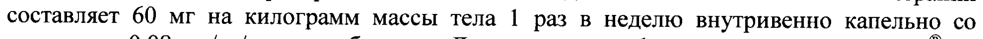

# Ингибитор альфа 1-протеиназы человеческий — парентерально

- Препарат: Респикам® (раствор для инфузий;)
- АТХ: B02AB02
- Источник: ГРЛС, инструкция по медицинскому применению, РУ ЛСР-003707/10, файл от 2021-10-06 (https://grls.rosminzdrav.ru/Grls_View_v2.aspx?routingGuid=65c4a0c6-2180-46dd-a9bc-62ca9f1730b2)
- Распознано автоматически (OCR): 4 из 4 стр.
- Инструкция к другому РУ того же препарата: ЛСР-003707/10 (срок действия истёк, решение от 14.02.2020). Текст может быть старше действующего
- Сомнительных строк после OCR: 1 (см. раздел «Проверка распознавания»)

## Общие сведения

‚ ЛСР-003707/10-040510 , ‚ | ИНСТРУКЦИЯ |
ПО МЕДИЦИНСКОМУ ПРИМЕНЕНИЮ ПРЕПАРАТА РЕСПИКАМ?® (RESPIKAM)
Регистрационный номер Торговое название препарата: Респикам®
Международное непатентованное или группировочное название: альфа! -протеиназы ингибитор (человеческий) |

## 3. Лекарственная форма

раствор для инфузий
раствор для инфузий

## 2. Состав

1 флакон с 50 мл раствора содержит: | Активное вещество: Ингибитор альфа1-протеиназы [человеческий] (альфа!-антитрипсин)
1000 мг Вспомогательные вещества: натрия дигидрофосфата дигидрат, натрия хлорид, вода для инъекций
С Описание:
Прозрачный, от бесцветного до желто-зеленого цвета раствор. Может содержать небольшой осадок (взвешенные протеиновые частицы).
Фармакотерапевтическая группа: ингибитор протеиназ
Код ATX: B0O2AB02 Фармакологические свойства

## 5.1. Фармакодинамика

Респикам® представляет собой стерильный, готовый к употреблению раствор, содержащий очищенный ингибитор альфа!-протеиназы (другое название — альфа1антитрипсин (ААТ)).
Респикам® представляет собой стерильный, готовый к употреблению раствор, содержащий очищенный ингибитор альфа!-протеиназы (другое название — альфа1антитрипсин (ААТ)).
Pecnukam® изготавливается из плазмы крови здоровых людей с помощью ионообменной | хроматографии. С целью предотвращения риска переноса возбудителей инфекционных заболеваний, каждая порция плазмы человека, используемая для производства препарата,
| С проверяется на содержание вируса иммунодефицита человека (ВИЧ), антител к гепатиту
С (анти-ВСГ), поверхностного антигена гепатита В (HBsAg), а также проводится серологическая реакция на определение возбудителя сифилиса.
Респикам® оказывает терапевтический эффект при дефиците AAT — хроническом наследственном, аутосомно-рецессивном заболевании, характеризующимся развитием тяжелой, медленно прогрессирующей панацинозной эмфиземы лёгких, чаще всего
. наблюдающейся на третьем-четвертом десятилетии жизни. Предполагается, что развитие .
этого патологического состояния обусловлено дисбалансом между эластазой (ферментом, способным разрушать эластин тканей и продуцируемым преимущественно нейтрофилами, в нижних отделах дыхательных путей) и AAT — главным ингибитором эластазы. В | результате длительного воздействия эластазы разрушается эластин тканей и развивается эмфизема легких. Примерно у 10 % новорожденных с ААТ-дефицитом наблюдается | гигантоклеточный гепатит с холестатической желтухой. У взрослых дефицит ААТ может сопровождаться циррозом печени.
Дефицит ААТ является генетической патологией в локусе гена PI, который был найден в хромосоме 14432.1. Концентрация AAT в плазме крови, связанная с PI — типом | 47505.
’ JICP-003707/10-0405 10 й oe 2 гомозиготного наследования, обычно находится в диапазоне 12-18 % от нормы, a гетерозиготного наследования — составляет примерно 35 % от нормы. Множество исследований эффективности заместительной терапии основывались на поддержании концентрации ААТ в плазме крови человека >80 мг/дл. Такая концентрация оказалась
| достаточной для предотвращения развития эмфиземы легких у таких больных.

## 5.2. Фармакокинетика

При инфузии Респикама® один раз в неделю в дозе 60 мг/кг массы тела у 21 больного среднее значение концентрации ААТ составило 126 мг/дл (до начала лечения - 30 мг/дл). |
При инфузии Респикама® один раз в неделю в дозе 60 мг/кг массы тела у 21 больного среднее значение концентрации ААТ составило 126 мг/дл (до начала лечения - 30 мг/дл). |
Многочисленные исследования эффективности заместительной терапии показали, что такая концентрация является достаточной для предотвращения развития эмфиземы легких у больных с врожденным дефицитом ААТ.
| В ходе исследования было обнаружено, что в первые часы после инфузии максимальная концентрация в плазме крови составляет 280 мг/дл с быстрым ее снижением в течение | первых 2 дней, и постепенным последующим снижением в течение 7 дней. Период полувыведения ингибитора альфа1-протеиназы составил 4,5 дня. В течение 2 лет исследования он не изменялся, что указывает на отсутствие образования антител в ответ с на введение ААТ.
| Показания к применению Врожденный дефицит ингибитора альфа!-протеиназы у больных с клинической картиной панацинозной эмфиземы легких. Для длительной заместительной терапии только у пациентов с фенотипами PiZZ, PiZ(-) или Pi(-)(-).

## 4.3. Противопоказания

| Селективный дефицит иммуноглобулина A (IgA) при наличии антител к IgA. |
| Селективный дефицит иммуноглобулина A (IgA) при наличии антител к IgA. |
Гиперчувствительность к составным компонентам препарата.

## 4.6. Применение при беременности и в период грудного вскармливания

На сегодняшний день нет информации, каким образом препарат Респикам® влияет на внутриутробное развитие плода или на репродуктивную функцию женского организма.
Неизвестно проникает ли препарат Респикам® в грудное молоко. Поэтому ингибитор
~ альфа1-протеиназы может назначаться врачом при беременности и грудном вскармливании
© только в случаях острой необходимости, когда ожидаемая польза для матери превышает возможный риск для плода или ребёнка.
Безопасность и эффективность препарата у детей не установлена. Применение у детей противопоказано.

## 4.2. Способ применения и дозы

Препарат предназначен только для внутривенного введения |
Препарат предназначен только для внутривенного введения |
Взрослые Рекомендуемая доза препарата Респикам® для длительной заместительной терапии составляет 60 мг на килограмм массы тела 1 раз в неделю внутривенно капельно со скоростью 0,08 мл/кг/мин или быстрее. Длительность инфузии препарата Респикам® не должна превышать 30 минут. Соблюдая правила асептики, необходимую дозу препарата набирают в шприц из флакона с помощью специальной иглы с фильтром (поставляется с препаратом). После этого удаляют иглу с фильтром и заменяют ее иглой, предназначенной для инъекций. Затем переносят дозу в соответствующий пластиковый 2 р 47505 у ЛСР-003707/10-040510 ig :
| контейнер (пластиковый пакет или флакон). Инфузию препарата производят с использованием системы, предназначенной для внутривенного капельного введения растворов (капельница).
Непосредственно перед введением, парентеральные лекарственные препараты | необходимо проверить на предмет наличия посторонних примесей и прозрачность раствора.
Респикам® следует применять после того, как температура препарата сравняется с комнатной.
Длительность курса устанавливается врачом.

## 4.8. Побочное действие

Препарат Респикам® в дозе 60 мг/кг в неделю хорошо переносится. В ходе исследования не поступало сообщений о серьезных нежелательных явлениях или смертельных исходах.
Препарат Респикам® в дозе 60 мг/кг в неделю хорошо переносится. В ходе исследования не поступало сообщений о серьезных нежелательных явлениях или смертельных исходах.
Не было выявлено отклонений от исходного значения основных показателей состояния | организма или лабораторных параметров. Не было выявлено изменений от исходного значения показателей на электрокардиограмме (ЭКГ). В течение периода клинического исследования и в течение 6 месяцев после него не обнаружилось изменений
С вирусологических параметров.
При изучении безопасности лечения Респикамом® у 18 больных были выявлены 22 случая побочного действия, их которых только 3 можно рассматривать, как возможно связанные с приемом Респикама® (головная боль, эритема и дисгевзия) и один, как вероятно, связанный (гипертермия) с его лечением.
С момента выхода препаратов ингибитора альфа1-протеиназы на рынок периодически поступали сообщения oO иных напоминающих простуду симптомах, реакциях напоминающих аллергию, озноб, появление одышки, сыпи, тахикардии и, редко, снижение артериального давления. Также были зафиксированы редкие случаи | кратковременного повышения артериального давления, сопровождающиеся болью в грудной клетке.

## 4.9. Передозировка

В настоящее время о случаях передозировки препаратом не сообщалось. Антидота к препарату не существует.
В настоящее время о случаях передозировки препаратом не сообщалось. Антидота к препарату не существует.
[ Взаимодействие с другими лекарственными средствами
Респикам® не следует смешивать с другими лекарственными средствами.

## 4.4. Особые указания

"Пороговая" концентрация ингибитора альфа!-протеиназы в плазме крови, призванная обеспечить достаточное антиэластазное действие в легких больных с дефицитом альфа1антитрипсина, составляет 80 мг/дл (эта величина основана на данных, полученных с помощью стандартного иммунологического анализа содержания ингибитора альфа1-протеиназы). |
"Пороговая" концентрация ингибитора альфа!-протеиназы в плазме крови, призванная обеспечить достаточное антиэластазное действие в легких больных с дефицитом альфа1антитрипсина, составляет 80 мг/дл (эта величина основана на данных, полученных с помощью стандартного иммунологического анализа содержания ингибитора альфа1-протеиназы). |
Несмотря на инактивацию и/или элиминацию вирусных возбудителей в процессе производства препарата Респикам® нельзя полностью исключить наличия в нем неизвестного инфекционного агента. У больных, получающих инфузии препаратов крови | или плазмы, могут развиться признаки и/или симптомы вирусного заболевания, например | гепатита С. Перед назначением препарата врач должен соотнести риск и пользу.
Возможно повышение объема плазмы после инфузии Респикама*, что следует учитывать у больных с увеличенным объемом циркулирующей жидкости.
Не допускается повторного применения остатков препарата после выполнения инфузии.
47505 | a JICP-003707/10-0405 10 Неиспользованные флаконы с препаратом, которые были взяты из холодильника, следует вернуть в холодильник на хранение в течение 6 часов. Если флакон с препаратом оставался при комнатной температуре (25 °С) более 48 часов, препарат считается
| просроченным и не допускается к дальнейшему использованию.
Влияние препарата на выполнение потенциально опасных видов деятельности, требующих повышенной концентрации внимания и быстроты психомоторных реакций, не
| установлено.

## 6.5. Форма выпуска

Раствор для инфузий 20 мг/мл. |
Раствор для инфузий 20 мг/мл. |
По 50 мл раствора для инфузий во флаконах бесцветного гидролитического стекла (USP)
тип |, герметично укупоренных резиновыми пробками и обжатых алюминиевыми | колпачками с пластиковой крышкой (flip-off).
По 1 флакону вместе с инструкцией по применению и иглой с фильтром (в стерильной упаковке из бумаги и ПВХ) помещают в картонную пачку. | с Условия хранения
Хранить при температуре от 2 до 8 °С. Не замораживать.
Хранить в недоступном для детей месте.

## 6.3. Срок годности

2 года. He использовать после истечения срока годности.
Условия отпуска из аптек По рецепту.
Производитель:
Камада Лтд., Израиль | Kamada Ltd., Israel
Адрес: Сапир 7, Кирьят Вайцман Сайенс Парк, 74036 Несс-Зиона, Израиль :
7 Sapir St., Kiryat Weizmann Science Park, 74036 Ness-Ziona, Israel
Претензии потребителей принимаются по адресу представительства
Генфа Медика C.A., Швейцария Адрес представительства: |
; 119421 Москва, Ленинский mp., д.99. ° : |
Тел. (495) 662-50-65, факс (495) 662-50-61 а 4S ,
<, с, о.
‘s о G, A :
§ “tap %, 4. В Представитель фирмы (i. ова | д и) |
SP) © i 45 a2 РОСЗДРАВНАДЗОРА £41 vis | ДЕЙСТВИТЕЛЕН ДЛЯ ДАННОЙ ©
6 ВЕРСИИ ДОКУМЕНТА = 4 р
Е —= 47505 |
## Проверка распознавания

Страницы-сканы распознаны автоматически. В 1 строках с дозировками цифры могли распознаться с ошибкой — сверьте с вырезкой из оригинала:

- стр. 2: «составляет 60 мг на килограмм массы тела 1 раз в неделю внутривенно капельно со» — повторное чтение: «составляет 60 _мг на килограмм массы тела 1 раз в неделю внутривенно капельно со»  
  
