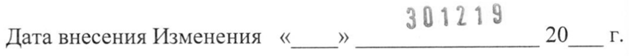
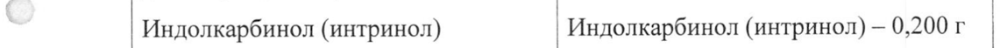
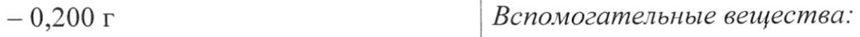
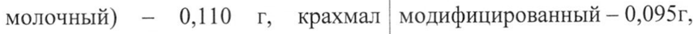
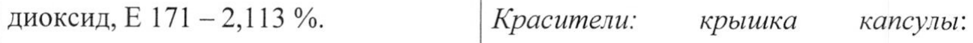
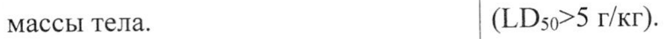
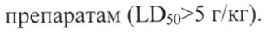

# Индолкарбинол — внутрь

- Препарат: Индинол Форто® (капсулы;)
- АТХ: G03XC
- Источник: ГРЛС, инструкция по медицинскому применению, РУ ЛП-002010, файл от 2024-03-26 (https://grls.rosminzdrav.ru/Grls_View_v2.aspx?routingGuid=c5d8acde-848a-4b2c-a51c-eb9d43b5d8a8)
- Распознано автоматически (OCR): 6 из 6 стр.
- Инструкция к другому РУ того же препарата: ЛП-002010 (национальное РУ, переоформленное по правилам ЕАЭС, решение от 21.02.2024). Текст может быть старше действующего
- Сомнительных строк после OCR: 7 (см. раздел «Проверка распознавания»)

## Общие сведения

JILI-UUZULU-SUIZIY МИНИСТЕРСТВО ЗДРАВООХРАНЕНИЯ РОССИЙСКОЙ ФЕДЕРАЦИИ
ИНСТРУКЦИЯ ПО МЕДИЦИНСКОМУ ПРИМЕНЕНИЮ ЛЕКАРСТВЕННОГО ПРЕПАРАТА
Индинол Форто® (Indinol Еого®)
наименование лекарственного препарата капсулы, 200 мг лекарственная форма, дозировка
АО «МираксБиоФарма», Россия наименование производителя, страна
Изменение № 1 Дата внесения Изменения «_ » 301215 20 г.
Торговое наименование: Торговое наименование

## 2. Состав

Состав 1 капсула содержит 1 капсула содержит
Состав 1 капсула содержит 1 капсула содержит
Действующее вещество: Действующее вещество:
| Индолкарбинол (интринол) Индолкарбинол (интринол) — 0,200 г |
— 0,200 г Вспомогательные вещества:
Вспомогательные вещества: лактозы моногидрат (сахар молочный)
лактозы моногидрат (сахар |— 0,110 г, крахмал кукурузный молочный) — 0,110 г, крахмал модифицированный - 0,095г, кукурузный модифицированный — | целлюлоза микрокристаллическая 0,095 г, целлюлоза | тип 102 — 0,064 г, микрокристаллическая — 0,064 г, карбоксиметилкрахмал натрия карбоксиметилкрахмал натрия (натрия крахмал гликолят) — 0,030 г,
(натрия крахмал гликолят) — магния стеарат — 0,001 г.
0,030 г, магния стеарат — 0,001 г.
118528 JILI-FUUZLULU-SULZIY

Изменение № | к инструкции по медицинскому применению i 2
Состав капсулы: Состав капсулы:
гидроксипропилметилцеллюлоза гидроксипропилметилцеллюлоза
(гипромеллоза) — до 100 %, вода | (гипромеллоза) — до 100 %.
очищенная — 4-6 %. Красители: корпус капсулы: титана
Красители: корпус капсулы: титана | диоксид, Е 171 — 2,0000 %.
диоксид, Е 171 - 2,113 %. Красители: крышка капсулы:
Красители: крышка капсулы: | краситель солнечный закат желтый, краситель солнечный закат желтый, | Е 110 - 1,0000 %, титана диоксид,
Е 110- 0,136 %, титана диоксид, Е 171 - 1,0000 %.
Е 171 - 2,437 %.
Описание: Описание капсулы целлюлозные № 0 с Капсулы № 0 с корпусом белого цвета корпусом белого цвета и крышкой | и крышкой оранжевого цвета.
оранжевого цвета. Содержимое капсулы - порошок от
Содержимое капсулы - порошок от | белого до светло-желтого или светло - белого до светло-желтого или | коричневого цвета, с характерным светло-коричневого цвета, со слабым запахом.
специфическим запахом.
Фармакологические свойства Фармакологические свойства

| Индинол® Форто является Индолкарбинол является универсальным корректором | универсальным корректором патологических гиперпластических | патологических гиперпластических процессов в тканях молочной процессов в тканях молочной железы.
железы. В основе терапевтического |B основе терапевтического эффекта эффекта Индинола® Форто лежит его Индолкарбинола лежит его антиэстрогенное и антиэстрогенное И антипролиферативное действие. антипролиферативное действие.
Главным свойством индолкарбинола | Главным свойством Индолкарбинола
(интринола) является его (интринола) является его способность способность вызывать вызывать избирательную — гибель

118528 11-0020 0-301219 Изменение № | к инструкции по медицинскому применению & 3 избирательную гибель клеток клеток молочной железы с аномально молочной железы с аномально высокой пролиферативной высокой пролиферативной активностью.
активностью. Индолкарбинол модулирует Индолкарбинол модулирует цитохромную систему таким образом, цитохромную систему таким что образующаяся изоформа образом, что образующаяся цитохрома Р450 - СУР1ТА1 изоформа цитохрома Р450 - СУРТА1 | гидроксилирует эстрогены во 2-м гидроксилирует эстрогены во 2-м положении, с образованием положении, с образованием 2- 2-гидроксиэстрона (2-ОНЕТ).
гидроксиэстрона (2-OHE1). Полученный метаболит является
Полученный метаболит является антагонистом рецептора эстрогенов и антагонистом рецептора эстрогенов блокирует его активацию самими и блокирует его активацию самими | эстрогенами, а также их опасными эстрогенами, а также их опасными метаболитами, в частности, 16-альфаметаболитами, в частности, 16- гидроксиэстроном (16а-ОНЕТ), доля альфа-гидроксиэстроном (16a- которого среди метаболитов
ОНЕТ), доля которого среди снижается. Так подавляется индукция метаболитов снижается. Так эстрогензависимых генов, и клетка подавляется индукция перестает получать чрезмерную эстрогензависимых генов, и клетка | эстрогензависимую стимуляцию.
перестает получать чрезмерную Индолкарбинол также блокирует эстрогензависимую стимуляцию. другие сигнальные механизмы
Индолкарбинол также блокирует (цитокиновые), стимулирующие | другие сигнальные механизмы патологический клеточный рост в
(цитокиновые), стимулирующие тканях молочной железы, | патологический клеточный рост в посредством подавления сигнальных тканях молочной железы, каскадов от соответствующих посредством подавления сигнальных | рецепторов.

118528 JRIFSVYUZULY ЗАЛЫ Изменение № | кинструкции по медицинскому применению С. 4 каскадов от соответствующих Курсовое применение препарата рецепторов. способствует уменьшению
Курсовое применение препарата интенсивности и — исчезновению способствует уменьшению болевого синдрома в молочной железе интенсивности и исчезновению при циклической масталгии болевого синдрома в молочной (мастодинии).
железе при циклической масталгии | Применение Индолкарбинола не
(мастодинии). приводит к увеличению массы тела.
Применение препарата Индинол® Индолкарбинол относится к
Форто не приводит к увеличению практически нетоксичным веществам массы тела. (LDso>5 Г/КГ).
Индинол® Форто относится к практически нетоксичным препаратам (LDso>5 г/кг).

## 4.6. Применение при беременности и в период грудного вскармливания

Противопоказано применение | Противопоказано применение препарата Индинол® Форто в период | препарата Индинол Форто® в период беременности и грудного | беременности и грудного вскармливания. вскармливания.

## 4.9. Передозировка

Передозировка К возможным симптомам | K возможным симптомам передозировки относится тошнота, | передозировки относится тошнота, рвота, диарея. Специфический | рвота, диарея. Специфический | антидот неизвестен. При подозрении | антидот неизвестен. При подозрении | на передозировку Индинола® Форто на передозировку препарата | рекомендуется симптоматическая | Индинол Форто* рекомендуется | терапия. | симптоматическая терапия.
Передозировка К возможным симптомам | K возможным симптомам передозировки относится тошнота, | передозировки относится тошнота, рвота, диарея. Специфический | рвота, диарея. Специфический | антидот неизвестен. При подозрении | антидот неизвестен. При подозрении | на передозировку Индинола® Форто на передозировку препарата | рекомендуется симптоматическая | Индинол Форто* рекомендуется | терапия. | симптоматическая терапия.
118528 [1 1-002010-301219 Изменение № | к инструкции по медицинскому применению С. 5

## 4.7. Влияние на способность управлять транспортными средствами, механизмами

Исходя из особенностей | Исходя из особенностей фармакодинамики и профиля | фармакодинамики и профиля нежелательных реакций, | нежелательных реакций, маловероятно, что Индинол® Форто | маловероятно, что препарат оказывает влияние на способность | Индинол Форто® оказывает влияние управлять транспортными | на способность управлять средствами и механизмами. транспортными средствами И механизмами.

## 6.5. Форма выпуска

Форма выпуска Капсулы, 200 мг. Капсулы, 200 мг.
Форма выпуска Капсулы, 200 мг. Капсулы, 200 мг.
По 20 капсул в контурную | По 20 капсул в контурную ячейковую ячейковую упаковку из пленки | упаковку из пленки поливинилхлоридн0й и — фольги | поливинилхлоридной И фольги алюминиевой печатной | алюминиевой печатной лакированной лакированной ИЛИ фольги | или фольги алюминиевой с алюминиевой с термосвариваемым | термосвариваемым покрытием.
покрытием. По 60, 90 или 120 капсул в банки
По 60, 90 или 120 капсул в банки | полимерные из полиэтилена низкого полимерные с гладкой горловиной, | давления с гладкой горловиной, укупоренные натягиваемой | укупоренные натягиваемой пластиковой крышкой с контролем | пластиковой крышкой с контролем первого вскрытия. первого вскрытия. |
Свободное пространство в банке | Свободное пространство в банке заполняют ватой — медицинской | заполняют ватой медицинской гигроскопической или | гигроскопической или уплотнителемуплотнителем-амортизатором амортизатором (компенсатором)
специальным из полиэтилена.
118528 JUWI-UUZULU-SUIZ1Y Изменение № | к инструкции по медицинскому применению С. 6
Старая редакция Новая редакция (компенсатором) специальным из| По 3 или 6 контурных ячейковых полиэтилена. упаковки по 20 капсул или каждую
По 3 или 6 контурных ячейковых | банку вместе с инструкцией по упаковки по 20 капсул или каждую | применению помещают в пачку из банку вместе с инструкцией по | картона.
применению помещают в пачку из картона.
Производитель: Производитель АО «МираксБиоФарма» АО «МираксБиоФарма»
Адрес места производства: Юридический адрес:
141401, Московская область, 131056. B . a г. Химки, ул. Рабочая, 2a, Kopi. | 1 НОВЫЕ ДЕН,
Тел./факс: (495) 721-20-58. г. Москва, ул. Брянская, д. 5.
Тел.: +7 (495) 721-20-58.
Адрес производства: 141401, | Российская Федерация, Московская область, городской округ Химки, г. Химки, ул. Рабочая, д. 2А, стр.1.
Владелец регистрационного | Владелец регистрационного удостоверения/организация, удостоверения/Организация,
| принимающая претензии | ПРинимающая претензии потребителей: ok ae
P | АО «МираксБиоФарма»
АО «МираксБиоФарма»
.. Юридический адрес:
Юридический адрес:
121059, Российская Федерация, 121059, Россия, г. Москва, г. Москва, ул. Брянская, д. 5.
ул. Брянская, д. 5.
Тел.: +7 (495) 721-20-58.
Тел.: (495) 721-20-58.
Es во OFS | 7 Генеральный директор eR | АО «МираксБиоФарма» | А В.М. Друх
ИИ us | etnpens® 2] + N3PO a ый ЭКСПЕРТНЫЙ ОТЧЕТ | on v3
А ЕЙСТВИТЕЛЕН ДЛЯ ДАННОЙ < моск” © | BEPCHMAOKYMEHTA | 8
€ 0000000007 418528
## Проверка распознавания

Страницы-сканы распознаны автоматически. В 7 строках с дозировками цифры могли распознаться с ошибкой — сверьте с вырезкой из оригинала:

- стр. 1: «Дата внесения Изменения «_ » 301215 20 г.» — низкая уверенность: «301215» (60), «20» (70); повторное чтение: «Дата внесения Изменения « » 301213 20 sr.»  
  
- стр. 1: «| Индолкарбинол (интринол) Индолкарбинол (интринол) — 0,200 г |» — низкая уверенность: «0,200» (50)  
  
- стр. 1: «— 0,200 г Вспомогательные вещества:» — низкая уверенность: «0,200» (67)  
  
- стр. 1: «молочный) — 0,110 г, крахмал модифицированный - 0,095г,» — повторное чтение: «молочный) — 0,110 г, крахмал модифицированный - 0,095r,»  
  
- стр. 2: «диоксид, Е 171 - 2,113 %. Красители: крышка капсулы:» — низкая уверенность: «2,113» (67); повторное чтение: «диоксид, Е 171 — 2,113 %. | Красители: крышка капсулы:»  
  
- стр. 4: «массы тела. (LDso>5 Г/КГ).» — низкая уверенность: «(LDso>5» (63)  
  
- стр. 4: «препаратам (LDso>5 г/кг).» — низкая уверенность: «(LDso>5» (17)  
  
