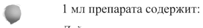
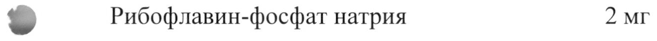
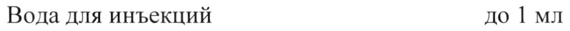
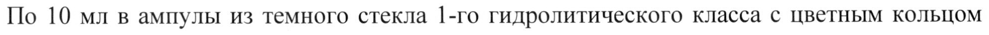

# Инозин + Никотинамид + Рибофлавин + Янтарная кислота — парентерально

- Препарат: Флатоцин солофарм (раствор для внутривенного введения;)
- АТХ: N07XX
- Источник: ГРЛС, инструкция по медицинскому применению, РУ ЛП-008602, файл от 2025-12-16 (https://grls.rosminzdrav.ru/Grls_View_v2.aspx?routingGuid=cc68f678-b004-4ae2-9b11-1fbd3324642e)
- Распознано автоматически (OCR): 8 из 8 стр.
- Инструкция к другому РУ того же препарата: ЛП-008602 (исключено из реестра, решение от 26.11.2025). Текст может быть старше действующего
- Сомнительных строк после OCR: 4 (см. раздел «Проверка распознавания»)

## Общие сведения

МИНИСТЕРСТВО ЗДРАВООХРАНЕНИЯ РОССИЙСКОЙ ФЕДЕРАЦИИ
ИНСТРУКЦИЯ цц_кцЬ_оЬЦ_оЬо— ПО МЕДИЦИНСКОМУ ПРИМЕНЕНИЮ ЛЕКАРСТВЕННОГ ОЫРЕНАРАЧ и |
Флатоцин солофарм. 11 - 008602 -061022 |
Регистрационный номер: СОГЛАСОВАНО Торговое наименование: Флатоцин солофарм о
Группировочное наименование: Инозин + Никотинамид + Рибофлавин + Янтарная кислота

## 3. Лекарственная форма

раствор для внутривенного введения
раствор для внутривенного введения

## 2. Состав

| ® 1 мл препарата содержит:
| ® 1 мл препарата содержит:
Действующие вещества:
Янтарная кислота 100 мг Никотинамид 10 мг
Инозин 20 мг > Рибофлавин-фосфат натрия 2 мг
Вспомогательные вещества:
Меглюмин 165 мг Натрия гидроксид до pH 6,0 - 7,0
Вода для инъекций до 1 мл . Описание w Прозрачный раствор оранжевого цвета.
Фармакотерапевтическая группа: прочие препараты для лечения заболеваний нервной системы.
Код ATX: NO7XX Фармакологические свойства

## 5.1. Фармакодинамика

Фармакологические эффекты обусловлены комплексным воздействием входящих в состав препарата веществ.
Фармакологические эффекты обусловлены комплексным воздействием входящих в состав препарата веществ.
Препарат усиливает интенсивность аэробного гликолиза, что приводит к активации утилизации глюкозы и [-окисления жирных кислот, а также стимулирует синтез у-аминомасляной кислоты в нейронах.
Препарат увеличивает устойчивость мембран нервных и глиальных клеток к ишемии, что выражается в снижении концентрации нейроспецифических белков, характеризующих уровень деструкции основных структурных компонентов нервной ткани.
Препарат улучшает коронарный и мозговой кровотоки, активирует метаболические процессы в центральной нервной системе, восстанавливает нарушенное сознание, способствует регрессу неврологической симптоматики и улучшению когнитивных функций мозга. Обладает быстрым пробуждающим действием при посленаркозном угнетении сознания.
При применении препарата в первые 12 часов от начала развития инсульта наблюдаются благоприятное течение ишемических и некротических процессов в зоне поражения
- (уменьшение очага), восстановление неврологического статуса и снижение уровня инвалидизации в отдаленном периоде.

## 5.2. Фармакокинетика

При внутривенной инфузии со скоростью около 2 мл/мин (в пересчете на неразбавленный препарат) янтарная кислота и инозин утилизируются практически мгновенно и в плазме
При внутривенной инфузии со скоростью около 2 мл/мин (в пересчете на неразбавленный препарат) янтарная кислота и инозин утилизируются практически мгновенно и в плазме
© крови He определяются.
Янтарная кислота: пик концентрации определяется в течение первой минуты после введения с дальнейшим быстрым снижением без кумуляции и возвращением ее уровня к фоновым значениям в результате ферментативного распада до воды и углекислого газа.
Инозин метаболизируется в печени с образованием инозинмонофосфата с последующим его окислением до мочевой кислоты. В незначительном количестве выводится почками.
- Никотинамид быстро распределяется во всех тканях, проникает через плаценту и в грудное молоко, метаболизируется в печени с образованием М-метилникотинамида, выводится почками. Период полувыведения из плазмы составляет около 1,3 часа, равновесный объем распределения — около 60 л, общий клиренс — около 0,6 л/мин.
Рибофлавин распределяется неравномерно: наибольшее количество — в миокарде, печени и почках. Период полувыведения из плазмы составляет около 2 часов, равновесный объем распределения — около 40 л, общий клиренс — около 0,3 л/мин. Проникает через плаценту и в грудное молоко. Связывание с белками плазмы — 60 %. Выводится почками, частично в форме метаболита; в высоких дозах — преимущественно в неизмененном виде.

## 4.1. Показания к применению

У взрослых в комплексной терапии:
У взрослых в комплексной терапии:
- инфаркта мозга;
- последствий цереброваскулярных болезней (инфаркта мозга, церебрального атеросклероза);
- токсической и гипоксической энцефалопатии при острых и хронических отравлениях, эндотоксикозах, посленаркозном угнетении сознания, а также для профилактики и лечения гипоксической энцефалопатии при кардиохирургических операциях с использованием искусственного кровообращения.
У детей (в т.ч. недоношенных со сроком гестации 28-36 недель) в комплексной терапии в периоде новорожденности:
- при церебральной ишемии.
er

## 4.3. Противопоказания

Индивидуальная непереносимость компонентов препарата, беременность, период грудного вскармливания.
Индивидуальная непереносимость компонентов препарата, беременность, период грудного вскармливания.
Не назначается пациентам (кроме периода новорожденности), находящимся в

w критическом состоянии, до стабилизации центральной гемодинамики и/или при снижении парциального давления кислорода в артериальной крови ниже 60 мм рт. ст.

## 4.3. С осторожностью

При нефролитиазе, подагре, гиперурикемии.
При нефролитиазе, подагре, гиперурикемии.
Если у Вас одно из перечисленных заболеваний, перед приемом препарата обязательно

© проконсультируйтесь с врачом.

## 4.6. Применение при беременности и в период грудного вскармливания

Применение препарата при беременности и в период грудного вскармливания противопоказано.

## 4.2. Способ применения и дозы

У взрослых Препарат применяют только внутривенно капельно в разведении на 100-200 мл 5-10 % раствора декстрозы или 0,9 % раствора натрия хлорида.
У взрослых Препарат применяют только внутривенно капельно в разведении на 100-200 мл 5-10 % раствора декстрозы или 0,9 % раствора натрия хлорида.
Скорость введения 3-4 мл/мин.
1. При инфаркте мозга препарат вводят в максимально ранние сроки от начала развития

заболевания в объеме 10 мл на введение с интервалом 8-12 часов в течение 10 дней.
При тяжелой форме течения заболевания разовую дозу увеличивают до 20 мл.
2. При последствиях цереброваскулярных болезней (инфаркта мозга, церебрального атеросклероза) препарат вводят в объеме 10 мл на введение один раз в сутки в течение
10 дней.
3. При токсической и гипоксической энцефалопатии препарат вводят в объеме 10 мл на введение 2 раза в сутки через 8-12 часов в течение 5 дней. При коматозном состоянии — в объеме 20 мл на введение в разведении на 200 мл раствора декстрозы. При посленаркозном угнетении сознания — однократно в тех же дозах. В терапии гипоксической энцефалопатии при кардиохирургических операциях с использованием искусственного кровообращения вводят по 20 мл препарата в разведении на 200 мл 5 % раствора декстрозы за 3 дня до операции, в день операции, в течение 3 дней после
- операции.
У детей _(в т.ч. недоношенных) в периоде новорожденности с церебральной ишемией суточная доза препарата составляет 2 мл/кг. Рассчитанную суточную дозу препарата вводят внутривенно капельно (медленно) после разведения в 5 % или 10 %
© растворе декстрозы (в соотношении не менее 1:5). Время первого введения — первые 12 часов после рождения; оптимальным временем для начала терапии являются первые 2 часа жизни. Рекомендуется вводить приготовленный раствор с помощью инфузионного насоса со скоростью от | до 4 мл/ч, обеспечивая равномерное поступление препарата в кровоток в течение суток, в зависимости от расчетного суточного объема растворов для базисной терапии, состояния гемодинамики пациента и показателей кислотно-основного
! состояния. Курс лечения в среднем составляет 5 суток.
= Побочное действие По данным Всемирной организации здравоохранения нежелательные реакции классифицированы в соответствии с их частотой развития следующим образом:
- очень частые (> 1/10);
- частые (> 1/100 - < 1/10);
- нечастые (> 1/1000 - < 1/100);
- редкие (> 1/10000 - < 1/1000);
- очень редкие (< 1/10000);
- частота неизвестна (не может быть определена на основе имеющихся данных).
Нарушения со стороны иммунной системы: очень редко — реакции гиперчувствительности, анафилактический шок.
Нарушения со стороны нервной системы: очень редко — головная боль, головокружение, парестезии, тремор, гипестезия.
Нарушения психики: очень редко — психомоторное возбуждение (беспокойство, повышенная двигательная активность).
Нарушения со стороны сердца: очень редко — тахикардия, кратковременные боли и дискомфорт в области грудной клетки, ощущение учащения или усиления сердечных сокращений.
Нарушения со стороны сосудов: очень редко — повышение или понижение артериального давления, гиперемия или бледность кожных покровов разной степени выраженности.
Нарушения со стороны дыхательной системы, органов грудной клетки и средостения:
очень редко — затруднение дыхания (одышка), удушье, першение в горле, сухой кашель,
- осиплость голоса, парестезия в носу, дизосмия, бронхоспазм.
Нарушения со стороны желудочно-кишечного тракта: очень редко — горечь, сухость, металлический привкус во рту, кратковременные боли и дискомфорт в эпигастральной области, тошнота, рвота, гипестезия полости рта, диспепсия.
. Нарушения со стороны кожи и подкожных тканей: очень редко — кожный зуд, сыпь,
© отечность лица, крапивница, ангионевротический отек, потливость.
Нарушения со стороны обмена веществ и питания: очень редко — транзиторная гипогликемия, гиперурикемия, обострение подагры. У детей (в том числе недоношенных)
в периоде новорожденности возможно развитие алкалоза.
Общие расстройства и нарушения в месте введения: редко — озноб, чувство жара, слабость, повышение температуры тела, боль и покраснение по ходу вены.
- Лабораторные и инструментальные данные: очень редко — учащенное дыхание.
Во избежание возникновения нежелательных реакций рекомендуется соблюдать режим дозирования и скорость введения препарата.
Если любые из указанных в инструкции нежелательных реакций усугубляются или Вы заметили любые другие нежелательные реакции, не указанные в инструкции, сообщите об этом врачу.

## 4.9. Передозировка

Случаев передозировки не наблюдалось. При передозировке проводят симптоматическую терапию.
Случаев передозировки не наблюдалось. При передозировке проводят симптоматическую терапию.

## 4.5. Взаимодействие с другими лекарственными средствами

Янтарная кислота, инозин и никотинамид совместимы с другими лекарственными

средствами.

Рибофлавин уменьшает активность доксициклина, тетрациклина, окситетрациклина,

эритромицина и линкомицина. Несовместим со стрептомицином.

Хлорпромазин, имипрамин, амитриптилин за счет блокады флавинокиназы нарушают

включение рибофлавина во флавинаденинмононуклеотид и флавинадениндинуклеотид и

увеличивают его выведение с мочой.

Тиреоидные гормоны ускоряют метаболизм рибофлавина.

Уменьшает и предупреждает развитие побочных эффектов хлорамфеникола (нарушения

гемопоэза, неврит зрительного нерва).

Совместим со средствами, стимулирующими гемопоэз, антиоксидантами, анаболическими
> стероидами.

## 4.4. Особые указания

Введение препарата новорожденным (недоношенным) детям следует осуществлять под

контролем показателей кислотно-основного состояния капиллярной крови не реже 2 раз в w сутки (как перед началом, так и в процессе терапии). По возможности следует

контролировать показатели сывороточного лактата и глюкозы.

Скорость введения раствора, содержащего препарат, следует уменьшить или временно

прекратить инфузию новорожденным (недоношенным) детям:

- находящимся на искусственной вентиляции легких — при появлении признаков

смешанного (респираторно-метаболического) алкалоза, угрожающего развитием
© нарушений мозгового кровообращения;

- при сохраненном спонтанном дыхании и респираторной поддержке методом

постоянного положительного давления в дыхательных путях (СИПАП) или получающим

воздушно-кислородную смесь через маску — при появлении лабораторных признаков

метаболического алкалоза, угрожающего появлением или учащением приступов апноэ.

У пациентов сахарным диабетом лечение следует проводить под контролем показателя

глюкозы крови.

Возможно интенсивное окрашивание мочи в желтый цвет.

## 4.7. Влияние на способность управлять транспортными средствами, механизмами

Необходимо соблюдать осторожность при управлении транспортными средствами и

работе с точными механизмами из-за возможного развития побочного действия

(головокружение, психомоторное возбуждение). При развитии указанных побочных эффектов необходимо отказаться от управления транспортными средствами и работы с точными механизмами.

## 6.5. Форма выпуска

Раствор для внутривенного введения.
Раствор для внутривенного введения.
По 10 мл в ампулы из темного стекла 1-го гидролитического класса с цветным кольцом разлома или с цветной точкой и насечкой. На ампулы может дополнительно наноситься одно, два или три цветных идентификационных кольца и/или двухмерный штриховой код, и/или буквенно-цифровая кодировка.
По 5 ампул в контурной ячейковой упаковке из пленки поливинилхлоридной или полиэтилентерефталатной с пленкой полимерной или фольгой алюминиевой

© лакированной или без пленки полимерной и фольги алюминиевой лакированной или в форме из картона с ячейками для укладки ампул.
По 1 или 2 контурные ячейковые упаковки или формы из картона вместе с инструкцией по применению и скарификатором ампульным или без него в пачке из картона.

© Условия хранения

В оригинальной упаковке (пачке картонной) при температуре не выше 25 °С.

## 6.3. Срок годности

2 года.
2 года.
Не применять по истечении срока годности!

С Условия отпуска Отпускают по рецепту.
Владелец регистрационного удостоверения ООО «Гротекс»
Россия, 195279, г. Санкт-Петербург, Индустриальный проспект, д. 71, корп. 2, лит. А
Тел.: +7 812 385 47 87 Факс: +7 812 385 47 88
Производитель/Организация, принимающая претензии
ООО «Гротекс»

Россия, 195279, г. Санкт-Петербург, Индустриальный проспект, д. 71, корп. 2, лит. А
Тел.: +7 812 385 47 87 Факс: +7 812 385 47 88 www.solopharm.com ZA y
© <i Ss / he jo Gr Заместитель директора по развитию ы Г we a
HS « [$ yo 6 4 2 ООО «Гротекс» 3 | 2 С. В, Сергеев fe)
XE Y с Фориттое5 oD
## Проверка распознавания

Страницы-сканы распознаны автоматически. В 4 строках с дозировками цифры могли распознаться с ошибкой — сверьте с вырезкой из оригинала:

- стр. 1: «| ® 1 мл препарата содержит:» — повторное чтение: «v tM препарата содержит:»  
  
- стр. 1: «> Рибофлавин-фосфат натрия 2 мг» — низкая уверенность: «2» (29)  
  
- стр. 1: «Вода для инъекций до 1 мл» — повторное чтение: «Вода для инъекций до 1 мл»  
  
- стр. 7: «По 10 мл в ампулы из темного стекла 1-го гидролитического класса с цветным кольцом» — повторное чтение: «По 10 млв ампулы из темного стекла 1-го гидролитического класса с цветным кольцом»  
  
