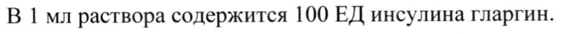
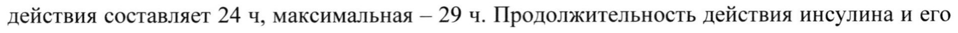
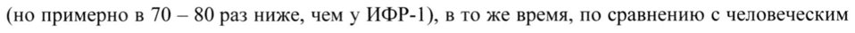
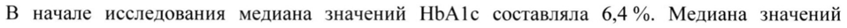

# Инсулин гларгин — парентерально

- Препарат: Лантус® СолоСтар® (раствор для подкожного введения 100 ЕД/мл)
- АТХ: A10AE04
- Источник: ОХЛП, Единый реестр ЛС ЕАЭС, запись 5f9ae6d6fb44f117bda88954, документ от 2026-05-21
- Распознано автоматически (OCR): 27 из 27 стр.
- Сомнительных строк после OCR: 4 (см. раздел «Проверка распознавания»)

## Общие сведения

ЛП-№(000207)-(РГ-КО)-200421 ОБЩАЯ ХАРАКТЕРИСТИКА ЛЕКАРСТВЕННОГО ПРЕПАРАТА

## 1. Наименование лекарственного препарата

Лантус СолоСтар, 100 ЕД/мл, раствор для подкожного введения.

## 2. Качественный и количественный состав

Действующее вещество: инсулин гларгин*.
В 1 мл раствора содержится 100 ЕД инсулина гларгин.
Каждая предварительно заполненная шприц-ручка содержит 300 ЕД инсулина гларгин в 3 мл раствора.
*Получено с использованием клеток Escherichia coli по технологии рекомбинантной ДНК.
Вспомогательные вещества, наличие которых надо учитывать в составе лекарственного
- препарата: 1 мл раствора содержит 2,7 мг метакрезола (см. раздел 4.4).
Полный перечень вспомогательных веществ указан в разделе 6.1.

## 3. Лекарственная форма

Раствор для подкожного введения.
Прозрачная, бесцветная или почти бесцветная жидкость.

## 4. Клинические данные

## 4.1. Показания к применению

Лечение сахарного диабета у взрослых, подростков и детей в возрасте от 2 лет и старше.

## 4.2. Режим дозирования и способ применения

Режим дозирования Препарат Лантус СолоСтар следует вводить 1 раз в сутки в любое время дня, но каждый день в одно и то же время.
© Дозу и режим введения препарата следует подбирать с учетом индивидуальных особенностей пациента. Активность препарата Лантус СолоСтар указывается в единицах. Такие единицы используются исключительно для данного препарата и не соответствуют МЕ или единицам, используемым для обозначения активности других аналогов инсулина.
Целевые значения концентрации глюкозы в крови, а также дозы и время введения или приема гипогликемических препаратов должны определяться и корректироваться индивидуально.
Коррекция дозы также может потребоваться, например, при изменении массы тела пациента, его образа жизни, изменении времени введения дозы инсулина или при других состояниях, которые могут увеличить предрасположенность к развитию гипо- или гипергликемии (см.
м | ЭКСПЕРТНЫЙ ОТЧЕТ | > ЩЕЙСТВИТЕЛЕН длЯ Анной 9 |
ЛП-№(000207)-(РГ-КО)-200421 раздел 4.4). Любые изменения дозы инсулина должны проводиться с осторожностью и под медицинским наблюдением.

Пациенты с сахарным диабетом | типа

Препарат Лантус СолоСтар должен применяться 1 раз в сутки в сочетании с инсулином,

вводимым во время приема пищи с индивидуальной коррекцией дозы.

Пациенты с сахарным диабетом 2 типа

У пациентов с сахарным диабетом 2 типа препарат Лантус СолоСтар может применяться как в

виде монотерапии, так и в комбинации с другими гипогликемическими препаратами.

У пациентов с сахарным диабетом 2 типа, принимающих пероральные гипогликемические

препараты, комбинированная терапия начинается с дозы инсулина гларгин 10 ЕД 1 раз в сутки,
& и в последующем схема лечения корректируется индивидуально.

При схемах лечения, включающих инъекции базального и прандиального инсулина, для

удовлетворения потребности в базальном инсулине инсулин гларгин обычно вводится в дозе,

составляющей 40-60 % от суточной дозы инсулина.

У всех пациентов с сахарным диабетом рекомендуется мониторинг концентрации глюкозы в

крови.

Дозу и режим введения препарата следует подбирать с учетом индивидуальных особенностей

пациента. Активность препарата Лантус СолоСтар указывается в единицах. Такие единицы

используются исключительно для данного препарата и не соответствуют МЕ или единицам,

используемым для обозначения активности других аналогов инсулина.

Переход с терапии другими препаратами инсулина на препарат Лантус СолоСтар

При переводе пациента со схемы лечения с применением инсулина средней
= продолжительности действия или длительного действия Ha схему лечения с применением

препарата Лантус СолоСтар может потребоваться коррекция количества (доз) и времени

введения инсулина короткого действия или его аналога в течение суток или изменение доз

пероральных гипогликемических препаратов.

Перевод с введения инсулина изофан 1 раз в сутки на препарат Лантус СолоСтар

При переводе пациентов с однократного в течение суток введения инсулин изофан на

однократное в течение суток введение препарата Лантус СолоСтар начальные дозы инсулина

обычно не изменяются (то есть применяется количество ЕД препарата Лантус СолоСтар в

сутки равное количеству МЕ инсулина изофан в сутки).

ЛП-№(000207)-(РГ-ВО)-200421 Перевод с введения инсулина изофан 2 раза в сутки на препарат Лантус СолоСтар
При переводе пациентов с двукратного в течение суток введения инсулина изофан на однократное введение препарата Лантус СолоСтар перед сном, с целью снижения риска развития гипогликемии в ночное и раннее утреннее время, начальную суточную дозу препарата Лантус СолоСтар следует снизить на 20% (по сравнению с суточной дозой инсулина-изофана) в течение первых недель, а затем корректировать ее в зависимости от реакции пациента.
Перевод с препарата Туджео СолоСтар (инсулин гларгин 300 ЕД/мл) на препарат
Лантус СолоСтар Инсулин гларгин 100 ЕД/мл и препарат Туджео СолоСтар не эквиваленты по своим
& фармакокинетическим, фармакодинамическим характеристикам и клиническим эффектам. В связи с этим, переход с препарата Туджео СолоСтар на инсулин гларгин 100 ЕД/мл и наоборот, требует наблюдения врача, проведения тщательного гликемического контроля и индивидуальной коррекции дозы препарата. С целью уменьшения риска развития гипогликемии при переводе пациентов с однократного в течение суток введения препарата
Туджео СолоСтар (инсулина гларгин 300 ЕД/мл) на однократное в течение суток введение препарата Лантус СолоСтар, начальная доза препарата Лантус СолоСтар должна быть снижена приблизительно на 20 %.
В течение первых недель лечения это снижение дозы препарата Лантус СолоСтар может быть частично компенсировано за счет повышения дозы прандиального инсулина. По окончании данного периода схема лечения должна быть скорректирована в индивидуальном порядке.
| При переводе на другую схему лечения и в течение нескольких последующих недель
- рекомендуется тщательный контроль гликемии (контроль концентрации глюкозы в крови) под медицинским наблюдением, с коррекцией, при необходимости, режима дозирования инсулина. У пациентов, принимающих высокие дозы инсулина из-за наличия антител к человеческому инсулину, может наблюдаться улучшенная реакция на инсулин в составе препарата Лантус СолоСтар.
При улучшении гликемического контроля и обусловленного этим повышения чувствительности тканей к инсулину может возникнуть необходимость коррекции режима дозирования инсулина.
Особые группы пациентов ЛП-№(000207)-(РГ-КО)-200421

Пациенты пожилого возраста (>65 лет)

У пациентов пожилого возраста с сахарным диабетом рекомендуется начинать применение со

средних начальных доз, медленно увеличивать их и применять средние поддерживающие

дозы. У пациентов пожилого возраста возможны трудности с распознаванием развивающейся

гипогликемии (см. раздел 4.4).

Рекомендуется тщательный мониторинг концентрации глюкозы в крови с индивидуальным

подбором дозы инсулина. У пациентов пожилого возраста прогрессивное ухудшение функции

почек может приводить к постоянному снижению потребности в инсулине.

Пациенты с нарушениями функции почек

Инсулин гларгин можно применять у пациентов с почечной недостаточностью при этом w рекомендуется тщательный мониторинг концентрации глюкозы в крови с индивидуальным

подбором дозы. У пациентов с почечной недостаточностью потребность в инсулине может

уменьшаться вследствие замедления метаболизма инсулина.

Пациенты с нарушениями функции печени

Инсулин гларгин можно применять у пациентов с печеночной недостаточностью при этом

рекомендуется тщательный мониторинг концентрации глюкозы в крови с индивидуальным

подбором дозы. У пациентов с печеночной недостаточностью потребность в инсулине может

уменьшаться вследствие снижения глюконеогенеза и замедления метаболизма инсулина.

Дети

Дети в возрасте от 2 лет и подростки

Были установлены безопасность и эффективность применения инсулина гларгин у подростков

и детей в возрасте от 2 лет и старше. Дозы и режим введения препарата следует подбирать с
- учетом индивидуальных особенностей пациента.

Дети до 2 лет

Безопасность и эффективность препарата Лантус СолоСтар не установлены. Данные

отсутствуют.

Способ применения

Препарат Лантус СолоСтар вводят подкожно.

Препарат следует вводить в подкожно-жировую клетчатку живота, плеч или бедер. В целях

снижения риска развития липодистрофии и кожного амилоидоза, места инъекций необходимо

менять каждый раз в пределах одной из рекомендуемых областей для введения препарата.

ЛП-№(000207)-(РГ-КО)-200421 Меры предосторожности, принимаемые перед применением препарата или при обращении с ним
Препарат Лантус СолоСтар нельзя смешивать с другими инсулинами. Смешивание может изменить профиль действия во времени (соотношение «время/действие») препарата Лантус
СолоСтар, а также привести к выпадению осадка.
Препарат Лантус СолоСтар нельзя разводить. Разведение может привести к изменению профиля действия препарата во времени.
Препарат Лантус СолоСтар не предназначен для внутривенного введения. Длительная продолжительность действия инсулина гларгин обусловлена только при его введении в подкожно-жировую клетчатку. Внутривенное введение обычной дозы для подкожного w введения может вызвать тяжелую гипогликемию.
Препарат Лантус СолоСтар — это прозрачный раствор, а не суспензия. Поэтому ресуспендирования перед применением не требуется.
Перед первым использованием шприц-ручку Лантус СолоСтар необходимо выдержать при комнатной температуре 1-2 часа.
При неисправности шприц-ручки Лантус СолоСтар можно извлечь инсулин гларгин из картриджа в шприц (пригодный для инсулина 100 МЕ/мл) и ввести нужную дозу препарата.
При этом шприц не должен содержать остатков других лекарственных средств.
Нельзя использовать иглы повторно. Перед каждой инъекцией следует присоединять новую стерильную иглу. Повторное использование игл увеличивает риск их закупорки, которая может приводить к введению меньшей дозы или к передозировке инсулина. Использование новой стерильной иглы для каждой инъекции минимизирует риск ее контаминации и
- инфицирования. Во избежание возможной передачи заболеваний, передающихся через кровь, инсулиновые шприц-ручки не должны использоваться более чем одним пациентом, даже при условии замены иглы.
Перед применением препарата следует выполнять инструкции по правильному обращению с предварительно заполненной шприц-ручкой СолоСтар (см. раздел 6.6).

## 4.3. Противопоказания

® Гиперчувствительность к инсулину гларгин и/или к любому из вспомогательных веществ, перечисленных в разделе 6.1.
® Детский возраст до 2-х лет (отсутствие клинических данных по применению).
ЛП-№(000207)-(РГ-ВО)-200421

## 4.4. Особые указания и меры предосторожности при применении

С осторожностью

Препарат Лантус СолоСтар следует применять под тщательным медицинским наблюдением в

период беременности и после родов (возможно изменение потребности в инсулине в течение

беременности и послеродовом периоде).

Препарат Лантус СолоСтар не является препаратом выбора для лечения диабетического

кетоацидоза. В таких случаях рекомендуется внутривенное введение инсулина короткого

действия.

В связи с ограниченным опытом применения препарата Лантус СолоСтар не оценивались его

эффективность и безопасность при лечении пациентов с нарушением функции печени или

& пациентов с почечной недостаточностью средней степени тяжести или тяжелой степени.

У пациентов с нарушением функции почек потребность в инсулине может уменьшиться в связи

с замедлением его элиминации. У пожилых пациентов прогрессирующее ухудшение функции

почек может привести к стойкому снижению потребности в инсулине.

У пациентов с печеночной недостаточностью тяжелой степени потребность в инсулине может

быть снижена в связи со снижением способности к глюконеогенезу и замедлением

биотрансформации инсулина.

В случае недостаточного контроля концентрации глюкозы в крови, а также при наличии

тенденции к развитию гипо- или гипергликемии, прежде чем приступать к коррекции режима

дозирования, следует проверить точность выполнения предписанной схемы лечения,

соблюдение указаний в отношении мест введения препарата и правильность техники
| проведения подкожных инъекций, а также учитывать все другие факторы, которые могут

- повлиять на концентрацию глюкозы в крови.

Пациенты должны быть проинструктированы о необходимости постоянно изменять место

инъекции для того, чтобы снизить риск развития липодистрофии и локализованного кожного

амилоидоза. Существует потенциальный риск замедления всасывания инсулина и ухудшения

гликемического контроля после инъекций инсулина в места с данными реакциями.

Сообщалось, что внезапное изменение места инъекции на непораженную область приводит к

развитию гипогликемии. После смены места инъекции рекомендуется провести мониторинг

концентрации глюкозы в крови, в случае необходимости решить вопрос в отношении

корректировки дозы гипогликемических препаратов.

ЛП-№(000207)-(РГ-ВО)-200421 Переход на другой тип инсулина или инсулин другого производителя должен осуществляться под строгим контролем врача. Изменение дозировки, производителя, типа (обычный изофан короткого или длительного действия и пр.) или происхождения инсулина (животный, человеческий, аналог человеческого инсулина), и/или метода его производства может привести к необходимости коррекции дозы инсулина.
Гипогликемия Время развития гипогликемии зависит от профиля действия используемых инсулинов и может, таким образом, изменяться при смене схемы лечения. Вследствие увеличения времени поступления в организм инсулина длительного действия при использовании препарата Лантус
СолоСтар, следует ожидать меньшей вероятности развития ночной гипогликемии, тогда как в
& ранние утренние часы эта вероятность развития гипогликемии выше.
При возникновении гипогликемии у пациентов, получающих лечение препаратом Лантус
СолоСтар, следует учитывать возможность замедления выхода из состояния гипогликемии в связи с пролонгированным действием инсулина гларгин.
Пациентам, у которых эпизоды гипогликемии могут иметь особое клиническое значение, таким как пациенты с выраженным стенозом коронарных артерий или сосудов головного мозга
(риск развития кардиальных и церебральных осложнений гипогликемии), а также пациентам с пролиферативной ретинопатией, особенно, если им не проводилось лечение фотокоагуляцией
(риск преходящей потери зрения вслед за гипогликемией), следует соблюдать особую осторожность и проводить более частый и тщательный контроль концентрации глюкозы в крови.
Пациенты должны быть предупреждены о состояниях, при которых симптомы-предвестники
- гипогликемии могут изменяться, становиться менее выраженными или отсутствовать:

- при заметном улучшении регуляции концентрации глюкозы в крови;
- при постепенном развитии гипогликемии;
- у пациентов пожилого возраста;
- при переводе пациента с инсулина животного происхождения на человеческий инсулин;
- при вегетативной нейропатии;
- при длительном анамнезе сахарного диабета;
- при наличии у пациентов психических расстройств;

ЛП-№(000207)-(РГ-ВО)-200421 - сопутствующее лечение другими лекарственными препаратами (см. раздел 4.5).
Такие ситуации могут приводить к развитию тяжелой гипогликемии (с возможной потерей сознания) до того, как пациент осознает, что у него развивается гипогликемия.
В случае если отмечаются нормальные или сниженные показатели гликированного гемоглобина, необходимо учитывать возможность развития повторяющихся нераспознанных эпизодов гипогликемии (особенно в ночное время).
Соблюдение пациентами схемы дозирования и режима питания, правильное введение инсулина и знание симптомов-предвестников гипогликемии способствуют существенному снижению риска развития гипогликемии. Факторы, повышающие склонность к гипогликемии, при наличии которых требуется особенно тщательное наблюдение и может быть необходима
& коррекция дозы инсулина:
- смена места введения инсулина;
- повышение чувствительности к инсулину (например, при устранении стрессовых факторов);
- непривычная, повышенная или длительная физическая активность;
- интеркуррентные заболевания, сопровождающиеся рвотой, диареей;
- нарушение диеты и режима питания;
- пропуск приема пищи;
- употребление алкоголя (этанола);
- некоторые некомпенсированные эндокринные нарушения (например, гипотиреоз, недостаточность аденогипофиза или коры надпочечников);
- сопутствующее лечение некоторыми другими лекарственными средствами (см. раздел
- 4.5).

Интеркуррентные заболевания При интеркуррентных заболеваниях требуется более интенсивный контроль концентрации глюкозы в крови. Во многих случаях показано проведение анализа на наличие кетоновых тел в моче, также часто требуется коррекция режима дозирования инсулина. Потребность в инсулине нередко возрастает. Пациенты с сахарным диабетом | типа должны продолжать регулярно включать в рацион хотя бы небольшое количество углеводов, даже при употреблении малых объемов пищи, или если они вообще не могут есть, или если у них рвота ит.п.. Кроме того, они не должны полностью отказываться от инсулина.

ЛП-№(000207)-(РГ-ВО)-200421 Антитела к инсулину
Применение инсулина гларгин может вызывать выработку антител к нему. В редких случаях, из-за наличия таких антител, может потребоваться коррекция дозы инсулина для снижения риска развития гипергликемии или гипогликемии.
Совместное применение с пиоглитазоном Сообщалось о случаях сердечной недостаточности при применении инсулина с пиоглитазоном, особенно у пациентов с факторами риска развития сердечной недостаточности. Это необходимо принимать во внимание при назначении комбинации пиоглитазона и препарата Лантус СолоСтар. При применении данной комбинации необходимо осуществлять наблюдение пациента в отношении признаков и симптомов хронической
& сердечной недостаточности, увеличения массы тела и отеков. Прием пиоглитазона следует прекратить при усугублении симптомов хронической сердечной недостаточности.
Ошибки, связанные с применением лекарственного препарата
Сообщалось об ошибках терапии, когда вместо инсулина гларгин пациенты случайно вводили другие инсулины, особенно инсулины короткого действия. Во избежание ошибочного введения другого препарата инсулина, перед каждой инъекцией всегда следует проверять название и дозировку препарата.

## 4.5. Взаимодействие с другими лекарственными препаратами и другие виды взаимодействия

Фармакодинамическое взаимодействие Пероральные гипогликемические средства, ингибиторы —ангиотензинпревращающего
| фермента, дизопирамид, фибраты, флуоксетин, ингибиторы — моноаминоксидазы,
- пентоксифиллин, пропоксифен, салицилаты и сульфаниламидные противомикробные средства могут усилить гипогликемическое действие инсулина и повысить предрасположенность к развитию гипогликемии. При одновременном применении может потребоваться коррекция дозы инсулина гларгин.
Глюкокортикостероиды, даназол, диазоксид, диуретики, глюкагон, изониазид, эстрогены и гестагены (например, в гормональных контрацептивах), производные фенотиазина, соматотропин, симпатомиметики (например, эпинефрин [адреналин], сальбутамол, тербуталин) и гормоны щитовидной железы, ингибиторы протеаз, атипичные нейролептики лП-№(000207)-(РГ-КО)-200421

(например, оланзапин или клозапин) могут ослабить гипогликемическое действие инсулина.
При одновременном применении может потребоваться коррекция дозы инсулина гларгин.
Бета-адреноблокаторы, клонидин, соли лития или алкоголь могут как усилить, так и ослабить гипогликемическое действие инсулина.
Пентамидин при одновременном применении с инсулином может вызывать гипогликемию, которая иногда сменяется гипергликемией.
При совместном применении с симпатолитиками, такими как бета-адреноблокаторы, клонидин, гуанетидин и резерпин, симптомы адренергической контррегуляции (активации симпатической нервной системы) могут быть не выражены или отсутствовать.
Фармацевтическое взаимодействие

& При смешивании препарата Лантус СолоСтар с другими лекарственными веществами, в TOM числе и с другими инсулинами, а также разведении препарата возможно образование осадка или изменение профиля действия препарата во времени.

## 4.6. Фертильность, беременность и лактация

Беременность Пациентки должны информировать лечащего врача о настоящей или планируемой беременности.
Не проводилось рандомизированных контролируемых клинических исследований по применению инсулина гларгин у беременных женщин.
Большое количество наблюдений (более 1000 исходов беременностей при ретроспективном и проспективном наблюдении) в пострегистрационный период применения инсулина гларгин показали отсутствие у него каких-либо специфических эффектов на течение и исход

- беременности или на состояние плодов или здоровье новорожденных.
Кроме того, с целью оценки безопасности применения инсулина гларгин и инсулина изофан у беременных женщин с ранее имевшимся или гестационным сахарным диабетом был проведен мета-анализ 8-ми наблюдательных клинических исследований, включавший женщин, у которых во время беременности применялся инсулин гларгин (п=331) и инсулин изофан
(n=371). Этот мета-анализ не выявил существенных различий, касающихся безопасности в отношении здоровья матерей или новорожденных при применении инсулина гларгин и инсулина изофан во время беременности.

ЛП-№(000207)-(РГ-ВО)-200421 В исследованиях на животных не было получено прямых или косвенных данных об эмбриотоксическом или фетотоксическом действии инсулина гларгин.
Для пациенток с ранее имевшимся или гестационным сахарным диабетом важно в течение всей беременности поддерживать адекватный гликемический контроль, чтобы предупредить появление нежелательных исходов, связанных с гипергликемией.
Препарат Лантус СолоСтар может применяться в период беременности только при наличии клинических показаний.
Потребность в инсулине может уменьшаться BI триместре беременности и увеличиваться во
Пи Ш триместрах.
Непосредственно после родов потребность в инсулине быстро уменьшается (возрастает риск
& развития гипогликемии). В этих условиях существенное значение имеет тщательный контроль концентрации глюкозы в крови.
Лактация Нет данных о проникновении инсулина гларгин в грудное молоко. Предполагается, что применение инсулина гларгин не будет оказывать никакого влияния на метаболизм новорожденных, находящихся на грудном вскармливании, так как представляет собой белок, расщепляющийся в желудочно-кишечном тракте человека до аминокислот. У пациенток с сахарным диабетом в период грудного вскармливания может потребоваться коррекция дозы инсулина и режима питания.
Фертильность Исследования на животных не выявили каких-либо неблагоприятных воздействий на фертильность.
- 4.7 Влияние на способность управлять транспортными средствами и работать с механизмами
Способность пациентов к концентрации внимания и быстрой психомоторной реакции может быть нарушена в результате развития таких состояний как гипогликемия, гипергликемия или нарушения зрения. Это может представлять риск в тех ситуациях, когда концентрация внимания и скорость реакции особенно важны (например, при управлении транспортным средством или работе с механизмами).
Пациентам рекомендуется соблюдать меры предосторожности во избежание развития гипогликемии при управлении транспортными средствами. Это особенно важно для тех
ЛП-№(000207)-(РГ-ВО)-200421 пациентов, у которых слабо выражены или отсутствуют симптомы, являющиеся предвестниками развивающейся гипогликемии, или для пациентов с часто возникающими случаями гипогликемии. В таких случаях следует решить вопрос в отношении целесообразности управления транспортным средством или работы с механизмами.

## 4.8. Нежелательные реакции

Резюме профиля безопасности

Гипогликемия, наиболее часто встречающаяся нежелательная реакция при проведении инсулинотерапии, может развиваться в тех случаях, когда доза инсулина оказывается слишком высокой по сравнению с потребностью в нем (см. раздел 4.4).

Табличное резюме нежелательных реакций

& Представленные ниже возможные нежелательные реакции на фоне терапии инсулином

гларгин распределены по системно-органным классам с указанием частоты их возникновения согласно рекомендации ВОЗ: очень часто (> 10 %), часто (> 1 %, < 19 %), нечасто (> 0,1 %, < 1%), редко (> 0,01 %, < 0,1 %), очень редко (< 0,01 %), частота неизвестна (невозможно оценить на основании имеющихся данных).

Системно- Очень Часто Нечасто Редко Очень редко органный часто

класс

MedDRA

Нарушения Аллерг

со стороны ические

иммунной реакци

системы и

ww Нарушение Гипогл

со стороны икемия

обмена

веществ и

питания

Нарушения Дисгевзия

со стороны

нервной

системы

ЛП-№(000207)-(РГ-ВО)-200421 Нарушения Наруше со стороны HHA органа зрения зрения
Ретино патия Нарушения Липоги Липоатр Кожный со стороны пертро офия амилоидоз кожи и фия подкожных тканей
Нарушения Миалгия со стороны = скелетномышечной и соединител ьной ткани
Общие Реакци Задерж нарушения и B Ka и реакции месте натрия вместе введени введения A Отеки
Описание отдельных нежелательных реакций
Нарушения со стороны обмена веществ и питания
Симптомы развития гипогликемии обычно возникают внезапно. Однако часто психоневрологическим нарушениям на фоне нейрогликопении (чувство усталости, необычная утомляемость или слабость, снижение способности к концентрации внимания, сонливость, зрительные расстройства, головная боль, тошнота, спутанность сознания или его потеря, судорожный синдром) обычно предшествуют симптомы адренергической контррегуляции (активации симпато-адреналовой системы в ответ на гипогликемию):
чувство голода, раздражительность, нервное возбуждение или тремор, беспокойство, бледность кожных покровов, «холодный» пот, тахикардия, выраженное сердцебиение (чем
ЛП-№(000207)-(РГ-КО)-200421 быстрее развивается гипогликемия и чем она тяжелее, тем сильнее выражены симптомы адренергической контррегуляции).

Приступы тяжелой гипогликемии, особенно повторяющиеся, могут приводить к поражению нервной системы. Эпизоды длительной и выраженной гипогликемии могут угрожать жизни пациентов, так как при нарастании гипогликемии возможен даже смертельный исход.
Нарушения со стороны иммунной системы Аллергические реакции немедленного типа на инсулин развиваются редко. Подобные реакции на инсулин (включая инсулин гларгин) или вспомогательные вещества могут проявляться развитием генерализованных кожных реакций, ангионевротического отека,
& бронхоспазма, снижения артериального давления или шока и могут, таким образом, представлять угрозу для жизни пациента.
Применение инсулина может вызывать образование антител к нему. Образование антител, перекрестно реагирующих с человеческим инсулином и инсулином гларгин, наблюдается с одинаковой частотой при применении инсулина изофан и инсулина гларгин. В редких случаях наличие таких антител к инсулину может вызвать необходимость коррекции режима дозирования с целью устранения тенденции к развитию гипо- или гипергликемии.
Нарушения со стороны органа зрения Значимые изменения регуляции концентрации глюкозы в крови могут вызвать временные нарушения зрения вследствие изменения упругости и показателя преломления хрусталика глаза.
Долгосрочный улучшенный гликемический контроль помогает снизить риск
= прогрессирования диабетической ретинопатии, однако инсулинотерапия, сопровождающаяся резкими колебаниями концентраций глюкозы в крови, может сопровождаться временным ухудшением течения диабетической ретинопатии. У пациентов с пролиферативной ретинопатией, особенно не получающих лечения фотокоагуляцией, эпизоды тяжелой гипогликемии могут приводить к развитию преходящей потери зрения.
Нарушения со стороны кожи и подкожных тканей
Как и при проведении инсулинотерапии любыми другими препаратами, в месте инъекций может развиваться липодистрофия, в связи с чем возможно замедление абсорбции
- ЛП-№(000207)-(РГ-КО)-200421 инсулина. При введении инсулина в месте инъекции развивался локализованный кожный амилоидоз, есть данные о развитии гипергликемии при повторных инъекциях инсулина в области кожного амилоидоза. Также сообщалось, что внезапное изменение места инъекции на непораженную область может приводить к развитию гипогликемии.

Постоянная смена мест инъекций в пределах областей тела, рекомендуемых для подкожного введения инсулина, может способствовать уменьшению выраженности этих реакций или предотвратить их развитие.
Общие расстройства и нарушения в месте введения
К ним относятся покраснение, боль, зуд, крапивница, отек или воспаление. Большинство незначительных реакций в месте введения инсулина обычно разрешаются в период
& времени OT нескольких дней до нескольких недель.
В редких случаях инсулин может вызывать задержку выведения натрия и образование отеков (особенно, если интенсифицированная инсулинотерапия приводит к улучшению ранее недостаточного гликемического контроля).
Применение у детей В целом у детей и подростков до 18 лет профиль безопасности аналогичен таковому у взрослых пациентов. Сообщения о нежелательных реакциях, полученные в ходе пострегистрационного наблюдения, включали сравнительно более частые случаи развития реакций в месте инъекции (боль) и кожных реакций (крапивница, покраснение) у детей и подростков, чем у взрослых пациентов.
Клинических данных по безопасности применения препарата Лантус СолоСтар у детей
1 младше 2 лет на данный момент не получено.
- Сообщения о нежелательных реакциях
Важно сообщать о подозреваемых нежелательных реакциях после регистрации лекарственного препарата с целью обеспечения непрерывного мониторинга соотношения
"польза — риск" лекарственного препарата. Медицинским работникам рекомендуется сообщать о любых подозреваемых нежелательных реакциях лекарственного препарата через национальные системы сообщения о нежелательных реакциях государств — членов
Евразийского экономического союза.
Российская Федерация.
адрес: 109074, г. Москва, Славянская площадь, д. 4, стр. 1.
ЛП-№(000207)-(РГ-КО)-200421

Федеральная Служба по надзору в сфере здравоохранения.
тел.: +7 (495) 698-45-38, +7 (499) 578-02-30.
адрес электронной почты: pharm@roszdravnadzor.ru интернет-сайт: http://www.roszdravnadzor.ru/services/npr_ais
Республика Беларусь.
адрес: 220037, г. Минск, пер. Товарищеский, 2а.
РУП "Центр экспертиз и испытаний в здравоохранении".
тел./факс: +375 17 242 00 29.
адрес электронной почты: repl@rceth.by заполнить извещение о нежелательной реакции на сайте: www.rceth.by

w Республика Казахстан.
адрес: г. Нур-Султан, ул. А. Иманова, 13 (4 этаж).
РГП на ПХВ «Национальный центр экспертизы лекарственных средств и медицинских изделий Комитета контроля качества и безопасности товаров и услуг Министерства здравоохранения Республики Казахстан».
тел.: 8 (7172)78-98-28.
адрес электронной почты: pdic@dari.kz интернет-сайт: www.ndda.kz: https://www.ndda.kz/upload/dari.kz/PharmNadzor/Karta_ls.docx
Кыргызская Республика.
Департамент лекарственного обеспечения и медицинской техники при Министерстве
Здравоохранения Кыргызской Республики.

тел./горячая линия: 0800 800-26-26.

- адрес электронной почты: dlomt@pharm.kg интернет-сайт: www.pharm.kg
Республика Армения.
адрес: г. Ереван 0051, пр. Комитаса 49/4.
«НАУЧНЫЙ ЦЕНТР ЭКСПЕРТИЗЫ ЛЕКАРСТВ И МЕДИЦИНСКИХ ТЕХНОЛОГИЙ ИМ.
АКАДЕМИКА Э. ГАБРИЕЛЯНА» АОЗТ.
Отдел мониторинга безопасности лекарств.
интернет-сайт: Www.pharm.am тел./горячая линия: (+374 10) 20-05-05, (+374 96) 22-05-05.

ЛП-№(000207)-(РГ-ВИ)-200421 адрес электронной почты: vigilance@pharm.am

## 4.9. Передозировка

Симптомы Передозировка инсулина может приводить к тяжелой и иногда длительной гипогликемии, угрожающей жизни больного.
Лечение Гипогликемия легкой и средней степени тяжести обычно купируется приемом внутрь легкоусвояемых углеводов (сахара, карамели, меда, стакана сока или колы). Может возникнуть необходимость изменения схемы дозирования препарата, режима питания или физической активности.
| Эпизоды более тяжелой гипогликемии, проявляющиеся комой, судорогами или неврологическими расстройствами требуют внутримышечного или подкожного введения глюкагона, а также внутривенного введения концентрированного раствора декстрозы
(глюкозы). Может потребоваться длительный прием углеводов и наблюдение специалиста, так как после видимого клинического улучшения возможен рецидив гипогликемии.
5. ( ФАРМАКОЛОГИЧЕСКИЕ СВОЙСТВА

## 5.1. Фармакодинамические свойства

Фармакотерапевтическая группа: гипогликемическое средство — инсулина длительного действия аналог.
Код ATX: A10AE04.
Механизм действия, фармакодинамические эффекты
Инсулин гларгин является аналогом человеческого инсулина, полученным методом
~ рекомбинации ДНК бактерий вида Escherichia coli (штаммы K12), и отличающимся низкой растворимостью в нейтральной среде.
В составе препарата Лантус СолоСтар инсулин гларгин полностью растворим, что обеспечивается кислой реакцией раствора для инъекций (рН 4). После введения в подкожножировую клетчатку кислая реакция раствора нейтрализуется, что приводит к образованию микропреципитатов, из которых постоянно высвобождаются небольшие количества инсулина гларгин, обеспечивая предсказуемый, плавный (без пиков) профиль кривой «концентрациявремя», а также пролонгированное действие препарата.
Инсулин гларгин метаболизируется до двух активных метаболитов М1 и M2 (см. раздел 5.2).
ЛП-№(000207)-(РГ-КУ)-200421 Связь с инсулиновыми рецепторами: кинетика связывания со специфическими рецепторами инсулина у инсулина гларгин и его метаболитов MI и М2 очень близка таковой у человеческого инсулина, в связи с чем инсулин гларгин способен осуществлять биологическое действие, аналогичное таковому у эндогенного инсулина.
Наиболее важным действием инсулина и его аналогов, в том числе и инсулина гларгин, является регуляция метаболизма глюкозы. Инсулин и его аналоги снижают концентрацию глюкозы в крови, стимулируя поглощение глюкозы периферическими тканями (особенно скелетной мускулатурой и жировой тканью) и ингибируя образование глюкозы в печени.
Инсулин подавляет липолиз в адипоцитах и ингибирует протеолиз, увеличивая одновременно синтез белка. Пролонгированное действие инсулина гларгин напрямую связано со сниженной
& скоростью ero абсорбции, что позволяет применять препарат 1 раз в сутки. После подкожного введения начало его действия наступает в среднем через 1 ч. Средняя продолжительность действия составляет 24 4, максимальная — 29 ч. Продолжительность действия инсулина и его аналогов, таких как инсулин гларгин, может существенно различаться у разных пациентов или у одного и того же пациента.
Была показана эффективность применения препарата Лантус СолоСтар у детей в возрасте старше 2 лет с сахарным диабетом 1 типа. У детей в возрастной группе 2-6 лет частота возникновения гипогликемии с клиническими проявлениями при применении инсулина гларгин была численно ниже, как в течение суток, так и в ночное время по сравнению с применением инсулина изофан (соответственно, в среднем 25,5 эпизодов против 33,0 эпизодов у одного пациента в течение одного года).
При пятилетнем наблюдении за пациентами с сахарным диабетом 2 типа не наблюдалось
- достоверных различий в прогрессировании диабетической ретинопатии при лечении инсулином гларгин по сравнению с инсулином изофан.
Связь с рецепторами инсулиноподобного фактора роста | (ИФР-1): аффинность инсулина гларгин к рецептору ИФР-1 приблизительно в 5 — 8 раз выше, чем у человеческого инсулина
(но примерно в 70 — 80 раз ниже, чем у ИФР-1), в то же время, по сравнению с человеческим инсулином, у метаболитов инсулина гларгин MI и M2 аффинность к рецептору ИФР-1 несколько меньше.
Общая терапевтическая концентрация инсулина (инсулина гларгин и его метаболитов), определяемая у пациентов с сахарным диабетом | типа, была заметно ниже концентрации,
JIT1-Ne(000207)-(PT'-RU)-20042 1 необходимой для полумаксимального связывания с рецепторами ИФР-1 и последующей активации митогенно-пролиферативного пути, запускаемого через рецепторы ИФР-1.
Физиологические концентрации эндогенного ИФР-|1 могут активировать митогеннопролиферативный путь, однако, терапевтические концентрации инсулина, определяемые при инсулинотерапии, включая лечение препаратом Лантус СолоСтар, значительно ниже фармакологических концентраций, необходимых для активации митогенно-пролиферативного пути.

Клиническая эффективность и безопасность
Исследование ORIGIN (Outcome Reduction with Initial Glargine I[Ntervention) было международным, многоцентровым, рандомизированным исследованием, проведенным у
& 12537 пациентов с высоким риском развития сердечно-сосудистых заболеваний и с нарушенной гликемией натощак (НГН), нарушенной толерантностью к глюкозе (HTT) или ранней стадией сахарного диабета 2 типа. Участники исследования были рандомизированы на группы (1:1): группа пациентов, получающих инсулин гларгин (n=6264), который титровался до достижения концентрации глюкозы крови натощак (ГКН) < 5,3 ммоль, и группа пациентов, получающих стандартное лечение (n=6273).
Первая конечная точка исследования представляла собой время до развития сердечнососудистой смерти, первого развития нефатального инфаркта миокарда или нефатального инсульта, а вторая конечная точка представляла собой время до первого возникновения любого осложнения из вышеперечисленных или до проведения процедуры реваскуляризации
(коронарных, сонных или периферических артерий), или до госпитализации по поводу развития сердечной недостаточности.
- Второстепенными конечными точками были смертность по любой причине и комбинированный показатель микрососудистых исходов.
Исследование ORIGIN показало, что лечение инсулином гларгин по сравнению со стандартной гипогликемической терапией не изменяло риск развития сердечно-сосудистых осложнений или сердечно-сосудистой смертности; не было выявлено различий в показателях любого компонента, составляющего конечные точки, смертности от всех причин, комбинированном показателе микрососудистых исходов.
В начале исследования медиана значений НЬА1с составляла 6,4%. Медиана значений показателя HbAlc во время лечения находилась в диапазоне 5,9-6,4 % в группе инсулина
ЛП-№(000207)-(РГ-КО)-200421 гларгин и 6,2-6,6 % в группе стандартного лечения на протяжении всего периода наблюдения.
В группе пациентов, получавших инсулин гларгин, частота развития тяжелой гипогликемии составляла 1,05 эпизод на 100 пациенто-лет терапии, а в группе пациентов, получавших стандартную гипогликемическую терапию — 0,30 эпизода на 100 пациенто-лет терапии.
Частота развития нетяжелой гипогликемии составляла в группе пациентов, получавших инсулин гларгин, 7,71 эпизодов на 100 пациенто-лет терапии, а в группе пациентов, получавших стандартную гипогликемическую терапию - 2,44 эпизода на 100 пациенто-лет терапии. В исследовании продолжительностью 6 лет у 42 % пациентов в группе, получавших инсулин гларгин, не было отмечено никаких случаев гипогликемии.

Медиана изменений массы тела по сравнению с исходом на последнем визите лечения была на

& 2,2 kr выше в группе инсулина гларгин, чем в группе стандартного лечения.

## 5.2. Фармакокинетические свойства

Сравнительное изучение концентраций инсулина гларгин и инсулина изофан в сыворотке

крови у здоровых людей и пациентов с сахарным диабетом, после подкожного введения

препаратов выявило более медленную и значительно более длительную абсорбцию, а также

отсутствие пика концентрации у инсулина гларгин по сравнению с инсулином изофан.

При однократном в течение суток подкожном введении препарата Лантус СолоСтар

равновесная концентрация инсулина гларгин в крови достигается через 2-4 суток при

ежедневном введении.

При внутривенном введении периоды полувыведения инсулина гларгин и человеческого

инсулина были сопоставимыми.

При введении инсулина гларгин в область живота, плеча или бедра не обнаружено достоверных

- различий в концентрациях инсулина в сыворотке крови.

По сравнению с человеческим инсулином средней продолжительности действия инсулин

гларгин характеризуется меньшей вариабельностью фармакокинетического профиля, как у

одного и того же, так и у разных пациентов.

У человека в подкожно-жировой клетчатке инсулин гларгин частично расщепляется со стороны

карбоксильного конца (С-конца) В-цепи (бета-цепи) с образованием двух активных

метаболитов М1 (21^-СЛу-инсулина) и M2 (21^-Су-дез-308-Тыг-инсулина). Преимущественно

в плазме крови циркулирует метаболит М1. Системная экспозиция метаболита М1

увеличивается при увеличении дозы препарата. Сопоставление данных фармакокинетики и
ЛП-№(000207)-(РГ-ВО)-200421 фармакодинамики показали, что действие препарата в основном осуществляется за счет системной экспозиции метаболита М1. У подавляющего большинства пациентов не удавалось обнаружить инсулин гларгин и метаболит М2 в системном кровотоке. В случаях, когда все-таки удавалось обнаружить в крови инсулин гларгин и метаболит М2, их концентрации не зависели от введенной дозы препарата Лантус СолоСтар.

Фармакокинетика у особых групп пациентов
Возраст и пол: информация о влиянии возраста и пола на фармакокинетику инсулина гларгин отсутствует. Однако эти факторы не вызывали различий в безопасности и эффективности препарата.
Курение: в рамках клинических исследований анализ по подгруппам не выявил различий в
& безопасности и эффективности инсулина гларгин для данной группы пациентов по сравнению с общей популяцией.
Ожирение: у пациентов с ожирением не было показано никаких различий в безопасности и эффективности инсулина гларгин и инсулина изофан по сравнению с пациентами с нормальной массой тела.
Фармакокинетика у детей У детей с сахарным диабетом | типа в возрасте от 2 до 6 лет концентрации инсулина гларгин и его основных метаболитов М1 и M2 в плазме крови перед введением очередной дозы, были сходны с таковыми у взрослых, что свидетельствует об отсутствии накопления инсулина гларгин и его метаболитов при постоянном применении инсулина гларгин у детей.

## 6. Фармацевтические свойства

, 6.1 Перечень вспомогательных веществ - Метакрезол (м-крезол)
Цинка хлорид Глицерол Натрия гидроксид Хлористоводородная кислота
Вода для инъекций

## 6.2. Несовместимость

Препарат Лантус СолоСтар нельзя смешивать с другими инсулинами или разводить (см.
раздел 4.2).
ЛП-№(000207)-(РГ-ВО)-200421

## 6.3. Срок годности (срок хранения)

3 года.
Срок годности препарата в одноразовой шприц-ручке СолоСтар после первого использования
— 4 недели. Рекомендуется отмечать на этикетке дату первого введения препарата.
6.4 Особые меры предосторожности при хранении
Хранить при температуре от 2°С до 8°С в защищенном от света месте.
Не замораживать.
При хранении препарата Лантус СолоСтар в холодильнике следует следить за тем, чтобы контейнеры не соприкасались непосредственно с морозильным отсеком или замороженными упаковками.

> Предварительно заполненную шприц-ручку СолоСтар не охлаждать.
Используемые одноразовые шприц-ручки СолоСтар следует хранить при температуре не выше 30°C, защищать от воздействия света.
6.5 Характер и содержание первичной упаковки
Раствор для подкожного введения, 100 ЕД/мл.
По 3 мл препарата в картридж из прозрачного, бесцветного стекла (тип 1). Картридж укупорен с одной стороны бромбутиловой пробкой и обжат алюминиевым колпачком, с другой стороны
— бромбутиловым плунжером.
Картридж вмонтирован в одноразовую шприц-ручку СолоСтар. По 5 шприц-ручек СолоСтар вместе с инструкцией по применению в картонную пачку, снабженную картонным фиксатором.
6.6 Особые меры предосторожности при уничтожении использованного лекарственного

~ препарата или отходов, полученных после применения лекарственного препарата, и другие манипуляции с препаратом
Пустые шприц-ручки СолоСтар не должны использоваться повторно и подлежат уничтожению.
Инструкция по использованию и обращению предварительно заполненной шприц-ручки
СолоСтар Перед первым использованием шприц-ручку необходимо выдержать при комнатной температуре 1-2 часа.

ЛП-№(000207)-(РГ-КО)-200421 Перед использованием следует осмотреть картридж внутри шприц-ручки. Его следует использовать только в случае, если раствор прозрачен, бесцветен, не содержит видимых твердых частиц и по консистенции напоминает воду.
Пустые шприц-ручки СолоСтар не должны использоваться повторно и подлежат уничтожению.
Для предотвращения инфицирования предварительно заполненная шприц-ручка должна использоваться только одним пациентом и не передаваться другому лицу.
Обращение со шприц-ручкой СолоСтар Перед использованием шприц-ручки СолоСтар внимательно прочитайте информацию по
& использованию.
Важная информация по использованию шприц-ручки СолоСтар
Перед каждым использованием необходимо с осторожностью подсоединить новую иглу к шприц-ручке и провести тест на безопасность. Необходимо использовать только иглы, совместимые с СолоСтар.
Необходимо принимать специальные меры предосторожности во избежание несчастных случаев, связанных с применением иглы, и возможностью переноса инфекции.
Ни в коем случае не используйте шприц-ручку СолоСтар при ее повреждении или в TOM случае, если Вы не уверены, что она будет работать надлежащим образом.
Всегда имейте в наличии запасную шприц-ручку СолоСтар на случай потери или повреждения
Вашего экземпляра шприц-ручки СолоСтар.
- Инструкция по хранению

Если шприц-ручка СолоСтар хранится в холодильнике, извлеките ее оттуда за 1-2 часа перед предполагаемой инъекцией, чтобы раствор принял комнатную температуру. Введение охлажденного инсулина является более болезненным.
Использованная шприц-ручка СолоСтар должна подвергаться уничтожению.
Эксплуатация Шприц-ручку СолоСтар необходимо предохранять от пыли и грязи.
Внешнюю сторону шприц-ручки СолоСтар можно очищать, протирая ее влажной тканью.

- ЛП-№(000207)-(РГ-КЦ)-200421
Не погружайте в жидкость, не промывайте и не смазывайте шприц-ручку СолоСтар, поскольку этим Вы можете повредить ее.

Шприц-ручка СолоСтар точно дозирует инсулин и безопасна в работе. Она также требует

бережного обращения. Избегайте ситуаций, при которых может произойти повреждение

шприц-ручки СолоСтар. Если Вы подозреваете, что Ваш экземпляр шприц-ручки СолоСтар

мог быть поврежден, используйте новую шприц-ручку.

Стадия 1. Контроль инсулина

Необходимо проверить этикетку на шприц-ручке СолоСтар для того, чтобы убедиться, что он

содержит соответствующий инсулин. Шприц-ручка препарата Лантус СолоСтар - серого цвета
® с пурпурной кнопкой для введения инъекции. После снятия колпачка шприца-ручки

контролируют внешний вид содержащегося в ней инсулина: раствор инсулина должен быть

прозрачен, бесцветен, не содержать видимых твердых частиц и по консистенции напоминать

воду.

Стадия 2. Подсоединение иглы

Необходимо использовать только иглы, совместимые со шприц-ручкой СолоСтар.

Для каждой последующей инъекции всегда применяют новую стерильную иглу. После

удаления колпачка иглу необходимо осторожно установить на шприц-ручке.

Стадия 3. Выполнение испытания на безопасность

Перед введением каждой инъекции необходимо провести тест на безопасность и убедиться, w что шприц-ручка и игла хорошо работают и пузырьки воздуха удалены.

Отмеряют дозу, равную 2 единицам.

Наружный и внутренний колпачки иглы должны быть сняты.

Располагая шприц-ручку иглой вверх, осторожно постукивают по картриджу с инсулином

пальцем таким образом, чтобы все пузырьки воздуха направились по направлению к игле.

Полностью нажимают на кнопку введения инъекции.

Если инсулин появляется на кончике иглы, это означает, что шприц-ручка и игла работают

правильно.

Если появления инсулина на кончике иглы не наблюдается, то стадия 3 может быть повторена

до тех пор, пока инсулин не появится на кончике иглы.

ЛП-№(000207)-(РГ-КО)-200421

Стадия 4. Выбор дозы Доза может быть установлена с точностью до | единицы от минимальной дозы | единица до максимальной дозы 80 единиц. Если необходимо ввести дозу, превышающую 80 единиц, следует провести 2 или более инъекций.
Дозировочное окошко должно показывать “0” после завершения испытания на безопасность.
После этого может быть установлена необходимая доза.
Стадия 5. Введение дозы Пациент должен быть проинформирован о технике проведения инъекции медицинским работником.

- Иглу необходимо ввести под кожу.
Кнопка введения инъекции должна быть нажата полностью. Она удерживается в этом положении в течение еще 10 секунд до момента извлечения иглы. Таким образом, обеспечивается введение выбранной дозы инсулина полностью.
Стадия 6. Извлечение и выбрасывание иглы
Во всех случаях игла после каждой инъекции должна быть удалена и выброшена. Этим обеспечивается профилактика загрязнения и/или внесения инфекции, попадания воздуха в емкость для инсулина и утечки инсулина.
При удалении и выбрасывании иглы должны быть осуществлены специальные меры предосторожности. Соблюдайте рекомендованные меры безопасности для удаления и выбрасывания игл (например, техника надевания колпачка одной рукой) для того, чтобы

- уменьшить риск несчастных случаев, связанных с применением иглы, а также предотвращения инфицирования.
После удаления иглы следует закрыть шприц-ручку СолоСтар колпачком.
Нет особых требований к утилизации.
Весь оставшийся лекарственный препарат и отходы следует уничтожить в установленном порядке.

## 7. Держатель регистрационного удостоверения

Германия.
Санофи-Авентис Дойчланд ГмбХ.

JITT-Ne(000207)-(PI'-RU)-20042 1 Брюнингштрассе 50, 65926, Франкфурт-на-Майне.
тел. +49 (0) 69 305 80 710.
факс. +49 (0) 69 305 80 710.
адрес электронной почты: \/\/\.запой.сот
7.1 Представитель держателя регистрационного удостоверения
Претензии потребителей направлять по адресу:
Российская Федерация.
Представительство АО «Санофи-авентис груп», Франция.
125009, г. Москва, ул. Тверская, 22.
& тел.: +7 (495) 721-14-00.
факс: +7 (495) 721-14-11.
адрес электронной почты: Communication.Russia@sanofi.com
Республика Беларусь.
Представительство AO «Sanofi-Aventis Groupe», Французская Республика.
220004, г. Минск, ул. Димитрова 5, офис 5/2.
тел.: +375-17-203-33-11.
факс: +375-17-203-25-24.
адрес электронной почты: Pharmacovigilance-B Y@sanofi.com
© Республика Казахстан и Кыргызская Республика.
ТОО «Санофи-авентис Казахстан».
050013, г. Алматы, проспект Нурсултан Назарбаев, 187 Б.
тел.: +7(727) 2445096.
адрес электронной почты по вопросам к качеству препарата: quality.info@sanofi.com адрес электронной почты по вопросам фармаконадзора:
Kazakhstan.Pharmacovigilance@sanofi.com адрес электронной почты по вопросам медицинской информации:
Medinfo.Kazakhstan@sanofi.com ЛП-№(000207)-(РГ-ВО)-200421
Республика Армения.
адрес электронной почты: Gxp.Caucasian@sanofi.com

## 8. Номер регистрационного удостоверения

## 9. Дата первичной регистрации

(ПОДТВЕРЖДЕНИЯ РЕГИСТРАЦИИ,

ПЕРЕРЕГИСТРАЦИИ)
Дата первичной регистрации:
10. ДАТА ПЕРЕСМОТРА ТЕКСТА
Общая характеристика лекарственного препарата Лантус СолоСтар доступна на w информационном портале Евразийского экономического союза в информационнокоммуникационной сети «Интернет» http://www.eurasiancommission.org м | 27
‚| ЭКСНЕРТНЫЙ ОТЧЕТ =| | |2 [ДЕЙСТВИТЕЛЕН ДЛЯ ДАННОЙ & |
## Проверка распознавания

Страницы-сканы распознаны автоматически. В 4 строках с дозировками цифры могли распознаться с ошибкой — сверьте с вырезкой из оригинала:

- стр. 1: «В 1 мл раствора содержится 100 ЕД инсулина гларгин.» — низкая уверенность: «1» (57)  
  
- стр. 18: «действия составляет 24 4, максимальная — 29 ч. Продолжительность действия инсулина и его» — низкая уверенность: «4,» (59)  
  
- стр. 18: «(но примерно в 70 — 80 раз ниже, чем у ИФР-1), в то же время, по сравнению с человеческим» — низкая уверенность: «ИФР-1),» (56)  
  
- стр. 19: «В начале исследования медиана значений НЬА1с составляла 6,4%. Медиана значений» — низкая уверенность: «6,4%.» (77)  
  
