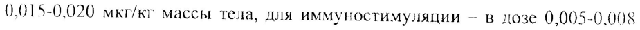
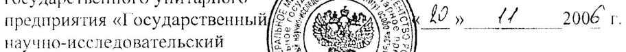

# Интерлейкин-1 бета — парентерально

- Препарат: Беталейкин® (лиофилизат для приготовления раствора для внутривенного и подкожного введения;)
- АТХ: L03AX
- Источник: ГРЛС, инструкция по медицинскому применению, РУ Р N000222/01, файл от 2026-06-05 (https://grls.rosminzdrav.ru/Grls_View_v2.aspx?routingGuid=79f538f9-a37b-478a-bd30-b1c8930c1768)
- Распознано автоматически (OCR): 6 из 6 стр.
- Инструкция к другому РУ того же препарата: Р N000222/01 (национальное РУ, переоформленное по правилам ЕАЭС, решение от 16.12.2016). Текст может быть старше действующего
- Сомнительных строк после OCR: 2 (см. раздел «Проверка распознавания»)

## Общие сведения

L/ | at, ne thes | - < се > P №00222/01-201207
УТВЕРЖДАЮ соли, $ oh no НАДО, $ it yaa ЧЕЛ г % ys SOMA
Главный госу [у ТИ ON санитарный в Е PX Sete Vee)
Российской Ча раке Е ye ASE OS ISS | с $ ДА ой
IOS de FRE SEE Binion
32 Lf rant ay
№ ри ИНСТРУКЦИЯ | © по медицинскому применению препарата БЕТАЛЕЙКИН®
Регистрационный номер: от a Торговое название препарата: Беталейкин®
Международное непатентованное название: Интерлейкин-!| бета
Химическое название: рекомбинантный интерлейкин-| бета

## 3. Лекарственная форма

лиофилизат для приготовления раствора для внутривенного и подкожного введения
лиофилизат для приготовления раствора для внутривенного и подкожного введения
- Состав: Одна ампула содержит 0,05 мкг, 0,5 мкг или 1,0 мкг интерлейкина-!| бета, вспомогательное вещество: | mr повидона
(поливинилпирролидона низкомолекулярного медицинского).
Описание: Пористая масса или порошок белого цвета.
Фармакотерапевтическая групна: Цитокин.
Код ATX: [103^Х] Взамен Инструкции, утвержденной 06 мая 2003 г.
Р №000222/01-201207

Фармакологическое (иммунологическое) действие:

Беталейкин® стимулирует кроветворение, иммунитет и раннее постлучевое восстановление. Препарат ускоряет восстановление стволового потенциала и костномозгового кроветворения, особенно гранулопозза, после поражающего действия цитостатиков и ионизирующей радиации. Это обусловлено его способностью инициировать вступление стволовых клеток в митотический цикл и их мобилизацию в кровь, усиливать выработку гемопоэтических ростовых факторов, включать механизмы общей и местной неспецифической резистентности. у

Иммуностимулирующее действие препарата реализуется путем

- повышения функциональной активности нейтрофильных гранулоцитов,

| индукции дифференцировки предшественников иммунокомпетентных

клеток, усиления пролиферации лимфоцитов, активации продукции цитокинов и увеличения антителообразования.

Назначение:

Беталейкин® применяют в качестве стимулятора лейкопоэза при токсической лейкопении П-У степени, осложняющей химио- и радиотерапию злокачественных опухолей, и как протектор лейкопоэза при необходимости проведения химиотерапии в условиях лейкопенического

ad фона (число лейкоцитов периферической крови не менее 3 x 10°/л).

Основным показанием к применению Беталейкина® в качестве иммуностимулятора являются вторичные иммунодефицитные состояния, развивающиеся после тяжелых травм, обширных хирургических вмешательств, в результате гнойно-септических и гнойно-деструктивных процессов, инфекционных заболеваний, а также при хронических септических состояниях.

Беталейкин® применяют в качестве средства экстренной противолучевой терапии при острых аварийных тотальных и субтотальных воздействиях ионизирующего излучения, не осложненных дополнительным термическим
Р №000222/01-201207

воздействием. Беталейкин“ применяют, если доза облучения по ориентировочной оценке превышает 1 Гр.

Показанием к применению Беталейкина® является также впервые выявленный туберкулез легких ограниченной протяженности с преобладанием продуктивного типа тканевой реакции (с деструкцией и без нее) и туберкулез легких, при котором сохраняются средние размеры продуктивных фокусов в легочной ткани и «остаточные полости» на 4-5 месяце лечения независимо от исходной формы туберкулеза.

## 4.2. Способ применения и дозы

ww Бсталейкин” вводят подкожно или внутривенно капельно.

1. В качестве стимулятора лейкопоэза препарат применяют в лозе
0,015-0.020 мкг/кг массы тела, для иммуностимуляции — в дозе 0.005-0.008 мкг/кг массы тела. Лечение проводят в виде курса из 5 ежедневных капельных внутривенных инфузий или подкожных инъекций.

Для получения необходимого инфузионного раствора для внутривенного введения содержимое ампулы с препаратом непосредственно исред введением растворяют в 1 мл стерильного изотонического 0.9% раствора натрия хлорида либо воды для инъекций и доводят общий объем раствора до 100 мл изотоническим 0,9% раствором натрия хлорида. [я

lw достижения расчетной дозы для инфузии данный раствор разводят в необходимом количестве (в зависимости от исходной дозы препарата в ампуле, соответственно, его концентрации в полученном растворе) в 500 мл 0.9% раствора натрия хлорида или 5% раствора глюкозы.
Продолжительность инфузии может варьировать от 120 до 180 минут.

Для получения инъекционного раствора для подкожного введения содержимое ампулы с препаратом растворяют в 0,5-1,0 мл стерильного изотонического 0,9% раствора натрия хлорида или воды для инъекций.

При необходимости могут быть проведены аналогичные повторные курсы лечения с интервалом в две недели.
Р N000222/01-201207

2. Беталейкии® как средство экстренной противолучевой терапии вводят подкожно, в пределах 2 ч после лучевого воздействия в дозе 1 мкг
(содержимое ампулы 1 мкг разводят в 1 мл стерильного изотонического

0,9 % раствора натрия хлорида).

3. Для лечения туберкулеза Беталейкин® вводится в дозе 0,005 мкг/кг массы тела. Препарат вводят внутривенно капельно в течение 3-х часов или подкожно. Раствор для инъекций готовят таким образом, как описано в 11.1 данного раздела. Лечение проводят в виде курса из 5 ежедневных процедур.

Беталейкин® назначается на фоне применения противотуберкулезных

we препаратов, специфическая — nonuxumuomepanua осуществляется 4 препаратами, — подобранными в соответствии с лекарственной чувствительностью МБТ.

## 4.8. Побочное действие

У отдельных больных можег наблюдаться озноб, головная боль, повышение температуры тела. Эти реакции продолжаются в течение 2-3 часов после введения, после чего температура падает и побочные явления исчезают. Указанные побочные эффекты не являются противопоказанием для продолжения курса лечения. При возникновении особенно тяжелых

7 побочных явлений они могут быть купированы введением парацетамола, анальгина, димедрола или их сочетаний. В случае крайне редко наблюдаемых выраженных общих, в том числе, аллергических реакций, допустимо применение кортикостероидов.

При подкожном введении Беталейкина® в области введения через 4-6 ч может появиться краснота и слабо выраженный инфильтрат. Они не являются проявлением инфицирования и не требуют врачебного вмешательства.

## 4.5. Взаимодействие с другими лекарственными средствами

Не выявлено.
| Р N000222/01-201207

## 4.3. Противопоказания

|
|

Индивидуальная непереносимость. Препарат не рекомендуется применять у больных в стадии септического шока и при выраженной лихорадке.

В случае применения Беталейкина” как средства экстренной противолучевой терапии противопоказаниями являются комбинированные радиационно-термические повреждения (КРТП), лихорадочные состояния, выраженная гипотония, шок.

Противопоказания для назначения Беталейкина” при лечении

“ туберкулеза: ` e объем поражения более 3 сегментов (в т.ч. включая очаги обсеменения), наличие полостей деструкции более 3 см, преобладание эксбудативной тканевой реакции в легочной ткани;
® выраженные симптомы интоксикации, в т.ч. гипертермия;
» дети и подростки младше 18 лет.

## 6.5. Форма выпуска

По 0,05 мкг, 0,5 мкг или 1 мкг в стеклянных ампулах, по 5 ампул в кассетную контурную ячейковую упаковку. Каждая упаковка в картонной

w пачке с инструкцией по применению.

Условия хранения и транспортирования:

Препарат хранят при температуре от 2 до 15 °С, в местах, недоступных для детей. Транспортируют при температуре от 2 до 15 °С. Допускается транспортирование при температуре от 16 до 25 °С в течение 5 суток.

## 6.3. Срок годности

2 года. Не применять по истечении срока годности.
Р NO00222/01-201207

Условия отпуска из аптек:

Отпускают по рецепту врача.

Производитель: Федеральное государственное унитарное предприятие
«Государственный научно-исследовательский институт 0с0б0 чистых биопрепаратов» Федерального медико-биологического агентства, Россия, 197110, г.Санкт-Петербург, ул.Пудожская, д.7. Тел.: 8(812) 230-42-03, факс:
8(812) 230-79-55. E-math:mark@hpb-spb.com, www. hpb-spb.com

Рекламации на физические и другие свойства направляют в ФГУН
LUCK им./Л.А.Тарасевича Роспотребнадзора (119002, Москва, пер.Сивцев
Вражек, д. 41, тел. /факс -241-39-22/241-92-38) и в адрес предприятия:
изготовителя.

\¢ =~ | Ger Директор Федерального ZRH TSS Е.Н.Свентицкий
PPG ий bg Ke государственного унитарного Ce “5 \
. uff d &, erates предприятия «Государственный//$ 5: ate ZONK Lo, {/ 2006 г.
научно-исследовательский read sy Le . Ще, кА os Ay институт особо чистых es BETAS SS
СУ биопрепаратов» Федерального GP и т. Пртор 4 медико-биологического агентства “Е
= Директор Федерального #8 и (Ю.Н.Левашев
= $ о мы hy SA % Государственного Учреждейя es OES
; sro PRR Е «Санкт-Петербургский нае % НА В » 2000 т.
В м ВЕ “о = исследовательский инсти Е? Ч \ Е
_ ВОВА tee Ist =f фтизиопульмонологии» Ya SO Mt JS ERS;
.. А АК Федерального агентства пов) ж Ve Soe
Редерально1 ентства по ин oh Oe © здравоохранению и социальная развитию, чл.-корр. РАМН —
## Проверка распознавания

Страницы-сканы распознаны автоматически. В 2 строках с дозировками цифры могли распознаться с ошибкой — сверьте с вырезкой из оригинала:

- стр. 3: «0,015-0.020 мкг/кг массы тела, для иммуностимуляции — в дозе 0.005-0.008» — низкая уверенность: «0,015-0.020» (79); повторное чтение: «(),015-0,020 мкг/кг массы тела, для иммуностимуляции — в дозе 0,005-0,008»  
  
- стр. 6: «предприятия «Государственный//$ 5: ate ZONK Lo, {/ 2006 г.» — низкая уверенность: «5:» (0), «2006» (51); повторное чтение: «»  
  
