# Инфликсимаб — парентерально

- Препарат: Ремикейд® (лиофилизат для приготовления раствора для инфузий;)
- АТХ: L04AB02
- Источник: ГРЛС, инструкция по медицинскому применению, РУ П N012948/01, файл от 2026-06-11 (https://grls.rosminzdrav.ru/Grls_View_v2.aspx?routingGuid=1d0efdac-7f0e-4b17-9537-051da5cd9af3)
- Распознано автоматически (OCR): 36 из 36 стр.
- Инструкция к другому РУ того же препарата: П N012948/01 (исключено из реестра, решение от 15.05.2026). Текст может быть старше действующего
- Сомнительных строк после OCR: 15 (см. раздел «Проверка распознавания»)

## Общие сведения

LL №912948/01-9608 19 МИНИСТЕРСТВО ЗДРАВООХРАНЕНИЯ РОССИЙСКОЙ ФЕДЕРАЦИИ
ИНСТРУКЦИЯ по медицинскому применению лекарственного препарата
РЕМИКЕЙД® РЕГИСТРАЦИОННЫЙ НОМЕР: IT №012948/01
ТОРГОВОЕ НАИМЕНОВАНИЕ: Ремикейд® МЕЖДУНАРОДНОЕ НЕПАТЕНТОВАННОЕ НАИМЕНОВАНИЕ: инфликсимаб

## 3. Лекарственная форма

лиофилизат для приготовления раствора для инфузий
лиофилизат для приготовления раствора для инфузий
СОСТАВ w В 1 флаконе содержится:
Активное вещество: инфликсимаб 100 мг.
Вспомогательные _ вещества: натрия гидрофосфата дигидрат 6,1 мг, натрия дигидрофосфата моногидрат 2,2 мг, сахароза 500 мг, полисорбат-80 0,5 мг.
ОПИСАНИЕ Лиофилизат в виде плотной массы белого цвета без признаков расплавления, не содержащей посторонних включений.
ФАРМАКОТЕРАПЕВТИЧЕСКАЯ ГРУППА Ингибиторы фактора некроза опухоли альфа (ФНОо.).
KOJI ATX: LO4AB02 ~ ФАРМАКОЛОГИЧЕСКИЕ СВОЙСТВА

Механизм действия Инфликсимаб представляет собой химерное мышино-человеческое моноклональное антитело, которое с высоким сродством связывается с растворимой и трансмембранной формами ФНО, но не связывается с лимфотоксином альфа (JIT).

## 5.1. Фармакодинамика

Инфликсимаб ингибирует функциональную активность MHOw в различных исследуемых образцах in vitro. Применение инфликсимаба у трансгенных мышей предупреждало развитие полиартрита, связанного с конституциональной экспрессией человеческого
Инфликсимаб ингибирует функциональную активность MHOw в различных исследуемых образцах in vitro. Применение инфликсимаба у трансгенных мышей предупреждало развитие полиартрита, связанного с конституциональной экспрессией человеческого
ФНОо. Введение инфликсимаба после начала болезни приводило к заживлению структурных повреждений суставов. Jn vivo инфликсимаб быстро образует стабильные

© Fy 1

120302
1 NUL2Z9Y48/U1L-UOUS LY комплексы с человеческим ФНОо, что сопровождается снижением биологической активности PHO.

Повышенные концентрации ФНОс. определялись в суставах пациентов с ревматоидным артритом и коррелировали с активностью болезни. У пациентов с ревматоидным артритом терапия инфликсимабом приводила к уменьшению инфильтрации клеток воспаления в воспаленные участки суставов, а также снижению экспрессии молекул, опосредующих клеточную адгезию, хемоаттракцию и разрушение тканей. После терапии инфликсимабом отмечалось снижение сывороточных концентраций интерлейкина-6 (ИЛ-6) и
С-реактивного белка (CPB), а также повышение концентрации гемоглобина у пациентов с ревматоидным артритом с пониженной по сравнению с базовым уровнем концентрацией гемоглобина. Значимого снижения числа лимфоцитов в периферической крови или их пролиферативного ответа на митогенную стимуляцию по сравнению с ответом клеток eo нелеченных пациентов уго выявлено не было. У пациентов с псориазом терапия инфликсимабом приводила к снижению воспаления в эпидермальном слое и нормализации дифференцировки кератиноцитов в псориатических бляшках. У пациентов с псориатическим артритом кратковременная терапия препаратом Ремикейд® сопровождалась снижением числа Т-клеток и кровеносных сосудов в синовиальной

оболочке и участках кожи, пораженных псориатическим процессом.
При гистологическом исследовании биоптатов толстой кишки, взятых до и через 4 недели после введения инфликсимаба, было выявлено существенное снижение концентрации
ФНОс. Терапия инфликсимабом пациентов с болезнью Крона сопровождалась значительным снижением концентрации неспецифического сывороточного маркера воспаления — СРБ. Общее число лейкоцитов периферической крови при терапии
- инфликсимабом менялось в минимальной степени, хотя для лимфоцитов, моноцитов и нейтрофилов наблюдалась тенденция к нормализации их числа. У пациентов, получавших инфликсимаб, пролиферативный ответ мононуклеарных клеток периферической крови на стимуляцию не снижался по сравнению с таковым у нелеченных пациентов. Не было выявлено существенных изменений секреции цитокинов стимулированными мононуклеарными клетками периферической крови после терапии инфликсимабом.
Изучение мононуклеарных клеток биоптатов собственной пластинки слизистой оболочки кишки показало, что терапия инфликсимабом вызывает снижение числа клеток, экспрессирующих @MHOa и интерферон-у. Дополнительные гистологические исследования подтвердили, что инфликсимаб уменьшает инфильтрацию клеток воспаления и содержание маркеров воспаления в пораженных участках кишки.
120302 © И №012948/01-060819 Эндоскопические исследования продемонстрировали заживление слизистой оболочки кишки у пациентов, получавших инфликсимаб.

## 5.2. Фармакокинетика

Однократное внутривенное инфузионное введение инфликсимаба в дозах 1, 3, 5, 10 или 20 мг/кг сопровождалось дозопропорциональным увеличением максимальной сывороточной концентрации (Cmax) и площади под кривой «концентрация-время» (AUC).
Однократное внутривенное инфузионное введение инфликсимаба в дозах 1, 3, 5, 10 или 20 мг/кг сопровождалось дозопропорциональным увеличением максимальной сывороточной концентрации (Cmax) и площади под кривой «концентрация-время» (AUC).
Объем распределения в равновесном состоянии (медиана 3,0-4,1 л) не зависел от дозы и свидетельствовал о циркуляции инфликсимаба преимущественно в сосудистом русле.
Фармакокинетика не зависела от времени. Пути выведения инфликсимаба не определены.
Неизмененный инфликсимаб в моче не выявлялся. У пациентов с ревматоидным артритом клиренс и объем распределения не менялись в зависимости от возраста или массы тела.
Фармакокинетика инфликсимаба у пожилых пациентов не изучалась. Исследования у
& пациентов с заболеваниями печени или почек не проводились.
После однократного введения доз 3, 5 или 10 мг/кг медиана Стах составляла 77, 118 и 277 мкг/мл соответственно. Медиана терминального периода полувыведения составляла от 8 до 9,5 дней. Инфликсимаб определялся в сыворотке крови в течение по крайней мере 8 недель у большинства пациентов с болезнью Крона (после однократного введения рекомендуемой дозы 5 мг/кг) или с ревматоидным артритом (при поддерживающей терапии по 3 мг/кг каждые 8 недель).
Повторное применение инфликсимаба (5 мг/кг на 0-й, 2-й и 6-й неделях у пациентов со свищевой формой болезни Крона, а также 3 или 10 мг/кг каждые 4 или 8 недель у пациентов с ревматоидным артритом) сопровождалось небольшим накоплением инфликсимаба в сыворотке крови после введения второй дозы. В дальнейшем клинически
& значимого накопления не наблюдалось. У большинства пациентов CO свищевой формой болезни Крона инфликсимаб определялся в сыворотке крови в течение 12 недель (в пределах от 4 до 28 недель) после введения в указанном режиме.
Дети Популяционный анализ фармакокинетических данных пациентов с язвенным колитом
(п=60), болезнью Крона (п=120), ювенильным ревматоидным артритом (п=117) и болезнью Кавасаки (п=16) в возрасте от 2 месяцев до 17 лет показал, что воздействие инфликсимаба зависит от массы тела нелинейно. При приеме 5 мг/кг препарата Ремикейд® каждые 8 недель предполагаемая медиана воздействия в равновесном состоянии (площадь под кривой «концентрация-время» в равновесном состоянии (AUCss)) у пациентов в возрасте от 6 до 17 лет была примерно на 20% меньше, чем предполагаемая медиана воздействия в равновесном состоянии у взрослых. Предполагается, что медиана AUCss у 120302 :
11 №012948/01-0608 19 пациентов в возрасте старше 2 и младше 6 лет на 40% ниже, чем у взрослых пациентов, хотя количество пациентов, данные которых подтверждают это предположение, ограничено.

## 4.1. Показания к применению

= Ревматоидный артрит. Лечение пациентов с ревматоидным артритом в активной форме, у которых проводившееся ранее лечение базисными противовоспалительными препаратами (БПВП), включая метотрексат, было неэффективным, а также лечение пациентов с тяжелым прогрессирующим ревматоидным артритом в активной форме, которым ранее не проводилось лечение метотрексатом или иными БИВП. Лечение проводят в комбинации с метотрексатом. Комбинированное лечение препаратом
= Ревматоидный артрит. Лечение пациентов с ревматоидным артритом в активной форме, у которых проводившееся ранее лечение базисными противовоспалительными препаратами (БПВП), включая метотрексат, было неэффективным, а также лечение пациентов с тяжелым прогрессирующим ревматоидным артритом в активной форме, которым ранее не проводилось лечение метотрексатом или иными БИВП. Лечение проводят в комбинации с метотрексатом. Комбинированное лечение препаратом
Ремикейд® и метотрексатом позволяет добиться уменьшения симптомов заболевания, улучшения функционального состояния и замедления прогрессирования повреждения
- суставов.
= Болезнь Крона у взрослых. Лечение пациентов в возрасте от 18 лет с болезнью
Крона в активной форме, средней или тяжелой степени, в том числе с образованием свищей, при неэффективности, непереносимости или наличии противопоказаний к стандартной терапии, включающей глюкокортикостероиды и/или иммунодепрессанты
(при свищевой форме — антибиотики, иммунодепрессанты и дренаж). Лечение препаратом
Ремикейд® способствует уменьшению симптомов заболевания, достижению и поддержанию ремиссии, заживлению слизистых оболочек и закрытию свищей, уменьшению числа свищей, снижению дозы или отмене глюкокортикостероидов, улучшению качества жизни пациентов.
= Болезнь Крона у детей и подростков. Лечение детей и подростков в возрасте от 6
© до 17 лет включительно с болезнью Крона в активной форме, средней или тяжелой степени, при неэффективности, непереносимости или наличии противопоказаний к стандартной терапии, включающей глюкокортикостероиды и/или иммунодепрессанты.
Лечение препаратом Ремикейд® способствует уменьшению симптомов заболевания, достижению и поддержанию ремиссии, снижению дозы или отмене глюкокортикостероидов, улучшению качества жизни пациентов.
= Язвенный колит у взрослых. Лечение пациентов с язвенным колитом, у которых традиционная терапия была недостаточно эффективна. Лечение препаратом Ремикейд® способствует заживлению слизистой оболочки кишечника, уменьшению симптомов заболевания, снижению дозы или отмене глюкокортикостероидов, уменьшению потребности в стационарном лечении, установлению и поддержанию ремиссии, улучшению качества жизни пациентов.
120302 " Ll №012948/01-960819

= Язвенный колит у детей и подростков. Лечение детей и подростков в возрасте OT 6 до 17 лет включительно с язвенным колитом средней или тяжелой степени тяжести с недостаточным ответом на стандартную терапию с применением глюкокортикостероидов, 6-меркаптопурина или азатиоприна, либо при наличии непереносимости или противопоказаний к стандартной терапии.
- Анкилозирующий спондилит. Лечение пациентов с анкилозирующим спондилитом с выраженными аксиальными симптомами и лабораторными признаками воспалительной активности, не ответивших на стандартную терапию. Лечение препаратом Ремикейд® позволяет достигнуть уменьшения симптомов заболевания и улучшения функциональной активности суставов.
= Псориатический артрит. Лечение пациентов с прогрессирующим псориатическим артритом в активной форме с неадекватным ответом на БПВП. Препарат Ремикейд®

& применяется в комбинации с метотрексатом или в виде монотерапии в случаях непереносимости или наличия противопоказаний к метотрексату. Лечение препаратом
Ремикейд® позволяет достигнуть уменьшения симптомов артрита и улучшения функциональной — активности пациентов а также уменьшения — степени рентгенологического прогрессирования при периферическом псориатическом полиартрите.
= Псориаз. Лечение пациентов со среднетяжелым и тяжелым псориазом при недостаточном ответе, или наличии противопоказаний, или непереносимости стандартной системной терапии, включая циклоспорин, метотрексат или ПУВА-терапию. Лечение препаратом Ремикейд” приводит к уменьшению воспалительных явлений в коже и нормализации процесса дифференцировки кератиноцитов.

© ПРОТИВОПОКАЗАНИЯ — Реакции гиперчувствительности на инфликсимаб, другие мышиные белки, а также на любое из вспомогательных веществ препарата.
— Тяжелый инфекционный процесс, например, сепсис, абсцесс, туберкулез, оппортунистические инфекции.
— Хроническая сердечная недостаточность Ш-ТУ функционального класса по классификации МУНА.
— Возраст менее 18 лет (при болезни Крона и язвенном колите — менее 6 лет).

## 4.3. С осторожностью

— Хронические или рецидивирующие инфекции в анамнезе, в том числе при сопутствующей терапии иммунодепрессантами.
— Хронические или рецидивирующие инфекции в анамнезе, в том числе при сопутствующей терапии иммунодепрессантами.

120302 2 11 №012948/)1-060819 — Интенсивная терапия иммунодепрессантами или длительная ПУВА-терапия в анамнезе.
— ( Носительство вируса гепатита В.
— _ Демиелинизирующие заболевания.
— <“ Повышенный риск развития злокачественных новообразований в связи с курением.
— Злокачественные новообразования в анамнезе, продолжение терапии у пациентов с развившимися злокачественными новообразованиями.
— Хроническая сердечная недостаточность 1-П функционального класса по классификации МУНА.

## 4.6. Применение при беременности и в период грудного вскармливания

ВСКАРМЛИВАНИЯ . Женщины детородного возраста в период лечения препаратом Ремикейд® и в течение по
© крайней мере 6 месяцев после его окончания должны использовать надежные методы контрацепции.
Беременность Данные, полученные примерно у 450 пациенток, получавших инфликсимаб во время беременности (в том числе около 230 в первом триместре), не выявляют непредвиденного воздействия на исход беременности.
В результате ингибирования MHOw прием инфликсимаба во время беременности может повлиять на нормальный иммунный ответ новорожденного. По данным исследований токсичности у мышей при использовании аналогичного антитела (селективно ингибирующего активность мышиного ФНОо.) не было выявлено признаков токсичности 7% для беременных самок, эмбриотоксичности или тератогенности.
Имеющийся клинический опыт ограничен, и для исключения возможного риска использование инфликсимаба не рекомендуется во время беременности.
Инфликсимаб проникает через плаценту и обнаруживается в сыворотке крови новорожденных в течение 6 месяцев после рождения. В результате внутриутробного воздействия инфликсимаба у новорожденных может быть увеличен риск возникновения инфекций, включая диссеминированную инфекцию, которая может привести к летальному исходу (см. разделы «Взаимодействие с Opyeumu лекарственными препаратами» и «Особые указания»).
Период кормления грудью Неизвестно, выделяется ли инфликсимаб с молоком у людей и абсорбируется ли после приема внутрь. Так как иммуноглобулины человека экскретируются с грудным молоком, 120302 6
И №012948/01-0608 19 женщине не следует кормить грудью в течение как минимум 6 месяцев после введения инфликсимаба.

Влияние на фертильность

Данные исследований недостаточны для заключения о влиянии инфликсимаба на

фертильность и репродуктивную функцию.

## 4.2. Способ применения и дозы

Введение препарата Ремикейд® должно осуществляться под наблюдением врачей,

имеющих опыт диагностики и лечения ревматоидного артрита, воспалительных

заболеваний кишечника, анкилозирующего спондилита, псориатического артрита или

псориаза. Препарат Ремикейд® вводят внутривенно. Инфузии препарата должны

проводиться под контролем врача, обученного выявлять инфузионные реакции.

При приеме препарата Ремикейд® сопутствующая терапия (глюкокортикостероидами или we иммунодепрессантами) должна быть оптимизирована.

Препарат вводят внутривенно капельно в течение не менее 2 ч. Все пациенты должны

оставаться под наблюдением врача в течение 1-2 4 после инфузии для предупреждения

острых инфузионных реакций. При проведении инфузии должны быть доступны средства

неотложной помощи (такие как эпинефрин, — антигистаминные — средства,

глюкокортикостероиды и — искусственная вентиляция легких). — Допускается

предварительное введение антигистаминных средств, гидрокортизона и/или

парацетамола, а также уменьшение скорости проведения инфузии для уменьшения риска

развития инфузионных реакций, особенно у пациентов, у которых инфузионные реакции

развивались при предыдущем введении препарата.

При лечении взрослых пациентов, которые хорошо перенесли по меньшей мере три ww первые 2-х часовые инфузии препарата Ремикейд® (фаза индукции) и находятся на

поддерживающей терапии, возможно сокращение продолжительности последующих

инфузий до минимального 1-часового введения. Если в последующем при ускоренном

введении препарата возникнет инфузионная реакция, то в случае продолжения терапии

рекомендован возврат к более медленным инфузиям.

Возможность сокращения времени инфузий при введении препарата в дозе более 6 мг/кг

не изучалась.

Лечение ревматоидного артрита

Первоначальная разовая доза препарата Ремикейд® составляет 3 мг/кг внутривенно. Затем

препарат вводят в той же дозе через 2 недели и 6 недель после первого введения (фаза

индукции), и далее каждые 8 недель (поддерживающая фаза лечения).

120302 7 LL №012948/01-060819

Лечение препаратом Ремикейд® следует проводить одновременно с применением

метотрексата.

У большинства пациентов клинический ответ достигается в течение 12 недель. При

недостаточном ответе или если эффект от лечения утрачивается в последующем периоде,

возможно увеличение дозы препарата Ремикейд® с шагом в 1,5 мг/кг, вплоть до 7,5 мг/кг

каждые 8 недель, или сокращение интервалов между введениями препарата Ремикейд® в

дозе 3 мг/кг до 4 недель. При достижении клинического ответа лечение должно быть

продолжено в соответствующей дозе и в соответствующем режиме дозирования.

При отсутствии эффекта от лечения в течение 12 первых недель, а также в ответ на

увеличение дозы препарата Ремикейд® или сокращение интервалов между инфузиями

следует рассмотреть вопрос о целесообразности продолжения лечения.

Лечение активной формы болезни Крона тяжелой или средней степени у взрослых
& Первоначальная доза препарата Ремикейд® составляет 5 мг/кг внутривенно, вторая

инфузия в той же дозе через 2 недели после первой. При отсутствии ответа после двух

введений дальнейшее применение препарата Ремикейд® не представляется

целесообразным. Для ответивших пациентов лечение препаратом Ремикейд® можно

продолжить, при этом следует выбрать один из двух возможных вариантов лечения:

- препарат вводят в дозе 5 мг/кг через 6 недель после первого введения и затем

каждые 8 недель; в поддерживающую фазу лечения некоторым пациентам для

достижения эффекта может потребоваться увеличение дозы до 10 мг/кг,

= препарат вводят повторно в дозе 5 мг/кг при рецидиве заболевания (см. разделы

«Повторное назначение» и «Побочное действие»).

Несмотря на недостаточность сравнительных данных, имеющиеся данные указывают на
& то, что некоторые пациенты, которые вначале ответили на терапию дозой 5 мг/кг, HO

впоследствии утратили ответ, могут вновь обрести ответ при увеличении дозы. Следует

тщательно оценить возможность продолжения терапии пациентов, у которых

отсутствовали признаки терапевтического улучшения после изменения дозы.

Общая продолжительность лечения препаратом Ремикейд® определяется лечащим врачом.

Лечение активной формы болезни Крона тяжелой или средней степени у детей и

подростков в возрасте от 6 до 17 лет включительно

Первоначальная доза препарата Ремикейд® составляет 5 мг/кг внутривенно. Затем

препарат вводят в той же дозе через 2 недели и 6 недель после первого введения, и далее —

каждые 8 недель. При отсутствии эффекта в течение первых 10 недель дальнейшее

применение препарата Ремикейд* не рекомендуется.

120302 8 И №012948/01-060819 Некоторым пациентам для поддержания клинического эффекта может потребоваться более короткий интервал между инфузиями, в то время как для части пациентов более длительный интервал может быть достаточен. У пациентов, у которых интервал между инфузиями сокращен до менее 8 недель, может быть увеличен риск развития нежелательных явлений. Следует тщательно оценить необходимость продолжения лечения при отсутствии дополнительного эффекта от лечения при изменении интервала дозирования.
Лечение препаратом Ремикейд® следует проводить одновременно с применением иммуномодуляторов — 6-меркаптопурина, азатиоприна или метотрексата.
При наличии ответа на лечение препаратом Ремикейд® общая продолжительность лечения определяется лечащим врачом.
Эффективность и безопасность препарата Ремикейд® у пациентов младше 6 лет не

w изучались.
Лечение болезни Крона с образованием свищей у взрослых
Препарат Ремикейд® вводят в дозе 5 мг/кг внутривенно, затем препарат вводят в той же дозе через 2 недели и 6 недель после первого введения. При отсутствии ответа после введения этих трех доз продолжение лечения препаратом Ремикейд® нецелесообразно.
При наличии ответа лечение можно продолжить, при этом следует выбрать один из двух возможных вариантов лечения:
= препарат вводят в дозе 5 мг/кг через 2 недели и 6 недель после первого введения и затем каждые 8 недель; у некоторых пациентов для достижения эффекта от лечения может потребоваться увеличение дозы до 10 мг/кг;
a препарат вводят повторно в той же дозе при рецидиве заболевания (CM. разделы
& «Повторное назначение» и «Побочное действие»).

Несмотря на недостаточность сравнительных данных, имеющиеся данные указывают на то, что некоторые пациенты, которые вначале ответили на терапию дозой 5 мг/кг, но впоследствии утратили ответ, могут вновь обрести ответ при увеличении дозы. Следует тщательно оценить возможность продолжения терапии пациентов, у которых отсутствовали признаки терапевтического улучшения после изменения дозы.
Общая продолжительность лечения препаратом Ремикейд® определяется лечащим врачом.
Сравнительных исследований указанных двух вариантов лечения болезни Крона не проводилось. Имеющиеся данные о применении препарата по второму варианту лечения
(повторном введении в случае рецидива) ограничены.
Лечение язвенного колита у взрослых

120302 9 И №012948/01-060819

Первоначальная доза препарата Ремикейд® составляет 5 мг/кг внутривенно. Затем препарат вводят в той же дозе через 2 недели и 6 недель после первого введения, и далее — каждые 8 недель. У некоторых пациентов для достижения эффекта может потребоваться увеличение дозы до 10 мг/кг. Имеющиеся данные свидетельствуют о наступлении эффекта от лечения в срок до 14 недель (после введения 3 доз). Если в течение этого времени эффекта не наступило, следует решить вопрос о целесообразности продолжения лечения. При наличии ответа на лечение общая продолжительность лечения препаратом
Ремикейд*® определяется лечащим врачом.
Лечение язвенного колита у детей и подростков от 6 до 17 лет включительно
Первоначальная доза препарата Ремикейд” составляет 5 мг/кг внутривенно. Затем препарат вводят в той же дозе через 2 недели и 6 недель после первого введения, и далее — каждые 8 недель. Имеющиеся данные не позволяют рекомендовать применение препарата

& Ремикейд* при отсутствии эффекта в течение 8 недель после первой инфузии.
При наличии ответа на лечение препаратом Ремикейд® общая продолжительность лечения определяется лечащим врачом.
Эффективность и безопасность препарата Ремикейд® у пациентов младше 6 лет не изучалась.
Лечение анкилозирующего спондилита Первоначальная доза препарата Ремикейд” составляет 5 мг/кг внутривенно. Затем препарат вводят в той же дозе через 2 недели и 6 недель после первого введения, и далее — каждые 6-8 недель. При отсутствии эффекта в течение 6 недель (после введения двух доз)
продолжать лечение нецелесообразно.
Лечение псориатического артрита

© Первоначальная доза препарата Ремикейд® составляет 5 мг/кг внутривенно. Затем препарат вводят в той же дозе через 2 недели и 6 недель после первого введения, и далее — каждые 8 недель.
Лечение псориаза Первоначальная доза препарата Ремикейд” составляет 5 мг/кг внутривенно. Затем препарат вводят в той же дозе через 2 недели и 6 недель после первого введения, и далее — каждые 8 недель. При отсутствии эффекта в течение 14 недель (после введения четырех доз) продолжать лечение инфликсимабом нецелесообразно. Общая продолжительность лечения препаратом Ремикейд® определяется лечащим врачом.
Повторное назначение при ревматоидном артрите и болезни Крона
В случае рецидива заболевания препарат Ремикейд® может быть снова назначен в течение 16 недель после введения последней дозы. В клинических исследованиях реакции

420302 *® 11 №9129465/01-9608 19 гиперчувствительности были нечастыми и наблюдались в случае, если интервал перед повторным введением препарата Ремикейд® составлял менее 1 года. Эффективность и безопасность повторного введения препарата с интервалом, превышающим 16 недель, не изучались.

Повторное назначение при язвенном колите
Эффективность и безопасность препарата при его повторном применении по иной схеме
(не каждые 8 недель) не изучались.
Повторное назначение при анкилозирующем спондилите
Эффективность и безопасность препарата при его повторном применении по иной схеме
(не каждые 6-8 недель) не изучались.
Повторное назначение при псориатическом артрите
Эффективность и безопасность препарата при его повторном применении по иной схеме

we (не каждые 8 недель) не изучались.
Повторное назначение при псориазе Ограниченный опыт повторного введения одной дозы препарата Ремикейд® после 20-недельного интервала позволяет предположить, что лечение может оказаться менее эффективным и сопровождаться более высокой частотой инфузионных реакций (легкой и средней степени тяжести) по сравнению с начальным индукционным режимом.
Ограниченный опыт повторного назначения препарата Ремикейд® в режиме индукции после обострения заболевания позволяет предположить, что лечение может сопровождаться более высокой частотой инфузионных реакций (в том числе тяжелой степени) по сравнению с режимом введения каждые 8 недель.
Повторное назначение независимо от показаний

w В случае перерыва в поддерживающей терапии и необходимости возобновления лечения не рекомендовано повторное назначение препарата Ремикейд® в режиме индукции.
Возобновление терапии следует проводить в режиме одной инфузии с последующим назначением инфузий в режиме поддерживающей терапии.
Пожилые (> 65 лет)
Эффективность и безопасность препарата у пожилых пациентов не изучались. Никаких существенных связанных с возрастом различий в распределении и выведении препарата в клинических исследованиях не наблюдалось. Коррекции дозы не требуется.
Нарушение функции почек и/или печени Эффективность и безопасность препарата у данной категории пациентов не изучались.

120302 И LL №012948/01-060819 ИНСТРУКЦИЯ ПО ПРИГОТОВЛЕНИЮ ИНФУЗИОННОГО РАСТВОРА
1) Рассчитайте дозу и необходимое количество флаконов препарата Ремикейд® (каждый флакон содержит 100 мг инфликсимаба) и требуемый объем готового раствора препарата.
2) В условиях асептики растворите содержимое каждого флакона в 10 мл воды для инъекций, используя шприц с иглой 21 (0,8 мм) или меньшего калибра. Перед введением растворителя снимите пластиковую крышку с флакона и протрите пробку 70% раствором этилового спирта. Введите иглу шприца во флакон через центр резиновой пробки, струю воды направляйте по стенке флакона.
Осторожно перемешайте раствор вращением флакона до полного растворения лиофилизированного порошка. Избегайте продолжительного и колебательного перемешивания.
НЕ ВСТРЯХИВАЙТЕ. При растворении возможно образование пены, в этом случае дайте
& раствору постоять в течение 5 минут.
Полученный раствор должен быть бесцветным или слабо желтого цвета и опалесцирующим. В нем может присутствовать небольшое количество мелких полупрозрачных частиц, поскольку инфликсимаб является белком. В случае наличия непрозрачных частиц, посторонних включений и измененного цвета раствор нельзя использовать.
3) Доведите общий объем приготовленной дозы раствора препарата Ремикейд® до 250 мл 0,9% раствором натрия хлорида для инъекций. Не допускается использование других растворителей. Для этого из стеклянного флакона или инфузионного мешка, содержащего 250 мл 0,9% раствора натрия хлорида, удалите объем, равный объему приготовленного с использованием воды для инъекций раствора препарата Ремикейд*®. После этого медленно w добавьте ранее приготовленный раствор препарата Ремикейд” в бутылку или инфузионный мешок с 0,9% раствором натрия хлорида и осторожно перемешайте.
НЕЛЬЗЯ ВВОДИТЬ ПРЕПАРАТ НЕРАЗВЕДЕННЫМ! Для приготовления объемов, превышающих 250 мл, используют инфузионный мешок большего объема (например, 500 мл, 1000 мл) или используют несколько инфузионных мешков объемом 250 мл, чтобы гарантировать, что концентрация приготовленного инфузионного раствора не превышает 4 мг/мл (например, для пациентов с ожирением).
4) Проведите инфузию в течение времени, не менее рекомендованного. Используйте только инфузионную систему со встроенным стерильным апирогенным фильтром, обладающим низкой белковосвязывающей активностью (размер пор не более 1,2 мкм). В связи с отсутствием в препарате консерванта начните введение инфузионного раствора 120302 12
LL №012948/01-96008 19 как можно скорее, HO не позже 3-х часов после его приготовления. Растворение и разведение следует проводить в условиях асептики.
5) Не вводите препарат Ремикейд® совместно с какими-либо другими лекарственными препаратами через одну инфузионную систему.
6) Визуально проверьте инфузионный раствор перед началом введения. В случае наличия непрозрачных частиц, посторонних включений и измененного цвета раствор нельзя использовать.
7) Неиспользованная часть инфузионного раствора дальнейшему применению не подлежит и должна быть уничтожена.

## 4.8. Побочное действие

Инфекции верхних дыхательных путей являлись наиболее частыми нежелательными реакциями, о которых сообщалось в клинических исследованиях. Их частота составляла w 25,3% у пациентов, получавших инфликсимаб, по сравнению с 16,5% у контрольной группы. Наиболее серьезные нежелательные реакции, связанные с использованием ингибиторов ФНО, которые сообщались при применении препарата Ремикейд®, включали реактивацию вируса гепатита В, хроническую сердечную недостаточность, серьезные инфекции (включая сепсис, оппортунистические инфекции и туберкулез), сывороточную болезнь (реакции гиперчувствительности замедленного типа), гематологические реакции, системную красную волчанку/волчаночноподобный синдром, демиелинизирующий синдром, гепатобилиарные нарушения, лимфому, гепатолиенальную Т-клеточную лимфому, лейкоз, карциному Меркеля, меланому, злокачественные новообразования у детей, саркоидоз/реакции по типу саркоидоза, интестинальный или перианальный абсцесс
Инфекции верхних дыхательных путей являлись наиболее частыми нежелательными реакциями, о которых сообщалось в клинических исследованиях. Их частота составляла w 25,3% у пациентов, получавших инфликсимаб, по сравнению с 16,5% у контрольной группы. Наиболее серьезные нежелательные реакции, связанные с использованием ингибиторов ФНО, которые сообщались при применении препарата Ремикейд®, включали реактивацию вируса гепатита В, хроническую сердечную недостаточность, серьезные инфекции (включая сепсис, оппортунистические инфекции и туберкулез), сывороточную болезнь (реакции гиперчувствительности замедленного типа), гематологические реакции, системную красную волчанку/волчаночноподобный синдром, демиелинизирующий синдром, гепатобилиарные нарушения, лимфому, гепатолиенальную Т-клеточную лимфому, лейкоз, карциному Меркеля, меланому, злокачественные новообразования у детей, саркоидоз/реакции по типу саркоидоза, интестинальный или перианальный абсцесс
(при болезни Крона) и серьезные инфузионные реакции (см. раздел «Особые указания»).
- У пациентов, получавших препарат Ремикейд®, очень редко сообщалось о гемофагоцитарном лимфогистиоцитозе (ГЛГ).
Таблица нежелательных реакций В таблице 1 перечислены нежелательные реакции (в том числе с летальным исходом), наблюдавшиеся в клинических исследованиях и сообщенные в пострегистрационный период. Неблагоприятные реакции по системам организма распределены по частоте на следующие категории: очень частые (>1/10), частые (>1/100 и <1/10), нечастые (>1/1000 и
<1/100), редкие (>1/10000 и <1/1000) и очень редкие (<1/10000), неизвестно (частота не может быть оценена на основании имеющихся данных). В каждой колонке нежелательные реакции расположены в порядке убывания серьезности.
120302 = LL №0129485/01-960819 Таблица 1. Нежелательные явления, выявленные при клинических исследованиях и в пострегистрационный период.
реакции паразитарные заболевания частые целлюлит, абсцесс кандидоз редкие менингит, оппортунистические инфекции
(такие как инвазивные грибковые инфекции
(пневмоцистоз, гистоплазмоз, аспергиллез, кокцидиомикоз, криптококкоз, бластомикоз), бактериальные инфекции (атипичная микобактериальная инфекция, — листериоз, сальмонеллез) и вирусные — инфекции
(цитомегаловирусная инфекция), & паразитарные инфекции, реактивация гепатита В внутриутробного воздействия инфликсимаба)* злокачественные и Ходжкина, лейкоз, меланома, рак шейки матки неуточненные неизвестно | гепатолиенальная Т-клеточная лимфома кисты и полипы) и язвенным колитом), карцинома Меркеля крови и лимфатической лимфаденопатия системы редкие агранулоцитоз (включая новорожденных после внутриутробного воздействия инфликсимаба), тромботическая тромбоцитопеническая пурпура, панцитопения, гемолитическая
& анемия, идиопатическая тромбоцитопеническая пурпура
Нарушения со стороны иммунной системы нечастые | анафилактические реакции, волчаночноподобный синдром, сывороточная болезнь или реакции по типу сывороточной болезни типу саркоидоза
Нарушения психики сонливость, нервозность редкие [апатия нервной системы частые парестезия 120302 14
11 NULZ948/U1-U6U8 19 редкие поперечный миелит, демиелинизирующие нарушения центральной нервной системы (по типу рассеяного склероза, неврита зрительного нерва), демиелинизирующие нарушения периферической нервной системы (синдром
Гийена-Барре, хроническая воспалительная демиелинизирующая полинейропатия и мультифокальная моторная — нейропатия), острые нарушения мозгового кровообращения, развившиеся в течение примерно 24 часов после начала инфузии
Нарушения со стороны органа зрения редкие |эндофтальмит течение 2 часов после инфузии
Нарушения со стороны сердца нечастые | сердечная недостаточность (возникновение и
& ухудшение), аритмия (включая случаи развившиеся в течение 24 часов после начала инфузии), обморок, брадикардия миокарда/инфаркт миокарда в течение 24 часов после начала инфузии
Нарушения со стороны частые снижение артериального давления, повышение
«приливы», «приливы»
тромбофлебит, гематома спазм сосудов дыхательной системы, частые синусит органов грудной клетки и частые инфекции нижних дыхательных путей w& средостения (например, бронхит, пневмония), одышка, носовое кровотечение плевральный выпот быстрое прогрессирование болезни, легочный фиброз и пневмонит желудочно-кишечного частые тракта частые желудочно-кишечное кровотечение, диарея, в запор дивертикулит, панкреатит, хейлит печени и желчевыводящих «печеночных» трансаминаз путей редкие [аутоиммунный гепатит, желтуха | 120302 ad
И №912948/01-0608 19 НИ неизвестно | печеночная недостаточность
Нарушения со стороны частые появление или ухудшение псориаза, включая кожи и подкожных тканей пустулезный — псориаз (преимущественно ладонно-подошвенная форма), крапивница, сыпь, зуд, повышенная потливость, сухость кожи, грибковый дерматит, экзема, алопеция нечастые | буллезная сыпь, онихомикоз, — себорея, фурункулез, розацеа‚ папиллома кожи, гиперкератоз, нарушение пигментации кожи редкие токсический эпидермальный некролиз, синдром Стивенса-Джонсона, мультиформная эритема, фурункулез, линеарный
[2А-зависимый буллезный дерматоз (LABD), острый генерализованный экзентематозный пустулез (AGEP), лихеноидные реакции
Нарушения со стороны частые артралгия, миалгия, боль в спине скелетно-мышечной и соединительной ткани
“> Нарушения со стороны инфекция мочевыводящих путей почек и мочевыводящих нечастые | пиелонефрит ей
Нарушения со стороны нечастые | вагинит половых органов и молочной железы
Общие расстройства и очень инфузионные реакции, боль нарушения в месте частые введения частые боль в груди, утомляемость, лихорадка, реакции в месте введения, озноб, отек нечастые | замедленное заживление ран
`` редкие _ образование гранулематозных очагов
Лабораторные и нечастые | образование аутоантител инструментальные данные редкие нарушение выработки факторов комплемента
*включая бычий туберкулез (диссеминированная БЦЖ инфекция), см. раздел «Особые указания».
Инфузионные реакции В качестве таковых при проведении клинических исследований рассматривались любые нежелательные реакции, возникшие во время инфузии или в течение 1 часа после нее. В клинических исследованиях 3 фазы частота развития инфузионных реакций в группе препарата Ремикейд® составила около 18% и около 5% — в группе плацебо. В целом частота инфузионных реакций у пациентов, получавших монотерапию инфликсимабом, была выше, чем у пациентов, получавших инфликсимаб с одновременным использованием иммуномодуляторов. Примерно 3% пациентов были вынуждены прекратить терапию в связи с развитием инфузионных реакций, при этом у всех пациентов реакции были обратимыми (после медикаментозной терапии или без нее). Из 120502.
11 №012948/01-060819 пациентов, получавших инфликсимаб и перенесших инфузионные реакции в индукционном периоде (по 6 неделю), у 27% в поддерживающем периоде (с 7 до 54 недели) развились повторные реакции. Из пациентов, у которых в индукционном периоде инфузионные реакции зафиксированы не были, у 9% отмечалось развитие данных реакций в поддерживающем периоде.
В клиническом исследовании ASPIRE у пациентов с ревматоидным артритом, перенесших как минимум три 2-х часовые инфузии препарата Ремикейд® без серьезных инфузионных реакций, допускалось сокращение продолжительности инфузий до не менее 40 мин. В данном исследовании 66% (686 из 1040) пациентов получили как минимум одну инфузию, сокращенную до 90 или менее минут, 44% (454 из 1040) пациентов получили как минимум одну инфузию, сокращенную до 60 или менее минут. У пациентов, получивших как минимум одну сокращенную инфузию инфликсимаба, инфузионные реакции были
& зарегистрированы у 15% пациентов, а серьезные инфузионные peakuHH— у 0,4% пациентов.
В клиническом исследовании ЗОМС у пациентов с болезнью Крона инфузионные реакции были зарегистрированы у 16,6% (27 из 163) пациентов, получавших монотерапию инфликсимабом, у 5% (9 из 179) пациентов, получавших комбинированную терапию инфликсимабом и азатиоприном, у 5,6% (9 из 161), получавших монотерапию азатиоприном. Одна серьезная инфузионная реакция была зарегистрирована (менее 1% пациентов) в группе монотерапии инфликсимабом.
В пострегистрационном периоде при применении препарата Ремикейд® отмечались случаи развития припадков и анафилактоидных реакций, включая отек глотки/гортани и выраженный бронхоспазм (см. раздел «Особые указания»). Сообщалось о случаях
& преходящей потери зрения, развившихся ВО время или в течение 2 ч после инфузии. Также сообщались случаи ишемии миокарда/инфаркта миокарда (некоторые с летальным исходом) и аритмии, развившиеся в течение 24 часов после начала инфузии. Также сообщались случаи острого нарушения мозгового кровообращения, развившиеся в течение примерно 24 ч после инфузии препарата Ремикейд®.
Инфузионные реакции после повторного введения препарата Ремикейд®
Было проведено клиническое исследование у пациентов с псориазом средней или тяжелой степени для оценки эффективности и безопасности долгосрочной поддерживающей терапии по сравнению с индукционным режимом использования препарата Ремикейд®
(максимум 4 инфузии на 0, 2, 6 и 14 неделях) после обострения заболевания. Пациенты не получали сопутствующую терапию иммунодепрессантами. В группе индукционной терапии серьезные инфузионные реакции развивались у 4% (8 из 219) пациентов по 120302 ?
И №012948/01-0608 19 сравнению с менее 1% (1 из 222) в группе поддерживающей терапии. Большинство серьезных инфузионных реакций было отмечено во время 2-ой инфузии (неделя 2).
Интервал между последней поддерживающей дозой и первой повторной индукционной дозой составлял от 35 до 231 дня. Симптомы включали (но не ограничивались) диспноэ, крапивницу, отек лица и снижение артериального давления. Во всех случаях после прекращения терапии препаратом Ремикейд® и/или в начале другой терапии признаки и симптомы полностью проходили.

Реакции гиперчувствительности замедленного типа (ГЗТ)
В клинических исследованиях реакции ГЗТ были нечастыми и происходили, если интервал перед повторным введением препарата Ремикейд® составлял менее 1 года. В исследованиях псориаза реакции ГЗТ происходили в начале курса терапии. Признаки и симптомы включали миалгию и/или артралгию, сопровождающиеся лихорадкой и/или
& сыпью. У некоторых пациентов отмечались зуд, отек лица, губ или рук, дисфагия, крапивница, боль в горле и головная боль.
Данных о числе случаев развития реакций ГЗТ, если интервал перед повторным введением приема препарата Ремикейд® составлял более 1 года, недостаточно. Однако ограниченные данные клинических исследований предполагают увеличенный риск развития реакций ГЗТ при увеличении интервала без приема препарата Ремикейд® (см.
раздел «Особые указания»).
В клиническом исследовании длительностью 1 год, в котором повторно проводили инфузии пациентам с болезнью Крона (АССЕМТ 1), число случаев развития реакций по типу сывороточной болезни составляло 2,4%.
Иммуногенность ow У пациентов, у которых образовывались антитела к инфликсимабу, с большей вероятностью (примерно в 2-3 раза) развивались инфузионные реакции. Сопутствующее использование иммунодепрессантов снижало вероятность развития инфузионных реакций.
В клинических исследованиях при однократном и многократном введении инфликсимаба в дозах от | до 20 мг/кг антитела к инфликсимабу обнаруживались у 14% пациентов с одновременной терапией любыми иммунодепрессантами и у 24% без терапии иммунодепрессантами. У 8% пациентов с ревматоидным артритом, получавших рекомендованные для повторной терапии дозы инфликсимаба одновременно с метотрексатом, обнаруживали антитела к инфликсимабу. У 15% пациентов с псориатическим артритом, которые получали инфузии 5 мг/кг инфликсимаба с или без одновременного приема метотрексата, обнаруживали антитела к инфликсимабу (у 4% 120302 18
IL №012948/01-060819 пациентов, получавших метотрексат, и у 26% пациентов, не получавших метотрексат изначально). У пациентов с болезнью Крона, получавших поддерживающую терапию инфликсимабом, антитела к инфликсимабу обнаруживались у 3,3% пациентов, получавших иммунодепрессанты, иу 13,3%, не получавших иммунодепрессанты. Число случаев при эпизодической терапии увеличивалось в 2-3 раза. В связи с ограничениями метода определения антител отрицательный результат не исключал наличия антител к инфликсимабу. У некоторых пациентов с высоким титром антител были признаки уменьшения эффективности терапии инфликсимабом. Примерно у 28% пациентов с псориазом, получавших терапию инфликсимабом в поддерживающем режиме без одновременного применения иммуномодуляторов, обнаруживались антитела к инфликсимабу.

Инфекции

& У пациентов, получавших препарат Ремикейд®, наблюдались туберкулез, бактериальные инфекции, включая сепсис и пневмонию, инвазивные грибковые, вирусные или другие оппортунистические инфекции. Некоторые из этих инфекций были летальны, наиболее часто сообщавшиеся оппортунистические инфекции с уровнем смертности более 5% включали пневмоцистоз, кандидоз, листериоз и аспергиллез.
В клинических исследованиях в группе терапии препаратом Ремикейд®, 36% пациентов дополнительно получали антиинфекционную терапию по сравнению с 25% таких пациентов, в группе плацебо.
В клинических исследованиях ревматоидного артрита, число случаев серьезных инфекций, включая пневмонию, было выше в группе пациентов, получавших совместную терапию инфликсимабом и метотрексатом, по сравнению с группой пациентов,

ow получавших только метотрексат, особенно при дозах инфликсимаба 6 мг/кг и более.
В пострегистрационный период инфекции были самыми часто сообщаемыми серьезными нежелательными реакциями, в отдельных случаях с летальным исходом. Из всех летальных исходов примерно 50% было связано с инфекционными осложнениями.
Сообщалось о случаях развития туберкулеза, включая милиарный туберкулез и туберкулез с внелегочной локализацией, в некоторых случаях с летальным исходом.
Злокачественные новообразования и лимфопролиферативные заболевания
В клинических исследованиях инфликсимаба, в которых терапию получили 5780 пациентов (5494 пациенто-лет), было диагностировано 5 случаев лимфомы и 26 случаев злокачественного новообразования (помимо лимфомы) по сравнению с отсутствием случаев лимфомы и 1 случаем злокачественного новообразования (помимо лимфомы) у 1600 пациентов, получавших плацебо (941 пациенто-лет).

120302 19 LL №М012948/01-060819 При долгосрочном наблюдении (до 5 лет) 3210 пациентов (6234 пациенто-лет)
участвовавших в клинических исследованиях инфликсимаба, сообщалось о 5 случаях лимфомы и 38 случаях злокачественного новообразования (помимо лимфомы).
Случаи злокачественных новообразований, включая лимфому, также сообщались в пострегистрационном периоде.
В клиническом исследовании, включавшем пациентов с ХОБЛ (средней или тяжелой степени), которые курили или являлись бывшими курильщиками, 157 взрослых пациентов получили терапию препаратом Ремикейд® в дозах, схожих с дозами для терапии ревматоидного артрита и болезни Крона. У 9 из этих пациентов развились злокачественные новообразования, в том числе | случай лимфомы. Медиана длительности последующего наблюдения составляла 0,8 лет (частота случаев 5,7% (95% ДИ 2,6510,6%)). Зарегистрирован | случай злокачественного новообразования в контрольной we группе 77 пациентов (медиана длительности последующего наблюдения 0,8 лет, частота 1,3% (95% ДИ 0,03-7,0%)). Большинство злокачественных новообразований диагностировались в легких или голове и шее.
Ретроспективное когортное популяционное исследование выявило повышенную заболеваемость раком шейки матки у женщин с ревматоидным артритом, получавших лечение инфликсимабом, по сравнению с пациентками, которые ранее не получали биологические препараты или общепопуляционным уровнем, в том числе пациенток старше 60 лет.
В пострегистрационном периоде сообщались случаи гепатолиенальной Т-клеточной лимфомы у пациентов, получавших препарат Ремикейд®. Подавляющее большинство случаев было зарегистрировано у пациентов с болезнью Крона и язвенным колитом, и
& большинство пациентов были подростками или молодыми взрослыми мужского пола.
Сердечно-сосудистая недостаточность Bo II фазе клинического исследования препарата Ремикейд® у пациентов с хронической сердечной недостаточностью было отмечено увеличение смертности в связи с нарастанием сердечной недостаточности на фоне терапии препаратом Ремикейд*, особенно при применении повышенной дозы 10 мг/кг (двукратное превышение максимальной рекомендованной терапевтической дозы). В данном исследовании 150 пациентов с хронической сердечной недостаточностью Ш-ТУ функционального класса по классификации МУНА (фракция выброса левого желудочка < 35%) получали 3 инфузии препарата Ремикейд® 5 мг/кг, 10 мг/кг или плацебо в течение 6 недель. На 38 неделе 9 из 101 пациента, получавших препарат Ремикейд® (2 пациента, получавших 5 мг/кг и 120302 0
LL №012948/01-960819

7 пациентов, получавших 10 мг/кг), умерли, по сравнению с одной смертью в группе

плацебо (49 пациентов).

В пострегистрационном периоде также сообщалось о случаях нарастания сердечной

недостаточности на фоне применения препарата Ремикейд® при наличии или отсутствии

дополнительных факторов. Кроме того, имелись сообщения о впервые выявленной

сердечной недостаточности, в том числе у пациентов, не имевших ранее заболеваний

сердечно-сосудистой системы. Некоторые из этих пациентов были в возрасте до 50 лет.

Изменения CO стороны печени и желчевыводящих путей

В клинических исследованиях у пациентов на фоне терапии препаратом Ремикейд®

наблюдалось слабое или умеренное повышение активности АЛТ и АСТ без развития

выраженного повреждения печени. Наблюдалось повышение АЛТ до уровня, равного или

превышающего 5-кратное значение верхнего предела нормы (см. таблицу 2). Повышение
& активности аминотрансфераз (AJIT в большей степени, чем ACT) отмечалось чаще в

группе пациентов, получавших препарат Ремикейд®, чем в контрольной группе. Такое

повышение активности аминотрансфераз отмечалось как в случае применения препарата

Ремикейд® в качестве монотерапии, так и при его применении в комбинации с другими

иммунодепрессантами. В большинстве случаев повышение активности аминотрансфераз

было преходящим, однако у небольшого числа пациентов это повышение было более

продолжительным. В целом, повышение активности АЛТ и АСТ протекало

бессимптомно, при этом уменьшение или возврат к исходным значениям этих показателей

происходил независимо от того, продолжалась или прекращалась терапия препаратом

Ремикейд*® или менялась сопутствующая терапия.

В пострегистрационном периоде имелись сообщения о появлении желтухи и гепатита, в w некоторых случаях имеющего признаки аутоиммунного гепатита, у пациентов,

получавших препарат Ремикейд*.

Таблица 2. Соотношение пациентов с повышением активности АЛТ в клинических

исследованиях.

наблюдения недели н нормы нормы

Os?

артри

1034

ет: р о ме о

детей

И О мы т Г м

детей

ола БИ И Е И К БАЛИ СЕССИИ

спондилит

о И СИ ЕС СС С ЗИ

артрит

i (el ра р В

бляшечный

Пациенты группы плацебо получали метотрексат, пациенты группы инфликсимаба получали инфликсимаб и метотрексат.

И №012948/01-060819

? Пациенты группы плацебо двух клинических исследований третьей фазы болезни Крона (ACCENT Ти ACCENT ID) получали 5 мг/кг

инфликсимаба в начале исследования и плацебо в поддерживающую стадию. Данные пациентов, которых рандомизировали в группу

плацебо на поддерживающей стадии и в дальнейшем перевели в группу инфликсимаба, при анализе активности АЛТ учитывали как

группу инфликсимаба. В клиническом исследовании SONIC фазы 3b пациенты группы плацебо в дополнение к инфузиям плацебо

получали азатиоприн 2,5 мг/кг/день в качестве активного контроля.

3 Количество пациентов, у которых оценивали активность АЛТ.

4 Медиана последующего наблюдения основана на количестве пациентов, получавших терапию.

Антинуклеарные антитела (АНА)/антитела к двуспиральной ДНК (дсДНК)

По данным клинических исследований приблизительно у половины от числа пациентов,

получавших инфликсимаб, и примерно у 1/5 от числа пациентов, получавших плацебо, не

имевших антиядерных антител (АМА) до терапии, на фоне терапии стали выявляться

антиядерные антитела. Антитела к двуспиральной нативной ДНК (anti-dsDNA) стали

выявляться приблизительно у 17% пациентов, получавших инфликсимаб, и не выявлялись

у пациентов, получавших плацебо. При заключительном обследовании у 57% пациентов,

получавших инфликсимаб, обнаруживались антитела к двуспиральной ДНК. Тем не w менее, сообщения о развитии волчанки или волчаночноподобного синдрома оставались

нечастыми.

Пациенты детского возраста

Пациенты детского возраста с болезнью Крона

Следующие нежелательные явления отмечались чаще у детей, чем у взрослых пациентов с

болезнью Крона (данные исследования REACH): анемия (10,7%), кровь в стуле (9,7%),

лейкопения (8,7%), «приливы» (8,7%), вирусные инфекции (7,8%), нейтропения (6,8%),

переломы костей (6,8%), бактериальные инфекции (5,8%), аллергические реакции со

стороны дыхательных путей (5,8%).

Инфузионные реакции

По данным исследования REACH у 17,5% рандомизированных пациентов наблюдалась
< одна или более инфузионная реакция. Серьезные инфузионные реакции отсутствовали, у 2

пациентов в исследовании были отмечены несерьезные анафилактические реакции.

Иммуногенность

Антитела к инфликсимабу были обнаружены у 3 пациентов детского возраста (2,9%).

Инфекции

Присоединение инфекции отмечено у 56,3% пациентов, рандомизированных в

исследовании КЕАСН. В исследовании КЕАСН инфекции чаще встречались у пациентов,

получавших инфузии препарата Ремикейд® с интервалом 8 недель, чем у пациентов,

получавших инфузии препарата Ремикейд® с интервалом 12 недель (73,6% и 38,0%

соответственно). При этом серьезные инфекции были отмечены у 3 пациентов из группы с

8-недельным интервалом терапии и у 4 пациентов из группы с 12-недельным интервалом

терапии. Наиболее частыми инфекционными осложнениями были инфекции верхних

120302 22 LL №012948/01-9060819 дыхательных путей и фарингит, наиболее частым серьезным инфекционным осложнением был абсцесс. Было отмечено три случая пневмонии (1 серьезный) и 2 случая выявления вируса Herpes zoster (оба несерьезные).

Пациенты детского возраста с язвенным колитом
В целом частота нежелательных явлений в клиническом исследовании (С0168Т72) у пациентов детского возраста с язвенным колитом была сопоставима с частотой в клинических исследованиях (АСТ 1 и ACT 2) у взрослых. В исследовании С0168Т72 наиболее часто зарегистрированными нежелательными явлениями были инфекции верхних дыхательных путей, фарингит, боль в животе, лихорадка и головная боль.
Наиболее частым нежелательным явлением было ухудшение течения язвенного колита, частота которого была выше в группе пациентов, получавших препарат каждые 12 недель по сравнению с режимом каждые 8 недель.

& Инфузионные реакции Зарегистрирована одна или более инфузионная реакция у 8 из 60 пациентов (13,3%), в том числе в группах поддерживающей терапии: у 4 из 22 пациентов (18,2%) каждые 8 недель и у 3 из 23 (13,0%) пациентов каждые 12 недель. Серьезных инфузионных реакций зарегистрировано не было, все реакции были легкие или средние по интенсивности.
Иммуногенность Антитела к инфликсимабу определялись у 4 (7,7%) пациентов до 54 недели.
Инфекции В исследовании С0168Т72 инфекции зарегистрированы у 31 из 60 пациентов (51,7%), при этом парентеральная или пероральная антимикробная терапия потребовалась 22 (36,7%)
пациентам. Частота инфекций у пациентов детского возраста с язвенным колитом в

w исследовании С0168Т72 была сопоставима с таковой у пациентов детского возраста с болезнью Крона (исследование КЕАСН), но при этом была несколько выше, чем у взрослых пациентов (исследования АСТ1 и АСТ2). В целом частота инфекций в исследовании С0168Т72 в группе поддерживающей терапии каждые 8 недель составляла 59%, в группе поддерживающей терапии каждые 12 недель — 60,9%. Наиболее часто регистрируемыми нежелательными явлениями со стороны дыхательной системы были инфекции верхних дыхательных путей (12%) и фарингиты (8%). Серьезные инфекции наблюдались у 12% пациентов, получавших терапию.
В данном исследовании количество пациентов в возрасте от 12 до 17 лет было больше, чем пациентов в возрасте от 6 до 11 лет (45 из 60, 75%). Несмотря на то, что количество пациентов в каждой подгруппе слишком мало, чтобы сделать определенные выводы о влиянии возраста на безопасность, количество случаев серьезных нежелательных явлений

120302 7 И NUL2Z948/01-V608 19

и прекращения терапии в связи с нежелательными явлениями было больше в группе более молодых пациентов. Несмотря на то, что количество пациентов с инфекциями было также больше в группе более молодых пациентов, количество серьезных инфекций было сопоставимо в обеих группах. В целом количество нежелательных явлений и инфузионных реакций было сопоставимо в обеих возрастных группах.
Данные пострегистрационного периода В пострегистрационный период спонтанные серьезные нежелательные явления у пациентов детского возраста включали в себя случаи злокачественных новообразований (в том числе гепатолиенальную Т-клеточную лимфому), преходящие нарушения
«печеночных» ферментов, волчаночноподобный синдром и появление аутоантител.
Особые группы пациентов Пожилые (> 65 лет)

© В клинических исследованиях ревматоидного артрита среди пациентов, получавших метотрексат и инфликсимаб, частота серьезных инфекций (11,3%) у пожилых пациентов
(> 65 лет) была выше, чем у пациентов младше 65 лет (4,6%). Среди пациентов, получавших только метотрексат, частота серьезных инфекций у пожилых пациентов составляла 5,2%, у пациентов младше 65 лет — 2,7% (см. раздел «Особые указания»).

## 4.9. Передозировка

Однократное введение препарата Ремикейд® в дозе 20 мг/кг не вызвало токсического эффекта. Клинических данных о передозировке не имеется. При необходимости следует проводить симптоматическое лечение.
Однократное введение препарата Ремикейд® в дозе 20 мг/кг не вызвало токсического эффекта. Клинических данных о передозировке не имеется. При необходимости следует проводить симптоматическое лечение.

## 4.5. Взаимодействие с другими лекарственными средствами

. Специальных исследований взаимодействия не проводили.

© У пациентов с ревматоидным артритом, псориатическим артритом и болезнью Крона одновременное применение с метотрексатом или другими иммуномодуляторами снижает образование антител к инфликсимабу и повышает концентрацию последнего в плазме.
Однако в связи с ограничениями метода, используемого для определения концентрации инфликсимаба и антител к инфликсимабу в сыворотке крови, результаты не являются однозначными.
Глюкокортикостероиды не оказывают клинически значимого влияния на фармакокинетику инфликсимаба.
Не рекомендуется одновременное применение препарата Ремикейд” и других биологических препаратов, применяемых по тем же показаниям, в том числе с анакинрой и абатацептом.

120302 24 п №012948/01-09608 19

Не рекомендуется одновременное применение препарата Ремикейд* и живых вакцин.

Рекомендуется отложить применение живых вакцин, по крайней мере, на 6 месяцев после

рождения у новорожденных, подвергшихся внутриутробному воздействию инфликсимаба

(см. раздел «Особые указания»).

Не рекомендуется одновременное применение препарата Ремикейд® и терапевтических

препаратов, содержащих возбудителей инфекций.

## 4.4. Особые указания

Чтобы улучшить отслеживаемость применения биологических лекарственных препаратов,

рекомендуется указывать наименование и серию препарата в медицинской карте

пациента.

Допускается единовременное хранение (до растворения) при температуре не выше 25 °С

не более 6 месяцев, но не позднее даты, указанной на картонной пачке в строке «Годен ww до:».

Инфузионные реакции и реакции гиперчувствительности

Использование инфликсимаба может быть связано с развитием острых инфузионных

реакций, включая анафилактический шок и реакции ГЗТ.

Острые инфузионные реакции, включая анафилактические, могут развиться во время (в

течение секунд) или в течение нескольких часов после инфузии. При появлении острой

реакции проведение инфузии следует немедленно прекратить. При проведении инфузии

должны быть доступны средства неотложной помощи (такие как эпинефрин,

антигистаминные средства, гидрокортизон и/или искусственная вентиляция легких).

Допускается предварительное введение антигистаминных средств, гидрокортизона и/или

парацетамола для предотвращения легких и преходящих эффектов.

- Возможно образование антител к инфликсимабу, что может быть связано с увеличением частоты инфузионных реакций. Небольшая часть инфузионных реакций были серьезными аллергическими реакциями. Наблюдалась связь между образованием антител к инфликсимабу и уменьшением длительности ответа на лечение. Совместное применение с иммуномодуляторами было связано с уменьшением числа случаев образования антител к инфликсимабу и уменьшением частоты инфузионных реакций. Эффект совместной терапии с иммуномодуляторами был более выражен у пациентов, получавших эпизодическое лечение, чем у пациентов на поддерживающей терапии. У пациентов, прекративших использование иммунодепрессантов до или во время терапии препаратом
Ремикейд®, риск образования антител повышен. Антитела к инфликсимабу не всегда могут быть обнаружены в образцах сыворотки. При развитии серьезной реакции необходимо назначить симптоматическое лечение, последующие инфузии препарата

120302 °° И №0129485/01-0600819 Ремикейд® проводить не следует. В клинических исследованиях сообщалось о случаях развития реакций ГЗТ. Имеющиеся данные позволяют предположить, что увеличение интервала без приема препарата Ремикейд® увеличивает риск развития реакций ГЗТ.
Пациентам следует сразу же обратиться за медицинской помощью при развитии любого нежелательного явления. При возобновлении лечения у пациентов после длительного перерыва следует тщательно наблюдать за признаками и симптомами реакций ГЗТ.
Инфекции До и во время терапии и после ее окончания следует вести тщательное наблюдение за пациентом на предмет выявления признаков возможной инфекции, включая туберкулез.
Поскольку выведение препарата Ремикейд® происходит в течение 6 месяцев, следует проводить наблюдение за пациентом в течение этого периода. Терапию препаратом
Ремикейд® следует прекратить в случае развития у пациента серьезной инфекции или
& сепсиса.
Следует проявлять осторожность при применении препарата Ремикейд® пациентам с хроническими инфекциями или рецидивирующей инфекцией в анамнезе, в том числе получающим сопутствующую терапию иммунодепрессантами. Пациентам следует избегать воздействия возможных факторов риска развития инфекций.
@MHOam является медиатором воспаления и модулятором клеточного иммунитета.
Экспериментальные данные показали, что ФНО< необходим для очистки ОТ внутриклеточных инфекций. Клинический опыт показывает, что иммунологическая защита против инфекций может быть скомпрометирована у некоторых пациентов, получающих лечение инфликсимабом.
Следует иметь в виду, что ингибирование активности ФНОо может маскировать такие w симптомы инфекции, как лихорадка. Раннее распознавание атипичных клинических проявлений серьезных инфекций и типичных клинических проявлений редких и нетипичных инфекций критично для сокращения отсрочки диагностики и лечения.
Пациенты, получающие терапию ингибиторами ФНО, подвержены большему риску развития серьезных инфекций.
Туберкулез, бактериальные инфекции, включая сепсис и пневмонию, инвазивные грибковые, вирусные или другие оппортунистические инфекции наблюдались у пациентов, получавших инфликсимаб. Некоторые из этих инфекций были фатальны.
Наиболее часто сообщавшиеся оппортунистические инфекции с уровнем смертности более 5% включали пневмоцистоз, кандидоз, листериоз и аспергиллез.
За пациентами, у которых развилась инфекция во время терапии препаратом Ремикейд*, следует тщательно наблюдать и провести полное диагностическое обследование.
120302 11 №012948/01-060819 Применение препарата Ремикейд* следует прекратить в случае развития у пациента новой серьезной инфекции или сепсиса и назначить антибактериальную или противогрибковую терапию до достижения контроля инфекционного процесса.
Туберкулез Сообщались случаи развития активного туберкулеза у пациентов, получавших препарат
Ремикейд®. Большинство случаев туберкулеза было внелегочными локальными или диссеминироваными.
До начала лечения препаратом Ремикейд” пациента следует внимательно обследовать на предмет выявления как активного, так и латентного туберкулезного процесса.
Обследование должно включать в себя тщательный сбор анамнеза, в том числе необходимо выяснить, имелось ли заболевание туберкулезом у пациента в прошлом, были ли контакты с больными туберкулезом, а также проводилась или проводится ли терапия

& иммунодепрессантами. Следует провести необходимые скрининг-тесты
(рентгенологическое исследование грудной клетки, туберкулиновая проба). При этом следует учитывать, что у тяжелобольных пациентов и у пациентов с иммуносупрессией может быть получена ложно-отрицательная туберкулиновая проба.

При диагностировании активного туберкулеза терапию препаратом Ремикейд® нельзя начинать.

При подозрении на латентный туберкулез следует получить консультацию фтизиатра. Во всех случаях, описанных далее, следует тщательно оценить риск/пользу терапии препаратом Ремикейд®.

При диагностировании латентного туберкулеза следует начать соответствующую терапию до начала терапии препаратом Ремикейд®.

w& У пациентов с несколькими или значительными факторами риска развития туберкулеза, но у которых латентный туберкулез не подтвержден тестом, следует рассмотреть необходимость противотуберкулезной терапии до начала терапии препаратом Ремикейд®.
Следует рассмотреть необходимость использования противотуберкулезной терапии до начала терапии препаратом Ремикейд® у пациентов с активным или латентным туберкулезом в анамнезе, для которых адекватный курс терапии не может быть подтвержден.

Сообщалось о нескольких случаях развития активного туберкулеза у пациентов, получавших препарат Ремикейд® во время и после терапии латентного туберкулеза.
Пациентам следует обратиться к врачу при появлении признаков или симптомов туберкулеза (непроходящий кашель, истощение/уменьшение веса, субфебрильная лихорадка) во время или после терапии препаратом Ремикейд*.

120302 Ll №012948/01-0600819

Инвазивные грибковые инфекции

В группе пациентов, получавших препарат Ремикейд®, подозрение на инвазивные грибковые инфекции, такие как аспергиллез, кандидоз, пневмоцистоз, гистоплазмоз, кокцидиомикоз или бластомикоз, должно всегда возникать при развитии у пациента серьезного системного заболевания. На ранней стадии следует провести консультацию у специалиста по диагностике и лечению инвазивных грибковых заболеваний при обследовании таких пациентов. Инвазивные грибковые инфекции могут быть представлены диссеминированными, а не локализованными поражениями, а результат анализа на антигены и антитела у некоторых пациентов с активной инфекцией может быть отрицательным. Следует оценить необходимость начала эмпирической противогрибковой терапии до окончания лабораторных исследований, учитывая как риск развития серьезной грибковой инфекции, так и последствия противогрибковой терапии.

& Для пациентов, проживавших или посещавших регионы, эндемичные по инвазивным грибковым инфекциям, таким как гистоплазмоз, кокцидиомикоз или бластомикоз, польза и риски терапии препаратом Ремикейд® должны быть тщательно оценены до начала терапии препаратом Ремикейд®.

Свищевая форма болезни Крона

Пациентам с болезнью Крона с острыми гнойными свищами не следует начинать терапию

препаратом Ремикейд® до выявления и устранения иного возможного очага инфекции, в

особенности абсцесса.

Реактивация вируса гепатита В

Реактивация вируса гепатита В наблюдалась у пациентов, хронических носителей вируса,

получавших антагонисты ФНО, включая инфликсимаб, в некоторых случаях с летальным
© исходом. Носителям вируса гепатита В, которым требуется лечение препаратом

Ремикейд®, следует тщательно наблюдать за признаками и симптомами активации

инфекции на протяжении курса терапии и в течение нескольких месяцев после окончания.

Достаточные данные об эффективности сочетанного применения противовирусной

терапии (для предотвращения реактивации вируса) и ингибиторов ФНОа у пациентов —

хронических вирусоносителей отсутствуют.

При реактивации гепатита В терапия препаратом Ремикейд® должна быть прекращена и

назначена соответствующая противовирусная терапия.

Изменения CO стороны печени и желчевыводящих путей

В пострегистрационном периоде использования препарата Ремикейд® наблюдались

случаи желтухи и неинфекционного гепатита, иногда с признаками аутоиммунного

гепатита. Сообщалось о единичных случаях печеночной недостаточности, приведшей к

120302 0g 11 №012945/01-96008 195 летальному исходу или потребовавшей пересадку печени. Пациенты с признаками или симптомами нарушения функции печени должны быть обследованы на наличие поражения печени. В случае появления желтухи или повышения активности АЛТ до уровня, превышающего 5-кратное верхнее значение нормы, следует отменить препарат
Ремикейд® и провести тщательное исследование возникшего нарушения.

Одновременное применение ингибитора ОНО и анакинры

Одновременное применение анакинры и другого ингибитора DHOa (этанерцепта) в

клинических исследованиях сопровождалось развитием серьезных инфекций и

нейтропении и не привело к дополнительному клиническому эффекту по сравнению с

монотерапией этанерцептом. Ввиду характера побочных действий, наблюдаемых при

одновременной терапии анакинрой и этанерцептом, аналогичные виды токсичности могут

возникать при комбинированной терапии анакинрой и другими ингибиторами MHO«. В
& связи с этим одновременное применение препарата Ремикейд” и анакинры не

рекомендуется.

Одновременное применение ингибитора ФНОа и абатацепта

В клинических исследованиях сочетанное применение ингибиторов ФНО и абатацепта

было связано с повышенным риском развития инфекций, включая серьезные инфекции,

по сравнению с применением только одних ингибиторов ФНО, без усиления

клинического эффекта. Одновременное применение препарата Ремикейд® и абатацепта не

рекомендуется.

Одновременное применение с другими биологическими препаратами

Недостаточно данных относительно совместного применения инфликсимаба и других

биологических препаратов, предназначенных для применения по тем же показаниям.
& Одновременное применение инфликсимаба с данными препаратами не рекомендуется в

виду возможного увеличения риска развития инфекций и других возможных

фармакологических взаимодействий.

Перевод с другого биологического препарата

Следует соблюдать осторожность при переводе с одного биологического препарата на

другой, так как перекрестная биологическая активность может увеличить риск развития

нежелательных явлений, в том числе инфекций.

Вакцинация

Всем пациентам рекомендуется по возможности пройти полную вакцинацию в

соответствии с текущим календарем профилактических прививок до начала терапии

препаратом Ремикейд®.

Живые вакцины и лекарственные препараты, содержащие инфекционные агенты

1203502 ~ LL NULZY48/U1L-UOUSILY Данные об ответе на вакцинацию или возможности вторичной передачи инфекции при применении живых вакцин у пациентов недостаточны. Применение живых вакцин может привести к клиническому проявлению инфекций, включая диссеминированную инфекцию. Одновременное применение живых вакцин и препарата Ремикейд® не рекомендуется.
Сообщались случаи летального исхода, вызванного диссеминированной БЦЖ инфекцией, после вакцинации БЦЖ среди новорожденных, подвергшихся внутриутробному воздействию инфликсимаба. Рекомендуется отложить применение живых вакцин, по крайней мере, на 6 месяцев после рождения у новорожденных, подвергшихся внутриутробному воздействию инфликсимаба (см. раздел «Применение при беременности и в период грудного вскармливания»).
Использование препаратов, содержащих инфекционные агенты, таких как живые
& аттенуированные бактерии (например, инстилляции мочевого пузыря БЦЖ для лечения рака), может привести к клиническому проявлению инфекций, включая диссеминированную инфекцию. Не рекомендуется одновременное применение препарата
Ремикейд*® и лекарственных препаратов, содержащих инфекционные агенты.
Аутоиммунные процессы В редких случаях относительный дефицит PHO, вызванный анти-ФНО терапией, может инициировать развитие аутоиммунного процесса. При появлении симптомов волчаночноподобного синдрома при терапии препаратом Ремикейд® и положительных тестах на антитела к двуспиральной ДНК терапия препаратом Ремикейд® должна быть прекращена (см. раздел «Побочное действие»).
Неврологические нарушения > Применение ингибиторов ФНО, включая инфликсимаб, в редких случаях сопровождалось появлением или нарастанием клинических и/или рентгенологических признаков демиелинизирующих заболеваний центральной нервной системы (включая рассеянный склероз) и периферической нервной системы, включая синдром Гийена-Барре. У пациентов с существующими или недавно появившимися демиелинизирующими заболеваниями необходимо тщательно взвешивать пользу и риск анти-ФНО терапии перед назначением препарата Ремикейд®. В случае развития таких заболеваний терапия препаратом Ремикейд® должна быть прекращена.
Злокачественные новообразования и лимфопролиферативные нарушения
При проведении клинических исследований с применением анти-ФНО средств отмечено более частое развитие лимфомы у пациентов, получающих анти-ФНО средство, чем у пациентов контрольной группы. В клинических исследованиях препарата Ремикейд® по 120302 ыы
И №012948/01-060819

всем одобренным показаниям возникновение лимфомы отмечалось редко, хотя и чаще, чем ожидается в целом у населения. В пострегистрационный период сообщалось о развитии лейкозов у пациентов, получавших антагонисты ФНО. Так как риск развития лимфомы и лейкемии повышен у пациентов с ревматоидным артритом с затянувшимся высокоактивным воспалительным заболеванием, то оценка риска затруднена.
В клинических исследованиях по изучению применения препарата Ремикейд® при возможном новом показании — хроническая обструктивная болезнь легких (ХОБЛ)
(тяжелой и средней степени тяжести) — у пациентов-курильщиков (или бывших курильщиков) частота развития новообразований была выше в группе получавших препарат Ремикейд®, чем в контрольной группе. Следует проявлять осторожность при назначении анти-ФНО терапии пациентам, у которых повышен риск развития злокачественных новообразований в связи с курением.

& По имеющимся данным, риск развития лимфом или других злокачественных новообразований у пациентов, получающих ингибиторы ФНО, не может быть исключен.
Следует проявлять осторожность при назначении ингибиторов ФНО пациентам с злокачественными новообразованиями в анамнезе или при продолжении терапии у пациентов с развившимися злокачественными новообразованиями.

Следует также проявлять осторожность у пациентов с псориазом или получавших интенсивную терапию иммунодепрессантами или длительную ПУВА-терапию в анамнезе.
В ходе пострегистрационных исследований сообщались случаи образования злокачественных опухолей, некоторые с летальным исходом, среди детей, подростков и совершеннолетних молодых людей (в возрасте до 22 лет), которые получали ингибиторы
ФНО (начало терапии в возрасте < 18 лет), включая препарат Ремикейд®. Приблизительно

& в половине случаев сообщалось о лимфомах. Другие случаи представлены рядом различных злокачественных опухолей, включающим злокачественные опухоли, обычно связываемые с иммуносупрессией. Риск развития злокачественных новообразований у пациентов, получающих ингибиторы ФНО, не может быть исключен.

В пострегистрационном периоде были получены сообщения о случаях развития гепатолиенальной Т-клеточной лимфомы при терапии ингибиторами ФНО, включая инфликсимаб. Этот редкий вид Т-клеточной лимфомы характеризуется очень агрессивным течением заболевания и обычно заканчивается летальным исходом. Почти все пациенты получали азатиоприн или 6-меркаптопурин совместно с терапией ингибитором ФНО или непосредственно до терапии ингибитором ФНО. Подавляющее большинство случаев при терапии препаратом Ремикейд* зарегистрированы у пациентов с болезнью Крона или язвенным колитом, большинство которых наблюдалось у подростков

120302 aI LL №012948/01-060819 или молодых взрослых мужского пола. Следует тщательно оценить возможный риск одновременного применения азатиоприна или 6-меркаптопурина и препарата Ремикейд®.
Риск развития гепатолиенальной лимфомы у пациентов, получающих препарат
Ремикейд®, не может быть исключен.

Сообщались случаи развития карциномы Меркеля и меланомы у пациентов, получавших блокаторы MHOa, включая инфликсимаб. Рекомендуется проводить периодический осмотр кожных покровов у пациентов, особенно у пациентов с наличием факторов риска развития злокачественных новообразований кожи.
Ретроспективное когортное популяционное исследование с использованием данных
Шведских национальных реестров в области здравоохранения выявило повышенную заболеваемость раком шейки матки у женщин с ревматоидным артритом, получавших лечение инфликсимабом, по сравнению с пациентками, ранее не получавшими лечение
& биологическими препаратами или общепопуляционным уровнем, в ТОМ числе среди пациенток старше 60 лет. Нельзя исключить причинно-следственную связь между лечением инфликсимабом и раком шейки матки. Следует продолжать периодически проводить профилактический осмотр женщин, получающих лечение препаратом
Ремикейд*®, включая пациенток старше 60 лет.
Всех пациентов с язвенным колитом, у которых повышен риск развития дисплазии или карциномы ободочной кишки (например, у пациентов с затянувшимся язвенным колитом или первичным склерозирующим холангитом) или у которых данные заболевания ранее диагностировали, следует регулярно наблюдать по поводу дисплазии до и после терапии.
Наблюдение должно включать колоноскопию и биопсию в зависимости от принятых рекомендаций. Неизвестно, влияет ли терапия инфликсимабом на риск развития
© дисплазии или рака ободочной кишки.
Так как возможность увеличения риска развития злокачественных новообразований у пациентов с впервые диагностированной дисплазией, получавших терапию препаратом
Ремикейд®, не установлена, следует тщательно оценить риски и пользу терапии препаратом Ремикейд® и принять решение о продолжении или прекращении терапии.
Сердечная недостаточность Препарат Ремикейд® следует применять с осторожностью у пациентов с хронической сердечной недостаточностью -П функционального класса по классификации NYHA.
Пациенты должны находиться под наблюдением, и в случае возникновения новых или ухудшения имеющихся признаков сердечной недостаточности терапия препаратом
Ремикейд® должна быть прекращена.
120302 LL №012948/01-060819

Гематологические реакции Имеются сообщения о панцитопении, лейкопении, нейтропении и тромбоцитопении у пациентов, получающих ингибиторы ФНО, включая Ремикейд® Все пациенты с развитием признаков и симптомов дискразии крови (персистирующая лихорадка, кровоподтеки, кровотечения, бледность) должны быть немедленно обследованы. В случае выраженных гематологических нарушений терапия препаратом Ремикейд® должна быть прекращена.
Другие Данные по безопасности применения препарата Ремикейд® у пациентов, у которых было проведено хирургическое вмешательство, в том числе артропластика, ограничены. При планировании операций необходимо учитывать длительный период полувыведения инфликсимаба. При выполнении операций пациентам, получающим терапию препаратом

& Ремикейд®, необходим тщательный мониторинг инфекций и своевременная их терапия в случае возникновения.
Отсутствие ответа на терапию болезни Крона может указывать на наличие фиксированной фибротической стриктуры, которая может потребовать хирургического лечения.
Имеющиеся данные позволяют предположить, что инфликсимаб не способствует ухудшению или образованию стриктуры.
Особые группы пациентов Пожилые (> 65 лет)
Частота серьезных инфекций у пожилых пациентов (> 65 лет) была выше, чем у пациентов младше 65 лет. Часть из этих инфекций привела к летальному исходу. При терапии пожилых пациентов следует быть особенно внимательным к риску развития инфекций.

® Пациенты детского возраста Инфекции В клинических исследованиях инфекции у пациентов детского возраста сообщались чаще, чем у взрослых.
Злокачественные новообразования и лимфопролиферативные нарушения
В ходе пострегистрационных исследований сообщались случаи образования злокачественных опухолей, некоторые с летальным исходом, среди детей, подростков и совершеннолетних молодых людей (в возрасте до 22 лет), которые получали ингибиторы
ФНО (начало терапии в возрасте < 18 лет), включая препарат Ремикейд®. Приблизительно в половине случаев сообщалось о лимфомах. Другие случаи представлены рядом различных злокачественных опухолей, включающим злокачественные опухоли, обычно

120302 33 LL №012948/01-0608 19 связываемые с иммуносупрессией. Риск развития злокачественных новообразований у пациентов, получающих ингибиторы ФНО, не может быть исключен.
В пострегистрационном периоде были получены сообщения о случаях развития гепатолиенальной Т-клеточной лимфомы при терапии ингибиторами ФНО, включая инфликсимаб. Этот редкий вид Т-клеточной лимфомы характеризуется очень агрессивным течением заболевания и обычно заканчивается летальным исходом. Почти все пациенты получали азатиоприн или 6-меркаптопурин совместно с терапией ингибитором ФНО или непосредственно до терапии ингибитором ФНО. Подавляющее большинство случаев при терапии препаратом Ремикейд* зарегистрированы у пациентов с болезнью Крона или язвенным колитом, большинство которых наблюдалось у подростков или молодых взрослых мужского пола. Следует тщательно оценить возможный риск одновременного применения азатиоприна или 6-меркаптопурина и препарата Ремикейд®.
6 Риск развития гепатолиенальной лимфомы у пациентов, получающих препарат
Ремикейд®, не может быть исключен.
Лечение препаратом Ремикейд® детей и подростков в возрасте до 17 лет включительно с ревматоидным артритом, анкилозирующим спондилитом, псориатическим артритом или псориазом, а также лечение детей в возрасте до 6 лет с болезнью Крона или язвенным колитом не изучено. До получения данных о безопасности и эффективности препарата
Ремикейд® применять препарат по этим показаниям в соответствующих возрастных группах не следует.

## 4.7. Влияние на способность управлять транспортными средствами, механизмами

СРЕДСТВАМИ, МЕХАНИЗМАМИ Препарат Ремикейд® может оказывать незначительное влияние на способность управлять
& автомобилем и работать с механизмами. Следует соблюдать осторожность при управлении транспортными средствами и занятии другими потенциально опасными видами деятельности, требующими повышенной концентрации внимания и быстроты психомоторных реакций, так как препарат Ремикейд® может вызывать головокружение и другие побочные эффекты, которые могут влиять на эти способности.

## 6.5. Форма выпуска

Лиофилизат для приготовления раствора для инфузий, содержащий по 100 мг активного вещества в стеклянных флаконах вместимостью 20 мл типа I, закрытых резиновыми пробками, обжатыми алюминиевыми колпачками и защищенными пластиковыми крышками. По 1 флакону вместе с инструкцией по применению в картонной пачке. | 120302 м
Лиофилизат для приготовления раствора для инфузий, содержащий по 100 мг активного вещества в стеклянных флаконах вместимостью 20 мл типа I, закрытых резиновыми пробками, обжатыми алюминиевыми колпачками и защищенными пластиковыми крышками. По 1 флакону вместе с инструкцией по применению в картонной пачке. | 120302 м
LL NUL2Z948/U1L-UOUS LY УСЛОВИЯ ХРАНЕНИЯ
При температуре от 2 до 8 °С. Не замораживать.
Хранить в оригинальной упаковке.
Хранить в недоступном для детей месте.
УСЛОВИЯ ТРАНСПОРТИРОВАНИЯ При температуре от 2 до 8 °С. Не замораживать.

## 6.3. Срок годности

3 года.
3 года.
Примечание: При изъятии препарата из холодильника необходимо указать новую дату окончания срока годности на картонной пачке в строке «При температуре не выше 25 °С хранить до:». После хранения препарата при температуре от 15 до 25 °C повторное
| хранение в холодильнике не допускается.
~ He применять по истечении срока годности!
УСЛОВИЯ ОТПУСКА Отпускают по рецепту.
ЮРИДИЧЕСКОЕ ЛИЦО, НА ИМЯ КОТОРОГО ВЫДАНО РЕГИСТРАЦИОННОЕ
УДОСТОВЕРЕНИЕ ООО «МСД Фармасьютикалс», Россия
ПРОИЗВОДИТЕЛЬ Произведено МСД Ирландия (Бринни), Ирландия
| MSD Ireland (Brinny), Brinny, Innishannon, Co. Cork, Ireland
- ИЛИ
МСД Интернешнл ГмбХ (Сингапур Бранч), Сингапур
MSD International GmbH (Singapore Branch), 60 Tuas West Drive, 638413, Singapore
Упаковано Шеринг-Плау Лабо Н.В., Бельгия
Schering-Plough Labo N.V., Industriepark 30, B-2220, Heist-op-den-Berg, Belgium или
АО «OPTAT», Россия 157092, Костромская обл., Сусанинский район, с. Северное, мкр. XapHTOHOBO
Выпускающий контроль качества AO «ОРТАТ», Россия 157092, Костромская обл., Сусанинский район, с. Северное, мкр. XapHTOHOBO 120302 =
LL NUL2Z948/U1-06U8 19 или Шеринг-Плау Лабо Н.В., Бельгия
Schering-Plough Labo N.V., Industriepark 30, B-2220, Heist-op-den-Berg, Belgium
ПРЕТЕНЗИИ ПОТРЕБИТЕЛЕЙ НАПРАВЛЯТЬ ПО АДРЕСУ
ООО «МСД Фармасьютикалс»
ул. Тимура Фрунзе, д. 11, стр. 1 г. Москва, Россия, 119021 тел.: (495) 916-71-00 факс: (495) 916-70-94
Я NOR i “Мол ‘SR, ини ВА
6 Специалист отдела (ce = РЕЙ по работе с регуляторными органами YALL Si
ООО «МСД Фармасьютикалс» Boe iene OOS Самкова О.С.
ООВ § Sos м > | ЭКСПЕРТНЫЙ ОТЧЕТ | |= = и для al &
ВЕРСИИ ДОКУМЕНТА 5 ии Ванино Са оф свв td
|_“ooooco0007 "| 120585 36
## Проверка распознавания

Страницы-сканы распознаны автоматически. В 15 строках с дозировками цифры могли распознаться с ошибкой — сверьте с вырезкой из оригинала:

- стр. 1: «Вспомогательные _ вещества: натрия гидрофосфата дигидрат 6,1 мг, натрия» — низкая уверенность: «6,1» (31)  
  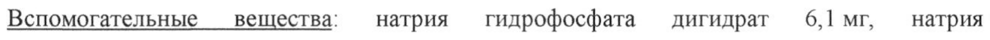
- стр. 3: «Объем распределения в равновесном состоянии (медиана 3,0-4,1 л) не зависел от дозы и» — низкая уверенность: «3,0-4,1» (33)  
  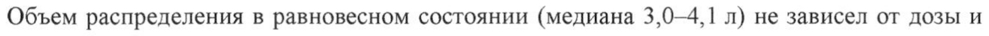
- стр. 3: «Повторное применение инфликсимаба (5 мг/кг на 0-й, 2-й и 6-й неделях у пациентов со» — низкая уверенность: «0-й,» (71)  
  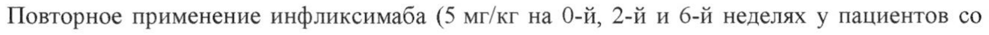
- стр. 3: «свищевой формой болезни Крона, а также 3 или 10 мг/кг каждые 4 или 8 недель у» — низкая уверенность: «10» (53)  
  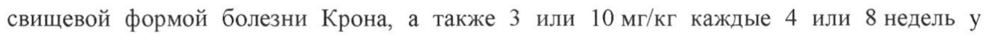
- стр. 6: «7% для беременных самок, эмбриотоксичности или тератогенности.» — низкая уверенность: «7%» (76); повторное чтение: «Фо 77я беременных самок, эмориотокоичности или тератогенности.»  
  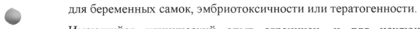
- стр. 7: «Препарат вводят внутривенно капельно в течение не менее 2 ч. Все пациенты должны» — низкая уверенность: «2» (71)  
  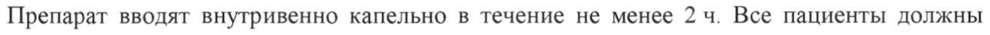
- стр. 8: «Первоначальная доза препарата Ремикейд® составляет 5 мг/кг внутривенно. Затем» — низкая уверенность: «5» (77)  
  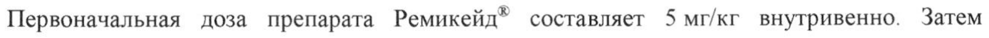
- стр. 10: «Первоначальная доза препарата Ремикейд® составляет 5 мг/кг внутривенно. Затем» — низкая уверенность: «5» (74)  
  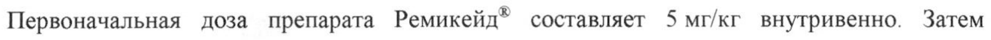
- стр. 10: «увеличение дозы до 10 мг/кг. Имеющиеся данные свидетельствуют о наступлении» — низкая уверенность: «10» (56)  
  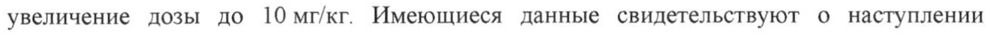
- стр. 10: «Первоначальная доза препарата Ремикейд” составляет 5 мг/кг внутривенно. Затем» — низкая уверенность: «5» (73)  
  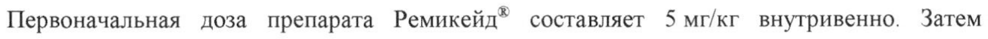
- стр. 10: «© Первоначальная доза препарата Ремикейд® составляет 5 мг/кг внутривенно. Затем» — низкая уверенность: «5» (62)  
  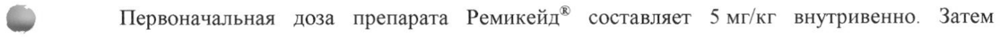
- стр. 12: «2) В условиях асептики растворите содержимое каждого флакона в 10 мл воды для» — низкая уверенность: «10» (63)  
  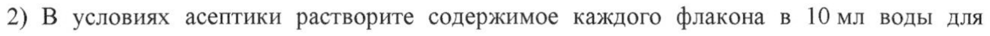
- стр. 12: «превышающих 250 мл, используют инфузионный мешок большего объема (например,» — низкая уверенность: «250» (64)  
  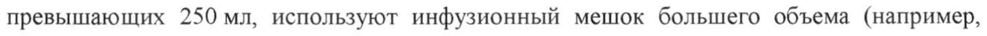
- стр. 20: «особенно при применении повышенной дозы 10 мг/кг (двукратное превышение» — низкая уверенность: «10» (70)  
  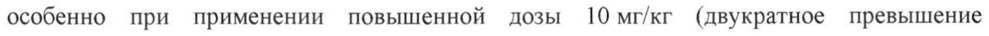
- стр. 34: «вещества в стеклянных флаконах вместимостью 20 мл типа I, закрытых резиновыми» — низкая уверенность: «20» (23)  
  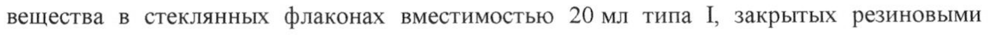
